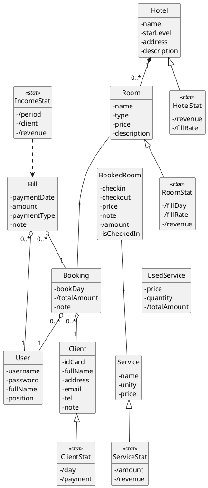

# Phân tích lớp thực thể — M00 Ví dụ: Quản lý khách sạn

<!-- Đây là case study của phương pháp, viết lại theo đúng mẫu ec-template.md để agent thấy hình dạng kết quả.
     Ví dụ không có tài liệu FR nên cột Nguồn ghi số câu (S1…) hoặc "CS" (lấy từ hình kết quả của case study).
     Với module thật của iShare, cột Nguồn phải ghi mã FR-/BR- hoặc "TN:<thuật ngữ>" (mục 2.1 của FR). -->

## 1. Mô tả chức năng

### 1.1 Đoạn mô tả

(S1) Hệ thống hỗ trợ quản lý thông tin về khách sạn, phòng của khách sạn và khách hàng đặt phòng tại khách sạn.
(S2) Hệ thống cho phép người quản lý khách sạn quản lý thông tin khách sạn và phòng, và xem các báo cáo thống kê:
thống kê phòng, thống kê khách sạn, thống kê khách hàng, thống kê dịch vụ và thống kê doanh thu.
(S3) Hệ thống cho phép quản trị viên quản lý tài khoản cho người dùng của hệ thống khi có yêu cầu.
(S4) Hệ thống cho phép nhân viên bán hàng tạo lượt đặt phòng và hủy lượt đặt phòng cho khách hàng ở xa qua điện thoại.
(S5) Hệ thống cho phép lễ tân tạo lượt đặt phòng, hủy lượt đặt phòng, làm thủ tục nhận phòng, trả phòng và xử lý
thanh toán cho khách hàng tại quầy lễ tân.
(S6) Mỗi khi một lần thanh toán được xử lý, hệ thống tạo một hóa đơn gồm thông tin về khách hàng, các phòng đã đặt và
các dịch vụ khách hàng đã dùng trong thời gian lưu trú.

### 1.2 Truy vết câu

| Câu | Nội dung tóm tắt | Nguồn |
|---|---|---|
| S1 | Phạm vi quản lý: khách sạn, phòng, khách hàng | CS |
| S2 | Người quản lý: quản lý khách sạn, phòng; xem 5 loại thống kê | CS |
| S3 | Quản trị viên: quản lý tài khoản người dùng | CS |
| S4 | Nhân viên bán hàng: đặt, hủy đặt phòng qua điện thoại | CS |
| S5 | Lễ tân: đặt, hủy, nhận phòng, trả phòng, thanh toán | CS |
| S6 | Thanh toán tạo hóa đơn gồm khách hàng, phòng đã đặt, dịch vụ đã dùng | CS |

## 2. Danh từ và phân loại

### 2.1 Sổ danh từ

| # | Danh từ | Xuất hiện ở | Phân loại | Kết quả | Lý do |
|---|---|---|---|---|---|
| 1 | hệ thống | S1 | Loại bỏ | — | Trừu tượng: chỉ chính phần mềm |
| 2 | thông tin | S1 | Loại bỏ | — | Chung chung: không chỉ một đối tượng cụ thể |
| 3 | khách sạn | S1 | Lớp | Hotel | Cần được quản lý (thêm, sửa, xem) |
| 4 | phòng | S1 | Lớp | Room | Cần được quản lý |
| 5 | khách hàng | S1 | Lớp | Client | Cần được quản lý |
| 6 | người quản lý | S2 | Lớp | User | Một loại người dùng của hệ thống; phân biệt bằng User.position |
| 7 | báo cáo thống kê | S2 | Loại bỏ | — | Chung chung: từng loại thống kê cụ thể xét ở dòng 8–12 |
| 8 | thống kê phòng | S2 | Lớp | RoomStat | Lớp thống kê: số liệu tính từ dữ liệu phòng |
| 9 | thống kê khách sạn | S2 | Lớp | HotelStat | Lớp thống kê |
| 10 | thống kê khách hàng | S2 | Lớp | ClientStat | Lớp thống kê |
| 11 | thống kê dịch vụ | S2 | Lớp | ServiceStat | Lớp thống kê |
| 12 | thống kê doanh thu | S2 | Lớp | IncomeStat | Lớp thống kê |
| 13 | quản trị viên | S3 | Lớp | User | Một loại người dùng |
| 14 | tài khoản / người dùng | S3 | Lớp | User | Cần được quản lý; "tài khoản" và "người dùng" chỉ cùng một đối tượng |
| 15 | yêu cầu | S3 | Loại bỏ | — | Chung chung: không phải dữ liệu hệ thống lưu |
| 16 | nhân viên bán hàng | S4 | Lớp | User | Một loại người dùng |
| 17 | lượt đặt phòng | S4 | Lớp | Booking | Hệ thống phải lưu từng lần đặt để hủy, nhận phòng, thanh toán |
| 18 | điện thoại | S4 | Loại bỏ | — | Ngoài phạm vi hệ thống: kênh liên lạc, hệ thống không lưu |
| 19 | lễ tân | S5 | Lớp | User | Một loại người dùng |
| 20 | lần thanh toán / hóa đơn | S5 | Lớp | Bill | Mỗi lần thanh toán được lưu thành một hóa đơn |
| 21 | quầy lễ tân | S5 | Loại bỏ | — | Ngoài phạm vi hệ thống: nơi chốn, hệ thống không lưu |
| 22 | phòng đã đặt | S6 | Lớp | BookedRoom | Một phòng trong một lượt đặt, có ngày nhận, ngày trả, giá riêng |
| 23 | dịch vụ | S6 | Lớp | Service | Cần được quản lý |
| 24 | thời gian lưu trú | S6 | Loại bỏ | — | Không lưu riêng: suy ra từ BookedRoom.checkin và BookedRoom.checkout |

### 2.2 Lớp

| Lớp | Tên tiếng Việt | Nhóm | Sở hữu | Mô tả | Nguồn |
|---|---|---|---|---|---|
| Hotel | Khách sạn | Thực thể | M00 | Khách sạn được quản lý trong hệ thống | S1, S2 |
| Room | Phòng | Thực thể | M00 | Phòng của một khách sạn | S1, S2 |
| Client | Khách hàng | Thực thể | M00 | Người đặt phòng | S1, S4, S5 |
| User | Người dùng | Thực thể | M00 | Tài khoản của người quản lý, quản trị viên, nhân viên bán hàng, lễ tân | S2, S3, S4, S5 |
| Booking | Lượt đặt phòng | Thực thể | M00 | Một lần khách hàng đặt một hoặc nhiều phòng | S4, S5 |
| BookedRoom | Phòng đã đặt | Liên kết | M00 | Một phòng trong một lượt đặt phòng | S6 |
| Bill | Hóa đơn | Thực thể | M00 | Kết quả của một lần thanh toán cho một lượt đặt phòng | S5, S6 |
| Service | Dịch vụ | Thực thể | M00 | Dịch vụ khách sạn cung cấp | S6 |
| UsedService | Dịch vụ đã dùng | Liên kết | M00 | Một dịch vụ được dùng trong một phòng đã đặt | S6 |
| HotelStat | Thống kê khách sạn | Thống kê | M00 | Số liệu thống kê theo khách sạn | S2 |
| RoomStat | Thống kê phòng | Thống kê | M00 | Số liệu thống kê theo phòng | S2 |
| ClientStat | Thống kê khách hàng | Thống kê | M00 | Số liệu thống kê theo khách hàng | S2 |
| ServiceStat | Thống kê dịch vụ | Thống kê | M00 | Số liệu thống kê theo dịch vụ | S2 |
| IncomeStat | Thống kê doanh thu | Thống kê | M00 | Doanh thu theo kỳ | S2 |

### 2.3 Thuộc tính

| Lớp | Thuộc tính | Tên tiếng Việt | Tính chất | Ràng buộc nguồn nêu | Nguồn |
|---|---|---|---|---|---|
| Hotel | name | Tên | Lưu | — | CS |
| Hotel | starLevel | Hạng sao | Lưu | — | CS |
| Hotel | address | Địa chỉ | Lưu | — | CS |
| Hotel | description | Mô tả | Lưu | Không bắt buộc | CS |
| Room | name | Tên phòng | Lưu | — | CS |
| Room | type | Loại phòng | Lưu | — | CS |
| Room | price | Giá niêm yết | Lưu | — | CS |
| Room | description | Mô tả | Lưu | Không bắt buộc | CS |
| Client | idCard | Số giấy tờ tùy thân | Lưu | — | CS |
| Client | fullName | Họ tên | Lưu | — | CS |
| Client | address | Địa chỉ | Lưu | — | CS |
| Client | email | Email | Lưu | Không bắt buộc | CS |
| Client | tel | Số điện thoại | Lưu | — | CS |
| Client | note | Ghi chú | Lưu | Không bắt buộc | CS |
| User | username | Tên đăng nhập | Lưu | — | CS |
| User | password | Mật khẩu | Lưu | — | CS |
| User | fullName | Họ tên | Lưu | — | CS |
| User | position | Vị trí | Lưu | Giá trị: người quản lý, quản trị viên, nhân viên bán hàng, lễ tân | S2, S3, S4, S5 |
| Booking | bookDay | Ngày đặt | Lưu | — | CS |
| Booking | totalAmount | Tổng tiền | Dẫn xuất | Tính từ các BookedRoom và UsedService của lượt đặt | CS |
| Booking | note | Ghi chú | Lưu | Không bắt buộc | CS |
| BookedRoom | checkin | Ngày nhận phòng | Lưu | — | S5 |
| BookedRoom | checkout | Ngày trả phòng | Lưu | — | S5 |
| BookedRoom | price | Giá lúc đặt | Lưu | Giá tại thời điểm đặt, có thể khác Room.price hiện tại | CS |
| BookedRoom | note | Ghi chú | Lưu | Không bắt buộc | CS |
| BookedRoom | amount | Thành tiền | Dẫn xuất | Tính từ price, checkin, checkout | CS |
| BookedRoom | isCheckedIn | Đã nhận phòng | Lưu | — | S5 |
| Bill | paymentDate | Ngày thanh toán | Lưu | — | S6 |
| Bill | amount | Số tiền | Lưu | — | CS |
| Bill | paymentType | Hình thức thanh toán | Lưu | — | CS |
| Bill | note | Ghi chú | Lưu | Không bắt buộc | CS |
| Service | name | Tên dịch vụ | Lưu | — | CS |
| Service | unity | Đơn vị tính | Lưu | — | CS |
| Service | price | Đơn giá niêm yết | Lưu | — | CS |
| UsedService | price | Đơn giá lúc dùng | Lưu | Giá tại thời điểm dùng | CS |
| UsedService | quantity | Số lượng | Lưu | — | CS |
| UsedService | totalAmount | Thành tiền | Dẫn xuất | quantity × price | CS |
| HotelStat | revenue | Doanh thu | Dẫn xuất | — | CS |
| HotelStat | fillRate | Tỷ lệ lấp đầy | Dẫn xuất | — | CS |
| RoomStat | fillDay | Số ngày có khách | Dẫn xuất | — | CS |
| RoomStat | fillRate | Tỷ lệ lấp đầy | Dẫn xuất | — | CS |
| RoomStat | revenue | Doanh thu | Dẫn xuất | — | CS |
| ClientStat | day | Số ngày lưu trú | Dẫn xuất | — | CS |
| ClientStat | payment | Tổng thanh toán | Dẫn xuất | — | CS |
| ServiceStat | amount | Số lượng đã bán | Dẫn xuất | — | CS |
| ServiceStat | revenue | Doanh thu | Dẫn xuất | — | CS |
| IncomeStat | period | Kỳ thống kê | Dẫn xuất | — | CS |
| IncomeStat | client | Số khách | Dẫn xuất | — | CS |
| IncomeStat | revenue | Doanh thu | Dẫn xuất | — | CS |

### 2.4 Đối chiếu với mục Dữ liệu nghiệp vụ của FR

Ví dụ không có tài liệu FR nên không có gì để đối chiếu.

| Thực thể trong FR | Trong mô hình | Xử lý |
|---|---|---|
| — | — | — |

## 3. Quan hệ giữa các lớp

### 3.1 Ma trận cặp lớp

Ô ghi: `T` = có quan hệ trực tiếp; `G(X)` = chỉ liên hệ gián tiếp qua lớp X; để trống = không liên quan.
Chỉ điền nửa trên. Lớp thống kê xét riêng ở cuối mục 3.2.

| | Room | Client | User | Booking | BookedRoom | Bill | Service | UsedService |
|---|---|---|---|---|---|---|---|---|
| Hotel | T | | | | | | | |
| Room | | G(Booking) | | G(BookedRoom) | T | | | |
| Client | | | | T | | G(Booking) | G(Booking) | |
| User | | | | T | | T | | |
| Booking | | | | | T | T | | |
| BookedRoom | | | | | | | G(UsedService) | T |
| Bill | | | | | | | | |
| Service | | | | | | | | T |

### 3.2 Quan hệ số lượng

| Cặp | Câu A → B | Câu B → A | Dạng | Xử lý |
|---|---|---|---|---|
| Hotel – Room | Một khách sạn có thể có nhiều phòng. | Một phòng chỉ thuộc một khách sạn. | 1-n | Giữ nguyên |
| Client – Room | Một khách hàng có thể đặt nhiều phòng. | Một phòng có thể được nhiều khách hàng đặt ở các thời điểm khác nhau. | n-n | Tách: thêm lớp Booking giữa hai lớp; xét tiếp Client – Booking và Booking – Room |
| Client – Booking | Một khách hàng có thể có nhiều lượt đặt phòng ở các thời điểm khác nhau. | Một lượt đặt phòng thuộc đúng một khách hàng. | 1-n | Giữ nguyên |
| Booking – Room | Một lượt đặt phòng có thể gồm nhiều phòng (khách đoàn). | Một phòng có thể nằm trong nhiều lượt đặt phòng ở các thời điểm khác nhau. | n-n | Tách: thêm lớp liên kết BookedRoom; một Booking và một Room xác định duy nhất một BookedRoom |
| Booking – BookedRoom | Một lượt đặt phòng gồm ít nhất một phòng đã đặt. | Một phòng đã đặt thuộc đúng một lượt đặt phòng. | 1-n | Giữ nguyên |
| Room – BookedRoom | Một phòng có thể ứng với nhiều phòng đã đặt ở các thời điểm khác nhau. | Một phòng đã đặt ứng với đúng một phòng. | 1-n | Giữ nguyên |
| Booking – Bill | Một lượt đặt phòng có thể được thanh toán nhiều lần, mỗi lần một hóa đơn. | Một hóa đơn thuộc đúng một lượt đặt phòng. | 1-n | Giữ nguyên |
| User – Bill | Một người dùng (lễ tân) có thể lập nhiều hóa đơn. | Một hóa đơn do đúng một người dùng lập. | 1-n | Giữ nguyên |
| User – Booking | Một người dùng (nhân viên bán hàng, lễ tân) có thể tạo nhiều lượt đặt phòng. | Một lượt đặt phòng do đúng một người dùng tạo. | 1-n | Giữ nguyên |
| BookedRoom – Service | Một phòng đã đặt có thể dùng nhiều dịch vụ. | Một dịch vụ có thể được dùng ở nhiều phòng đã đặt. | n-n | Tách: thêm lớp liên kết UsedService |
| BookedRoom – UsedService | Một phòng đã đặt có thể có nhiều dịch vụ đã dùng. | Một dịch vụ đã dùng thuộc đúng một phòng đã đặt. | 1-n | Giữ nguyên |
| Service – UsedService | Một dịch vụ có thể ứng với nhiều dịch vụ đã dùng. | Một dịch vụ đã dùng ứng với đúng một dịch vụ. | 1-n | Giữ nguyên |

Lớp thống kê không có quan hệ số lượng: HotelStat, RoomStat, ServiceStat, ClientStat dùng lại thuộc tính của lớp thực
thể tương ứng (kế thừa); IncomeStat không dùng lại thuộc tính của lớp nào, chỉ tính từ Bill (phụ thuộc).

### 3.3 Lớp liên kết

| Lớp liên kết | Tách từ quan hệ n-n | Thuộc tính riêng của liên kết | Nguồn |
|---|---|---|---|
| BookedRoom | Room – Booking | checkin, checkout, price, note, amount, isCheckedIn | S5, S6 |
| UsedService | BookedRoom – Service | price, quantity, totalAmount | S6 |

### 3.4 Quan hệ

| ID | Lớp A | Bội số A | Lớp B | Bội số B | Dạng | Loại | Bên chính | Căn cứ | Nguồn |
|---|---|---|---|---|---|---|---|---|---|
| R-M00-01 | Hotel | 1 | Room | 0..* | 1-n | Hợp thành | Hotel | Phòng không tồn tại ngoài khách sạn, thuộc đúng một khách sạn, bị xóa theo khách sạn | S1 |
| R-M00-02 | Client | 1 | Booking | 0..* | 1-n | Kết tập | Booking | Lượt đặt phòng chứa thông tin khách hàng; khách hàng tồn tại độc lập và dùng cho nhiều lượt đặt | S4, S5 |
| R-M00-03 | Booking | 1 | BookedRoom | 1..* | 1-n | Liên kết | — | Nửa thứ nhất của quan hệ n-n Room – Booking đã tách qua lớp liên kết BookedRoom | S6 |
| R-M00-04 | Room | 1 | BookedRoom | 0..* | 1-n | Liên kết | — | Nửa thứ hai của quan hệ n-n Room – Booking đã tách qua lớp liên kết BookedRoom | S6 |
| R-M00-05 | Booking | 1 | Bill | 0..* | 1-n | Kết tập | Bill | Hóa đơn chứa thông tin lượt đặt phòng; lượt đặt phòng tồn tại trước và độc lập với hóa đơn | S6 |
| R-M00-06 | User | 1 | Bill | 0..* | 1-n | Kết tập | Bill | Hóa đơn ghi người lập; người dùng tồn tại độc lập | S5 |
| R-M00-07 | User | 1 | Booking | 0..* | 1-n | Kết tập | Booking | Lượt đặt phòng ghi người tạo; người dùng tồn tại độc lập | S4, S5 |
| R-M00-08 | BookedRoom | 1 | UsedService | 0..* | 1-n | Liên kết | — | Nửa thứ nhất của quan hệ n-n BookedRoom – Service đã tách qua lớp liên kết UsedService | S6 |
| R-M00-09 | Service | 1 | UsedService | 0..* | 1-n | Liên kết | — | Nửa thứ hai của quan hệ n-n BookedRoom – Service đã tách qua lớp liên kết UsedService | S6 |
| R-M00-10 | Hotel | — | HotelStat | — | — | Kế thừa | Hotel | HotelStat dùng lại mọi thuộc tính của Hotel và thêm số liệu thống kê | S2 |
| R-M00-11 | Room | — | RoomStat | — | — | Kế thừa | Room | RoomStat dùng lại mọi thuộc tính của Room và thêm số liệu thống kê | S2 |
| R-M00-12 | Service | — | ServiceStat | — | — | Kế thừa | Service | ServiceStat dùng lại mọi thuộc tính của Service và thêm số liệu thống kê | S2 |
| R-M00-13 | Client | — | ClientStat | — | — | Kế thừa | Client | ClientStat dùng lại mọi thuộc tính của Client và thêm số liệu thống kê | S2 |
| R-M00-14 | IncomeStat | — | Bill | — | — | Phụ thuộc | Bill | IncomeStat không dùng lại thuộc tính của lớp nào; số liệu của nó chỉ tính từ Bill | S2 |

## 4. Sơ đồ lớp phân tích

<!-- BEGIN:PUML -->

<!-- END:PUML -->

## 5. Liên module

Ví dụ chỉ có một module nên không có lớp của module khác.

| Lớp | Module sở hữu | Module này dùng thế nào | Thuộc tính module này bổ sung |
|---|---|---|---|
| — | — | — | — |

## 6. Câu hỏi và điểm chưa chốt

| Mã | Loại | Câu hỏi | Trả lời | Ghi vào |
|---|---|---|---|---|
| Q-01 | Thiếu | Sơ đồ phân tích gốc của case study không vẽ quan hệ User – Booking, nhưng đoạn mô tả nói nhân viên bán hàng và lễ tân tạo lượt đặt phòng, và bước thiết kế của case study có "Booking has an User". Có ghi quan hệ này ở bước phân tích không? | Có: thêm R-M00-07. | EC-M00 mục 3.4 |

## 7. Lịch sử sửa đổi

| Phiên bản | Ngày | Nội dung | Người sửa |
|---|---|---|---|
| 1.0 | 2026-11-15 | Dựng từ case study quản lý khách sạn | (ví dụ) |
