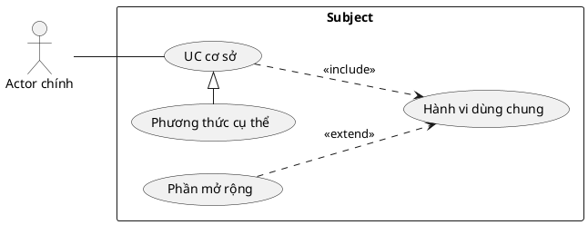

# Sơ đồ, ký pháp và render

[Vietnamese Doc]

Đọc ở bước 6. Mô hình hành vi/quan hệ đã thống nhất là nguồn cho các view.

## Ký pháp

- Actor ở ngoài boundary subject; UC trong boundary, package chỉ tổ chức nhóm.
- Association actor–UC dùng nét liền, thường không cần mũi tên.
- Include: nét đứt, mũi tên mở từ including → included, nhãn «include».
- Extend: nét đứt, mũi tên mở từ extension → base, nhãn «extend».
- Generalization: nét liền, **tam giác rỗng**, từ chuyên biệt → tổng quát;
  áp dụng cho UC–UC hoặc actor–actor, không actor–UC.
- UC abstract phải được đánh dấu phù hợp và có hợp đồng chung trong đặc tả.
- Không dùng mũi tên để diễn đạt thứ tự; dùng luồng văn bản/activity khi cần.

Node không có “loại include/extend” cố định: cùng UC có thể được nhiều quan hệ
sử dụng. Màu không thay thế ký pháp; ID của node là ID UC ổn định, không đặt theo
loại quan hệ hay UC cha.

## Chọn renderer

Ưu tiên PlantUML cho đầu ra UML chính thức. Ví dụ ký pháp (chỉ minh họa, không
phải mô hình tính năng iShare):



Không sao chép cả bốn quan hệ vào mọi UC. Sơ đồ thật chỉ chứa quan hệ đã được
chứng minh ở bước 4.
Trong ví dụ, Base là core, các UC còn lại là sub: Base include Shared là cạnh
chính–con; Extra extend Shared là cạnh con–con. Shared là sub của core nhưng
đồng thời là base của quan hệ extend. Đây là ví dụ ký pháp, không phải yêu cầu
iShare; trong mô hình thật phải có guard/extension point và luồng tương ứng.

Có thể dùng Mermaid native use case nếu runtime đã xác minh hỗ trợ
[usecase-beta](https://mermaid.js.org/syntax/usecase.html). Ghi phiên bản và
kiểm tra cú pháp thực tế, không suy từ hỗ trợ của một website khác. Flowchart
Mermaid chỉ là view minh họa: mũi tên thường có nhãn generalization không tạo
tam giác UML. Nếu dùng, ghi rõ giới hạn, không nghiệm thu là ký pháp UML chuẩn.

## View và tính nhất quán

- Overview dự án: chỉ UC chính (core) lấy từ module, actor và ownership; giữ
  ID/tên, link về module, không đưa sub lên sơ đồ tổng quan toàn hệ thống.
- Overview module: UC chính và actor của module, làm đầu vào ghép toàn hệ thống.
- Chi tiết module: **mỗi core có một sơ đồ riêng**, gồm node core, toàn bộ sub
  theo decomposition, actor và các quan hệ core–sub/sub–sub. Package có thể hỗ
  trợ bố cục nhưng không thay node core. Không cần mỗi sub một sơ đồ riêng.
- Trong mỗi view, lọc bảng relation theo các endpoint thuộc tập node xuất hiện
  và vẽ đủ các cạnh đó, kể cả sub–sub. Quan hệ tới UC dùng chung ngoài nhóm thì
  thêm node tham chiếu cùng ID; không đổi đích về core để đơn giản hóa hình.
- Decomposition xác định sub thuộc core nào; relation UML xác định mũi tên
  hành vi. Không vẽ kế thừa chỉ để biểu diễn hai tầng đầu ra.
- UC dùng chung giữ ID và định nghĩa; chỉ khai báo node một lần trong mỗi view.
  Lặp cùng ID ở **các sơ đồ khác nhau** là hợp lệ.
- Đối chiếu endpoints, chiều, nhãn, extension point với bảng quan hệ. Phát hiện
  cycle generalization/include để review; không biến điều hướng UI thành quan hệ.

## Định dạng bàn giao

- Mỗi sơ đồ/view chỉ bàn giao **một file `.svg`** trong thư mục sơ đồ của US.
  Tài liệu US nhúng/link SVG; cột artifact trỏ tới chính file này.
- Không tạo kèm `.png`, `.puml` hoặc `.mmd` trong thư mục đầu ra. File nguồn
  cần cho renderer nằm trong workspace agent; chỉ chuyển SVG đã kiểm tra
  sang vị trí bàn giao. Không thêm link tải file trung gian vào US.
- Ưu tiên kiểm tra hình SVG trực tiếp. Nếu công cụ kiểm tra cần ảnh raster,
  chỉ tạo ảnh tạm trong workspace agent, không bàn giao thêm bản PNG.

## Xác minh thực tế

1. Kiểm tra renderer có sẵn và phiên bản. Không tuyên bố đã render khi chỉ đọc mã.
2. Với PlantUML jar cục bộ được cài sẵn, dùng đường dẫn thực tế:

```text
java -jar <plantuml.jar> -version
java -jar <plantuml.jar> -checkonly <diagram.puml>
java -jar <plantuml.jar> -tsvg <diagram.puml>
```

   Chạy trong workspace agent: `<diagram.puml>` và SVG render tại đây là file
   làm việc. Sau kiểm tra, chỉ chuyển SVG tới thư mục sơ đồ của tài liệu.
3. Nếu dùng Mermaid CLI đã có, kiểm tra `mmdc --version`, render từng view
   bằng `mmdc -i <diagram.mmd> -o <diagram.svg>`.
4. Kiểm tra hình xuất: tiếng Việt/nhãn đủ đọc, boundary/actor đúng, đầu mũi tên,
   không cắt nội dung hoặc chồng lấp làm sai nghĩa.
5. Ghi lệnh, phiên bản, kết quả và vị trí hình vào bảng kiểm tra. Không có renderer:
   ghi “chưa kiểm tra render”, nêu phần còn thiếu; không đánh dấu Đã duyệt hoặc
   đạt QA ký pháp. Chỉ yêu cầu cài công cụ nếu thực sự cần để hoàn tất tác vụ và
   tuân theo quyền môi trường.

Tool check_us.py kiểm tra tham chiếu, không thực thi renderer hoặc chứng minh
sơ đồ khớp hoàn toàn bảng quan hệ. Kiểm tra này là một bước riêng.

Nguồn: [OMG UML](https://www.omg.org/spec/UML/2.5.1),
[IBM Generalization](https://www.ibm.com/docs/en/dma?topic=diagrams-generalization-relationships),
[PlantUML use case](https://plantuml.com/use-case-diagram).
