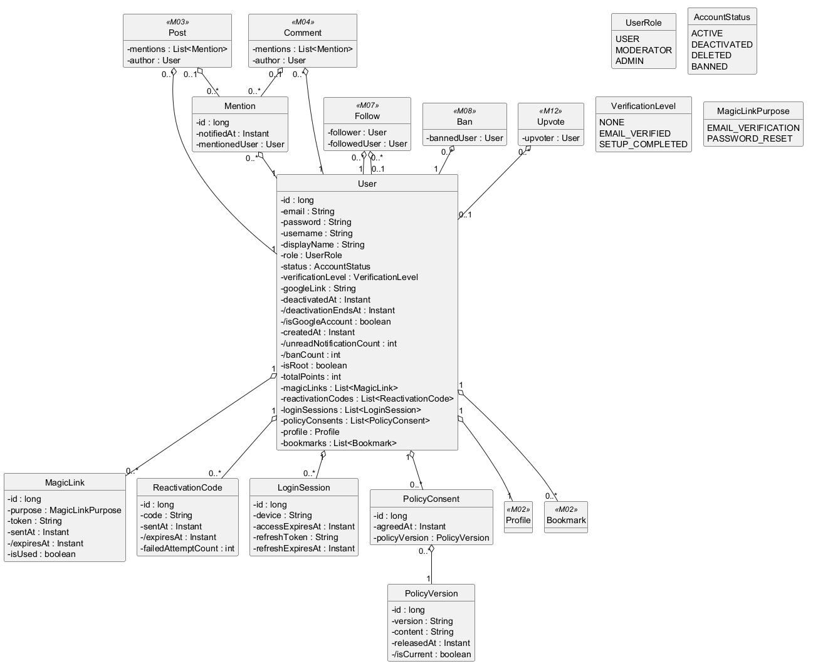

# Thiết kế lớp thực thể — M01 Authentication & Account

<!-- [Vietnamese Doc] Tài liệu tiếng Việt; tên lớp, thuộc tính, kiểu viết tiếng Anh. -->

| Mã tài liệu | CD-M01 |
|---|---|
| Dự án | iShare |
| Module | M01 — Authentication & Account |
| Đầu vào | EC-M01 phiên bản 1.1 |
| Trạng thái | Bản nháp |
| Phiên bản | 0.1 |
| Ngày | 2026-11-20 |
| Tác giả | Phạm Văn Đức |

<!-- Quy ước chung cho mọi bảng dưới đây:
     - Không đổi tên cột, không xóa cột, không đổi số mục: tool đọc bảng theo số mục và tên cột.
     - Ô không có nội dung ghi "—". Mục chưa tới bước làm thì để dòng "(Chưa làm — bước N)".
     - Tập lớp, thuộc tính, quan hệ và mã R-Mxx-nn giữ đúng như EC-Mxx.md.
     - Sơ đồ ở mục 5 do gen_puml.py sinh; không sửa tay.
     - Quy ước dùng (data-model/conventions.md): QU-02 id kiểu long; QU-04 bộ kiểu Java; QU-05 danh sách ghi List<X>. -->

## 1. Lớp và id

<!-- id: Có (lớp của module, không kế thừa) | Kế thừa (lớp con) | Không (lớp thống kê không kế thừa) | Ngoài (lớp của module khác). -->

| Lớp | Nhóm | Sở hữu | Lớp cha | id | Ghi chú |
|---|---|---|---|---|---|
| User | Thực thể | M01 | — | Có | — |
| MagicLink | Thực thể | M01 | — | Có | — |
| ReactivationCode | Thực thể | M01 | — | Có | — |
| LoginSession | Thực thể | M01 | — | Có | — |
| Mention | Thực thể | M01 | — | Có | — |
| PolicyVersion | Thực thể | M01 | — | Có | — |
| PolicyConsent | Liên kết | M01 | — | Có | — |
| Profile | Thực thể | M02 | — | Ngoài | Lớp của M02; id và thuộc tính thiết kế ở CD-M02 |
| Bookmark | Liên kết | M02 | — | Ngoài | Lớp của M02; id và thuộc tính thiết kế ở CD-M02 |
| Post | Thực thể | M03 | — | Ngoài | Lớp của M03; id và thuộc tính thiết kế ở CD-M03 |
| Comment | Thực thể | M04 | — | Ngoài | Lớp của M04; id và thuộc tính thiết kế ở CD-M04 |
| Follow | Thực thể | M07 | — | Ngoài | Lớp của M07; id và thuộc tính thiết kế ở CD-M07 |
| Ban | Thực thể | M08 | — | Ngoài | Lớp của M08; id và thuộc tính thiết kế ở CD-M08 |
| Upvote | Thực thể | M12 | — | Ngoài | Lớp của M12; id và thuộc tính thiết kế ở CD-M12 |

## 2. Thuộc tính và kiểu

### 2.1 Thuộc tính

<!-- Chỉ thuộc tính thường (kể cả id). Thuộc tính đối tượng ghi ở mục 4, không ghi ở đây.
     Bắt buộc: Có | Không. Tính chất: Khóa (chỉ id) | Lưu | Dẫn xuất.
     Căn cứ kiểu: mã FR-/BR- quyết định kiểu, hoặc mã quy ước QU-nn.
     Mọi thuộc tính kiểu Instant: lưu UTC, tính mốc và hiển thị theo giờ Việt Nam (DEC-127, QU-04); không nhắc lại ở từng dòng. -->

| Lớp | Thuộc tính | Kiểu | Bắt buộc | Ràng buộc | Tính chất | Căn cứ kiểu |
|---|---|---|---|---|---|---|
| User | id | long | Có | Duy nhất | Khóa | QU-02 |
| User | email | String | Không | Có ở mọi trạng thái trừ DELETED; duy nhất: mỗi email thuộc tối đa một tài khoản (BR-M01-04); xóa và giải phóng khi DELETED (BR-M01-21, BR-M01-47) | Lưu | BR-M01-04 |
| User | password | String | Không | 8–64 ký tự khi nhập, nhận mọi ký tự, không tự cắt khoảng trắng; mật khẩu mới khác mật khẩu hiện tại (BR-M01-35); không có ở tài khoản Google; xóa khi DELETED (BR-M01-47) | Lưu | BR-M01-35 |
| User | username | String | Không | Có từ bước 3; 3–20 ký tự a–z, A–Z, 0–9, "_"; duy nhất khi so không phân biệt hoa thường, kể cả tài khoản DELETED; lưu đúng hoa thường đã nhập (BR-M01-05); giữ khi DELETED (BR-M01-21) | Lưu | BR-M01-05 |
| User | displayName | String | Không | Có từ bước 3; sau khi bỏ khoảng trắng đầu, cuối dài 1–50 ký tự; chỉ chữ cái (kể cả có dấu), chữ số, khoảng trắng và . , - _ ' ( ); được trùng (BR-M01-06); xóa khi DELETED (BR-M01-47) | Lưu | BR-M01-06 |
| User | role | UserRole | Có | Mặc định USER khi tạo (BR-M01-01); đổi ở M10 | Lưu | BR-M01-01 |
| User | status | AccountStatus | Có | Mặc định ACTIVE; DELETED là trạng thái kết thúc (FR-M01-12.04) | Lưu | FR-M01-12.04 |
| User | verificationLevel | VerificationLevel | Có | Bắt đầu NONE khi đăng ký email, EMAIL_VERIFIED khi tạo bằng Google; không đi ngược (BR-M01-02, BR-M01-08) | Lưu | BR-M01-02 |
| User | googleLink | String | Không | Mã định danh tài khoản Google (giá trị `sub` Google trả về khi đăng nhập, tối đa 255 ký tự, không đổi khi người dùng đổi email Google); duy nhất; lần đầu khớp tài khoản email theo email rồi ghi mã này (FR-M01-04.04), các lần sau khớp theo mã; chỉ có ở tài khoản Google và tài khoản email đã liên kết Google; xóa khi DELETED (BR-M01-47) | Lưu | DD-M01-01 |
| User | deactivatedAt | Instant | Không | Chỉ có khi DEACTIVATED | Lưu | QU-04 |
| User | deactivationEndsAt | Instant | Không | = deactivatedAt + 14 × 24 giờ (BR-M01-21); chỉ có khi DEACTIVATED | Dẫn xuất | BR-M01-21 |
| User | isGoogleAccount | boolean | Có | Đúng khi tài khoản không có password (TN:Tài khoản Google) | Dẫn xuất | QU-04 |
| User | createdAt | Instant | Có | — | Lưu | QU-04 |
| User | unreadNotificationCount | int | Có | ≥ 0; số Notification đang Chưa đọc, không tính tin nhắn (FR-M07-05.10, BR-M07-12) | Dẫn xuất | QU-04 |
| User | banCount | int | Có | ≥ 0; số ban từng có hiệu lực, kể cả gỡ sớm và vĩnh viễn, trừ ban Bị lật (BR-M08-34) | Dẫn xuất | QU-04 |
| User | isRoot | boolean | Có | Đúng ở đúng một tài khoản ADMIN tạo sẵn khi khởi tạo hệ thống (BR-M10-10) | Lưu | BR-M10-10 |
| User | totalPoints | int | Có | ≥ 0; = 2 × upvote có hiệu lực trên bài viết + 1 × upvote có hiệu lực trên bình luận, chỉ nội dung chưa bị trừ điểm (BR-M12-05); không giảm theo thời gian, không chỉnh tay (BR-M12-06); cộng lại điểm đã trừ khi khiếu nại bài bị gỡ được chấp nhận (BR-M12-10) | Lưu | BR-M12-05 |
| MagicLink | id | long | Có | Duy nhất | Khóa | QU-02 |
| MagicLink | purpose | MagicLinkPurpose | Có | Với mỗi tài khoản chỉ link mới nhất cùng loại còn hiệu lực (BR-M01-38) | Lưu | BR-M01-38 |
| MagicLink | token | String | Có | — | Lưu | QU-04 |
| MagicLink | sentAt | Instant | Có | Hai lần gửi link xác minh cách nhau ít nhất 60 giây (BR-M01-11) | Lưu | QU-04 |
| MagicLink | expiresAt | Instant | Có | = sentAt + 1 giờ với link xác minh email (BR-M01-10); = sentAt + 15 phút với link đặt lại mật khẩu (BR-M01-12) | Dẫn xuất | BR-M01-10, BR-M01-12 |
| MagicLink | isUsed | boolean | Có | Mỗi link chỉ dùng được một lần (BR-M01-38) | Lưu | BR-M01-38 |
| ReactivationCode | id | long | Có | Duy nhất | Khóa | QU-02 |
| ReactivationCode | code | String | Có | Đúng 6 chữ số, giữ cả số 0 đầu (BR-M01-22) | Lưu | BR-M01-22 |
| ReactivationCode | sentAt | Instant | Có | Hai lần gửi cách nhau ít nhất 60 giây (BR-M01-22) | Lưu | QU-04 |
| ReactivationCode | expiresAt | Instant | Có | = sentAt + 15 phút (BR-M01-22) | Dẫn xuất | BR-M01-22 |
| ReactivationCode | failedAttemptCount | int | Có | 0–5; tới lần sai thứ 5 mã mất hiệu lực (BR-M01-22) | Lưu | BR-M01-22 |
| LoginSession | id | long | Có | Duy nhất | Khóa | QU-02 |
| LoginSession | device | String | Có | Mỗi thiết bị một phiên đăng nhập riêng (BR-M01-17) | Lưu | QU-04 |
| LoginSession | accessExpiresAt | Instant | Có | 1 giờ từ lúc cấp phiên truy cập (BR-M01-16) | Lưu | BR-M01-16 |
| LoginSession | refreshToken | String | Có | — | Lưu | QU-04 |
| LoginSession | refreshExpiresAt | Instant | Có | 30 ngày từ lúc cấp phiên làm mới (BR-M01-16) | Lưu | BR-M01-16 |
| Mention | id | long | Có | Duy nhất | Khóa | QU-02 |
| Mention | notifiedAt | Instant | Không | — | Lưu | QU-04 |
| PolicyVersion | id | long | Có | Duy nhất | Khóa | QU-02 |
| PolicyVersion | version | String | Có | — | Lưu | QU-04 |
| PolicyVersion | content | String | Có | Gồm các mục của BR-M01-42, dữ liệu trình bày theo bốn nhóm của BR-M01-43; chỉ đổi qua triển khai bản mới (FR-M01-15.09) | Lưu | QU-04 |
| PolicyVersion | releasedAt | Instant | Có | — | Lưu | QU-04 |
| PolicyVersion | isCurrent | boolean | Có | Đúng ở phiên bản có releasedAt muộn nhất (BR-M01-44) | Dẫn xuất | BR-M01-44 |
| PolicyConsent | id | long | Có | Duy nhất | Khóa | QU-02 |
| PolicyConsent | agreedAt | Instant | Có | Mỗi lần đồng ý là một bản ghi mới (BR-M01-44); xóa khi DELETED (BR-M01-47) | Lưu | QU-04 |

### 2.2 Kiểu liệt kê

<!-- Giá trị viết HOA_GẠCH_DƯỚI, ngăn bởi dấu phẩy. Nguồn: bảng chuyển trạng thái hoặc quy tắc của FR. -->

| Kiểu | Giá trị | Dùng ở | Nguồn |
|---|---|---|---|
| UserRole | USER, MODERATOR, ADMIN | User.role | BR-M01-01; tên giá trị theo MD-02 (EC-SYS) |
| AccountStatus | ACTIVE, DEACTIVATED, DELETED, BANNED | User.status | TN:Trạng thái tài khoản; FR-M01-12.04 |
| VerificationLevel | NONE, EMAIL_VERIFIED, SETUP_COMPLETED | User.verificationLevel | TN:Mức xác minh; BR-M01-02, BR-M01-08 |
| MagicLinkPurpose | EMAIL_VERIFICATION, PASSWORD_RESET | MagicLink.purpose | Mục Dữ liệu nghiệp vụ của FR-M01 (hai loại magic link); EC-M01 Q-01; BR-M01-38 |

## 3. Chuyển quan hệ

### 3.1 Quan hệ thành phần – toàn thể

<!-- ID: đúng mã của EC. Bội số thành phần = số thành phần ứng với một toàn thể; Bội số toàn thể = số toàn thể ứng với một thành phần.
     Dạng đọc theo thứ tự thành phần–toàn thể: n-1 | 1-n | 1-1. Loại: Hợp thành | Kết tập. -->

| ID | Thành phần | Toàn thể | Bội số thành phần | Bội số toàn thể | Dạng | Loại | Loại ở phân tích | Căn cứ |
|---|---|---|---|---|---|---|---|---|
| R-M01-01 | MagicLink | User | 0..* | 1 | n-1 | Kết tập | Kết tập | Giữ nguyên từ phân tích |
| R-M01-02 | ReactivationCode | User | 0..* | 1 | n-1 | Kết tập | Kết tập | Giữ nguyên từ phân tích |
| R-M01-03 | LoginSession | User | 0..* | 1 | n-1 | Kết tập | Kết tập | Giữ nguyên từ phân tích |
| R-M01-04 | PolicyConsent | User | 0..* | 1 | n-1 | Kết tập | Liên kết | User + PolicyVersion → PolicyConsent: bản ghi đồng ý được tạo trong lúc tài khoản đăng ký hoặc đồng ý lại (FR-M01-01.14, FR-M01-04.13, FR-M01-16.02) và bị xóa theo tài khoản khi DELETED (FR-M01-12.08), nên User là lớp chứa. Kết tập vì tài khoản không bị xóa hẳn (FR-M01-12.03) |
| R-M01-05 | PolicyVersion | PolicyConsent | 1 | 0..* | 1-n | Kết tập | Liên kết | User + PolicyVersion → PolicyConsent: phiên bản chính sách có sẵn từ trước (đội phát triển triển khai, FR-M01-15.09) và được nhiều bản ghi đồng ý tham chiếu, nên là lớp danh mục |
| R-M01-06 | User | Mention | 1 | 0..* | 1-n | Kết tập | Kết tập | Giữ nguyên từ phân tích |
| R-M01-07 | Mention | Post | 0..* | 0..1 | n-1 | Kết tập | Kết tập | Giữ nguyên từ phân tích |
| R-M01-08 | Mention | Comment | 0..* | 0..1 | n-1 | Kết tập | Kết tập | Giữ nguyên từ phân tích |
| R-M01-09 | Profile | User | 1 | 1 | 1-1 | Kết tập | Kết tập | Giữ nguyên từ phân tích |
| R-M01-10 | Bookmark | User | 0..* | 1 | n-1 | Kết tập | Liên kết | User + Post → Bookmark (lớp liên kết của EC-M02, MD-07): bookmark được tạo khi người dùng lưu bài, xem qua tab Bookmark của người dùng (FR-M02-07.07) và bị xóa theo tài khoản khi DELETED (FR-M01-12.08), nên User là lớp chứa. Trùng R-M02-02, cùng cách chuyển |
| R-M01-11 | User | Post | 1 | 0..* | 1-n | Kết tập | Kết tập | Giữ nguyên từ phân tích |
| R-M01-12 | User | Comment | 1 | 0..* | 1-n | Kết tập | Kết tập | Giữ nguyên từ phân tích |
| R-M01-13 | User | Follow | 1 | 0..* | 1-n | Kết tập | Kết tập | Giữ nguyên từ phân tích |
| R-M01-14 | User | Follow | 0..1 | 0..* | 1-n | Kết tập | Kết tập | Giữ nguyên từ phân tích |
| R-M01-15 | User | Ban | 1 | 0..* | 1-n | Kết tập | Kết tập | Giữ nguyên từ phân tích |
| R-M01-16 | User | Upvote | 0..1 | 0..* | 1-n | Kết tập | Kết tập | Giữ nguyên từ phân tích |

### 3.2 Quan hệ giữ nguyên

<!-- Loại: Kế thừa (Lớp = lớp con, Lớp đích = lớp cha) | Phụ thuộc (Lớp = lớp phụ thuộc, Lớp đích = lớp được dùng). -->

| ID | Loại | Lớp | Lớp đích | Ghi chú |
|---|---|---|---|---|
| — | — | — | — | — |

## 4. Thuộc tính đối tượng

<!-- Mỗi dòng của mục 3.1 đúng một dòng ở đây. Lớp chứa = lớp toàn thể.
     Kiểu: ThànhPhần (dạng 1-n, 1-1) hoặc List<ThànhPhần> (dạng n-1, QU-05). -->

| Quan hệ | Lớp chứa | Thuộc tính | Kiểu | Quy tắc |
|---|---|---|---|---|
| R-M01-01 | User | magicLinks | List<MagicLink> | MagicLink là thành phần của User, dạng n-1 → User có danh sách MagicLink |
| R-M01-02 | User | reactivationCodes | List<ReactivationCode> | ReactivationCode là thành phần của User, dạng n-1 → User có danh sách ReactivationCode |
| R-M01-03 | User | loginSessions | List<LoginSession> | LoginSession là thành phần của User, dạng n-1 → User có danh sách LoginSession |
| R-M01-04 | User | policyConsents | List<PolicyConsent> | PolicyConsent là thành phần của User, dạng n-1 → User có danh sách PolicyConsent |
| R-M01-05 | PolicyConsent | policyVersion | PolicyVersion | PolicyVersion là thành phần của PolicyConsent, dạng 1-n → PolicyConsent có một PolicyVersion |
| R-M01-06 | Mention | mentionedUser | User | User là thành phần của Mention, dạng 1-n → Mention có một User (tên theo vai trò) |
| R-M01-07 | Post | mentions | List<Mention> | Mention là thành phần của Post, dạng n-1 → Post có danh sách Mention |
| R-M01-08 | Comment | mentions | List<Mention> | Mention là thành phần của Comment, dạng n-1 → Comment có danh sách Mention |
| R-M01-09 | User | profile | Profile | Profile là thành phần của User, dạng 1-1 → User có một Profile |
| R-M01-10 | User | bookmarks | List<Bookmark> | Bookmark là thành phần của User, dạng n-1 → User có danh sách Bookmark |
| R-M01-11 | Post | author | User | User là thành phần của Post, dạng 1-n → Post có một User (tên theo vai trò) |
| R-M01-12 | Comment | author | User | User là thành phần của Comment, dạng 1-n → Comment có một User (tên theo vai trò) |
| R-M01-13 | Follow | follower | User | User là thành phần của Follow, dạng 1-n → Follow có một User (tên theo vai trò) |
| R-M01-14 | Follow | followedUser | User | User là thành phần của Follow, dạng 1-n → Follow có một User (tên theo vai trò) |
| R-M01-15 | Ban | bannedUser | User | User là thành phần của Ban, dạng 1-n → Ban có một User (tên theo vai trò) |
| R-M01-16 | Upvote | upvoter | User | User là thành phần của Upvote, dạng 1-n → Upvote có một User (tên theo vai trò) |

## 5. Sơ đồ lớp thiết kế

<!-- BEGIN:DIAGRAM -->

Mã nguồn sơ đồ: [diagrams/CD-M01.puml](diagrams/CD-M01.puml). Ảnh và tệp .puml do `gen_puml.py` sinh từ các bảng của tài liệu này; muốn đổi sơ đồ thì sửa bảng rồi chạy lại tool, không sửa tay.
<!-- END:DIAGRAM -->

## 6. Liên module

<!-- Mỗi lớp ngoài một dòng. "Đề nghị cho module sở hữu": thuộc tính đối tượng mà module này cần thêm vào lớp đó, kèm mã quan hệ. -->

| Lớp | Module sở hữu | Module này dùng thế nào | Đề nghị cho module sở hữu |
|---|---|---|---|
| Profile | M02 | Ghi bio, gradeLevel, avatar ở bước 3 đăng ký; đọc avatar cho danh sách gợi ý nhắc tên; xóa các trường này khi tài khoản DELETED (R-M01-09) | — |
| Bookmark | M02 | Xóa bookmark của tài khoản khi tài khoản DELETED (R-M01-10) | — |
| Post | M03 | Ẩn bài của tác giả DEACTIVATED, DELETED (R-M01-11); bài chứa lượt nhắc tên (R-M01-07) | Thêm `mentions : List<Mention>` (R-M01-07); Thêm `author : User` (R-M01-11) |
| Comment | M04 | Hiển thị bình luận của tác giả DEACTIVATED, DELETED với tên thay thế (R-M01-12); bình luận chứa lượt nhắc tên (R-M01-08) | Thêm `mentions : List<Mention>` (R-M01-08); Thêm `author : User` (R-M01-12) |
| Follow | M07 | Đọc người đang theo dõi để xếp danh sách gợi ý nhắc tên; xóa lượt theo dõi của tài khoản và tới tài khoản khi DELETED (R-M01-13, R-M01-14) | Thêm `follower : User` (R-M01-13); Thêm `followedUser : User` (R-M01-14) |
| Ban | M08 | Đọc reason, endsAt, appealDeadline cho màn hình tài khoản bị khóa; đưa tài khoản về ACTIVE khi hết hạn ban (R-M01-15) | Thêm `bannedUser : User` (R-M01-15) |
| Upvote | M12 | Bỏ người cho khỏi upvote khi tài khoản DELETED, giữ upvote cho người nhận (R-M01-16) | Thêm `upvoter : User` (R-M01-16) |

## 7. Quyết định thiết kế

| Mã | Quyết định | Lý do |
|---|---|---|
| DD-M01-01 | User.googleLink kiểu String, lưu mã định danh `sub` của tài khoản Google | Trả lời Q-01: làm theo cách phổ biến. Google khuyên dùng `sub` làm khóa nhận diện người dùng vì email Google có thể đổi; nếu chỉ lưu boolean và khớp theo email thì người đổi email Google không vào lại được tài khoản đã liên kết |

## 8. Câu hỏi và điểm chưa chốt

| Mã | Loại | Câu hỏi | Trả lời | Ghi vào |
|---|---|---|---|---|
| Q-01 | Lựa chọn kiểu | User.googleLink nên lưu gì? (a) String: mã định danh tài khoản Google (Google cấp, không đổi khi người dùng đổi email Google) — đề xuất, vì đăng nhập Google về sau so được đúng tài khoản đã liên kết; (b) boolean: chỉ ghi đã liên kết hay chưa, đăng nhập Google khớp theo email. Hai cách khác nhau khi email Google của người dùng đổi. | (a) String lưu mã `sub` của Google, theo cách làm phổ biến (người dùng, 2026-11-20); DD-M01-01 | Mục 2.1 (User.googleLink); DD-M01-nn |
| Q-02 | Xác nhận | Tính bắt buộc suy ra (FR không nói) và kiểu chỉ theo quy ước, đề xuất: User.createdAt Có (M15 thống kê đăng ký theo thời gian); MagicLink.token Có; LoginSession.refreshToken Có; LoginSession.device kiểu String (chuỗi mô tả thiết bị); Mention.notifiedAt Không (chỉ có sau khi đã gửi thông báo); PolicyVersion.version kiểu String (nhãn phiên bản; 'mới hơn' xét theo releasedAt, BR-M01-44); PolicyVersion.releasedAt Có. Bạn đồng ý cả danh sách? | Đồng ý (người dùng, 2026-11-20) | Mục 2.1 |
| Q-03 | Xác nhận | Lớp chứa của lớp liên kết: PolicyConsent thuộc User (User có danh sách PolicyConsent, PolicyConsent có một PolicyVersion); Bookmark thuộc User (User có danh sách Bookmark) — thuộc tính User.bookmarks đặt ở M01 vì User là lớp của M01, trùng R-M02-02. Đồng ý? | Đồng ý (người dùng, 2026-11-20) | Mục 3.1, 4 |

## 9. Lịch sử sửa đổi

| Phiên bản | Ngày | Nội dung | Người sửa |
|---|---|---|---|
| 0.1 | 2026-11-20 | Tạo mới từ EC-M01 v1.1; làm liền bước 1–4 theo yêu cầu của người dùng (không dừng ở cổng); chưa qua duyệt, câu hỏi ở mục 8 chờ trả lời | Phạm Văn Đức |
| 0.2 | 2026-11-20 | Ghi trả lời mục 8: Q-01 googleLink kiểu String lưu mã `sub` (DD-M01-01), Q-02, Q-03 đồng ý; chờ chốt | Phạm Văn Đức |
| 1.0 | 2026-11-20 | Chốt: người dùng chốt CD-M01 | Phạm Văn Đức |
