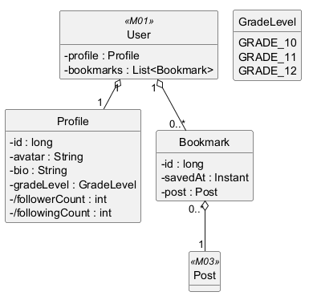

# Thiết kế lớp thực thể — M02 User Profile

<!-- [Vietnamese Doc] Tài liệu tiếng Việt; tên lớp, thuộc tính, kiểu viết tiếng Anh. -->

| Mã tài liệu | CD-M02 |
|---|---|
| Dự án | iShare |
| Module | M02 — User Profile |
| Đầu vào | EC-M02 phiên bản 1.1 |
| Trạng thái | Bản nháp |
| Phiên bản | 0.1 |
| Ngày | 2026-11-20 |
| Tác giả | Phạm Văn Đức |

<!-- Quy ước chung cho mọi bảng dưới đây:
     - Không đổi tên cột, không xóa cột, không đổi số mục: tool đọc bảng theo số mục và tên cột.
     - Ô không có nội dung ghi "—". Mục chưa tới bước làm thì để dòng "(Chưa làm — bước N)".
     - Tập lớp, thuộc tính, quan hệ và mã R-Mxx-nn giữ đúng như EC-Mxx.md.
     - Sơ đồ ở mục 5 do gen_puml.py sinh; không sửa tay.
     - Quy ước dùng (data-model/conventions.md): QU-02 id kiểu long; QU-04 bộ kiểu Java; QU-05 danh sách ghi List<X>. -->

## 1. Lớp và id

<!-- id: Có (lớp của module, không kế thừa) | Kế thừa (lớp con) | Không (lớp thống kê không kế thừa) | Ngoài (lớp của module khác). -->

| Lớp | Nhóm | Sở hữu | Lớp cha | id | Ghi chú |
|---|---|---|---|---|---|
| Profile | Thực thể | M02 | — | Có | — |
| Bookmark | Liên kết | M02 | — | Có | — |
| User | Thực thể | M01 | — | Ngoài | Lớp của M01; id và thuộc tính thiết kế ở CD-M01 |
| Post | Thực thể | M03 | — | Ngoài | Lớp của M03; id và thuộc tính thiết kế ở CD-M03 |

## 2. Thuộc tính và kiểu

### 2.1 Thuộc tính

<!-- Chỉ thuộc tính thường (kể cả id). Thuộc tính đối tượng ghi ở mục 4, không ghi ở đây.
     Bắt buộc: Có | Không. Tính chất: Khóa (chỉ id) | Lưu | Dẫn xuất.
     Căn cứ kiểu: mã FR-/BR- quyết định kiểu, hoặc mã quy ước QU-nn.
     Mọi thuộc tính kiểu Instant: lưu UTC, tính mốc và hiển thị theo giờ Việt Nam (DEC-127, QU-04); không nhắc lại ở từng dòng. -->

| Lớp | Thuộc tính | Kiểu | Bắt buộc | Ràng buộc | Tính chất | Căn cứ kiểu |
|---|---|---|---|---|---|---|
| Profile | id | long | Có | Duy nhất | Khóa | QU-02 |
| Profile | avatar | String | Không | Đường dẫn ảnh trên nơi lưu ảnh (Cloudinary, DEC-137); ảnh JPEG, PNG hoặc WebP, tối đa 5 MB, không nhận GIF động (BR-M02-06); lưu ảnh gốc, hiển thị cắt tròn (BR-M02-08); trống thì hiện avatar mặc định (BR-M02-32); đặt ảnh mới thì xóa ảnh cũ (BR-M02-07) | Lưu | BR-M02-06 |
| Profile | bio | String | Không | Tối đa 155 ký tự đếm sau khi cắt khoảng trắng đầu và cuối, mỗi emoji, mỗi lần xuống dòng là một ký tự; chỉ gồm khoảng trắng thì lưu là trống (BR-M02-04, BR-M02-33) | Lưu | BR-M02-04 |
| Profile | gradeLevel | GradeLevel | Không | Bỏ chọn được; chỉ đổi khi chủ hồ sơ tự sửa, không tự tăng theo năm học; độc lập với Lớp/Khối trên bài viết (BR-M02-09, BR-M02-10) | Lưu | BR-M02-09 |
| Profile | followerCount | int | Có | ≥ 0; không đếm người theo dõi có tài khoản DEACTIVATED hoặc BANNED (BR-M02-27) | Dẫn xuất | QU-04 |
| Profile | followingCount | int | Có | ≥ 0; chỉ lượt theo dõi người dùng, không gồm Topic; không đếm tài khoản DEACTIVATED hoặc BANNED (BR-M02-27) | Dẫn xuất | QU-04 |
| Bookmark | id | long | Có | Duy nhất | Khóa | QU-02 |
| Bookmark | savedAt | Instant | Có | Mỗi người dùng lưu một bài viết nhiều nhất một lần (BR-M02-22); tab Bookmark xếp mới nhất trước (BR-M02-31) | Lưu | QU-04 |

### 2.2 Kiểu liệt kê

<!-- Giá trị viết HOA_GẠCH_DƯỚI, ngăn bởi dấu phẩy. Nguồn: bảng chuyển trạng thái hoặc quy tắc của FR. -->

| Kiểu | Giá trị | Dùng ở | Nguồn |
|---|---|---|---|
| GradeLevel | GRADE_10, GRADE_11, GRADE_12 | Profile.gradeLevel | BR-M02-09 (một trong 10, 11, 12); cùng tập giá trị Lớp/Khối của bài viết (M03), bảng xếp hạng (M12) |

## 3. Chuyển quan hệ

### 3.1 Quan hệ thành phần – toàn thể

<!-- ID: đúng mã của EC. Bội số thành phần = số thành phần ứng với một toàn thể; Bội số toàn thể = số toàn thể ứng với một thành phần.
     Dạng đọc theo thứ tự thành phần–toàn thể: n-1 | 1-n | 1-1. Loại: Hợp thành | Kết tập. -->

| ID | Thành phần | Toàn thể | Bội số thành phần | Bội số toàn thể | Dạng | Loại | Loại ở phân tích | Căn cứ |
|---|---|---|---|---|---|---|---|---|
| R-M02-01 | Profile | User | 1 | 1 | 1-1 | Kết tập | Kết tập | Giữ nguyên từ phân tích |
| R-M02-02 | Bookmark | User | 0..* | 1 | n-1 | Kết tập | Liên kết | User + Post → Bookmark: bookmark được tạo khi người dùng lưu bài và được xem, bỏ lưu qua tab Bookmark của người dùng (FR-M02-05.01, FR-M02-07.07), nên User là lớp chứa. Kết tập vì tài khoản không bị xóa hẳn. Cùng cách chuyển với R-M01-10 (MD-07) |
| R-M02-03 | Post | Bookmark | 1 | 0..* | 1-n | Kết tập | Liên kết | User + Post → Bookmark: bài viết có sẵn từ trước và được nhiều bookmark tham chiếu, nên là lớp danh mục; bookmark bị xóa khi bài bị xóa hẳn (BR-M02-30) là hành vi xóa theo, không đổi bên chứa |

### 3.2 Quan hệ giữ nguyên

<!-- Loại: Kế thừa (Lớp = lớp con, Lớp đích = lớp cha) | Phụ thuộc (Lớp = lớp phụ thuộc, Lớp đích = lớp được dùng). -->

| ID | Loại | Lớp | Lớp đích | Ghi chú |
|---|---|---|---|---|
| — | — | — | — | — |

## 4. Thuộc tính đối tượng

<!-- Mỗi dòng của mục 3.1 đúng một dòng ở đây. Lớp chứa = lớp toàn thể.
     Kiểu: ThànhPhần (dạng 1-n, 1-1) hoặc List<ThànhPhần> (dạng n-1, QU-05). -->

| Quan hệ | Lớp chứa | Thuộc tính | Kiểu | Quy tắc |
|---|---|---|---|---|
| R-M02-01 | User | profile | Profile | Profile là thành phần của User, dạng 1-1 → User có một Profile |
| R-M02-02 | User | bookmarks | List<Bookmark> | Bookmark là thành phần của User, dạng n-1 → User có danh sách Bookmark |
| R-M02-03 | Bookmark | post | Post | Post là thành phần của Bookmark, dạng 1-n → Bookmark có một Post |

## 5. Sơ đồ lớp thiết kế

<!-- BEGIN:DIAGRAM -->

Mã nguồn sơ đồ: [diagrams/CD-M02.puml](diagrams/CD-M02.puml). Ảnh và tệp .puml do `gen_puml.py` sinh từ các bảng của tài liệu này; muốn đổi sơ đồ thì sửa bảng rồi chạy lại tool, không sửa tay.
<!-- END:DIAGRAM -->

## 6. Liên module

<!-- Mỗi lớp ngoài một dòng. "Đề nghị cho module sở hữu": thuộc tính đối tượng mà module này cần thêm vào lớp đó, kèm mã quan hệ. -->

| Lớp | Module sở hữu | Module này dùng thế nào | Đề nghị cho module sở hữu |
|---|---|---|---|
| User | M01 | Tài khoản có một hồ sơ (R-M02-01) và là người lưu của bookmark (R-M02-02); đọc username, displayName, createdAt, status để tìm và hiển thị hồ sơ, lọc và đếm danh sách theo dõi, chặn sửa hồ sơ khi không ACTIVE | Thêm `profile : Profile` (R-M02-01); Thêm `bookmarks : List<Bookmark>` (R-M02-02) |
| Post | M03 | Bài viết được lưu (R-M02-03), bookmark bị xóa khi bài bị xóa hẳn; đọc createdAt, publishState, modState, isAnonymous để chọn bài ở tab Bài viết và nhận ra bài đã lưu không xem được | — |

## 7. Quyết định thiết kế

| Mã | Quyết định | Lý do |
|---|---|---|
| — | — | — |

## 8. Câu hỏi và điểm chưa chốt

| Mã | Loại | Câu hỏi | Trả lời | Ghi vào |
|---|---|---|---|---|
| Q-01 | Xác nhận | Kiểu chọn theo quy ước, đề xuất: Profile.avatar kiểu String là đường dẫn ảnh trên Cloudinary (DEC-137), không lưu tệp ảnh trong lớp; Profile.gradeLevel là kiểu liệt kê GradeLevel (GRADE_10, GRADE_11, GRADE_12), dùng chung cho Lớp/Khối của bài viết (M03) và bảng xếp hạng (M12), thay vì số nguyên 10–12. Đồng ý? | Đồng ý (người dùng, 2026-11-20) | Mục 2.1, 2.2 |

## 9. Lịch sử sửa đổi

| Phiên bản | Ngày | Nội dung | Người sửa |
|---|---|---|---|
| 0.1 | 2026-11-20 | Tạo mới từ EC-M02 v1.1; làm liền bước 1–4 theo yêu cầu của người dùng (không dừng ở cổng); chưa qua duyệt, câu hỏi ở mục 8 chờ trả lời | Phạm Văn Đức |
| 0.2 | 2026-11-20 | Ghi trả lời mục 8: người dùng đồng ý các đề xuất; chờ chốt | Phạm Văn Đức |
| 1.0 | 2026-11-20 | Chốt: người dùng chốt CD-M02 | Phạm Văn Đức |
