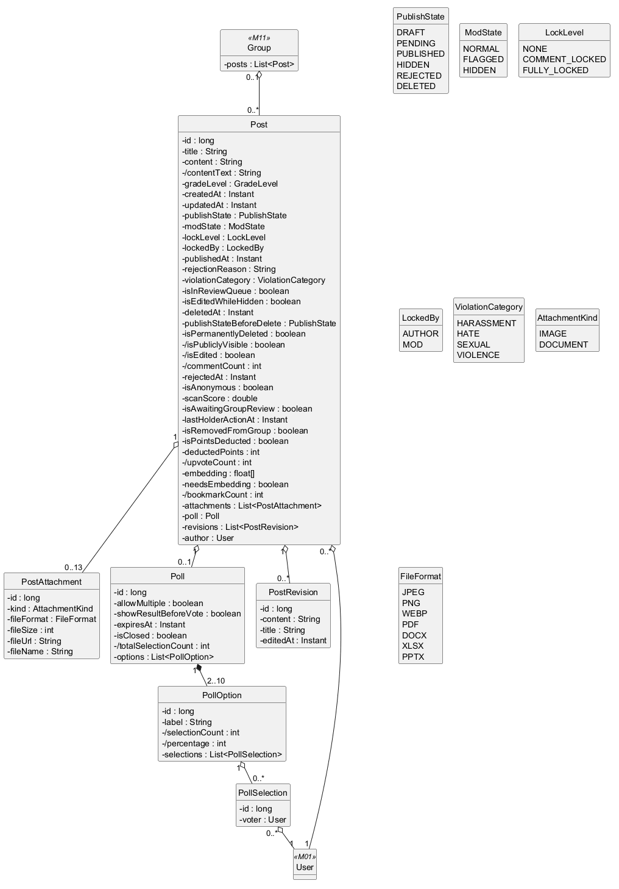

# Thiết kế lớp thực thể — M03 Post & Content

<!-- [Vietnamese Doc] Tài liệu tiếng Việt; tên lớp, thuộc tính, kiểu viết tiếng Anh. -->

| Mã tài liệu | CD-M03 |
|---|---|
| Dự án | iShare |
| Module | M03 — Post & Content |
| Đầu vào | EC-M03 phiên bản 1.1 |
| Trạng thái | Bản nháp |
| Phiên bản | 0.1 |
| Ngày | 2026-11-20 |
| Tác giả | Phạm Văn Đức |

<!-- Quy ước chung cho mọi bảng dưới đây:
     - Không đổi tên cột, không xóa cột, không đổi số mục: tool đọc bảng theo số mục và tên cột.
     - Ô không có nội dung ghi "—". Mục chưa tới bước làm thì để dòng "(Chưa làm — bước N)".
     - Tập lớp, thuộc tính, quan hệ và mã R-Mxx-nn giữ đúng như EC-Mxx.md.
     - Sơ đồ ở mục 5 do gen_puml.py sinh; không sửa tay.
     - Quy ước dùng (data-model/conventions.md): QU-02 id kiểu long; QU-04 bộ kiểu Java; QU-05 danh sách ghi List<X>. -->

## 1. Lớp và id

<!-- id: Có (lớp của module, không kế thừa) | Kế thừa (lớp con) | Không (lớp thống kê không kế thừa) | Ngoài (lớp của module khác). -->

| Lớp | Nhóm | Sở hữu | Lớp cha | id | Ghi chú |
|---|---|---|---|---|---|
| Post | Thực thể | M03 | — | Có | — |
| PostAttachment | Thực thể | M03 | — | Có | — |
| Poll | Thực thể | M03 | — | Có | — |
| PollOption | Thực thể | M03 | — | Có | — |
| PollSelection | Liên kết | M03 | — | Có | — |
| PostRevision | Thực thể | M03 | — | Có | — |
| User | Thực thể | M01 | — | Ngoài | Lớp của M01; id và thuộc tính thiết kế ở CD-M01 |
| Group | Thực thể | M11 | — | Ngoài | Lớp của M11; id và thuộc tính thiết kế ở CD-M11 |

## 2. Thuộc tính và kiểu

### 2.1 Thuộc tính

<!-- Chỉ thuộc tính thường (kể cả id). Thuộc tính đối tượng ghi ở mục 4, không ghi ở đây.
     Bắt buộc: Có | Không. Tính chất: Khóa (chỉ id) | Lưu | Dẫn xuất.
     Căn cứ kiểu: mã FR-/BR- quyết định kiểu, hoặc mã quy ước QU-nn.
     Mọi thuộc tính kiểu Instant: lưu UTC, tính mốc và hiển thị theo giờ Việt Nam (DEC-127, QU-04); không nhắc lại ở từng dòng. -->

| Lớp | Thuộc tính | Kiểu | Bắt buộc | Ràng buộc | Tính chất | Căn cứ kiểu |
|---|---|---|---|---|---|---|
| Post | id | long | Có | Duy nhất | Khóa | QU-02 |
| Post | title | String | Không | Tối đa 150 ký tự (BR-M03-42); bắt buộc khi gửi (BR-M03-40); bài nháp được thiếu nếu có phần khác (BR-M03-41) | Lưu | BR-M03-42 |
| Post | content | String | Không | Nội dung giàu định dạng dạng JSON của Tiptap (DEC-137) theo BR-M03-03; LaTeX dạng mã thô (BR-M03-05); không chứa ảnh (BR-M03-04); tối đa 6.000 từ đếm trên phần chữ người đọc thấy (BR-M03-42); khi gửi phải có nội dung hoặc poll (BR-M03-40) | Lưu | BR-M03-03 |
| Post | contentText | String | Không | Phần chữ người đọc thấy của content, không kèm định dạng; có khi content có | Dẫn xuất | QU-04 |
| Post | gradeLevel | GradeLevel | Không | Tùy chọn (BR-M03-06); độc lập với Profile.gradeLevel | Lưu | BR-M03-06 |
| Post | createdAt | Instant | Có | — | Lưu | QU-04 |
| Post | updatedAt | Instant | Có | — | Lưu | QU-04 |
| Post | publishState | PublishState | Có | Bài mới là DRAFT; chuyển theo mục Chuyển trạng thái của FR | Lưu | TN:Trạng thái đăng |
| Post | modState | ModState | Có | Bài mới là NORMAL (BR-M03-48); sang FLAGGED khi quét lại sau khi sửa cho điểm ≥ 0.5 (BR-M03-26) | Lưu | BR-M03-48 |
| Post | lockLevel | LockLevel | Có | Bài mới là NONE (FR-M03-01.09); chỉ Mod, Admin đặt FULLY_LOCKED (BR-M03-31) | Lưu | FR-M03-01.09 |
| Post | lockedBy | LockedBy | Không | Chỉ có khi lockLevel khác NONE; Admin khóa cũng ghi MOD (FR-M03-14.02); MOD thì tác giả không mở hay đổi mức khóa (BR-M03-32) | Lưu | TN:Mức khóa |
| Post | publishedAt | Instant | Không | Lúc bài chuyển sang PUBLISHED lần đầu; không đổi khi hiện lại sau Tự ẩn hay khôi phục (EC-M03 Q-02) | Lưu | QU-04 |
| Post | rejectionReason | String | Không | Bắt buộc khi Mod, Admin từ chối (FR-M03-06.04); tác giả xem được (FR-M03-06.05) | Lưu | QU-04 |
| Post | violationCategory | ViolationCategory | Không | Chỉ có khi AI tự từ chối bài vừa gửi (FR-M03-05.03); tác giả xem được (BR-M03-46) | Lưu | BR-M13-12 |
| Post | isInReviewQueue | boolean | Có | — | Lưu | QU-04 |
| Post | isEditedWhileHidden | boolean | Có | Đặt khi tác giả lưu bản sửa của bài Tự ẩn (FR-M03-05.14); khi hiện lại thì quét (FR-M03-05.05) | Lưu | QU-04 |
| Post | deletedAt | Instant | Không | Chỉ có khi bài DELETED; hạn khôi phục 7 × 24 giờ từ thời điểm này (BR-M03-35) | Lưu | QU-04 |
| Post | publishStateBeforeDelete | PublishState | Không | Chỉ có khi bài DELETED; một giá trị khác DELETED; khôi phục về giá trị này, riêng PENDING thì về DRAFT (BR-M03-35) | Lưu | BR-M03-35 |
| Post | isPermanentlyDeleted | boolean | Có | Gắn khi bài DELETED hết hạn khôi phục (BR-M03-37); chỉ là cờ, dữ liệu bài được giữ (FR-M03-17.02); không gỡ được | Lưu | QU-04 |
| Post | isPubliclyVisible | boolean | Có | publishState = PUBLISHED và modState = NORMAL; không phụ thuộc mức khóa (BR-M03-18) | Dẫn xuất | BR-M03-18 |
| Post | isEdited | boolean | Có | Đúng khi bài có ít nhất một PostRevision (BR-M03-27); Mod, Admin đổi Topic, Tag không tính (BR-M03-28) | Dẫn xuất | BR-M03-27 |
| Post | commentCount | int | Có | ≥ 0; số bình luận gốc và trả lời đang hiển thị, không tính dấu "[Bình luận đã bị xóa]" và bình luận bị ẩn (BR-M04-18) | Dẫn xuất | QU-04 |
| Post | rejectedAt | Instant | Không | Chỉ có khi bài bị từ chối; hạn khiếu nại khi không có cảnh cáo đi kèm = rejectedAt + 3 × 24 giờ (BR-M09-04) | Lưu | QU-04 |
| Post | isAnonymous | boolean | Có | Chỉ chọn được khi bài thuộc nhóm có công tắc ẩn danh bật (BR-M11-16); giữ nguyên khi công tắc tắt sau đó; danh tính thật luôn được giữ (BR-M11-17) | Lưu | QU-04 |
| Post | scanScore | double | Không | 0 đến 1, do M13 trả về (TN:Điểm quét); không có khi AI tắt, quét thất bại hoặc tác giả là Admin; cổng duyệt nhóm dùng ngưỡng 0.9 và 0.5 (BR-M11-18) | Lưu | BR-M11-18 |
| Post | isAwaitingGroupReview | boolean | Có | Đúng khi bài Chờ duyệt (chờ nhóm duyệt); sai khi đang quét hoặc đã ra khỏi hàng chờ của nhóm | Lưu | QU-04 |
| Post | lastHolderActionAt | Instant | Không | Có khi bài nhóm đang có người giữ; đặt lúc nhận bài và mỗi lần người giữ mở xem, chấp nhận, từ chối; 30 phút không thao tác thì nhả về hàng chờ (BR-M11-20) | Lưu | QU-04 |
| Post | isRemovedFromGroup | boolean | Có | Đặt khi Owner, Group Mod gỡ khỏi nhóm (xóa mềm); tác giả không tự bỏ được (BR-M11-30) | Lưu | QU-04 |
| Post | isPointsDeducted | boolean | Có | Sai = Đang tính điểm, đúng = Đã trừ điểm; về sai khi khiếu nại bài bị gỡ được chấp nhận (FR-M12-02.18) | Lưu | QU-04 |
| Post | deductedPoints | int | Không | ≥ 0; chỉ có khi đã trừ điểm; = điểm từ các upvote có hiệu lực tại thời điểm trừ (BR-M12-09); dùng để hoàn đúng số đó (BR-M12-10) | Lưu | BR-M12-09 |
| Post | upvoteCount | int | Có | ≥ 0; số upvote đang có hiệu lực (BR-M12-02) | Dẫn xuất | QU-04 |
| Post | embedding | float[] | Không | Vector biểu diễn tiêu đề và nội dung chữ, lưu bằng pgvector (DEC-137, text-embedding-3-small); chỉ có ở bài PUBLISHED, mỗi bài đúng một; tạo lại khi tiêu đề hoặc nội dung chữ đổi (BR-M13-17, BR-M13-18) | Lưu | QU-04 |
| Post | needsEmbedding | boolean | Có | Đúng khi bài PUBLISHED chưa có embedding theo nội dung hiện tại (công tắc tắt hoặc lời gọi thất bại); về sai khi đã tạo (BR-M13-26) | Lưu | BR-M13-26 |
| Post | bookmarkCount | int | Có | ≥ 0; bookmark đã bỏ không tính (BR-M14-10) | Dẫn xuất | QU-04 |
| PostAttachment | id | long | Có | Duy nhất | Khóa | QU-02 |
| PostAttachment | kind | AttachmentKind | Có | Mỗi bài tối đa 10 ảnh và 3 tài liệu, tính riêng (BR-M03-07, BR-M03-08) | Lưu | BR-M03-07, BR-M03-08 |
| PostAttachment | fileFormat | FileFormat | Có | Ảnh: JPEG, PNG, WEBP (BR-M03-07); tài liệu: PDF, DOCX, XLSX, PPTX (BR-M03-08) | Lưu | BR-M03-07, BR-M03-08 |
| PostAttachment | fileSize | int | Có | Đơn vị byte; ảnh tối đa 5 MB, tài liệu tối đa 20 MB (BR-M03-07, BR-M03-08) | Lưu | BR-M03-07, BR-M03-08 |
| PostAttachment | fileUrl | String | Có | — | Lưu | QU-04 |
| PostAttachment | fileName | String | Có | — | Lưu | QU-04 |
| Poll | id | long | Có | Duy nhất | Khóa | QU-02 |
| Poll | allowMultiple | boolean | Có | Mặc định đúng (chọn nhiều); không đổi được sau khi bài được gửi (BR-M03-11) | Lưu | BR-M03-11 |
| Poll | showResultBeforeVote | boolean | Có | Mặc định sai; không đổi được sau khi bài được gửi (BR-M03-11) | Lưu | BR-M03-11 |
| Poll | expiresAt | Instant | Có | Không trước thời điểm hiện tại khi đặt hoặc đổi (BR-M03-12); kết thúc ngay = đặt bằng thời điểm hiện tại (BR-M03-14) | Lưu | BR-M03-12 |
| Poll | isClosed | boolean | Có | Đóng khi đến hạn hoặc tác giả kết thúc ngay; không mở lại được (BR-M03-13, BR-M03-14) | Lưu | QU-04 |
| Poll | totalSelectionCount | int | Có | ≥ 0; số PollSelection của mọi lựa chọn trong poll (BR-M03-15) | Dẫn xuất | QU-04 |
| PollOption | id | long | Có | Duy nhất | Khóa | QU-02 |
| PollOption | label | String | Có | Do tác giả đặt; không sửa được sau khi bài được gửi (BR-M03-44) | Lưu | QU-04 |
| PollOption | selectionCount | int | Có | ≥ 0; số PollSelection của lựa chọn (BR-M03-15) | Dẫn xuất | QU-04 |
| PollOption | percentage | int | Có | 0–100; = selectionCount ÷ Poll.totalSelectionCount, làm tròn tới số nguyên (BR-M03-15) | Dẫn xuất | BR-M03-15 |
| PollSelection | id | long | Có | Duy nhất | Khóa | QU-02 |
| PostRevision | id | long | Có | Duy nhất | Khóa | QU-02 |
| PostRevision | content | String | Có | Nội dung bài ngay trước lần lưu bản sửa, cùng dạng với Post.content (BR-M03-27); không sửa được | Lưu | BR-M03-27 |
| PostRevision | title | String | Có | — | Lưu | QU-04 |
| PostRevision | editedAt | Instant | Có | — | Lưu | QU-04 |

### 2.2 Kiểu liệt kê

<!-- Giá trị viết HOA_GẠCH_DƯỚI, ngăn bởi dấu phẩy. Nguồn: bảng chuyển trạng thái hoặc quy tắc của FR. -->

Kiểu liệt kê dùng lại của module khác, không khai lại: GradeLevel (CD-M02) cho Post.gradeLevel. Tool báo WARN "chưa khai ở mục 2.2" cho thuộc tính dùng kiểu này và cho Post.embedding : float[] (QU-04); giữ lại.

| Kiểu | Giá trị | Dùng ở | Nguồn |
|---|---|---|---|
| PublishState | DRAFT, PENDING, PUBLISHED, HIDDEN, REJECTED, DELETED | Post.publishState, Post.publishStateBeforeDelete | TN:Trạng thái đăng (Nháp, Chờ duyệt, Đã đăng, Tự ẩn, Bị từ chối, Đã xóa); tên giá trị theo DEC-031 |
| ModState | NORMAL, FLAGGED, HIDDEN | Post.modState | TN:Trạng thái kiểm duyệt (Bình thường, Bị gắn cờ, Bị Mod ẩn); BR-M03-48; tên giá trị theo DEC-032 |
| LockLevel | NONE, COMMENT_LOCKED, FULLY_LOCKED | Post.lockLevel | TN:Mức khóa (Không khóa, Khóa bình luận, Khóa toàn bộ); tên giá trị theo DEC-033 |
| LockedBy | AUTHOR, MOD | Post.lockedBy | TN:Mức khóa (tác giả hoặc Mod); FR-M03-14.02; tên giá trị theo DEC-033 |
| ViolationCategory | HARASSMENT, HATE, SEXUAL, VIOLENCE | Post.violationCategory | BR-M13-12 (Quấy rối, Ngôn từ thù ghét, Nội dung người lớn, Bạo lực, theo thứ tự này); tên giá trị theo nhóm của OpenAI Moderation API (DEC-137) |
| AttachmentKind | IMAGE, DOCUMENT | PostAttachment.kind | BR-M03-07, BR-M03-08 (ảnh hoặc tài liệu) |
| FileFormat | JPEG, PNG, WEBP, PDF, DOCX, XLSX, PPTX | PostAttachment.fileFormat | BR-M03-07, BR-M03-08 |

## 3. Chuyển quan hệ

### 3.1 Quan hệ thành phần – toàn thể

<!-- ID: đúng mã của EC. Bội số thành phần = số thành phần ứng với một toàn thể; Bội số toàn thể = số toàn thể ứng với một thành phần.
     Dạng đọc theo thứ tự thành phần–toàn thể: n-1 | 1-n | 1-1. Loại: Hợp thành | Kết tập. -->

| ID | Thành phần | Toàn thể | Bội số thành phần | Bội số toàn thể | Dạng | Loại | Loại ở phân tích | Căn cứ |
|---|---|---|---|---|---|---|---|---|
| R-M03-01 | PostAttachment | Post | 0..13 | 1 | n-1 | Kết tập | Kết tập | Giữ nguyên từ phân tích |
| R-M03-02 | Poll | Post | 0..1 | 1 | 1-1 | Kết tập | Kết tập | Giữ nguyên từ phân tích |
| R-M03-03 | PollOption | Poll | 2..10 | 1 | n-1 | Hợp thành | Hợp thành | Giữ nguyên từ phân tích |
| R-M03-04 | PostRevision | Post | 0..* | 1 | n-1 | Kết tập | Kết tập | Giữ nguyên từ phân tích |
| R-M03-05 | User | Post | 1 | 0..* | 1-n | Kết tập | Kết tập | Giữ nguyên từ phân tích |
| R-M03-06 | Post | Group | 0..* | 0..1 | n-1 | Kết tập | Kết tập | Giữ nguyên từ phân tích |
| R-M03-07 | PollSelection | PollOption | 0..* | 1 | n-1 | Kết tập | Liên kết | PollOption + User → PollSelection: lượt chọn được tạo, đổi, bỏ trong lúc người dùng bình chọn trên poll của bài (FR-M03-08.01, FR-M03-08.04, FR-M03-08.05) và được đếm theo từng lựa chọn làm kết quả poll (BR-M03-15), nên PollOption là lớp chứa |
| R-M03-08 | User | PollSelection | 1 | 0..* | 1-n | Kết tập | Liên kết | PollOption + User → PollSelection: tài khoản có sẵn từ trước, tồn tại độc lập và được nhiều lượt chọn tham chiếu (người bình chọn), nên là lớp danh mục |

### 3.2 Quan hệ giữ nguyên

<!-- Loại: Kế thừa (Lớp = lớp con, Lớp đích = lớp cha) | Phụ thuộc (Lớp = lớp phụ thuộc, Lớp đích = lớp được dùng). -->

| ID | Loại | Lớp | Lớp đích | Ghi chú |
|---|---|---|---|---|
| — | — | — | — | — |

## 4. Thuộc tính đối tượng

<!-- Mỗi dòng của mục 3.1 đúng một dòng ở đây. Lớp chứa = lớp toàn thể.
     Kiểu: ThànhPhần (dạng 1-n, 1-1) hoặc List<ThànhPhần> (dạng n-1, QU-05). -->

| Quan hệ | Lớp chứa | Thuộc tính | Kiểu | Quy tắc |
|---|---|---|---|---|
| R-M03-01 | Post | attachments | List<PostAttachment> | PostAttachment là thành phần của Post, dạng n-1 → Post có danh sách PostAttachment |
| R-M03-02 | Post | poll | Poll | Poll là thành phần của Post, dạng 1-1 → Post có một Poll |
| R-M03-03 | Poll | options | List<PollOption> | PollOption là thành phần của Poll, dạng n-1 → Poll có danh sách PollOption |
| R-M03-04 | Post | revisions | List<PostRevision> | PostRevision là thành phần của Post, dạng n-1 → Post có danh sách PostRevision |
| R-M03-05 | Post | author | User | User là thành phần của Post, dạng 1-n → Post có một User (tên theo vai trò) |
| R-M03-06 | Group | posts | List<Post> | Post là thành phần của Group, dạng n-1 → Group có danh sách Post |
| R-M03-07 | PollOption | selections | List<PollSelection> | PollSelection là thành phần của PollOption, dạng n-1 → PollOption có danh sách PollSelection |
| R-M03-08 | PollSelection | voter | User | User là thành phần của PollSelection, dạng 1-n → PollSelection có một User (tên theo vai trò) |

## 5. Sơ đồ lớp thiết kế

<!-- BEGIN:DIAGRAM -->

Mã nguồn sơ đồ: [diagrams/CD-M03.puml](diagrams/CD-M03.puml). Ảnh và tệp .puml do `gen_puml.py` sinh từ các bảng của tài liệu này; muốn đổi sơ đồ thì sửa bảng rồi chạy lại tool, không sửa tay.
<!-- END:DIAGRAM -->

## 6. Liên module

<!-- Mỗi lớp ngoài một dòng. "Đề nghị cho module sở hữu": thuộc tính đối tượng mà module này cần thêm vào lớp đó, kèm mã quan hệ. -->

| Lớp | Module sở hữu | Module này dùng thế nào | Đề nghị cho module sở hữu |
|---|---|---|---|
| User | M01 | Ghi tác giả của bài viết (R-M03-05, cùng R-M01-11) và người bình chọn của lượt chọn (R-M03-08); người sửa của phiên bản sửa lấy qua tác giả của bài. Đọc role để cho Mod, Admin duyệt và khóa bài, không quét bài của Admin; đọc status để không hiển thị bài của tài khoản DEACTIVATED, DELETED | — |
| Group | M11 | Bài viết có thể thuộc một nhóm (R-M03-06): bài nhóm theo luồng duyệt của nhóm, bài trong nhóm Private chỉ thành viên xem. Đọc privacy. Tên lớp và thuộc tính tạm, chờ EC-M11. Dấu "bị gỡ khỏi nhóm" và cờ đăng ẩn danh trên Post do EC-M11 bổ sung (FR-M03 xếp hai việc này vào M11) | Thêm `posts : List<Post>` (R-M03-06) |

## 7. Quyết định thiết kế

| Mã | Quyết định | Lý do |
|---|---|---|
| — | — | — |

## 8. Câu hỏi và điểm chưa chốt

| Mã | Loại | Câu hỏi | Trả lời | Ghi vào |
|---|---|---|---|---|
| Q-01 | Xác nhận | Tính bắt buộc suy ra và kiểu theo quy ước, đề xuất: Post.updatedAt Có (khi tạo bằng createdAt); Post.isInReviewQueue Có (cờ, mặc định sai); PostAttachment.fileUrl, fileName Có; PostAttachment.fileSize kiểu int đơn vị byte; PostRevision.title Có (bài đã gửi luôn có tiêu đề, BR-M03-40); Post.content, PostRevision.content kiểu String chứa JSON của Tiptap (DEC-137); Post.embedding kiểu float[] (QU-04). Đồng ý? | Đồng ý (người dùng, 2026-11-20) | Mục 2.1 |
| Q-02 | Xác nhận | Tên giá trị kiểu liệt kê lấy theo register thay vì dịch từ thuật ngữ FR: PublishState dùng PENDING (Chờ duyệt) và HIDDEN (Tự ẩn) theo DEC-031; ModState dùng HIDDEN (Bị Mod ẩn) theo DEC-032; LockedBy dùng MOD theo DEC-033; ViolationCategory dùng HARASSMENT, HATE, SEXUAL, VIOLENCE theo nhóm của OpenAI Moderation API. Đồng ý? | Đồng ý (người dùng, 2026-11-20) | Mục 2.2 |
| Q-03 | Xác nhận | Lớp chứa của PollSelection là PollOption (PollOption có danh sách selections, PollSelection có một voter : User), vì lượt chọn được tạo khi bình chọn trên poll và được đếm theo lựa chọn. Phương án khác: User chứa danh sách lượt chọn của mình (khó lấy kết quả poll hơn). Đồng ý? | Đồng ý (người dùng, 2026-11-20) | Mục 3.1, 4 |

## 9. Lịch sử sửa đổi

| Phiên bản | Ngày | Nội dung | Người sửa |
|---|---|---|---|
| 0.1 | 2026-11-20 | Tạo mới từ EC-M03 v1.1; làm liền bước 1–4 theo yêu cầu của người dùng (không dừng ở cổng); chưa qua duyệt, câu hỏi ở mục 8 chờ trả lời | Phạm Văn Đức |
| 0.2 | 2026-11-20 | Ghi trả lời mục 8: người dùng đồng ý các đề xuất; chờ chốt | Phạm Văn Đức |
| 1.0 | 2026-11-20 | Chốt: người dùng chốt CD-M03 | Phạm Văn Đức |
