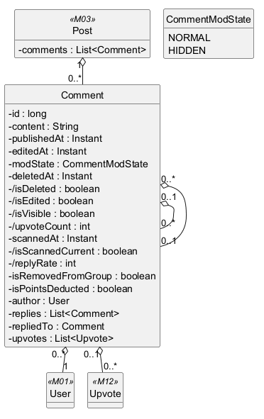

# Thiết kế lớp thực thể — M04 Comment

<!-- [Vietnamese Doc] Tài liệu tiếng Việt; tên lớp, thuộc tính, kiểu viết tiếng Anh. -->

| Mã tài liệu | CD-M04 |
|---|---|
| Dự án | iShare |
| Module | M04 — Comment |
| Đầu vào | EC-M04 phiên bản 1.1 |
| Trạng thái | Bản nháp |
| Phiên bản | 0.1 |
| Ngày | 2026-11-20 |
| Tác giả | Phạm Văn Đức |

<!-- Quy ước chung cho mọi bảng dưới đây:
     - Không đổi tên cột, không xóa cột, không đổi số mục: tool đọc bảng theo số mục và tên cột.
     - Ô không có nội dung ghi "—". Mục chưa tới bước làm thì để dòng "(Chưa làm — bước N)".
     - Tập lớp, thuộc tính, quan hệ và mã R-Mxx-nn giữ đúng như EC-Mxx.md.
     - Sơ đồ ở mục 5 do gen_puml.py sinh; không sửa tay.
     - Quy ước dùng (data-model/conventions.md): QU-02 id kiểu long; QU-04 bộ kiểu Java; QU-05 danh sách ghi List<X>. -->

## 1. Lớp và id

<!-- id: Có (lớp của module, không kế thừa) | Kế thừa (lớp con) | Không (lớp thống kê không kế thừa) | Ngoài (lớp của module khác). -->

| Lớp | Nhóm | Sở hữu | Lớp cha | id | Ghi chú |
|---|---|---|---|---|---|
| Comment | Thực thể | M04 | — | Có | — |
| Post | Thực thể | M03 | — | Ngoài | Lớp của M03; id và thuộc tính thiết kế ở CD-M03 |
| User | Thực thể | M01 | — | Ngoài | Lớp của M01; id và thuộc tính thiết kế ở CD-M01 |
| Upvote | Thực thể | M12 | — | Ngoài | Lớp của M12; id và thuộc tính thiết kế ở CD-M12 |

## 2. Thuộc tính và kiểu

### 2.1 Thuộc tính

<!-- Chỉ thuộc tính thường (kể cả id). Thuộc tính đối tượng ghi ở mục 4, không ghi ở đây.
     Bắt buộc: Có | Không. Tính chất: Khóa (chỉ id) | Lưu | Dẫn xuất.
     Căn cứ kiểu: mã FR-/BR- quyết định kiểu, hoặc mã quy ước QU-nn.
     Mọi thuộc tính kiểu Instant: lưu UTC, tính mốc và hiển thị theo giờ Việt Nam (DEC-127, QU-04); không nhắc lại ở từng dòng. -->

| Lớp | Thuộc tính | Kiểu | Bắt buộc | Ràng buộc | Tính chất | Căn cứ kiểu |
|---|---|---|---|---|---|---|
| Comment | id | long | Có | Duy nhất | Khóa | QU-02 |
| Comment | content | String | Có | Không trống, không chỉ khoảng trắng; tối đa 1.000 từ đếm trên phần chữ người đọc thấy, khối trích dẫn tự gõ có tính, dòng trích dẫn khi trả lời không tính (BR-M04-19); chỉ in đậm, in nghiêng, code trong dòng, LaTeX, liên kết, nhắc tên, trích dẫn (BR-M04-01); không tệp đính kèm (BR-M04-02); dạng JSON của Tiptap như Post.content (DEC-137); giữ khi bình luận bị xóa (BR-M04-21) | Lưu | BR-M04-19 |
| Comment | publishedAt | Instant | Có | Lúc hệ thống ghi nhận bình luận được gửi; không đổi khi sửa (FR-M04-04.03) | Lưu | QU-04 |
| Comment | editedAt | Instant | Không | Chỉ có khi đã sửa; lần sửa gần nhất thay lần trước (FR-M04-04.02) | Lưu | QU-04 |
| Comment | modState | CommentModState | Có | Bình luận mới là NORMAL (FR-M04-02.02, FR-M04-03.04); không đổi khi sửa (FR-M04-04.03); M08 đổi | Lưu | TN:Trạng thái kiểm duyệt của bình luận |
| Comment | deletedAt | Instant | Không | Chỉ có khi tác giả đã xóa; không xóa lại, không khôi phục (FR-M04-05.04, FR-M04-05.06) | Lưu | QU-04 |
| Comment | isDeleted | boolean | Có | Đúng khi deletedAt có giá trị (FR-M04-05.01) | Dẫn xuất | QU-04 |
| Comment | isEdited | boolean | Có | Đúng khi editedAt có giá trị (BR-M04-07) | Dẫn xuất | QU-04 |
| Comment | isVisible | boolean | Có | Đúng khi chưa bị xóa và modState = NORMAL (TN:Bình luận hiển thị bình thường) | Dẫn xuất | QU-04 |
| Comment | upvoteCount | int | Có | ≥ 0; số người đang upvote, upvote đã rút không tính (TN:Số upvote của bình luận) | Dẫn xuất | QU-04 |
| Comment | scannedAt | Instant | Không | — | Lưu | QU-04 |
| Comment | isScannedCurrent | boolean | Có | Đúng khi có scannedAt và scannedAt không sớm hơn editedAt (TN:Đã quét với nội dung hiện tại, BR-M08-21) | Dẫn xuất | QU-04 |
| Comment | replyRate | int | Không | ≥ 0; chỉ có ở bình luận gốc: số trả lời của luồng đăng trong khoảng thời gian trượt (BR-M08-20); ngưỡng tạm 10 trả lời trong 5 phút (TBD-M08-04) | Dẫn xuất | BR-M08-20 |
| Comment | isRemovedFromGroup | boolean | Có | Như Post.isRemovedFromGroup (BR-M11-30) | Lưu | QU-04 |
| Comment | isPointsDeducted | boolean | Có | Sai = Đang tính điểm, đúng = Đã trừ điểm; với bình luận Đã trừ điểm là trạng thái cuối | Lưu | QU-04 |

### 2.2 Kiểu liệt kê

<!-- Giá trị viết HOA_GẠCH_DƯỚI, ngăn bởi dấu phẩy. Nguồn: bảng chuyển trạng thái hoặc quy tắc của FR. -->

Không khai lại kiểu liệt kê đã có ở module khác.

| Kiểu | Giá trị | Dùng ở | Nguồn |
|---|---|---|---|
| CommentModState | NORMAL, HIDDEN | Comment.modState | TN:Trạng thái kiểm duyệt của bình luận (Bình thường, Bị ẩn); khác tập giá trị ModState của bài viết (không có Bị gắn cờ) nên khai kiểu riêng |

## 3. Chuyển quan hệ

### 3.1 Quan hệ thành phần – toàn thể

<!-- ID: đúng mã của EC. Bội số thành phần = số thành phần ứng với một toàn thể; Bội số toàn thể = số toàn thể ứng với một thành phần.
     Dạng đọc theo thứ tự thành phần–toàn thể: n-1 | 1-n | 1-1. Loại: Hợp thành | Kết tập. -->

| ID | Thành phần | Toàn thể | Bội số thành phần | Bội số toàn thể | Dạng | Loại | Loại ở phân tích | Căn cứ |
|---|---|---|---|---|---|---|---|---|
| R-M04-01 | Comment | Post | 0..* | 1 | n-1 | Kết tập | Kết tập | Giữ nguyên từ phân tích |
| R-M04-02 | User | Comment | 1 | 0..* | 1-n | Kết tập | Kết tập | Giữ nguyên từ phân tích |
| R-M04-03 | Comment | Comment | 0..* | 0..1 | n-1 | Kết tập | Kết tập | Quan hệ tự thân, giữ nguyên Kết tập từ phân tích: bình luận gốc (toàn thể) giữ danh sách trả lời của luồng (thành phần); vai trò: replies là các trả lời của luồng mà bình luận này là gốc |
| R-M04-04 | Comment | Comment | 0..1 | 0..* | 1-n | Kết tập | Kết tập | Quan hệ tự thân, giữ nguyên Kết tập từ phân tích: trả lời (toàn thể) giữ tham chiếu tới bình luận được trả lời (thành phần), là bình luận gốc hoặc một trả lời khác trong luồng |
| R-M04-05 | Upvote | Comment | 0..* | 0..1 | n-1 | Kết tập | Kết tập | Giữ nguyên từ phân tích |

### 3.2 Quan hệ giữ nguyên

<!-- Loại: Kế thừa (Lớp = lớp con, Lớp đích = lớp cha) | Phụ thuộc (Lớp = lớp phụ thuộc, Lớp đích = lớp được dùng). -->

| ID | Loại | Lớp | Lớp đích | Ghi chú |
|---|---|---|---|---|
| — | — | — | — | — |

## 4. Thuộc tính đối tượng

<!-- Mỗi dòng của mục 3.1 đúng một dòng ở đây. Lớp chứa = lớp toàn thể.
     Kiểu: ThànhPhần (dạng 1-n, 1-1) hoặc List<ThànhPhần> (dạng n-1, QU-05). -->

| Quan hệ | Lớp chứa | Thuộc tính | Kiểu | Quy tắc |
|---|---|---|---|---|
| R-M04-01 | Post | comments | List<Comment> | Comment là thành phần của Post, dạng n-1 → Post có danh sách Comment |
| R-M04-02 | Comment | author | User | User là thành phần của Comment, dạng 1-n → Comment có một User (tên theo vai trò) |
| R-M04-03 | Comment | replies | List<Comment> | Comment là thành phần của Comment, dạng n-1 → Comment có danh sách Comment |
| R-M04-04 | Comment | repliedTo | Comment | Comment là thành phần của Comment, dạng 1-n → Comment có một Comment (tên theo vai trò) |
| R-M04-05 | Comment | upvotes | List<Upvote> | Upvote là thành phần của Comment, dạng n-1 → Comment có danh sách Upvote |

## 5. Sơ đồ lớp thiết kế

<!-- BEGIN:DIAGRAM -->

Mã nguồn sơ đồ: [diagrams/CD-M04.puml](diagrams/CD-M04.puml). Ảnh và tệp .puml do `gen_puml.py` sinh từ các bảng của tài liệu này; muốn đổi sơ đồ thì sửa bảng rồi chạy lại tool, không sửa tay.
<!-- END:DIAGRAM -->

## 6. Liên module

<!-- Mỗi lớp ngoài một dòng. "Đề nghị cho module sở hữu": thuộc tính đối tượng mà module này cần thêm vào lớp đó, kèm mã quan hệ. -->

| Lớp | Module sở hữu | Module này dùng thế nào | Đề nghị cho module sở hữu |
|---|---|---|---|
| Post | M03 | Bình luận thuộc bài viết (R-M04-01). Đọc lockLevel để từ chối bình luận gốc, trả lời mới và việc sửa bình luận khi bài bị khóa; đọc isPubliclyVisible để chỉ hiển thị và nhận bình luận trên bài người xem xem được. Bổ sung commentCount, tức số bình luận gốc và trả lời đang hiển thị bình thường, hiện trên bài viết (BR-M04-18) | Thêm `comments : List<Comment>` (R-M04-01) |
| User | M01 | Ghi tác giả bình luận (R-M04-02, cùng R-M01-12). Đọc displayName để hiện tên tác giả của bình luận được trả lời trong dòng trích dẫn | — |
| Upvote | M12 | Bình luận nhận upvote (R-M04-05); M04 đếm upvote đang có của bình luận để xếp Top (Comment./upvoteCount). Tên lớp và bội số đầu Comment là tạm, chờ EC-M12 | — |

## 7. Quyết định thiết kế

| Mã | Quyết định | Lý do |
|---|---|---|
| — | — | — |

## 8. Câu hỏi và điểm chưa chốt

| Mã | Loại | Câu hỏi | Trả lời | Ghi vào |
|---|---|---|---|---|
| Q-01 | Xác nhận | Kiểu và tính bắt buộc suy ra, đề xuất: Comment.scannedAt Không (chưa quét thì chưa có); Comment.replyRate kiểu int, chỉ có ở bình luận gốc; Comment.modState dùng kiểu liệt kê riêng CommentModState (NORMAL, HIDDEN) vì bình luận không có trạng thái Bị gắn cờ như bài viết. Đồng ý? | Đồng ý (người dùng, 2026-11-20) | Mục 2.1, 2.2 |
| Q-02 | Xác nhận | Hai quan hệ tự thân của Comment chuyển thành hai thuộc tính đối tượng ở cùng lớp: replies : List<Comment> (R-M04-03, bình luận gốc giữ các trả lời của luồng) và repliedTo : Comment (R-M04-04, trả lời giữ bình luận được trả lời). Đồng ý? | Đồng ý (người dùng, 2026-11-20) | Mục 3.1, 4 |

## 9. Lịch sử sửa đổi

| Phiên bản | Ngày | Nội dung | Người sửa |
|---|---|---|---|
| 0.1 | 2026-11-20 | Tạo mới từ EC-M04 v1.1; làm liền bước 1–4 theo yêu cầu của người dùng (không dừng ở cổng); chưa qua duyệt, câu hỏi ở mục 8 chờ trả lời | Phạm Văn Đức |
| 0.2 | 2026-11-20 | Ghi trả lời mục 8: người dùng đồng ý các đề xuất; chờ chốt | Phạm Văn Đức |
| 1.0 | 2026-11-20 | Chốt: người dùng chốt CD-M04 | Phạm Văn Đức |
