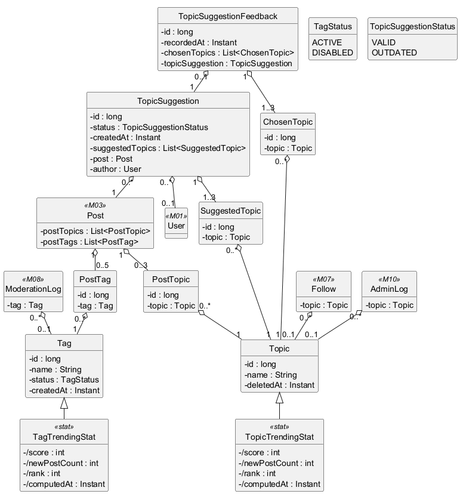

# Thiết kế lớp thực thể — M05 Topic & Tag

<!-- [Vietnamese Doc] Tài liệu tiếng Việt; tên lớp, thuộc tính, kiểu viết tiếng Anh. -->

| Mã tài liệu | CD-M05 |
|---|---|
| Dự án | iShare |
| Module | M05 — Topic & Tag |
| Đầu vào | EC-M05 phiên bản 1.1 |
| Trạng thái | Bản nháp |
| Phiên bản | 0.1 |
| Ngày | 2026-11-20 |
| Tác giả | Phạm Văn Đức |

<!-- Quy ước chung cho mọi bảng dưới đây:
     - Không đổi tên cột, không xóa cột, không đổi số mục: tool đọc bảng theo số mục và tên cột.
     - Ô không có nội dung ghi "—". Mục chưa tới bước làm thì để dòng "(Chưa làm — bước N)".
     - Tập lớp, thuộc tính, quan hệ và mã R-Mxx-nn giữ đúng như EC-Mxx.md.
     - Sơ đồ ở mục 5 do gen_puml.py sinh; không sửa tay.
     - Quy ước dùng (data-model/conventions.md): QU-02 id kiểu long; QU-04 bộ kiểu Java; QU-05 danh sách ghi List<X>. -->

## 1. Lớp và id

<!-- id: Có (lớp của module, không kế thừa) | Kế thừa (lớp con) | Không (lớp thống kê không kế thừa) | Ngoài (lớp của module khác). -->

| Lớp | Nhóm | Sở hữu | Lớp cha | id | Ghi chú |
|---|---|---|---|---|---|
| Topic | Thực thể | M05 | — | Có | — |
| Tag | Thực thể | M05 | — | Có | — |
| TopicSuggestion | Thực thể | M05 | — | Có | — |
| TopicSuggestionFeedback | Thực thể | M05 | — | Có | — |
| TopicTrendingStat | Thống kê | M05 | Topic | Kế thừa | Dùng id của Topic |
| TagTrendingStat | Thống kê | M05 | Tag | Kế thừa | Dùng id của Tag |
| PostTopic | Liên kết | M05 | — | Có | — |
| PostTag | Liên kết | M05 | — | Có | — |
| SuggestedTopic | Liên kết | M05 | — | Có | — |
| ChosenTopic | Liên kết | M05 | — | Có | — |
| Post | Thực thể | M03 | — | Ngoài | Lớp của M03; id và thuộc tính thiết kế ở CD-M03 |
| User | Thực thể | M01 | — | Ngoài | Lớp của M01; id và thuộc tính thiết kế ở CD-M01 |
| Follow | Thực thể | M07 | — | Ngoài | Lớp của M07; id và thuộc tính thiết kế ở CD-M07 |
| ModerationLog | Thực thể | M08 | — | Ngoài | Lớp của M08; id và thuộc tính thiết kế ở CD-M08 |
| AdminLog | Thực thể | M10 | — | Ngoài | Lớp của M10; id và thuộc tính thiết kế ở CD-M10 |

## 2. Thuộc tính và kiểu

### 2.1 Thuộc tính

<!-- Chỉ thuộc tính thường (kể cả id). Thuộc tính đối tượng ghi ở mục 4, không ghi ở đây.
     Bắt buộc: Có | Không. Tính chất: Khóa (chỉ id) | Lưu | Dẫn xuất.
     Căn cứ kiểu: mã FR-/BR- quyết định kiểu, hoặc mã quy ước QU-nn.
     Mọi thuộc tính kiểu Instant: lưu UTC, tính mốc và hiển thị theo giờ Việt Nam (DEC-127, QU-04); không nhắc lại ở từng dòng. -->

| Lớp | Thuộc tính | Kiểu | Bắt buộc | Ràng buộc | Tính chất | Căn cứ kiểu |
|---|---|---|---|---|---|---|
| Topic | id | long | Có | Duy nhất | Khóa | QU-02 |
| Topic | name | String | Có | Không trùng trong danh mục: so không phân biệt hoa thường, bỏ khoảng trắng thừa ở đầu, cuối, giữa, phân biệt dấu (BR-M05-05, FR-M05-06.08); không đổi sau khi tạo | Lưu | BR-M05-05 |
| Topic | deletedAt | Instant | Không | — | Lưu | QU-04 |
| Tag | id | long | Có | Duy nhất | Khóa | QU-02 |
| Tag | name | String | Có | Duy nhất; chữ thường, không bỏ dấu (BR-M05-24); chỉ chữ cái, chữ số, "_", ít nhất một chữ cái (BR-M05-20); tối đa 30 ký tự, không tính "#" (BR-M05-23); không sửa (BR-M05-25) | Lưu | BR-M05-23 |
| Tag | status | TagStatus | Có | Mới tạo là ACTIVE (FR-M05-03.02); chỉ đổi bằng FR-M05-09.01, FR-M05-10.01 | Lưu | FR-M05-03.02 |
| Tag | createdAt | Instant | Có | — | Lưu | QU-04 |
| TopicSuggestion | id | long | Có | Duy nhất | Khóa | QU-02 |
| TopicSuggestion | status | TopicSuggestionStatus | Có | Mới tạo là VALID khi AI trả về Topic hợp lệ (mục Chuyển trạng thái của FR) | Lưu | Mục Chuyển trạng thái của FR-M05 |
| TopicSuggestion | createdAt | Instant | Có | — | Lưu | QU-04 |
| TopicSuggestionFeedback | id | long | Có | Duy nhất | Khóa | QU-02 |
| TopicSuggestionFeedback | recordedAt | Instant | Có | — | Lưu | QU-04 |
| TopicTrendingStat | score | int | Có | > 0 mới vào danh sách (FR-M05-05.14); đăng bài 1, upvote 2, bình luận (kể cả trả lời) 1, bookmark 1 trong cửa sổ 7 ngày, chỉ bài đang hiện trên feed chính, tương tác đã rút không tính (BR-M05-29); tính lại mỗi 15–30 phút (BR-M05-30) | Dẫn xuất | BR-M05-29 |
| TopicTrendingStat | newPostCount | int | Có | ≥ 0; số bài có Topic được đăng trong cửa sổ 7 ngày (TN:Bài mới) | Dẫn xuất | QU-04 |
| TopicTrendingStat | rank | int | Có | Từ 1; xếp theo score giảm, newPostCount giảm, tên A–Z; mỗi mục một hạng riêng (BR-M05-31) | Dẫn xuất | BR-M05-31 |
| TopicTrendingStat | computedAt | Instant | Có | Cửa sổ 7 ngày tính ngược từ thời điểm này (FR-M05-05.03) | Dẫn xuất | QU-04 |
| TagTrendingStat | score | int | Có | Như TopicTrendingStat.score, trên các bài có Tag; chỉ Tag ACTIVE (FR-M05-05.07) | Dẫn xuất | BR-M05-29 |
| TagTrendingStat | newPostCount | int | Có | ≥ 0; số bài có Tag được đăng trong cửa sổ 7 ngày (TN:Bài mới) | Dẫn xuất | QU-04 |
| TagTrendingStat | rank | int | Có | Từ 1; xếp theo score giảm, newPostCount giảm, tên A–Z; mỗi mục một hạng riêng (BR-M05-31) | Dẫn xuất | BR-M05-31 |
| TagTrendingStat | computedAt | Instant | Có | Cửa sổ 7 ngày tính ngược từ thời điểm này (FR-M05-05.03) | Dẫn xuất | QU-04 |
| PostTopic | id | long | Có | Duy nhất | Khóa | QU-02 |
| PostTag | id | long | Có | Duy nhất | Khóa | QU-02 |
| SuggestedTopic | id | long | Có | Duy nhất | Khóa | QU-02 |
| ChosenTopic | id | long | Có | Duy nhất | Khóa | QU-02 |

### 2.2 Kiểu liệt kê

<!-- Giá trị viết HOA_GẠCH_DƯỚI, ngăn bởi dấu phẩy. Nguồn: bảng chuyển trạng thái hoặc quy tắc của FR. -->

| Kiểu | Giá trị | Dùng ở | Nguồn |
|---|---|---|---|
| TagStatus | ACTIVE, DISABLED | Tag.status | Mục Dữ liệu nghiệp vụ của FR-M05 (Hoạt động, Bị vô hiệu hóa); FR-M05-03.02, FR-M05-09.01, FR-M05-10.01 |
| TopicSuggestionStatus | VALID, OUTDATED | TopicSuggestion.status | Mục Chuyển trạng thái của FR-M05 (Còn hiệu lực, Lỗi thời) |

## 3. Chuyển quan hệ

### 3.1 Quan hệ thành phần – toàn thể

<!-- ID: đúng mã của EC. Bội số thành phần = số thành phần ứng với một toàn thể; Bội số toàn thể = số toàn thể ứng với một thành phần.
     Dạng đọc theo thứ tự thành phần–toàn thể: n-1 | 1-n | 1-1. Loại: Hợp thành | Kết tập. -->

| ID | Thành phần | Toàn thể | Bội số thành phần | Bội số toàn thể | Dạng | Loại | Loại ở phân tích | Căn cứ |
|---|---|---|---|---|---|---|---|---|
| R-M05-01 | Topic | PostTopic | 1 | 0..* | 1-n | Kết tập | Liên kết | Post + Topic → PostTopic: Topic có sẵn trong danh mục do Admin quản lý và được nhiều bài tham chiếu, nên là lớp danh mục |
| R-M05-02 | PostTopic | Post | 0..3 | 1 | n-1 | Kết tập | Liên kết | Post + Topic → PostTopic: Topic được gán trong lúc soạn hoặc sửa bài (FR-M05-01.02, FR-M05-01.10) và xem qua bài, nên Post là lớp chứa |
| R-M05-03 | Tag | PostTag | 1 | 0..* | 1-n | Kết tập | Liên kết | Post + Tag → PostTag: Tag tồn tại độc lập (không bị xóa, chỉ vô hiệu hóa) và được nhiều bài tham chiếu, nên là lớp danh mục |
| R-M05-04 | PostTag | Post | 0..5 | 1 | n-1 | Kết tập | Liên kết | Post + Tag → PostTag: Tag được gắn trong lúc soạn hoặc sửa bài (FR-M05-03.01) và giữ theo bài kể cả khi Tag bị vô hiệu hóa (FR-M05-09.03), nên Post là lớp chứa |
| R-M05-05 | SuggestedTopic | TopicSuggestion | 1..3 | 1 | n-1 | Kết tập | Liên kết | TopicSuggestion + Topic → SuggestedTopic: các Topic gợi ý được tạo cùng lượt gợi ý (FR-M05-02.03, tối đa 3, BR-M05-13), nên TopicSuggestion là lớp chứa |
| R-M05-06 | Topic | SuggestedTopic | 1 | 0..* | 1-n | Kết tập | Liên kết | TopicSuggestion + Topic → SuggestedTopic: Topic có sẵn trong danh mục, được tham chiếu, nên là lớp danh mục |
| R-M05-07 | ChosenTopic | TopicSuggestionFeedback | 1..3 | 1 | n-1 | Kết tập | Liên kết | TopicSuggestionFeedback + Topic → ChosenTopic: các Topic chọn cuối được ghi cùng phản hồi khi gửi bài hoặc lưu bản sửa (FR-M05-02.12), nên TopicSuggestionFeedback là lớp chứa |
| R-M05-08 | Topic | ChosenTopic | 1 | 0..* | 1-n | Kết tập | Liên kết | TopicSuggestionFeedback + Topic → ChosenTopic: Topic có sẵn trong danh mục, được tham chiếu, nên là lớp danh mục |
| R-M05-09 | TopicSuggestion | TopicSuggestionFeedback | 1 | 0..1 | 1-1 | Kết tập | Kết tập | Giữ nguyên từ phân tích |
| R-M05-10 | Post | TopicSuggestion | 1 | 0..* | 1-n | Kết tập | Kết tập | Giữ nguyên từ phân tích |
| R-M05-11 | User | TopicSuggestion | 0..1 | 0..* | 1-n | Kết tập | Kết tập | Giữ nguyên từ phân tích |
| R-M05-12 | Topic | Follow | 0..1 | 0..* | 1-n | Kết tập | Kết tập | Giữ nguyên từ phân tích |
| R-M05-13 | Topic | AdminLog | 0..1 | 0..* | 1-n | Kết tập | Kết tập | Giữ nguyên từ phân tích |
| R-M05-14 | Tag | ModerationLog | 0..1 | 0..* | 1-n | Kết tập | Kết tập | Giữ nguyên từ phân tích |

### 3.2 Quan hệ giữ nguyên

<!-- Loại: Kế thừa (Lớp = lớp con, Lớp đích = lớp cha) | Phụ thuộc (Lớp = lớp phụ thuộc, Lớp đích = lớp được dùng). -->

| ID | Loại | Lớp | Lớp đích | Ghi chú |
|---|---|---|---|---|
| R-M05-15 | Kế thừa | TopicTrendingStat | Topic | — |
| R-M05-16 | Kế thừa | TagTrendingStat | Tag | — |

## 4. Thuộc tính đối tượng

<!-- Mỗi dòng của mục 3.1 đúng một dòng ở đây. Lớp chứa = lớp toàn thể.
     Kiểu: ThànhPhần (dạng 1-n, 1-1) hoặc List<ThànhPhần> (dạng n-1, QU-05). -->

| Quan hệ | Lớp chứa | Thuộc tính | Kiểu | Quy tắc |
|---|---|---|---|---|
| R-M05-01 | PostTopic | topic | Topic | Topic là thành phần của PostTopic, dạng 1-n → PostTopic có một Topic |
| R-M05-02 | Post | postTopics | List<PostTopic> | PostTopic là thành phần của Post, dạng n-1 → Post có danh sách PostTopic |
| R-M05-03 | PostTag | tag | Tag | Tag là thành phần của PostTag, dạng 1-n → PostTag có một Tag |
| R-M05-04 | Post | postTags | List<PostTag> | PostTag là thành phần của Post, dạng n-1 → Post có danh sách PostTag |
| R-M05-05 | TopicSuggestion | suggestedTopics | List<SuggestedTopic> | SuggestedTopic là thành phần của TopicSuggestion, dạng n-1 → TopicSuggestion có danh sách SuggestedTopic |
| R-M05-06 | SuggestedTopic | topic | Topic | Topic là thành phần của SuggestedTopic, dạng 1-n → SuggestedTopic có một Topic |
| R-M05-07 | TopicSuggestionFeedback | chosenTopics | List<ChosenTopic> | ChosenTopic là thành phần của TopicSuggestionFeedback, dạng n-1 → TopicSuggestionFeedback có danh sách ChosenTopic |
| R-M05-08 | ChosenTopic | topic | Topic | Topic là thành phần của ChosenTopic, dạng 1-n → ChosenTopic có một Topic |
| R-M05-09 | TopicSuggestionFeedback | topicSuggestion | TopicSuggestion | TopicSuggestion là thành phần của TopicSuggestionFeedback, dạng 1-1 → TopicSuggestionFeedback có một TopicSuggestion |
| R-M05-10 | TopicSuggestion | post | Post | Post là thành phần của TopicSuggestion, dạng 1-n → TopicSuggestion có một Post |
| R-M05-11 | TopicSuggestion | author | User | User là thành phần của TopicSuggestion, dạng 1-n → TopicSuggestion có một User (tên theo vai trò) |
| R-M05-12 | Follow | topic | Topic | Topic là thành phần của Follow, dạng 1-n → Follow có một Topic |
| R-M05-13 | AdminLog | topic | Topic | Topic là thành phần của AdminLog, dạng 1-n → AdminLog có một Topic |
| R-M05-14 | ModerationLog | tag | Tag | Tag là thành phần của ModerationLog, dạng 1-n → ModerationLog có một Tag |

## 5. Sơ đồ lớp thiết kế

<!-- BEGIN:DIAGRAM -->

Mã nguồn sơ đồ: [diagrams/CD-M05.puml](diagrams/CD-M05.puml). Ảnh và tệp .puml do `gen_puml.py` sinh từ các bảng của tài liệu này; muốn đổi sơ đồ thì sửa bảng rồi chạy lại tool, không sửa tay.
<!-- END:DIAGRAM -->

## 6. Liên module

<!-- Mỗi lớp ngoài một dòng. "Đề nghị cho module sở hữu": thuộc tính đối tượng mà module này cần thêm vào lớp đó, kèm mã quan hệ. -->

| Lớp | Module sở hữu | Module này dùng thế nào | Đề nghị cho module sở hữu |
|---|---|---|---|
| Post | M03 | Gán Topic, Tag qua PostTopic, PostTag (R-M05-01–04); gợi ý Topic cho bài (R-M05-10); đọc title, contentText, publishState, modState, publishedAt | Thêm `postTopics : List<PostTopic>` (R-M05-02); Thêm `postTags : List<PostTag>` (R-M05-04) |
| User | M01 | Ghi tác giả yêu cầu gợi ý (R-M05-11), bỏ liên kết khi DELETED; đọc role để kiểm quyền, status để lọc Trending | — |
| Follow | M07 | Chuyển lượt theo dõi sang Topic đích khi gộp, bỏ lượt theo dõi khi xóa Topic (R-M05-12) | Thêm `topic : Topic` (R-M05-12) |
| ModerationLog | M08 | Ghi dòng nhật ký khi vô hiệu hóa, kích hoạt lại Tag (R-M05-14) và khi đổi Topic, Tag trên bài người khác (quan hệ với bài viết và người thực hiện là giữa hai lớp ngoài, do M08 ghi) | Thêm `tag : Tag` (R-M05-14) |
| AdminLog | M10 | Ghi mục nhật ký khi thêm, gộp, xóa Topic (R-M05-13) | Thêm `topic : Topic` (R-M05-13) |

## 7. Quyết định thiết kế

| Mã | Quyết định | Lý do |
|---|---|---|
| — | — | — |

## 8. Câu hỏi và điểm chưa chốt

| Mã | Loại | Câu hỏi | Trả lời | Ghi vào |
|---|---|---|---|---|
| Q-01 | Xác nhận | Tên giá trị kiểu liệt kê (register chưa đặt tên): TagStatus = ACTIVE (Hoạt động), DISABLED (Bị vô hiệu hóa); TopicSuggestionStatus = VALID (Còn hiệu lực), OUTDATED (Lỗi thời). Điểm Trending (score) kiểu int vì mọi trọng số là số nguyên (BR-M05-29). Đồng ý? | Đồng ý (người dùng, 2026-11-20) | Mục 2.1, 2.2 |
| Q-02 | Xác nhận | Lớp chứa của các lớp liên kết: PostTopic, PostTag thuộc Post (Post có postTopics, postTags — đề nghị cho M03); SuggestedTopic thuộc TopicSuggestion; ChosenTopic thuộc TopicSuggestionFeedback; Topic, Tag là lớp danh mục được tham chiếu. Đồng ý? | Đồng ý (người dùng, 2026-11-20) | Mục 3.1, 4, 6 |
| Q-03 | Xác nhận | Tính bắt buộc suy ra: Topic.deletedAt Không (chỉ có khi Topic bị xóa hoặc gộp); TopicSuggestion.createdAt, TopicSuggestionFeedback.recordedAt Có. Đồng ý? | Đồng ý (người dùng, 2026-11-20) | Mục 2.1 |

## 9. Lịch sử sửa đổi

| Phiên bản | Ngày | Nội dung | Người sửa |
|---|---|---|---|
| 0.1 | 2026-11-20 | Tạo mới từ EC-M05 v1.1; làm liền bước 1–4 theo yêu cầu của người dùng (không dừng ở cổng); chưa qua duyệt, câu hỏi ở mục 8 chờ trả lời | Phạm Văn Đức |
| 0.2 | 2026-11-20 | Ghi trả lời mục 8: người dùng đồng ý các đề xuất; chờ chốt | Phạm Văn Đức |
| 1.0 | 2026-11-20 | Chốt: người dùng chốt CD-M05 | Phạm Văn Đức |
