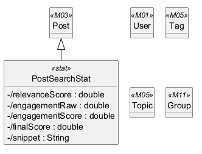

# Thiết kế lớp thực thể — M06 Search

<!-- [Vietnamese Doc] Tài liệu tiếng Việt; tên lớp, thuộc tính, kiểu viết tiếng Anh. -->

| Mã tài liệu | CD-M06 |
|---|---|
| Dự án | iShare |
| Module | M06 — Search |
| Đầu vào | EC-M06 phiên bản 1.1 |
| Trạng thái | Bản nháp |
| Phiên bản | 0.1 |
| Ngày | 2026-11-20 |
| Tác giả | Phạm Văn Đức |

<!-- Quy ước chung cho mọi bảng dưới đây:
     - Không đổi tên cột, không xóa cột, không đổi số mục: tool đọc bảng theo số mục và tên cột.
     - Ô không có nội dung ghi "—". Mục chưa tới bước làm thì để dòng "(Chưa làm — bước N)".
     - Tập lớp, thuộc tính, quan hệ và mã R-Mxx-nn giữ đúng như EC-Mxx.md.
     - Sơ đồ ở mục 5 do gen_puml.py sinh; không sửa tay.
     - Quy ước dùng (data-model/conventions.md): QU-02 id kiểu long; QU-04 bộ kiểu Java; QU-05 danh sách ghi List<X>. -->

## 1. Lớp và id

<!-- id: Có (lớp của module, không kế thừa) | Kế thừa (lớp con) | Không (lớp thống kê không kế thừa) | Ngoài (lớp của module khác). -->

| Lớp | Nhóm | Sở hữu | Lớp cha | id | Ghi chú |
|---|---|---|---|---|---|
| PostSearchStat | Thống kê | M06 | Post | Kế thừa | Dùng id của Post |
| Post | Thực thể | M03 | — | Ngoài | Lớp của M03; id và thuộc tính thiết kế ở CD-M03 |
| User | Thực thể | M01 | — | Ngoài | Lớp của M01; id và thuộc tính thiết kế ở CD-M01 |
| Tag | Thực thể | M05 | — | Ngoài | Lớp của M05; id và thuộc tính thiết kế ở CD-M05 |
| Topic | Thực thể | M05 | — | Ngoài | Lớp của M05; id và thuộc tính thiết kế ở CD-M05 |
| Group | Thực thể | M11 | — | Ngoài | Lớp của M11; id và thuộc tính thiết kế ở CD-M11 |

## 2. Thuộc tính và kiểu

### 2.1 Thuộc tính

<!-- Chỉ thuộc tính thường (kể cả id). Thuộc tính đối tượng ghi ở mục 4, không ghi ở đây.
     Bắt buộc: Có | Không. Tính chất: Khóa (chỉ id) | Lưu | Dẫn xuất.
     Căn cứ kiểu: mã FR-/BR- quyết định kiểu, hoặc mã quy ước QU-nn.
     Mọi thuộc tính kiểu Instant: lưu UTC, tính mốc và hiển thị theo giờ Việt Nam (DEC-127, QU-04); không nhắc lại ở từng dòng. -->

| Lớp | Thuộc tính | Kiểu | Bắt buộc | Ràng buộc | Tính chất | Căn cứ kiểu |
|---|---|---|---|---|---|---|
| PostSearchStat | relevanceScore | double | Không | 0–1; chỉ có với truy vấn có chữ; tìm ngữ nghĩa: (cosine(embedding truy vấn, embedding bài) + 1) ÷ 2; tìm full-text: số từ của truy vấn có trong tiêu đề hoặc nội dung chữ ÷ số từ của truy vấn (BR-M06-13, BR-M06-08); tập ứng viên là 120 bài có điểm cao nhất (FR-M06-02.28) | Dẫn xuất | BR-M06-13 |
| PostSearchStat | engagementRaw | double | Có | = log(1 + Post.upvoteCount) × 2 + log(1 + Post.commentCount) × 1 (BR-M06-13) | Dẫn xuất | BR-M06-13 |
| PostSearchStat | engagementScore | double | Không | 0–1; chỉ có với truy vấn có chữ; chuẩn hóa min–max của engagementRaw trong tập ứng viên, mọi ứng viên bằng nhau thì 0 (BR-M06-13) | Dẫn xuất | BR-M06-13 |
| PostSearchStat | finalScore | double | Không | Chỉ có với truy vấn có chữ; = relevanceScore × 0,8 + engagementScore × 0,2; × 0,5 khi tác giả ở mức cảnh cáo HEAVY và đang xếp theo Liên quan (BR-M06-13, BR-M06-14); không hiện cho người tìm (FR-M06-02.12) | Dẫn xuất | BR-M06-13 |
| PostSearchStat | snippet | String | Không | Tối đa 150 ký tự đầu của Post.contentText, cắt trước từ bị cắt dở và thêm "…"; không có khi bài không có nội dung chữ (BR-M06-18); không tô sáng từ khóa (FR-M06-02.15) | Dẫn xuất | BR-M06-18 |

### 2.2 Kiểu liệt kê

<!-- Giá trị viết HOA_GẠCH_DƯỚI, ngăn bởi dấu phẩy. Nguồn: bảng chuyển trạng thái hoặc quy tắc của FR. -->

| Kiểu | Giá trị | Dùng ở | Nguồn |
|---|---|---|---|
| — | — | — | — |

## 3. Chuyển quan hệ

### 3.1 Quan hệ thành phần – toàn thể

<!-- ID: đúng mã của EC. Bội số thành phần = số thành phần ứng với một toàn thể; Bội số toàn thể = số toàn thể ứng với một thành phần.
     Dạng đọc theo thứ tự thành phần–toàn thể: n-1 | 1-n | 1-1. Loại: Hợp thành | Kết tập. -->

| ID | Thành phần | Toàn thể | Bội số thành phần | Bội số toàn thể | Dạng | Loại | Loại ở phân tích | Căn cứ |
|---|---|---|---|---|---|---|---|---|
| — | — | — | — | — | — | — | — | — |

### 3.2 Quan hệ giữ nguyên

<!-- Loại: Kế thừa (Lớp = lớp con, Lớp đích = lớp cha) | Phụ thuộc (Lớp = lớp phụ thuộc, Lớp đích = lớp được dùng). -->

| ID | Loại | Lớp | Lớp đích | Ghi chú |
|---|---|---|---|---|
| R-M06-01 | Kế thừa | PostSearchStat | Post | PostSearchStat dùng id và thuộc tính của Post; không sinh thuộc tính đối tượng |

## 4. Thuộc tính đối tượng

<!-- Mỗi dòng của mục 3.1 đúng một dòng ở đây. Lớp chứa = lớp toàn thể.
     Kiểu: ThànhPhần (dạng 1-n, 1-1) hoặc List<ThànhPhần> (dạng n-1, QU-05). -->

| Quan hệ | Lớp chứa | Thuộc tính | Kiểu | Quy tắc |
|---|---|---|---|---|
| — | — | — | — | — |

## 5. Sơ đồ lớp thiết kế

<!-- BEGIN:DIAGRAM -->

Mã nguồn sơ đồ: [diagrams/CD-M06.puml](diagrams/CD-M06.puml). Ảnh và tệp .puml do `gen_puml.py` sinh từ các bảng của tài liệu này; muốn đổi sơ đồ thì sửa bảng rồi chạy lại tool, không sửa tay.
<!-- END:DIAGRAM -->

## 6. Liên module

<!-- Mỗi lớp ngoài một dòng. "Đề nghị cho module sở hữu": thuộc tính đối tượng mà module này cần thêm vào lớp đó, kèm mã quan hệ. -->

| Lớp | Module sở hữu | Module này dùng thế nào | Đề nghị cho module sở hữu |
|---|---|---|---|
| Post | M03 | Lớp cha của PostSearchStat (R-M06-01): mỗi kết quả bài viết là một bài viết. Đọc title, contentText để so khớp và cắt đoạn trích; publishedAt để lọc khoảng thời gian, xếp Mới nhất; isPubliclyVisible để chỉ giữ bài đang hiển thị công khai; commentCount (M04 bổ sung) và upvoteCount để tính engagementRaw, xếp Nhiều upvote nhất; isAnonymous cho bộ lọc đang theo dõi. upvoteCount và isAnonymous chưa có ở EC-M03 | — |
| User | M01 | Được tìm theo displayName, username làm gợi ý khi gõ và kết quả phụ, chỉ tài khoản có status ACTIVE và verificationLevel SETUP_COMPLETED; đọc status của tác giả bài viết (BANNED vẫn giữ trong kết quả). Không có quan hệ với lớp của M06 | — |
| Tag | M05 | Được tìm theo name, bỏ Tag có status Bị vô hiệu hóa; dùng làm bộ lọc kết quả bài viết qua PostTag của M05. Không có quan hệ với lớp của M06 | — |
| Topic | M05 | Được tìm theo name; dùng làm bộ lọc kết quả bài viết qua PostTopic của M05. Không có quan hệ với lớp của M06 | — |
| Group | M11 | Được tìm theo name, không theo mô tả; Group có privacy Private và bài viết của Group đó (R-M03-06) chỉ hiện với thành viên. Không có quan hệ với lớp của M06. Tên lớp và thuộc tính tạm, chờ EC-M11 | — |

## 7. Quyết định thiết kế

| Mã | Quyết định | Lý do |
|---|---|---|
| — | — | — |

## 8. Câu hỏi và điểm chưa chốt

| Mã | Loại | Câu hỏi | Trả lời | Ghi vào |
|---|---|---|---|---|
| Q-01 | Xác nhận | Tính bắt buộc của số liệu tìm kiếm: relevanceScore, engagementScore, finalScore Không vì chỉ có với truy vấn có chữ (truy vấn rỗng chỉ lọc, không chấm điểm); engagementRaw Có; snippet Không (bài không có nội dung chữ). Các điểm kiểu double. Đồng ý? | Đồng ý (người dùng, 2026-11-20) | Mục 2.1 |

## 9. Lịch sử sửa đổi

| Phiên bản | Ngày | Nội dung | Người sửa |
|---|---|---|---|
| 0.1 | 2026-11-20 | Tạo mới từ EC-M06 v1.1; làm liền bước 1–4 theo yêu cầu của người dùng (không dừng ở cổng); chưa qua duyệt, câu hỏi ở mục 8 chờ trả lời | Phạm Văn Đức |
| 0.2 | 2026-11-20 | Ghi trả lời mục 8: người dùng đồng ý các đề xuất; chờ chốt | Phạm Văn Đức |
| 1.0 | 2026-11-20 | Chốt: người dùng chốt CD-M06 | Phạm Văn Đức |
