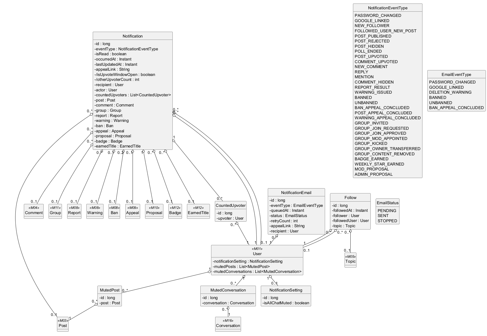

# Thiết kế lớp thực thể — M07 Notification

<!-- [Vietnamese Doc] Tài liệu tiếng Việt; tên lớp, thuộc tính, kiểu viết tiếng Anh. -->

| Mã tài liệu | CD-M07 |
|---|---|
| Dự án | iShare |
| Module | M07 — Notification |
| Đầu vào | EC-M07 phiên bản 1.1 |
| Trạng thái | Bản nháp |
| Phiên bản | 0.1 |
| Ngày | 2026-11-20 |
| Tác giả | Phạm Văn Đức |

<!-- Quy ước chung cho mọi bảng dưới đây:
     - Không đổi tên cột, không xóa cột, không đổi số mục: tool đọc bảng theo số mục và tên cột.
     - Ô không có nội dung ghi "—". Mục chưa tới bước làm thì để dòng "(Chưa làm — bước N)".
     - Tập lớp, thuộc tính, quan hệ và mã R-Mxx-nn giữ đúng như EC-Mxx.md.
     - Sơ đồ ở mục 5 do gen_puml.py sinh; không sửa tay.
     - Quy ước dùng (data-model/conventions.md): QU-02 id kiểu long; QU-04 bộ kiểu Java; QU-05 danh sách ghi List<X>. -->

## 1. Lớp và id

<!-- id: Có (lớp của module, không kế thừa) | Kế thừa (lớp con) | Không (lớp thống kê không kế thừa) | Ngoài (lớp của module khác). -->

| Lớp | Nhóm | Sở hữu | Lớp cha | id | Ghi chú |
|---|---|---|---|---|---|
| Notification | Thực thể | M07 | — | Có | — |
| Follow | Thực thể | M07 | — | Có | — |
| NotificationEmail | Thực thể | M07 | — | Có | — |
| NotificationSetting | Thực thể | M07 | — | Có | — |
| CountedUpvoter | Liên kết | M07 | — | Có | — |
| MutedPost | Liên kết | M07 | — | Có | — |
| MutedConversation | Liên kết | M07 | — | Có | — |
| User | Thực thể | M01 | — | Ngoài | Lớp của M01; id và thuộc tính thiết kế ở CD-M01 |
| Topic | Thực thể | M05 | — | Ngoài | Lớp của M05; id và thuộc tính thiết kế ở CD-M05 |
| Post | Thực thể | M03 | — | Ngoài | Lớp của M03; id và thuộc tính thiết kế ở CD-M03 |
| Comment | Thực thể | M04 | — | Ngoài | Lớp của M04; id và thuộc tính thiết kế ở CD-M04 |
| Group | Thực thể | M11 | — | Ngoài | Lớp của M11; id và thuộc tính thiết kế ở CD-M11 |
| Report | Thực thể | M08 | — | Ngoài | Lớp của M08; id và thuộc tính thiết kế ở CD-M08 |
| Warning | Thực thể | M08 | — | Ngoài | Lớp của M08; id và thuộc tính thiết kế ở CD-M08 |
| Ban | Thực thể | M08 | — | Ngoài | Lớp của M08; id và thuộc tính thiết kế ở CD-M08 |
| Appeal | Thực thể | M09 | — | Ngoài | Lớp của M09; id và thuộc tính thiết kế ở CD-M09 |
| Proposal | Thực thể | M10 | — | Ngoài | Lớp của M10; id và thuộc tính thiết kế ở CD-M10 |
| Badge | Thực thể | M12 | — | Ngoài | Lớp của M12; id và thuộc tính thiết kế ở CD-M12 |
| EarnedTitle | Thực thể | M12 | — | Ngoài | Lớp của M12; id và thuộc tính thiết kế ở CD-M12 |
| Conversation | Thực thể | M16 | — | Ngoài | Lớp của M16; id và thuộc tính thiết kế ở CD-M16 |

## 2. Thuộc tính và kiểu

### 2.1 Thuộc tính

<!-- Chỉ thuộc tính thường (kể cả id). Thuộc tính đối tượng ghi ở mục 4, không ghi ở đây.
     Bắt buộc: Có | Không. Tính chất: Khóa (chỉ id) | Lưu | Dẫn xuất.
     Căn cứ kiểu: mã FR-/BR- quyết định kiểu, hoặc mã quy ước QU-nn.
     Mọi thuộc tính kiểu Instant: lưu UTC, tính mốc và hiển thị theo giờ Việt Nam (DEC-127, QU-04); không nhắc lại ở từng dòng. -->

| Lớp | Thuộc tính | Kiểu | Bắt buộc | Ràng buộc | Tính chất | Căn cứ kiểu |
|---|---|---|---|---|---|---|
| Notification | id | long | Có | Duy nhất | Khóa | QU-02 |
| Notification | eventType | NotificationEventType | Có | Một trong các sự kiện của BR-M07-01; không có tin nhắn (FR-M07-02.10), không có cảnh báo trước khi tự xóa (FR-M07-04.06), không có các trường hợp của BR-M07-21 | Lưu | BR-M07-01 |
| Notification | isRead | boolean | Có | Mới tạo là sai (Chưa đọc) (FR-M07-02.01); đúng khi người nhận bấm vào hoặc "Đánh dấu tất cả đã đọc" (FR-M07-06.01, FR-M07-06.03); về sai chỉ khi thông báo upvote được gộp thêm (FR-M07-02.04) | Lưu | Mục Chuyển trạng thái của FR-M07 |
| Notification | occurredAt | Instant | Có | Do module phát sinh sự kiện cung cấp (FR-M07-02.02); lưu UTC, hiển thị giờ Asia/Ho_Chi_Minh (BR-M07-22) | Lưu | BR-M07-22 |
| Notification | lastUpdatedAt | Instant | Có | Bằng occurredAt khi tạo; đổi thành thời điểm của lượt upvote gộp thêm (FR-M07-02.04); chuông hiện 10 thông báo mới nhất theo giá trị này (BR-M07-12) | Lưu | QU-04 |
| Notification | appealLink | String | Không | Chỉ có khi sự kiện là cảnh cáo, ban, bài bị Mod hoặc Admin gỡ, bài bị AI từ chối (FR-M07-02.13) | Lưu | QU-04 |
| Notification | isUpvoteWindowOpen | boolean | Không | Chỉ có ở thông báo upvote: đúng khi hiện tại còn trước occurredAt + 5 × 60 giây; không kéo dài theo lượt upvote sau (BR-M07-05) | Dẫn xuất | BR-M07-05 |
| Notification | otherUpvoterCount | int | Không | ≥ 0; chỉ có ở thông báo upvote: số người khác nhau đã được đếm trong cửa sổ, trừ người upvote mới nhất (FR-M07-02.20); bỏ upvote không làm giảm (FR-M07-02.19) | Dẫn xuất | BR-M07-05 |
| Follow | id | long | Có | Duy nhất | Khóa | QU-02 |
| Follow | followedAt | Instant | Có | Ghi khi người dùng bắt đầu theo dõi (FR-M07-01.01) | Lưu | QU-04 |
| NotificationEmail | id | long | Có | Duy nhất | Khóa | QU-02 |
| NotificationEmail | eventType | EmailEventType | Có | Chỉ các sự kiện có email (BR-M07-03) | Lưu | BR-M07-03 |
| NotificationEmail | queuedAt | Instant | Có | Ghi khi email vào hàng đợi | Lưu | QU-04 |
| NotificationEmail | status | EmailStatus | Có | PENDING khi vào hàng đợi; SENT khi gửi thành công (FR-M07-04.02); STOPPED khi vẫn lỗi sau 3 lần gửi lại (FR-M07-04.10) | Lưu | FR-M07-04.02, FR-M07-04.10 |
| NotificationEmail | retryCount | int | Có | 0–3; tăng 1 mỗi lần gửi lại sau lần lỗi; hết 3 lần vẫn lỗi thì dừng (BR-M07-26) | Lưu | BR-M07-26 |
| NotificationEmail | appealLink | String | Không | Chỉ có với email về ban (FR-M07-04.08) | Lưu | QU-04 |
| NotificationSetting | id | long | Có | Duy nhất | Khóa | QU-02 |
| NotificationSetting | isAllChatMuted | boolean | Có | Sai = Đang nhận, đúng = Đã tắt; khi đúng thì mọi cuộc trò chuyện không hiện popup, không ngoại lệ; khi sai thì theo cài đặt riêng từng cuộc (BR-M07-08) | Lưu | Mục Chuyển trạng thái của FR-M07 |
| CountedUpvoter | id | long | Có | Duy nhất | Khóa | QU-02 |
| MutedPost | id | long | Có | Duy nhất | Khóa | QU-02 |
| MutedConversation | id | long | Có | Duy nhất | Khóa | QU-02 |

### 2.2 Kiểu liệt kê

<!-- Giá trị viết HOA_GẠCH_DƯỚI, ngăn bởi dấu phẩy. Nguồn: bảng chuyển trạng thái hoặc quy tắc của FR. -->

| Kiểu | Giá trị | Dùng ở | Nguồn |
|---|---|---|---|
| NotificationEventType | PASSWORD_CHANGED, GOOGLE_LINKED, NEW_FOLLOWER, FOLLOWED_USER_NEW_POST, POST_PUBLISHED, POST_REJECTED, POST_HIDDEN, POLL_ENDED, POST_UPVOTED, COMMENT_UPVOTED, NEW_COMMENT, REPLY, MENTION, COMMENT_HIDDEN, REPORT_RESULT, WARNING_ISSUED, BANNED, UNBANNED, BAN_APPEAL_CONCLUDED, POST_APPEAL_CONCLUDED, WARNING_APPEAL_CONCLUDED, GROUP_INVITED, GROUP_JOIN_REQUESTED, GROUP_JOIN_APPROVED, GROUP_MOD_APPOINTED, GROUP_KICKED, GROUP_OWNER_TRANSFERRED, GROUP_CONTENT_REMOVED, BADGE_EARNED, WEEKLY_STAR_EARNED, MOD_PROPOSAL, ADMIN_PROPOSAL | Notification.eventType | BR-M07-01 (32 sự kiện, theo đúng thứ tự liệt kê) |
| EmailEventType | PASSWORD_CHANGED, GOOGLE_LINKED, DELETION_WARNING, BANNED, UNBANNED, BAN_APPEAL_CONCLUDED | NotificationEmail.eventType | BR-M07-03 (mật khẩu đã đổi, đã liên kết Google, cảnh báo trước khi tự xóa, ban, gỡ ban, kết luận khiếu nại về ban) |
| EmailStatus | PENDING, SENT, STOPPED | NotificationEmail.status | FR-M07-04.02, FR-M07-04.10 (Chờ gửi, Đã gửi, Đã dừng) |

## 3. Chuyển quan hệ

### 3.1 Quan hệ thành phần – toàn thể

<!-- ID: đúng mã của EC. Bội số thành phần = số thành phần ứng với một toàn thể; Bội số toàn thể = số toàn thể ứng với một thành phần.
     Dạng đọc theo thứ tự thành phần–toàn thể: n-1 | 1-n | 1-1. Loại: Hợp thành | Kết tập. -->

| ID | Thành phần | Toàn thể | Bội số thành phần | Bội số toàn thể | Dạng | Loại | Loại ở phân tích | Căn cứ |
|---|---|---|---|---|---|---|---|---|
| R-M07-01 | User | Notification | 1 | 0..* | 1-n | Kết tập | Kết tập | Giữ nguyên từ phân tích |
| R-M07-02 | User | Notification | 0..1 | 0..* | 1-n | Kết tập | Kết tập | Giữ nguyên từ phân tích |
| R-M07-03 | CountedUpvoter | Notification | 0..* | 1 | n-1 | Kết tập | Liên kết | Notification + User → CountedUpvoter: người upvote được đếm trong lúc gộp lượt upvote vào thông báo (FR-M07-02.04, FR-M07-02.20) và chỉ có nghĩa trong thông báo đó, nên Notification là lớp chứa |
| R-M07-04 | User | CountedUpvoter | 1 | 0..* | 1-n | Kết tập | Liên kết | Notification + User → CountedUpvoter: người dùng có sẵn, tồn tại độc lập và được tham chiếu, nên là lớp danh mục |
| R-M07-05 | Post | Notification | 0..1 | 0..* | 1-n | Kết tập | Kết tập | Giữ nguyên từ phân tích |
| R-M07-06 | Comment | Notification | 0..1 | 0..* | 1-n | Kết tập | Kết tập | Giữ nguyên từ phân tích |
| R-M07-07 | Group | Notification | 0..1 | 0..* | 1-n | Kết tập | Kết tập | Giữ nguyên từ phân tích |
| R-M07-08 | Report | Notification | 0..1 | 0..* | 1-n | Kết tập | Kết tập | Giữ nguyên từ phân tích |
| R-M07-09 | Warning | Notification | 0..1 | 0..1 | 1-1 | Kết tập | Kết tập | Giữ nguyên từ phân tích |
| R-M07-10 | Ban | Notification | 0..1 | 0..2 | 1-n | Kết tập | Kết tập | Giữ nguyên từ phân tích |
| R-M07-11 | Appeal | Notification | 0..1 | 0..1 | 1-1 | Kết tập | Kết tập | Giữ nguyên từ phân tích |
| R-M07-12 | Proposal | Notification | 0..1 | 1 | 1-1 | Kết tập | Kết tập | Giữ nguyên từ phân tích |
| R-M07-13 | Badge | Notification | 0..1 | 0..* | 1-n | Kết tập | Kết tập | Giữ nguyên từ phân tích |
| R-M07-14 | EarnedTitle | Notification | 0..1 | 0..* | 1-n | Kết tập | Kết tập | Giữ nguyên từ phân tích |
| R-M07-15 | User | Follow | 1 | 0..* | 1-n | Kết tập | Kết tập | Giữ nguyên từ phân tích |
| R-M07-16 | User | Follow | 0..1 | 0..* | 1-n | Kết tập | Kết tập | Giữ nguyên từ phân tích |
| R-M07-17 | Topic | Follow | 0..1 | 0..* | 1-n | Kết tập | Kết tập | Giữ nguyên từ phân tích |
| R-M07-18 | User | NotificationEmail | 1 | 0..* | 1-n | Kết tập | Kết tập | Giữ nguyên từ phân tích |
| R-M07-19 | NotificationSetting | User | 0..1 | 1 | 1-1 | Kết tập | Kết tập | Giữ nguyên từ phân tích |
| R-M07-20 | MutedPost | User | 0..* | 1 | n-1 | Kết tập | Liên kết | User + Post → MutedPost: tắt thông báo là cài đặt của người dùng, chỉ áp cho chính người đó (FR-M07-08.04), bật lại thì bỏ (FR-M07-08.03); hai phía đều có sẵn, User là lớp chứa theo phía cài đặt (người dùng chọn ở Q-02) |
| R-M07-21 | Post | MutedPost | 1 | 0..* | 1-n | Kết tập | Liên kết | User + Post → MutedPost: bài viết có sẵn và được tham chiếu, nên là lớp danh mục |
| R-M07-22 | MutedConversation | User | 0..* | 1 | n-1 | Kết tập | Liên kết | User + Conversation → MutedConversation: tắt thông báo cuộc trò chuyện là cài đặt riêng của thành viên (FR-M07-09.01, FR-M07-09.02); User là lớp chứa như MutedPost (người dùng chọn ở Q-02) |
| R-M07-23 | Conversation | MutedConversation | 1 | 0..* | 1-n | Kết tập | Liên kết | User + Conversation → MutedConversation: cuộc trò chuyện có sẵn và được tham chiếu, nên là lớp danh mục; bỏ liên kết khi thành viên rời (FR-M07-09.08) là hành vi xóa theo, không đổi bên chứa |

### 3.2 Quan hệ giữ nguyên

<!-- Loại: Kế thừa (Lớp = lớp con, Lớp đích = lớp cha) | Phụ thuộc (Lớp = lớp phụ thuộc, Lớp đích = lớp được dùng). -->

| ID | Loại | Lớp | Lớp đích | Ghi chú |
|---|---|---|---|---|
| — | — | — | — | — |

## 4. Thuộc tính đối tượng

<!-- Mỗi dòng của mục 3.1 đúng một dòng ở đây. Lớp chứa = lớp toàn thể.
     Kiểu: ThànhPhần (dạng 1-n, 1-1) hoặc List<ThànhPhần> (dạng n-1, QU-05). -->

| Quan hệ | Lớp chứa | Thuộc tính | Kiểu | Quy tắc |
|---|---|---|---|---|
| R-M07-01 | Notification | recipient | User | User là thành phần của Notification, dạng 1-n → Notification có một User (tên theo vai trò) |
| R-M07-02 | Notification | actor | User | User là thành phần của Notification, dạng 1-n → Notification có một User (tên theo vai trò) |
| R-M07-03 | Notification | countedUpvoters | List<CountedUpvoter> | CountedUpvoter là thành phần của Notification, dạng n-1 → Notification có danh sách CountedUpvoter |
| R-M07-04 | CountedUpvoter | upvoter | User | User là thành phần của CountedUpvoter, dạng 1-n → CountedUpvoter có một User (tên theo vai trò) |
| R-M07-05 | Notification | post | Post | Post là thành phần của Notification, dạng 1-n → Notification có một Post |
| R-M07-06 | Notification | comment | Comment | Comment là thành phần của Notification, dạng 1-n → Notification có một Comment |
| R-M07-07 | Notification | group | Group | Group là thành phần của Notification, dạng 1-n → Notification có một Group |
| R-M07-08 | Notification | report | Report | Report là thành phần của Notification, dạng 1-n → Notification có một Report |
| R-M07-09 | Notification | warning | Warning | Warning là thành phần của Notification, dạng 1-1 → Notification có một Warning |
| R-M07-10 | Notification | ban | Ban | Ban là thành phần của Notification, dạng 1-n → Notification có một Ban |
| R-M07-11 | Notification | appeal | Appeal | Appeal là thành phần của Notification, dạng 1-1 → Notification có một Appeal |
| R-M07-12 | Notification | proposal | Proposal | Proposal là thành phần của Notification, dạng 1-1 → Notification có một Proposal |
| R-M07-13 | Notification | badge | Badge | Badge là thành phần của Notification, dạng 1-n → Notification có một Badge |
| R-M07-14 | Notification | earnedTitle | EarnedTitle | EarnedTitle là thành phần của Notification, dạng 1-n → Notification có một EarnedTitle |
| R-M07-15 | Follow | follower | User | User là thành phần của Follow, dạng 1-n → Follow có một User (tên theo vai trò) |
| R-M07-16 | Follow | followedUser | User | User là thành phần của Follow, dạng 1-n → Follow có một User (tên theo vai trò) |
| R-M07-17 | Follow | topic | Topic | Topic là thành phần của Follow, dạng 1-n → Follow có một Topic |
| R-M07-18 | NotificationEmail | recipient | User | User là thành phần của NotificationEmail, dạng 1-n → NotificationEmail có một User (tên theo vai trò) |
| R-M07-19 | User | notificationSetting | NotificationSetting | NotificationSetting là thành phần của User, dạng 1-1 → User có một NotificationSetting |
| R-M07-20 | User | mutedPosts | List<MutedPost> | MutedPost là thành phần của User, dạng n-1 → User có danh sách MutedPost |
| R-M07-21 | MutedPost | post | Post | Post là thành phần của MutedPost, dạng 1-n → MutedPost có một Post |
| R-M07-22 | User | mutedConversations | List<MutedConversation> | MutedConversation là thành phần của User, dạng n-1 → User có danh sách MutedConversation |
| R-M07-23 | MutedConversation | conversation | Conversation | Conversation là thành phần của MutedConversation, dạng 1-n → MutedConversation có một Conversation |

## 5. Sơ đồ lớp thiết kế

<!-- BEGIN:DIAGRAM -->

Mã nguồn sơ đồ: [diagrams/CD-M07.puml](diagrams/CD-M07.puml). Ảnh và tệp .puml do `gen_puml.py` sinh từ các bảng của tài liệu này; muốn đổi sơ đồ thì sửa bảng rồi chạy lại tool, không sửa tay.
<!-- END:DIAGRAM -->

## 6. Liên module

<!-- Mỗi lớp ngoài một dòng. "Đề nghị cho module sở hữu": thuộc tính đối tượng mà module này cần thêm vào lớp đó, kèm mã quan hệ. -->

| Lớp | Module sở hữu | Module này dùng thế nào | Đề nghị cho module sở hữu |
|---|---|---|---|
| User | M01 | Người nhận của thông báo và email (R-M07-01, R-M07-18), người gây sự kiện (R-M07-02), người upvote đã được đếm (R-M07-04), người theo dõi và người được theo dõi (R-M07-15, R-M07-16), chủ cài đặt thông báo (R-M07-19), người tắt thông báo bài và cuộc trò chuyện (R-M07-20, R-M07-22); đọc displayName, status, email | Thêm `notificationSetting : NotificationSetting` (R-M07-19); Thêm `mutedPosts : List<MutedPost>` (R-M07-20); Thêm `mutedConversations : List<MutedConversation>` (R-M07-22) |
| Topic | M05 | Đối tượng theo dõi (R-M07-17); M05 chuyển, bỏ lượt theo dõi khi gộp, xóa Topic | — |
| Post | M03 | Nội dung liên quan của thông báo (R-M07-05); bài bị tắt thông báo (R-M07-21); đọc isAnonymous (do M11 bổ sung) và /isPubliclyVisible | — |
| Comment | M04 | Nội dung liên quan của thông báo (R-M07-06); đọc /isVisible | — |
| Group | M11 | Nội dung liên quan của thông báo sự kiện nhóm (R-M07-07); đọc inviteLink | — |
| Report | M08 | Nội dung liên quan của thông báo kết quả báo cáo (R-M07-08) | — |
| Warning | M08 | Nội dung liên quan của thông báo nhận cảnh cáo (R-M07-09) | — |
| Ban | M08 | Nội dung liên quan của thông báo ban, gỡ ban (R-M07-10) | — |
| Appeal | M09 | Nội dung liên quan của thông báo kết luận khiếu nại (R-M07-11) | — |
| Proposal | M10 | Thông báo đề xuất trỏ tới đề xuất (R-M07-12); chuyển lựa chọn Chấp nhận, Từ chối cho M10 ghi, đọc status để hiện lựa chọn đã chọn hoặc "Đã hết hạn" (Q-02) | — |
| Badge | M12 | Nội dung liên quan của thông báo đạt huy hiệu (R-M07-13) | — |
| EarnedTitle | M12 | Lần đạt danh hiệu "Ngôi sao tuần" mà thông báo đạt danh hiệu trỏ tới (R-M07-14) | — |
| Conversation | M16 | Cuộc trò chuyện bị tắt thông báo (R-M07-23); M16 báo việc thành viên rời, bị xóa khỏi nhóm chat để bỏ MutedConversation | — |

## 7. Quyết định thiết kế

| Mã | Quyết định | Lý do |
|---|---|---|
| DD-M07-01 | MutedPost, MutedConversation thuộc User (User có mutedPosts, mutedConversations — đề nghị cho M01) | Trả lời Q-02: tắt thông báo của một bài viết hay một cuộc trò chuyện là cài đặt riêng của người dùng |

## 8. Câu hỏi và điểm chưa chốt

| Mã | Loại | Câu hỏi | Trả lời | Ghi vào |
|---|---|---|---|---|
| Q-01 | Xác nhận | Tên giá trị của NotificationEventType (32 giá trị) và EmailEventType tự đặt theo BR-M07-01, BR-M07-03 vì register chưa đặt tên; email có thêm DELETION_WARNING (cảnh báo trước khi tự xóa) không có ở thông báo trong ứng dụng nên tách thành kiểu riêng. Notification.isRead và NotificationSetting.isAllChatMuted là boolean (hai trạng thái của FR). Đồng ý? | Đồng ý (người dùng, 2026-11-20) | Mục 2.1, 2.2 |
| Q-02 | Lựa chọn | Lớp chứa của MutedPost và MutedConversation: đề xuất User (User có mutedPosts, mutedConversations — đề nghị cho M01) vì tắt thông báo là cài đặt riêng của người dùng. Phương án khác: Post chứa mutedPosts, Conversation chứa mutedConversations (thuận khi gửi thông báo của một bài hay một cuộc trò chuyện: lấy ngay danh sách người đã tắt). Chọn phương án nào? | User chứa, như đề xuất (người dùng, 2026-11-20); DD-M07-01 | Mục 3.1, 4, 6 |
| Q-03 | Xác nhận | Tên theo vai trò của thuộc tính đối tượng: Notification.recipient, Notification.actor (người gây sự kiện), NotificationEmail.recipient, CountedUpvoter.upvoter, Follow.follower, Follow.followedUser. Đồng ý? | Đồng ý (người dùng, 2026-11-20) | Mục 4 |

## 9. Lịch sử sửa đổi

| Phiên bản | Ngày | Nội dung | Người sửa |
|---|---|---|---|
| 0.1 | 2026-11-20 | Tạo mới từ EC-M07 v1.1; làm liền bước 1–4 theo yêu cầu của người dùng (không dừng ở cổng); chưa qua duyệt, câu hỏi ở mục 8 chờ trả lời | Phạm Văn Đức |
| 0.2 | 2026-11-20 | Ghi trả lời mục 8: Q-02 MutedPost, MutedConversation thuộc User (DD-M07-01), Q-01, Q-03 đồng ý; chờ chốt | Phạm Văn Đức |
| 1.0 | 2026-11-20 | Chốt: người dùng chốt CD-M07 | Phạm Văn Đức |
