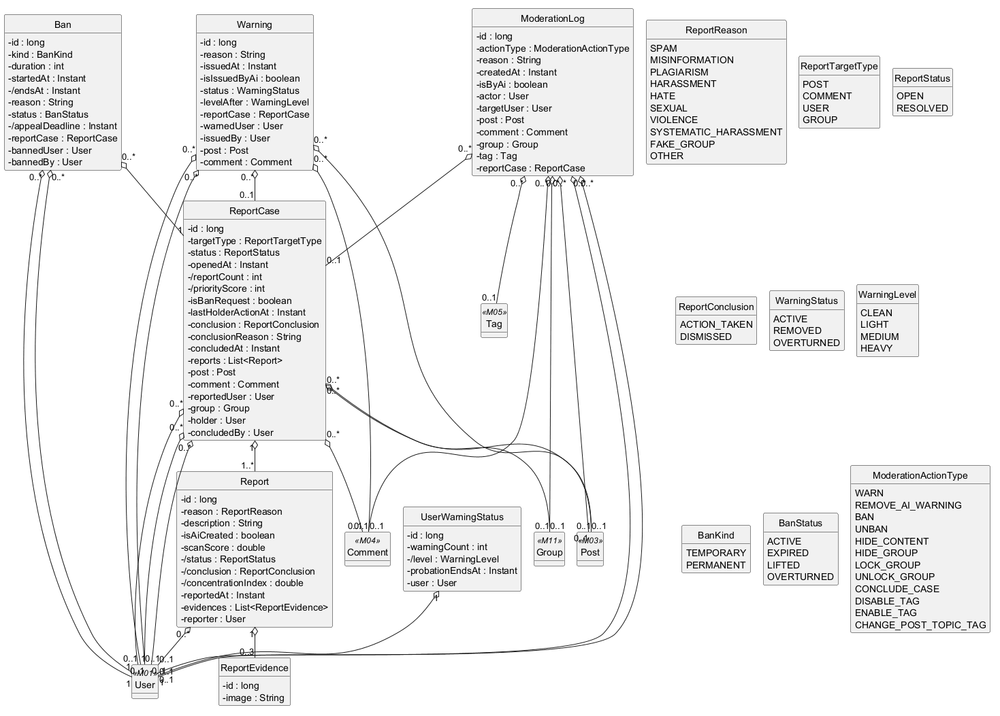

# Thiết kế lớp thực thể — M08 Moderation

<!-- [Vietnamese Doc] Tài liệu tiếng Việt; tên lớp, thuộc tính, kiểu viết tiếng Anh. -->

| Mã tài liệu | CD-M08 |
|---|---|
| Dự án | iShare |
| Module | M08 — Moderation |
| Đầu vào | EC-M08 phiên bản 1.1 |
| Trạng thái | Bản nháp |
| Phiên bản | 0.1 |
| Ngày | 2026-11-20 |
| Tác giả | Phạm Văn Đức |

<!-- Quy ước chung cho mọi bảng dưới đây:
     - Không đổi tên cột, không xóa cột, không đổi số mục: tool đọc bảng theo số mục và tên cột.
     - Ô không có nội dung ghi "—". Mục chưa tới bước làm thì để dòng "(Chưa làm — bước N)".
     - Tập lớp, thuộc tính, quan hệ và mã R-Mxx-nn giữ đúng như EC-Mxx.md.
     - Sơ đồ ở mục 5 do gen_puml.py sinh; không sửa tay.
     - Quy ước dùng (data-model/conventions.md): QU-02 id kiểu long; QU-04 bộ kiểu Java; QU-05 danh sách ghi List<X>. -->

## 1. Lớp và id

<!-- id: Có (lớp của module, không kế thừa) | Kế thừa (lớp con) | Không (lớp thống kê không kế thừa) | Ngoài (lớp của module khác). -->

| Lớp | Nhóm | Sở hữu | Lớp cha | id | Ghi chú |
|---|---|---|---|---|---|
| Report | Thực thể | M08 | — | Có | — |
| ReportEvidence | Thực thể | M08 | — | Có | — |
| ReportCase | Thực thể | M08 | — | Có | — |
| Warning | Thực thể | M08 | — | Có | — |
| UserWarningStatus | Thực thể | M08 | — | Có | — |
| Ban | Thực thể | M08 | — | Có | — |
| ModerationLog | Thực thể | M08 | — | Có | — |
| User | Thực thể | M01 | — | Ngoài | Lớp của M01; id và thuộc tính thiết kế ở CD-M01 |
| Post | Thực thể | M03 | — | Ngoài | Lớp của M03; id và thuộc tính thiết kế ở CD-M03 |
| Comment | Thực thể | M04 | — | Ngoài | Lớp của M04; id và thuộc tính thiết kế ở CD-M04 |
| Group | Thực thể | M11 | — | Ngoài | Lớp của M11; id và thuộc tính thiết kế ở CD-M11 |
| Tag | Thực thể | M05 | — | Ngoài | Lớp của M05; id và thuộc tính thiết kế ở CD-M05 |

## 2. Thuộc tính và kiểu

### 2.1 Thuộc tính

<!-- Chỉ thuộc tính thường (kể cả id). Thuộc tính đối tượng ghi ở mục 4, không ghi ở đây.
     Bắt buộc: Có | Không. Tính chất: Khóa (chỉ id) | Lưu | Dẫn xuất.
     Căn cứ kiểu: mã FR-/BR- quyết định kiểu, hoặc mã quy ước QU-nn.
     Mọi thuộc tính kiểu Instant: lưu UTC, tính mốc và hiển thị theo giờ Việt Nam (DEC-127, QU-04); không nhắc lại ở từng dòng. -->

| Lớp | Thuộc tính | Kiểu | Bắt buộc | Ràng buộc | Tính chất | Căn cứ kiểu |
|---|---|---|---|---|---|---|
| Report | id | long | Có | Duy nhất | Khóa | QU-02 |
| Report | reason | ReportReason | Có | Đúng một lý do (FR-M08-01.07, FR-M08-01.19), chọn từ danh sách của loại đối tượng: bài viết 8, bình luận 7, người dùng 2, nhóm 4 (BR-M08-02); mức nặng 10, 5, 2 theo lý do (BR-M08-06); mục do AI tạo là HARASSMENT, HATE, SEXUAL hoặc VIOLENCE theo nhóm có điểm cao nhất (BR-M08-25, BR-M08-51); không sửa sau khi gửi | Lưu | BR-M08-02 |
| Report | description | String | Không | Bắt buộc khi reason = OTHER (BR-M08-04); không sửa sau khi gửi (FR-M08-01.18) | Lưu | BR-M08-04 |
| Report | isAiCreated | boolean | Có | Đúng khi người báo cáo là "Hệ thống (AI)" (TN:Mục do AI tạo); các trường hợp tạo theo BR-M08-49 | Lưu | QU-04 |
| Report | scanScore | double | Không | 0 đến 1, điểm cao nhất trong bốn nhóm vi phạm (BR-M08-51); chỉ có ở mục do AI tạo | Lưu | BR-M08-51 |
| Report | status | ReportStatus | Có | Bằng ReportCase.status của vụ chứa báo cáo (BR-M08-05, BR-M08-10) | Dẫn xuất | Mục Chuyển trạng thái của FR-M08 |
| Report | conclusion | ReportConclusion | Không | Chỉ có khi RESOLVED; bằng ReportCase.conclusion của vụ (BR-M08-10) | Dẫn xuất | BR-M08-10 |
| Report | concentrationIndex | double | Không | 0–1; = số báo cáo của người báo cáo nhắm vào đối tượng của vụ bị DISMISSED ÷ tổng số báo cáo của người đó đã xử lý, chỉ tính vụ kết luận trong 90 × 24 giờ gần nhất (BR-M08-19); không có khi người báo cáo chưa có báo cáo đã xử lý hoặc là mục do AI tạo; chỉ tham khảo (BR-M08-18) | Dẫn xuất | BR-M08-19 |
| Report | reportedAt | Instant | Có | — | Lưu | QU-04 |
| ReportEvidence | id | long | Có | Duy nhất | Khóa | QU-02 |
| ReportEvidence | image | String | Có | Đường dẫn ảnh trên nơi lưu ảnh (Cloudinary, DEC-137); JPEG, PNG hoặc WebP, tối đa 5 MB; mỗi báo cáo tối đa 3 ảnh (BR-M08-03) | Lưu | BR-M08-03 |
| ReportCase | id | long | Có | Duy nhất | Khóa | QU-02 |
| ReportCase | targetType | ReportTargetType | Có | Quyết định danh sách lý do dùng được (BR-M08-02); khớp đúng một đối tượng của vụ (R-M08-04 đến R-M08-07) | Lưu | TN:Đối tượng bị báo cáo |
| ReportCase | status | ReportStatus | Có | Vụ mới là OPEN; RESOLVED là trạng thái cuối, không mở lại; mỗi đối tượng nhiều nhất một vụ OPEN (BR-M08-05) | Lưu | BR-M08-05 |
| ReportCase | openedAt | Instant | Có | Hai vụ bằng điểm ưu tiên thì vụ mở trước đứng trước (BR-M08-07) | Lưu | QU-04 |
| ReportCase | reportCount | int | Có | ≥ 1; mục do AI tạo tính là một báo cáo (BR-M08-06, BR-M08-49) | Dẫn xuất | QU-04 |
| ReportCase | priorityScore | int | Có | = mức nặng cao nhất (10, 5, 2) trong các lý do của vụ + reportCount × 2 (BR-M08-06); hàng chờ xếp giảm dần (BR-M08-07) | Dẫn xuất | BR-M08-06 |
| ReportCase | isBanRequest | boolean | Có | Đánh dấu khi người đang ở mức HEAVY lại bị xác định vi phạm (BR-M08-36) | Lưu | QU-04 |
| ReportCase | lastHolderActionAt | Instant | Không | Chỉ có khi vụ đang có người giữ; thao tác gồm mở xem, ẩn nội dung, cảnh cáo, ban, kết luận; 30 phút không thao tác thì tự nhả (BR-M08-09) | Lưu | QU-04 |
| ReportCase | conclusion | ReportConclusion | Không | Chỉ có khi RESOLVED; chỉ người đang giữ vụ kết luận (BR-M08-08); không kết luận lại (FR-M08-05.08) | Lưu | Mục Chuyển trạng thái của FR-M08 |
| ReportCase | conclusionReason | String | Không | Bắt buộc khi kết luận (FR-M08-05.09); không cần trùng lý do báo cáo (FR-M08-05.03) | Lưu | QU-04 |
| ReportCase | concludedAt | Instant | Không | Chỉ có khi RESOLVED; dùng cho cửa sổ 90 × 24 giờ của chỉ số tập trung (BR-M08-19) | Lưu | QU-04 |
| Warning | id | long | Có | Duy nhất | Khóa | QU-02 |
| Warning | reason | String | Có | Do Mod, Admin nhập khi ra cảnh cáo (FR-M08-10.01); cảnh cáo do AI ra là tên nhóm vi phạm có điểm cao nhất (BR-M08-51) | Lưu | QU-04 |
| Warning | issuedAt | Instant | Có | Thời gian thử thách tính đủ N × 24 giờ từ lúc này (BR-M08-29, FR-M08-12.03) | Lưu | QU-04 |
| Warning | isIssuedByAi | boolean | Có | Đúng khi người ra là AI (FR-M08-09.01); chỉ cảnh cáo do AI ra mới bỏ được (FR-M08-11.01) | Lưu | QU-04 |
| Warning | status | WarningStatus | Có | Cảnh cáo mới là ACTIVE; bỏ hoặc bị lật thì giữ bản ghi, chỉ đổi trạng thái (BR-M08-54); OVERTURNED do M09 đặt | Lưu | BR-M08-54 |
| Warning | levelAfter | WarningLevel | Có | LIGHT, MEDIUM hoặc HEAVY (không bao giờ CLEAN): mức của người bị cảnh cáo ngay sau cảnh cáo này (BR-M08-28) | Lưu | BR-M08-28 |
| UserWarningStatus | id | long | Có | Duy nhất | Khóa | QU-02 |
| UserWarningStatus | warningCount | int | Có | 0–6; tài khoản mới là 0; tăng 1 mỗi cảnh cáo (FR-M08-09.04, FR-M08-10.02); giảm 1 khi cảnh cáo bị bỏ hoặc bị lật (BR-M08-54); hết thời gian thử thách thì thành 4, 2 hoặc 0 (BR-M08-30) | Lưu | TN:Mức cảnh cáo |
| UserWarningStatus | level | WarningLevel | Có | CLEAN (0), LIGHT (1–2), MEDIUM (3–4), HEAVY (5–6) theo warningCount (BR-M08-28); chỉ chính người đó và Mod, Admin thấy (BR-M08-32) | Dẫn xuất | BR-M08-28 |
| UserWarningStatus | probationEndsAt | Instant | Không | = lúc cảnh cáo hoặc lúc giảm mức + 7, 10, 15 × 24 giờ theo LIGHT, MEDIUM, HEAVY (BR-M08-29, BR-M08-30); không đổi khi cảnh cáo bị bỏ (FR-M08-11.05); không có khi CLEAN | Lưu | BR-M08-29 |
| Ban | id | long | Có | Duy nhất | Khóa | QU-02 |
| Ban | kind | BanKind | Có | Thao tác "Ban" lần thứ 3 trở đi ra PERMANENT (BR-M08-34); "Ban vĩnh viễn" bỏ qua cách tính leo thang (BR-M08-35) | Lưu | BR-M08-34 |
| Ban | duration | int | Không | Đơn vị ngày, N ngày = N × 24 giờ (BR-M08-43); 30 khi chưa từng bị ban, 90 khi đã bị ban 1 lần (BR-M08-34); không có với ban PERMANENT | Lưu | BR-M08-34 |
| Ban | startedAt | Instant | Có | — | Lưu | QU-04 |
| Ban | endsAt | Instant | Không | = startedAt + duration (BR-M08-43); không có với ban PERMANENT | Dẫn xuất | BR-M08-43 |
| Ban | reason | String | Có | — | Lưu | QU-04 |
| Ban | status | BanStatus | Có | Ban mới là ACTIVE; EXPIRED, LIFTED, OVERTURNED là trạng thái cuối; mỗi tài khoản nhiều nhất một ban ACTIVE (BR-M08-52); OVERTURNED do M09 đặt | Lưu | BR-M08-52 |
| Ban | appealDeadline | Instant | Có | Ban tạm thời: = startedAt + duration; ban vĩnh viễn: = startedAt + 90 × 24 giờ (BR-M09-04); quá hạn với ban vĩnh viễn thì mất quyền khiếu nại (BR-M09-05) | Dẫn xuất | BR-M09-04 |
| ModerationLog | id | long | Có | Duy nhất | Khóa | QU-02 |
| ModerationLog | actionType | ModerationActionType | Có | Không ghi việc nhận, nhả vụ (FR-M08-16.07) | Lưu | BR-M08-39 |
| ModerationLog | reason | String | Có | — | Lưu | QU-04 |
| ModerationLog | createdAt | Instant | Có | Giữ vĩnh viễn, không sửa, không xóa (BR-M08-40) | Lưu | QU-04 |
| ModerationLog | isByAi | boolean | Có | Đúng khi người làm là AI; người làm là Mod, Admin hoặc AI (BR-M08-39) | Lưu | QU-04 |

### 2.2 Kiểu liệt kê

<!-- Giá trị viết HOA_GẠCH_DƯỚI, ngăn bởi dấu phẩy. Nguồn: bảng chuyển trạng thái hoặc quy tắc của FR. -->

| Kiểu | Giá trị | Dùng ở | Nguồn |
|---|---|---|---|
| ReportReason | SPAM, MISINFORMATION, PLAGIARISM, HARASSMENT, HATE, SEXUAL, VIOLENCE, SYSTEMATIC_HARASSMENT, FAKE_GROUP, OTHER | Report.reason | BR-M08-02 (Spam/Quảng cáo; Nội dung sai/hiểu nhầm; Đạo văn/Vi phạm bản quyền; Quấy rối/Bắt nạt; Ngôn từ thù ghét/Phân biệt; Nội dung người lớn/Không phù hợp; Bạo lực/Đe dọa; Quấy rối/Bắt nạt có hệ thống; Group giả mạo; Khác); bốn lý do AI dùng cùng tên giá trị với ViolationCategory (CD-M03) |
| ReportTargetType | POST, COMMENT, USER, GROUP | ReportCase.targetType | TN:Đối tượng bị báo cáo; BR-M08-02 |
| ReportStatus | OPEN, RESOLVED | ReportCase.status, Report.status | BR-M08-05; mục Chuyển trạng thái của FR-M08 (Mở, Đã xử lý) |
| ReportConclusion | ACTION_TAKEN, DISMISSED | ReportCase.conclusion, Report.conclusion | Mục Chuyển trạng thái của FR-M08 (Có xử lý, Bác bỏ); BR-M08-10 |
| WarningStatus | ACTIVE, REMOVED, OVERTURNED | Warning.status | BR-M08-54; mục Chuyển trạng thái của FR-M08 (Đang tính, Đã bỏ, Bị lật) |
| WarningLevel | CLEAN, LIGHT, MEDIUM, HEAVY | UserWarningStatus.level, Warning.levelAfter | BR-M08-28 (Sạch, LIGHT, MEDIUM, HEAVY); tên LIGHT, MEDIUM, HEAVY theo DEC-079 |
| BanKind | TEMPORARY, PERMANENT | Ban.kind | BR-M08-34, BR-M08-35 (Tạm thời, Vĩnh viễn) |
| BanStatus | ACTIVE, EXPIRED, LIFTED, OVERTURNED | Ban.status | BR-M08-52; mục Chuyển trạng thái của FR-M08 (Đang hiệu lực, Hết hạn, Đã gỡ, Bị lật) |
| ModerationActionType | WARN, REMOVE_AI_WARNING, BAN, UNBAN, HIDE_CONTENT, HIDE_GROUP, LOCK_GROUP, UNLOCK_GROUP, CONCLUDE_CASE, DISABLE_TAG, ENABLE_TAG, CHANGE_POST_TOPIC_TAG | ModerationLog.actionType | BR-M08-39 (12 thao tác theo đúng thứ tự liệt kê) |

## 3. Chuyển quan hệ

### 3.1 Quan hệ thành phần – toàn thể

<!-- ID: đúng mã của EC. Bội số thành phần = số thành phần ứng với một toàn thể; Bội số toàn thể = số toàn thể ứng với một thành phần.
     Dạng đọc theo thứ tự thành phần–toàn thể: n-1 | 1-n | 1-1. Loại: Hợp thành | Kết tập. -->

| ID | Thành phần | Toàn thể | Bội số thành phần | Bội số toàn thể | Dạng | Loại | Loại ở phân tích | Căn cứ |
|---|---|---|---|---|---|---|---|---|
| R-M08-01 | Report | ReportCase | 1..* | 1 | n-1 | Kết tập | Kết tập | Giữ nguyên từ phân tích |
| R-M08-02 | ReportEvidence | Report | 0..3 | 1 | n-1 | Kết tập | Kết tập | Giữ nguyên từ phân tích |
| R-M08-03 | User | Report | 0..1 | 0..* | 1-n | Kết tập | Kết tập | Giữ nguyên từ phân tích |
| R-M08-04 | Post | ReportCase | 0..1 | 0..* | 1-n | Kết tập | Kết tập | Giữ nguyên từ phân tích |
| R-M08-05 | Comment | ReportCase | 0..1 | 0..* | 1-n | Kết tập | Kết tập | Giữ nguyên từ phân tích |
| R-M08-06 | User | ReportCase | 0..1 | 0..* | 1-n | Kết tập | Kết tập | Giữ nguyên từ phân tích |
| R-M08-07 | Group | ReportCase | 0..1 | 0..* | 1-n | Kết tập | Kết tập | Giữ nguyên từ phân tích |
| R-M08-08 | User | ReportCase | 0..1 | 0..* | 1-n | Kết tập | Kết tập | Giữ nguyên từ phân tích |
| R-M08-09 | User | ReportCase | 0..1 | 0..* | 1-n | Kết tập | Kết tập | Giữ nguyên từ phân tích |
| R-M08-10 | ReportCase | Warning | 0..1 | 0..* | 1-n | Kết tập | Kết tập | Giữ nguyên từ phân tích |
| R-M08-11 | ReportCase | Ban | 1 | 0..* | 1-n | Kết tập | Liên kết | Liên kết 1-n không có lớp liên kết: mặc định phía 1 là thành phần của phía n, tức lần ban giữ tham chiếu tới vụ mà người ban đang giữ khi tạo ban (BR-M08-48); FR không mô tả ban như phần của vụ |
| R-M08-12 | User | Warning | 1 | 0..* | 1-n | Kết tập | Kết tập | Giữ nguyên từ phân tích |
| R-M08-13 | User | Warning | 0..1 | 0..* | 1-n | Kết tập | Kết tập | Giữ nguyên từ phân tích |
| R-M08-14 | Post | Warning | 0..1 | 0..* | 1-n | Kết tập | Kết tập | Giữ nguyên từ phân tích |
| R-M08-15 | Comment | Warning | 0..1 | 0..* | 1-n | Kết tập | Kết tập | Giữ nguyên từ phân tích |
| R-M08-16 | User | UserWarningStatus | 1 | 1 | 1-1 | Kết tập | Kết tập | Giữ nguyên từ phân tích |
| R-M08-17 | User | Ban | 1 | 0..* | 1-n | Kết tập | Kết tập | Giữ nguyên từ phân tích |
| R-M08-18 | User | Ban | 1 | 0..* | 1-n | Kết tập | Kết tập | Giữ nguyên từ phân tích |
| R-M08-19 | User | ModerationLog | 0..1 | 0..* | 1-n | Kết tập | Kết tập | Giữ nguyên từ phân tích |
| R-M08-20 | User | ModerationLog | 0..1 | 0..* | 1-n | Kết tập | Kết tập | Giữ nguyên từ phân tích |
| R-M08-21 | Post | ModerationLog | 0..1 | 0..* | 1-n | Kết tập | Kết tập | Giữ nguyên từ phân tích |
| R-M08-22 | Comment | ModerationLog | 0..1 | 0..* | 1-n | Kết tập | Kết tập | Giữ nguyên từ phân tích |
| R-M08-23 | Group | ModerationLog | 0..1 | 0..* | 1-n | Kết tập | Kết tập | Giữ nguyên từ phân tích |
| R-M08-24 | Tag | ModerationLog | 0..1 | 0..* | 1-n | Kết tập | Kết tập | Giữ nguyên từ phân tích |
| R-M08-25 | ReportCase | ModerationLog | 0..1 | 0..* | 1-n | Kết tập | Kết tập | Giữ nguyên từ phân tích |

### 3.2 Quan hệ giữ nguyên

<!-- Loại: Kế thừa (Lớp = lớp con, Lớp đích = lớp cha) | Phụ thuộc (Lớp = lớp phụ thuộc, Lớp đích = lớp được dùng). -->

| ID | Loại | Lớp | Lớp đích | Ghi chú |
|---|---|---|---|---|
| — | — | — | — | — |

## 4. Thuộc tính đối tượng

<!-- Mỗi dòng của mục 3.1 đúng một dòng ở đây. Lớp chứa = lớp toàn thể.
     Kiểu: ThànhPhần (dạng 1-n, 1-1) hoặc List<ThànhPhần> (dạng n-1, QU-05). -->

| Quan hệ | Lớp chứa | Thuộc tính | Kiểu | Quy tắc |
|---|---|---|---|---|
| R-M08-01 | ReportCase | reports | List<Report> | Report là thành phần của ReportCase, dạng n-1 → ReportCase có danh sách Report |
| R-M08-02 | Report | evidences | List<ReportEvidence> | ReportEvidence là thành phần của Report, dạng n-1 → Report có danh sách ReportEvidence |
| R-M08-03 | Report | reporter | User | User là thành phần của Report, dạng 1-n → Report có một User (tên theo vai trò) |
| R-M08-04 | ReportCase | post | Post | Post là thành phần của ReportCase, dạng 1-n → ReportCase có một Post |
| R-M08-05 | ReportCase | comment | Comment | Comment là thành phần của ReportCase, dạng 1-n → ReportCase có một Comment |
| R-M08-06 | ReportCase | reportedUser | User | User là thành phần của ReportCase, dạng 1-n → ReportCase có một User (tên theo vai trò) |
| R-M08-07 | ReportCase | group | Group | Group là thành phần của ReportCase, dạng 1-n → ReportCase có một Group |
| R-M08-08 | ReportCase | holder | User | User là thành phần của ReportCase, dạng 1-n → ReportCase có một User (tên theo vai trò) |
| R-M08-09 | ReportCase | concludedBy | User | User là thành phần của ReportCase, dạng 1-n → ReportCase có một User (tên theo vai trò) |
| R-M08-10 | Warning | reportCase | ReportCase | ReportCase là thành phần của Warning, dạng 1-n → Warning có một ReportCase |
| R-M08-11 | Ban | reportCase | ReportCase | ReportCase là thành phần của Ban, dạng 1-n → Ban có một ReportCase |
| R-M08-12 | Warning | warnedUser | User | User là thành phần của Warning, dạng 1-n → Warning có một User (tên theo vai trò) |
| R-M08-13 | Warning | issuedBy | User | User là thành phần của Warning, dạng 1-n → Warning có một User (tên theo vai trò) |
| R-M08-14 | Warning | post | Post | Post là thành phần của Warning, dạng 1-n → Warning có một Post |
| R-M08-15 | Warning | comment | Comment | Comment là thành phần của Warning, dạng 1-n → Warning có một Comment |
| R-M08-16 | UserWarningStatus | user | User | User là thành phần của UserWarningStatus, dạng 1-1 → UserWarningStatus có một User |
| R-M08-17 | Ban | bannedUser | User | User là thành phần của Ban, dạng 1-n → Ban có một User (tên theo vai trò) |
| R-M08-18 | Ban | bannedBy | User | User là thành phần của Ban, dạng 1-n → Ban có một User (tên theo vai trò) |
| R-M08-19 | ModerationLog | actor | User | User là thành phần của ModerationLog, dạng 1-n → ModerationLog có một User (tên theo vai trò) |
| R-M08-20 | ModerationLog | targetUser | User | User là thành phần của ModerationLog, dạng 1-n → ModerationLog có một User (tên theo vai trò) |
| R-M08-21 | ModerationLog | post | Post | Post là thành phần của ModerationLog, dạng 1-n → ModerationLog có một Post |
| R-M08-22 | ModerationLog | comment | Comment | Comment là thành phần của ModerationLog, dạng 1-n → ModerationLog có một Comment |
| R-M08-23 | ModerationLog | group | Group | Group là thành phần của ModerationLog, dạng 1-n → ModerationLog có một Group |
| R-M08-24 | ModerationLog | tag | Tag | Tag là thành phần của ModerationLog, dạng 1-n → ModerationLog có một Tag |
| R-M08-25 | ModerationLog | reportCase | ReportCase | ReportCase là thành phần của ModerationLog, dạng 1-n → ModerationLog có một ReportCase |

## 5. Sơ đồ lớp thiết kế

<!-- BEGIN:DIAGRAM -->

Mã nguồn sơ đồ: [diagrams/CD-M08.puml](diagrams/CD-M08.puml). Ảnh và tệp .puml do `gen_puml.py` sinh từ các bảng của tài liệu này; muốn đổi sơ đồ thì sửa bảng rồi chạy lại tool, không sửa tay.
<!-- END:DIAGRAM -->

## 6. Liên module

<!-- Mỗi lớp ngoài một dòng. "Đề nghị cho module sở hữu": thuộc tính đối tượng mà module này cần thêm vào lớp đó, kèm mã quan hệ. -->

| Lớp | Module sở hữu | Module này dùng thế nào | Đề nghị cho module sở hữu |
|---|---|---|---|
| User | M01 | Ghi người báo cáo (R-M08-03); đối tượng, người giữ vụ, người kết luận của vụ (R-M08-06, R-M08-08, R-M08-09); người bị cảnh cáo, người ra cảnh cáo (R-M08-12, R-M08-13); trạng thái cảnh cáo (R-M08-16); người bị ban, người ban (R-M08-17, R-M08-18); người làm và đối tượng của dòng nhật ký (R-M08-19, R-M08-20). Đọc role, username; ban, gỡ ban làm M01 đổi status | — |
| Post | M03 | Đối tượng của vụ (R-M08-04); nội dung liên quan của cảnh cáo do AI ra (R-M08-14); đối tượng của dòng nhật ký (R-M08-21). Đọc title, content; ghi modState (Bị ẩn, Bình thường) | — |
| Comment | M04 | Đối tượng của vụ (R-M08-05); nội dung liên quan của cảnh cáo do AI ra (R-M08-15); đối tượng của dòng nhật ký (R-M08-22). Đọc content, publishedAt, editedAt để quét luồng; ghi modState (Bị ẩn, Bình thường) | — |
| Group | M11 | Đối tượng của vụ (R-M08-07); đối tượng của dòng nhật ký (R-M08-23) | — |
| Tag | M05 | Đối tượng của dòng nhật ký (R-M08-24, trùng R-M05-14 của EC-M05; lượt gộp khử trùng). Đọc name | — |

## 7. Quyết định thiết kế

| Mã | Quyết định | Lý do |
|---|---|---|
| — | — | — |

## 8. Câu hỏi và điểm chưa chốt

| Mã | Loại | Câu hỏi | Trả lời | Ghi vào |
|---|---|---|---|---|
| Q-01 | Xác nhận | Tên giá trị kiểu liệt kê tự đặt (register chỉ có LIGHT, MEDIUM, HEAVY): ReportReason 10 giá trị, trong đó bốn lý do AI dùng chung tên với ViolationCategory (HARASSMENT, HATE, SEXUAL, VIOLENCE) để mục do AI tạo lấy thẳng nhóm vi phạm làm lý do; WarningLevel thêm CLEAN cho mức Sạch (0 lần); ReportStatus OPEN, RESOLVED; ReportConclusion ACTION_TAKEN, DISMISSED; WarningStatus ACTIVE, REMOVED, OVERTURNED; BanStatus ACTIVE, EXPIRED, LIFTED, OVERTURNED; ModerationActionType 12 giá trị. Đồng ý? | Đồng ý (người dùng, 2026-11-20) | Mục 2.2 |
| Q-02 | Xác nhận | Kiểu và tính bắt buộc suy ra: Ban.duration kiểu int đơn vị ngày; Ban.reason, ModerationLog.reason Có (BR-M08-39 nói mỗi dòng nhật ký gồm lý do); Warning.reason kiểu String (Mod nhập tự do, AI ghi tên nhóm vi phạm); Report.concentrationIndex kiểu double, Không (không có khi người báo cáo chưa có báo cáo nào đã xử lý); Report.reportedAt Có; ReportCase.priorityScore kiểu int. Đồng ý? | Đồng ý (người dùng, 2026-11-20) | Mục 2.1 |
| Q-03 | Xác nhận | R-M08-11 (ReportCase 1 – Ban 0..*, Liên kết ở phân tích) chuyển thành Ban giữ một reportCase (vụ đang giữ khi tạo ban), không phải ReportCase giữ danh sách ban. Tên theo vai trò: Report.reporter; ReportCase.reportedUser, holder, concludedBy; Warning.warnedUser, issuedBy; Ban.bannedUser, bannedBy; ModerationLog.actor, targetUser. Đồng ý? | Đồng ý (người dùng, 2026-11-20) | Mục 3.1, 4 |

## 9. Lịch sử sửa đổi

| Phiên bản | Ngày | Nội dung | Người sửa |
|---|---|---|---|
| 0.1 | 2026-11-20 | Tạo mới từ EC-M08 v1.1; làm liền bước 1–4 theo yêu cầu của người dùng (không dừng ở cổng); chưa qua duyệt, câu hỏi ở mục 8 chờ trả lời | Phạm Văn Đức |
| 0.2 | 2026-11-20 | Ghi trả lời mục 8: người dùng đồng ý các đề xuất; chờ chốt | Phạm Văn Đức |
| 1.0 | 2026-11-20 | Chốt: người dùng chốt CD-M08 | Phạm Văn Đức |
