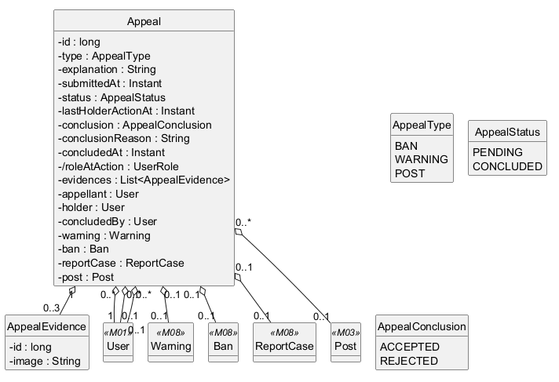

# Thiết kế lớp thực thể — M09 Appeal

<!-- [Vietnamese Doc] Tài liệu tiếng Việt; tên lớp, thuộc tính, kiểu viết tiếng Anh. -->

| Mã tài liệu | CD-M09 |
|---|---|
| Dự án | iShare |
| Module | M09 — Appeal |
| Đầu vào | EC-M09 phiên bản 1.1 |
| Trạng thái | Bản nháp |
| Phiên bản | 0.1 |
| Ngày | 2026-11-20 |
| Tác giả | Phạm Văn Đức |

<!-- Quy ước chung cho mọi bảng dưới đây:
     - Không đổi tên cột, không xóa cột, không đổi số mục: tool đọc bảng theo số mục và tên cột.
     - Ô không có nội dung ghi "—". Mục chưa tới bước làm thì để dòng "(Chưa làm — bước N)".
     - Tập lớp, thuộc tính, quan hệ và mã R-Mxx-nn giữ đúng như EC-Mxx.md.
     - Sơ đồ ở mục 5 do gen_puml.py sinh; không sửa tay.
     - Quy ước dùng (data-model/conventions.md): QU-02 id kiểu long; QU-04 bộ kiểu Java; QU-05 danh sách ghi List<X>. -->

## 1. Lớp và id

<!-- id: Có (lớp của module, không kế thừa) | Kế thừa (lớp con) | Không (lớp thống kê không kế thừa) | Ngoài (lớp của module khác). -->

| Lớp | Nhóm | Sở hữu | Lớp cha | id | Ghi chú |
|---|---|---|---|---|---|
| Appeal | Thực thể | M09 | — | Có | — |
| AppealEvidence | Thực thể | M09 | — | Có | — |
| User | Thực thể | M01 | — | Ngoài | Lớp của M01; id và thuộc tính thiết kế ở CD-M01 |
| Warning | Thực thể | M08 | — | Ngoài | Lớp của M08; id và thuộc tính thiết kế ở CD-M08 |
| Ban | Thực thể | M08 | — | Ngoài | Lớp của M08; id và thuộc tính thiết kế ở CD-M08 |
| ReportCase | Thực thể | M08 | — | Ngoài | Lớp của M08; id và thuộc tính thiết kế ở CD-M08 |
| Post | Thực thể | M03 | — | Ngoài | Lớp của M03; id và thuộc tính thiết kế ở CD-M03 |

## 2. Thuộc tính và kiểu

### 2.1 Thuộc tính

<!-- Chỉ thuộc tính thường (kể cả id). Thuộc tính đối tượng ghi ở mục 4, không ghi ở đây.
     Bắt buộc: Có | Không. Tính chất: Khóa (chỉ id) | Lưu | Dẫn xuất.
     Căn cứ kiểu: mã FR-/BR- quyết định kiểu, hoặc mã quy ước QU-nn.
     Mọi thuộc tính kiểu Instant: lưu UTC, tính mốc và hiển thị theo giờ Việt Nam (DEC-127, QU-04); không nhắc lại ở từng dòng. -->

| Lớp | Thuộc tính | Kiểu | Bắt buộc | Ràng buộc | Tính chất | Căn cứ kiểu |
|---|---|---|---|---|---|---|
| Appeal | id | long | Có | Duy nhất | Khóa | QU-02 |
| Appeal | type | AppealType | Có | Gắn theo xử lý bị khiếu nại; khiếu nại bài bị gỡ và khiếu nại gộp đều là POST (FR-M09-01.03, TN:Loại khiếu nại); hàng chờ xếp BAN, rồi WARNING, rồi POST (BR-M09-10); khớp với quan hệ tới xử lý (R-M09-05 đến R-M09-08) | Lưu | TN:Loại khiếu nại |
| Appeal | explanation | String | Có | Không trống (BR-M09-03, FR-M09-01.10); không sửa sau khi gửi (BR-M09-27) | Lưu | BR-M09-03 |
| Appeal | submittedAt | Instant | Có | Phải trước hạn khiếu nại của xử lý (BR-M09-04); cùng loại thì gửi trước đứng trước (BR-M09-10) | Lưu | QU-04 |
| Appeal | status | AppealStatus | Có | Khiếu nại mới là PENDING (FR-M09-01.01); CONCLUDED là trạng thái cuối, không kết luận lại (FR-M09-07.08); "chưa ai giữ", "đang được giữ" suy từ quan hệ người giữ | Lưu | Mục Chuyển trạng thái của FR-M09 |
| Appeal | lastHolderActionAt | Instant | Không | Chỉ có khi đang có người giữ; đặt lúc nhận và mỗi lần người giữ mở xem; 30 phút không thao tác thì tự nhả (BR-M09-11) | Lưu | QU-04 |
| Appeal | conclusion | AppealConclusion | Không | Chỉ có khi CONCLUDED; chỉ người đang giữ kết luận (FR-M09-07.06); REJECTED là cuối cùng, không gửi lại cho cùng xử lý (BR-M09-06) | Lưu | Mục Chuyển trạng thái của FR-M09 |
| Appeal | conclusionReason | String | Không | Chỉ có khi CONCLUDED; bắt buộc ở cả ACCEPTED và REJECTED (BR-M09-27, FR-M09-07.11); gửi kèm thông báo kết luận (BR-M09-20) | Lưu | BR-M09-27 |
| Appeal | concludedAt | Instant | Không | Chỉ có khi CONCLUDED | Lưu | QU-04 |
| Appeal | roleAtAction | UserRole | Có | Chỉ USER hoặc MODERATOR (Admin không có khiếu nại, BR-M09-01); vai trò tại thời điểm có xử lý, vẫn là MODERATOR khi đã mất vai trò Mod vì bị ban (FR-M09-03.08); MODERATOR thì chỉ Admin xét (BR-M09-12) | Dẫn xuất | BR-M09-01 |
| AppealEvidence | id | long | Có | Duy nhất | Khóa | QU-02 |
| AppealEvidence | image | String | Có | Đường dẫn ảnh trên nơi lưu ảnh (Cloudinary, DEC-137); JPEG, PNG hoặc WebP, tối đa 5 MB; mỗi khiếu nại tối đa 3 ảnh (BR-M09-03); không sửa sau khi gửi (BR-M09-27) | Lưu | BR-M09-03 |

### 2.2 Kiểu liệt kê

<!-- Giá trị viết HOA_GẠCH_DƯỚI, ngăn bởi dấu phẩy. Nguồn: bảng chuyển trạng thái hoặc quy tắc của FR. -->

Kiểu liệt kê dùng lại của module khác, không khai lại: UserRole (CD-M01) cho Appeal.roleAtAction. Tool báo WARN "chưa khai ở mục 2.2" cho thuộc tính này; giữ lại.

| Kiểu | Giá trị | Dùng ở | Nguồn |
|---|---|---|---|
| AppealType | BAN, WARNING, POST | Appeal.type | TN:Loại khiếu nại (Ban, Cảnh cáo, Bài viết); FR-M09-01.03, BR-M09-10 |
| AppealStatus | PENDING, CONCLUDED | Appeal.status | Mục Chuyển trạng thái của FR-M09 (Chờ xét, Đã kết luận) |
| AppealConclusion | ACCEPTED, REJECTED | Appeal.conclusion | Mục Chuyển trạng thái của FR-M09 (Chấp nhận, Từ chối); BR-M09-06 |

## 3. Chuyển quan hệ

### 3.1 Quan hệ thành phần – toàn thể

<!-- ID: đúng mã của EC. Bội số thành phần = số thành phần ứng với một toàn thể; Bội số toàn thể = số toàn thể ứng với một thành phần.
     Dạng đọc theo thứ tự thành phần–toàn thể: n-1 | 1-n | 1-1. Loại: Hợp thành | Kết tập. -->

| ID | Thành phần | Toàn thể | Bội số thành phần | Bội số toàn thể | Dạng | Loại | Loại ở phân tích | Căn cứ |
|---|---|---|---|---|---|---|---|---|
| R-M09-01 | AppealEvidence | Appeal | 0..3 | 1 | n-1 | Kết tập | Kết tập | Giữ nguyên từ phân tích |
| R-M09-02 | User | Appeal | 1 | 0..* | 1-n | Kết tập | Kết tập | Giữ nguyên từ phân tích |
| R-M09-03 | User | Appeal | 0..1 | 0..* | 1-n | Kết tập | Kết tập | Giữ nguyên từ phân tích |
| R-M09-04 | User | Appeal | 0..1 | 0..* | 1-n | Kết tập | Kết tập | Giữ nguyên từ phân tích |
| R-M09-05 | Warning | Appeal | 0..1 | 0..1 | 1-1 | Kết tập | Kết tập | Giữ nguyên từ phân tích |
| R-M09-06 | Ban | Appeal | 0..1 | 0..1 | 1-1 | Kết tập | Kết tập | Giữ nguyên từ phân tích |
| R-M09-07 | ReportCase | Appeal | 0..1 | 0..1 | 1-1 | Kết tập | Kết tập | Giữ nguyên từ phân tích |
| R-M09-08 | Post | Appeal | 0..1 | 0..* | 1-n | Kết tập | Kết tập | Giữ nguyên từ phân tích |

### 3.2 Quan hệ giữ nguyên

<!-- Loại: Kế thừa (Lớp = lớp con, Lớp đích = lớp cha) | Phụ thuộc (Lớp = lớp phụ thuộc, Lớp đích = lớp được dùng). -->

| ID | Loại | Lớp | Lớp đích | Ghi chú |
|---|---|---|---|---|
| — | — | — | — | — |

## 4. Thuộc tính đối tượng

<!-- Mỗi dòng của mục 3.1 đúng một dòng ở đây. Lớp chứa = lớp toàn thể.
     Kiểu: ThànhPhần (dạng 1-n, 1-1) hoặc List<ThànhPhần> (dạng n-1, QU-05). -->

| Quan hệ | Lớp chứa | Thuộc tính | Kiểu | Quy tắc |
|---|---|---|---|---|
| R-M09-01 | Appeal | evidences | List<AppealEvidence> | AppealEvidence là thành phần của Appeal, dạng n-1 → Appeal có danh sách AppealEvidence |
| R-M09-02 | Appeal | appellant | User | User là thành phần của Appeal, dạng 1-n → Appeal có một User (tên theo vai trò) |
| R-M09-03 | Appeal | holder | User | User là thành phần của Appeal, dạng 1-n → Appeal có một User (tên theo vai trò) |
| R-M09-04 | Appeal | concludedBy | User | User là thành phần của Appeal, dạng 1-n → Appeal có một User (tên theo vai trò) |
| R-M09-05 | Appeal | warning | Warning | Warning là thành phần của Appeal, dạng 1-1 → Appeal có một Warning |
| R-M09-06 | Appeal | ban | Ban | Ban là thành phần của Appeal, dạng 1-1 → Appeal có một Ban |
| R-M09-07 | Appeal | reportCase | ReportCase | ReportCase là thành phần của Appeal, dạng 1-1 → Appeal có một ReportCase |
| R-M09-08 | Appeal | post | Post | Post là thành phần của Appeal, dạng 1-n → Appeal có một Post |

## 5. Sơ đồ lớp thiết kế

<!-- BEGIN:DIAGRAM -->

Mã nguồn sơ đồ: [diagrams/CD-M09.puml](diagrams/CD-M09.puml). Ảnh và tệp .puml do `gen_puml.py` sinh từ các bảng của tài liệu này; muốn đổi sơ đồ thì sửa bảng rồi chạy lại tool, không sửa tay.
<!-- END:DIAGRAM -->

## 6. Liên module

<!-- Mỗi lớp ngoài một dòng. "Đề nghị cho module sở hữu": thuộc tính đối tượng mà module này cần thêm vào lớp đó, kèm mã quan hệ. -->

| Lớp | Module sở hữu | Module này dùng thế nào | Đề nghị cho module sở hữu |
|---|---|---|---|
| User | M01 | Người khiếu nại, người đang giữ, người kết luận (R-M09-02, R-M09-03, R-M09-04). Đọc role để kiểm quyền Mod, Admin; đọc status để tài khoản BANNED chỉ khiếu nại được ban đang hiệu lực; đọc username để hiển thị người khiếu nại. Khiếu nại một ban đang hiệu lực được chấp nhận thì M01 đưa status về ACTIVE; không ghi role | — |
| Warning | M08 | Xử lý bị khiếu nại của khiếu nại cảnh cáo và khiếu nại gộp (R-M09-05); cảnh cáo ra cùng lần gỡ bài đọc qua vụ (R-M08-10); người ra cảnh cáo đọc qua R-M08-13. Đọc reason, issuedAt, isIssuedByAi, levelAfter; ghi status (Bị lật), rồi M08 giảm số lần cảnh cáo và tính lại mức | — |
| Ban | M08 | Xử lý bị khiếu nại của khiếu nại ban (R-M09-06); ban ra cùng lần gỡ bài đọc qua vụ (R-M08-11); người ban đọc qua R-M08-18. Đọc kind, duration, startedAt, reason; ghi status (Bị lật) | — |
| ReportCase | M08 | Lần gỡ bài viết của khiếu nại bài bị gỡ (R-M09-07, Q-01); bài bị gỡ đọc qua R-M08-04, người ra xử lý là người kết luận vụ (R-M08-09). Đọc conclusionReason, concludedAt; không ghi | — |
| Post | M03 | Bài bị AI tự từ chối của khiếu nại gộp (R-M09-08); bài bị gỡ đọc qua vụ (R-M08-04). Đọc title, content, violationCategory, rejectedAt; ghi modState (Bình thường) và publishState (Đã đăng) | — |

## 7. Quyết định thiết kế

| Mã | Quyết định | Lý do |
|---|---|---|
| — | — | — |

## 8. Câu hỏi và điểm chưa chốt

| Mã | Loại | Câu hỏi | Trả lời | Ghi vào |
|---|---|---|---|---|
| Q-01 | Xác nhận | Kiểu liệt kê: AppealType BAN, WARNING, POST; AppealStatus PENDING, CONCLUDED; AppealConclusion ACCEPTED, REJECTED; Appeal.roleAtAction dùng lại UserRole của M01 (chỉ nhận USER, MODERATOR). Tên theo vai trò: Appeal.appellant (người khiếu nại), holder, concludedBy như ReportCase của M08. Đồng ý? | Đồng ý (người dùng, 2026-11-20) | Mục 2.1, 2.2, 4 |

## 9. Lịch sử sửa đổi

| Phiên bản | Ngày | Nội dung | Người sửa |
|---|---|---|---|
| 0.1 | 2026-11-20 | Tạo mới từ EC-M09 v1.1; làm liền bước 1–4 theo yêu cầu của người dùng (không dừng ở cổng); chưa qua duyệt, câu hỏi ở mục 8 chờ trả lời | Phạm Văn Đức |
| 0.2 | 2026-11-20 | Ghi trả lời mục 8: người dùng đồng ý các đề xuất; chờ chốt | Phạm Văn Đức |
| 1.0 | 2026-11-20 | Chốt: người dùng chốt CD-M09 | Phạm Văn Đức |
