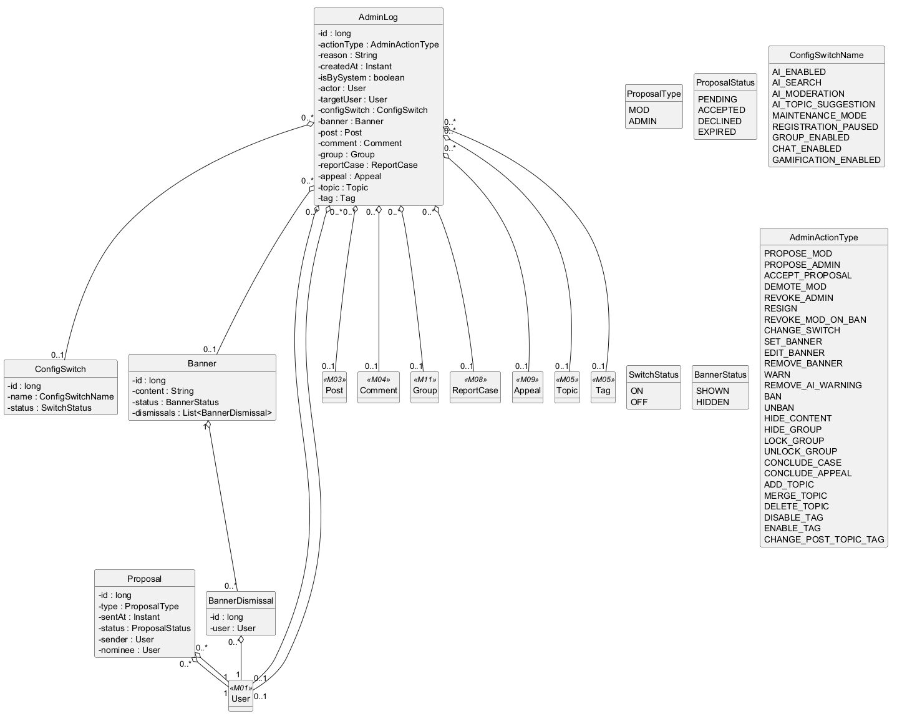

# Thiết kế lớp thực thể — M10 Admin Panel

<!-- [Vietnamese Doc] Tài liệu tiếng Việt; tên lớp, thuộc tính, kiểu viết tiếng Anh. -->

| Mã tài liệu | CD-M10 |
|---|---|
| Dự án | iShare |
| Module | M10 — Admin Panel |
| Đầu vào | EC-M10 phiên bản 1.1 |
| Trạng thái | Bản nháp |
| Phiên bản | 0.1 |
| Ngày | 2026-11-20 |
| Tác giả | Phạm Văn Đức |

<!-- Quy ước chung cho mọi bảng dưới đây:
     - Không đổi tên cột, không xóa cột, không đổi số mục: tool đọc bảng theo số mục và tên cột.
     - Ô không có nội dung ghi "—". Mục chưa tới bước làm thì để dòng "(Chưa làm — bước N)".
     - Tập lớp, thuộc tính, quan hệ và mã R-Mxx-nn giữ đúng như EC-Mxx.md.
     - Sơ đồ ở mục 5 do gen_puml.py sinh; không sửa tay.
     - Quy ước dùng (data-model/conventions.md): QU-02 id kiểu long; QU-04 bộ kiểu Java; QU-05 danh sách ghi List<X>. -->

## 1. Lớp và id

<!-- id: Có (lớp của module, không kế thừa) | Kế thừa (lớp con) | Không (lớp thống kê không kế thừa) | Ngoài (lớp của module khác). -->

| Lớp | Nhóm | Sở hữu | Lớp cha | id | Ghi chú |
|---|---|---|---|---|---|
| Proposal | Thực thể | M10 | — | Có | — |
| ConfigSwitch | Thực thể | M10 | — | Có | — |
| Banner | Thực thể | M10 | — | Có | — |
| BannerDismissal | Liên kết | M10 | — | Có | — |
| AdminLog | Thực thể | M10 | — | Có | — |
| User | Thực thể | M01 | — | Ngoài | Lớp của M01; id và thuộc tính thiết kế ở CD-M01 |
| Post | Thực thể | M03 | — | Ngoài | Lớp của M03; id và thuộc tính thiết kế ở CD-M03 |
| Comment | Thực thể | M04 | — | Ngoài | Lớp của M04; id và thuộc tính thiết kế ở CD-M04 |
| Group | Thực thể | M11 | — | Ngoài | Lớp của M11; id và thuộc tính thiết kế ở CD-M11 |
| ReportCase | Thực thể | M08 | — | Ngoài | Lớp của M08; id và thuộc tính thiết kế ở CD-M08 |
| Appeal | Thực thể | M09 | — | Ngoài | Lớp của M09; id và thuộc tính thiết kế ở CD-M09 |
| Topic | Thực thể | M05 | — | Ngoài | Lớp của M05; id và thuộc tính thiết kế ở CD-M05 |
| Tag | Thực thể | M05 | — | Ngoài | Lớp của M05; id và thuộc tính thiết kế ở CD-M05 |

## 2. Thuộc tính và kiểu

### 2.1 Thuộc tính

<!-- Chỉ thuộc tính thường (kể cả id). Thuộc tính đối tượng ghi ở mục 4, không ghi ở đây.
     Bắt buộc: Có | Không. Tính chất: Khóa (chỉ id) | Lưu | Dẫn xuất.
     Căn cứ kiểu: mã FR-/BR- quyết định kiểu, hoặc mã quy ước QU-nn.
     Mọi thuộc tính kiểu Instant: lưu UTC, tính mốc và hiển thị theo giờ Việt Nam (DEC-127, QU-04); không nhắc lại ở từng dòng. -->

| Lớp | Thuộc tính | Kiểu | Bắt buộc | Ràng buộc | Tính chất | Căn cứ kiểu |
|---|---|---|---|---|---|---|
| Proposal | id | long | Có | Duy nhất | Khóa | QU-02 |
| Proposal | type | ProposalType | Có | MOD gửi cho tài khoản USER (FR-M10-02.07); ADMIN gửi cho USER hoặc MODERATOR (FR-M10-07.02, BR-M10-11); mỗi người được đề xuất nhiều nhất một đề xuất PENDING cho mỗi loại (BR-M10-27) | Lưu | TN:Đề xuất |
| Proposal | sentAt | Instant | Có | Lúc hệ thống lưu đề xuất; hạn đề xuất = sentAt + 7 × 24 giờ, hằng số chính sách (BR-M10-07, BR-M10-04) | Lưu | QU-04 |
| Proposal | status | ProposalStatus | Có | Mới gửi là PENDING; trả lời một lần (BR-M10-07); PENDING sang EXPIRED khi đủ 7 × 24 giờ từ sentAt hoặc có đề xuất mới cùng loại cho cùng người (BR-M10-27) | Lưu | TN:Trạng thái của đề xuất |
| ConfigSwitch | id | long | Có | Duy nhất | Khóa | QU-02 |
| ConfigSwitch | name | ConfigSwitchName | Có | Duy nhất; đúng chín công tắc, không tạo thêm, không xóa (FR-M10-09.01, FR-M10-12.03, BR-M10-12, BR-M10-19) | Lưu | BR-M10-12, BR-M10-19 |
| ConfigSwitch | status | SwitchStatus | Có | Khởi tạo: công tắc AI và ba cờ tính năng ON, chế độ bảo trì và tạm dừng đăng ký OFF (BR-M10-26); áp cho mọi thao tác sau thời điểm đổi (BR-M10-13); công tắc AI riêng vẫn lưu khi công tắc tổng OFF, chỉ có tác dụng khi công tắc tổng ON (FR-M10-09.06, BR-M10-14) | Lưu | TN:Trạng thái của công tắc cấu hình |
| Banner | id | long | Có | Duy nhất | Khóa | QU-02 |
| Banner | content | String | Có | 1–200 ký tự đếm sau khi bỏ khoảng trắng đầu và cuối (TN:Ký tự của banner); văn bản thuần (BR-M10-20, FR-M10-13.05, FR-M10-13.06) | Lưu | BR-M10-20 |
| Banner | status | BannerStatus | Có | Nhiều nhất một banner SHOWN (BR-M10-20); đặt banner mới thì banner đang hiện được thay (FR-M10-13.04) | Lưu | BR-M10-20 |
| BannerDismissal | id | long | Có | Duy nhất | Khóa | QU-02 |
| AdminLog | id | long | Có | Duy nhất | Khóa | QU-02 |
| AdminLog | actionType | AdminActionType | Có | Không ghi việc xem, nhận, nhả vụ hay khiếu nại, việc Admin làm như người dùng thường, quyết định của AI (FR-M10-14.05, FR-M10-14.08) | Lưu | FR-M10-14.02 |
| AdminLog | reason | String | Không | Tùy chọn; thao tác mà module gốc bắt buộc lý do thì lấy đúng lý do đó (BR-M10-23, FR-M10-14.09) | Lưu | QU-04 |
| AdminLog | createdAt | Instant | Có | Lúc thao tác hoàn tất; mới nhất trước (BR-M10-23); không sửa, không xóa, giữ vĩnh viễn (BR-M10-22) | Lưu | QU-04 |
| AdminLog | isBySystem | boolean | Có | Đúng khi Mod mất vai trò do bị ban (FR-M10-14.07, BR-M10-21) | Lưu | QU-04 |

### 2.2 Kiểu liệt kê

<!-- Giá trị viết HOA_GẠCH_DƯỚI, ngăn bởi dấu phẩy. Nguồn: bảng chuyển trạng thái hoặc quy tắc của FR. -->

| Kiểu | Giá trị | Dùng ở | Nguồn |
|---|---|---|---|
| ProposalType | MOD, ADMIN | Proposal.type | TN:Đề xuất (Làm Mod, Làm Admin) |
| ProposalStatus | PENDING, ACCEPTED, DECLINED, EXPIRED | Proposal.status | TN:Trạng thái của đề xuất (Chưa trả lời, Đã chấp nhận, Đã từ chối, Hết hiệu lực) |
| ConfigSwitchName | AI_ENABLED, AI_SEARCH, AI_MODERATION, AI_TOPIC_SUGGESTION, MAINTENANCE_MODE, REGISTRATION_PAUSED, GROUP_ENABLED, CHAT_ENABLED, GAMIFICATION_ENABLED | ConfigSwitch.name | FR-M10-09.01, FR-M10-12.03, BR-M10-12, BR-M10-19 (công tắc AI tổng — tên AI_ENABLED theo DEC-092/093; ba công tắc AI riêng; chế độ bảo trì; tạm dừng đăng ký; ba cờ tính năng Group, Chat, Gamification) |
| SwitchStatus | ON, OFF | ConfigSwitch.status | TN:Trạng thái của công tắc cấu hình (Bật, Tắt) |
| BannerStatus | SHOWN, HIDDEN | Banner.status | Mục Dữ liệu nghiệp vụ của FR-M10 (Đang hiện, Không hiện); BR-M10-20 |
| AdminActionType | PROPOSE_MOD, PROPOSE_ADMIN, ACCEPT_PROPOSAL, DEMOTE_MOD, REVOKE_ADMIN, RESIGN, REVOKE_MOD_ON_BAN, CHANGE_SWITCH, SET_BANNER, EDIT_BANNER, REMOVE_BANNER, WARN, REMOVE_AI_WARNING, BAN, UNBAN, HIDE_CONTENT, HIDE_GROUP, LOCK_GROUP, UNLOCK_GROUP, CONCLUDE_CASE, CONCLUDE_APPEAL, ADD_TOPIC, MERGE_TOPIC, DELETE_TOPIC, DISABLE_TAG, ENABLE_TAG, CHANGE_POST_TOPIC_TAG | AdminLog.actionType | FR-M10-14.02, FR-M10-14.06, FR-M10-14.07 (27 thao tác theo đúng thứ tự liệt kê; các thao tác kiểm duyệt cùng tên giá trị với ModerationActionType của CD-M08) |

## 3. Chuyển quan hệ

### 3.1 Quan hệ thành phần – toàn thể

<!-- ID: đúng mã của EC. Bội số thành phần = số thành phần ứng với một toàn thể; Bội số toàn thể = số toàn thể ứng với một thành phần.
     Dạng đọc theo thứ tự thành phần–toàn thể: n-1 | 1-n | 1-1. Loại: Hợp thành | Kết tập. -->

| ID | Thành phần | Toàn thể | Bội số thành phần | Bội số toàn thể | Dạng | Loại | Loại ở phân tích | Căn cứ |
|---|---|---|---|---|---|---|---|---|
| R-M10-01 | User | Proposal | 1 | 0..* | 1-n | Kết tập | Kết tập | Giữ nguyên từ phân tích |
| R-M10-02 | User | Proposal | 1 | 0..* | 1-n | Kết tập | Kết tập | Giữ nguyên từ phân tích |
| R-M10-03 | User | AdminLog | 0..1 | 0..* | 1-n | Kết tập | Kết tập | Giữ nguyên từ phân tích |
| R-M10-04 | User | AdminLog | 0..1 | 0..* | 1-n | Kết tập | Kết tập | Giữ nguyên từ phân tích |
| R-M10-05 | ConfigSwitch | AdminLog | 0..1 | 0..* | 1-n | Kết tập | Kết tập | Giữ nguyên từ phân tích |
| R-M10-06 | Banner | AdminLog | 0..1 | 0..* | 1-n | Kết tập | Kết tập | Giữ nguyên từ phân tích |
| R-M10-07 | Post | AdminLog | 0..1 | 0..* | 1-n | Kết tập | Kết tập | Giữ nguyên từ phân tích |
| R-M10-08 | Comment | AdminLog | 0..1 | 0..* | 1-n | Kết tập | Kết tập | Giữ nguyên từ phân tích |
| R-M10-09 | Group | AdminLog | 0..1 | 0..* | 1-n | Kết tập | Kết tập | Giữ nguyên từ phân tích |
| R-M10-10 | ReportCase | AdminLog | 0..1 | 0..* | 1-n | Kết tập | Kết tập | Giữ nguyên từ phân tích |
| R-M10-11 | Appeal | AdminLog | 0..1 | 0..* | 1-n | Kết tập | Kết tập | Giữ nguyên từ phân tích |
| R-M10-12 | Topic | AdminLog | 0..1 | 0..* | 1-n | Kết tập | Kết tập | Giữ nguyên từ phân tích |
| R-M10-13 | Tag | AdminLog | 0..1 | 0..* | 1-n | Kết tập | Kết tập | Giữ nguyên từ phân tích |
| R-M10-14 | BannerDismissal | Banner | 0..* | 1 | n-1 | Kết tập | Liên kết | Banner + User → BannerDismissal: lượt đóng chỉ có tác dụng với nội dung hiện tại của banner và mất khi Admin sửa nội dung (FR-M10-13.07, FR-M10-13.08), tức được quản lý qua banner, nên Banner là lớp chứa |
| R-M10-15 | User | BannerDismissal | 1 | 0..* | 1-n | Kết tập | Liên kết | Banner + User → BannerDismissal: người dùng có sẵn và được tham chiếu (người đã đóng), nên là lớp danh mục |

### 3.2 Quan hệ giữ nguyên

<!-- Loại: Kế thừa (Lớp = lớp con, Lớp đích = lớp cha) | Phụ thuộc (Lớp = lớp phụ thuộc, Lớp đích = lớp được dùng). -->

| ID | Loại | Lớp | Lớp đích | Ghi chú |
|---|---|---|---|---|
| — | — | — | — | — |

## 4. Thuộc tính đối tượng

<!-- Mỗi dòng của mục 3.1 đúng một dòng ở đây. Lớp chứa = lớp toàn thể.
     Kiểu: ThànhPhần (dạng 1-n, 1-1) hoặc List<ThànhPhần> (dạng n-1, QU-05). -->

| Quan hệ | Lớp chứa | Thuộc tính | Kiểu | Quy tắc |
|---|---|---|---|---|
| R-M10-01 | Proposal | sender | User | User là thành phần của Proposal, dạng 1-n → Proposal có một User (tên theo vai trò) |
| R-M10-02 | Proposal | nominee | User | User là thành phần của Proposal, dạng 1-n → Proposal có một User (tên theo vai trò) |
| R-M10-03 | AdminLog | actor | User | User là thành phần của AdminLog, dạng 1-n → AdminLog có một User (tên theo vai trò) |
| R-M10-04 | AdminLog | targetUser | User | User là thành phần của AdminLog, dạng 1-n → AdminLog có một User (tên theo vai trò) |
| R-M10-05 | AdminLog | configSwitch | ConfigSwitch | ConfigSwitch là thành phần của AdminLog, dạng 1-n → AdminLog có một ConfigSwitch |
| R-M10-06 | AdminLog | banner | Banner | Banner là thành phần của AdminLog, dạng 1-n → AdminLog có một Banner |
| R-M10-07 | AdminLog | post | Post | Post là thành phần của AdminLog, dạng 1-n → AdminLog có một Post |
| R-M10-08 | AdminLog | comment | Comment | Comment là thành phần của AdminLog, dạng 1-n → AdminLog có một Comment |
| R-M10-09 | AdminLog | group | Group | Group là thành phần của AdminLog, dạng 1-n → AdminLog có một Group |
| R-M10-10 | AdminLog | reportCase | ReportCase | ReportCase là thành phần của AdminLog, dạng 1-n → AdminLog có một ReportCase |
| R-M10-11 | AdminLog | appeal | Appeal | Appeal là thành phần của AdminLog, dạng 1-n → AdminLog có một Appeal |
| R-M10-12 | AdminLog | topic | Topic | Topic là thành phần của AdminLog, dạng 1-n → AdminLog có một Topic |
| R-M10-13 | AdminLog | tag | Tag | Tag là thành phần của AdminLog, dạng 1-n → AdminLog có một Tag |
| R-M10-14 | Banner | dismissals | List<BannerDismissal> | BannerDismissal là thành phần của Banner, dạng n-1 → Banner có danh sách BannerDismissal |
| R-M10-15 | BannerDismissal | user | User | User là thành phần của BannerDismissal, dạng 1-n → BannerDismissal có một User |

## 5. Sơ đồ lớp thiết kế

<!-- BEGIN:DIAGRAM -->

Mã nguồn sơ đồ: [diagrams/CD-M10.puml](diagrams/CD-M10.puml). Ảnh và tệp .puml do `gen_puml.py` sinh từ các bảng của tài liệu này; muốn đổi sơ đồ thì sửa bảng rồi chạy lại tool, không sửa tay.
<!-- END:DIAGRAM -->

## 6. Liên module

<!-- Mỗi lớp ngoài một dòng. "Đề nghị cho module sở hữu": thuộc tính đối tượng mà module này cần thêm vào lớp đó, kèm mã quan hệ. -->

| Lớp | Module sở hữu | Module này dùng thế nào | Đề nghị cho module sở hữu |
|---|---|---|---|
| User | M01 | Người gửi, người được đề xuất (R-M10-01, R-M10-02); người làm và đối tượng của mục nhật ký (R-M10-03, R-M10-04); người đã đóng banner (R-M10-15). Ghi role khi chấp nhận đề xuất, giáng cấp, tự từ chức, thu hồi vai trò Mod khi bị ban, thu hồi vai trò Admin; đọc username, displayName, status, verificationLevel để tìm, hiển thị người dùng và xét người nhận đề xuất. Tài khoản ADMIN gốc tạo sẵn khi khởi tạo (FR-M10-07.04) | — |
| Post | M03 | Đối tượng của mục nhật ký khi Admin ẩn bài hoặc đổi Topic, Tag (R-M10-07); không đọc, không ghi thuộc tính | — |
| Comment | M04 | Đối tượng của mục nhật ký khi Admin ẩn bình luận (R-M10-08); không đọc, không ghi thuộc tính | — |
| Group | M11 | Đối tượng của mục nhật ký khi Admin ẩn, khóa, mở khóa nhóm (R-M10-09); không đọc, không ghi thuộc tính | — |
| ReportCase | M08 | Đối tượng của mục nhật ký khi Admin kết luận vụ (R-M10-10); không đọc, không ghi thuộc tính | — |
| Appeal | M09 | Đối tượng của mục nhật ký khi Admin kết luận khiếu nại (R-M10-11); không đọc, không ghi thuộc tính | — |
| Topic | M05 | Đối tượng của mục nhật ký khi Admin thêm, gộp, xóa Topic (R-M10-12, trùng R-M05-13); không đọc, không ghi thuộc tính | — |
| Tag | M05 | Đối tượng của mục nhật ký khi Admin vô hiệu hóa, kích hoạt lại Tag (R-M10-13); không đọc, không ghi thuộc tính | — |

## 7. Quyết định thiết kế

| Mã | Quyết định | Lý do |
|---|---|---|
| — | — | — |

## 8. Câu hỏi và điểm chưa chốt

| Mã | Loại | Câu hỏi | Trả lời | Ghi vào |
|---|---|---|---|---|
| Q-01 | Xác nhận | Tên giá trị kiểu liệt kê tự đặt: ConfigSwitchName 9 giá trị (công tắc AI tổng là AI_ENABLED như register gọi); ConfigSwitch.status và Banner.status dùng kiểu liệt kê SwitchStatus (ON, OFF), BannerStatus (SHOWN, HIDDEN) thay vì boolean, để giữ tên thuộc tính status của bản phân tích; AdminActionType 27 giá trị, các thao tác kiểm duyệt cùng tên với ModerationActionType (M08); ProposalStatus PENDING, ACCEPTED, DECLINED, EXPIRED. Đồng ý? | Đồng ý (người dùng, 2026-11-20) | Mục 2.1, 2.2 |
| Q-02 | Xác nhận | Lớp chứa của BannerDismissal là Banner (Banner có dismissals, BannerDismissal có một user), vì lượt đóng gắn với nội dung hiện tại của banner và mất khi Admin sửa banner. Tên theo vai trò: Proposal.sender, Proposal.nominee (người được đề xuất), AdminLog.actor, AdminLog.targetUser. Đồng ý? | Đồng ý (người dùng, 2026-11-20) | Mục 3.1, 4 |

## 9. Lịch sử sửa đổi

| Phiên bản | Ngày | Nội dung | Người sửa |
|---|---|---|---|
| 0.1 | 2026-11-20 | Tạo mới từ EC-M10 v1.1; làm liền bước 1–4 theo yêu cầu của người dùng (không dừng ở cổng); chưa qua duyệt, câu hỏi ở mục 8 chờ trả lời | Phạm Văn Đức |
| 0.2 | 2026-11-20 | Ghi trả lời mục 8: người dùng đồng ý các đề xuất; chờ chốt | Phạm Văn Đức |
| 1.0 | 2026-11-20 | Chốt: người dùng chốt CD-M10 | Phạm Văn Đức |
