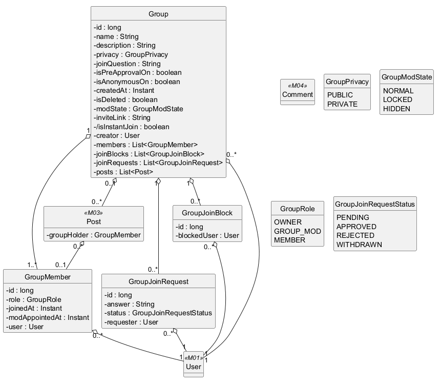

# Thiết kế lớp thực thể — M11 Group

<!-- [Vietnamese Doc] Tài liệu tiếng Việt; tên lớp, thuộc tính, kiểu viết tiếng Anh. -->

| Mã tài liệu | CD-M11 |
|---|---|
| Dự án | iShare |
| Module | M11 — Group |
| Đầu vào | EC-M11 phiên bản 1.1 |
| Trạng thái | Bản nháp |
| Phiên bản | 0.1 |
| Ngày | 2026-11-20 |
| Tác giả | Phạm Văn Đức |

<!-- Quy ước chung cho mọi bảng dưới đây:
     - Không đổi tên cột, không xóa cột, không đổi số mục: tool đọc bảng theo số mục và tên cột.
     - Ô không có nội dung ghi "—". Mục chưa tới bước làm thì để dòng "(Chưa làm — bước N)".
     - Tập lớp, thuộc tính, quan hệ và mã R-Mxx-nn giữ đúng như EC-Mxx.md.
     - Sơ đồ ở mục 5 do gen_puml.py sinh; không sửa tay.
     - Quy ước dùng (data-model/conventions.md): QU-02 id kiểu long; QU-04 bộ kiểu Java; QU-05 danh sách ghi List<X>. -->

## 1. Lớp và id

<!-- id: Có (lớp của module, không kế thừa) | Kế thừa (lớp con) | Không (lớp thống kê không kế thừa) | Ngoài (lớp của module khác). -->

| Lớp | Nhóm | Sở hữu | Lớp cha | id | Ghi chú |
|---|---|---|---|---|---|
| Group | Thực thể | M11 | — | Có | — |
| GroupMember | Liên kết | M11 | — | Có | — |
| GroupJoinRequest | Thực thể | M11 | — | Có | — |
| GroupJoinBlock | Liên kết | M11 | — | Có | — |
| User | Thực thể | M01 | — | Ngoài | Lớp của M01; id và thuộc tính thiết kế ở CD-M01 |
| Post | Thực thể | M03 | — | Ngoài | Lớp của M03; id và thuộc tính thiết kế ở CD-M03 |
| Comment | Thực thể | M04 | — | Ngoài | Lớp của M04; id và thuộc tính thiết kế ở CD-M04 |

## 2. Thuộc tính và kiểu

### 2.1 Thuộc tính

<!-- Chỉ thuộc tính thường (kể cả id). Thuộc tính đối tượng ghi ở mục 4, không ghi ở đây.
     Bắt buộc: Có | Không. Tính chất: Khóa (chỉ id) | Lưu | Dẫn xuất.
     Căn cứ kiểu: mã FR-/BR- quyết định kiểu, hoặc mã quy ước QU-nn.
     Mọi thuộc tính kiểu Instant: lưu UTC, tính mốc và hiển thị theo giờ Việt Nam (DEC-127, QU-04); không nhắc lại ở từng dòng. -->

| Lớp | Thuộc tính | Kiểu | Bắt buộc | Ràng buộc | Tính chất | Căn cứ kiểu |
|---|---|---|---|---|---|---|
| Group | id | long | Có | Duy nhất | Khóa | QU-02 |
| Group | name | String | Có | Tối đa 100 ký tự (BR-M11-31); được trùng với nhóm khác (FR-M11-01.10) | Lưu | BR-M11-31 |
| Group | description | String | Không | Tối đa 500 ký tự (BR-M11-31) | Lưu | BR-M11-31 |
| Group | privacy | GroupPrivacy | Có | Người tạo chọn khi tạo; Owner đổi bất kỳ lúc nào, chế độ mới áp cho thao tác sau thời điểm đổi (BR-M11-15) | Lưu | BR-M11-15 |
| Group | joinQuestion | String | Không | Tối đa một câu hỏi mỗi nhóm, mặc định trống (BR-M11-08, BR-M11-31); câu hỏi mới áp cho yêu cầu gửi sau đó (FR-M11-02.07) | Lưu | BR-M11-08 |
| Group | isPreApprovalOn | boolean | Có | Mặc định sai (Tắt) (BR-M11-31); giá trị mới dùng cho bài gửi sau thời điểm đổi; tắt không nhả các bài đang chờ (BR-M11-18) | Lưu | BR-M11-31 |
| Group | isAnonymousOn | boolean | Có | Mặc định sai (Tắt) (BR-M11-31); tắt chỉ chặn chọn ẩn danh cho bài mới (BR-M11-16) | Lưu | BR-M11-31 |
| Group | createdAt | Instant | Có | Mỗi người tạo tối đa 5 nhóm trong 24 giờ gần nhất, tính cả nhóm đã xóa (BR-M11-03); danh sách nhóm xếp mới nhất trước (BR-M11-35) | Lưu | QU-04 |
| Group | isDeleted | boolean | Có | Mới tạo là sai (Hoạt động); đúng (Đã xóa) là trạng thái cuối; xóa mềm, dữ liệu được giữ (BR-M11-23) | Lưu | TN:Trạng thái tồn tại của nhóm |
| Group | modState | GroupModState | Có | Mới tạo là NORMAL (FR-M11-01.01); M08 quyết trong vụ báo cáo; HIDDEN là trạng thái cuối, không bỏ ẩn (FR-M08-18.03, BR-M08-50, BR-M11-27); nhóm LOCKED có thể bị ẩn ở vụ sau (FR-M08-18.08) | Lưu | MD-06 (EC-SYS) |
| Group | inviteLink | String | Có | Duy nhất; một link chung mỗi nhóm, không hết hạn, không thu hồi, không tạo lại (BR-M11-12) | Lưu | BR-M11-12 |
| Group | isInstantJoin | boolean | Có | Đúng khi privacy = PUBLIC và joinQuestion trống (TN:Nhóm vào ngay, BR-M11-07) | Dẫn xuất | BR-M11-07 |
| GroupMember | id | long | Có | Duy nhất | Khóa | QU-02 |
| GroupMember | role | GroupRole | Có | Thứ bậc MEMBER < GROUP_MOD < OWNER (BR-M11-05); mỗi nhóm đúng một OWNER (BR-M11-04); khác User.role | Lưu | TN:Vai trò nhóm |
| GroupMember | joinedAt | Instant | Có | Lúc vào ngay, lúc yêu cầu được chấp nhận, hoặc lúc tạo nhóm với Owner đầu tiên (TN:Thời điểm tham gia); dùng chọn Owner thay thế (BR-M11-26) | Lưu | QU-04 |
| GroupMember | modAppointedAt | Instant | Không | Chỉ có khi role = GROUP_MOD; ghi mỗi lần bổ nhiệm, thâm niên tính từ lần gần nhất (BR-M11-26, FR-M11-11.06) | Lưu | QU-04 |
| GroupJoinRequest | id | long | Có | Duy nhất | Khóa | QU-02 |
| GroupJoinRequest | answer | String | Không | Chỉ có và không được trống khi nhóm có câu hỏi tham gia (BR-M11-08, FR-M11-04.08) | Lưu | BR-M11-08 |
| GroupJoinRequest | status | GroupJoinRequestStatus | Có | Mới gửi là PENDING; mỗi người nhiều nhất một yêu cầu PENDING cho mỗi nhóm (BR-M11-09); không xóa | Lưu | TN:Yêu cầu tham gia |
| GroupJoinBlock | id | long | Có | Duy nhất | Khóa | QU-02 |

### 2.2 Kiểu liệt kê

<!-- Giá trị viết HOA_GẠCH_DƯỚI, ngăn bởi dấu phẩy. Nguồn: bảng chuyển trạng thái hoặc quy tắc của FR. -->

| Kiểu | Giá trị | Dùng ở | Nguồn |
|---|---|---|---|
| GroupPrivacy | PUBLIC, PRIVATE | Group.privacy | BR-M11-15 (Public, Private) |
| GroupModState | NORMAL, LOCKED, HIDDEN | Group.modState | MD-06 của EC-SYS; FR-M08-18.03, FR-M08-18.08 (Bình thường, Bị khóa, Bị ẩn) |
| GroupRole | OWNER, GROUP_MOD, MEMBER | GroupMember.role | TN:Vai trò nhóm; BR-M11-05 |
| GroupJoinRequestStatus | PENDING, APPROVED, REJECTED, WITHDRAWN | GroupJoinRequest.status | TN:Yêu cầu tham gia (Chờ duyệt, Đã chấp nhận, Đã từ chối, Đã rút) |

## 3. Chuyển quan hệ

### 3.1 Quan hệ thành phần – toàn thể

<!-- ID: đúng mã của EC. Bội số thành phần = số thành phần ứng với một toàn thể; Bội số toàn thể = số toàn thể ứng với một thành phần.
     Dạng đọc theo thứ tự thành phần–toàn thể: n-1 | 1-n | 1-1. Loại: Hợp thành | Kết tập. -->

| ID | Thành phần | Toàn thể | Bội số thành phần | Bội số toàn thể | Dạng | Loại | Loại ở phân tích | Căn cứ |
|---|---|---|---|---|---|---|---|---|
| R-M11-01 | User | Group | 1 | 0..* | 1-n | Kết tập | Kết tập | Giữ nguyên từ phân tích |
| R-M11-02 | User | GroupMember | 1 | 0..* | 1-n | Kết tập | Liên kết | User + Group → GroupMember: tài khoản có sẵn, tồn tại độc lập và được nhiều tư cách thành viên tham chiếu, nên là lớp danh mục |
| R-M11-03 | GroupMember | Group | 1..* | 1 | n-1 | Kết tập | Liên kết | User + Group → GroupMember: thành viên được tạo trong lúc thao tác trên nhóm (tạo nhóm, vào ngay, duyệt yêu cầu: FR-M11-01.02, FR-M11-04.01) và được xem, bổ nhiệm, kick qua nhóm (FR-M11-08.01), nên Group là lớp chứa. Kết tập vì nhóm chỉ xóa mềm (BR-M11-23) |
| R-M11-04 | User | GroupJoinBlock | 1 | 0..* | 1-n | Kết tập | Liên kết | User + Group → GroupJoinBlock: tài khoản có sẵn và được tham chiếu (người bị chặn), nên là lớp danh mục |
| R-M11-05 | GroupJoinBlock | Group | 0..* | 1 | n-1 | Kết tập | Liên kết | User + Group → GroupJoinBlock: Owner, Group Mod chặn và bỏ chặn trong trang quản lý của nhóm (FR-M11-07.01, FR-M11-07.04, FR-M11-07.05), nên Group là lớp chứa |
| R-M11-06 | User | GroupJoinRequest | 1 | 0..* | 1-n | Kết tập | Kết tập | Giữ nguyên từ phân tích |
| R-M11-07 | GroupJoinRequest | Group | 0..* | 1 | n-1 | Kết tập | Kết tập | Giữ nguyên từ phân tích |
| R-M11-08 | Post | Group | 0..* | 0..1 | n-1 | Kết tập | Kết tập | Giữ nguyên từ phân tích |
| R-M11-09 | GroupMember | Post | 0..1 | 0..* | 1-n | Kết tập | Kết tập | Giữ nguyên từ phân tích |

### 3.2 Quan hệ giữ nguyên

<!-- Loại: Kế thừa (Lớp = lớp con, Lớp đích = lớp cha) | Phụ thuộc (Lớp = lớp phụ thuộc, Lớp đích = lớp được dùng). -->

| ID | Loại | Lớp | Lớp đích | Ghi chú |
|---|---|---|---|---|
| — | — | — | — | — |

## 4. Thuộc tính đối tượng

<!-- Mỗi dòng của mục 3.1 đúng một dòng ở đây. Lớp chứa = lớp toàn thể.
     Kiểu: ThànhPhần (dạng 1-n, 1-1) hoặc List<ThànhPhần> (dạng n-1, QU-05). -->

| Quan hệ | Lớp chứa | Thuộc tính | Kiểu | Quy tắc |
|---|---|---|---|---|
| R-M11-01 | Group | creator | User | User là thành phần của Group, dạng 1-n → Group có một User (tên theo vai trò) |
| R-M11-02 | GroupMember | user | User | User là thành phần của GroupMember, dạng 1-n → GroupMember có một User |
| R-M11-03 | Group | members | List<GroupMember> | GroupMember là thành phần của Group, dạng n-1 → Group có danh sách GroupMember |
| R-M11-04 | GroupJoinBlock | blockedUser | User | User là thành phần của GroupJoinBlock, dạng 1-n → GroupJoinBlock có một User (tên theo vai trò) |
| R-M11-05 | Group | joinBlocks | List<GroupJoinBlock> | GroupJoinBlock là thành phần của Group, dạng n-1 → Group có danh sách GroupJoinBlock |
| R-M11-06 | GroupJoinRequest | requester | User | User là thành phần của GroupJoinRequest, dạng 1-n → GroupJoinRequest có một User (tên theo vai trò) |
| R-M11-07 | Group | joinRequests | List<GroupJoinRequest> | GroupJoinRequest là thành phần của Group, dạng n-1 → Group có danh sách GroupJoinRequest |
| R-M11-08 | Group | posts | List<Post> | Post là thành phần của Group, dạng n-1 → Group có danh sách Post |
| R-M11-09 | Post | groupHolder | GroupMember | GroupMember là thành phần của Post, dạng 1-n → Post có một GroupMember (tên theo vai trò) |

## 5. Sơ đồ lớp thiết kế

<!-- BEGIN:DIAGRAM -->

Mã nguồn sơ đồ: [diagrams/CD-M11.puml](diagrams/CD-M11.puml). Ảnh và tệp .puml do `gen_puml.py` sinh từ các bảng của tài liệu này; muốn đổi sơ đồ thì sửa bảng rồi chạy lại tool, không sửa tay.
<!-- END:DIAGRAM -->

## 6. Liên module

<!-- Mỗi lớp ngoài một dòng. "Đề nghị cho module sở hữu": thuộc tính đối tượng mà module này cần thêm vào lớp đó, kèm mã quan hệ. -->

| Lớp | Module sở hữu | Module này dùng thế nào | Đề nghị cho module sở hữu |
|---|---|---|---|
| User | M01 | Người tạo nhóm (R-M11-01), thành viên nhóm (R-M11-02), người bị chặn (R-M11-04), người gửi yêu cầu tham gia (R-M11-06). Đọc role (Admin, Mod), status (kích hoạt kế nhiệm Owner), displayName (danh sách thành viên) | — |
| Post | M03 | Bài nhóm (R-M11-08, trùng R-M03-06); người đang giữ bài trong hàng chờ duyệt của nhóm (R-M11-09). Ghi publishState và rejectionReason theo cổng duyệt của nhóm | Thêm `groupHolder : GroupMember` (R-M11-09) |
| Comment | M04 | Đặt dấu bị gỡ khỏi nhóm khi Owner, Group Mod gỡ bình luận; không có quan hệ với lớp nào của M11 | — |

## 7. Quyết định thiết kế

| Mã | Quyết định | Lý do |
|---|---|---|
| — | — | — |

## 8. Câu hỏi và điểm chưa chốt

| Mã | Loại | Câu hỏi | Trả lời | Ghi vào |
|---|---|---|---|---|
| Q-01 | Xác nhận | Kiểu: Group.isPreApprovalOn, isAnonymousOn, isDeleted là boolean (hai trạng thái Bật/Tắt, Hoạt động/Đã xóa của FR); Group.inviteLink kiểu String và duy nhất (mỗi nhóm một link chung); kiểu liệt kê GroupPrivacy, GroupModState (NORMAL, LOCKED, HIDDEN), GroupRole (OWNER, GROUP_MOD, MEMBER), GroupJoinRequestStatus (PENDING, APPROVED, REJECTED, WITHDRAWN). Đồng ý? | Đồng ý (người dùng, 2026-11-20) | Mục 2.1, 2.2 |
| Q-02 | Xác nhận | Lớp chứa: GroupMember và GroupJoinBlock thuộc Group (Group có members, joinBlocks; mỗi dòng giữ một user/blockedUser). R-M11-09 cho Post một thuộc tính groupHolder : GroupMember (Owner hoặc Group Mod đang giữ bài trong hàng chờ của nhóm) — đề nghị cho M03; tên groupHolder để không lẫn với người giữ vụ báo cáo. Đồng ý? | Đồng ý (người dùng, 2026-11-20) | Mục 3.1, 4, 6 |

## 9. Lịch sử sửa đổi

| Phiên bản | Ngày | Nội dung | Người sửa |
|---|---|---|---|
| 0.1 | 2026-11-20 | Tạo mới từ EC-M11 v1.1; làm liền bước 1–4 theo yêu cầu của người dùng (không dừng ở cổng); chưa qua duyệt, câu hỏi ở mục 8 chờ trả lời | Phạm Văn Đức |
| 0.2 | 2026-11-20 | Ghi trả lời mục 8: người dùng đồng ý các đề xuất; chờ chốt | Phạm Văn Đức |
| 1.0 | 2026-11-20 | Chốt: người dùng chốt CD-M11 | Phạm Văn Đức |
