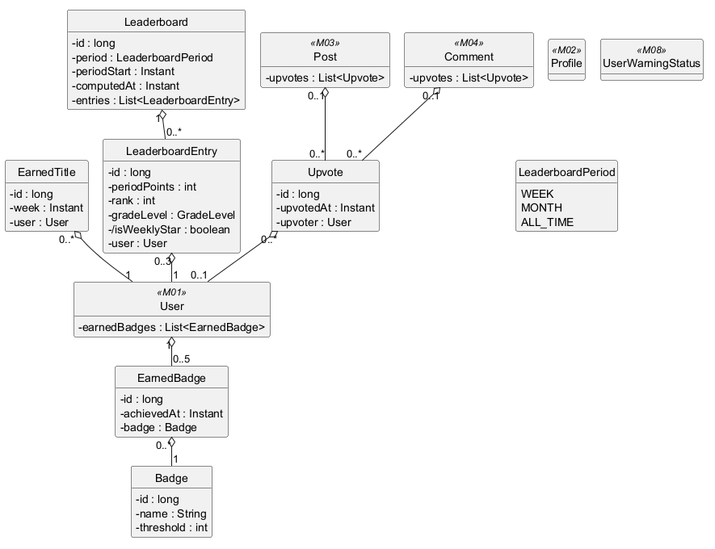

# Thiết kế lớp thực thể — M12 Gamification

<!-- [Vietnamese Doc] Tài liệu tiếng Việt; tên lớp, thuộc tính, kiểu viết tiếng Anh. -->

| Mã tài liệu | CD-M12 |
|---|---|
| Dự án | iShare |
| Module | M12 — Gamification |
| Đầu vào | EC-M12 phiên bản 1.1 |
| Trạng thái | Bản nháp |
| Phiên bản | 0.1 |
| Ngày | 2026-11-20 |
| Tác giả | Phạm Văn Đức |

<!-- Quy ước chung cho mọi bảng dưới đây:
     - Không đổi tên cột, không xóa cột, không đổi số mục: tool đọc bảng theo số mục và tên cột.
     - Ô không có nội dung ghi "—". Mục chưa tới bước làm thì để dòng "(Chưa làm — bước N)".
     - Tập lớp, thuộc tính, quan hệ và mã R-Mxx-nn giữ đúng như EC-Mxx.md.
     - Sơ đồ ở mục 5 do gen_puml.py sinh; không sửa tay.
     - Quy ước dùng (data-model/conventions.md): QU-02 id kiểu long; QU-04 bộ kiểu Java; QU-05 danh sách ghi List<X>. -->

## 1. Lớp và id

<!-- id: Có (lớp của module, không kế thừa) | Kế thừa (lớp con) | Không (lớp thống kê không kế thừa) | Ngoài (lớp của module khác). -->

| Lớp | Nhóm | Sở hữu | Lớp cha | id | Ghi chú |
|---|---|---|---|---|---|
| Upvote | Thực thể | M12 | — | Có | — |
| Badge | Thực thể | M12 | — | Có | — |
| EarnedBadge | Liên kết | M12 | — | Có | — |
| EarnedTitle | Thực thể | M12 | — | Có | — |
| Leaderboard | Thực thể | M12 | — | Có | — |
| LeaderboardEntry | Liên kết | M12 | — | Có | — |
| User | Thực thể | M01 | — | Ngoài | Lớp của M01; id và thuộc tính thiết kế ở CD-M01 |
| Post | Thực thể | M03 | — | Ngoài | Lớp của M03; id và thuộc tính thiết kế ở CD-M03 |
| Comment | Thực thể | M04 | — | Ngoài | Lớp của M04; id và thuộc tính thiết kế ở CD-M04 |
| Profile | Thực thể | M02 | — | Ngoài | Lớp của M02; id và thuộc tính thiết kế ở CD-M02 |
| UserWarningStatus | Thực thể | M08 | — | Ngoài | Lớp của M08; id và thuộc tính thiết kế ở CD-M08 |

## 2. Thuộc tính và kiểu

### 2.1 Thuộc tính

<!-- Chỉ thuộc tính thường (kể cả id). Thuộc tính đối tượng ghi ở mục 4, không ghi ở đây.
     Bắt buộc: Có | Không. Tính chất: Khóa (chỉ id) | Lưu | Dẫn xuất.
     Căn cứ kiểu: mã FR-/BR- quyết định kiểu, hoặc mã quy ước QU-nn.
     Mọi thuộc tính kiểu Instant: lưu UTC, tính mốc và hiển thị theo giờ Việt Nam (DEC-127, QU-04); không nhắc lại ở từng dòng. -->

| Lớp | Thuộc tính | Kiểu | Bắt buộc | Ràng buộc | Tính chất | Căn cứ kiểu |
|---|---|---|---|---|---|---|
| Upvote | id | long | Có | Duy nhất | Khóa | QU-02 |
| Upvote | upvotedAt | Instant | Có | Lúc người dùng bấm upvote và upvote có hiệu lực (TN:Thời điểm upvote); xếp upvote vào chu kỳ theo giờ Việt Nam (BR-M12-14) | Lưu | QU-04 |
| Badge | id | long | Có | Duy nhất | Khóa | QU-02 |
| Badge | name | String | Có | Một trong năm tên cố định: Người mới nổi, Cây bút triển vọng, Cây bút tích cực, Chuyên gia cộng đồng, Huyền thoại iShare (BR-M12-11); chỉ đổi bằng triển khai (BR-M12-06) | Lưu | BR-M12-11 |
| Badge | threshold | int | Có | 25, 100, 300, 600, 1000 theo thứ tự tên (BR-M12-11); không hiển thị cùng huy hiệu (BR-M12-12) | Lưu | BR-M12-11 |
| EarnedBadge | id | long | Có | Duy nhất | Khóa | QU-02 |
| EarnedBadge | achievedAt | Instant | Có | Thời điểm đạt đầu tiên, không đổi; hồ sơ hiện ngày đạt theo giờ Việt Nam; huy hiệu không thu hồi, không trao lại (BR-M12-12) | Lưu | DD-M12-01 |
| EarnedTitle | id | long | Có | Duy nhất | Khóa | QU-02 |
| EarnedTitle | week | Instant | Có | Mốc 00:00 thứ Hai đầu tuần lịch theo giờ Việt Nam, lưu UTC (tuần từ 00:00 thứ Hai đến trước 00:00 thứ Hai tuần sau, BR-M12-14); mỗi người mỗi tuần một bản ghi (BR-M12-24) | Lưu | DD-M12-01 |
| Leaderboard | id | long | Có | Duy nhất | Khóa | QU-02 |
| Leaderboard | period | LeaderboardPeriod | Có | Duy nhất: mỗi loại chu kỳ một kết quả hiện hành (mục Dữ liệu nghiệp vụ); không có chu kỳ năm (FR-M12-04.05) | Lưu | BR-M12-14 |
| Leaderboard | periodStart | Instant | Không | Mốc 00:00 ngày đầu của tuần (thứ Hai) hoặc tháng (ngày 1) đã chốt theo giờ Việt Nam, lưu UTC; không có với ALL_TIME | Lưu | DD-M12-01 |
| Leaderboard | computedAt | Instant | Có | ALL_TIME tính lại mỗi 60 phút; WEEK, MONTH tính một lần khi chốt, trễ tối đa 60 phút sau mốc cuối (BR-M12-19, BR-M12-25) | Lưu | QU-04 |
| LeaderboardEntry | id | long | Có | Duy nhất | Khóa | QU-02 |
| LeaderboardEntry | periodPoints | int | Có | > 0; điểm theo trọng số BR-M12-05 từ upvote có thời điểm trong chu kỳ, còn hiệu lực lúc tính, trên nội dung chưa bị trừ điểm (BR-M12-15); ALL_TIME dùng tổng điểm (FR-M12-04.04) | Lưu | BR-M12-15 |
| LeaderboardEntry | rank | int | Có | ≥ 1; cùng điểm đồng hạng, người kế tiếp nhận hạng = số người đứng trên + 1 (BR-M12-18) | Lưu | BR-M12-18 |
| LeaderboardEntry | gradeLevel | GradeLevel | Không | Chụp từ hồ sơ lúc chốt, với ALL_TIME lúc tính gần nhất; trống khi hồ sơ chưa đặt (BR-M12-16) | Lưu | BR-M12-16 |
| LeaderboardEntry | isWeeklyStar | boolean | Có | Đúng khi dòng thuộc kết quả WEEK và rank từ 1 đến 3 (BR-M12-23) | Dẫn xuất | BR-M12-23 |

### 2.2 Kiểu liệt kê

<!-- Giá trị viết HOA_GẠCH_DƯỚI, ngăn bởi dấu phẩy. Nguồn: bảng chuyển trạng thái hoặc quy tắc của FR. -->

Kiểu liệt kê dùng lại của module khác, không khai lại: GradeLevel (CD-M02) cho LeaderboardEntry.gradeLevel. Tool báo WARN "chưa khai ở mục 2.2" cho thuộc tính này; giữ lại.

| Kiểu | Giá trị | Dùng ở | Nguồn |
|---|---|---|---|
| LeaderboardPeriod | WEEK, MONTH, ALL_TIME | Leaderboard.period | BR-M12-14 (Tuần, Tháng, Toàn thời gian); FR-M12-04.05 |

## 3. Chuyển quan hệ

### 3.1 Quan hệ thành phần – toàn thể

<!-- ID: đúng mã của EC. Bội số thành phần = số thành phần ứng với một toàn thể; Bội số toàn thể = số toàn thể ứng với một thành phần.
     Dạng đọc theo thứ tự thành phần–toàn thể: n-1 | 1-n | 1-1. Loại: Hợp thành | Kết tập. -->

| ID | Thành phần | Toàn thể | Bội số thành phần | Bội số toàn thể | Dạng | Loại | Loại ở phân tích | Căn cứ |
|---|---|---|---|---|---|---|---|---|
| R-M12-01 | User | Upvote | 0..1 | 0..* | 1-n | Kết tập | Kết tập | Giữ nguyên từ phân tích |
| R-M12-02 | Upvote | Post | 0..* | 0..1 | n-1 | Kết tập | Kết tập | Giữ nguyên từ phân tích |
| R-M12-03 | Upvote | Comment | 0..* | 0..1 | n-1 | Kết tập | Kết tập | Giữ nguyên từ phân tích |
| R-M12-04 | EarnedBadge | User | 0..5 | 1 | n-1 | Kết tập | Liên kết | User + Badge → EarnedBadge: huy hiệu được trao khi tổng điểm của người dùng đạt mốc (FR-M12-03.02) và được xem trên hồ sơ của người đó, nên User là lớp chứa; huy hiệu giữ vĩnh viễn |
| R-M12-05 | Badge | EarnedBadge | 1 | 0..* | 1-n | Kết tập | Liên kết | User + Badge → EarnedBadge: Badge là danh mục cố định 5 huy hiệu (BR-M12-11), được nhiều lần đạt tham chiếu, nên là lớp danh mục |
| R-M12-06 | User | EarnedTitle | 1 | 0..* | 1-n | Kết tập | Kết tập | Giữ nguyên từ phân tích |
| R-M12-07 | LeaderboardEntry | Leaderboard | 0..* | 1 | n-1 | Kết tập | Liên kết | Leaderboard + User → LeaderboardEntry: các dòng được tạo trong lần tính kết quả bảng xếp hạng và mất khi kết quả mới thay kết quả cũ (FR-M12-04.14), nên Leaderboard là lớp chứa. Giữ Kết tập vì phân tích không ghi Hợp thành |
| R-M12-08 | User | LeaderboardEntry | 1 | 0..3 | 1-n | Kết tập | Liên kết | Leaderboard + User → LeaderboardEntry: tài khoản có sẵn và được tham chiếu (người được xếp hạng), nên là lớp danh mục |

### 3.2 Quan hệ giữ nguyên

<!-- Loại: Kế thừa (Lớp = lớp con, Lớp đích = lớp cha) | Phụ thuộc (Lớp = lớp phụ thuộc, Lớp đích = lớp được dùng). -->

| ID | Loại | Lớp | Lớp đích | Ghi chú |
|---|---|---|---|---|
| — | — | — | — | — |

## 4. Thuộc tính đối tượng

<!-- Mỗi dòng của mục 3.1 đúng một dòng ở đây. Lớp chứa = lớp toàn thể.
     Kiểu: ThànhPhần (dạng 1-n, 1-1) hoặc List<ThànhPhần> (dạng n-1, QU-05). -->

| Quan hệ | Lớp chứa | Thuộc tính | Kiểu | Quy tắc |
|---|---|---|---|---|
| R-M12-01 | Upvote | upvoter | User | User là thành phần của Upvote, dạng 1-n → Upvote có một User (tên theo vai trò) |
| R-M12-02 | Post | upvotes | List<Upvote> | Upvote là thành phần của Post, dạng n-1 → Post có danh sách Upvote |
| R-M12-03 | Comment | upvotes | List<Upvote> | Upvote là thành phần của Comment, dạng n-1 → Comment có danh sách Upvote |
| R-M12-04 | User | earnedBadges | List<EarnedBadge> | EarnedBadge là thành phần của User, dạng n-1 → User có danh sách EarnedBadge |
| R-M12-05 | EarnedBadge | badge | Badge | Badge là thành phần của EarnedBadge, dạng 1-n → EarnedBadge có một Badge |
| R-M12-06 | EarnedTitle | user | User | User là thành phần của EarnedTitle, dạng 1-n → EarnedTitle có một User |
| R-M12-07 | Leaderboard | entries | List<LeaderboardEntry> | LeaderboardEntry là thành phần của Leaderboard, dạng n-1 → Leaderboard có danh sách LeaderboardEntry |
| R-M12-08 | LeaderboardEntry | user | User | User là thành phần của LeaderboardEntry, dạng 1-n → LeaderboardEntry có một User |

## 5. Sơ đồ lớp thiết kế

<!-- BEGIN:DIAGRAM -->

Mã nguồn sơ đồ: [diagrams/CD-M12.puml](diagrams/CD-M12.puml). Ảnh và tệp .puml do `gen_puml.py` sinh từ các bảng của tài liệu này; muốn đổi sơ đồ thì sửa bảng rồi chạy lại tool, không sửa tay.
<!-- END:DIAGRAM -->

## 6. Liên module

<!-- Mỗi lớp ngoài một dòng. "Đề nghị cho module sở hữu": thuộc tính đối tượng mà module này cần thêm vào lớp đó, kèm mã quan hệ. -->

| Lớp | Module sở hữu | Module này dùng thế nào | Đề nghị cho module sở hữu |
|---|---|---|---|
| User | M01 | Người upvote (R-M12-01, trùng R-M01-16), người đạt huy hiệu (R-M12-04), người nhận danh hiệu (R-M12-06), người được xếp hạng (R-M12-08). Đọc role, status, username, displayName; ghi totalPoints | Thêm `earnedBadges : List<EarnedBadge>` (R-M12-04) |
| Post | M03 | Bài viết nhận upvote (R-M12-02). Đọc lockLevel, isPubliclyVisible, modState, isPermanentlyDeleted để chặn upvote và trừ điểm; ghi isPointsDeducted, deductedPoints | Thêm `upvotes : List<Upvote>` (R-M12-02) |
| Comment | M04 | Bình luận nhận upvote (R-M12-03, trùng R-M04-05). Đọc modState, isDeleted, isVisible; ghi isPointsDeducted | Thêm `upvotes : List<Upvote>` (R-M12-03) |
| Profile | M02 | Đọc gradeLevel (chụp vào dòng bảng xếp hạng) và avatar (hiển thị); không có quan hệ với lớp nào của M12 | — |
| UserWarningStatus | M08 | Đọc level để loại người ở HEAVY khỏi bảng xếp hạng và việc trao danh hiệu; không có quan hệ với lớp nào của M12 | — |

## 7. Quyết định thiết kế

| Mã | Quyết định | Lý do |
|---|---|---|
| DD-M12-01 | EarnedTitle.week, Leaderboard.periodStart, EarnedBadge.achievedAt kiểu Instant (mốc đầu chu kỳ là 00:00 giờ Việt Nam, lưu UTC) | Trả lời Q-01: mọi mốc thời gian khác trong mô hình đã là Instant, kể cả khóa của xu hướng thống kê M15 (mốc đầu giờ, ngày, tháng); dùng một kiểu cho thống nhất. achievedAt đổi theo cùng nguyên tắc, người dùng đồng ý ở Q-02 |

## 8. Câu hỏi và điểm chưa chốt

| Mã | Loại | Câu hỏi | Trả lời | Ghi vào |
|---|---|---|---|---|
| Q-01 | Lựa chọn kiểu | EarnedTitle.week và Leaderboard.periodStart lưu thế nào? (a) LocalDate là ngày đầu chu kỳ (thứ Hai của tuần, ngày 1 của tháng) theo giờ Việt Nam — đề xuất, so sánh và hiển thị trực tiếp; (b) số tuần ISO kèm năm (ví dụ 2026-W47): gọn khi hiển thị "Tuần 47" nhưng phải xử lý tuần vắt qua năm; (c) Instant mốc 00:00 thứ Hai giờ Việt Nam lưu UTC. Chọn phương án nào? | (c) Instant, cho thống nhất với mọi mốc thời gian khác (người dùng, 2026-11-20); DD-M12-01 | Mục 2.1; DD-M12-nn |
| Q-02 | Xác nhận | Kiểu khác: EarnedBadge.achievedAt đổi từ LocalDate sang Instant theo cùng nguyên tắc với Q-01 (hồ sơ vẫn hiện ngày, DD-M12-01); Badge.name kiểu String (Badge là lớp danh mục 5 dòng cố định, không phải kiểu liệt kê); Leaderboard.periodStart Không (ALL_TIME không có mốc đầu). Lớp chứa: EarnedBadge thuộc User (đề nghị User.earnedBadges cho M01), LeaderboardEntry thuộc Leaderboard (entries). Đồng ý? | Đồng ý (người dùng, 2026-11-20) | Mục 2.1, 3.1, 4 |

## 9. Lịch sử sửa đổi

| Phiên bản | Ngày | Nội dung | Người sửa |
|---|---|---|---|
| 0.1 | 2026-11-20 | Tạo mới từ EC-M12 v1.1; làm liền bước 1–4 theo yêu cầu của người dùng (không dừng ở cổng); chưa qua duyệt, câu hỏi ở mục 8 chờ trả lời | Phạm Văn Đức |
| 0.2 | 2026-11-20 | Ghi trả lời mục 8: Q-01 week, periodStart kiểu Instant, achievedAt đổi theo (DD-M12-01), Q-02 đồng ý; chờ chốt | Phạm Văn Đức |
| 1.0 | 2026-11-20 | Chốt: người dùng chốt CD-M12 | Phạm Văn Đức |
