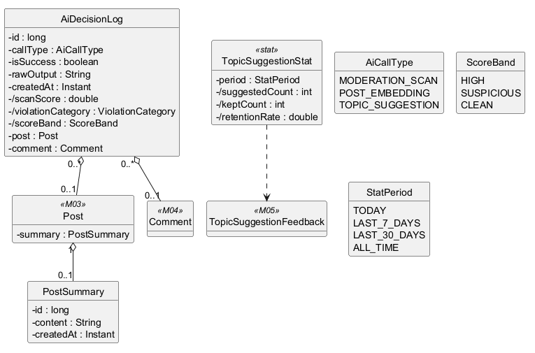

# Thiết kế lớp thực thể — M13 AI Layer

<!-- [Vietnamese Doc] Tài liệu tiếng Việt; tên lớp, thuộc tính, kiểu viết tiếng Anh. -->

| Mã tài liệu | CD-M13 |
|---|---|
| Dự án | iShare |
| Module | M13 — AI Layer |
| Đầu vào | EC-M13 phiên bản 1.1 |
| Trạng thái | Bản nháp |
| Phiên bản | 0.1 |
| Ngày | 2026-11-20 |
| Tác giả | Phạm Văn Đức |

<!-- Quy ước chung cho mọi bảng dưới đây:
     - Không đổi tên cột, không xóa cột, không đổi số mục: tool đọc bảng theo số mục và tên cột.
     - Ô không có nội dung ghi "—". Mục chưa tới bước làm thì để dòng "(Chưa làm — bước N)".
     - Tập lớp, thuộc tính, quan hệ và mã R-Mxx-nn giữ đúng như EC-Mxx.md.
     - Sơ đồ ở mục 5 do gen_puml.py sinh; không sửa tay.
     - Quy ước dùng (data-model/conventions.md): QU-02 id kiểu long; QU-04 bộ kiểu Java; QU-05 danh sách ghi List<X>. -->

## 1. Lớp và id

<!-- id: Có (lớp của module, không kế thừa) | Kế thừa (lớp con) | Không (lớp thống kê không kế thừa) | Ngoài (lớp của module khác). -->

| Lớp | Nhóm | Sở hữu | Lớp cha | id | Ghi chú |
|---|---|---|---|---|---|
| AiDecisionLog | Thực thể | M13 | — | Có | — |
| PostSummary | Thực thể | M13 | — | Có | — |
| TopicSuggestionStat | Thống kê | M13 | — | Không | Lớp thống kê không kế thừa: không lưu, không cần định danh |
| Post | Thực thể | M03 | — | Ngoài | Lớp của M03; id và thuộc tính thiết kế ở CD-M03 |
| Comment | Thực thể | M04 | — | Ngoài | Lớp của M04; id và thuộc tính thiết kế ở CD-M04 |
| TopicSuggestionFeedback | Thực thể | M05 | — | Ngoài | Lớp của M05; id và thuộc tính thiết kế ở CD-M05 |

## 2. Thuộc tính và kiểu

### 2.1 Thuộc tính

<!-- Chỉ thuộc tính thường (kể cả id). Thuộc tính đối tượng ghi ở mục 4, không ghi ở đây.
     Bắt buộc: Có | Không. Tính chất: Khóa (chỉ id) | Lưu | Dẫn xuất.
     Căn cứ kiểu: mã FR-/BR- quyết định kiểu, hoặc mã quy ước QU-nn.
     Mọi thuộc tính kiểu Instant: lưu UTC, tính mốc và hiển thị theo giờ Việt Nam (DEC-127, QU-04); không nhắc lại ở từng dòng. -->

| Lớp | Thuộc tính | Kiểu | Bắt buộc | Ràng buộc | Tính chất | Căn cứ kiểu |
|---|---|---|---|---|---|---|
| AiDecisionLog | id | long | Có | Duy nhất | Khóa | QU-02 |
| AiDecisionLog | callType | AiCallType | Có | Không có tóm tắt và embedding truy vấn (FR-M13-08.05) | Lưu | BR-M13-21 |
| AiDecisionLog | isSuccess | boolean | Có | Đúng khi một trong hai lần thử có kết quả, sai khi cả hai lần lỗi (BR-M13-21) | Lưu | BR-M13-21 |
| AiDecisionLog | rawOutput | String | Không | Kết quả dịch vụ AI trả về, giữ nguyên dạng JSON chưa xử lý (TN:Đầu ra thô); chỉ có khi lời gọi có kết quả (FR-M13-08.02); không sửa, không xóa (BR-M13-22) | Lưu | QU-04 |
| AiDecisionLog | createdAt | Instant | Có | Không sửa, không xóa (BR-M13-22) | Lưu | QU-04 |
| AiDecisionLog | scanScore | double | Không | 0 đến 1; = điểm cao nhất trong bốn điểm nhóm vi phạm của rawOutput (BR-M13-12); chỉ có ở lời gọi chấm điểm kiểm duyệt thành công | Dẫn xuất | BR-M13-12 |
| AiDecisionLog | violationCategory | ViolationCategory | Không | = nhóm có điểm quét; nhiều nhóm cùng điểm cao nhất thì lấy nhóm đứng trước theo thứ tự HARASSMENT, HATE, SEXUAL, VIOLENCE (BR-M13-12); chỉ có khi có scanScore | Dẫn xuất | BR-M13-12 |
| AiDecisionLog | scoreBand | ScoreBand | Không | HIGH (≥ 0,9), SUSPICIOUS (0,5 đến < 0,9), CLEAN (< 0,5), một cặp ngưỡng chung cho bài viết, bình luận và mọi tác giả (BR-M13-13); ngưỡng là hằng số chính sách (BR-M13-14); chỉ có khi có scanScore | Dẫn xuất | BR-M13-13 |
| PostSummary | id | long | Có | Duy nhất | Khóa | QU-02 |
| PostSummary | content | String | Có | Tạo từ tiêu đề và nội dung chữ của bài, không gồm tệp đính kèm và bình chọn (BR-M13-28); kết quả thất bại không được giữ (BR-M13-27) | Lưu | QU-04 |
| PostSummary | createdAt | Instant | Có | Kết quả bị bỏ khi đủ 24 × 60 phút từ thời điểm này (BR-M13-27) | Lưu | QU-04 |
| TopicSuggestionStat | period | StatPeriod | Có | Theo giờ Việt Nam (FR-M13-10.02, BR-M13-29); Admin chọn ở bộ lọc của M15 | Lưu | FR-M13-10.02 |
| TopicSuggestionStat | suggestedCount | int | Có | ≥ 0; tổng số Topic AI gợi ý trên các phản hồi ghi trong khoảng, kể cả của tài khoản đã xóa (BR-M13-29, BR-M13-23) | Dẫn xuất | QU-04 |
| TopicSuggestionStat | keptCount | int | Có | 0 ≤ keptCount ≤ suggestedCount; số Topic gợi ý có trong Topic tác giả chọn cuối (BR-M13-29) | Dẫn xuất | QU-04 |
| TopicSuggestionStat | retentionRate | double | Không | = keptCount ÷ suggestedCount, 0–1; không có giá trị khi khoảng không có phản hồi nào (FR-M13-10.03, BR-M13-29) | Dẫn xuất | BR-M13-29 |

### 2.2 Kiểu liệt kê

<!-- Giá trị viết HOA_GẠCH_DƯỚI, ngăn bởi dấu phẩy. Nguồn: bảng chuyển trạng thái hoặc quy tắc của FR. -->

Kiểu liệt kê dùng lại của module khác, không khai lại: ViolationCategory (CD-M03) cho AiDecisionLog.violationCategory. Tool báo WARN "chưa khai ở mục 2.2" cho thuộc tính này; giữ lại.

| Kiểu | Giá trị | Dùng ở | Nguồn |
|---|---|---|---|
| AiCallType | MODERATION_SCAN, POST_EMBEDDING, TOPIC_SUGGESTION | AiDecisionLog.callType | Mục Dữ liệu nghiệp vụ của FR-M13; BR-M13-21 (chấm điểm kiểm duyệt, embedding bài, gợi ý Topic) |
| ScoreBand | HIGH, SUSPICIOUS, CLEAN | AiDecisionLog.scoreBand | BR-M13-13 (Cao, nghi ngờ, sạch) |
| StatPeriod | TODAY, LAST_7_DAYS, LAST_30_DAYS, ALL_TIME | TopicSuggestionStat.period | FR-M13-10.02, BR-M13-29 (Hôm nay, 7 ngày, 30 ngày, Toàn thời gian); cùng bộ lọc thời gian của M15 (DEC-265) |

## 3. Chuyển quan hệ

### 3.1 Quan hệ thành phần – toàn thể

<!-- ID: đúng mã của EC. Bội số thành phần = số thành phần ứng với một toàn thể; Bội số toàn thể = số toàn thể ứng với một thành phần.
     Dạng đọc theo thứ tự thành phần–toàn thể: n-1 | 1-n | 1-1. Loại: Hợp thành | Kết tập. -->

| ID | Thành phần | Toàn thể | Bội số thành phần | Bội số toàn thể | Dạng | Loại | Loại ở phân tích | Căn cứ |
|---|---|---|---|---|---|---|---|---|
| R-M13-01 | Post | AiDecisionLog | 0..1 | 0..* | 1-n | Kết tập | Kết tập | Giữ nguyên từ phân tích |
| R-M13-02 | Comment | AiDecisionLog | 0..1 | 0..* | 1-n | Kết tập | Kết tập | Giữ nguyên từ phân tích |
| R-M13-03 | PostSummary | Post | 0..1 | 1 | 1-1 | Kết tập | Kết tập | Giữ nguyên từ phân tích |

### 3.2 Quan hệ giữ nguyên

<!-- Loại: Kế thừa (Lớp = lớp con, Lớp đích = lớp cha) | Phụ thuộc (Lớp = lớp phụ thuộc, Lớp đích = lớp được dùng). -->

| ID | Loại | Lớp | Lớp đích | Ghi chú |
|---|---|---|---|---|
| R-M13-04 | Phụ thuộc | TopicSuggestionStat | TopicSuggestionFeedback | TopicSuggestionStat chỉ dùng các phản hồi trong khoảng để tính, không giữ đối tượng TopicSuggestionFeedback |

## 4. Thuộc tính đối tượng

<!-- Mỗi dòng của mục 3.1 đúng một dòng ở đây. Lớp chứa = lớp toàn thể.
     Kiểu: ThànhPhần (dạng 1-n, 1-1) hoặc List<ThànhPhần> (dạng n-1, QU-05). -->

| Quan hệ | Lớp chứa | Thuộc tính | Kiểu | Quy tắc |
|---|---|---|---|---|
| R-M13-01 | AiDecisionLog | post | Post | Post là thành phần của AiDecisionLog, dạng 1-n → AiDecisionLog có một Post |
| R-M13-02 | AiDecisionLog | comment | Comment | Comment là thành phần của AiDecisionLog, dạng 1-n → AiDecisionLog có một Comment |
| R-M13-03 | Post | summary | PostSummary | PostSummary là thành phần của Post, dạng 1-1 → Post có một PostSummary (tên theo vai trò) |

## 5. Sơ đồ lớp thiết kế

<!-- BEGIN:DIAGRAM -->

Mã nguồn sơ đồ: [diagrams/CD-M13.puml](diagrams/CD-M13.puml). Ảnh và tệp .puml do `gen_puml.py` sinh từ các bảng của tài liệu này; muốn đổi sơ đồ thì sửa bảng rồi chạy lại tool, không sửa tay.
<!-- END:DIAGRAM -->

## 6. Liên module

<!-- Mỗi lớp ngoài một dòng. "Đề nghị cho module sở hữu": thuộc tính đối tượng mà module này cần thêm vào lớp đó, kèm mã quan hệ. -->

| Lớp | Module sở hữu | Module này dùng thế nào | Đề nghị cho module sở hữu |
|---|---|---|---|
| Post | M03 | Bài được quét, tạo embedding, gợi ý Topic, tóm tắt; có bản ghi nhật ký quyết định AI (R-M13-01) và kết quả tóm tắt đang giữ (R-M13-03). Đọc title, contentText, publishState; ghi embedding và needsEmbedding | Thêm `summary : PostSummary` (R-M13-03) |
| Comment | M04 | Bình luận được chấm điểm khi M08 quét luồng; có bản ghi nhật ký quyết định AI (R-M13-02). Đọc content | — |
| TopicSuggestionFeedback | M05 | Dữ liệu của lớp thống kê TopicSuggestionStat (R-M13-04). Đọc recordedAt; đọc các Topic gợi ý và Topic chọn cuối qua SuggestedTopic, ChosenTopic của EC-M05 | — |

## 7. Quyết định thiết kế

| Mã | Quyết định | Lý do |
|---|---|---|
| — | — | — |

## 8. Câu hỏi và điểm chưa chốt

| Mã | Loại | Câu hỏi | Trả lời | Ghi vào |
|---|---|---|---|---|
| Q-01 | Xác nhận | Kiểu: AiDecisionLog.rawOutput kiểu String chứa JSON nguyên văn của dịch vụ AI; kiểu liệt kê AiCallType, ScoreBand (HIGH, SUSPICIOUS, CLEAN); StatPeriod (TODAY, LAST_7_DAYS, LAST_30_DAYS, ALL_TIME) khai ở đây và M15 dùng lại cho mọi lớp thống kê; retentionRate kiểu double 0–1, Không khi khoảng không có phản hồi. Đồng ý? | Đồng ý (người dùng, 2026-11-20) | Mục 2.1, 2.2 |

## 9. Lịch sử sửa đổi

| Phiên bản | Ngày | Nội dung | Người sửa |
|---|---|---|---|
| 0.1 | 2026-11-20 | Tạo mới từ EC-M13 v1.1; làm liền bước 1–4 theo yêu cầu của người dùng (không dừng ở cổng); chưa qua duyệt, câu hỏi ở mục 8 chờ trả lời | Phạm Văn Đức |
| 0.2 | 2026-11-20 | Ghi trả lời mục 8: người dùng đồng ý các đề xuất; chờ chốt | Phạm Văn Đức |
| 1.0 | 2026-11-20 | Chốt: người dùng chốt CD-M13 | Phạm Văn Đức |
