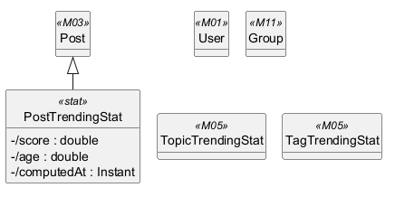

# Thiết kế lớp thực thể — M14 Feed & Discovery

<!-- [Vietnamese Doc] Tài liệu tiếng Việt; tên lớp, thuộc tính, kiểu viết tiếng Anh. -->

| Mã tài liệu | CD-M14 |
|---|---|
| Dự án | iShare |
| Module | M14 — Feed & Discovery |
| Đầu vào | EC-M14 phiên bản 1.1 |
| Trạng thái | Bản nháp |
| Phiên bản | 0.1 |
| Ngày | 2026-11-20 |
| Tác giả | Phạm Văn Đức |

<!-- Quy ước chung cho mọi bảng dưới đây:
     - Không đổi tên cột, không xóa cột, không đổi số mục: tool đọc bảng theo số mục và tên cột.
     - Ô không có nội dung ghi "—". Mục chưa tới bước làm thì để dòng "(Chưa làm — bước N)".
     - Tập lớp, thuộc tính, quan hệ và mã R-Mxx-nn giữ đúng như EC-Mxx.md.
     - Sơ đồ ở mục 5 do gen_puml.py sinh; không sửa tay.
     - Quy ước dùng (data-model/conventions.md): QU-02 id kiểu long; QU-04 bộ kiểu Java; QU-05 danh sách ghi List<X>. -->

## 1. Lớp và id

<!-- id: Có (lớp của module, không kế thừa) | Kế thừa (lớp con) | Không (lớp thống kê không kế thừa) | Ngoài (lớp của module khác). -->

| Lớp | Nhóm | Sở hữu | Lớp cha | id | Ghi chú |
|---|---|---|---|---|---|
| PostTrendingStat | Thống kê | M14 | Post | Kế thừa | Dùng id của Post |
| Post | Thực thể | M03 | — | Ngoài | Lớp của M03; id và thuộc tính thiết kế ở CD-M03 |
| User | Thực thể | M01 | — | Ngoài | Lớp của M01; id và thuộc tính thiết kế ở CD-M01 |
| Group | Thực thể | M11 | — | Ngoài | Lớp của M11; id và thuộc tính thiết kế ở CD-M11 |
| TopicTrendingStat | Thống kê | M05 | — | Ngoài | Lớp của M05; id và thuộc tính thiết kế ở CD-M05 |
| TagTrendingStat | Thống kê | M05 | — | Ngoài | Lớp của M05; id và thuộc tính thiết kế ở CD-M05 |

## 2. Thuộc tính và kiểu

### 2.1 Thuộc tính

<!-- Chỉ thuộc tính thường (kể cả id). Thuộc tính đối tượng ghi ở mục 4, không ghi ở đây.
     Bắt buộc: Có | Không. Tính chất: Khóa (chỉ id) | Lưu | Dẫn xuất.
     Căn cứ kiểu: mã FR-/BR- quyết định kiểu, hoặc mã quy ước QU-nn.
     Mọi thuộc tính kiểu Instant: lưu UTC, tính mốc và hiển thị theo giờ Việt Nam (DEC-127, QU-04); không nhắc lại ở từng dòng. -->

| Lớp | Thuộc tính | Kiểu | Bắt buộc | Ràng buộc | Tính chất | Căn cứ kiểu |
|---|---|---|---|---|---|---|
| PostTrendingStat | score | double | Có | = 0,5^(age / 7) × (1 + 2 × upvoteCount + commentCount + bookmarkCount), số đếm lấy tại lần tính; không tính lượt xem (BR-M14-10); không ngưỡng tối thiểu (BR-M14-12); xếp giảm dần, bằng điểm thì publishedAt sau đứng trước (BR-M14-13) | Dẫn xuất | BR-M14-10 |
| PostTrendingStat | age | double | Có | 0–28; = (computedAt − publishedAt) tính bằng ngày, 24 giờ là một ngày, giữ phần lẻ (TN:Tuổi bài); bài có age > 28 bị loại (BR-M14-11) | Dẫn xuất | TN:Tuổi bài |
| PostTrendingStat | computedAt | Instant | Có | Lần tính cách nhau 15–30 phút (BR-M14-14); một lượt xem tab Trending giữ kết quả của lần tính hiện hành lúc mở tab (BR-M14-19) | Dẫn xuất | QU-04 |

### 2.2 Kiểu liệt kê

<!-- Giá trị viết HOA_GẠCH_DƯỚI, ngăn bởi dấu phẩy. Nguồn: bảng chuyển trạng thái hoặc quy tắc của FR. -->

| Kiểu | Giá trị | Dùng ở | Nguồn |
|---|---|---|---|
| — | — | — | — |

## 3. Chuyển quan hệ

### 3.1 Quan hệ thành phần – toàn thể

<!-- ID: đúng mã của EC. Bội số thành phần = số thành phần ứng với một toàn thể; Bội số toàn thể = số toàn thể ứng với một thành phần.
     Dạng đọc theo thứ tự thành phần–toàn thể: n-1 | 1-n | 1-1. Loại: Hợp thành | Kết tập. -->

| ID | Thành phần | Toàn thể | Bội số thành phần | Bội số toàn thể | Dạng | Loại | Loại ở phân tích | Căn cứ |
|---|---|---|---|---|---|---|---|---|
| — | — | — | — | — | — | — | — | — |

### 3.2 Quan hệ giữ nguyên

<!-- Loại: Kế thừa (Lớp = lớp con, Lớp đích = lớp cha) | Phụ thuộc (Lớp = lớp phụ thuộc, Lớp đích = lớp được dùng). -->

| ID | Loại | Lớp | Lớp đích | Ghi chú |
|---|---|---|---|---|
| R-M14-01 | Kế thừa | PostTrendingStat | Post | PostTrendingStat dùng id và thuộc tính của Post; không sinh thuộc tính đối tượng |

## 4. Thuộc tính đối tượng

<!-- Mỗi dòng của mục 3.1 đúng một dòng ở đây. Lớp chứa = lớp toàn thể.
     Kiểu: ThànhPhần (dạng 1-n, 1-1) hoặc List<ThànhPhần> (dạng n-1, QU-05). -->

| Quan hệ | Lớp chứa | Thuộc tính | Kiểu | Quy tắc |
|---|---|---|---|---|
| — | — | — | — | — |

## 5. Sơ đồ lớp thiết kế

<!-- BEGIN:DIAGRAM -->

Mã nguồn sơ đồ: [diagrams/CD-M14.puml](diagrams/CD-M14.puml). Ảnh và tệp .puml do `gen_puml.py` sinh từ các bảng của tài liệu này; muốn đổi sơ đồ thì sửa bảng rồi chạy lại tool, không sửa tay.
<!-- END:DIAGRAM -->

## 6. Liên module

<!-- Mỗi lớp ngoài một dòng. "Đề nghị cho module sở hữu": thuộc tính đối tượng mà module này cần thêm vào lớp đó, kèm mã quan hệ. -->

| Lớp | Module sở hữu | Module này dùng thế nào | Đề nghị cho module sở hữu |
|---|---|---|---|
| Post | M03 | Lớp cha của PostTrendingStat (R-M14-01); nguồn của mọi tab. Đọc isPubliclyVisible, publishedAt, upvoteCount (M12), commentCount (M04), isAnonymous (M11), bookmarkCount | — |
| User | M01 | Đọc status của tác giả để ẩn bài của tài khoản DEACTIVATED, DELETED; không có quan hệ với lớp nào của M14 | — |
| Group | M11 | Đọc privacy để chọn bài nhóm cho Trending Post, Following, Group, Newest; không có quan hệ với lớp nào của M14 | — |
| TopicTrendingStat | M05 | Đọc score, rank để hiển thị mục con Trending Topic; không có quan hệ với lớp nào của M14 | — |
| TagTrendingStat | M05 | Đọc score, rank để hiển thị mục con Trending Tag; không có quan hệ với lớp nào của M14 | — |

## 7. Quyết định thiết kế

| Mã | Quyết định | Lý do |
|---|---|---|
| — | — | — |

## 8. Câu hỏi và điểm chưa chốt

| Mã | Loại | Câu hỏi | Trả lời | Ghi vào |
|---|---|---|---|---|
| Q-01 | Xác nhận | PostTrendingStat.score và age kiểu double (công thức có lũy thừa 0,5^(age/7) và tuổi bài giữ phần lẻ của ngày). Đồng ý? | Đồng ý (người dùng, 2026-11-20) | Mục 2.1 |

## 9. Lịch sử sửa đổi

| Phiên bản | Ngày | Nội dung | Người sửa |
|---|---|---|---|
| 0.1 | 2026-11-20 | Tạo mới từ EC-M14 v1.1; làm liền bước 1–4 theo yêu cầu của người dùng (không dừng ở cổng); chưa qua duyệt, câu hỏi ở mục 8 chờ trả lời | Phạm Văn Đức |
| 0.2 | 2026-11-20 | Ghi trả lời mục 8: người dùng đồng ý các đề xuất; chờ chốt | Phạm Văn Đức |
| 1.0 | 2026-11-20 | Chốt: người dùng chốt CD-M14 | Phạm Văn Đức |
