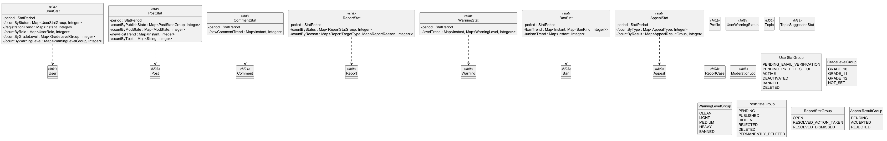

# Thiết kế lớp thực thể — M15 Analytics & Stats

<!-- [Vietnamese Doc] Tài liệu tiếng Việt; tên lớp, thuộc tính, kiểu viết tiếng Anh. -->

| Mã tài liệu | CD-M15 |
|---|---|
| Dự án | iShare |
| Module | M15 — Analytics & Stats |
| Đầu vào | EC-M15 phiên bản 1.1 |
| Trạng thái | Bản nháp |
| Phiên bản | 0.1 |
| Ngày | 2026-11-20 |
| Tác giả | Phạm Văn Đức |

<!-- Quy ước chung cho mọi bảng dưới đây:
     - Không đổi tên cột, không xóa cột, không đổi số mục: tool đọc bảng theo số mục và tên cột.
     - Ô không có nội dung ghi "—". Mục chưa tới bước làm thì để dòng "(Chưa làm — bước N)".
     - Tập lớp, thuộc tính, quan hệ và mã R-Mxx-nn giữ đúng như EC-Mxx.md.
     - Sơ đồ ở mục 5 do gen_puml.py sinh; không sửa tay.
     - Quy ước dùng (data-model/conventions.md): QU-02 id kiểu long; QU-04 bộ kiểu Java; QU-05 danh sách ghi List<X>. -->

## 1. Lớp và id

<!-- id: Có (lớp của module, không kế thừa) | Kế thừa (lớp con) | Không (lớp thống kê không kế thừa) | Ngoài (lớp của module khác). -->

| Lớp | Nhóm | Sở hữu | Lớp cha | id | Ghi chú |
|---|---|---|---|---|---|
| UserStat | Thống kê | M15 | — | Không | Lớp thống kê không kế thừa: không lưu, không cần định danh |
| PostStat | Thống kê | M15 | — | Không | Lớp thống kê không kế thừa: không lưu, không cần định danh |
| CommentStat | Thống kê | M15 | — | Không | Lớp thống kê không kế thừa: không lưu, không cần định danh |
| ReportStat | Thống kê | M15 | — | Không | Lớp thống kê không kế thừa: không lưu, không cần định danh |
| WarningStat | Thống kê | M15 | — | Không | Lớp thống kê không kế thừa: không lưu, không cần định danh |
| BanStat | Thống kê | M15 | — | Không | Lớp thống kê không kế thừa: không lưu, không cần định danh |
| AppealStat | Thống kê | M15 | — | Không | Lớp thống kê không kế thừa: không lưu, không cần định danh |
| User | Thực thể | M01 | — | Ngoài | Lớp của M01; id và thuộc tính thiết kế ở CD-M01 |
| Profile | Thực thể | M02 | — | Ngoài | Lớp của M02; id và thuộc tính thiết kế ở CD-M02 |
| UserWarningStatus | Thực thể | M08 | — | Ngoài | Lớp của M08; id và thuộc tính thiết kế ở CD-M08 |
| Post | Thực thể | M03 | — | Ngoài | Lớp của M03; id và thuộc tính thiết kế ở CD-M03 |
| Topic | Thực thể | M05 | — | Ngoài | Lớp của M05; id và thuộc tính thiết kế ở CD-M05 |
| Comment | Thực thể | M04 | — | Ngoài | Lớp của M04; id và thuộc tính thiết kế ở CD-M04 |
| TopicSuggestionStat | Thống kê | M13 | — | Ngoài | Lớp của M13; id và thuộc tính thiết kế ở CD-M13 |
| Report | Thực thể | M08 | — | Ngoài | Lớp của M08; id và thuộc tính thiết kế ở CD-M08 |
| ReportCase | Thực thể | M08 | — | Ngoài | Lớp của M08; id và thuộc tính thiết kế ở CD-M08 |
| Warning | Thực thể | M08 | — | Ngoài | Lớp của M08; id và thuộc tính thiết kế ở CD-M08 |
| Ban | Thực thể | M08 | — | Ngoài | Lớp của M08; id và thuộc tính thiết kế ở CD-M08 |
| ModerationLog | Thực thể | M08 | — | Ngoài | Lớp của M08; id và thuộc tính thiết kế ở CD-M08 |
| Appeal | Thực thể | M09 | — | Ngoài | Lớp của M09; id và thuộc tính thiết kế ở CD-M09 |

## 2. Thuộc tính và kiểu

### 2.1 Thuộc tính

<!-- Chỉ thuộc tính thường (kể cả id). Thuộc tính đối tượng ghi ở mục 4, không ghi ở đây.
     Bắt buộc: Có | Không. Tính chất: Khóa (chỉ id) | Lưu | Dẫn xuất.
     Căn cứ kiểu: mã FR-/BR- quyết định kiểu, hoặc mã quy ước QU-nn.
     Mọi thuộc tính kiểu Instant: lưu UTC, tính mốc và hiển thị theo giờ Việt Nam (DEC-127, QU-04); không nhắc lại ở từng dòng. -->

Thuộc tính đếm theo nhóm ghi kiểu `Map<K, Integer>`, xu hướng theo thời gian ghi `Map<Instant, Integer>` (khóa là mốc đầu mỗi giờ, ngày hoặc tháng của khoảng, giờ Việt Nam), xu hướng tách theo nhóm ghi `Map<Instant, Map<K, Integer>>` (QU-04). Tool báo WARN "kiểu lạ" cho các kiểu này; giữ lại. Nhóm đếm không có dữ liệu hiện 0 (FR-M15-01.11).

| Lớp | Thuộc tính | Kiểu | Bắt buộc | Ràng buộc | Tính chất | Căn cứ kiểu |
|---|---|---|---|---|---|---|
| UserStat | period | StatPeriod | Có | Chọn sẵn ALL_TIME; ranh giới theo giờ Việt Nam, 7 ngày và 30 ngày theo ngày lịch gồm hôm nay (BR-M15-03, BR-M15-04) | Lưu | BR-M15-03 |
| UserStat | countByStatus | Map<UserStatGroup, Integer> | Có | Tài khoản tạo trong khoảng, mỗi tài khoản đúng một nhóm theo trạng thái lúc xem (BR-M15-20, BR-M15-18) | Dẫn xuất | BR-M15-20 |
| UserStat | registrationTrend | Map<Instant, Integer> | Có | Số tài khoản tạo theo từng giờ, ngày hoặc tháng của khoảng, kể cả chưa hoàn tất hoặc đã xóa (BR-M15-20, BR-M15-19) | Dẫn xuất | BR-M15-19 |
| UserStat | countByRole | Map<UserRole, Integer> | Có | Chỉ tài khoản đã xong bước 3, không DELETED (BR-M15-20) | Dẫn xuất | BR-M15-20 |
| UserStat | countByGradeLevel | Map<GradeLevelGroup, Integer> | Có | Chỉ tài khoản đã xong bước 3, không DELETED (BR-M15-20) | Dẫn xuất | BR-M15-20 |
| UserStat | countByWarningLevel | Map<WarningLevelGroup, Integer> | Có | Mỗi tài khoản đúng một nhóm: tài khoản BANNED chỉ ở nhóm BANNED, ADMIN ở nhóm CLEAN; chỉ tài khoản đã xong bước 3, không DELETED (BR-M15-20) | Dẫn xuất | BR-M15-20 |
| PostStat | period | StatPeriod | Có | Như UserStat.period (BR-M15-03, BR-M15-04) | Lưu | BR-M15-03 |
| PostStat | countByPublishState | Map<PostStateGroup, Integer> | Có | Bài tạo trong khoảng theo Post.createdAt; không đếm nháp; bài nhóm, ẩn danh, bị ẩn vì tác giả, vì nhóm, bị gỡ khỏi nhóm đếm theo trạng thái của chính bài (BR-M15-21) | Dẫn xuất | BR-M15-21 |
| PostStat | countByModState | Map<ModState, Integer> | Có | Bài tạo trong khoảng, không đếm nháp (BR-M15-21) | Dẫn xuất | BR-M15-21 |
| PostStat | newPostTrend | Map<Instant, Integer> | Có | Số bài theo từng giờ, ngày hoặc tháng của khoảng, theo thời điểm đăng (BR-M15-21, BR-M15-19) | Dẫn xuất | BR-M15-19 |
| PostStat | countByTopic | Map<String, Integer> | Có | Khóa là tên Topic trong danh mục hiện tại; bài nhiều Topic đếm một lần ở mỗi Topic; bài của Topic đã gộp đếm ở Topic đích (BR-M15-17, BR-M15-21) | Dẫn xuất | BR-M15-17 |
| CommentStat | period | StatPeriod | Có | Như UserStat.period | Lưu | BR-M15-03 |
| CommentStat | newCommentTrend | Map<Instant, Integer> | Có | Số bình luận theo từng giờ, ngày hoặc tháng theo thời điểm đăng, kể cả bình luận về sau bị ẩn hoặc bị xóa (BR-M15-21, BR-M15-19) | Dẫn xuất | BR-M15-19 |
| ReportStat | period | StatPeriod | Có | Như UserStat.period | Lưu | BR-M15-03 |
| ReportStat | countByStatus | Map<ReportStatGroup, Integer> | Có | Đếm theo từng báo cáo, không theo vụ; mục do AI tạo, kể cả yêu cầu ban của hệ thống, là một báo cáo (BR-M15-11, BR-M15-22) | Dẫn xuất | BR-M15-11 |
| ReportStat | countByReason | Map<ReportTargetType, Map<ReportReason, Integer>> | Có | Tách theo loại đối tượng: bài viết 8, bình luận 7, người dùng 2, nhóm 4 lý do; không gộp lý do cùng tên của hai loại (BR-M15-12, BR-M15-22) | Dẫn xuất | BR-M15-12 |
| WarningStat | period | StatPeriod | Có | Như UserStat.period | Lưu | BR-M15-03 |
| WarningStat | levelTrend | Map<Instant, Map<WarningLevel, Integer>> | Có | Số cảnh cáo theo từng giờ, ngày hoặc tháng, tách theo mức LIGHT, MEDIUM, HEAVY đạt ngay sau cảnh cáo; gồm cảnh cáo do AI và do Mod, Admin, kể cả về sau bị bỏ hoặc bị lật (BR-M15-13, BR-M15-22) | Dẫn xuất | BR-M15-13 |
| BanStat | period | StatPeriod | Có | Như UserStat.period | Lưu | BR-M15-03 |
| BanStat | banTrend | Map<Instant, Map<BanKind, Integer>> | Có | Số ban theo từng giờ, ngày hoặc tháng, tách TEMPORARY và PERMANENT, kể cả ban về sau bị lật (BR-M15-14, BR-M15-22) | Dẫn xuất | BR-M15-14 |
| BanStat | unbanTrend | Map<Instant, Integer> | Có | Chỉ đếm thao tác gỡ ban của Mod, Admin (dòng ModerationLog UNBAN); ban hết hạn, bị lật không tính (BR-M15-14, BR-M15-22) | Dẫn xuất | BR-M15-14 |
| AppealStat | period | StatPeriod | Có | Như UserStat.period | Lưu | BR-M15-03 |
| AppealStat | countByType | Map<AppealType, Integer> | Có | Khiếu nại bài bị gỡ và khiếu nại gộp thuộc POST (BR-M15-10) | Dẫn xuất | BR-M15-10 |
| AppealStat | countByResult | Map<AppealResultGroup, Integer> | Có | Đếm theo kết quả hiện tại của khiếu nại (BR-M15-10, BR-M15-22) | Dẫn xuất | BR-M15-10 |

### 2.2 Kiểu liệt kê

<!-- Giá trị viết HOA_GẠCH_DƯỚI, ngăn bởi dấu phẩy. Nguồn: bảng chuyển trạng thái hoặc quy tắc của FR. -->

Kiểu liệt kê dùng lại của module khác, không khai lại: StatPeriod (CD-M13), UserRole (CD-M01), ModState (CD-M03), ReportTargetType, ReportReason, WarningLevel, BanKind (CD-M08), AppealType (CD-M09). Các kiểu dưới đây là tập nhóm đếm riêng của thống kê, khác tập giá trị của kiểu nghiệp vụ tương ứng (thêm hoặc bớt nhóm), nên khai riêng.

| Kiểu | Giá trị | Dùng ở | Nguồn |
|---|---|---|---|
| UserStatGroup | PENDING_EMAIL_VERIFICATION, PENDING_PROFILE_SETUP, ACTIVE, DEACTIVATED, BANNED, DELETED | Khóa của UserStat.countByStatus | BR-M15-20 (Chờ xác minh email, Chờ hoàn tất hồ sơ, ACTIVE đã xong bước 3, DEACTIVATED, BANNED, DELETED) |
| GradeLevelGroup | GRADE_10, GRADE_11, GRADE_12, NOT_SET | Khóa của UserStat.countByGradeLevel | BR-M15-20 (10, 11, 12, Chưa khai) |
| WarningLevelGroup | CLEAN, LIGHT, MEDIUM, HEAVY, BANNED | Khóa của UserStat.countByWarningLevel | BR-M15-20 (Sạch, LIGHT, MEDIUM, HEAVY, BANNED) |
| PostStateGroup | PENDING, PUBLISHED, HIDDEN, REJECTED, DELETED, PERMANENTLY_DELETED | Khóa của PostStat.countByPublishState | BR-M15-21 (Chờ duyệt, Đã đăng, Tự ẩn, Bị từ chối, Đã xóa, Đã xóa hẳn; không có Nháp); tên giá trị như PublishState (CD-M03) |
| ReportStatGroup | OPEN, RESOLVED_ACTION_TAKEN, RESOLVED_DISMISSED | Khóa của ReportStat.countByStatus | BR-M15-11 (Mở, Đã xử lý – Có xử lý, Đã xử lý – Bác bỏ) |
| AppealResultGroup | PENDING, ACCEPTED, REJECTED | Khóa của AppealStat.countByResult | BR-M15-10 (Chờ xét, Chấp nhận, Từ chối) |

## 3. Chuyển quan hệ

### 3.1 Quan hệ thành phần – toàn thể

<!-- ID: đúng mã của EC. Bội số thành phần = số thành phần ứng với một toàn thể; Bội số toàn thể = số toàn thể ứng với một thành phần.
     Dạng đọc theo thứ tự thành phần–toàn thể: n-1 | 1-n | 1-1. Loại: Hợp thành | Kết tập. -->

| ID | Thành phần | Toàn thể | Bội số thành phần | Bội số toàn thể | Dạng | Loại | Loại ở phân tích | Căn cứ |
|---|---|---|---|---|---|---|---|---|
| — | — | — | — | — | — | — | — | — |

### 3.2 Quan hệ giữ nguyên

<!-- Loại: Kế thừa (Lớp = lớp con, Lớp đích = lớp cha) | Phụ thuộc (Lớp = lớp phụ thuộc, Lớp đích = lớp được dùng). -->

| ID | Loại | Lớp | Lớp đích | Ghi chú |
|---|---|---|---|---|
| R-M15-01 | Phụ thuộc | UserStat | User | UserStat chỉ dùng User để tính, không giữ đối tượng User |
| R-M15-02 | Phụ thuộc | PostStat | Post | PostStat chỉ dùng Post để tính, không giữ đối tượng Post |
| R-M15-03 | Phụ thuộc | CommentStat | Comment | CommentStat chỉ dùng Comment để tính, không giữ đối tượng Comment |
| R-M15-04 | Phụ thuộc | ReportStat | Report | ReportStat chỉ dùng Report để tính, không giữ đối tượng Report |
| R-M15-05 | Phụ thuộc | WarningStat | Warning | WarningStat chỉ dùng Warning để tính, không giữ đối tượng Warning |
| R-M15-06 | Phụ thuộc | BanStat | Ban | BanStat chỉ dùng Ban để tính, không giữ đối tượng Ban |
| R-M15-07 | Phụ thuộc | AppealStat | Appeal | AppealStat chỉ dùng Appeal để tính, không giữ đối tượng Appeal |

## 4. Thuộc tính đối tượng

<!-- Mỗi dòng của mục 3.1 đúng một dòng ở đây. Lớp chứa = lớp toàn thể.
     Kiểu: ThànhPhần (dạng 1-n, 1-1) hoặc List<ThànhPhần> (dạng n-1, QU-05). -->

| Quan hệ | Lớp chứa | Thuộc tính | Kiểu | Quy tắc |
|---|---|---|---|---|
| — | — | — | — | — |

## 5. Sơ đồ lớp thiết kế

<!-- BEGIN:DIAGRAM -->

Mã nguồn sơ đồ: [diagrams/CD-M15.puml](diagrams/CD-M15.puml). Ảnh và tệp .puml do `gen_puml.py` sinh từ các bảng của tài liệu này; muốn đổi sơ đồ thì sửa bảng rồi chạy lại tool, không sửa tay.
<!-- END:DIAGRAM -->

## 6. Liên module

<!-- Mỗi lớp ngoài một dòng. "Đề nghị cho module sở hữu": thuộc tính đối tượng mà module này cần thêm vào lớp đó, kèm mã quan hệ. -->

| Lớp | Module sở hữu | Module này dùng thế nào | Đề nghị cho module sở hữu |
|---|---|---|---|
| User | M01 | Nguồn của UserStat (R-M15-01). Đọc status, verificationLevel, createdAt, role | — |
| Profile | M02 | Đọc gradeLevel cho UserStat; không có quan hệ với lớp nào của M15 | — |
| UserWarningStatus | M08 | Đọc level cho UserStat; không có quan hệ với lớp nào của M15 | — |
| Post | M03 | Nguồn của PostStat (R-M15-02). Đọc publishState, modState, createdAt, publishedAt, isPermanentlyDeleted | — |
| Topic | M05 | Đọc name, deletedAt cho PostStat; không có quan hệ với lớp nào của M15 | — |
| Comment | M04 | Nguồn của CommentStat (R-M15-03). Đọc publishedAt | — |
| TopicSuggestionStat | M13 | Đọc retentionRate để hiển thị; không có quan hệ với lớp nào của M15 | — |
| Report | M08 | Nguồn của ReportStat (R-M15-04). Đọc status, conclusion, reason, reportedAt | — |
| ReportCase | M08 | Đọc targetType cho ReportStat; không có quan hệ với lớp nào của M15 | — |
| Warning | M08 | Nguồn của WarningStat (R-M15-05). Đọc issuedAt, levelAfter | — |
| Ban | M08 | Nguồn của BanStat (R-M15-06). Đọc kind, startedAt | — |
| ModerationLog | M08 | Đọc actionType, createdAt để đếm gỡ ban cho BanStat; không có quan hệ với lớp nào của M15 | — |
| Appeal | M09 | Nguồn của AppealStat (R-M15-07). Đọc type, status, conclusion, submittedAt | — |

## 7. Quyết định thiết kế

| Mã | Quyết định | Lý do |
|---|---|---|
| DD-M15-01 | Khóa của số liệu đếm theo nhóm dùng 6 kiểu liệt kê riêng: UserStatGroup, GradeLevelGroup, WarningLevelGroup, PostStateGroup, ReportStatGroup, AppealResultGroup | Trả lời Q-01: tập nhóm trên biểu đồ khác tập giá trị của kiểu nghiệp vụ (thêm, bớt hoặc gộp nhóm); khai riêng để mỗi khóa ứng đúng một nhóm, không phải tách thuộc tính đếm rời |

## 8. Câu hỏi và điểm chưa chốt

| Mã | Loại | Câu hỏi | Trả lời | Ghi vào |
|---|---|---|---|---|
| Q-01 | Lựa chọn kiểu | Số liệu đếm theo nhóm có tập nhóm khác tập giá trị nghiệp vụ (ví dụ countByStatus có "Chờ xác minh email", "Chờ hoàn tất hồ sơ" mà AccountStatus không có; countByGradeLevel có "Chưa khai"). Đề xuất khai 6 kiểu liệt kê nhóm đếm riêng của M15 (UserStatGroup, GradeLevelGroup, WarningLevelGroup, PostStateGroup, ReportStatGroup, AppealResultGroup) làm khóa của Map. Phương án khác: dùng thẳng kiểu nghiệp vụ và ghi nhóm thêm ở Ràng buộc (ít kiểu hơn nhưng khóa không nói đủ nhóm). Chọn phương án nào? | (a) Khai 6 kiểu nhóm đếm riêng, như đề xuất (người dùng, 2026-11-20); DD-M15-01 | Mục 2.1, 2.2 |
| Q-02 | Xác nhận | Số liệu hai chiều ghi Map lồng: ReportStat.countByReason : Map<ReportTargetType, Map<ReportReason, Integer>> (lý do tách theo loại đối tượng); WarningStat.levelTrend : Map<Instant, Map<WarningLevel, Integer>>; BanStat.banTrend : Map<Instant, Map<BanKind, Integer>>; PostStat.countByTopic : Map<String, Integer> khóa là tên Topic (không giữ đối tượng Topic trong lớp thống kê). Đồng ý? | Đồng ý (người dùng, 2026-11-20) | Mục 2.1 |

## 9. Lịch sử sửa đổi

| Phiên bản | Ngày | Nội dung | Người sửa |
|---|---|---|---|
| 0.1 | 2026-11-20 | Tạo mới từ EC-M15 v1.1; làm liền bước 1–4 theo yêu cầu của người dùng (không dừng ở cổng); chưa qua duyệt, câu hỏi ở mục 8 chờ trả lời | Phạm Văn Đức |
| 0.2 | 2026-11-20 | Ghi trả lời mục 8: Q-01 khai 6 kiểu nhóm đếm riêng (DD-M15-01), Q-02 đồng ý; chờ chốt | Phạm Văn Đức |
| 1.0 | 2026-11-20 | Chốt: người dùng chốt CD-M15 | Phạm Văn Đức |
