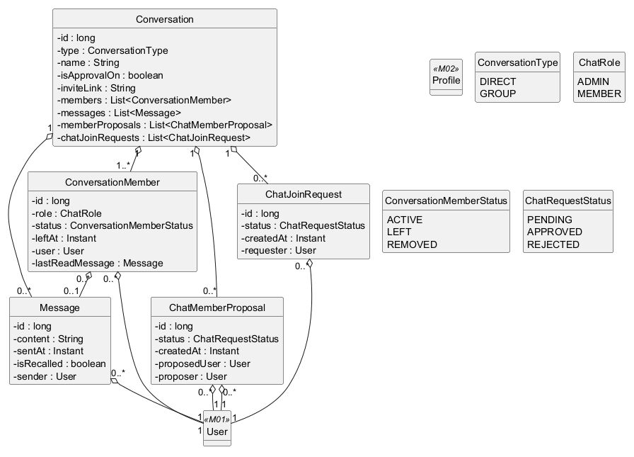

# Thiết kế lớp thực thể — M16 Chat & Messaging

<!-- [Vietnamese Doc] Tài liệu tiếng Việt; tên lớp, thuộc tính, kiểu viết tiếng Anh. -->

| Mã tài liệu | CD-M16 |
|---|---|
| Dự án | iShare |
| Module | M16 — Chat & Messaging |
| Đầu vào | EC-M16 phiên bản 1.1 |
| Trạng thái | Bản nháp |
| Phiên bản | 0.1 |
| Ngày | 2026-11-20 |
| Tác giả | Phạm Văn Đức |

<!-- Quy ước chung cho mọi bảng dưới đây:
     - Không đổi tên cột, không xóa cột, không đổi số mục: tool đọc bảng theo số mục và tên cột.
     - Ô không có nội dung ghi "—". Mục chưa tới bước làm thì để dòng "(Chưa làm — bước N)".
     - Tập lớp, thuộc tính, quan hệ và mã R-Mxx-nn giữ đúng như EC-Mxx.md.
     - Sơ đồ ở mục 5 do gen_puml.py sinh; không sửa tay.
     - Quy ước dùng (data-model/conventions.md): QU-02 id kiểu long; QU-04 bộ kiểu Java; QU-05 danh sách ghi List<X>. -->

## 1. Lớp và id

<!-- id: Có (lớp của module, không kế thừa) | Kế thừa (lớp con) | Không (lớp thống kê không kế thừa) | Ngoài (lớp của module khác). -->

| Lớp | Nhóm | Sở hữu | Lớp cha | id | Ghi chú |
|---|---|---|---|---|---|
| Conversation | Thực thể | M16 | — | Có | — |
| ConversationMember | Liên kết | M16 | — | Có | — |
| Message | Thực thể | M16 | — | Có | — |
| ChatMemberProposal | Thực thể | M16 | — | Có | — |
| ChatJoinRequest | Thực thể | M16 | — | Có | — |
| User | Thực thể | M01 | — | Ngoài | Lớp của M01; id và thuộc tính thiết kế ở CD-M01 |
| Profile | Thực thể | M02 | — | Ngoài | Lớp của M02; id và thuộc tính thiết kế ở CD-M02 |

## 2. Thuộc tính và kiểu

### 2.1 Thuộc tính

<!-- Chỉ thuộc tính thường (kể cả id). Thuộc tính đối tượng ghi ở mục 4, không ghi ở đây.
     Bắt buộc: Có | Không. Tính chất: Khóa (chỉ id) | Lưu | Dẫn xuất.
     Căn cứ kiểu: mã FR-/BR- quyết định kiểu, hoặc mã quy ước QU-nn.
     Mọi thuộc tính kiểu Instant: lưu UTC, tính mốc và hiển thị theo giờ Việt Nam (DEC-127, QU-04); không nhắc lại ở từng dòng. -->

| Lớp | Thuộc tính | Kiểu | Bắt buộc | Ràng buộc | Tính chất | Căn cứ kiểu |
|---|---|---|---|---|---|---|
| Conversation | id | long | Có | Duy nhất | Khóa | QU-02 |
| Conversation | type | ConversationType | Có | DIRECT có đúng 2 thành viên, mỗi cặp người dùng nhiều nhất một cuộc (BR-M16-24) | Lưu | BR-M16-01 |
| Conversation | name | String | Không | Chỉ có và bắt buộc ở nhóm chat; 1–100 ký tự sau khi bỏ khoảng trắng đầu, cuối; được trùng với nhóm chat khác (BR-M16-32); mọi thành viên đổi được (BR-M16-05) | Lưu | BR-M16-32 |
| Conversation | isApprovalOn | boolean | Không | Chỉ có ở nhóm chat; sai (Tắt) khi tạo (BR-M16-06); chỉ Admin nhóm chat đổi; hệ thống tự tắt khi Admin nhóm chat không thể khôi phục (BR-M16-30) | Lưu | BR-M16-06 |
| Conversation | inviteLink | String | Không | Chỉ có ở nhóm chat; duy nhất; một link chung, không hết hạn, không thu hồi, không tạo lại (BR-M16-29) | Lưu | BR-M16-29 |
| ConversationMember | id | long | Có | Duy nhất | Khóa | QU-02 |
| ConversationMember | role | ChatRole | Không | Chỉ có ở nhóm chat; người tạo là ADMIN đầu tiên; mỗi nhóm chat nhiều nhất một ADMIN (BR-M16-04); chuyển quyền thì đổi vai trò của hai người (BR-M16-07); khác User.role | Lưu | BR-M16-04 |
| ConversationMember | status | ConversationMemberStatus | Có | LEFT, REMOVED chỉ ở nhóm chat; vào lại thì về ACTIVE (mục Chuyển trạng thái của FR-M16) | Lưu | Mục Chuyển trạng thái của FR-M16 |
| ConversationMember | leftAt | Instant | Không | Chỉ có khi LEFT hoặc REMOVED; thành viên cũ chỉ xem tin gửi trước thời điểm này (TN:Thời điểm rời, BR-M16-27) | Lưu | QU-04 |
| Message | id | long | Có | Duy nhất | Khóa | QU-02 |
| Message | content | String | Có | Văn bản thuần, có thể kèm emoji; không trống, không chỉ khoảng trắng; tối đa 1.000 từ (BR-M16-08); không sửa (BR-M16-10); giữ cả khi thu hồi nhưng không hiện (BR-M16-12) | Lưu | BR-M16-08 |
| Message | sentAt | Instant | Có | Lúc hệ thống nhận tin; thu hồi được khi chưa quá 5 phút từ thời điểm này (BR-M16-11); mỗi người tối đa 30 tin trong 60 giây ở một cuộc (BR-M16-09) | Lưu | QU-04 |
| Message | isRecalled | boolean | Có | Mặc định sai (Bình thường); chỉ người gửi đặt, một lần (FR-M16-06.04, FR-M16-06.06); xóa mềm (BR-M16-12) | Lưu | QU-04 |
| ChatMemberProposal | id | long | Có | Duy nhất | Khóa | QU-02 |
| ChatMemberProposal | status | ChatRequestStatus | Có | Mới tạo là PENDING; không xóa | Lưu | TN:Đề nghị thêm thành viên |
| ChatMemberProposal | createdAt | Instant | Có | Thứ tự chờ tính theo thời điểm này (BR-M16-33) | Lưu | QU-04 |
| ChatJoinRequest | id | long | Có | Duy nhất | Khóa | QU-02 |
| ChatJoinRequest | status | ChatRequestStatus | Có | Mới tạo là PENDING; mỗi người nhiều nhất một yêu cầu PENDING tới một nhóm chat; bị từ chối thì gửi lại ngay được (BR-M16-29); không xóa | Lưu | TN:Yêu cầu gia nhập |
| ChatJoinRequest | createdAt | Instant | Có | Thứ tự chờ tính theo thời điểm này (BR-M16-33) | Lưu | QU-04 |

### 2.2 Kiểu liệt kê

<!-- Giá trị viết HOA_GẠCH_DƯỚI, ngăn bởi dấu phẩy. Nguồn: bảng chuyển trạng thái hoặc quy tắc của FR. -->

| Kiểu | Giá trị | Dùng ở | Nguồn |
|---|---|---|---|
| ConversationType | DIRECT, GROUP | Conversation.type | TN:Cuộc trò chuyện; BR-M16-01 (Trò chuyện 1-1, nhóm chat) |
| ChatRole | ADMIN, MEMBER | ConversationMember.role | BR-M16-04 (Admin nhóm chat, Member) |
| ConversationMemberStatus | ACTIVE, LEFT, REMOVED | ConversationMember.status | Mục Chuyển trạng thái của FR-M16 (Đang là thành viên, Đã rời, Bị xóa) |
| ChatRequestStatus | PENDING, APPROVED, REJECTED | ChatMemberProposal.status, ChatJoinRequest.status | TN:Đề nghị thêm thành viên, TN:Yêu cầu gia nhập (Chờ duyệt, Đã chấp nhận, Đã từ chối) |

## 3. Chuyển quan hệ

### 3.1 Quan hệ thành phần – toàn thể

<!-- ID: đúng mã của EC. Bội số thành phần = số thành phần ứng với một toàn thể; Bội số toàn thể = số toàn thể ứng với một thành phần.
     Dạng đọc theo thứ tự thành phần–toàn thể: n-1 | 1-n | 1-1. Loại: Hợp thành | Kết tập. -->

| ID | Thành phần | Toàn thể | Bội số thành phần | Bội số toàn thể | Dạng | Loại | Loại ở phân tích | Căn cứ |
|---|---|---|---|---|---|---|---|---|
| R-M16-01 | User | ConversationMember | 1 | 0..* | 1-n | Kết tập | Liên kết | User + Conversation → ConversationMember: tài khoản có sẵn và được tham chiếu (thành viên), nên là lớp danh mục |
| R-M16-02 | ConversationMember | Conversation | 1..* | 1 | n-1 | Kết tập | Liên kết | User + Conversation → ConversationMember: thành viên được tạo khi tạo cuộc trò chuyện, thêm người, duyệt yêu cầu (FR-M16-02.02, FR-M16-14.01) và được xem, xóa qua cuộc trò chuyện (FR-M16-04.10), nên Conversation là lớp chứa; thành viên cũ vẫn được giữ |
| R-M16-03 | Message | Conversation | 0..* | 1 | n-1 | Kết tập | Kết tập | Giữ nguyên từ phân tích |
| R-M16-04 | User | Message | 1 | 0..* | 1-n | Kết tập | Kết tập | Giữ nguyên từ phân tích |
| R-M16-05 | Message | ConversationMember | 0..1 | 0..* | 1-n | Kết tập | Kết tập | Giữ nguyên từ phân tích |
| R-M16-06 | ChatMemberProposal | Conversation | 0..* | 1 | n-1 | Kết tập | Kết tập | Giữ nguyên từ phân tích |
| R-M16-07 | User | ChatMemberProposal | 1 | 0..* | 1-n | Kết tập | Kết tập | Giữ nguyên từ phân tích |
| R-M16-08 | User | ChatMemberProposal | 1 | 0..* | 1-n | Kết tập | Kết tập | Giữ nguyên từ phân tích |
| R-M16-09 | ChatJoinRequest | Conversation | 0..* | 1 | n-1 | Kết tập | Kết tập | Giữ nguyên từ phân tích |
| R-M16-10 | User | ChatJoinRequest | 1 | 0..* | 1-n | Kết tập | Kết tập | Giữ nguyên từ phân tích |

### 3.2 Quan hệ giữ nguyên

<!-- Loại: Kế thừa (Lớp = lớp con, Lớp đích = lớp cha) | Phụ thuộc (Lớp = lớp phụ thuộc, Lớp đích = lớp được dùng). -->

| ID | Loại | Lớp | Lớp đích | Ghi chú |
|---|---|---|---|---|
| — | — | — | — | — |

## 4. Thuộc tính đối tượng

<!-- Mỗi dòng của mục 3.1 đúng một dòng ở đây. Lớp chứa = lớp toàn thể.
     Kiểu: ThànhPhần (dạng 1-n, 1-1) hoặc List<ThànhPhần> (dạng n-1, QU-05). -->

| Quan hệ | Lớp chứa | Thuộc tính | Kiểu | Quy tắc |
|---|---|---|---|---|
| R-M16-01 | ConversationMember | user | User | User là thành phần của ConversationMember, dạng 1-n → ConversationMember có một User |
| R-M16-02 | Conversation | members | List<ConversationMember> | ConversationMember là thành phần của Conversation, dạng n-1 → Conversation có danh sách ConversationMember |
| R-M16-03 | Conversation | messages | List<Message> | Message là thành phần của Conversation, dạng n-1 → Conversation có danh sách Message |
| R-M16-04 | Message | sender | User | User là thành phần của Message, dạng 1-n → Message có một User (tên theo vai trò) |
| R-M16-05 | ConversationMember | lastReadMessage | Message | Message là thành phần của ConversationMember, dạng 1-n → ConversationMember có một Message (tên theo vai trò) |
| R-M16-06 | Conversation | memberProposals | List<ChatMemberProposal> | ChatMemberProposal là thành phần của Conversation, dạng n-1 → Conversation có danh sách ChatMemberProposal |
| R-M16-07 | ChatMemberProposal | proposedUser | User | User là thành phần của ChatMemberProposal, dạng 1-n → ChatMemberProposal có một User (tên theo vai trò) |
| R-M16-08 | ChatMemberProposal | proposer | User | User là thành phần của ChatMemberProposal, dạng 1-n → ChatMemberProposal có một User (tên theo vai trò) |
| R-M16-09 | Conversation | chatJoinRequests | List<ChatJoinRequest> | ChatJoinRequest là thành phần của Conversation, dạng n-1 → Conversation có danh sách ChatJoinRequest |
| R-M16-10 | ChatJoinRequest | requester | User | User là thành phần của ChatJoinRequest, dạng 1-n → ChatJoinRequest có một User (tên theo vai trò) |

## 5. Sơ đồ lớp thiết kế

<!-- BEGIN:DIAGRAM -->

Mã nguồn sơ đồ: [diagrams/CD-M16.puml](diagrams/CD-M16.puml). Ảnh và tệp .puml do `gen_puml.py` sinh từ các bảng của tài liệu này; muốn đổi sơ đồ thì sửa bảng rồi chạy lại tool, không sửa tay.
<!-- END:DIAGRAM -->

## 6. Liên module

<!-- Mỗi lớp ngoài một dòng. "Đề nghị cho module sở hữu": thuộc tính đối tượng mà module này cần thêm vào lớp đó, kèm mã quan hệ. -->

| Lớp | Module sở hữu | Module này dùng thế nào | Đề nghị cho module sở hữu |
|---|---|---|---|
| User | M01 | Thành viên cuộc trò chuyện (R-M16-01), người gửi tin (R-M16-04), người được đề nghị và người đề nghị (R-M16-07, R-M16-08), người xin gia nhập (R-M16-10). Đọc status, role, displayName | — |
| Profile | M02 | Đọc avatar để hiển thị; không có quan hệ với lớp nào của M16 | — |

## 7. Quyết định thiết kế

| Mã | Quyết định | Lý do |
|---|---|---|
| — | — | — |

## 8. Câu hỏi và điểm chưa chốt

| Mã | Loại | Câu hỏi | Trả lời | Ghi vào |
|---|---|---|---|---|
| Q-01 | Xác nhận | Kiểu và tính bắt buộc: Conversation.name, isApprovalOn, inviteLink và ConversationMember.role Không vì chỉ có ở nhóm chat; ChatMemberProposal.status và ChatJoinRequest.status dùng chung kiểu liệt kê ChatRequestStatus (PENDING, APPROVED, REJECTED) — khác GroupJoinRequestStatus của M11 vì không có trạng thái Đã rút. Đồng ý? | Đồng ý (người dùng, 2026-11-20) | Mục 2.1, 2.2 |
| Q-02 | Xác nhận | Lớp chứa của ConversationMember là Conversation (Conversation có members, mỗi ConversationMember có một user). Mốc đã đọc R-M16-05 thành ConversationMember.lastReadMessage : Message. Tên theo vai trò: Message.sender, ChatMemberProposal.proposedUser, proposer, ChatJoinRequest.requester. Đồng ý? | Đồng ý (người dùng, 2026-11-20) | Mục 3.1, 4 |

## 9. Lịch sử sửa đổi

| Phiên bản | Ngày | Nội dung | Người sửa |
|---|---|---|---|
| 0.1 | 2026-11-20 | Tạo mới từ EC-M16 v1.1; làm liền bước 1–4 theo yêu cầu của người dùng (không dừng ở cổng); chưa qua duyệt, câu hỏi ở mục 8 chờ trả lời | Phạm Văn Đức |
| 0.2 | 2026-11-20 | Ghi trả lời mục 8: người dùng đồng ý các đề xuất; chờ chốt | Phạm Văn Đức |
| 1.0 | 2026-11-20 | Chốt: người dùng chốt CD-M16 | Phạm Văn Đức |
