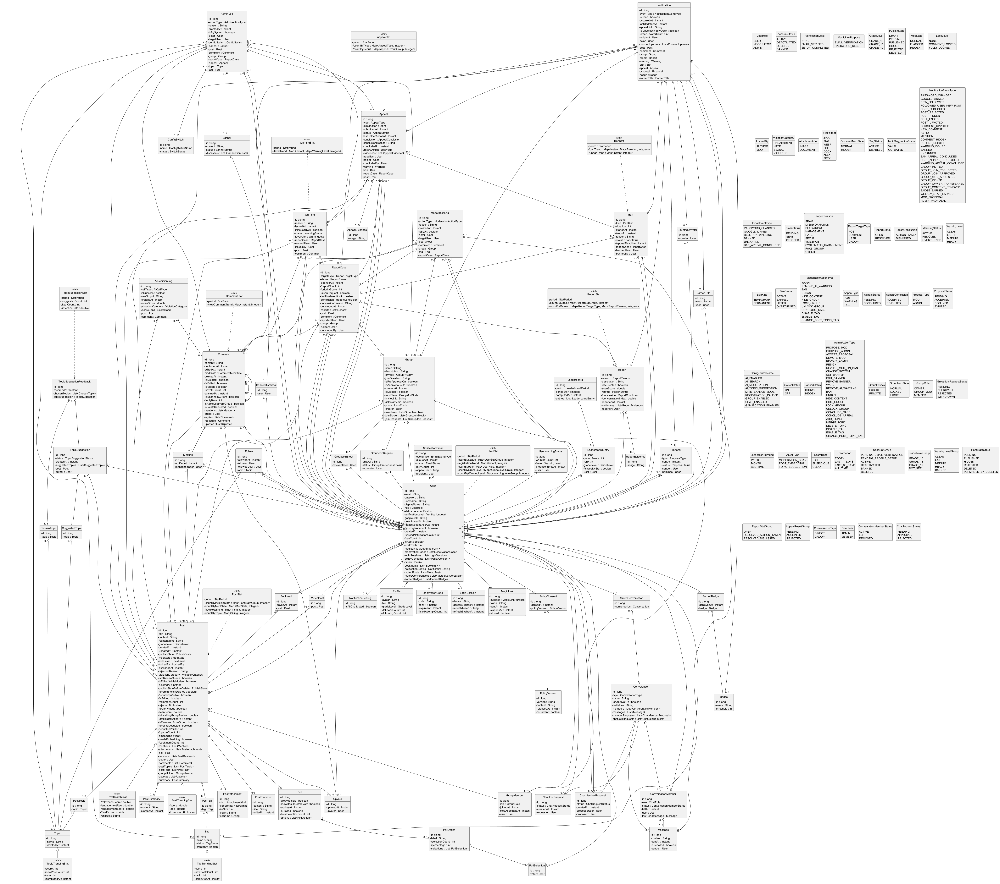

# Thiết kế lớp thực thể — Toàn hệ thống iShare

<!-- [Vietnamese Doc] Bản gộp từ các CD-Mxx.md, khớp với EC-SYS.md.
     Số mục giữ giống tài liệu module (1, 2.1, 2.2, 3.1, 3.2, 4, 5) để tool đọc được. -->

Bản gộp của 16 tài liệu thiết kế lớp module. Tập lớp, thuộc tính và quan hệ đúng như EC-SYS; quan hệ khai ở hai module
chỉ giữ mã mà EC-SYS giữ (MD-08). Thuộc tính đối tượng mà module đề nghị cho lớp của module khác nằm ở lớp chứa
(MD-15). Kiểu theo `data-model/conventions.md`: id `long`, mọi mốc thời gian `Instant`, danh sách `List<X>`.

## 1. Lớp và id

<!-- Ở bản hệ thống cột id chỉ còn: Có | Kế thừa | Không. Sở hữu: module sở hữu lớp. -->

| Lớp | Nhóm | Sở hữu | Lớp cha | id | Ghi chú |
|---|---|---|---|---|---|
| AdminLog | Thực thể | M10 | — | Có | — |
| AiDecisionLog | Thực thể | M13 | — | Có | — |
| Appeal | Thực thể | M09 | — | Có | — |
| AppealEvidence | Thực thể | M09 | — | Có | — |
| AppealStat | Thống kê | M15 | — | Không | Lớp thống kê không kế thừa: không lưu, không cần định danh |
| Badge | Thực thể | M12 | — | Có | — |
| Ban | Thực thể | M08 | — | Có | — |
| BanStat | Thống kê | M15 | — | Không | Lớp thống kê không kế thừa: không lưu, không cần định danh |
| Banner | Thực thể | M10 | — | Có | — |
| BannerDismissal | Liên kết | M10 | — | Có | — |
| Bookmark | Liên kết | M02 | — | Có | — |
| ChatJoinRequest | Thực thể | M16 | — | Có | — |
| ChatMemberProposal | Thực thể | M16 | — | Có | — |
| ChosenTopic | Liên kết | M05 | — | Có | — |
| Comment | Thực thể | M04 | — | Có | — |
| CommentStat | Thống kê | M15 | — | Không | Lớp thống kê không kế thừa: không lưu, không cần định danh |
| ConfigSwitch | Thực thể | M10 | — | Có | — |
| Conversation | Thực thể | M16 | — | Có | — |
| ConversationMember | Liên kết | M16 | — | Có | — |
| CountedUpvoter | Liên kết | M07 | — | Có | — |
| EarnedBadge | Liên kết | M12 | — | Có | — |
| EarnedTitle | Thực thể | M12 | — | Có | — |
| Follow | Thực thể | M07 | — | Có | — |
| Group | Thực thể | M11 | — | Có | — |
| GroupJoinBlock | Liên kết | M11 | — | Có | — |
| GroupJoinRequest | Thực thể | M11 | — | Có | — |
| GroupMember | Liên kết | M11 | — | Có | — |
| Leaderboard | Thực thể | M12 | — | Có | — |
| LeaderboardEntry | Liên kết | M12 | — | Có | — |
| LoginSession | Thực thể | M01 | — | Có | — |
| MagicLink | Thực thể | M01 | — | Có | — |
| Mention | Thực thể | M01 | — | Có | — |
| Message | Thực thể | M16 | — | Có | — |
| ModerationLog | Thực thể | M08 | — | Có | — |
| MutedConversation | Liên kết | M07 | — | Có | — |
| MutedPost | Liên kết | M07 | — | Có | — |
| Notification | Thực thể | M07 | — | Có | — |
| NotificationEmail | Thực thể | M07 | — | Có | — |
| NotificationSetting | Thực thể | M07 | — | Có | — |
| PolicyConsent | Liên kết | M01 | — | Có | — |
| PolicyVersion | Thực thể | M01 | — | Có | — |
| Poll | Thực thể | M03 | — | Có | — |
| PollOption | Thực thể | M03 | — | Có | — |
| PollSelection | Liên kết | M03 | — | Có | — |
| Post | Thực thể | M03 | — | Có | — |
| PostAttachment | Thực thể | M03 | — | Có | — |
| PostRevision | Thực thể | M03 | — | Có | — |
| PostSearchStat | Thống kê | M06 | Post | Kế thừa | Dùng id của Post |
| PostStat | Thống kê | M15 | — | Không | Lớp thống kê không kế thừa: không lưu, không cần định danh |
| PostSummary | Thực thể | M13 | — | Có | — |
| PostTag | Liên kết | M05 | — | Có | — |
| PostTopic | Liên kết | M05 | — | Có | — |
| PostTrendingStat | Thống kê | M14 | Post | Kế thừa | Dùng id của Post |
| Profile | Thực thể | M02 | — | Có | — |
| Proposal | Thực thể | M10 | — | Có | — |
| ReactivationCode | Thực thể | M01 | — | Có | — |
| Report | Thực thể | M08 | — | Có | — |
| ReportCase | Thực thể | M08 | — | Có | — |
| ReportEvidence | Thực thể | M08 | — | Có | — |
| ReportStat | Thống kê | M15 | — | Không | Lớp thống kê không kế thừa: không lưu, không cần định danh |
| SuggestedTopic | Liên kết | M05 | — | Có | — |
| Tag | Thực thể | M05 | — | Có | — |
| TagTrendingStat | Thống kê | M05 | Tag | Kế thừa | Dùng id của Tag |
| Topic | Thực thể | M05 | — | Có | — |
| TopicSuggestion | Thực thể | M05 | — | Có | — |
| TopicSuggestionFeedback | Thực thể | M05 | — | Có | — |
| TopicSuggestionStat | Thống kê | M13 | — | Không | Lớp thống kê không kế thừa: không lưu, không cần định danh |
| TopicTrendingStat | Thống kê | M05 | Topic | Kế thừa | Dùng id của Topic |
| Upvote | Thực thể | M12 | — | Có | — |
| User | Thực thể | M01 | — | Có | — |
| UserStat | Thống kê | M15 | — | Không | Lớp thống kê không kế thừa: không lưu, không cần định danh |
| UserWarningStatus | Thực thể | M08 | — | Có | — |
| Warning | Thực thể | M08 | — | Có | — |
| WarningStat | Thống kê | M15 | — | Không | Lớp thống kê không kế thừa: không lưu, không cần định danh |

## 2. Thuộc tính và kiểu

### 2.1 Thuộc tính

Tool báo WARN "kiểu lạ" cho `float[]` và `Map<…>` (mở rộng theo QU-04); giữ lại.

| Lớp | Thuộc tính | Kiểu | Bắt buộc | Ràng buộc | Tính chất | Căn cứ kiểu |
|---|---|---|---|---|---|---|
| AdminLog | id | long | Có | Duy nhất | Khóa | QU-02 |
| AdminLog | actionType | AdminActionType | Có | Không ghi việc xem, nhận, nhả vụ hay khiếu nại, việc Admin làm như người dùng thường, quyết định của AI (FR-M10-14.05, FR-M10-14.08) | Lưu | FR-M10-14.02 |
| AdminLog | reason | String | Không | Tùy chọn; thao tác mà module gốc bắt buộc lý do thì lấy đúng lý do đó (BR-M10-23, FR-M10-14.09) | Lưu | QU-04 |
| AdminLog | createdAt | Instant | Có | Lúc thao tác hoàn tất; mới nhất trước (BR-M10-23); không sửa, không xóa, giữ vĩnh viễn (BR-M10-22) | Lưu | QU-04 |
| AdminLog | isBySystem | boolean | Có | Đúng khi Mod mất vai trò do bị ban (FR-M10-14.07, BR-M10-21) | Lưu | QU-04 |
| AiDecisionLog | id | long | Có | Duy nhất | Khóa | QU-02 |
| AiDecisionLog | callType | AiCallType | Có | Không có tóm tắt và embedding truy vấn (FR-M13-08.05) | Lưu | BR-M13-21 |
| AiDecisionLog | isSuccess | boolean | Có | Đúng khi một trong hai lần thử có kết quả, sai khi cả hai lần lỗi (BR-M13-21) | Lưu | BR-M13-21 |
| AiDecisionLog | rawOutput | String | Không | Kết quả dịch vụ AI trả về, giữ nguyên dạng JSON chưa xử lý (TN:Đầu ra thô); chỉ có khi lời gọi có kết quả (FR-M13-08.02); không sửa, không xóa (BR-M13-22) | Lưu | QU-04 |
| AiDecisionLog | createdAt | Instant | Có | Không sửa, không xóa (BR-M13-22) | Lưu | QU-04 |
| AiDecisionLog | scanScore | double | Không | 0 đến 1; = điểm cao nhất trong bốn điểm nhóm vi phạm của rawOutput (BR-M13-12); chỉ có ở lời gọi chấm điểm kiểm duyệt thành công | Dẫn xuất | BR-M13-12 |
| AiDecisionLog | violationCategory | ViolationCategory | Không | = nhóm có điểm quét; nhiều nhóm cùng điểm cao nhất thì lấy nhóm đứng trước theo thứ tự HARASSMENT, HATE, SEXUAL, VIOLENCE (BR-M13-12); chỉ có khi có scanScore | Dẫn xuất | BR-M13-12 |
| AiDecisionLog | scoreBand | ScoreBand | Không | HIGH (≥ 0,9), SUSPICIOUS (0,5 đến < 0,9), CLEAN (< 0,5), một cặp ngưỡng chung cho bài viết, bình luận và mọi tác giả (BR-M13-13); ngưỡng là hằng số chính sách (BR-M13-14); chỉ có khi có scanScore | Dẫn xuất | BR-M13-13 |
| Appeal | id | long | Có | Duy nhất | Khóa | QU-02 |
| Appeal | type | AppealType | Có | Gắn theo xử lý bị khiếu nại; khiếu nại bài bị gỡ và khiếu nại gộp đều là POST (FR-M09-01.03, TN:Loại khiếu nại); hàng chờ xếp BAN, rồi WARNING, rồi POST (BR-M09-10); khớp với quan hệ tới xử lý (R-M09-05 đến R-M09-08) | Lưu | TN:Loại khiếu nại |
| Appeal | explanation | String | Có | Không trống (BR-M09-03, FR-M09-01.10); không sửa sau khi gửi (BR-M09-27) | Lưu | BR-M09-03 |
| Appeal | submittedAt | Instant | Có | Phải trước hạn khiếu nại của xử lý (BR-M09-04); cùng loại thì gửi trước đứng trước (BR-M09-10) | Lưu | QU-04 |
| Appeal | status | AppealStatus | Có | Khiếu nại mới là PENDING (FR-M09-01.01); CONCLUDED là trạng thái cuối, không kết luận lại (FR-M09-07.08); "chưa ai giữ", "đang được giữ" suy từ quan hệ người giữ | Lưu | Mục Chuyển trạng thái của FR-M09 |
| Appeal | lastHolderActionAt | Instant | Không | Chỉ có khi đang có người giữ; đặt lúc nhận và mỗi lần người giữ mở xem; 30 phút không thao tác thì tự nhả (BR-M09-11) | Lưu | QU-04 |
| Appeal | conclusion | AppealConclusion | Không | Chỉ có khi CONCLUDED; chỉ người đang giữ kết luận (FR-M09-07.06); REJECTED là cuối cùng, không gửi lại cho cùng xử lý (BR-M09-06) | Lưu | Mục Chuyển trạng thái của FR-M09 |
| Appeal | conclusionReason | String | Không | Chỉ có khi CONCLUDED; bắt buộc ở cả ACCEPTED và REJECTED (BR-M09-27, FR-M09-07.11); gửi kèm thông báo kết luận (BR-M09-20) | Lưu | BR-M09-27 |
| Appeal | concludedAt | Instant | Không | Chỉ có khi CONCLUDED | Lưu | QU-04 |
| Appeal | roleAtAction | UserRole | Có | Chỉ USER hoặc MODERATOR (Admin không có khiếu nại, BR-M09-01); vai trò tại thời điểm có xử lý, vẫn là MODERATOR khi đã mất vai trò Mod vì bị ban (FR-M09-03.08); MODERATOR thì chỉ Admin xét (BR-M09-12) | Dẫn xuất | BR-M09-01 |
| AppealEvidence | id | long | Có | Duy nhất | Khóa | QU-02 |
| AppealEvidence | image | String | Có | Đường dẫn ảnh trên nơi lưu ảnh (Cloudinary, DEC-137); JPEG, PNG hoặc WebP, tối đa 5 MB; mỗi khiếu nại tối đa 3 ảnh (BR-M09-03); không sửa sau khi gửi (BR-M09-27) | Lưu | BR-M09-03 |
| AppealStat | period | StatPeriod | Có | Như UserStat.period | Lưu | BR-M15-03 |
| AppealStat | countByType | Map<AppealType, Integer> | Có | Khiếu nại bài bị gỡ và khiếu nại gộp thuộc POST (BR-M15-10) | Dẫn xuất | BR-M15-10 |
| AppealStat | countByResult | Map<AppealResultGroup, Integer> | Có | Đếm theo kết quả hiện tại của khiếu nại (BR-M15-10, BR-M15-22) | Dẫn xuất | BR-M15-10 |
| Badge | id | long | Có | Duy nhất | Khóa | QU-02 |
| Badge | name | String | Có | Một trong năm tên cố định: Người mới nổi, Cây bút triển vọng, Cây bút tích cực, Chuyên gia cộng đồng, Huyền thoại iShare (BR-M12-11); chỉ đổi bằng triển khai (BR-M12-06) | Lưu | BR-M12-11 |
| Badge | threshold | int | Có | 25, 100, 300, 600, 1000 theo thứ tự tên (BR-M12-11); không hiển thị cùng huy hiệu (BR-M12-12) | Lưu | BR-M12-11 |
| Ban | id | long | Có | Duy nhất | Khóa | QU-02 |
| Ban | kind | BanKind | Có | Thao tác "Ban" lần thứ 3 trở đi ra PERMANENT (BR-M08-34); "Ban vĩnh viễn" bỏ qua cách tính leo thang (BR-M08-35) | Lưu | BR-M08-34 |
| Ban | duration | int | Không | Đơn vị ngày, N ngày = N × 24 giờ (BR-M08-43); 30 khi chưa từng bị ban, 90 khi đã bị ban 1 lần (BR-M08-34); không có với ban PERMANENT | Lưu | BR-M08-34 |
| Ban | startedAt | Instant | Có | — | Lưu | QU-04 |
| Ban | endsAt | Instant | Không | = startedAt + duration (BR-M08-43); không có với ban PERMANENT | Dẫn xuất | BR-M08-43 |
| Ban | reason | String | Có | — | Lưu | QU-04 |
| Ban | status | BanStatus | Có | Ban mới là ACTIVE; EXPIRED, LIFTED, OVERTURNED là trạng thái cuối; mỗi tài khoản nhiều nhất một ban ACTIVE (BR-M08-52); OVERTURNED do M09 đặt | Lưu | BR-M08-52 |
| Ban | appealDeadline | Instant | Có | Ban tạm thời: = startedAt + duration; ban vĩnh viễn: = startedAt + 90 × 24 giờ (BR-M09-04); quá hạn với ban vĩnh viễn thì mất quyền khiếu nại (BR-M09-05) | Dẫn xuất | BR-M09-04 |
| BanStat | period | StatPeriod | Có | Như UserStat.period | Lưu | BR-M15-03 |
| BanStat | banTrend | Map<Instant, Map<BanKind, Integer>> | Có | Số ban theo từng giờ, ngày hoặc tháng, tách TEMPORARY và PERMANENT, kể cả ban về sau bị lật (BR-M15-14, BR-M15-22) | Dẫn xuất | BR-M15-14 |
| BanStat | unbanTrend | Map<Instant, Integer> | Có | Chỉ đếm thao tác gỡ ban của Mod, Admin (dòng ModerationLog UNBAN); ban hết hạn, bị lật không tính (BR-M15-14, BR-M15-22) | Dẫn xuất | BR-M15-14 |
| Banner | id | long | Có | Duy nhất | Khóa | QU-02 |
| Banner | content | String | Có | 1–200 ký tự đếm sau khi bỏ khoảng trắng đầu và cuối (TN:Ký tự của banner); văn bản thuần (BR-M10-20, FR-M10-13.05, FR-M10-13.06) | Lưu | BR-M10-20 |
| Banner | status | BannerStatus | Có | Nhiều nhất một banner SHOWN (BR-M10-20); đặt banner mới thì banner đang hiện được thay (FR-M10-13.04) | Lưu | BR-M10-20 |
| BannerDismissal | id | long | Có | Duy nhất | Khóa | QU-02 |
| Bookmark | id | long | Có | Duy nhất | Khóa | QU-02 |
| Bookmark | savedAt | Instant | Có | Mỗi người dùng lưu một bài viết nhiều nhất một lần (BR-M02-22); tab Bookmark xếp mới nhất trước (BR-M02-31) | Lưu | QU-04 |
| ChatJoinRequest | id | long | Có | Duy nhất | Khóa | QU-02 |
| ChatJoinRequest | status | ChatRequestStatus | Có | Mới tạo là PENDING; mỗi người nhiều nhất một yêu cầu PENDING tới một nhóm chat; bị từ chối thì gửi lại ngay được (BR-M16-29); không xóa | Lưu | TN:Yêu cầu gia nhập |
| ChatJoinRequest | createdAt | Instant | Có | Thứ tự chờ tính theo thời điểm này (BR-M16-33) | Lưu | QU-04 |
| ChatMemberProposal | id | long | Có | Duy nhất | Khóa | QU-02 |
| ChatMemberProposal | status | ChatRequestStatus | Có | Mới tạo là PENDING; không xóa | Lưu | TN:Đề nghị thêm thành viên |
| ChatMemberProposal | createdAt | Instant | Có | Thứ tự chờ tính theo thời điểm này (BR-M16-33) | Lưu | QU-04 |
| ChosenTopic | id | long | Có | Duy nhất | Khóa | QU-02 |
| Comment | id | long | Có | Duy nhất | Khóa | QU-02 |
| Comment | content | String | Có | Không trống, không chỉ khoảng trắng; tối đa 1.000 từ đếm trên phần chữ người đọc thấy, khối trích dẫn tự gõ có tính, dòng trích dẫn khi trả lời không tính (BR-M04-19); chỉ in đậm, in nghiêng, code trong dòng, LaTeX, liên kết, nhắc tên, trích dẫn (BR-M04-01); không tệp đính kèm (BR-M04-02); dạng JSON của Tiptap như Post.content (DEC-137); giữ khi bình luận bị xóa (BR-M04-21) | Lưu | BR-M04-19 |
| Comment | publishedAt | Instant | Có | Lúc hệ thống ghi nhận bình luận được gửi; không đổi khi sửa (FR-M04-04.03) | Lưu | QU-04 |
| Comment | editedAt | Instant | Không | Chỉ có khi đã sửa; lần sửa gần nhất thay lần trước (FR-M04-04.02) | Lưu | QU-04 |
| Comment | modState | CommentModState | Có | Bình luận mới là NORMAL (FR-M04-02.02, FR-M04-03.04); không đổi khi sửa (FR-M04-04.03); M08 đổi | Lưu | TN:Trạng thái kiểm duyệt của bình luận |
| Comment | deletedAt | Instant | Không | Chỉ có khi tác giả đã xóa; không xóa lại, không khôi phục (FR-M04-05.04, FR-M04-05.06) | Lưu | QU-04 |
| Comment | isDeleted | boolean | Có | Đúng khi deletedAt có giá trị (FR-M04-05.01) | Dẫn xuất | QU-04 |
| Comment | isEdited | boolean | Có | Đúng khi editedAt có giá trị (BR-M04-07) | Dẫn xuất | QU-04 |
| Comment | isVisible | boolean | Có | Đúng khi chưa bị xóa và modState = NORMAL (TN:Bình luận hiển thị bình thường) | Dẫn xuất | QU-04 |
| Comment | upvoteCount | int | Có | ≥ 0; số người đang upvote, upvote đã rút không tính (TN:Số upvote của bình luận) | Dẫn xuất | QU-04 |
| Comment | scannedAt | Instant | Không | — | Lưu | QU-04 |
| Comment | isScannedCurrent | boolean | Có | Đúng khi có scannedAt và scannedAt không sớm hơn editedAt (TN:Đã quét với nội dung hiện tại, BR-M08-21) | Dẫn xuất | QU-04 |
| Comment | replyRate | int | Không | ≥ 0; chỉ có ở bình luận gốc: số trả lời của luồng đăng trong khoảng thời gian trượt (BR-M08-20); ngưỡng tạm 10 trả lời trong 5 phút (TBD-M08-04) | Dẫn xuất | BR-M08-20 |
| Comment | isRemovedFromGroup | boolean | Có | Như Post.isRemovedFromGroup (BR-M11-30) | Lưu | QU-04 |
| Comment | isPointsDeducted | boolean | Có | Sai = Đang tính điểm, đúng = Đã trừ điểm; với bình luận Đã trừ điểm là trạng thái cuối | Lưu | QU-04 |
| CommentStat | period | StatPeriod | Có | Như UserStat.period | Lưu | BR-M15-03 |
| CommentStat | newCommentTrend | Map<Instant, Integer> | Có | Số bình luận theo từng giờ, ngày hoặc tháng theo thời điểm đăng, kể cả bình luận về sau bị ẩn hoặc bị xóa (BR-M15-21, BR-M15-19) | Dẫn xuất | BR-M15-19 |
| ConfigSwitch | id | long | Có | Duy nhất | Khóa | QU-02 |
| ConfigSwitch | name | ConfigSwitchName | Có | Duy nhất; đúng chín công tắc, không tạo thêm, không xóa (FR-M10-09.01, FR-M10-12.03, BR-M10-12, BR-M10-19) | Lưu | BR-M10-12, BR-M10-19 |
| ConfigSwitch | status | SwitchStatus | Có | Khởi tạo: công tắc AI và ba cờ tính năng ON, chế độ bảo trì và tạm dừng đăng ký OFF (BR-M10-26); áp cho mọi thao tác sau thời điểm đổi (BR-M10-13); công tắc AI riêng vẫn lưu khi công tắc tổng OFF, chỉ có tác dụng khi công tắc tổng ON (FR-M10-09.06, BR-M10-14) | Lưu | TN:Trạng thái của công tắc cấu hình |
| Conversation | id | long | Có | Duy nhất | Khóa | QU-02 |
| Conversation | type | ConversationType | Có | DIRECT có đúng 2 thành viên, mỗi cặp người dùng nhiều nhất một cuộc (BR-M16-24) | Lưu | BR-M16-01 |
| Conversation | name | String | Không | Chỉ có và bắt buộc ở nhóm chat; 1–100 ký tự sau khi bỏ khoảng trắng đầu, cuối; được trùng với nhóm chat khác (BR-M16-32); mọi thành viên đổi được (BR-M16-05) | Lưu | BR-M16-32 |
| Conversation | isApprovalOn | boolean | Không | Chỉ có ở nhóm chat; sai (Tắt) khi tạo (BR-M16-06); chỉ Admin nhóm chat đổi; hệ thống tự tắt khi Admin nhóm chat không thể khôi phục (BR-M16-30) | Lưu | BR-M16-06 |
| Conversation | inviteLink | String | Không | Chỉ có ở nhóm chat; duy nhất; một link chung, không hết hạn, không thu hồi, không tạo lại (BR-M16-29) | Lưu | BR-M16-29 |
| ConversationMember | id | long | Có | Duy nhất | Khóa | QU-02 |
| ConversationMember | role | ChatRole | Không | Chỉ có ở nhóm chat; người tạo là ADMIN đầu tiên; mỗi nhóm chat nhiều nhất một ADMIN (BR-M16-04); chuyển quyền thì đổi vai trò của hai người (BR-M16-07); khác User.role | Lưu | BR-M16-04 |
| ConversationMember | status | ConversationMemberStatus | Có | LEFT, REMOVED chỉ ở nhóm chat; vào lại thì về ACTIVE (mục Chuyển trạng thái của FR-M16) | Lưu | Mục Chuyển trạng thái của FR-M16 |
| ConversationMember | leftAt | Instant | Không | Chỉ có khi LEFT hoặc REMOVED; thành viên cũ chỉ xem tin gửi trước thời điểm này (TN:Thời điểm rời, BR-M16-27) | Lưu | QU-04 |
| CountedUpvoter | id | long | Có | Duy nhất | Khóa | QU-02 |
| EarnedBadge | id | long | Có | Duy nhất | Khóa | QU-02 |
| EarnedBadge | achievedAt | Instant | Có | Thời điểm đạt đầu tiên, không đổi; hồ sơ hiện ngày đạt theo giờ Việt Nam; huy hiệu không thu hồi, không trao lại (BR-M12-12) | Lưu | DD-M12-01 |
| EarnedTitle | id | long | Có | Duy nhất | Khóa | QU-02 |
| EarnedTitle | week | Instant | Có | Mốc 00:00 thứ Hai đầu tuần lịch theo giờ Việt Nam, lưu UTC (tuần từ 00:00 thứ Hai đến trước 00:00 thứ Hai tuần sau, BR-M12-14); mỗi người mỗi tuần một bản ghi (BR-M12-24) | Lưu | DD-M12-01 |
| Follow | id | long | Có | Duy nhất | Khóa | QU-02 |
| Follow | followedAt | Instant | Có | Ghi khi người dùng bắt đầu theo dõi (FR-M07-01.01) | Lưu | QU-04 |
| Group | id | long | Có | Duy nhất | Khóa | QU-02 |
| Group | name | String | Có | Tối đa 100 ký tự (BR-M11-31); được trùng với nhóm khác (FR-M11-01.10) | Lưu | BR-M11-31 |
| Group | description | String | Không | Tối đa 500 ký tự (BR-M11-31) | Lưu | BR-M11-31 |
| Group | privacy | GroupPrivacy | Có | Người tạo chọn khi tạo; Owner đổi bất kỳ lúc nào, chế độ mới áp cho thao tác sau thời điểm đổi (BR-M11-15) | Lưu | BR-M11-15 |
| Group | joinQuestion | String | Không | Tối đa một câu hỏi mỗi nhóm, mặc định trống (BR-M11-08, BR-M11-31); câu hỏi mới áp cho yêu cầu gửi sau đó (FR-M11-02.07) | Lưu | BR-M11-08 |
| Group | isPreApprovalOn | boolean | Có | Mặc định sai (Tắt) (BR-M11-31); giá trị mới dùng cho bài gửi sau thời điểm đổi; tắt không nhả các bài đang chờ (BR-M11-18) | Lưu | BR-M11-31 |
| Group | isAnonymousOn | boolean | Có | Mặc định sai (Tắt) (BR-M11-31); tắt chỉ chặn chọn ẩn danh cho bài mới (BR-M11-16) | Lưu | BR-M11-31 |
| Group | createdAt | Instant | Có | Mỗi người tạo tối đa 5 nhóm trong 24 giờ gần nhất, tính cả nhóm đã xóa (BR-M11-03); danh sách nhóm xếp mới nhất trước (BR-M11-35) | Lưu | QU-04 |
| Group | isDeleted | boolean | Có | Mới tạo là sai (Hoạt động); đúng (Đã xóa) là trạng thái cuối; xóa mềm, dữ liệu được giữ (BR-M11-23) | Lưu | TN:Trạng thái tồn tại của nhóm |
| Group | modState | GroupModState | Có | Mới tạo là NORMAL (FR-M11-01.01); M08 quyết trong vụ báo cáo; HIDDEN là trạng thái cuối, không bỏ ẩn (FR-M08-18.03, BR-M08-50, BR-M11-27); nhóm LOCKED có thể bị ẩn ở vụ sau (FR-M08-18.08) | Lưu | MD-06 (EC-SYS) |
| Group | inviteLink | String | Có | Duy nhất; một link chung mỗi nhóm, không hết hạn, không thu hồi, không tạo lại (BR-M11-12) | Lưu | BR-M11-12 |
| Group | isInstantJoin | boolean | Có | Đúng khi privacy = PUBLIC và joinQuestion trống (TN:Nhóm vào ngay, BR-M11-07) | Dẫn xuất | BR-M11-07 |
| GroupJoinBlock | id | long | Có | Duy nhất | Khóa | QU-02 |
| GroupJoinRequest | id | long | Có | Duy nhất | Khóa | QU-02 |
| GroupJoinRequest | answer | String | Không | Chỉ có và không được trống khi nhóm có câu hỏi tham gia (BR-M11-08, FR-M11-04.08) | Lưu | BR-M11-08 |
| GroupJoinRequest | status | GroupJoinRequestStatus | Có | Mới gửi là PENDING; mỗi người nhiều nhất một yêu cầu PENDING cho mỗi nhóm (BR-M11-09); không xóa | Lưu | TN:Yêu cầu tham gia |
| GroupMember | id | long | Có | Duy nhất | Khóa | QU-02 |
| GroupMember | role | GroupRole | Có | Thứ bậc MEMBER < GROUP_MOD < OWNER (BR-M11-05); mỗi nhóm đúng một OWNER (BR-M11-04); khác User.role | Lưu | TN:Vai trò nhóm |
| GroupMember | joinedAt | Instant | Có | Lúc vào ngay, lúc yêu cầu được chấp nhận, hoặc lúc tạo nhóm với Owner đầu tiên (TN:Thời điểm tham gia); dùng chọn Owner thay thế (BR-M11-26) | Lưu | QU-04 |
| GroupMember | modAppointedAt | Instant | Không | Chỉ có khi role = GROUP_MOD; ghi mỗi lần bổ nhiệm, thâm niên tính từ lần gần nhất (BR-M11-26, FR-M11-11.06) | Lưu | QU-04 |
| Leaderboard | id | long | Có | Duy nhất | Khóa | QU-02 |
| Leaderboard | period | LeaderboardPeriod | Có | Duy nhất: mỗi loại chu kỳ một kết quả hiện hành (mục Dữ liệu nghiệp vụ); không có chu kỳ năm (FR-M12-04.05) | Lưu | BR-M12-14 |
| Leaderboard | periodStart | Instant | Không | Mốc 00:00 ngày đầu của tuần (thứ Hai) hoặc tháng (ngày 1) đã chốt theo giờ Việt Nam, lưu UTC; không có với ALL_TIME | Lưu | DD-M12-01 |
| Leaderboard | computedAt | Instant | Có | ALL_TIME tính lại mỗi 60 phút; WEEK, MONTH tính một lần khi chốt, trễ tối đa 60 phút sau mốc cuối (BR-M12-19, BR-M12-25) | Lưu | QU-04 |
| LeaderboardEntry | id | long | Có | Duy nhất | Khóa | QU-02 |
| LeaderboardEntry | periodPoints | int | Có | > 0; điểm theo trọng số BR-M12-05 từ upvote có thời điểm trong chu kỳ, còn hiệu lực lúc tính, trên nội dung chưa bị trừ điểm (BR-M12-15); ALL_TIME dùng tổng điểm (FR-M12-04.04) | Lưu | BR-M12-15 |
| LeaderboardEntry | rank | int | Có | ≥ 1; cùng điểm đồng hạng, người kế tiếp nhận hạng = số người đứng trên + 1 (BR-M12-18) | Lưu | BR-M12-18 |
| LeaderboardEntry | gradeLevel | GradeLevel | Không | Chụp từ hồ sơ lúc chốt, với ALL_TIME lúc tính gần nhất; trống khi hồ sơ chưa đặt (BR-M12-16) | Lưu | BR-M12-16 |
| LeaderboardEntry | isWeeklyStar | boolean | Có | Đúng khi dòng thuộc kết quả WEEK và rank từ 1 đến 3 (BR-M12-23) | Dẫn xuất | BR-M12-23 |
| LoginSession | id | long | Có | Duy nhất | Khóa | QU-02 |
| LoginSession | device | String | Có | Mỗi thiết bị một phiên đăng nhập riêng (BR-M01-17) | Lưu | QU-04 |
| LoginSession | accessExpiresAt | Instant | Có | 1 giờ từ lúc cấp phiên truy cập (BR-M01-16) | Lưu | BR-M01-16 |
| LoginSession | refreshToken | String | Có | — | Lưu | QU-04 |
| LoginSession | refreshExpiresAt | Instant | Có | 30 ngày từ lúc cấp phiên làm mới (BR-M01-16) | Lưu | BR-M01-16 |
| MagicLink | id | long | Có | Duy nhất | Khóa | QU-02 |
| MagicLink | purpose | MagicLinkPurpose | Có | Với mỗi tài khoản chỉ link mới nhất cùng loại còn hiệu lực (BR-M01-38) | Lưu | BR-M01-38 |
| MagicLink | token | String | Có | — | Lưu | QU-04 |
| MagicLink | sentAt | Instant | Có | Hai lần gửi link xác minh cách nhau ít nhất 60 giây (BR-M01-11) | Lưu | QU-04 |
| MagicLink | expiresAt | Instant | Có | = sentAt + 1 giờ với link xác minh email (BR-M01-10); = sentAt + 15 phút với link đặt lại mật khẩu (BR-M01-12) | Dẫn xuất | BR-M01-10, BR-M01-12 |
| MagicLink | isUsed | boolean | Có | Mỗi link chỉ dùng được một lần (BR-M01-38) | Lưu | BR-M01-38 |
| Mention | id | long | Có | Duy nhất | Khóa | QU-02 |
| Mention | notifiedAt | Instant | Không | — | Lưu | QU-04 |
| Message | id | long | Có | Duy nhất | Khóa | QU-02 |
| Message | content | String | Có | Văn bản thuần, có thể kèm emoji; không trống, không chỉ khoảng trắng; tối đa 1.000 từ (BR-M16-08); không sửa (BR-M16-10); giữ cả khi thu hồi nhưng không hiện (BR-M16-12) | Lưu | BR-M16-08 |
| Message | sentAt | Instant | Có | Lúc hệ thống nhận tin; thu hồi được khi chưa quá 5 phút từ thời điểm này (BR-M16-11); mỗi người tối đa 30 tin trong 60 giây ở một cuộc (BR-M16-09) | Lưu | QU-04 |
| Message | isRecalled | boolean | Có | Mặc định sai (Bình thường); chỉ người gửi đặt, một lần (FR-M16-06.04, FR-M16-06.06); xóa mềm (BR-M16-12) | Lưu | QU-04 |
| ModerationLog | id | long | Có | Duy nhất | Khóa | QU-02 |
| ModerationLog | actionType | ModerationActionType | Có | Không ghi việc nhận, nhả vụ (FR-M08-16.07) | Lưu | BR-M08-39 |
| ModerationLog | reason | String | Có | — | Lưu | QU-04 |
| ModerationLog | createdAt | Instant | Có | Giữ vĩnh viễn, không sửa, không xóa (BR-M08-40) | Lưu | QU-04 |
| ModerationLog | isByAi | boolean | Có | Đúng khi người làm là AI; người làm là Mod, Admin hoặc AI (BR-M08-39) | Lưu | QU-04 |
| MutedConversation | id | long | Có | Duy nhất | Khóa | QU-02 |
| MutedPost | id | long | Có | Duy nhất | Khóa | QU-02 |
| Notification | id | long | Có | Duy nhất | Khóa | QU-02 |
| Notification | eventType | NotificationEventType | Có | Một trong các sự kiện của BR-M07-01; không có tin nhắn (FR-M07-02.10), không có cảnh báo trước khi tự xóa (FR-M07-04.06), không có các trường hợp của BR-M07-21 | Lưu | BR-M07-01 |
| Notification | isRead | boolean | Có | Mới tạo là sai (Chưa đọc) (FR-M07-02.01); đúng khi người nhận bấm vào hoặc "Đánh dấu tất cả đã đọc" (FR-M07-06.01, FR-M07-06.03); về sai chỉ khi thông báo upvote được gộp thêm (FR-M07-02.04) | Lưu | Mục Chuyển trạng thái của FR-M07 |
| Notification | occurredAt | Instant | Có | Do module phát sinh sự kiện cung cấp (FR-M07-02.02); lưu UTC, hiển thị giờ Asia/Ho_Chi_Minh (BR-M07-22) | Lưu | BR-M07-22 |
| Notification | lastUpdatedAt | Instant | Có | Bằng occurredAt khi tạo; đổi thành thời điểm của lượt upvote gộp thêm (FR-M07-02.04); chuông hiện 10 thông báo mới nhất theo giá trị này (BR-M07-12) | Lưu | QU-04 |
| Notification | appealLink | String | Không | Chỉ có khi sự kiện là cảnh cáo, ban, bài bị Mod hoặc Admin gỡ, bài bị AI từ chối (FR-M07-02.13) | Lưu | QU-04 |
| Notification | isUpvoteWindowOpen | boolean | Không | Chỉ có ở thông báo upvote: đúng khi hiện tại còn trước occurredAt + 5 × 60 giây; không kéo dài theo lượt upvote sau (BR-M07-05) | Dẫn xuất | BR-M07-05 |
| Notification | otherUpvoterCount | int | Không | ≥ 0; chỉ có ở thông báo upvote: số người khác nhau đã được đếm trong cửa sổ, trừ người upvote mới nhất (FR-M07-02.20); bỏ upvote không làm giảm (FR-M07-02.19) | Dẫn xuất | BR-M07-05 |
| NotificationEmail | id | long | Có | Duy nhất | Khóa | QU-02 |
| NotificationEmail | eventType | EmailEventType | Có | Chỉ các sự kiện có email (BR-M07-03) | Lưu | BR-M07-03 |
| NotificationEmail | queuedAt | Instant | Có | Ghi khi email vào hàng đợi | Lưu | QU-04 |
| NotificationEmail | status | EmailStatus | Có | PENDING khi vào hàng đợi; SENT khi gửi thành công (FR-M07-04.02); STOPPED khi vẫn lỗi sau 3 lần gửi lại (FR-M07-04.10) | Lưu | FR-M07-04.02, FR-M07-04.10 |
| NotificationEmail | retryCount | int | Có | 0–3; tăng 1 mỗi lần gửi lại sau lần lỗi; hết 3 lần vẫn lỗi thì dừng (BR-M07-26) | Lưu | BR-M07-26 |
| NotificationEmail | appealLink | String | Không | Chỉ có với email về ban (FR-M07-04.08) | Lưu | QU-04 |
| NotificationSetting | id | long | Có | Duy nhất | Khóa | QU-02 |
| NotificationSetting | isAllChatMuted | boolean | Có | Sai = Đang nhận, đúng = Đã tắt; khi đúng thì mọi cuộc trò chuyện không hiện popup, không ngoại lệ; khi sai thì theo cài đặt riêng từng cuộc (BR-M07-08) | Lưu | Mục Chuyển trạng thái của FR-M07 |
| PolicyConsent | id | long | Có | Duy nhất | Khóa | QU-02 |
| PolicyConsent | agreedAt | Instant | Có | Mỗi lần đồng ý là một bản ghi mới (BR-M01-44); xóa khi DELETED (BR-M01-47) | Lưu | QU-04 |
| PolicyVersion | id | long | Có | Duy nhất | Khóa | QU-02 |
| PolicyVersion | version | String | Có | — | Lưu | QU-04 |
| PolicyVersion | content | String | Có | Gồm các mục của BR-M01-42, dữ liệu trình bày theo bốn nhóm của BR-M01-43; chỉ đổi qua triển khai bản mới (FR-M01-15.09) | Lưu | QU-04 |
| PolicyVersion | releasedAt | Instant | Có | — | Lưu | QU-04 |
| PolicyVersion | isCurrent | boolean | Có | Đúng ở phiên bản có releasedAt muộn nhất (BR-M01-44) | Dẫn xuất | BR-M01-44 |
| Poll | id | long | Có | Duy nhất | Khóa | QU-02 |
| Poll | allowMultiple | boolean | Có | Mặc định đúng (chọn nhiều); không đổi được sau khi bài được gửi (BR-M03-11) | Lưu | BR-M03-11 |
| Poll | showResultBeforeVote | boolean | Có | Mặc định sai; không đổi được sau khi bài được gửi (BR-M03-11) | Lưu | BR-M03-11 |
| Poll | expiresAt | Instant | Có | Không trước thời điểm hiện tại khi đặt hoặc đổi (BR-M03-12); kết thúc ngay = đặt bằng thời điểm hiện tại (BR-M03-14) | Lưu | BR-M03-12 |
| Poll | isClosed | boolean | Có | Đóng khi đến hạn hoặc tác giả kết thúc ngay; không mở lại được (BR-M03-13, BR-M03-14) | Lưu | QU-04 |
| Poll | totalSelectionCount | int | Có | ≥ 0; số PollSelection của mọi lựa chọn trong poll (BR-M03-15) | Dẫn xuất | QU-04 |
| PollOption | id | long | Có | Duy nhất | Khóa | QU-02 |
| PollOption | label | String | Có | Do tác giả đặt; không sửa được sau khi bài được gửi (BR-M03-44) | Lưu | QU-04 |
| PollOption | selectionCount | int | Có | ≥ 0; số PollSelection của lựa chọn (BR-M03-15) | Dẫn xuất | QU-04 |
| PollOption | percentage | int | Có | 0–100; = selectionCount ÷ Poll.totalSelectionCount, làm tròn tới số nguyên (BR-M03-15) | Dẫn xuất | BR-M03-15 |
| PollSelection | id | long | Có | Duy nhất | Khóa | QU-02 |
| Post | id | long | Có | Duy nhất | Khóa | QU-02 |
| Post | title | String | Không | Tối đa 150 ký tự (BR-M03-42); bắt buộc khi gửi (BR-M03-40); bài nháp được thiếu nếu có phần khác (BR-M03-41) | Lưu | BR-M03-42 |
| Post | content | String | Không | Nội dung giàu định dạng dạng JSON của Tiptap (DEC-137) theo BR-M03-03; LaTeX dạng mã thô (BR-M03-05); không chứa ảnh (BR-M03-04); tối đa 6.000 từ đếm trên phần chữ người đọc thấy (BR-M03-42); khi gửi phải có nội dung hoặc poll (BR-M03-40) | Lưu | BR-M03-03 |
| Post | contentText | String | Không | Phần chữ người đọc thấy của content, không kèm định dạng; có khi content có | Dẫn xuất | QU-04 |
| Post | gradeLevel | GradeLevel | Không | Tùy chọn (BR-M03-06); độc lập với Profile.gradeLevel | Lưu | BR-M03-06 |
| Post | createdAt | Instant | Có | — | Lưu | QU-04 |
| Post | updatedAt | Instant | Có | — | Lưu | QU-04 |
| Post | publishState | PublishState | Có | Bài mới là DRAFT; chuyển theo mục Chuyển trạng thái của FR | Lưu | TN:Trạng thái đăng |
| Post | modState | ModState | Có | Bài mới là NORMAL (BR-M03-48); sang FLAGGED khi quét lại sau khi sửa cho điểm ≥ 0.5 (BR-M03-26) | Lưu | BR-M03-48 |
| Post | lockLevel | LockLevel | Có | Bài mới là NONE (FR-M03-01.09); chỉ Mod, Admin đặt FULLY_LOCKED (BR-M03-31) | Lưu | FR-M03-01.09 |
| Post | lockedBy | LockedBy | Không | Chỉ có khi lockLevel khác NONE; Admin khóa cũng ghi MOD (FR-M03-14.02); MOD thì tác giả không mở hay đổi mức khóa (BR-M03-32) | Lưu | TN:Mức khóa |
| Post | publishedAt | Instant | Không | Lúc bài chuyển sang PUBLISHED lần đầu; không đổi khi hiện lại sau Tự ẩn hay khôi phục (EC-M03 Q-02) | Lưu | QU-04 |
| Post | rejectionReason | String | Không | Bắt buộc khi Mod, Admin từ chối (FR-M03-06.04); tác giả xem được (FR-M03-06.05) | Lưu | QU-04 |
| Post | violationCategory | ViolationCategory | Không | Chỉ có khi AI tự từ chối bài vừa gửi (FR-M03-05.03); tác giả xem được (BR-M03-46) | Lưu | BR-M13-12 |
| Post | isInReviewQueue | boolean | Có | — | Lưu | QU-04 |
| Post | isEditedWhileHidden | boolean | Có | Đặt khi tác giả lưu bản sửa của bài Tự ẩn (FR-M03-05.14); khi hiện lại thì quét (FR-M03-05.05) | Lưu | QU-04 |
| Post | deletedAt | Instant | Không | Chỉ có khi bài DELETED; hạn khôi phục 7 × 24 giờ từ thời điểm này (BR-M03-35) | Lưu | QU-04 |
| Post | publishStateBeforeDelete | PublishState | Không | Chỉ có khi bài DELETED; một giá trị khác DELETED; khôi phục về giá trị này, riêng PENDING thì về DRAFT (BR-M03-35) | Lưu | BR-M03-35 |
| Post | isPermanentlyDeleted | boolean | Có | Gắn khi bài DELETED hết hạn khôi phục (BR-M03-37); chỉ là cờ, dữ liệu bài được giữ (FR-M03-17.02); không gỡ được | Lưu | QU-04 |
| Post | isPubliclyVisible | boolean | Có | publishState = PUBLISHED và modState = NORMAL; không phụ thuộc mức khóa (BR-M03-18) | Dẫn xuất | BR-M03-18 |
| Post | isEdited | boolean | Có | Đúng khi bài có ít nhất một PostRevision (BR-M03-27); Mod, Admin đổi Topic, Tag không tính (BR-M03-28) | Dẫn xuất | BR-M03-27 |
| Post | commentCount | int | Có | ≥ 0; số bình luận gốc và trả lời đang hiển thị, không tính dấu "[Bình luận đã bị xóa]" và bình luận bị ẩn (BR-M04-18) | Dẫn xuất | QU-04 |
| Post | rejectedAt | Instant | Không | Chỉ có khi bài bị từ chối; hạn khiếu nại khi không có cảnh cáo đi kèm = rejectedAt + 3 × 24 giờ (BR-M09-04) | Lưu | QU-04 |
| Post | isAnonymous | boolean | Có | Chỉ chọn được khi bài thuộc nhóm có công tắc ẩn danh bật (BR-M11-16); giữ nguyên khi công tắc tắt sau đó; danh tính thật luôn được giữ (BR-M11-17) | Lưu | QU-04 |
| Post | scanScore | double | Không | 0 đến 1, do M13 trả về (TN:Điểm quét); không có khi AI tắt, quét thất bại hoặc tác giả là Admin; cổng duyệt nhóm dùng ngưỡng 0.9 và 0.5 (BR-M11-18) | Lưu | BR-M11-18 |
| Post | isAwaitingGroupReview | boolean | Có | Đúng khi bài Chờ duyệt (chờ nhóm duyệt); sai khi đang quét hoặc đã ra khỏi hàng chờ của nhóm | Lưu | QU-04 |
| Post | lastHolderActionAt | Instant | Không | Có khi bài nhóm đang có người giữ; đặt lúc nhận bài và mỗi lần người giữ mở xem, chấp nhận, từ chối; 30 phút không thao tác thì nhả về hàng chờ (BR-M11-20) | Lưu | QU-04 |
| Post | isRemovedFromGroup | boolean | Có | Đặt khi Owner, Group Mod gỡ khỏi nhóm (xóa mềm); tác giả không tự bỏ được (BR-M11-30) | Lưu | QU-04 |
| Post | isPointsDeducted | boolean | Có | Sai = Đang tính điểm, đúng = Đã trừ điểm; về sai khi khiếu nại bài bị gỡ được chấp nhận (FR-M12-02.18) | Lưu | QU-04 |
| Post | deductedPoints | int | Không | ≥ 0; chỉ có khi đã trừ điểm; = điểm từ các upvote có hiệu lực tại thời điểm trừ (BR-M12-09); dùng để hoàn đúng số đó (BR-M12-10) | Lưu | BR-M12-09 |
| Post | upvoteCount | int | Có | ≥ 0; số upvote đang có hiệu lực (BR-M12-02) | Dẫn xuất | QU-04 |
| Post | embedding | float[] | Không | Vector biểu diễn tiêu đề và nội dung chữ, lưu bằng pgvector (DEC-137, text-embedding-3-small); chỉ có ở bài PUBLISHED, mỗi bài đúng một; tạo lại khi tiêu đề hoặc nội dung chữ đổi (BR-M13-17, BR-M13-18) | Lưu | QU-04 |
| Post | needsEmbedding | boolean | Có | Đúng khi bài PUBLISHED chưa có embedding theo nội dung hiện tại (công tắc tắt hoặc lời gọi thất bại); về sai khi đã tạo (BR-M13-26) | Lưu | BR-M13-26 |
| Post | bookmarkCount | int | Có | ≥ 0; bookmark đã bỏ không tính (BR-M14-10) | Dẫn xuất | QU-04 |
| PostAttachment | id | long | Có | Duy nhất | Khóa | QU-02 |
| PostAttachment | kind | AttachmentKind | Có | Mỗi bài tối đa 10 ảnh và 3 tài liệu, tính riêng (BR-M03-07, BR-M03-08) | Lưu | BR-M03-07, BR-M03-08 |
| PostAttachment | fileFormat | FileFormat | Có | Ảnh: JPEG, PNG, WEBP (BR-M03-07); tài liệu: PDF, DOCX, XLSX, PPTX (BR-M03-08) | Lưu | BR-M03-07, BR-M03-08 |
| PostAttachment | fileSize | int | Có | Đơn vị byte; ảnh tối đa 5 MB, tài liệu tối đa 20 MB (BR-M03-07, BR-M03-08) | Lưu | BR-M03-07, BR-M03-08 |
| PostAttachment | fileUrl | String | Có | — | Lưu | QU-04 |
| PostAttachment | fileName | String | Có | — | Lưu | QU-04 |
| PostRevision | id | long | Có | Duy nhất | Khóa | QU-02 |
| PostRevision | content | String | Có | Nội dung bài ngay trước lần lưu bản sửa, cùng dạng với Post.content (BR-M03-27); không sửa được | Lưu | BR-M03-27 |
| PostRevision | title | String | Có | — | Lưu | QU-04 |
| PostRevision | editedAt | Instant | Có | — | Lưu | QU-04 |
| PostSearchStat | relevanceScore | double | Không | 0–1; chỉ có với truy vấn có chữ; tìm ngữ nghĩa: (cosine(embedding truy vấn, embedding bài) + 1) ÷ 2; tìm full-text: số từ của truy vấn có trong tiêu đề hoặc nội dung chữ ÷ số từ của truy vấn (BR-M06-13, BR-M06-08); tập ứng viên là 120 bài có điểm cao nhất (FR-M06-02.28) | Dẫn xuất | BR-M06-13 |
| PostSearchStat | engagementRaw | double | Có | = log(1 + Post.upvoteCount) × 2 + log(1 + Post.commentCount) × 1 (BR-M06-13) | Dẫn xuất | BR-M06-13 |
| PostSearchStat | engagementScore | double | Không | 0–1; chỉ có với truy vấn có chữ; chuẩn hóa min–max của engagementRaw trong tập ứng viên, mọi ứng viên bằng nhau thì 0 (BR-M06-13) | Dẫn xuất | BR-M06-13 |
| PostSearchStat | finalScore | double | Không | Chỉ có với truy vấn có chữ; = relevanceScore × 0,8 + engagementScore × 0,2; × 0,5 khi tác giả ở mức cảnh cáo HEAVY và đang xếp theo Liên quan (BR-M06-13, BR-M06-14); không hiện cho người tìm (FR-M06-02.12) | Dẫn xuất | BR-M06-13 |
| PostSearchStat | snippet | String | Không | Tối đa 150 ký tự đầu của Post.contentText, cắt trước từ bị cắt dở và thêm "…"; không có khi bài không có nội dung chữ (BR-M06-18); không tô sáng từ khóa (FR-M06-02.15) | Dẫn xuất | BR-M06-18 |
| PostStat | period | StatPeriod | Có | Như UserStat.period (BR-M15-03, BR-M15-04) | Lưu | BR-M15-03 |
| PostStat | countByPublishState | Map<PostStateGroup, Integer> | Có | Bài tạo trong khoảng theo Post.createdAt; không đếm nháp; bài nhóm, ẩn danh, bị ẩn vì tác giả, vì nhóm, bị gỡ khỏi nhóm đếm theo trạng thái của chính bài (BR-M15-21) | Dẫn xuất | BR-M15-21 |
| PostStat | countByModState | Map<ModState, Integer> | Có | Bài tạo trong khoảng, không đếm nháp (BR-M15-21) | Dẫn xuất | BR-M15-21 |
| PostStat | newPostTrend | Map<Instant, Integer> | Có | Số bài theo từng giờ, ngày hoặc tháng của khoảng, theo thời điểm đăng (BR-M15-21, BR-M15-19) | Dẫn xuất | BR-M15-19 |
| PostStat | countByTopic | Map<String, Integer> | Có | Khóa là tên Topic trong danh mục hiện tại; bài nhiều Topic đếm một lần ở mỗi Topic; bài của Topic đã gộp đếm ở Topic đích (BR-M15-17, BR-M15-21) | Dẫn xuất | BR-M15-17 |
| PostSummary | id | long | Có | Duy nhất | Khóa | QU-02 |
| PostSummary | content | String | Có | Tạo từ tiêu đề và nội dung chữ của bài, không gồm tệp đính kèm và bình chọn (BR-M13-28); kết quả thất bại không được giữ (BR-M13-27) | Lưu | QU-04 |
| PostSummary | createdAt | Instant | Có | Kết quả bị bỏ khi đủ 24 × 60 phút từ thời điểm này (BR-M13-27) | Lưu | QU-04 |
| PostTag | id | long | Có | Duy nhất | Khóa | QU-02 |
| PostTopic | id | long | Có | Duy nhất | Khóa | QU-02 |
| PostTrendingStat | score | double | Có | = 0,5^(age / 7) × (1 + 2 × upvoteCount + commentCount + bookmarkCount), số đếm lấy tại lần tính; không tính lượt xem (BR-M14-10); không ngưỡng tối thiểu (BR-M14-12); xếp giảm dần, bằng điểm thì publishedAt sau đứng trước (BR-M14-13) | Dẫn xuất | BR-M14-10 |
| PostTrendingStat | age | double | Có | 0–28; = (computedAt − publishedAt) tính bằng ngày, 24 giờ là một ngày, giữ phần lẻ (TN:Tuổi bài); bài có age > 28 bị loại (BR-M14-11) | Dẫn xuất | TN:Tuổi bài |
| PostTrendingStat | computedAt | Instant | Có | Lần tính cách nhau 15–30 phút (BR-M14-14); một lượt xem tab Trending giữ kết quả của lần tính hiện hành lúc mở tab (BR-M14-19) | Dẫn xuất | QU-04 |
| Profile | id | long | Có | Duy nhất | Khóa | QU-02 |
| Profile | avatar | String | Không | Đường dẫn ảnh trên nơi lưu ảnh (Cloudinary, DEC-137); ảnh JPEG, PNG hoặc WebP, tối đa 5 MB, không nhận GIF động (BR-M02-06); lưu ảnh gốc, hiển thị cắt tròn (BR-M02-08); trống thì hiện avatar mặc định (BR-M02-32); đặt ảnh mới thì xóa ảnh cũ (BR-M02-07) | Lưu | BR-M02-06 |
| Profile | bio | String | Không | Tối đa 155 ký tự đếm sau khi cắt khoảng trắng đầu và cuối, mỗi emoji, mỗi lần xuống dòng là một ký tự; chỉ gồm khoảng trắng thì lưu là trống (BR-M02-04, BR-M02-33) | Lưu | BR-M02-04 |
| Profile | gradeLevel | GradeLevel | Không | Bỏ chọn được; chỉ đổi khi chủ hồ sơ tự sửa, không tự tăng theo năm học; độc lập với Lớp/Khối trên bài viết (BR-M02-09, BR-M02-10) | Lưu | BR-M02-09 |
| Profile | followerCount | int | Có | ≥ 0; không đếm người theo dõi có tài khoản DEACTIVATED hoặc BANNED (BR-M02-27) | Dẫn xuất | QU-04 |
| Profile | followingCount | int | Có | ≥ 0; chỉ lượt theo dõi người dùng, không gồm Topic; không đếm tài khoản DEACTIVATED hoặc BANNED (BR-M02-27) | Dẫn xuất | QU-04 |
| Proposal | id | long | Có | Duy nhất | Khóa | QU-02 |
| Proposal | type | ProposalType | Có | MOD gửi cho tài khoản USER (FR-M10-02.07); ADMIN gửi cho USER hoặc MODERATOR (FR-M10-07.02, BR-M10-11); mỗi người được đề xuất nhiều nhất một đề xuất PENDING cho mỗi loại (BR-M10-27) | Lưu | TN:Đề xuất |
| Proposal | sentAt | Instant | Có | Lúc hệ thống lưu đề xuất; hạn đề xuất = sentAt + 7 × 24 giờ, hằng số chính sách (BR-M10-07, BR-M10-04) | Lưu | QU-04 |
| Proposal | status | ProposalStatus | Có | Mới gửi là PENDING; trả lời một lần (BR-M10-07); PENDING sang EXPIRED khi đủ 7 × 24 giờ từ sentAt hoặc có đề xuất mới cùng loại cho cùng người (BR-M10-27) | Lưu | TN:Trạng thái của đề xuất |
| ReactivationCode | id | long | Có | Duy nhất | Khóa | QU-02 |
| ReactivationCode | code | String | Có | Đúng 6 chữ số, giữ cả số 0 đầu (BR-M01-22) | Lưu | BR-M01-22 |
| ReactivationCode | sentAt | Instant | Có | Hai lần gửi cách nhau ít nhất 60 giây (BR-M01-22) | Lưu | QU-04 |
| ReactivationCode | expiresAt | Instant | Có | = sentAt + 15 phút (BR-M01-22) | Dẫn xuất | BR-M01-22 |
| ReactivationCode | failedAttemptCount | int | Có | 0–5; tới lần sai thứ 5 mã mất hiệu lực (BR-M01-22) | Lưu | BR-M01-22 |
| Report | id | long | Có | Duy nhất | Khóa | QU-02 |
| Report | reason | ReportReason | Có | Đúng một lý do (FR-M08-01.07, FR-M08-01.19), chọn từ danh sách của loại đối tượng: bài viết 8, bình luận 7, người dùng 2, nhóm 4 (BR-M08-02); mức nặng 10, 5, 2 theo lý do (BR-M08-06); mục do AI tạo là HARASSMENT, HATE, SEXUAL hoặc VIOLENCE theo nhóm có điểm cao nhất (BR-M08-25, BR-M08-51); không sửa sau khi gửi | Lưu | BR-M08-02 |
| Report | description | String | Không | Bắt buộc khi reason = OTHER (BR-M08-04); không sửa sau khi gửi (FR-M08-01.18) | Lưu | BR-M08-04 |
| Report | isAiCreated | boolean | Có | Đúng khi người báo cáo là "Hệ thống (AI)" (TN:Mục do AI tạo); các trường hợp tạo theo BR-M08-49 | Lưu | QU-04 |
| Report | scanScore | double | Không | 0 đến 1, điểm cao nhất trong bốn nhóm vi phạm (BR-M08-51); chỉ có ở mục do AI tạo | Lưu | BR-M08-51 |
| Report | status | ReportStatus | Có | Bằng ReportCase.status của vụ chứa báo cáo (BR-M08-05, BR-M08-10) | Dẫn xuất | Mục Chuyển trạng thái của FR-M08 |
| Report | conclusion | ReportConclusion | Không | Chỉ có khi RESOLVED; bằng ReportCase.conclusion của vụ (BR-M08-10) | Dẫn xuất | BR-M08-10 |
| Report | concentrationIndex | double | Không | 0–1; = số báo cáo của người báo cáo nhắm vào đối tượng của vụ bị DISMISSED ÷ tổng số báo cáo của người đó đã xử lý, chỉ tính vụ kết luận trong 90 × 24 giờ gần nhất (BR-M08-19); không có khi người báo cáo chưa có báo cáo đã xử lý hoặc là mục do AI tạo; chỉ tham khảo (BR-M08-18) | Dẫn xuất | BR-M08-19 |
| Report | reportedAt | Instant | Có | — | Lưu | QU-04 |
| ReportCase | id | long | Có | Duy nhất | Khóa | QU-02 |
| ReportCase | targetType | ReportTargetType | Có | Quyết định danh sách lý do dùng được (BR-M08-02); khớp đúng một đối tượng của vụ (R-M08-04 đến R-M08-07) | Lưu | TN:Đối tượng bị báo cáo |
| ReportCase | status | ReportStatus | Có | Vụ mới là OPEN; RESOLVED là trạng thái cuối, không mở lại; mỗi đối tượng nhiều nhất một vụ OPEN (BR-M08-05) | Lưu | BR-M08-05 |
| ReportCase | openedAt | Instant | Có | Hai vụ bằng điểm ưu tiên thì vụ mở trước đứng trước (BR-M08-07) | Lưu | QU-04 |
| ReportCase | reportCount | int | Có | ≥ 1; mục do AI tạo tính là một báo cáo (BR-M08-06, BR-M08-49) | Dẫn xuất | QU-04 |
| ReportCase | priorityScore | int | Có | = mức nặng cao nhất (10, 5, 2) trong các lý do của vụ + reportCount × 2 (BR-M08-06); hàng chờ xếp giảm dần (BR-M08-07) | Dẫn xuất | BR-M08-06 |
| ReportCase | isBanRequest | boolean | Có | Đánh dấu khi người đang ở mức HEAVY lại bị xác định vi phạm (BR-M08-36) | Lưu | QU-04 |
| ReportCase | lastHolderActionAt | Instant | Không | Chỉ có khi vụ đang có người giữ; thao tác gồm mở xem, ẩn nội dung, cảnh cáo, ban, kết luận; 30 phút không thao tác thì tự nhả (BR-M08-09) | Lưu | QU-04 |
| ReportCase | conclusion | ReportConclusion | Không | Chỉ có khi RESOLVED; chỉ người đang giữ vụ kết luận (BR-M08-08); không kết luận lại (FR-M08-05.08) | Lưu | Mục Chuyển trạng thái của FR-M08 |
| ReportCase | conclusionReason | String | Không | Bắt buộc khi kết luận (FR-M08-05.09); không cần trùng lý do báo cáo (FR-M08-05.03) | Lưu | QU-04 |
| ReportCase | concludedAt | Instant | Không | Chỉ có khi RESOLVED; dùng cho cửa sổ 90 × 24 giờ của chỉ số tập trung (BR-M08-19) | Lưu | QU-04 |
| ReportEvidence | id | long | Có | Duy nhất | Khóa | QU-02 |
| ReportEvidence | image | String | Có | Đường dẫn ảnh trên nơi lưu ảnh (Cloudinary, DEC-137); JPEG, PNG hoặc WebP, tối đa 5 MB; mỗi báo cáo tối đa 3 ảnh (BR-M08-03) | Lưu | BR-M08-03 |
| ReportStat | period | StatPeriod | Có | Như UserStat.period | Lưu | BR-M15-03 |
| ReportStat | countByStatus | Map<ReportStatGroup, Integer> | Có | Đếm theo từng báo cáo, không theo vụ; mục do AI tạo, kể cả yêu cầu ban của hệ thống, là một báo cáo (BR-M15-11, BR-M15-22) | Dẫn xuất | BR-M15-11 |
| ReportStat | countByReason | Map<ReportTargetType, Map<ReportReason, Integer>> | Có | Tách theo loại đối tượng: bài viết 8, bình luận 7, người dùng 2, nhóm 4 lý do; không gộp lý do cùng tên của hai loại (BR-M15-12, BR-M15-22) | Dẫn xuất | BR-M15-12 |
| SuggestedTopic | id | long | Có | Duy nhất | Khóa | QU-02 |
| Tag | id | long | Có | Duy nhất | Khóa | QU-02 |
| Tag | name | String | Có | Duy nhất; chữ thường, không bỏ dấu (BR-M05-24); chỉ chữ cái, chữ số, "_", ít nhất một chữ cái (BR-M05-20); tối đa 30 ký tự, không tính "#" (BR-M05-23); không sửa (BR-M05-25) | Lưu | BR-M05-23 |
| Tag | status | TagStatus | Có | Mới tạo là ACTIVE (FR-M05-03.02); chỉ đổi bằng FR-M05-09.01, FR-M05-10.01 | Lưu | FR-M05-03.02 |
| Tag | createdAt | Instant | Có | — | Lưu | QU-04 |
| TagTrendingStat | score | int | Có | Như TopicTrendingStat.score, trên các bài có Tag; chỉ Tag ACTIVE (FR-M05-05.07) | Dẫn xuất | BR-M05-29 |
| TagTrendingStat | newPostCount | int | Có | ≥ 0; số bài có Tag được đăng trong cửa sổ 7 ngày (TN:Bài mới) | Dẫn xuất | QU-04 |
| TagTrendingStat | rank | int | Có | Từ 1; xếp theo score giảm, newPostCount giảm, tên A–Z; mỗi mục một hạng riêng (BR-M05-31) | Dẫn xuất | BR-M05-31 |
| TagTrendingStat | computedAt | Instant | Có | Cửa sổ 7 ngày tính ngược từ thời điểm này (FR-M05-05.03) | Dẫn xuất | QU-04 |
| Topic | id | long | Có | Duy nhất | Khóa | QU-02 |
| Topic | name | String | Có | Không trùng trong danh mục: so không phân biệt hoa thường, bỏ khoảng trắng thừa ở đầu, cuối, giữa, phân biệt dấu (BR-M05-05, FR-M05-06.08); không đổi sau khi tạo | Lưu | BR-M05-05 |
| Topic | deletedAt | Instant | Không | — | Lưu | QU-04 |
| TopicSuggestion | id | long | Có | Duy nhất | Khóa | QU-02 |
| TopicSuggestion | status | TopicSuggestionStatus | Có | Mới tạo là VALID khi AI trả về Topic hợp lệ (mục Chuyển trạng thái của FR) | Lưu | Mục Chuyển trạng thái của FR-M05 |
| TopicSuggestion | createdAt | Instant | Có | — | Lưu | QU-04 |
| TopicSuggestionFeedback | id | long | Có | Duy nhất | Khóa | QU-02 |
| TopicSuggestionFeedback | recordedAt | Instant | Có | — | Lưu | QU-04 |
| TopicSuggestionStat | period | StatPeriod | Có | Theo giờ Việt Nam (FR-M13-10.02, BR-M13-29); Admin chọn ở bộ lọc của M15 | Lưu | FR-M13-10.02 |
| TopicSuggestionStat | suggestedCount | int | Có | ≥ 0; tổng số Topic AI gợi ý trên các phản hồi ghi trong khoảng, kể cả của tài khoản đã xóa (BR-M13-29, BR-M13-23) | Dẫn xuất | QU-04 |
| TopicSuggestionStat | keptCount | int | Có | 0 ≤ keptCount ≤ suggestedCount; số Topic gợi ý có trong Topic tác giả chọn cuối (BR-M13-29) | Dẫn xuất | QU-04 |
| TopicSuggestionStat | retentionRate | double | Không | = keptCount ÷ suggestedCount, 0–1; không có giá trị khi khoảng không có phản hồi nào (FR-M13-10.03, BR-M13-29) | Dẫn xuất | BR-M13-29 |
| TopicTrendingStat | score | int | Có | > 0 mới vào danh sách (FR-M05-05.14); đăng bài 1, upvote 2, bình luận (kể cả trả lời) 1, bookmark 1 trong cửa sổ 7 ngày, chỉ bài đang hiện trên feed chính, tương tác đã rút không tính (BR-M05-29); tính lại mỗi 15–30 phút (BR-M05-30) | Dẫn xuất | BR-M05-29 |
| TopicTrendingStat | newPostCount | int | Có | ≥ 0; số bài có Topic được đăng trong cửa sổ 7 ngày (TN:Bài mới) | Dẫn xuất | QU-04 |
| TopicTrendingStat | rank | int | Có | Từ 1; xếp theo score giảm, newPostCount giảm, tên A–Z; mỗi mục một hạng riêng (BR-M05-31) | Dẫn xuất | BR-M05-31 |
| TopicTrendingStat | computedAt | Instant | Có | Cửa sổ 7 ngày tính ngược từ thời điểm này (FR-M05-05.03) | Dẫn xuất | QU-04 |
| Upvote | id | long | Có | Duy nhất | Khóa | QU-02 |
| Upvote | upvotedAt | Instant | Có | Lúc người dùng bấm upvote và upvote có hiệu lực (TN:Thời điểm upvote); xếp upvote vào chu kỳ theo giờ Việt Nam (BR-M12-14) | Lưu | QU-04 |
| User | id | long | Có | Duy nhất | Khóa | QU-02 |
| User | email | String | Không | Có ở mọi trạng thái trừ DELETED; duy nhất: mỗi email thuộc tối đa một tài khoản (BR-M01-04); xóa và giải phóng khi DELETED (BR-M01-21, BR-M01-47) | Lưu | BR-M01-04 |
| User | password | String | Không | 8–64 ký tự khi nhập, nhận mọi ký tự, không tự cắt khoảng trắng; mật khẩu mới khác mật khẩu hiện tại (BR-M01-35); không có ở tài khoản Google; xóa khi DELETED (BR-M01-47) | Lưu | BR-M01-35 |
| User | username | String | Không | Có từ bước 3; 3–20 ký tự a–z, A–Z, 0–9, "_"; duy nhất khi so không phân biệt hoa thường, kể cả tài khoản DELETED; lưu đúng hoa thường đã nhập (BR-M01-05); giữ khi DELETED (BR-M01-21) | Lưu | BR-M01-05 |
| User | displayName | String | Không | Có từ bước 3; sau khi bỏ khoảng trắng đầu, cuối dài 1–50 ký tự; chỉ chữ cái (kể cả có dấu), chữ số, khoảng trắng và . , - _ ' ( ); được trùng (BR-M01-06); xóa khi DELETED (BR-M01-47) | Lưu | BR-M01-06 |
| User | role | UserRole | Có | Mặc định USER khi tạo (BR-M01-01); đổi ở M10 | Lưu | BR-M01-01 |
| User | status | AccountStatus | Có | Mặc định ACTIVE; DELETED là trạng thái kết thúc (FR-M01-12.04) | Lưu | FR-M01-12.04 |
| User | verificationLevel | VerificationLevel | Có | Bắt đầu NONE khi đăng ký email, EMAIL_VERIFIED khi tạo bằng Google; không đi ngược (BR-M01-02, BR-M01-08) | Lưu | BR-M01-02 |
| User | googleLink | String | Không | Mã định danh tài khoản Google (giá trị sub Google trả về khi đăng nhập, tối đa 255 ký tự, không đổi khi người dùng đổi email Google); duy nhất; lần đầu khớp tài khoản email theo email rồi ghi mã này (FR-M01-04.04), các lần sau khớp theo mã; chỉ có ở tài khoản Google và tài khoản email đã liên kết Google; xóa khi DELETED (BR-M01-47) | Lưu | DD-M01-01 |
| User | deactivatedAt | Instant | Không | Chỉ có khi DEACTIVATED | Lưu | QU-04 |
| User | deactivationEndsAt | Instant | Không | = deactivatedAt + 14 × 24 giờ (BR-M01-21); chỉ có khi DEACTIVATED | Dẫn xuất | BR-M01-21 |
| User | isGoogleAccount | boolean | Có | Đúng khi tài khoản không có password (TN:Tài khoản Google) | Dẫn xuất | QU-04 |
| User | createdAt | Instant | Có | — | Lưu | QU-04 |
| User | unreadNotificationCount | int | Có | ≥ 0; số Notification đang Chưa đọc, không tính tin nhắn (FR-M07-05.10, BR-M07-12) | Dẫn xuất | QU-04 |
| User | banCount | int | Có | ≥ 0; số ban từng có hiệu lực, kể cả gỡ sớm và vĩnh viễn, trừ ban Bị lật (BR-M08-34) | Dẫn xuất | QU-04 |
| User | isRoot | boolean | Có | Đúng ở đúng một tài khoản ADMIN tạo sẵn khi khởi tạo hệ thống (BR-M10-10) | Lưu | BR-M10-10 |
| User | totalPoints | int | Có | ≥ 0; = 2 × upvote có hiệu lực trên bài viết + 1 × upvote có hiệu lực trên bình luận, chỉ nội dung chưa bị trừ điểm (BR-M12-05); không giảm theo thời gian, không chỉnh tay (BR-M12-06); cộng lại điểm đã trừ khi khiếu nại bài bị gỡ được chấp nhận (BR-M12-10) | Lưu | BR-M12-05 |
| UserStat | period | StatPeriod | Có | Chọn sẵn ALL_TIME; ranh giới theo giờ Việt Nam, 7 ngày và 30 ngày theo ngày lịch gồm hôm nay (BR-M15-03, BR-M15-04) | Lưu | BR-M15-03 |
| UserStat | countByStatus | Map<UserStatGroup, Integer> | Có | Tài khoản tạo trong khoảng, mỗi tài khoản đúng một nhóm theo trạng thái lúc xem (BR-M15-20, BR-M15-18) | Dẫn xuất | BR-M15-20 |
| UserStat | registrationTrend | Map<Instant, Integer> | Có | Số tài khoản tạo theo từng giờ, ngày hoặc tháng của khoảng, kể cả chưa hoàn tất hoặc đã xóa (BR-M15-20, BR-M15-19) | Dẫn xuất | BR-M15-19 |
| UserStat | countByRole | Map<UserRole, Integer> | Có | Chỉ tài khoản đã xong bước 3, không DELETED (BR-M15-20) | Dẫn xuất | BR-M15-20 |
| UserStat | countByGradeLevel | Map<GradeLevelGroup, Integer> | Có | Chỉ tài khoản đã xong bước 3, không DELETED (BR-M15-20) | Dẫn xuất | BR-M15-20 |
| UserStat | countByWarningLevel | Map<WarningLevelGroup, Integer> | Có | Mỗi tài khoản đúng một nhóm: tài khoản BANNED chỉ ở nhóm BANNED, ADMIN ở nhóm CLEAN; chỉ tài khoản đã xong bước 3, không DELETED (BR-M15-20) | Dẫn xuất | BR-M15-20 |
| UserWarningStatus | id | long | Có | Duy nhất | Khóa | QU-02 |
| UserWarningStatus | warningCount | int | Có | 0–6; tài khoản mới là 0; tăng 1 mỗi cảnh cáo (FR-M08-09.04, FR-M08-10.02); giảm 1 khi cảnh cáo bị bỏ hoặc bị lật (BR-M08-54); hết thời gian thử thách thì thành 4, 2 hoặc 0 (BR-M08-30) | Lưu | TN:Mức cảnh cáo |
| UserWarningStatus | level | WarningLevel | Có | CLEAN (0), LIGHT (1–2), MEDIUM (3–4), HEAVY (5–6) theo warningCount (BR-M08-28); chỉ chính người đó và Mod, Admin thấy (BR-M08-32) | Dẫn xuất | BR-M08-28 |
| UserWarningStatus | probationEndsAt | Instant | Không | = lúc cảnh cáo hoặc lúc giảm mức + 7, 10, 15 × 24 giờ theo LIGHT, MEDIUM, HEAVY (BR-M08-29, BR-M08-30); không đổi khi cảnh cáo bị bỏ (FR-M08-11.05); không có khi CLEAN | Lưu | BR-M08-29 |
| Warning | id | long | Có | Duy nhất | Khóa | QU-02 |
| Warning | reason | String | Có | Do Mod, Admin nhập khi ra cảnh cáo (FR-M08-10.01); cảnh cáo do AI ra là tên nhóm vi phạm có điểm cao nhất (BR-M08-51) | Lưu | QU-04 |
| Warning | issuedAt | Instant | Có | Thời gian thử thách tính đủ N × 24 giờ từ lúc này (BR-M08-29, FR-M08-12.03) | Lưu | QU-04 |
| Warning | isIssuedByAi | boolean | Có | Đúng khi người ra là AI (FR-M08-09.01); chỉ cảnh cáo do AI ra mới bỏ được (FR-M08-11.01) | Lưu | QU-04 |
| Warning | status | WarningStatus | Có | Cảnh cáo mới là ACTIVE; bỏ hoặc bị lật thì giữ bản ghi, chỉ đổi trạng thái (BR-M08-54); OVERTURNED do M09 đặt | Lưu | BR-M08-54 |
| Warning | levelAfter | WarningLevel | Có | LIGHT, MEDIUM hoặc HEAVY (không bao giờ CLEAN): mức của người bị cảnh cáo ngay sau cảnh cáo này (BR-M08-28) | Lưu | BR-M08-28 |
| WarningStat | period | StatPeriod | Có | Như UserStat.period | Lưu | BR-M15-03 |
| WarningStat | levelTrend | Map<Instant, Map<WarningLevel, Integer>> | Có | Số cảnh cáo theo từng giờ, ngày hoặc tháng, tách theo mức LIGHT, MEDIUM, HEAVY đạt ngay sau cảnh cáo; gồm cảnh cáo do AI và do Mod, Admin, kể cả về sau bị bỏ hoặc bị lật (BR-M15-13, BR-M15-22) | Dẫn xuất | BR-M15-13 |

### 2.2 Kiểu liệt kê

| Kiểu | Giá trị | Dùng ở | Nguồn |
|---|---|---|---|
| UserRole | USER, MODERATOR, ADMIN | Appeal.roleAtAction, User.role, UserStat.countByRole | BR-M01-01; tên giá trị theo MD-02 (EC-SYS) (CD-M01) |
| AccountStatus | ACTIVE, DEACTIVATED, DELETED, BANNED | User.status | TN:Trạng thái tài khoản; FR-M01-12.04 (CD-M01) |
| VerificationLevel | NONE, EMAIL_VERIFIED, SETUP_COMPLETED | User.verificationLevel | TN:Mức xác minh; BR-M01-02, BR-M01-08 (CD-M01) |
| MagicLinkPurpose | EMAIL_VERIFICATION, PASSWORD_RESET | MagicLink.purpose | Mục Dữ liệu nghiệp vụ của FR-M01 (hai loại magic link); EC-M01 Q-01; BR-M01-38 (CD-M01) |
| GradeLevel | GRADE_10, GRADE_11, GRADE_12 | LeaderboardEntry.gradeLevel, Post.gradeLevel, Profile.gradeLevel | BR-M02-09 (một trong 10, 11, 12); cùng tập giá trị Lớp/Khối của bài viết (M03), bảng xếp hạng (M12) (CD-M02) |
| PublishState | DRAFT, PENDING, PUBLISHED, HIDDEN, REJECTED, DELETED | Post.publishState, Post.publishStateBeforeDelete | TN:Trạng thái đăng (Nháp, Chờ duyệt, Đã đăng, Tự ẩn, Bị từ chối, Đã xóa); tên giá trị theo DEC-031 (CD-M03) |
| ModState | NORMAL, FLAGGED, HIDDEN | Post.modState, PostStat.countByModState | TN:Trạng thái kiểm duyệt (Bình thường, Bị gắn cờ, Bị Mod ẩn); BR-M03-48; tên giá trị theo DEC-032 (CD-M03) |
| LockLevel | NONE, COMMENT_LOCKED, FULLY_LOCKED | Post.lockLevel | TN:Mức khóa (Không khóa, Khóa bình luận, Khóa toàn bộ); tên giá trị theo DEC-033 (CD-M03) |
| LockedBy | AUTHOR, MOD | Post.lockedBy | TN:Mức khóa (tác giả hoặc Mod); FR-M03-14.02; tên giá trị theo DEC-033 (CD-M03) |
| ViolationCategory | HARASSMENT, HATE, SEXUAL, VIOLENCE | AiDecisionLog.violationCategory, Post.violationCategory | BR-M13-12 (Quấy rối, Ngôn từ thù ghét, Nội dung người lớn, Bạo lực, theo thứ tự này); tên giá trị theo nhóm của OpenAI Moderation API (DEC-137) (CD-M03) |
| AttachmentKind | IMAGE, DOCUMENT | PostAttachment.kind | BR-M03-07, BR-M03-08 (ảnh hoặc tài liệu) (CD-M03) |
| FileFormat | JPEG, PNG, WEBP, PDF, DOCX, XLSX, PPTX | PostAttachment.fileFormat | BR-M03-07, BR-M03-08 (CD-M03) |
| CommentModState | NORMAL, HIDDEN | Comment.modState | TN:Trạng thái kiểm duyệt của bình luận (Bình thường, Bị ẩn); khác tập giá trị ModState của bài viết (không có Bị gắn cờ) nên khai kiểu riêng (CD-M04) |
| TagStatus | ACTIVE, DISABLED | Tag.status | Mục Dữ liệu nghiệp vụ của FR-M05 (Hoạt động, Bị vô hiệu hóa); FR-M05-03.02, FR-M05-09.01, FR-M05-10.01 (CD-M05) |
| TopicSuggestionStatus | VALID, OUTDATED | TopicSuggestion.status | Mục Chuyển trạng thái của FR-M05 (Còn hiệu lực, Lỗi thời) (CD-M05) |
| NotificationEventType | PASSWORD_CHANGED, GOOGLE_LINKED, NEW_FOLLOWER, FOLLOWED_USER_NEW_POST, POST_PUBLISHED, POST_REJECTED, POST_HIDDEN, POLL_ENDED, POST_UPVOTED, COMMENT_UPVOTED, NEW_COMMENT, REPLY, MENTION, COMMENT_HIDDEN, REPORT_RESULT, WARNING_ISSUED, BANNED, UNBANNED, BAN_APPEAL_CONCLUDED, POST_APPEAL_CONCLUDED, WARNING_APPEAL_CONCLUDED, GROUP_INVITED, GROUP_JOIN_REQUESTED, GROUP_JOIN_APPROVED, GROUP_MOD_APPOINTED, GROUP_KICKED, GROUP_OWNER_TRANSFERRED, GROUP_CONTENT_REMOVED, BADGE_EARNED, WEEKLY_STAR_EARNED, MOD_PROPOSAL, ADMIN_PROPOSAL | Notification.eventType | BR-M07-01 (32 sự kiện, theo đúng thứ tự liệt kê) (CD-M07) |
| EmailEventType | PASSWORD_CHANGED, GOOGLE_LINKED, DELETION_WARNING, BANNED, UNBANNED, BAN_APPEAL_CONCLUDED | NotificationEmail.eventType | BR-M07-03 (mật khẩu đã đổi, đã liên kết Google, cảnh báo trước khi tự xóa, ban, gỡ ban, kết luận khiếu nại về ban) (CD-M07) |
| EmailStatus | PENDING, SENT, STOPPED | NotificationEmail.status | FR-M07-04.02, FR-M07-04.10 (Chờ gửi, Đã gửi, Đã dừng) (CD-M07) |
| ReportReason | SPAM, MISINFORMATION, PLAGIARISM, HARASSMENT, HATE, SEXUAL, VIOLENCE, SYSTEMATIC_HARASSMENT, FAKE_GROUP, OTHER | Report.reason, ReportStat.countByReason | BR-M08-02 (Spam/Quảng cáo; Nội dung sai/hiểu nhầm; Đạo văn/Vi phạm bản quyền; Quấy rối/Bắt nạt; Ngôn từ thù ghét/Phân biệt; Nội dung người lớn/Không phù hợp; Bạo lực/Đe dọa; Quấy rối/Bắt nạt có hệ thống; Group giả mạo; Khác); bốn lý do AI dùng cùng tên giá trị với ViolationCategory (CD-M03) (CD-M08) |
| ReportTargetType | POST, COMMENT, USER, GROUP | ReportCase.targetType, ReportStat.countByReason | TN:Đối tượng bị báo cáo; BR-M08-02 (CD-M08) |
| ReportStatus | OPEN, RESOLVED | Report.status, ReportCase.status | BR-M08-05; mục Chuyển trạng thái của FR-M08 (Mở, Đã xử lý) (CD-M08) |
| ReportConclusion | ACTION_TAKEN, DISMISSED | Report.conclusion, ReportCase.conclusion | Mục Chuyển trạng thái của FR-M08 (Có xử lý, Bác bỏ); BR-M08-10 (CD-M08) |
| WarningStatus | ACTIVE, REMOVED, OVERTURNED | Warning.status | BR-M08-54; mục Chuyển trạng thái của FR-M08 (Đang tính, Đã bỏ, Bị lật) (CD-M08) |
| WarningLevel | CLEAN, LIGHT, MEDIUM, HEAVY | UserWarningStatus.level, Warning.levelAfter, WarningStat.levelTrend | BR-M08-28 (Sạch, LIGHT, MEDIUM, HEAVY); tên LIGHT, MEDIUM, HEAVY theo DEC-079 (CD-M08) |
| BanKind | TEMPORARY, PERMANENT | Ban.kind, BanStat.banTrend | BR-M08-34, BR-M08-35 (Tạm thời, Vĩnh viễn) (CD-M08) |
| BanStatus | ACTIVE, EXPIRED, LIFTED, OVERTURNED | Ban.status | BR-M08-52; mục Chuyển trạng thái của FR-M08 (Đang hiệu lực, Hết hạn, Đã gỡ, Bị lật) (CD-M08) |
| ModerationActionType | WARN, REMOVE_AI_WARNING, BAN, UNBAN, HIDE_CONTENT, HIDE_GROUP, LOCK_GROUP, UNLOCK_GROUP, CONCLUDE_CASE, DISABLE_TAG, ENABLE_TAG, CHANGE_POST_TOPIC_TAG | ModerationLog.actionType | BR-M08-39 (12 thao tác theo đúng thứ tự liệt kê) (CD-M08) |
| AppealType | BAN, WARNING, POST | Appeal.type, AppealStat.countByType | TN:Loại khiếu nại (Ban, Cảnh cáo, Bài viết); FR-M09-01.03, BR-M09-10 (CD-M09) |
| AppealStatus | PENDING, CONCLUDED | Appeal.status | Mục Chuyển trạng thái của FR-M09 (Chờ xét, Đã kết luận) (CD-M09) |
| AppealConclusion | ACCEPTED, REJECTED | Appeal.conclusion | Mục Chuyển trạng thái của FR-M09 (Chấp nhận, Từ chối); BR-M09-06 (CD-M09) |
| ProposalType | MOD, ADMIN | Proposal.type | TN:Đề xuất (Làm Mod, Làm Admin) (CD-M10) |
| ProposalStatus | PENDING, ACCEPTED, DECLINED, EXPIRED | Proposal.status | TN:Trạng thái của đề xuất (Chưa trả lời, Đã chấp nhận, Đã từ chối, Hết hiệu lực) (CD-M10) |
| ConfigSwitchName | AI_ENABLED, AI_SEARCH, AI_MODERATION, AI_TOPIC_SUGGESTION, MAINTENANCE_MODE, REGISTRATION_PAUSED, GROUP_ENABLED, CHAT_ENABLED, GAMIFICATION_ENABLED | ConfigSwitch.name | FR-M10-09.01, FR-M10-12.03, BR-M10-12, BR-M10-19 (công tắc AI tổng — tên AI_ENABLED theo DEC-092/093; ba công tắc AI riêng; chế độ bảo trì; tạm dừng đăng ký; ba cờ tính năng Group, Chat, Gamification) (CD-M10) |
| SwitchStatus | ON, OFF | ConfigSwitch.status | TN:Trạng thái của công tắc cấu hình (Bật, Tắt) (CD-M10) |
| BannerStatus | SHOWN, HIDDEN | Banner.status | Mục Dữ liệu nghiệp vụ của FR-M10 (Đang hiện, Không hiện); BR-M10-20 (CD-M10) |
| AdminActionType | PROPOSE_MOD, PROPOSE_ADMIN, ACCEPT_PROPOSAL, DEMOTE_MOD, REVOKE_ADMIN, RESIGN, REVOKE_MOD_ON_BAN, CHANGE_SWITCH, SET_BANNER, EDIT_BANNER, REMOVE_BANNER, WARN, REMOVE_AI_WARNING, BAN, UNBAN, HIDE_CONTENT, HIDE_GROUP, LOCK_GROUP, UNLOCK_GROUP, CONCLUDE_CASE, CONCLUDE_APPEAL, ADD_TOPIC, MERGE_TOPIC, DELETE_TOPIC, DISABLE_TAG, ENABLE_TAG, CHANGE_POST_TOPIC_TAG | AdminLog.actionType | FR-M10-14.02, FR-M10-14.06, FR-M10-14.07 (27 thao tác theo đúng thứ tự liệt kê; các thao tác kiểm duyệt cùng tên giá trị với ModerationActionType của CD-M08) (CD-M10) |
| GroupPrivacy | PUBLIC, PRIVATE | Group.privacy | BR-M11-15 (Public, Private) (CD-M11) |
| GroupModState | NORMAL, LOCKED, HIDDEN | Group.modState | MD-06 của EC-SYS; FR-M08-18.03, FR-M08-18.08 (Bình thường, Bị khóa, Bị ẩn) (CD-M11) |
| GroupRole | OWNER, GROUP_MOD, MEMBER | GroupMember.role | TN:Vai trò nhóm; BR-M11-05 (CD-M11) |
| GroupJoinRequestStatus | PENDING, APPROVED, REJECTED, WITHDRAWN | GroupJoinRequest.status | TN:Yêu cầu tham gia (Chờ duyệt, Đã chấp nhận, Đã từ chối, Đã rút) (CD-M11) |
| LeaderboardPeriod | WEEK, MONTH, ALL_TIME | Leaderboard.period | BR-M12-14 (Tuần, Tháng, Toàn thời gian); FR-M12-04.05 (CD-M12) |
| AiCallType | MODERATION_SCAN, POST_EMBEDDING, TOPIC_SUGGESTION | AiDecisionLog.callType | Mục Dữ liệu nghiệp vụ của FR-M13; BR-M13-21 (chấm điểm kiểm duyệt, embedding bài, gợi ý Topic) (CD-M13) |
| ScoreBand | HIGH, SUSPICIOUS, CLEAN | AiDecisionLog.scoreBand | BR-M13-13 (Cao, nghi ngờ, sạch) (CD-M13) |
| StatPeriod | TODAY, LAST_7_DAYS, LAST_30_DAYS, ALL_TIME | AppealStat.period, BanStat.period, CommentStat.period, PostStat.period, ReportStat.period, TopicSuggestionStat.period, UserStat.period, WarningStat.period | FR-M13-10.02, BR-M13-29 (Hôm nay, 7 ngày, 30 ngày, Toàn thời gian); cùng bộ lọc thời gian của M15 (DEC-265) (CD-M13) |
| UserStatGroup | PENDING_EMAIL_VERIFICATION, PENDING_PROFILE_SETUP, ACTIVE, DEACTIVATED, BANNED, DELETED | UserStat.countByStatus | BR-M15-20 (Chờ xác minh email, Chờ hoàn tất hồ sơ, ACTIVE đã xong bước 3, DEACTIVATED, BANNED, DELETED) (CD-M15) |
| GradeLevelGroup | GRADE_10, GRADE_11, GRADE_12, NOT_SET | UserStat.countByGradeLevel | BR-M15-20 (10, 11, 12, Chưa khai) (CD-M15) |
| WarningLevelGroup | CLEAN, LIGHT, MEDIUM, HEAVY, BANNED | UserStat.countByWarningLevel | BR-M15-20 (Sạch, LIGHT, MEDIUM, HEAVY, BANNED) (CD-M15) |
| PostStateGroup | PENDING, PUBLISHED, HIDDEN, REJECTED, DELETED, PERMANENTLY_DELETED | PostStat.countByPublishState | BR-M15-21 (Chờ duyệt, Đã đăng, Tự ẩn, Bị từ chối, Đã xóa, Đã xóa hẳn; không có Nháp); tên giá trị như PublishState (CD-M03) (CD-M15) |
| ReportStatGroup | OPEN, RESOLVED_ACTION_TAKEN, RESOLVED_DISMISSED | ReportStat.countByStatus | BR-M15-11 (Mở, Đã xử lý – Có xử lý, Đã xử lý – Bác bỏ) (CD-M15) |
| AppealResultGroup | PENDING, ACCEPTED, REJECTED | AppealStat.countByResult | BR-M15-10 (Chờ xét, Chấp nhận, Từ chối) (CD-M15) |
| ConversationType | DIRECT, GROUP | Conversation.type | TN:Cuộc trò chuyện; BR-M16-01 (Trò chuyện 1-1, nhóm chat) (CD-M16) |
| ChatRole | ADMIN, MEMBER | ConversationMember.role | BR-M16-04 (Admin nhóm chat, Member) (CD-M16) |
| ConversationMemberStatus | ACTIVE, LEFT, REMOVED | ConversationMember.status | Mục Chuyển trạng thái của FR-M16 (Đang là thành viên, Đã rời, Bị xóa) (CD-M16) |
| ChatRequestStatus | PENDING, APPROVED, REJECTED | ChatJoinRequest.status, ChatMemberProposal.status | TN:Đề nghị thêm thành viên, TN:Yêu cầu gia nhập (Chờ duyệt, Đã chấp nhận, Đã từ chối) (CD-M16) |

## 3. Chuyển quan hệ

### 3.1 Quan hệ thành phần – toàn thể

| ID | Thành phần | Toàn thể | Bội số thành phần | Bội số toàn thể | Dạng | Loại | Loại ở phân tích | Căn cứ |
|---|---|---|---|---|---|---|---|---|
| R-M01-01 | MagicLink | User | 0..* | 1 | n-1 | Kết tập | Kết tập | Giữ nguyên từ phân tích |
| R-M01-02 | ReactivationCode | User | 0..* | 1 | n-1 | Kết tập | Kết tập | Giữ nguyên từ phân tích |
| R-M01-03 | LoginSession | User | 0..* | 1 | n-1 | Kết tập | Kết tập | Giữ nguyên từ phân tích |
| R-M01-04 | PolicyConsent | User | 0..* | 1 | n-1 | Kết tập | Liên kết | User + PolicyVersion → PolicyConsent: bản ghi đồng ý được tạo trong lúc tài khoản đăng ký hoặc đồng ý lại (FR-M01-01.14, FR-M01-04.13, FR-M01-16.02) và bị xóa theo tài khoản khi DELETED (FR-M01-12.08), nên User là lớp chứa. Kết tập vì tài khoản không bị xóa hẳn (FR-M01-12.03) |
| R-M01-05 | PolicyVersion | PolicyConsent | 1 | 0..* | 1-n | Kết tập | Liên kết | User + PolicyVersion → PolicyConsent: phiên bản chính sách có sẵn từ trước (đội phát triển triển khai, FR-M01-15.09) và được nhiều bản ghi đồng ý tham chiếu, nên là lớp danh mục |
| R-M01-06 | User | Mention | 1 | 0..* | 1-n | Kết tập | Kết tập | Giữ nguyên từ phân tích |
| R-M01-07 | Mention | Post | 0..* | 0..1 | n-1 | Kết tập | Kết tập | Giữ nguyên từ phân tích |
| R-M01-08 | Mention | Comment | 0..* | 0..1 | n-1 | Kết tập | Kết tập | Giữ nguyên từ phân tích |
| R-M02-01 | Profile | User | 1 | 1 | 1-1 | Kết tập | Kết tập | Giữ nguyên từ phân tích |
| R-M02-02 | Bookmark | User | 0..* | 1 | n-1 | Kết tập | Liên kết | User + Post → Bookmark: bookmark được tạo khi người dùng lưu bài và được xem, bỏ lưu qua tab Bookmark của người dùng (FR-M02-05.01, FR-M02-07.07), nên User là lớp chứa. Kết tập vì tài khoản không bị xóa hẳn. Cùng cách chuyển với R-M01-10 (MD-07) |
| R-M02-03 | Post | Bookmark | 1 | 0..* | 1-n | Kết tập | Liên kết | User + Post → Bookmark: bài viết có sẵn từ trước và được nhiều bookmark tham chiếu, nên là lớp danh mục; bookmark bị xóa khi bài bị xóa hẳn (BR-M02-30) là hành vi xóa theo, không đổi bên chứa |
| R-M03-01 | PostAttachment | Post | 0..13 | 1 | n-1 | Kết tập | Kết tập | Giữ nguyên từ phân tích |
| R-M03-02 | Poll | Post | 0..1 | 1 | 1-1 | Kết tập | Kết tập | Giữ nguyên từ phân tích |
| R-M03-03 | PollOption | Poll | 2..10 | 1 | n-1 | Hợp thành | Hợp thành | Giữ nguyên từ phân tích |
| R-M03-04 | PostRevision | Post | 0..* | 1 | n-1 | Kết tập | Kết tập | Giữ nguyên từ phân tích |
| R-M03-05 | User | Post | 1 | 0..* | 1-n | Kết tập | Kết tập | Giữ nguyên từ phân tích |
| R-M03-06 | Post | Group | 0..* | 0..1 | n-1 | Kết tập | Kết tập | Giữ nguyên từ phân tích |
| R-M03-07 | PollSelection | PollOption | 0..* | 1 | n-1 | Kết tập | Liên kết | PollOption + User → PollSelection: lượt chọn được tạo, đổi, bỏ trong lúc người dùng bình chọn trên poll của bài (FR-M03-08.01, FR-M03-08.04, FR-M03-08.05) và được đếm theo từng lựa chọn làm kết quả poll (BR-M03-15), nên PollOption là lớp chứa |
| R-M03-08 | User | PollSelection | 1 | 0..* | 1-n | Kết tập | Liên kết | PollOption + User → PollSelection: tài khoản có sẵn từ trước, tồn tại độc lập và được nhiều lượt chọn tham chiếu (người bình chọn), nên là lớp danh mục |
| R-M04-01 | Comment | Post | 0..* | 1 | n-1 | Kết tập | Kết tập | Giữ nguyên từ phân tích |
| R-M04-02 | User | Comment | 1 | 0..* | 1-n | Kết tập | Kết tập | Giữ nguyên từ phân tích |
| R-M04-03 | Comment | Comment | 0..* | 0..1 | n-1 | Kết tập | Kết tập | Quan hệ tự thân, giữ nguyên Kết tập từ phân tích: bình luận gốc (toàn thể) giữ danh sách trả lời của luồng (thành phần); vai trò: replies là các trả lời của luồng mà bình luận này là gốc |
| R-M04-04 | Comment | Comment | 0..1 | 0..* | 1-n | Kết tập | Kết tập | Quan hệ tự thân, giữ nguyên Kết tập từ phân tích: trả lời (toàn thể) giữ tham chiếu tới bình luận được trả lời (thành phần), là bình luận gốc hoặc một trả lời khác trong luồng |
| R-M05-01 | Topic | PostTopic | 1 | 0..* | 1-n | Kết tập | Liên kết | Post + Topic → PostTopic: Topic có sẵn trong danh mục do Admin quản lý và được nhiều bài tham chiếu, nên là lớp danh mục |
| R-M05-02 | PostTopic | Post | 0..3 | 1 | n-1 | Kết tập | Liên kết | Post + Topic → PostTopic: Topic được gán trong lúc soạn hoặc sửa bài (FR-M05-01.02, FR-M05-01.10) và xem qua bài, nên Post là lớp chứa |
| R-M05-03 | Tag | PostTag | 1 | 0..* | 1-n | Kết tập | Liên kết | Post + Tag → PostTag: Tag tồn tại độc lập (không bị xóa, chỉ vô hiệu hóa) và được nhiều bài tham chiếu, nên là lớp danh mục |
| R-M05-04 | PostTag | Post | 0..5 | 1 | n-1 | Kết tập | Liên kết | Post + Tag → PostTag: Tag được gắn trong lúc soạn hoặc sửa bài (FR-M05-03.01) và giữ theo bài kể cả khi Tag bị vô hiệu hóa (FR-M05-09.03), nên Post là lớp chứa |
| R-M05-05 | SuggestedTopic | TopicSuggestion | 1..3 | 1 | n-1 | Kết tập | Liên kết | TopicSuggestion + Topic → SuggestedTopic: các Topic gợi ý được tạo cùng lượt gợi ý (FR-M05-02.03, tối đa 3, BR-M05-13), nên TopicSuggestion là lớp chứa |
| R-M05-06 | Topic | SuggestedTopic | 1 | 0..* | 1-n | Kết tập | Liên kết | TopicSuggestion + Topic → SuggestedTopic: Topic có sẵn trong danh mục, được tham chiếu, nên là lớp danh mục |
| R-M05-07 | ChosenTopic | TopicSuggestionFeedback | 1..3 | 1 | n-1 | Kết tập | Liên kết | TopicSuggestionFeedback + Topic → ChosenTopic: các Topic chọn cuối được ghi cùng phản hồi khi gửi bài hoặc lưu bản sửa (FR-M05-02.12), nên TopicSuggestionFeedback là lớp chứa |
| R-M05-08 | Topic | ChosenTopic | 1 | 0..* | 1-n | Kết tập | Liên kết | TopicSuggestionFeedback + Topic → ChosenTopic: Topic có sẵn trong danh mục, được tham chiếu, nên là lớp danh mục |
| R-M05-09 | TopicSuggestion | TopicSuggestionFeedback | 1 | 0..1 | 1-1 | Kết tập | Kết tập | Giữ nguyên từ phân tích |
| R-M05-10 | Post | TopicSuggestion | 1 | 0..* | 1-n | Kết tập | Kết tập | Giữ nguyên từ phân tích |
| R-M05-11 | User | TopicSuggestion | 0..1 | 0..* | 1-n | Kết tập | Kết tập | Giữ nguyên từ phân tích |
| R-M07-01 | User | Notification | 1 | 0..* | 1-n | Kết tập | Kết tập | Giữ nguyên từ phân tích |
| R-M07-02 | User | Notification | 0..1 | 0..* | 1-n | Kết tập | Kết tập | Giữ nguyên từ phân tích |
| R-M07-03 | CountedUpvoter | Notification | 0..* | 1 | n-1 | Kết tập | Liên kết | Notification + User → CountedUpvoter: người upvote được đếm trong lúc gộp lượt upvote vào thông báo (FR-M07-02.04, FR-M07-02.20) và chỉ có nghĩa trong thông báo đó, nên Notification là lớp chứa |
| R-M07-04 | User | CountedUpvoter | 1 | 0..* | 1-n | Kết tập | Liên kết | Notification + User → CountedUpvoter: người dùng có sẵn, tồn tại độc lập và được tham chiếu, nên là lớp danh mục |
| R-M07-05 | Post | Notification | 0..1 | 0..* | 1-n | Kết tập | Kết tập | Giữ nguyên từ phân tích |
| R-M07-06 | Comment | Notification | 0..1 | 0..* | 1-n | Kết tập | Kết tập | Giữ nguyên từ phân tích |
| R-M07-07 | Group | Notification | 0..1 | 0..* | 1-n | Kết tập | Kết tập | Giữ nguyên từ phân tích |
| R-M07-08 | Report | Notification | 0..1 | 0..* | 1-n | Kết tập | Kết tập | Giữ nguyên từ phân tích |
| R-M07-09 | Warning | Notification | 0..1 | 0..1 | 1-1 | Kết tập | Kết tập | Giữ nguyên từ phân tích |
| R-M07-10 | Ban | Notification | 0..1 | 0..2 | 1-n | Kết tập | Kết tập | Giữ nguyên từ phân tích |
| R-M07-11 | Appeal | Notification | 0..1 | 0..1 | 1-1 | Kết tập | Kết tập | Giữ nguyên từ phân tích |
| R-M07-12 | Proposal | Notification | 0..1 | 1 | 1-1 | Kết tập | Kết tập | Giữ nguyên từ phân tích |
| R-M07-13 | Badge | Notification | 0..1 | 0..* | 1-n | Kết tập | Kết tập | Giữ nguyên từ phân tích |
| R-M07-14 | EarnedTitle | Notification | 0..1 | 0..* | 1-n | Kết tập | Kết tập | Giữ nguyên từ phân tích |
| R-M07-15 | User | Follow | 1 | 0..* | 1-n | Kết tập | Kết tập | Giữ nguyên từ phân tích |
| R-M07-16 | User | Follow | 0..1 | 0..* | 1-n | Kết tập | Kết tập | Giữ nguyên từ phân tích |
| R-M07-17 | Topic | Follow | 0..1 | 0..* | 1-n | Kết tập | Kết tập | Giữ nguyên từ phân tích |
| R-M07-18 | User | NotificationEmail | 1 | 0..* | 1-n | Kết tập | Kết tập | Giữ nguyên từ phân tích |
| R-M07-19 | NotificationSetting | User | 0..1 | 1 | 1-1 | Kết tập | Kết tập | Giữ nguyên từ phân tích |
| R-M07-20 | MutedPost | User | 0..* | 1 | n-1 | Kết tập | Liên kết | User + Post → MutedPost: tắt thông báo là cài đặt của người dùng, chỉ áp cho chính người đó (FR-M07-08.04), bật lại thì bỏ (FR-M07-08.03); hai phía đều có sẵn, User là lớp chứa theo phía cài đặt (người dùng chọn ở Q-02) |
| R-M07-21 | Post | MutedPost | 1 | 0..* | 1-n | Kết tập | Liên kết | User + Post → MutedPost: bài viết có sẵn và được tham chiếu, nên là lớp danh mục |
| R-M07-22 | MutedConversation | User | 0..* | 1 | n-1 | Kết tập | Liên kết | User + Conversation → MutedConversation: tắt thông báo cuộc trò chuyện là cài đặt riêng của thành viên (FR-M07-09.01, FR-M07-09.02); User là lớp chứa như MutedPost (người dùng chọn ở Q-02) |
| R-M07-23 | Conversation | MutedConversation | 1 | 0..* | 1-n | Kết tập | Liên kết | User + Conversation → MutedConversation: cuộc trò chuyện có sẵn và được tham chiếu, nên là lớp danh mục; bỏ liên kết khi thành viên rời (FR-M07-09.08) là hành vi xóa theo, không đổi bên chứa |
| R-M08-01 | Report | ReportCase | 1..* | 1 | n-1 | Kết tập | Kết tập | Giữ nguyên từ phân tích |
| R-M08-02 | ReportEvidence | Report | 0..3 | 1 | n-1 | Kết tập | Kết tập | Giữ nguyên từ phân tích |
| R-M08-03 | User | Report | 0..1 | 0..* | 1-n | Kết tập | Kết tập | Giữ nguyên từ phân tích |
| R-M08-04 | Post | ReportCase | 0..1 | 0..* | 1-n | Kết tập | Kết tập | Giữ nguyên từ phân tích |
| R-M08-05 | Comment | ReportCase | 0..1 | 0..* | 1-n | Kết tập | Kết tập | Giữ nguyên từ phân tích |
| R-M08-06 | User | ReportCase | 0..1 | 0..* | 1-n | Kết tập | Kết tập | Giữ nguyên từ phân tích |
| R-M08-07 | Group | ReportCase | 0..1 | 0..* | 1-n | Kết tập | Kết tập | Giữ nguyên từ phân tích |
| R-M08-08 | User | ReportCase | 0..1 | 0..* | 1-n | Kết tập | Kết tập | Giữ nguyên từ phân tích |
| R-M08-09 | User | ReportCase | 0..1 | 0..* | 1-n | Kết tập | Kết tập | Giữ nguyên từ phân tích |
| R-M08-10 | ReportCase | Warning | 0..1 | 0..* | 1-n | Kết tập | Kết tập | Giữ nguyên từ phân tích |
| R-M08-11 | ReportCase | Ban | 1 | 0..* | 1-n | Kết tập | Liên kết | Liên kết 1-n không có lớp liên kết: mặc định phía 1 là thành phần của phía n, tức lần ban giữ tham chiếu tới vụ mà người ban đang giữ khi tạo ban (BR-M08-48); FR không mô tả ban như phần của vụ |
| R-M08-12 | User | Warning | 1 | 0..* | 1-n | Kết tập | Kết tập | Giữ nguyên từ phân tích |
| R-M08-13 | User | Warning | 0..1 | 0..* | 1-n | Kết tập | Kết tập | Giữ nguyên từ phân tích |
| R-M08-14 | Post | Warning | 0..1 | 0..* | 1-n | Kết tập | Kết tập | Giữ nguyên từ phân tích |
| R-M08-15 | Comment | Warning | 0..1 | 0..* | 1-n | Kết tập | Kết tập | Giữ nguyên từ phân tích |
| R-M08-16 | User | UserWarningStatus | 1 | 1 | 1-1 | Kết tập | Kết tập | Giữ nguyên từ phân tích |
| R-M08-17 | User | Ban | 1 | 0..* | 1-n | Kết tập | Kết tập | Giữ nguyên từ phân tích |
| R-M08-18 | User | Ban | 1 | 0..* | 1-n | Kết tập | Kết tập | Giữ nguyên từ phân tích |
| R-M08-19 | User | ModerationLog | 0..1 | 0..* | 1-n | Kết tập | Kết tập | Giữ nguyên từ phân tích |
| R-M08-20 | User | ModerationLog | 0..1 | 0..* | 1-n | Kết tập | Kết tập | Giữ nguyên từ phân tích |
| R-M08-21 | Post | ModerationLog | 0..1 | 0..* | 1-n | Kết tập | Kết tập | Giữ nguyên từ phân tích |
| R-M08-22 | Comment | ModerationLog | 0..1 | 0..* | 1-n | Kết tập | Kết tập | Giữ nguyên từ phân tích |
| R-M08-23 | Group | ModerationLog | 0..1 | 0..* | 1-n | Kết tập | Kết tập | Giữ nguyên từ phân tích |
| R-M08-24 | Tag | ModerationLog | 0..1 | 0..* | 1-n | Kết tập | Kết tập | Giữ nguyên từ phân tích |
| R-M08-25 | ReportCase | ModerationLog | 0..1 | 0..* | 1-n | Kết tập | Kết tập | Giữ nguyên từ phân tích |
| R-M09-01 | AppealEvidence | Appeal | 0..3 | 1 | n-1 | Kết tập | Kết tập | Giữ nguyên từ phân tích |
| R-M09-02 | User | Appeal | 1 | 0..* | 1-n | Kết tập | Kết tập | Giữ nguyên từ phân tích |
| R-M09-03 | User | Appeal | 0..1 | 0..* | 1-n | Kết tập | Kết tập | Giữ nguyên từ phân tích |
| R-M09-04 | User | Appeal | 0..1 | 0..* | 1-n | Kết tập | Kết tập | Giữ nguyên từ phân tích |
| R-M09-05 | Warning | Appeal | 0..1 | 0..1 | 1-1 | Kết tập | Kết tập | Giữ nguyên từ phân tích |
| R-M09-06 | Ban | Appeal | 0..1 | 0..1 | 1-1 | Kết tập | Kết tập | Giữ nguyên từ phân tích |
| R-M09-07 | ReportCase | Appeal | 0..1 | 0..1 | 1-1 | Kết tập | Kết tập | Giữ nguyên từ phân tích |
| R-M09-08 | Post | Appeal | 0..1 | 0..* | 1-n | Kết tập | Kết tập | Giữ nguyên từ phân tích |
| R-M10-01 | User | Proposal | 1 | 0..* | 1-n | Kết tập | Kết tập | Giữ nguyên từ phân tích |
| R-M10-02 | User | Proposal | 1 | 0..* | 1-n | Kết tập | Kết tập | Giữ nguyên từ phân tích |
| R-M10-03 | User | AdminLog | 0..1 | 0..* | 1-n | Kết tập | Kết tập | Giữ nguyên từ phân tích |
| R-M10-04 | User | AdminLog | 0..1 | 0..* | 1-n | Kết tập | Kết tập | Giữ nguyên từ phân tích |
| R-M10-05 | ConfigSwitch | AdminLog | 0..1 | 0..* | 1-n | Kết tập | Kết tập | Giữ nguyên từ phân tích |
| R-M10-06 | Banner | AdminLog | 0..1 | 0..* | 1-n | Kết tập | Kết tập | Giữ nguyên từ phân tích |
| R-M10-07 | Post | AdminLog | 0..1 | 0..* | 1-n | Kết tập | Kết tập | Giữ nguyên từ phân tích |
| R-M10-08 | Comment | AdminLog | 0..1 | 0..* | 1-n | Kết tập | Kết tập | Giữ nguyên từ phân tích |
| R-M10-09 | Group | AdminLog | 0..1 | 0..* | 1-n | Kết tập | Kết tập | Giữ nguyên từ phân tích |
| R-M10-10 | ReportCase | AdminLog | 0..1 | 0..* | 1-n | Kết tập | Kết tập | Giữ nguyên từ phân tích |
| R-M10-11 | Appeal | AdminLog | 0..1 | 0..* | 1-n | Kết tập | Kết tập | Giữ nguyên từ phân tích |
| R-M10-12 | Topic | AdminLog | 0..1 | 0..* | 1-n | Kết tập | Kết tập | Giữ nguyên từ phân tích |
| R-M10-13 | Tag | AdminLog | 0..1 | 0..* | 1-n | Kết tập | Kết tập | Giữ nguyên từ phân tích |
| R-M10-14 | BannerDismissal | Banner | 0..* | 1 | n-1 | Kết tập | Liên kết | Banner + User → BannerDismissal: lượt đóng chỉ có tác dụng với nội dung hiện tại của banner và mất khi Admin sửa nội dung (FR-M10-13.07, FR-M10-13.08), tức được quản lý qua banner, nên Banner là lớp chứa |
| R-M10-15 | User | BannerDismissal | 1 | 0..* | 1-n | Kết tập | Liên kết | Banner + User → BannerDismissal: người dùng có sẵn và được tham chiếu (người đã đóng), nên là lớp danh mục |
| R-M11-01 | User | Group | 1 | 0..* | 1-n | Kết tập | Kết tập | Giữ nguyên từ phân tích |
| R-M11-02 | User | GroupMember | 1 | 0..* | 1-n | Kết tập | Liên kết | User + Group → GroupMember: tài khoản có sẵn, tồn tại độc lập và được nhiều tư cách thành viên tham chiếu, nên là lớp danh mục |
| R-M11-03 | GroupMember | Group | 1..* | 1 | n-1 | Kết tập | Liên kết | User + Group → GroupMember: thành viên được tạo trong lúc thao tác trên nhóm (tạo nhóm, vào ngay, duyệt yêu cầu: FR-M11-01.02, FR-M11-04.01) và được xem, bổ nhiệm, kick qua nhóm (FR-M11-08.01), nên Group là lớp chứa. Kết tập vì nhóm chỉ xóa mềm (BR-M11-23) |
| R-M11-04 | User | GroupJoinBlock | 1 | 0..* | 1-n | Kết tập | Liên kết | User + Group → GroupJoinBlock: tài khoản có sẵn và được tham chiếu (người bị chặn), nên là lớp danh mục |
| R-M11-05 | GroupJoinBlock | Group | 0..* | 1 | n-1 | Kết tập | Liên kết | User + Group → GroupJoinBlock: Owner, Group Mod chặn và bỏ chặn trong trang quản lý của nhóm (FR-M11-07.01, FR-M11-07.04, FR-M11-07.05), nên Group là lớp chứa |
| R-M11-06 | User | GroupJoinRequest | 1 | 0..* | 1-n | Kết tập | Kết tập | Giữ nguyên từ phân tích |
| R-M11-07 | GroupJoinRequest | Group | 0..* | 1 | n-1 | Kết tập | Kết tập | Giữ nguyên từ phân tích |
| R-M11-09 | GroupMember | Post | 0..1 | 0..* | 1-n | Kết tập | Kết tập | Giữ nguyên từ phân tích |
| R-M12-01 | User | Upvote | 0..1 | 0..* | 1-n | Kết tập | Kết tập | Giữ nguyên từ phân tích |
| R-M12-02 | Upvote | Post | 0..* | 0..1 | n-1 | Kết tập | Kết tập | Giữ nguyên từ phân tích |
| R-M12-03 | Upvote | Comment | 0..* | 0..1 | n-1 | Kết tập | Kết tập | Giữ nguyên từ phân tích |
| R-M12-04 | EarnedBadge | User | 0..5 | 1 | n-1 | Kết tập | Liên kết | User + Badge → EarnedBadge: huy hiệu được trao khi tổng điểm của người dùng đạt mốc (FR-M12-03.02) và được xem trên hồ sơ của người đó, nên User là lớp chứa; huy hiệu giữ vĩnh viễn |
| R-M12-05 | Badge | EarnedBadge | 1 | 0..* | 1-n | Kết tập | Liên kết | User + Badge → EarnedBadge: Badge là danh mục cố định 5 huy hiệu (BR-M12-11), được nhiều lần đạt tham chiếu, nên là lớp danh mục |
| R-M12-06 | User | EarnedTitle | 1 | 0..* | 1-n | Kết tập | Kết tập | Giữ nguyên từ phân tích |
| R-M12-07 | LeaderboardEntry | Leaderboard | 0..* | 1 | n-1 | Kết tập | Liên kết | Leaderboard + User → LeaderboardEntry: các dòng được tạo trong lần tính kết quả bảng xếp hạng và mất khi kết quả mới thay kết quả cũ (FR-M12-04.14), nên Leaderboard là lớp chứa. Giữ Kết tập vì phân tích không ghi Hợp thành |
| R-M12-08 | User | LeaderboardEntry | 1 | 0..3 | 1-n | Kết tập | Liên kết | Leaderboard + User → LeaderboardEntry: tài khoản có sẵn và được tham chiếu (người được xếp hạng), nên là lớp danh mục |
| R-M13-01 | Post | AiDecisionLog | 0..1 | 0..* | 1-n | Kết tập | Kết tập | Giữ nguyên từ phân tích |
| R-M13-02 | Comment | AiDecisionLog | 0..1 | 0..* | 1-n | Kết tập | Kết tập | Giữ nguyên từ phân tích |
| R-M13-03 | PostSummary | Post | 0..1 | 1 | 1-1 | Kết tập | Kết tập | Giữ nguyên từ phân tích |
| R-M16-01 | User | ConversationMember | 1 | 0..* | 1-n | Kết tập | Liên kết | User + Conversation → ConversationMember: tài khoản có sẵn và được tham chiếu (thành viên), nên là lớp danh mục |
| R-M16-02 | ConversationMember | Conversation | 1..* | 1 | n-1 | Kết tập | Liên kết | User + Conversation → ConversationMember: thành viên được tạo khi tạo cuộc trò chuyện, thêm người, duyệt yêu cầu (FR-M16-02.02, FR-M16-14.01) và được xem, xóa qua cuộc trò chuyện (FR-M16-04.10), nên Conversation là lớp chứa; thành viên cũ vẫn được giữ |
| R-M16-03 | Message | Conversation | 0..* | 1 | n-1 | Kết tập | Kết tập | Giữ nguyên từ phân tích |
| R-M16-04 | User | Message | 1 | 0..* | 1-n | Kết tập | Kết tập | Giữ nguyên từ phân tích |
| R-M16-05 | Message | ConversationMember | 0..1 | 0..* | 1-n | Kết tập | Kết tập | Giữ nguyên từ phân tích |
| R-M16-06 | ChatMemberProposal | Conversation | 0..* | 1 | n-1 | Kết tập | Kết tập | Giữ nguyên từ phân tích |
| R-M16-07 | User | ChatMemberProposal | 1 | 0..* | 1-n | Kết tập | Kết tập | Giữ nguyên từ phân tích |
| R-M16-08 | User | ChatMemberProposal | 1 | 0..* | 1-n | Kết tập | Kết tập | Giữ nguyên từ phân tích |
| R-M16-09 | ChatJoinRequest | Conversation | 0..* | 1 | n-1 | Kết tập | Kết tập | Giữ nguyên từ phân tích |
| R-M16-10 | User | ChatJoinRequest | 1 | 0..* | 1-n | Kết tập | Kết tập | Giữ nguyên từ phân tích |

### 3.2 Quan hệ giữ nguyên

| ID | Loại | Lớp | Lớp đích | Ghi chú |
|---|---|---|---|---|
| R-M05-15 | Kế thừa | TopicTrendingStat | Topic | — |
| R-M05-16 | Kế thừa | TagTrendingStat | Tag | — |
| R-M06-01 | Kế thừa | PostSearchStat | Post | PostSearchStat dùng id và thuộc tính của Post; không sinh thuộc tính đối tượng |
| R-M13-04 | Phụ thuộc | TopicSuggestionStat | TopicSuggestionFeedback | TopicSuggestionStat chỉ dùng các phản hồi trong khoảng để tính, không giữ đối tượng TopicSuggestionFeedback |
| R-M14-01 | Kế thừa | PostTrendingStat | Post | PostTrendingStat dùng id và thuộc tính của Post; không sinh thuộc tính đối tượng |
| R-M15-01 | Phụ thuộc | UserStat | User | UserStat chỉ dùng User để tính, không giữ đối tượng User |
| R-M15-02 | Phụ thuộc | PostStat | Post | PostStat chỉ dùng Post để tính, không giữ đối tượng Post |
| R-M15-03 | Phụ thuộc | CommentStat | Comment | CommentStat chỉ dùng Comment để tính, không giữ đối tượng Comment |
| R-M15-04 | Phụ thuộc | ReportStat | Report | ReportStat chỉ dùng Report để tính, không giữ đối tượng Report |
| R-M15-05 | Phụ thuộc | WarningStat | Warning | WarningStat chỉ dùng Warning để tính, không giữ đối tượng Warning |
| R-M15-06 | Phụ thuộc | BanStat | Ban | BanStat chỉ dùng Ban để tính, không giữ đối tượng Ban |
| R-M15-07 | Phụ thuộc | AppealStat | Appeal | AppealStat chỉ dùng Appeal để tính, không giữ đối tượng Appeal |

## 4. Thuộc tính đối tượng

| Quan hệ | Lớp chứa | Thuộc tính | Kiểu | Quy tắc |
|---|---|---|---|---|
| R-M01-01 | User | magicLinks | List<MagicLink> | MagicLink là thành phần của User, dạng n-1 → User có danh sách MagicLink |
| R-M01-02 | User | reactivationCodes | List<ReactivationCode> | ReactivationCode là thành phần của User, dạng n-1 → User có danh sách ReactivationCode |
| R-M01-03 | User | loginSessions | List<LoginSession> | LoginSession là thành phần của User, dạng n-1 → User có danh sách LoginSession |
| R-M01-04 | User | policyConsents | List<PolicyConsent> | PolicyConsent là thành phần của User, dạng n-1 → User có danh sách PolicyConsent |
| R-M01-05 | PolicyConsent | policyVersion | PolicyVersion | PolicyVersion là thành phần của PolicyConsent, dạng 1-n → PolicyConsent có một PolicyVersion |
| R-M01-06 | Mention | mentionedUser | User | User là thành phần của Mention, dạng 1-n → Mention có một User (tên theo vai trò) |
| R-M01-07 | Post | mentions | List<Mention> | Mention là thành phần của Post, dạng n-1 → Post có danh sách Mention |
| R-M01-08 | Comment | mentions | List<Mention> | Mention là thành phần của Comment, dạng n-1 → Comment có danh sách Mention |
| R-M02-01 | User | profile | Profile | Profile là thành phần của User, dạng 1-1 → User có một Profile |
| R-M02-02 | User | bookmarks | List<Bookmark> | Bookmark là thành phần của User, dạng n-1 → User có danh sách Bookmark |
| R-M02-03 | Bookmark | post | Post | Post là thành phần của Bookmark, dạng 1-n → Bookmark có một Post |
| R-M03-01 | Post | attachments | List<PostAttachment> | PostAttachment là thành phần của Post, dạng n-1 → Post có danh sách PostAttachment |
| R-M03-02 | Post | poll | Poll | Poll là thành phần của Post, dạng 1-1 → Post có một Poll |
| R-M03-03 | Poll | options | List<PollOption> | PollOption là thành phần của Poll, dạng n-1 → Poll có danh sách PollOption |
| R-M03-04 | Post | revisions | List<PostRevision> | PostRevision là thành phần của Post, dạng n-1 → Post có danh sách PostRevision |
| R-M03-05 | Post | author | User | User là thành phần của Post, dạng 1-n → Post có một User (tên theo vai trò) |
| R-M03-06 | Group | posts | List<Post> | Post là thành phần của Group, dạng n-1 → Group có danh sách Post |
| R-M03-07 | PollOption | selections | List<PollSelection> | PollSelection là thành phần của PollOption, dạng n-1 → PollOption có danh sách PollSelection |
| R-M03-08 | PollSelection | voter | User | User là thành phần của PollSelection, dạng 1-n → PollSelection có một User (tên theo vai trò) |
| R-M04-01 | Post | comments | List<Comment> | Comment là thành phần của Post, dạng n-1 → Post có danh sách Comment |
| R-M04-02 | Comment | author | User | User là thành phần của Comment, dạng 1-n → Comment có một User (tên theo vai trò) |
| R-M04-03 | Comment | replies | List<Comment> | Comment là thành phần của Comment, dạng n-1 → Comment có danh sách Comment |
| R-M04-04 | Comment | repliedTo | Comment | Comment là thành phần của Comment, dạng 1-n → Comment có một Comment (tên theo vai trò) |
| R-M05-01 | PostTopic | topic | Topic | Topic là thành phần của PostTopic, dạng 1-n → PostTopic có một Topic |
| R-M05-02 | Post | postTopics | List<PostTopic> | PostTopic là thành phần của Post, dạng n-1 → Post có danh sách PostTopic |
| R-M05-03 | PostTag | tag | Tag | Tag là thành phần của PostTag, dạng 1-n → PostTag có một Tag |
| R-M05-04 | Post | postTags | List<PostTag> | PostTag là thành phần của Post, dạng n-1 → Post có danh sách PostTag |
| R-M05-05 | TopicSuggestion | suggestedTopics | List<SuggestedTopic> | SuggestedTopic là thành phần của TopicSuggestion, dạng n-1 → TopicSuggestion có danh sách SuggestedTopic |
| R-M05-06 | SuggestedTopic | topic | Topic | Topic là thành phần của SuggestedTopic, dạng 1-n → SuggestedTopic có một Topic |
| R-M05-07 | TopicSuggestionFeedback | chosenTopics | List<ChosenTopic> | ChosenTopic là thành phần của TopicSuggestionFeedback, dạng n-1 → TopicSuggestionFeedback có danh sách ChosenTopic |
| R-M05-08 | ChosenTopic | topic | Topic | Topic là thành phần của ChosenTopic, dạng 1-n → ChosenTopic có một Topic |
| R-M05-09 | TopicSuggestionFeedback | topicSuggestion | TopicSuggestion | TopicSuggestion là thành phần của TopicSuggestionFeedback, dạng 1-1 → TopicSuggestionFeedback có một TopicSuggestion |
| R-M05-10 | TopicSuggestion | post | Post | Post là thành phần của TopicSuggestion, dạng 1-n → TopicSuggestion có một Post |
| R-M05-11 | TopicSuggestion | author | User | User là thành phần của TopicSuggestion, dạng 1-n → TopicSuggestion có một User (tên theo vai trò) |
| R-M07-01 | Notification | recipient | User | User là thành phần của Notification, dạng 1-n → Notification có một User (tên theo vai trò) |
| R-M07-02 | Notification | actor | User | User là thành phần của Notification, dạng 1-n → Notification có một User (tên theo vai trò) |
| R-M07-03 | Notification | countedUpvoters | List<CountedUpvoter> | CountedUpvoter là thành phần của Notification, dạng n-1 → Notification có danh sách CountedUpvoter |
| R-M07-04 | CountedUpvoter | upvoter | User | User là thành phần của CountedUpvoter, dạng 1-n → CountedUpvoter có một User (tên theo vai trò) |
| R-M07-05 | Notification | post | Post | Post là thành phần của Notification, dạng 1-n → Notification có một Post |
| R-M07-06 | Notification | comment | Comment | Comment là thành phần của Notification, dạng 1-n → Notification có một Comment |
| R-M07-07 | Notification | group | Group | Group là thành phần của Notification, dạng 1-n → Notification có một Group |
| R-M07-08 | Notification | report | Report | Report là thành phần của Notification, dạng 1-n → Notification có một Report |
| R-M07-09 | Notification | warning | Warning | Warning là thành phần của Notification, dạng 1-1 → Notification có một Warning |
| R-M07-10 | Notification | ban | Ban | Ban là thành phần của Notification, dạng 1-n → Notification có một Ban |
| R-M07-11 | Notification | appeal | Appeal | Appeal là thành phần của Notification, dạng 1-1 → Notification có một Appeal |
| R-M07-12 | Notification | proposal | Proposal | Proposal là thành phần của Notification, dạng 1-1 → Notification có một Proposal |
| R-M07-13 | Notification | badge | Badge | Badge là thành phần của Notification, dạng 1-n → Notification có một Badge |
| R-M07-14 | Notification | earnedTitle | EarnedTitle | EarnedTitle là thành phần của Notification, dạng 1-n → Notification có một EarnedTitle |
| R-M07-15 | Follow | follower | User | User là thành phần của Follow, dạng 1-n → Follow có một User (tên theo vai trò) |
| R-M07-16 | Follow | followedUser | User | User là thành phần của Follow, dạng 1-n → Follow có một User (tên theo vai trò) |
| R-M07-17 | Follow | topic | Topic | Topic là thành phần của Follow, dạng 1-n → Follow có một Topic |
| R-M07-18 | NotificationEmail | recipient | User | User là thành phần của NotificationEmail, dạng 1-n → NotificationEmail có một User (tên theo vai trò) |
| R-M07-19 | User | notificationSetting | NotificationSetting | NotificationSetting là thành phần của User, dạng 1-1 → User có một NotificationSetting |
| R-M07-20 | User | mutedPosts | List<MutedPost> | MutedPost là thành phần của User, dạng n-1 → User có danh sách MutedPost |
| R-M07-21 | MutedPost | post | Post | Post là thành phần của MutedPost, dạng 1-n → MutedPost có một Post |
| R-M07-22 | User | mutedConversations | List<MutedConversation> | MutedConversation là thành phần của User, dạng n-1 → User có danh sách MutedConversation |
| R-M07-23 | MutedConversation | conversation | Conversation | Conversation là thành phần của MutedConversation, dạng 1-n → MutedConversation có một Conversation |
| R-M08-01 | ReportCase | reports | List<Report> | Report là thành phần của ReportCase, dạng n-1 → ReportCase có danh sách Report |
| R-M08-02 | Report | evidences | List<ReportEvidence> | ReportEvidence là thành phần của Report, dạng n-1 → Report có danh sách ReportEvidence |
| R-M08-03 | Report | reporter | User | User là thành phần của Report, dạng 1-n → Report có một User (tên theo vai trò) |
| R-M08-04 | ReportCase | post | Post | Post là thành phần của ReportCase, dạng 1-n → ReportCase có một Post |
| R-M08-05 | ReportCase | comment | Comment | Comment là thành phần của ReportCase, dạng 1-n → ReportCase có một Comment |
| R-M08-06 | ReportCase | reportedUser | User | User là thành phần của ReportCase, dạng 1-n → ReportCase có một User (tên theo vai trò) |
| R-M08-07 | ReportCase | group | Group | Group là thành phần của ReportCase, dạng 1-n → ReportCase có một Group |
| R-M08-08 | ReportCase | holder | User | User là thành phần của ReportCase, dạng 1-n → ReportCase có một User (tên theo vai trò) |
| R-M08-09 | ReportCase | concludedBy | User | User là thành phần của ReportCase, dạng 1-n → ReportCase có một User (tên theo vai trò) |
| R-M08-10 | Warning | reportCase | ReportCase | ReportCase là thành phần của Warning, dạng 1-n → Warning có một ReportCase |
| R-M08-11 | Ban | reportCase | ReportCase | ReportCase là thành phần của Ban, dạng 1-n → Ban có một ReportCase |
| R-M08-12 | Warning | warnedUser | User | User là thành phần của Warning, dạng 1-n → Warning có một User (tên theo vai trò) |
| R-M08-13 | Warning | issuedBy | User | User là thành phần của Warning, dạng 1-n → Warning có một User (tên theo vai trò) |
| R-M08-14 | Warning | post | Post | Post là thành phần của Warning, dạng 1-n → Warning có một Post |
| R-M08-15 | Warning | comment | Comment | Comment là thành phần của Warning, dạng 1-n → Warning có một Comment |
| R-M08-16 | UserWarningStatus | user | User | User là thành phần của UserWarningStatus, dạng 1-1 → UserWarningStatus có một User |
| R-M08-17 | Ban | bannedUser | User | User là thành phần của Ban, dạng 1-n → Ban có một User (tên theo vai trò) |
| R-M08-18 | Ban | bannedBy | User | User là thành phần của Ban, dạng 1-n → Ban có một User (tên theo vai trò) |
| R-M08-19 | ModerationLog | actor | User | User là thành phần của ModerationLog, dạng 1-n → ModerationLog có một User (tên theo vai trò) |
| R-M08-20 | ModerationLog | targetUser | User | User là thành phần của ModerationLog, dạng 1-n → ModerationLog có một User (tên theo vai trò) |
| R-M08-21 | ModerationLog | post | Post | Post là thành phần của ModerationLog, dạng 1-n → ModerationLog có một Post |
| R-M08-22 | ModerationLog | comment | Comment | Comment là thành phần của ModerationLog, dạng 1-n → ModerationLog có một Comment |
| R-M08-23 | ModerationLog | group | Group | Group là thành phần của ModerationLog, dạng 1-n → ModerationLog có một Group |
| R-M08-24 | ModerationLog | tag | Tag | Tag là thành phần của ModerationLog, dạng 1-n → ModerationLog có một Tag |
| R-M08-25 | ModerationLog | reportCase | ReportCase | ReportCase là thành phần của ModerationLog, dạng 1-n → ModerationLog có một ReportCase |
| R-M09-01 | Appeal | evidences | List<AppealEvidence> | AppealEvidence là thành phần của Appeal, dạng n-1 → Appeal có danh sách AppealEvidence |
| R-M09-02 | Appeal | appellant | User | User là thành phần của Appeal, dạng 1-n → Appeal có một User (tên theo vai trò) |
| R-M09-03 | Appeal | holder | User | User là thành phần của Appeal, dạng 1-n → Appeal có một User (tên theo vai trò) |
| R-M09-04 | Appeal | concludedBy | User | User là thành phần của Appeal, dạng 1-n → Appeal có một User (tên theo vai trò) |
| R-M09-05 | Appeal | warning | Warning | Warning là thành phần của Appeal, dạng 1-1 → Appeal có một Warning |
| R-M09-06 | Appeal | ban | Ban | Ban là thành phần của Appeal, dạng 1-1 → Appeal có một Ban |
| R-M09-07 | Appeal | reportCase | ReportCase | ReportCase là thành phần của Appeal, dạng 1-1 → Appeal có một ReportCase |
| R-M09-08 | Appeal | post | Post | Post là thành phần của Appeal, dạng 1-n → Appeal có một Post |
| R-M10-01 | Proposal | sender | User | User là thành phần của Proposal, dạng 1-n → Proposal có một User (tên theo vai trò) |
| R-M10-02 | Proposal | nominee | User | User là thành phần của Proposal, dạng 1-n → Proposal có một User (tên theo vai trò) |
| R-M10-03 | AdminLog | actor | User | User là thành phần của AdminLog, dạng 1-n → AdminLog có một User (tên theo vai trò) |
| R-M10-04 | AdminLog | targetUser | User | User là thành phần của AdminLog, dạng 1-n → AdminLog có một User (tên theo vai trò) |
| R-M10-05 | AdminLog | configSwitch | ConfigSwitch | ConfigSwitch là thành phần của AdminLog, dạng 1-n → AdminLog có một ConfigSwitch |
| R-M10-06 | AdminLog | banner | Banner | Banner là thành phần của AdminLog, dạng 1-n → AdminLog có một Banner |
| R-M10-07 | AdminLog | post | Post | Post là thành phần của AdminLog, dạng 1-n → AdminLog có một Post |
| R-M10-08 | AdminLog | comment | Comment | Comment là thành phần của AdminLog, dạng 1-n → AdminLog có một Comment |
| R-M10-09 | AdminLog | group | Group | Group là thành phần của AdminLog, dạng 1-n → AdminLog có một Group |
| R-M10-10 | AdminLog | reportCase | ReportCase | ReportCase là thành phần của AdminLog, dạng 1-n → AdminLog có một ReportCase |
| R-M10-11 | AdminLog | appeal | Appeal | Appeal là thành phần của AdminLog, dạng 1-n → AdminLog có một Appeal |
| R-M10-12 | AdminLog | topic | Topic | Topic là thành phần của AdminLog, dạng 1-n → AdminLog có một Topic |
| R-M10-13 | AdminLog | tag | Tag | Tag là thành phần của AdminLog, dạng 1-n → AdminLog có một Tag |
| R-M10-14 | Banner | dismissals | List<BannerDismissal> | BannerDismissal là thành phần của Banner, dạng n-1 → Banner có danh sách BannerDismissal |
| R-M10-15 | BannerDismissal | user | User | User là thành phần của BannerDismissal, dạng 1-n → BannerDismissal có một User |
| R-M11-01 | Group | creator | User | User là thành phần của Group, dạng 1-n → Group có một User (tên theo vai trò) |
| R-M11-02 | GroupMember | user | User | User là thành phần của GroupMember, dạng 1-n → GroupMember có một User |
| R-M11-03 | Group | members | List<GroupMember> | GroupMember là thành phần của Group, dạng n-1 → Group có danh sách GroupMember |
| R-M11-04 | GroupJoinBlock | blockedUser | User | User là thành phần của GroupJoinBlock, dạng 1-n → GroupJoinBlock có một User (tên theo vai trò) |
| R-M11-05 | Group | joinBlocks | List<GroupJoinBlock> | GroupJoinBlock là thành phần của Group, dạng n-1 → Group có danh sách GroupJoinBlock |
| R-M11-06 | GroupJoinRequest | requester | User | User là thành phần của GroupJoinRequest, dạng 1-n → GroupJoinRequest có một User (tên theo vai trò) |
| R-M11-07 | Group | joinRequests | List<GroupJoinRequest> | GroupJoinRequest là thành phần của Group, dạng n-1 → Group có danh sách GroupJoinRequest |
| R-M11-09 | Post | groupHolder | GroupMember | GroupMember là thành phần của Post, dạng 1-n → Post có một GroupMember (tên theo vai trò) |
| R-M12-01 | Upvote | upvoter | User | User là thành phần của Upvote, dạng 1-n → Upvote có một User (tên theo vai trò) |
| R-M12-02 | Post | upvotes | List<Upvote> | Upvote là thành phần của Post, dạng n-1 → Post có danh sách Upvote |
| R-M12-03 | Comment | upvotes | List<Upvote> | Upvote là thành phần của Comment, dạng n-1 → Comment có danh sách Upvote |
| R-M12-04 | User | earnedBadges | List<EarnedBadge> | EarnedBadge là thành phần của User, dạng n-1 → User có danh sách EarnedBadge |
| R-M12-05 | EarnedBadge | badge | Badge | Badge là thành phần của EarnedBadge, dạng 1-n → EarnedBadge có một Badge |
| R-M12-06 | EarnedTitle | user | User | User là thành phần của EarnedTitle, dạng 1-n → EarnedTitle có một User |
| R-M12-07 | Leaderboard | entries | List<LeaderboardEntry> | LeaderboardEntry là thành phần của Leaderboard, dạng n-1 → Leaderboard có danh sách LeaderboardEntry |
| R-M12-08 | LeaderboardEntry | user | User | User là thành phần của LeaderboardEntry, dạng 1-n → LeaderboardEntry có một User |
| R-M13-01 | AiDecisionLog | post | Post | Post là thành phần của AiDecisionLog, dạng 1-n → AiDecisionLog có một Post |
| R-M13-02 | AiDecisionLog | comment | Comment | Comment là thành phần của AiDecisionLog, dạng 1-n → AiDecisionLog có một Comment |
| R-M13-03 | Post | summary | PostSummary | PostSummary là thành phần của Post, dạng 1-1 → Post có một PostSummary (tên theo vai trò) |
| R-M16-01 | ConversationMember | user | User | User là thành phần của ConversationMember, dạng 1-n → ConversationMember có một User |
| R-M16-02 | Conversation | members | List<ConversationMember> | ConversationMember là thành phần của Conversation, dạng n-1 → Conversation có danh sách ConversationMember |
| R-M16-03 | Conversation | messages | List<Message> | Message là thành phần của Conversation, dạng n-1 → Conversation có danh sách Message |
| R-M16-04 | Message | sender | User | User là thành phần của Message, dạng 1-n → Message có một User (tên theo vai trò) |
| R-M16-05 | ConversationMember | lastReadMessage | Message | Message là thành phần của ConversationMember, dạng 1-n → ConversationMember có một Message (tên theo vai trò) |
| R-M16-06 | Conversation | memberProposals | List<ChatMemberProposal> | ChatMemberProposal là thành phần của Conversation, dạng n-1 → Conversation có danh sách ChatMemberProposal |
| R-M16-07 | ChatMemberProposal | proposedUser | User | User là thành phần của ChatMemberProposal, dạng 1-n → ChatMemberProposal có một User (tên theo vai trò) |
| R-M16-08 | ChatMemberProposal | proposer | User | User là thành phần của ChatMemberProposal, dạng 1-n → ChatMemberProposal có một User (tên theo vai trò) |
| R-M16-09 | Conversation | chatJoinRequests | List<ChatJoinRequest> | ChatJoinRequest là thành phần của Conversation, dạng n-1 → Conversation có danh sách ChatJoinRequest |
| R-M16-10 | ChatJoinRequest | requester | User | User là thành phần của ChatJoinRequest, dạng 1-n → ChatJoinRequest có một User (tên theo vai trò) |

## 5. Sơ đồ lớp thiết kế toàn hệ thống

<!-- BEGIN:DIAGRAM -->

Mã nguồn sơ đồ: [diagrams/CD-SYS.puml](diagrams/CD-SYS.puml). Ảnh và tệp .puml do `gen_puml.py` sinh từ các bảng của tài liệu này; muốn đổi sơ đồ thì sửa bảng rồi chạy lại tool, không sửa tay.
<!-- END:DIAGRAM -->

## 7. Quyết định gộp

<!-- Quyết định đã có ở EC-SYS thì dẫn lại đúng mã MD-nn; quyết định mới của lượt gộp này đánh số tiếp. -->

| Mã | Vấn đề | Các module | Quyết định | Áp dụng cho |
|---|---|---|---|---|
| MD-08 | 13 quan hệ khai ở hai module (EC-SYS giữ một mã: 12 theo MD-08, Bookmark – User theo MD-07) nên CD của cả hai module đều sinh thuộc tính đối tượng, cùng tên và cùng kiểu: R-M01-09 = R-M02-01 (User.profile); R-M01-10 = R-M02-02 (User.bookmarks); R-M01-11 = R-M03-05 (Post.author); R-M01-12 = R-M04-02 (Comment.author); R-M01-13 = R-M07-15 (Follow.follower); R-M01-14 = R-M07-16 (Follow.followedUser); R-M01-15 = R-M08-17 (Ban.bannedUser); R-M01-16 = R-M12-01 (Upvote.upvoter); R-M04-05 = R-M12-03 (Comment.upvotes); R-M05-12 = R-M07-17 (Follow.topic); R-M05-13 = R-M10-12 (AdminLog.topic); R-M05-14 = R-M08-24 (ModerationLog.tag); R-M11-08 = R-M03-06 (Group.posts) | M01, M02, M03, M04, M05, M07, M08, M10, M11, M12 | Dẫn lại MD-08 (và MD-07 cho Bookmark – User) của EC-SYS: CD-SYS giữ một dòng ở mục 3.1 và mục 4 theo mã EC-SYS giữ; tên hai bên đã khớp nên không đổi tên | CD-SYS (tài liệu module giữ nguyên) |
| MD-15 | 16 thuộc tính đối tượng mà module đề nghị cho lớp của module khác (mục 6 của CD-Mxx), tính theo mã quan hệ EC-SYS giữ | M01, M02, M03, M04, M05, M07, M11, M12, M13 | Đưa vào lớp chứa ở CD-SYS: M01: User.profile (R-M02-01, M02), User.bookmarks (R-M02-02, M02), User.notificationSetting (R-M07-19, M07), User.mutedPosts (R-M07-20, M07), User.mutedConversations (R-M07-22, M07), User.earnedBadges (R-M12-04, M12); M03: Post.mentions (R-M01-07, M01), Post.comments (R-M04-01, M04), Post.postTopics (R-M05-02, M05), Post.postTags (R-M05-04, M05), Post.groupHolder (R-M11-09, M11), Post.upvotes (R-M12-02, M12), Post.summary (R-M13-03, M13); M04: Comment.mentions (R-M01-08, M01), Comment.upvotes (R-M12-03, M12); M11: Group.posts (R-M03-06, M03). Đã kiểm không trùng tên thuộc tính khác của lớp. Tài liệu module giữ nguyên: thuộc tính đối tượng đi theo quan hệ, quan hệ thuộc module khai nó | CD-SYS |
| MD-16 | 10 kiểu liệt kê dùng ở lớp của nhiều module nhưng chỉ khai ở một CD: UserRole (CD-M01; dùng ở M01, M09, M15); GradeLevel (CD-M02; dùng ở M02, M03, M12); ModState (CD-M03; dùng ở M03, M15); ViolationCategory (CD-M03; dùng ở M03, M13); ReportReason (CD-M08; dùng ở M08, M15); ReportTargetType (CD-M08; dùng ở M08, M15); WarningLevel (CD-M08; dùng ở M08, M15); BanKind (CD-M08; dùng ở M08, M15); AppealType (CD-M09; dùng ở M09, M15); StatPeriod (CD-M13; dùng ở M13, M15) | M01, M02, M03, M08, M09, M12, M13, M15 | Mỗi kiểu một dòng ở mục 2.2, giữ tên và giá trị của CD khai; cột Dùng ở ghi đủ mọi thuộc tính dùng kiểu đó. Đã soát: không có kiểu liệt kê cùng tên khác giá trị, không có hai kiểu khác tên cùng tập giá trị | CD-SYS |

## 8. Câu hỏi và điểm chưa chốt

| Mã | Loại | Câu hỏi | Trả lời | Ghi vào |
|---|---|---|---|---|
| — | — | — | — | — |

## 9. Lịch sử sửa đổi

| Phiên bản | Ngày | Nội dung | Người sửa |
|---|---|---|---|
| 0.1 | 2026-11-20 | Tạo mới; việc A: kiểm kê 16 CD-Mxx đã chốt, dẫn lại MD-08, lập MD-15 đến MD-16; việc B: dựng bản hợp nhất (74 lớp, 342 dòng thuộc tính kể cả id, 134 quan hệ thành phần – toàn thể, 12 quan hệ giữ nguyên, 54 kiểu liệt kê); việc C: không tài liệu module nào phải sửa | Phạm Văn Đức |
| 1.0 | 2026-11-20 | Chốt: người dùng yêu cầu chốt toàn bộ CD và làm lượt gộp trong một lần | Phạm Văn Đức |
