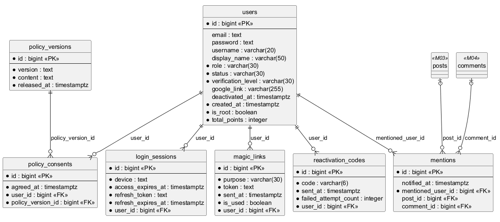

# Thiết kế cơ sở dữ liệu — M01 Authentication & Account

<!-- [Vietnamese Doc] Tài liệu tiếng Việt; tên bảng, cột, kiểu viết tiếng Anh. -->

| Mã tài liệu | DB-M01 |
|---|---|
| Dự án | iShare |
| Module | M01 — Authentication & Account |
| Đầu vào | CD-M01 phiên bản 1.0 |
| Trạng thái | Đã chốt |
| Phiên bản | 1.0 |
| Ngày | 2026-11-22 |
| Tác giả | Phạm Văn Đức |

<!-- Quy ước chung cho mọi bảng dưới đây:
     - Không đổi tên cột, không xóa cột, không đổi số mục: tool đọc bảng theo số mục và tên cột.
     - Ô không có nội dung ghi "—". Mục chưa tới bước làm thì để dòng "(Chưa làm — bước N)".
     - Bảng chỉ sinh từ lớp, cột chỉ sinh từ thuộc tính, khóa ngoại chỉ sinh từ quan hệ (giữ mã R-Mxx-nn).
     - Mục 6 do build_schema.py sinh; không sửa tay.
     - Quy ước dùng (data-model/conventions.md): QU-06, QU-07; QU-08 cách ghép tên khóa ngoại và QU-09 kiểu cột
       (người dùng xác nhận 2026-11-22, DB-M01 Q-01, Q-02). Mọi khóa chính id kiểu bigint (QU-02: long). -->

## 1. Bảng

| Bảng | Từ lớp | Nhóm | Sở hữu | Ghi chú |
|---|---|---|---|---|
| users | User | Thực thể | M01 | — |
| magic_links | MagicLink | Thực thể | M01 | — |
| reactivation_codes | ReactivationCode | Thực thể | M01 | — |
| login_sessions | LoginSession | Thực thể | M01 | — |
| mentions | Mention | Thực thể | M01 | — |
| policy_versions | PolicyVersion | Thực thể | M01 | — |
| policy_consents | PolicyConsent | Liên kết | M01 | — |

## 2. Cột

### 2.1 Cột từ thuộc tính

| Bảng | Cột | Kiểu | Null | Duy nhất | Từ thuộc tính | Ghi chú |
|---|---|---|---|---|---|---|
| users | id | bigint | Không | Có | User.id | — |
| users | email | text | Có | Có | User.email | Nhiều dòng null không vi phạm duy nhất; Có ở mọi trạng thái trừ DELETED; duy nhất: mỗi email thuộc tối đa một tài khoản (BR-M01-04); xóa và giải phóng khi DELETED (BR-M01-21, BR-M01-47) |
| users | password | text | Có | Không | User.password | Cột lưu chuỗi băm của mật khẩu nên dùng text, không đặt varchar(64) (DD-M01-01); 8–64 ký tự khi nhập, nhận mọi ký tự, không tự cắt khoảng trắng; mật khẩu mới khác mật khẩu hiện tại (BR-M01-35); không có ở tài khoản Google; xóa khi DELETED (BR-M01-47) |
| users | username | varchar(20) | Có | Có | User.username | Duy nhất theo lower(username); Có từ bước 3; 3–20 ký tự a–z, A–Z, 0–9, "_"; duy nhất khi so không phân biệt hoa thường, kể cả tài khoản DELETED; lưu đúng hoa thường đã nhập (BR-M01-05); giữ khi DELETED (BR-M01-21) |
| users | display_name | varchar(50) | Có | Không | User.displayName | Lưu chuỗi đã bỏ khoảng trắng đầu, cuối (FR-M01-03.12) nên varchar(50) đủ; Có từ bước 3; sau khi bỏ khoảng trắng đầu, cuối dài 1–50 ký tự; chỉ chữ cái (kể cả có dấu), chữ số, khoảng trắng và . , - _ ' ( ); được trùng (BR-M01-06); xóa khi DELETED (BR-M01-47) |
| users | role | varchar(30) | Không | Không | User.role | Giá trị: USER, MODERATOR, ADMIN; Mặc định USER khi tạo (BR-M01-01); đổi ở M10 |
| users | status | varchar(30) | Không | Không | User.status | Giá trị: ACTIVE, DEACTIVATED, DELETED, BANNED; Mặc định ACTIVE; DELETED là trạng thái kết thúc (FR-M01-12.04) |
| users | verification_level | varchar(30) | Không | Không | User.verificationLevel | Giá trị: NONE, EMAIL_VERIFIED, SETUP_COMPLETED; Bắt đầu NONE khi đăng ký email, EMAIL_VERIFIED khi tạo bằng Google; không đi ngược (BR-M01-02, BR-M01-08) |
| users | google_link | varchar(255) | Có | Có | User.googleLink | Mã định danh tài khoản Google (giá trị sub Google trả về khi đăng nhập, tối đa 255 ký tự, không đổi khi người dùng đổi email Google); duy nhất; lần đầu khớp tài khoản email theo email rồi ghi mã này (FR-M01-04.04), các lần sau khớp theo mã; chỉ có ở tài khoản Google và tài khoản email đã liên kết Google; xóa khi DELETED (BR-M01-47) |
| users | deactivated_at | timestamptz | Có | Không | User.deactivatedAt | Chỉ có khi DEACTIVATED |
| users | deactivation_ends_at | timestamptz | Có | Không | User.deactivationEndsAt | = deactivatedAt + 14 × 24 giờ (BR-M01-21); chỉ có khi DEACTIVATED; Dẫn xuất ở CD: xét ở bước 5 |
| users | is_google_account | boolean | Không | Không | User.isGoogleAccount | Đúng khi tài khoản không có password (TN:Tài khoản Google); Dẫn xuất ở CD: xét ở bước 5 |
| users | created_at | timestamptz | Không | Không | User.createdAt | — |
| users | unread_notification_count | integer | Không | Không | User.unreadNotificationCount | ≥ 0; số Notification đang Chưa đọc, không tính tin nhắn (FR-M07-05.10, BR-M07-12); Dẫn xuất ở CD: xét ở bước 5 |
| users | ban_count | integer | Không | Không | User.banCount | ≥ 0; số ban từng có hiệu lực, kể cả gỡ sớm và vĩnh viễn, trừ ban Bị lật (BR-M08-34); Dẫn xuất ở CD: xét ở bước 5 |
| users | is_root | boolean | Không | Không | User.isRoot | Đúng ở đúng một tài khoản ADMIN tạo sẵn khi khởi tạo hệ thống (BR-M10-10) |
| users | total_points | integer | Không | Không | User.totalPoints | ≥ 0; = 2 × upvote có hiệu lực trên bài viết + 1 × upvote có hiệu lực trên bình luận, chỉ nội dung chưa bị trừ điểm (BR-M12-05); không giảm theo thời gian, không chỉnh tay (BR-M12-06); cộng lại điểm đã trừ khi khiếu nại bài bị gỡ được chấp nhận (BR-M12-10) |
| magic_links | id | bigint | Không | Có | MagicLink.id | — |
| magic_links | purpose | varchar(30) | Không | Không | MagicLink.purpose | Giá trị: EMAIL_VERIFICATION, PASSWORD_RESET; Với mỗi tài khoản chỉ link mới nhất cùng loại còn hiệu lực (BR-M01-38) |
| magic_links | token | text | Không | Không | MagicLink.token | — |
| magic_links | sent_at | timestamptz | Không | Không | MagicLink.sentAt | Hai lần gửi link xác minh cách nhau ít nhất 60 giây (BR-M01-11) |
| magic_links | expires_at | timestamptz | Không | Không | MagicLink.expiresAt | = sentAt + 1 giờ với link xác minh email (BR-M01-10); = sentAt + 15 phút với link đặt lại mật khẩu (BR-M01-12); Dẫn xuất ở CD: xét ở bước 5 |
| magic_links | is_used | boolean | Không | Không | MagicLink.isUsed | Mỗi link chỉ dùng được một lần (BR-M01-38) |
| reactivation_codes | id | bigint | Không | Có | ReactivationCode.id | — |
| reactivation_codes | code | varchar(6) | Không | Không | ReactivationCode.code | Đúng 6 chữ số, giữ cả số 0 đầu (BR-M01-22) |
| reactivation_codes | sent_at | timestamptz | Không | Không | ReactivationCode.sentAt | Hai lần gửi cách nhau ít nhất 60 giây (BR-M01-22) |
| reactivation_codes | expires_at | timestamptz | Không | Không | ReactivationCode.expiresAt | = sentAt + 15 phút (BR-M01-22); Dẫn xuất ở CD: xét ở bước 5 |
| reactivation_codes | failed_attempt_count | integer | Không | Không | ReactivationCode.failedAttemptCount | 0–5; tới lần sai thứ 5 mã mất hiệu lực (BR-M01-22) |
| login_sessions | id | bigint | Không | Có | LoginSession.id | — |
| login_sessions | device | text | Không | Không | LoginSession.device | Mỗi thiết bị một phiên đăng nhập riêng (BR-M01-17) |
| login_sessions | access_expires_at | timestamptz | Không | Không | LoginSession.accessExpiresAt | 1 giờ từ lúc cấp phiên truy cập (BR-M01-16) |
| login_sessions | refresh_token | text | Không | Không | LoginSession.refreshToken | — |
| login_sessions | refresh_expires_at | timestamptz | Không | Không | LoginSession.refreshExpiresAt | 30 ngày từ lúc cấp phiên làm mới (BR-M01-16) |
| mentions | id | bigint | Không | Có | Mention.id | — |
| mentions | notified_at | timestamptz | Có | Không | Mention.notifiedAt | — |
| policy_versions | id | bigint | Không | Có | PolicyVersion.id | — |
| policy_versions | version | text | Không | Không | PolicyVersion.version | — |
| policy_versions | content | text | Không | Không | PolicyVersion.content | Gồm các mục của BR-M01-42, dữ liệu trình bày theo bốn nhóm của BR-M01-43; chỉ đổi qua triển khai bản mới (FR-M01-15.09) |
| policy_versions | released_at | timestamptz | Không | Không | PolicyVersion.releasedAt | — |
| policy_versions | is_current | boolean | Không | Không | PolicyVersion.isCurrent | Đúng ở phiên bản có releasedAt muộn nhất (BR-M01-44); Dẫn xuất ở CD: xét ở bước 5 |
| policy_consents | id | bigint | Không | Có | PolicyConsent.id | — |
| policy_consents | agreed_at | timestamptz | Không | Không | PolicyConsent.agreedAt | Mỗi lần đồng ý là một bản ghi mới (BR-M01-44); xóa khi DELETED (BR-M01-47) |

### 2.2 Thuộc tính đối tượng không chuyển

| Lớp | Thuộc tính | Kiểu | Lý do không chuyển |
|---|---|---|---|
| User | magicLinks | List<MagicLink> | Thuộc tính đối tượng; được thay bằng khóa ngoại magic_links.user_id ở bước 4 (R-M01-01) |
| User | reactivationCodes | List<ReactivationCode> | Thuộc tính đối tượng; được thay bằng khóa ngoại reactivation_codes.user_id ở bước 4 (R-M01-02) |
| User | loginSessions | List<LoginSession> | Thuộc tính đối tượng; được thay bằng khóa ngoại login_sessions.user_id ở bước 4 (R-M01-03) |
| User | policyConsents | List<PolicyConsent> | Thuộc tính đối tượng; được thay bằng khóa ngoại policy_consents.user_id ở bước 4 (R-M01-04) |
| PolicyConsent | policyVersion | PolicyVersion | Thuộc tính đối tượng; được thay bằng khóa ngoại policy_consents.policy_version_id ở bước 4 (R-M01-05) |
| Mention | mentionedUser | User | Thuộc tính đối tượng; được thay bằng khóa ngoại mentions.mentioned_user_id ở bước 4 (R-M01-06) |
| User | profile | Profile | Thuộc tính đối tượng; được thay bằng khóa ngoại profiles.user_id đặt ở bảng của module khác, ghi thành đề nghị ở mục 7.2 (R-M01-09) |
| User | bookmarks | List<Bookmark> | Thuộc tính đối tượng; được thay bằng khóa ngoại bookmarks.user_id đặt ở bảng của module khác, ghi thành đề nghị ở mục 7.2 (R-M01-10) |

## 3. Quan hệ giữa các bảng

"Dạng" đọc theo thứ tự Bảng A – Bảng B; quan hệ 1-n viết bảng phía 1 ở cột Bảng A.

| ID | Bảng A | Bảng B | Dạng | Xử lý | Ghi chú |
|---|---|---|---|---|---|
| R-M01-01 | users | magic_links | 1-n | Tách riêng | — |
| R-M01-02 | users | reactivation_codes | 1-n | Tách riêng | — |
| R-M01-03 | users | login_sessions | 1-n | Tách riêng | — |
| R-M01-04 | users | policy_consents | 1-n | Tách riêng | — |
| R-M01-05 | policy_versions | policy_consents | 1-n | Tách riêng | — |
| R-M01-06 | users | mentions | 1-n | Tách riêng | — |
| R-M01-07 | posts | mentions | 1-n | Tách riêng | — |
| R-M01-08 | comments | mentions | 1-n | Tách riêng | — |
| R-M01-09 | users | profiles | 1-1 | Tách riêng | Không gộp: profiles là bảng của M02. Tách riêng; khóa ngoại đặt ở profiles (hồ sơ là bên được tạo sau, ở bước 3 đăng ký), cùng cách với R-M02-01 của DB-M02: đề nghị profiles.user_id, Duy nhất (mục 7.2) |
| R-M01-10 | users | bookmarks | 1-n | Tách riêng | Bảng phía n bookmarks thuộc M02: khóa ngoại đề nghị ở mục 7.2 |
| R-M01-11 | users | posts | 1-n | Tách riêng | Bảng phía n posts thuộc M03: khóa ngoại đề nghị ở mục 7.2 |
| R-M01-12 | users | comments | 1-n | Tách riêng | Bảng phía n comments thuộc M04: khóa ngoại đề nghị ở mục 7.2 |
| R-M01-13 | users | follows | 1-n | Tách riêng | Bảng phía n follows thuộc M07: khóa ngoại đề nghị ở mục 7.2 |
| R-M01-14 | users | follows | 1-n | Tách riêng | Bảng phía n follows thuộc M07: khóa ngoại đề nghị ở mục 7.2 |
| R-M01-15 | users | bans | 1-n | Tách riêng | Bảng phía n bans thuộc M08: khóa ngoại đề nghị ở mục 7.2 |
| R-M01-16 | users | upvotes | 1-n | Tách riêng | Bảng phía n upvotes thuộc M12: khóa ngoại đề nghị ở mục 7.2 |

Không có quan hệ n-n.

## 4. Khóa

### 4.1 Khóa chính

| Bảng | Khóa chính | Ghi chú |
|---|---|---|
| users | id | — |
| magic_links | id | — |
| reactivation_codes | id | — |
| login_sessions | id | — |
| mentions | id | — |
| policy_versions | id | — |
| policy_consents | id | — |

### 4.2 Khóa ngoại

| Bảng | Cột | Kiểu | Null | Duy nhất | Tham chiếu | Từ quan hệ | Ghi chú |
|---|---|---|---|---|---|---|---|
| magic_links | user_id | bigint | Không | Không | users(id) | R-M01-01 | 1 users – n magic_links |
| reactivation_codes | user_id | bigint | Không | Không | users(id) | R-M01-02 | 1 users – n reactivation_codes |
| login_sessions | user_id | bigint | Không | Không | users(id) | R-M01-03 | 1 users – n login_sessions |
| policy_consents | user_id | bigint | Không | Không | users(id) | R-M01-04 | 1 users – n policy_consents; Xóa theo tài khoản khi DELETED (FR-M01-12.08) |
| policy_consents | policy_version_id | bigint | Không | Không | policy_versions(id) | R-M01-05 | 1 policy_versions – n policy_consents |
| mentions | mentioned_user_id | bigint | Không | Không | users(id) | R-M01-06 | 1 users – n mentions |
| mentions | post_id | bigint | Có | Không | posts(id) | R-M01-07 | 1 posts – n mentions |
| mentions | comment_id | bigint | Có | Không | comments(id) | R-M01-08 | 1 comments – n mentions |

## 5. Loại dư thừa

### 5.1 Cột bị loại

| Bảng | Cột | Loại dư thừa | Căn cứ | Cách có lại giá trị |
|---|---|---|---|---|
| users | deactivation_ends_at | Dẫn xuất | Thuộc tính dẫn xuất ở CD-M01; BR-M01-21 | users.deactivated_at + 14 × 24 giờ (BR-M01-21); chỉ có khi users.status = DEACTIVATED |
| users | is_google_account | Dẫn xuất | Thuộc tính dẫn xuất ở CD-M01; TN:Tài khoản Google | Đúng khi users.password null (tài khoản không có mật khẩu); tài khoản DELETED bị xóa mật khẩu (BR-M01-47) nên giá trị chỉ dùng cho tài khoản chưa DELETED |
| users | unread_notification_count | Dẫn xuất | Thuộc tính dẫn xuất ở CD-M01; FR-M07-05.10, BR-M07-12 | Đếm notifications có recipient_id = users.id và is_read = false (bảng của M07; tin nhắn không nằm ở bảng này) |
| users | ban_count | Dẫn xuất | Thuộc tính dẫn xuất ở CD-M01; BR-M08-34 | Đếm bans có banned_user_id = users.id và status khác OVERTURNED (bảng của M08; gồm ban gỡ sớm và ban vĩnh viễn) |
| magic_links | expires_at | Dẫn xuất | Thuộc tính dẫn xuất ở CD-M01; BR-M01-10, BR-M01-12 | magic_links.sent_at + 1 giờ khi purpose = EMAIL_VERIFICATION (BR-M01-10); + 15 phút khi purpose = PASSWORD_RESET (BR-M01-12) |
| reactivation_codes | expires_at | Dẫn xuất | Thuộc tính dẫn xuất ở CD-M01; BR-M01-22 | reactivation_codes.sent_at + 15 phút (BR-M01-22) |
| policy_versions | is_current | Dẫn xuất | Thuộc tính dẫn xuất ở CD-M01; BR-M01-44 | Đúng ở dòng policy_versions có released_at lớn nhất |

### 5.2 Bảng bị loại

| Bảng | Lý do |
|---|---|
| — | — |

### 5.3 Dẫn xuất nhưng giữ lại

Không có.

| Bảng | Cột | Lý do giữ | Nguồn |
|---|---|---|---|
| — | — | — | — |

### 5.4 Đã xét nhưng không coi là dư thừa

| Bảng | Cột | Vì sao không dư thừa |
|---|---|---|
| users | total_points | CD ghi Tính chất Lưu: cộng, trừ tức thời, không chỉnh tay, hoàn đúng số điểm đã trừ khi khiếu nại được chấp nhận (BR-M12-05, BR-M12-06, BR-M12-10). Nguồn tính nằm ở bảng của module khác (upvotes M12, posts M03, comments M04), nên phép thử dẫn xuất xuyên module để lượt gộp DB-SYS xét |

## 6. Lược đồ cuối

### 6.1 Bảng và cột

<!-- BEGIN:SCHEMA -->
| Bảng | Cột | Kiểu | Khóa | Null | Duy nhất | Tham chiếu |
|---|---|---|---|---|---|---|
| users | id | bigint | PK | Không | Có | — |
| users | email | text | — | Có | Có | — |
| users | password | text | — | Có | Không | — |
| users | username | varchar(20) | — | Có | Có | — |
| users | display_name | varchar(50) | — | Có | Không | — |
| users | role | varchar(30) | — | Không | Không | — |
| users | status | varchar(30) | — | Không | Không | — |
| users | verification_level | varchar(30) | — | Không | Không | — |
| users | google_link | varchar(255) | — | Có | Có | — |
| users | deactivated_at | timestamptz | — | Có | Không | — |
| users | created_at | timestamptz | — | Không | Không | — |
| users | is_root | boolean | — | Không | Không | — |
| users | total_points | integer | — | Không | Không | — |
| magic_links | id | bigint | PK | Không | Có | — |
| magic_links | purpose | varchar(30) | — | Không | Không | — |
| magic_links | token | text | — | Không | Không | — |
| magic_links | sent_at | timestamptz | — | Không | Không | — |
| magic_links | is_used | boolean | — | Không | Không | — |
| magic_links | user_id | bigint | FK | Không | Không | users(id) |
| reactivation_codes | id | bigint | PK | Không | Có | — |
| reactivation_codes | code | varchar(6) | — | Không | Không | — |
| reactivation_codes | sent_at | timestamptz | — | Không | Không | — |
| reactivation_codes | failed_attempt_count | integer | — | Không | Không | — |
| reactivation_codes | user_id | bigint | FK | Không | Không | users(id) |
| login_sessions | id | bigint | PK | Không | Có | — |
| login_sessions | device | text | — | Không | Không | — |
| login_sessions | access_expires_at | timestamptz | — | Không | Không | — |
| login_sessions | refresh_token | text | — | Không | Không | — |
| login_sessions | refresh_expires_at | timestamptz | — | Không | Không | — |
| login_sessions | user_id | bigint | FK | Không | Không | users(id) |
| mentions | id | bigint | PK | Không | Có | — |
| mentions | notified_at | timestamptz | — | Có | Không | — |
| mentions | mentioned_user_id | bigint | FK | Không | Không | users(id) |
| mentions | post_id | bigint | FK | Có | Không | posts(id) |
| mentions | comment_id | bigint | FK | Có | Không | comments(id) |
| policy_versions | id | bigint | PK | Không | Có | — |
| policy_versions | version | text | — | Không | Không | — |
| policy_versions | content | text | — | Không | Không | — |
| policy_versions | released_at | timestamptz | — | Không | Không | — |
| policy_consents | id | bigint | PK | Không | Có | — |
| policy_consents | agreed_at | timestamptz | — | Không | Không | — |
| policy_consents | user_id | bigint | FK | Không | Không | users(id) |
| policy_consents | policy_version_id | bigint | FK | Không | Không | policy_versions(id) |
<!-- END:SCHEMA -->

### 6.2 Sơ đồ quan hệ

<!-- BEGIN:DIAGRAM -->

Mã nguồn sơ đồ: [diagrams/DB-M01.puml](diagrams/DB-M01.puml). Ảnh và tệp .puml do `build_schema.py` sinh từ các bảng của tài liệu này; muốn đổi sơ đồ thì sửa bảng rồi chạy lại tool, không sửa tay.
<!-- END:DIAGRAM -->

## 7. Liên module

### 7.1 Bảng của module khác được tham chiếu

| Bảng ngoài | Module sở hữu | Dùng thế nào |
|---|---|---|
| profiles | M02 | Ghi bio, gradeLevel, avatar ở bước 3 đăng ký; đọc avatar cho danh sách gợi ý nhắc tên; xóa các trường này khi tài khoản DELETED (R-M01-09) |
| bookmarks | M02 | Xóa bookmark của tài khoản khi tài khoản DELETED (R-M01-10) |
| posts | M03 | Ẩn bài của tác giả DEACTIVATED, DELETED (R-M01-11); bài chứa lượt nhắc tên (R-M01-07) |
| comments | M04 | Hiển thị bình luận của tác giả DEACTIVATED, DELETED với tên thay thế (R-M01-12); bình luận chứa lượt nhắc tên (R-M01-08) |
| follows | M07 | Đọc người đang theo dõi để xếp danh sách gợi ý nhắc tên; xóa lượt theo dõi của tài khoản và tới tài khoản khi DELETED (R-M01-13, R-M01-14) |
| bans | M08 | Đọc reason, endsAt, appealDeadline cho màn hình tài khoản bị khóa; đưa tài khoản về ACTIVE khi hết hạn ban (R-M01-15). ends_at, appeal_deadline bị loại ở DB-M08, tính lại từ started_at, duration, kind |
| upvotes | M12 | Bỏ người cho khỏi upvote khi tài khoản DELETED, giữ upvote cho người nhận (R-M01-16) |

### 7.2 Khóa ngoại đề nghị cho bảng của module khác

<!-- Khi bảng của module khác là phía n của một quan hệ với bảng của module này. -->

| Bảng của module khác | Cột | Kiểu | Tham chiếu | Từ quan hệ |
|---|---|---|---|---|
| profiles | user_id | bigint | users(id) | R-M01-09 |
| bookmarks | user_id | bigint | users(id) | R-M01-10 |
| posts | author_id | bigint | users(id) | R-M01-11 |
| comments | author_id | bigint | users(id) | R-M01-12 |
| follows | follower_id | bigint | users(id) | R-M01-13 |
| follows | followed_user_id | bigint | users(id) | R-M01-14 |
| bans | banned_user_id | bigint | users(id) | R-M01-15 |
| upvotes | upvoter_id | bigint | users(id) | R-M01-16 |

## 8. Quyết định thiết kế

| Mã | Quyết định | Lý do |
|---|---|---|
| DD-M01-01 | users.password kiểu text, lưu chuỗi băm của mật khẩu | Trả lời Q-03: giới hạn 8–64 ký tự (BR-M01-35) áp khi nhập; lưu nguyên văn không an toàn; độ dài chuỗi băm do thuật toán băm quyết định |

## 9. Câu hỏi và điểm chưa chốt

| Mã | Loại | Câu hỏi | Trả lời | Ghi vào |
|---|---|---|---|---|
| Q-01 | Quy ước (QU-08) | Cách ghép tên khóa ngoại, đề xuất theo mặc định của CONVENTIONS.md: (1) thuộc tính đối tượng một đối tượng ở bảng chứa khóa ngoại → tên thuộc tính + _id (Post.author → posts.author_id, Mention.mentionedUser → mentions.mentioned_user_id); (2) thuộc tính danh sách ở phía 1 → tên lớp phía 1 + _id (User.magicLinks → magic_links.user_id); (3) quan hệ của bảng với chính nó hoặc hai khóa cùng trỏ một bảng → tên theo vai trò (parent_comment_id, replied_to_id, holder_id, concluded_by_id); (4) 1-1 và cha–con: tên bảng được tham chiếu số ít + _id (profiles.user_id, topic_trending_stats.topic_id). Áp cho mọi module. Đồng ý? | Đồng ý (người dùng, 2026-11-22); ghi QU-08 vào data-model/conventions.md | data-model/conventions.md (QU-08) |
| Q-02 | Quy ước (QU-09) | Kiểu cột PostgreSQL, đề xuất theo mặc định: long → bigint (mọi id và khóa ngoại); int → integer; double → double precision; boolean → boolean; Instant → timestamptz; String nguồn nêu độ dài tối đa bằng ký tự → varchar(n) đúng số đó, còn lại → text (gồm chuỗi JSON của Tiptap và đầu ra thô của AI: text, không dùng jsonb); kiểu liệt kê → varchar(30) kèm giá trị cho phép ở Ghi chú (giá trị dài nhất 24 ký tự ở cột, 26 ở khóa Map). Mở rộng cho kiểu QU-04: float[] → vector(1536) của pgvector (DEC-095, QA-168); Map<…> → jsonb (chỉ có ở lớp thống kê, đều bị loại ở bước 5). Đồng ý? | Đồng ý (người dùng, 2026-11-22); ghi QU-09 vào data-model/conventions.md | data-model/conventions.md (QU-09) |
| Q-03 | Lựa chọn kiểu | users.password: giới hạn 8–64 ký tự của BR-M01-35 áp khi nhập. Đề xuất (a) cột text lưu chuỗi băm của mật khẩu (cách làm phổ biến; độ dài do thuật toán băm quyết định). Phương án (b) varchar(64) chỉ đúng nếu lưu mật khẩu nguyên văn — không an toàn. Chọn (a)? | (a) text, lưu chuỗi băm (người dùng, 2026-11-22); DD-M01-01 | Mục 2.1 (users.password); DD-M01-nn |

## 10. Lịch sử sửa đổi

| Phiên bản | Ngày | Nội dung | Người sửa |
|---|---|---|---|
| 0.1 | 2026-11-20 | Tạo mới từ CD-M01 v1.0; làm liền bước 1–5 theo yêu cầu của người dùng (không dừng ở cổng); chưa qua duyệt, câu hỏi ở mục 9 chờ trả lời | Phạm Văn Đức |
| 0.2 | 2026-11-22 | Ghi trả lời mục 9: QU-08, QU-09 đồng ý (ghi conventions.md); users.password text lưu chuỗi băm (DD-M01-01); soát lại các cột dẫn xuất bị loại theo tiêu chí của người dùng, không đổi; chờ chốt | Phạm Văn Đức |
| 1.0 | 2026-11-22 | Chốt: người dùng chốt DB-M01 | Phạm Văn Đức |
