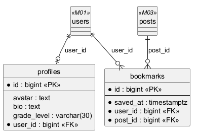

# Thiết kế cơ sở dữ liệu — M02 User Profile

<!-- [Vietnamese Doc] Tài liệu tiếng Việt; tên bảng, cột, kiểu viết tiếng Anh. -->

| Mã tài liệu | DB-M02 |
|---|---|
| Dự án | iShare |
| Module | M02 — User Profile |
| Đầu vào | CD-M02 phiên bản 1.0 |
| Trạng thái | Đã chốt |
| Phiên bản | 1.0 |
| Ngày | 2026-11-22 |
| Tác giả | Phạm Văn Đức |

<!-- Quy ước chung cho mọi bảng dưới đây:
     - Không đổi tên cột, không xóa cột, không đổi số mục: tool đọc bảng theo số mục và tên cột.
     - Ô không có nội dung ghi "—". Mục chưa tới bước làm thì để dòng "(Chưa làm — bước N)".
     - Bảng chỉ sinh từ lớp, cột chỉ sinh từ thuộc tính, khóa ngoại chỉ sinh từ quan hệ (giữ mã R-Mxx-nn).
     - Mục 6 do build_schema.py sinh; không sửa tay.
     - Quy ước dùng (data-model/conventions.md): QU-06, QU-07; QU-08 cách ghép tên khóa ngoại và QU-09 kiểu cột
       (người dùng xác nhận 2026-11-22, DB-M01 Q-01, Q-02). Mọi khóa chính id kiểu bigint (QU-02: long). -->

## 1. Bảng

| Bảng | Từ lớp | Nhóm | Sở hữu | Ghi chú |
|---|---|---|---|---|
| profiles | Profile | Thực thể | M02 | — |
| bookmarks | Bookmark | Liên kết | M02 | — |

## 2. Cột

### 2.1 Cột từ thuộc tính

| Bảng | Cột | Kiểu | Null | Duy nhất | Từ thuộc tính | Ghi chú |
|---|---|---|---|---|---|---|
| profiles | id | bigint | Không | Có | Profile.id | — |
| profiles | avatar | text | Có | Không | Profile.avatar | Nguồn không nêu độ dài đường dẫn: text; Đường dẫn ảnh trên nơi lưu ảnh (Cloudinary, DEC-137); ảnh JPEG, PNG hoặc WebP, tối đa 5 MB, không nhận GIF động (BR-M02-06); lưu ảnh gốc, hiển thị cắt tròn (BR-M02-08); trống thì hiện avatar mặc định (BR-M02-32); đặt ảnh mới thì xóa ảnh cũ (BR-M02-07) |
| profiles | bio | text | Có | Không | Profile.bio | Nguồn đếm mỗi emoji là một ký tự (BR-M02-33) còn varchar(n) đếm theo điểm mã Unicode (một emoji có thể gồm nhiều điểm mã), nên dùng text; giới hạn 155 kiểm ở tầng ứng dụng (DD-M02-01); Tối đa 155 ký tự đếm sau khi cắt khoảng trắng đầu và cuối, mỗi emoji, mỗi lần xuống dòng là một ký tự; chỉ gồm khoảng trắng thì lưu là trống (BR-M02-04, BR-M02-33) |
| profiles | grade_level | varchar(30) | Có | Không | Profile.gradeLevel | Giá trị: GRADE_10, GRADE_11, GRADE_12; Bỏ chọn được; chỉ đổi khi chủ hồ sơ tự sửa, không tự tăng theo năm học; độc lập với Lớp/Khối trên bài viết (BR-M02-09, BR-M02-10) |
| profiles | follower_count | integer | Không | Không | Profile.followerCount | ≥ 0; không đếm người theo dõi có tài khoản DEACTIVATED hoặc BANNED (BR-M02-27); Dẫn xuất ở CD: xét ở bước 5 |
| profiles | following_count | integer | Không | Không | Profile.followingCount | ≥ 0; chỉ lượt theo dõi người dùng, không gồm Topic; không đếm tài khoản DEACTIVATED hoặc BANNED (BR-M02-27); Dẫn xuất ở CD: xét ở bước 5 |
| bookmarks | id | bigint | Không | Có | Bookmark.id | — |
| bookmarks | saved_at | timestamptz | Không | Không | Bookmark.savedAt | Mỗi người dùng lưu một bài viết nhiều nhất một lần (BR-M02-22); tab Bookmark xếp mới nhất trước (BR-M02-31) |

### 2.2 Thuộc tính đối tượng không chuyển

| Lớp | Thuộc tính | Kiểu | Lý do không chuyển |
|---|---|---|---|
| Bookmark | post | Post | Thuộc tính đối tượng; được thay bằng khóa ngoại bookmarks.post_id ở bước 4 (R-M02-03) |

## 3. Quan hệ giữa các bảng

"Dạng" đọc theo thứ tự Bảng A – Bảng B; quan hệ 1-n viết bảng phía 1 ở cột Bảng A.

| ID | Bảng A | Bảng B | Dạng | Xử lý | Ghi chú |
|---|---|---|---|---|---|
| R-M02-01 | users | profiles | 1-1 | Tách riêng | Không gộp: users là bảng của M01. Tách riêng; khóa ngoại ở profiles (hồ sơ là bên được tạo sau, ở bước 3 đăng ký): profiles.user_id, Duy nhất. Cùng quan hệ với R-M01-09 (DD-M02-02) |
| R-M02-02 | users | bookmarks | 1-n | Tách riêng | — |
| R-M02-03 | posts | bookmarks | 1-n | Tách riêng | — |

Không có quan hệ n-n.

## 4. Khóa

### 4.1 Khóa chính

| Bảng | Khóa chính | Ghi chú |
|---|---|---|
| profiles | id | — |
| bookmarks | id | — |

### 4.2 Khóa ngoại

| Bảng | Cột | Kiểu | Null | Duy nhất | Tham chiếu | Từ quan hệ | Ghi chú |
|---|---|---|---|---|---|---|---|
| profiles | user_id | bigint | Không | Có | users(id) | R-M02-01 | 1-1 tách riêng: mỗi dòng users ứng với nhiều nhất một dòng profiles |
| bookmarks | user_id | bigint | Không | Không | users(id) | R-M02-02 | 1 users – n bookmarks; Bookmark bị xóa theo tài khoản khi DELETED (FR-M01-12.08) |
| bookmarks | post_id | bigint | Không | Không | posts(id) | R-M02-03 | 1 posts – n bookmarks; Bookmark bị xóa khi bài bị xóa hẳn (BR-M02-30) |

## 5. Loại dư thừa

### 5.1 Cột bị loại

| Bảng | Cột | Loại dư thừa | Căn cứ | Cách có lại giá trị |
|---|---|---|---|---|
| profiles | follower_count | Dẫn xuất | Thuộc tính dẫn xuất ở CD-M02; BR-M02-27 | Đếm follows có followed_user_id = profiles.user_id mà tài khoản follows.follower_id có users.status khác DEACTIVATED và BANNED (follows của M07, users của M01) |
| profiles | following_count | Dẫn xuất | Thuộc tính dẫn xuất ở CD-M02; BR-M02-27 | Đếm follows có follower_id = profiles.user_id và followed_user_id khác null (chỉ theo dõi người dùng, không gồm Topic) mà tài khoản followed_user_id có users.status khác DEACTIVATED và BANNED |

### 5.2 Bảng bị loại

| Bảng | Lý do |
|---|---|
| — | — |

### 5.3 Dẫn xuất nhưng giữ lại

Không có.

| Bảng | Cột | Lý do giữ | Nguồn |
|---|---|---|---|
| — | — | — | — |

### 5.4 Đã xét nhưng không coi là dư thừa

| Bảng | Cột | Vì sao không dư thừa |
|---|---|---|
| profiles | grade_level | Lớp/Khối do chủ hồ sơ tự đặt. posts.grade_level (M03) là Lớp/Khối của bài, độc lập với hồ sơ (BR-M02-09, BR-M02-10); leaderboard_entries.grade_level (M12) là bản chụp lúc chốt bảng (BR-M12-16). Ba cột là ba dữ liệu khác nhau |

## 6. Lược đồ cuối

### 6.1 Bảng và cột

<!-- BEGIN:SCHEMA -->
| Bảng | Cột | Kiểu | Khóa | Null | Duy nhất | Tham chiếu |
|---|---|---|---|---|---|---|
| profiles | id | bigint | PK | Không | Có | — |
| profiles | avatar | text | — | Có | Không | — |
| profiles | bio | text | — | Có | Không | — |
| profiles | grade_level | varchar(30) | — | Có | Không | — |
| profiles | user_id | bigint | FK | Không | Có | users(id) |
| bookmarks | id | bigint | PK | Không | Có | — |
| bookmarks | saved_at | timestamptz | — | Không | Không | — |
| bookmarks | user_id | bigint | FK | Không | Không | users(id) |
| bookmarks | post_id | bigint | FK | Không | Không | posts(id) |
<!-- END:SCHEMA -->

### 6.2 Sơ đồ quan hệ

<!-- BEGIN:DIAGRAM -->

Mã nguồn sơ đồ: [diagrams/DB-M02.puml](diagrams/DB-M02.puml). Ảnh và tệp .puml do `build_schema.py` sinh từ các bảng của tài liệu này; muốn đổi sơ đồ thì sửa bảng rồi chạy lại tool, không sửa tay.
<!-- END:DIAGRAM -->

## 7. Liên module

### 7.1 Bảng của module khác được tham chiếu

| Bảng ngoài | Module sở hữu | Dùng thế nào |
|---|---|---|
| users | M01 | Tài khoản có một hồ sơ (R-M02-01) và là người lưu của bookmark (R-M02-02); đọc username, displayName, createdAt, status để tìm và hiển thị hồ sơ, lọc và đếm danh sách theo dõi, chặn sửa hồ sơ khi không ACTIVE |
| posts | M03 | Bài viết được lưu (R-M02-03), bookmark bị xóa khi bài bị xóa hẳn; đọc createdAt, publishState, modState, isAnonymous để chọn bài ở tab Bài viết và nhận ra bài đã lưu không xem được |

### 7.2 Khóa ngoại đề nghị cho bảng của module khác

<!-- Khi bảng của module khác là phía n của một quan hệ với bảng của module này. -->

| Bảng của module khác | Cột | Kiểu | Tham chiếu | Từ quan hệ |
|---|---|---|---|---|
| — | — | — | — | — |

## 8. Quyết định thiết kế

| Mã | Quyết định | Lý do |
|---|---|---|
| DD-M02-01 | profiles.bio kiểu text; giới hạn 155 ký tự kiểm ở tầng ứng dụng | Trả lời Q-01: FR đếm mỗi emoji là một ký tự (BR-M02-33) còn varchar(n) đếm theo điểm mã Unicode |
| DD-M02-02 | Quan hệ 1-1 users–profiles (R-M02-01) tách riêng; khóa ngoại profiles.user_id, Duy nhất, không null | Trả lời Q-02: users thuộc M01 nên không gộp; hồ sơ là bên được tạo sau |

## 9. Câu hỏi và điểm chưa chốt

| Mã | Loại | Câu hỏi | Trả lời | Ghi vào |
|---|---|---|---|---|
| Q-01 | Lựa chọn kiểu | profiles.bio: FR đếm mỗi emoji là một ký tự (BR-M02-33), nhưng varchar(155) của PostgreSQL đếm theo điểm mã Unicode, nên một bio 155 ký tự có emoji ghép (ví dụ 👨‍👩‍👧 là 5 điểm mã) sẽ bị cơ sở dữ liệu từ chối. Đề xuất (a) text, giới hạn 155 kiểm ở tầng ứng dụng. Phương án (b) varchar(155) theo đúng con số của nguồn, chấp nhận trường hợp trên. Chọn (a)? | (a) text (người dùng, 2026-11-22); DD-M02-01 | Mục 2.1 (profiles.bio); DD-M02-nn |
| Q-02 | Xác nhận | Quan hệ 1-1 User–Profile (R-M02-01, trùng R-M01-09): không gộp được vì users thuộc M01. Đề xuất tách riêng, khóa ngoại ở profiles: profiles.user_id, Duy nhất, không null (hồ sơ là bên được tạo sau). Đồng ý? | Đồng ý (người dùng, 2026-11-22). Soát nghiệp vụ: mỗi tài khoản đúng một hồ sơ (R-M02-01, 1–1); khi DELETED hồ sơ chỉ bị xóa các trường, dòng vẫn còn (BR-M01-47); DD-M02-02 | Mục 3, 4.2; DD-M02-nn |

## 10. Lịch sử sửa đổi

| Phiên bản | Ngày | Nội dung | Người sửa |
|---|---|---|---|
| 0.1 | 2026-11-20 | Tạo mới từ CD-M02 v1.0; làm liền bước 1–5 theo yêu cầu của người dùng (không dừng ở cổng); chưa qua duyệt, câu hỏi ở mục 9 chờ trả lời | Phạm Văn Đức |
| 0.2 | 2026-11-22 | Ghi trả lời mục 9: bio kiểu text (DD-M02-01); 1-1 users–profiles tách riêng (DD-M02-02); chờ chốt | Phạm Văn Đức |
| 1.0 | 2026-11-22 | Chốt: người dùng chốt DB-M02 | Phạm Văn Đức |
