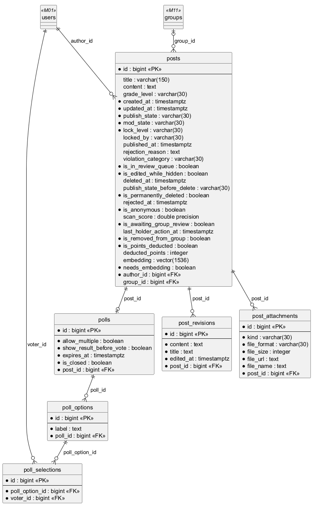

# Thiết kế cơ sở dữ liệu — M03 Post & Content

<!-- [Vietnamese Doc] Tài liệu tiếng Việt; tên bảng, cột, kiểu viết tiếng Anh. -->

| Mã tài liệu | DB-M03 |
|---|---|
| Dự án | iShare |
| Module | M03 — Post & Content |
| Đầu vào | CD-M03 phiên bản 1.0 |
| Trạng thái | Đã chốt |
| Phiên bản | 1.0 |
| Ngày | 2026-11-22 |
| Tác giả | Phạm Văn Đức |

<!-- Quy ước chung cho mọi bảng dưới đây:
     - Không đổi tên cột, không xóa cột, không đổi số mục: tool đọc bảng theo số mục và tên cột.
     - Ô không có nội dung ghi "—". Mục chưa tới bước làm thì để dòng "(Chưa làm — bước N)".
     - Bảng chỉ sinh từ lớp, cột chỉ sinh từ thuộc tính, khóa ngoại chỉ sinh từ quan hệ (giữ mã R-Mxx-nn).
     - Mục 6 do build_schema.py sinh; không sửa tay.
     - Quy ước dùng (data-model/conventions.md): QU-06, QU-07; QU-08 cách ghép tên khóa ngoại và QU-09 kiểu cột
       (người dùng xác nhận 2026-11-22, DB-M01 Q-01, Q-02). Mọi khóa chính id kiểu bigint (QU-02: long). -->

## 1. Bảng

| Bảng | Từ lớp | Nhóm | Sở hữu | Ghi chú |
|---|---|---|---|---|
| posts | Post | Thực thể | M03 | — |
| post_attachments | PostAttachment | Thực thể | M03 | — |
| polls | Poll | Thực thể | M03 | — |
| poll_options | PollOption | Thực thể | M03 | — |
| poll_selections | PollSelection | Liên kết | M03 | — |
| post_revisions | PostRevision | Thực thể | M03 | — |

## 2. Cột

### 2.1 Cột từ thuộc tính

| Bảng | Cột | Kiểu | Null | Duy nhất | Từ thuộc tính | Ghi chú |
|---|---|---|---|---|---|---|
| posts | id | bigint | Không | Có | Post.id | — |
| posts | title | varchar(150) | Có | Không | Post.title | Tối đa 150 ký tự (BR-M03-42); bắt buộc khi gửi (BR-M03-40); bài nháp được thiếu nếu có phần khác (BR-M03-41) |
| posts | content | text | Có | Không | Post.content | Nội dung giàu định dạng dạng JSON của Tiptap (DEC-137) theo BR-M03-03; LaTeX dạng mã thô (BR-M03-05); không chứa ảnh (BR-M03-04); tối đa 6.000 từ đếm trên phần chữ người đọc thấy (BR-M03-42); khi gửi phải có nội dung hoặc poll (BR-M03-40) |
| posts | content_text | text | Có | Không | Post.contentText | Phần chữ người đọc thấy của content, không kèm định dạng; có khi content có; Dẫn xuất ở CD: xét ở bước 5 |
| posts | grade_level | varchar(30) | Có | Không | Post.gradeLevel | Giá trị: GRADE_10, GRADE_11, GRADE_12; Tùy chọn (BR-M03-06); độc lập với Profile.gradeLevel |
| posts | created_at | timestamptz | Không | Không | Post.createdAt | — |
| posts | updated_at | timestamptz | Không | Không | Post.updatedAt | — |
| posts | publish_state | varchar(30) | Không | Không | Post.publishState | Giá trị: DRAFT, PENDING, PUBLISHED, HIDDEN, REJECTED, DELETED; Bài mới là DRAFT; chuyển theo mục Chuyển trạng thái của FR |
| posts | mod_state | varchar(30) | Không | Không | Post.modState | Giá trị: NORMAL, FLAGGED, HIDDEN; Bài mới là NORMAL (BR-M03-48); sang FLAGGED khi quét lại sau khi sửa cho điểm ≥ 0.5 (BR-M03-26) |
| posts | lock_level | varchar(30) | Không | Không | Post.lockLevel | Giá trị: NONE, COMMENT_LOCKED, FULLY_LOCKED; Bài mới là NONE (FR-M03-01.09); chỉ Mod, Admin đặt FULLY_LOCKED (BR-M03-31) |
| posts | locked_by | varchar(30) | Có | Không | Post.lockedBy | Giá trị: AUTHOR, MOD; Chỉ có khi lockLevel khác NONE; Admin khóa cũng ghi MOD (FR-M03-14.02); MOD thì tác giả không mở hay đổi mức khóa (BR-M03-32) |
| posts | published_at | timestamptz | Có | Không | Post.publishedAt | Lúc bài chuyển sang PUBLISHED lần đầu; không đổi khi hiện lại sau Tự ẩn hay khôi phục (EC-M03 Q-02) |
| posts | rejection_reason | text | Có | Không | Post.rejectionReason | Bắt buộc khi Mod, Admin từ chối (FR-M03-06.04); tác giả xem được (FR-M03-06.05) |
| posts | violation_category | varchar(30) | Có | Không | Post.violationCategory | Giá trị: HARASSMENT, HATE, SEXUAL, VIOLENCE; Chỉ có khi AI tự từ chối bài vừa gửi (FR-M03-05.03); tác giả xem được (BR-M03-46) |
| posts | is_in_review_queue | boolean | Không | Không | Post.isInReviewQueue | — |
| posts | is_edited_while_hidden | boolean | Không | Không | Post.isEditedWhileHidden | Đặt khi tác giả lưu bản sửa của bài Tự ẩn (FR-M03-05.14); khi hiện lại thì quét (FR-M03-05.05) |
| posts | deleted_at | timestamptz | Có | Không | Post.deletedAt | Chỉ có khi bài DELETED; hạn khôi phục 7 × 24 giờ từ thời điểm này (BR-M03-35) |
| posts | publish_state_before_delete | varchar(30) | Có | Không | Post.publishStateBeforeDelete | Giá trị: DRAFT, PENDING, PUBLISHED, HIDDEN, REJECTED, DELETED; Chỉ có khi bài DELETED; một giá trị khác DELETED; khôi phục về giá trị này, riêng PENDING thì về DRAFT (BR-M03-35) |
| posts | is_permanently_deleted | boolean | Không | Không | Post.isPermanentlyDeleted | Gắn khi bài DELETED hết hạn khôi phục (BR-M03-37); chỉ là cờ, dữ liệu bài được giữ (FR-M03-17.02); không gỡ được |
| posts | is_publicly_visible | boolean | Không | Không | Post.isPubliclyVisible | publishState = PUBLISHED và modState = NORMAL; không phụ thuộc mức khóa (BR-M03-18); Dẫn xuất ở CD: xét ở bước 5 |
| posts | is_edited | boolean | Không | Không | Post.isEdited | Đúng khi bài có ít nhất một PostRevision (BR-M03-27); Mod, Admin đổi Topic, Tag không tính (BR-M03-28); Dẫn xuất ở CD: xét ở bước 5 |
| posts | comment_count | integer | Không | Không | Post.commentCount | ≥ 0; số bình luận gốc và trả lời đang hiển thị, không tính dấu "[Bình luận đã bị xóa]" và bình luận bị ẩn (BR-M04-18); Dẫn xuất ở CD: xét ở bước 5 |
| posts | rejected_at | timestamptz | Có | Không | Post.rejectedAt | Chỉ có khi bài bị từ chối; hạn khiếu nại khi không có cảnh cáo đi kèm = rejectedAt + 3 × 24 giờ (BR-M09-04) |
| posts | is_anonymous | boolean | Không | Không | Post.isAnonymous | Chỉ chọn được khi bài thuộc nhóm có công tắc ẩn danh bật (BR-M11-16); giữ nguyên khi công tắc tắt sau đó; danh tính thật luôn được giữ (BR-M11-17) |
| posts | scan_score | double precision | Có | Không | Post.scanScore | 0 đến 1, do M13 trả về (TN:Điểm quét); không có khi AI tắt, quét thất bại hoặc tác giả là Admin; cổng duyệt nhóm dùng ngưỡng 0.9 và 0.5 (BR-M11-18) |
| posts | is_awaiting_group_review | boolean | Không | Không | Post.isAwaitingGroupReview | Đúng khi bài Chờ duyệt (chờ nhóm duyệt); sai khi đang quét hoặc đã ra khỏi hàng chờ của nhóm |
| posts | last_holder_action_at | timestamptz | Có | Không | Post.lastHolderActionAt | Có khi bài nhóm đang có người giữ; đặt lúc nhận bài và mỗi lần người giữ mở xem, chấp nhận, từ chối; 30 phút không thao tác thì nhả về hàng chờ (BR-M11-20) |
| posts | is_removed_from_group | boolean | Không | Không | Post.isRemovedFromGroup | Đặt khi Owner, Group Mod gỡ khỏi nhóm (xóa mềm); tác giả không tự bỏ được (BR-M11-30) |
| posts | is_points_deducted | boolean | Không | Không | Post.isPointsDeducted | Sai = Đang tính điểm, đúng = Đã trừ điểm; về sai khi khiếu nại bài bị gỡ được chấp nhận (FR-M12-02.18) |
| posts | deducted_points | integer | Có | Không | Post.deductedPoints | ≥ 0; chỉ có khi đã trừ điểm; = điểm từ các upvote có hiệu lực tại thời điểm trừ (BR-M12-09); dùng để hoàn đúng số đó (BR-M12-10) |
| posts | upvote_count | integer | Không | Không | Post.upvoteCount | ≥ 0; số upvote đang có hiệu lực (BR-M12-02); Dẫn xuất ở CD: xét ở bước 5 |
| posts | embedding | vector(1536) | Có | Không | Post.embedding | Kiểu vector của pgvector, 1536 chiều theo text-embedding-3-small (DEC-095, QA-168); Vector biểu diễn tiêu đề và nội dung chữ, lưu bằng pgvector (DEC-137, text-embedding-3-small); chỉ có ở bài PUBLISHED, mỗi bài đúng một; tạo lại khi tiêu đề hoặc nội dung chữ đổi (BR-M13-17, BR-M13-18) |
| posts | needs_embedding | boolean | Không | Không | Post.needsEmbedding | Đúng khi bài PUBLISHED chưa có embedding theo nội dung hiện tại (công tắc tắt hoặc lời gọi thất bại); về sai khi đã tạo (BR-M13-26) |
| posts | bookmark_count | integer | Không | Không | Post.bookmarkCount | ≥ 0; bookmark đã bỏ không tính (BR-M14-10); Dẫn xuất ở CD: xét ở bước 5 |
| post_attachments | id | bigint | Không | Có | PostAttachment.id | — |
| post_attachments | kind | varchar(30) | Không | Không | PostAttachment.kind | Giá trị: IMAGE, DOCUMENT; Mỗi bài tối đa 10 ảnh và 3 tài liệu, tính riêng (BR-M03-07, BR-M03-08) |
| post_attachments | file_format | varchar(30) | Không | Không | PostAttachment.fileFormat | Giá trị: JPEG, PNG, WEBP, PDF, DOCX, XLSX, PPTX; Ảnh: JPEG, PNG, WEBP (BR-M03-07); tài liệu: PDF, DOCX, XLSX, PPTX (BR-M03-08) |
| post_attachments | file_size | integer | Không | Không | PostAttachment.fileSize | Đơn vị byte; ảnh tối đa 5 MB, tài liệu tối đa 20 MB (BR-M03-07, BR-M03-08) |
| post_attachments | file_url | text | Không | Không | PostAttachment.fileUrl | — |
| post_attachments | file_name | text | Không | Không | PostAttachment.fileName | — |
| polls | id | bigint | Không | Có | Poll.id | — |
| polls | allow_multiple | boolean | Không | Không | Poll.allowMultiple | Mặc định đúng (chọn nhiều); không đổi được sau khi bài được gửi (BR-M03-11) |
| polls | show_result_before_vote | boolean | Không | Không | Poll.showResultBeforeVote | Mặc định sai; không đổi được sau khi bài được gửi (BR-M03-11) |
| polls | expires_at | timestamptz | Không | Không | Poll.expiresAt | Không trước thời điểm hiện tại khi đặt hoặc đổi (BR-M03-12); kết thúc ngay = đặt bằng thời điểm hiện tại (BR-M03-14) |
| polls | is_closed | boolean | Không | Không | Poll.isClosed | Đóng khi đến hạn hoặc tác giả kết thúc ngay; không mở lại được (BR-M03-13, BR-M03-14) |
| polls | total_selection_count | integer | Không | Không | Poll.totalSelectionCount | ≥ 0; số PollSelection của mọi lựa chọn trong poll (BR-M03-15); Dẫn xuất ở CD: xét ở bước 5 |
| poll_options | id | bigint | Không | Có | PollOption.id | — |
| poll_options | label | text | Không | Không | PollOption.label | Do tác giả đặt; không sửa được sau khi bài được gửi (BR-M03-44) |
| poll_options | selection_count | integer | Không | Không | PollOption.selectionCount | ≥ 0; số PollSelection của lựa chọn (BR-M03-15); Dẫn xuất ở CD: xét ở bước 5 |
| poll_options | percentage | integer | Không | Không | PollOption.percentage | 0–100; = selectionCount ÷ Poll.totalSelectionCount, làm tròn tới số nguyên (BR-M03-15); Dẫn xuất ở CD: xét ở bước 5 |
| poll_selections | id | bigint | Không | Có | PollSelection.id | — |
| post_revisions | id | bigint | Không | Có | PostRevision.id | — |
| post_revisions | content | text | Không | Không | PostRevision.content | Nội dung bài ngay trước lần lưu bản sửa, cùng dạng với Post.content (BR-M03-27); không sửa được |
| post_revisions | title | text | Không | Không | PostRevision.title | — |
| post_revisions | edited_at | timestamptz | Không | Không | PostRevision.editedAt | — |

### 2.2 Thuộc tính đối tượng không chuyển

| Lớp | Thuộc tính | Kiểu | Lý do không chuyển |
|---|---|---|---|
| Post | attachments | List<PostAttachment> | Thuộc tính đối tượng; được thay bằng khóa ngoại post_attachments.post_id ở bước 4 (R-M03-01) |
| Post | poll | Poll | Thuộc tính đối tượng; được thay bằng khóa ngoại polls.post_id ở bước 4 (R-M03-02) |
| Poll | options | List<PollOption> | Thuộc tính đối tượng; được thay bằng khóa ngoại poll_options.poll_id ở bước 4 (R-M03-03) |
| Post | revisions | List<PostRevision> | Thuộc tính đối tượng; được thay bằng khóa ngoại post_revisions.post_id ở bước 4 (R-M03-04) |
| Post | author | User | Thuộc tính đối tượng; được thay bằng khóa ngoại posts.author_id ở bước 4 (R-M03-05) |
| PollOption | selections | List<PollSelection> | Thuộc tính đối tượng; được thay bằng khóa ngoại poll_selections.poll_option_id ở bước 4 (R-M03-07) |
| PollSelection | voter | User | Thuộc tính đối tượng; được thay bằng khóa ngoại poll_selections.voter_id ở bước 4 (R-M03-08) |

## 3. Quan hệ giữa các bảng

"Dạng" đọc theo thứ tự Bảng A – Bảng B; quan hệ 1-n viết bảng phía 1 ở cột Bảng A.

| ID | Bảng A | Bảng B | Dạng | Xử lý | Ghi chú |
|---|---|---|---|---|---|
| R-M03-01 | posts | post_attachments | 1-n | Tách riêng | — |
| R-M03-02 | posts | polls | 1-1 | Tách riêng | Hai bảng cùng M03, mặc định của phương pháp là gộp. Tách riêng theo quyết định của người dùng (DD-M03-01): bài không bắt buộc có poll (bội số 0..1) nên gộp sẽ để trống mọi cột poll ở phần lớn bài, và poll có bảng con poll_options. Khóa ngoại ở polls (bên tùy chọn): polls.post_id, Duy nhất |
| R-M03-03 | polls | poll_options | 1-n | Tách riêng | — |
| R-M03-04 | posts | post_revisions | 1-n | Tách riêng | — |
| R-M03-05 | users | posts | 1-n | Tách riêng | — |
| R-M03-06 | groups | posts | 1-n | Tách riêng | — |
| R-M03-07 | poll_options | poll_selections | 1-n | Tách riêng | — |
| R-M03-08 | users | poll_selections | 1-n | Tách riêng | — |

Không có quan hệ n-n.

## 4. Khóa

### 4.1 Khóa chính

| Bảng | Khóa chính | Ghi chú |
|---|---|---|
| posts | id | — |
| post_attachments | id | — |
| polls | id | — |
| poll_options | id | — |
| poll_selections | id | — |
| post_revisions | id | — |

### 4.2 Khóa ngoại

| Bảng | Cột | Kiểu | Null | Duy nhất | Tham chiếu | Từ quan hệ | Ghi chú |
|---|---|---|---|---|---|---|---|
| post_attachments | post_id | bigint | Không | Không | posts(id) | R-M03-01 | 1 posts – n post_attachments |
| polls | post_id | bigint | Không | Có | posts(id) | R-M03-02 | 1-1 tách riêng: mỗi dòng posts ứng với nhiều nhất một dòng polls; Null = Không vì mỗi poll thuộc đúng một bài (bội số phía bài là 1) |
| poll_options | poll_id | bigint | Không | Không | polls(id) | R-M03-03 | 1 polls – n poll_options; Hợp thành ở CD: lựa chọn không tồn tại ngoài poll |
| post_revisions | post_id | bigint | Không | Không | posts(id) | R-M03-04 | 1 posts – n post_revisions |
| posts | author_id | bigint | Không | Không | users(id) | R-M03-05 | 1 users – n posts |
| posts | group_id | bigint | Có | Không | groups(id) | R-M03-06 | 1 groups – n posts |
| poll_selections | poll_option_id | bigint | Không | Không | poll_options(id) | R-M03-07 | 1 poll_options – n poll_selections |
| poll_selections | voter_id | bigint | Không | Không | users(id) | R-M03-08 | 1 users – n poll_selections |

## 5. Loại dư thừa

### 5.1 Cột bị loại

| Bảng | Cột | Loại dư thừa | Căn cứ | Cách có lại giá trị |
|---|---|---|---|---|
| posts | content_text | Dẫn xuất | Thuộc tính dẫn xuất ở CD-M03; DD-M03-02 | Phần chữ người đọc thấy của posts.content (JSON Tiptap), bỏ định dạng; trống khi content trống |
| posts | is_publicly_visible | Dẫn xuất | Thuộc tính dẫn xuất ở CD-M03; BR-M03-18 | posts.publish_state = PUBLISHED và posts.mod_state = NORMAL |
| posts | is_edited | Dẫn xuất | Thuộc tính dẫn xuất ở CD-M03; BR-M03-27, BR-M03-28 | Có ít nhất một dòng post_revisions với post_id = posts.id |
| posts | comment_count | Dẫn xuất | Thuộc tính dẫn xuất ở CD-M03; BR-M04-18 | Đếm comments có post_id = posts.id đang hiển thị bình thường: deleted_at null và mod_state = NORMAL (bảng của M04) |
| posts | upvote_count | Dẫn xuất | Thuộc tính dẫn xuất ở CD-M03; BR-M12-02. FR-M06-04.07 và FR-M06-04.17 xếp theo số upvote trên mọi bài khớp bộ lọc; người dùng chọn loại (DD-M03-03) | Đếm upvotes có post_id = posts.id (bảng của M12) |
| posts | bookmark_count | Dẫn xuất | Thuộc tính dẫn xuất ở CD-M03; BR-M14-10 | Đếm bookmarks có post_id = posts.id (bảng của M02) |
| polls | total_selection_count | Dẫn xuất | Thuộc tính dẫn xuất ở CD-M03; BR-M03-15 | Đếm poll_selections có poll_option_id thuộc các poll_options có poll_id = polls.id |
| poll_options | selection_count | Dẫn xuất | Thuộc tính dẫn xuất ở CD-M03; BR-M03-15 | Đếm poll_selections có poll_option_id = poll_options.id |
| poll_options | percentage | Dẫn xuất | Thuộc tính dẫn xuất ở CD-M03; BR-M03-15 | Số poll_selections của lựa chọn × 100 ÷ số poll_selections của mọi lựa chọn cùng poll_id, làm tròn tới số nguyên |

### 5.2 Bảng bị loại

| Bảng | Lý do |
|---|---|
| — | — |

### 5.3 Dẫn xuất nhưng giữ lại

Không có.

| Bảng | Cột | Lý do giữ | Nguồn |
|---|---|---|---|
| — | — | — | — |

### 5.4 Đã xét nhưng không coi là dư thừa

| Bảng | Cột | Vì sao không dư thừa |
|---|---|---|
| posts | grade_level | Lớp/Khối của bài do tác giả chọn, độc lập với profiles.grade_level (BR-M02-09, BR-M02-10): không suy ra từ hồ sơ |
| post_revisions | title, content | Nội dung ngay trước một lần lưu bản sửa (BR-M03-27); posts.title, posts.content là nội dung hiện tại. Hai dữ liệu khác nhau |
| posts | deducted_points | Điểm từ các upvote có hiệu lực tại thời điểm trừ (BR-M12-09), dùng để hoàn đúng số đó (BR-M12-10); upvote đổi về sau nên không tính lại được |
| posts | scan_score | Điểm của lần quét áp cho nội dung hiện tại (M13 trả về). Nhật ký ai_decision_logs (M13) giữ mọi lần gọi, kể cả lần thất bại, và không có điểm khi tác giả là Admin hay AI tắt, nên không lấy chắc được qua khóa ngoại; lượt gộp DB-SYS xét lại |

## 6. Lược đồ cuối

### 6.1 Bảng và cột

<!-- BEGIN:SCHEMA -->
| Bảng | Cột | Kiểu | Khóa | Null | Duy nhất | Tham chiếu |
|---|---|---|---|---|---|---|
| posts | id | bigint | PK | Không | Có | — |
| posts | title | varchar(150) | — | Có | Không | — |
| posts | content | text | — | Có | Không | — |
| posts | grade_level | varchar(30) | — | Có | Không | — |
| posts | created_at | timestamptz | — | Không | Không | — |
| posts | updated_at | timestamptz | — | Không | Không | — |
| posts | publish_state | varchar(30) | — | Không | Không | — |
| posts | mod_state | varchar(30) | — | Không | Không | — |
| posts | lock_level | varchar(30) | — | Không | Không | — |
| posts | locked_by | varchar(30) | — | Có | Không | — |
| posts | published_at | timestamptz | — | Có | Không | — |
| posts | rejection_reason | text | — | Có | Không | — |
| posts | violation_category | varchar(30) | — | Có | Không | — |
| posts | is_in_review_queue | boolean | — | Không | Không | — |
| posts | is_edited_while_hidden | boolean | — | Không | Không | — |
| posts | deleted_at | timestamptz | — | Có | Không | — |
| posts | publish_state_before_delete | varchar(30) | — | Có | Không | — |
| posts | is_permanently_deleted | boolean | — | Không | Không | — |
| posts | rejected_at | timestamptz | — | Có | Không | — |
| posts | is_anonymous | boolean | — | Không | Không | — |
| posts | scan_score | double precision | — | Có | Không | — |
| posts | is_awaiting_group_review | boolean | — | Không | Không | — |
| posts | last_holder_action_at | timestamptz | — | Có | Không | — |
| posts | is_removed_from_group | boolean | — | Không | Không | — |
| posts | is_points_deducted | boolean | — | Không | Không | — |
| posts | deducted_points | integer | — | Có | Không | — |
| posts | embedding | vector(1536) | — | Có | Không | — |
| posts | needs_embedding | boolean | — | Không | Không | — |
| posts | author_id | bigint | FK | Không | Không | users(id) |
| posts | group_id | bigint | FK | Có | Không | groups(id) |
| post_attachments | id | bigint | PK | Không | Có | — |
| post_attachments | kind | varchar(30) | — | Không | Không | — |
| post_attachments | file_format | varchar(30) | — | Không | Không | — |
| post_attachments | file_size | integer | — | Không | Không | — |
| post_attachments | file_url | text | — | Không | Không | — |
| post_attachments | file_name | text | — | Không | Không | — |
| post_attachments | post_id | bigint | FK | Không | Không | posts(id) |
| polls | id | bigint | PK | Không | Có | — |
| polls | allow_multiple | boolean | — | Không | Không | — |
| polls | show_result_before_vote | boolean | — | Không | Không | — |
| polls | expires_at | timestamptz | — | Không | Không | — |
| polls | is_closed | boolean | — | Không | Không | — |
| polls | post_id | bigint | FK | Không | Có | posts(id) |
| poll_options | id | bigint | PK | Không | Có | — |
| poll_options | label | text | — | Không | Không | — |
| poll_options | poll_id | bigint | FK | Không | Không | polls(id) |
| poll_selections | id | bigint | PK | Không | Có | — |
| poll_selections | poll_option_id | bigint | FK | Không | Không | poll_options(id) |
| poll_selections | voter_id | bigint | FK | Không | Không | users(id) |
| post_revisions | id | bigint | PK | Không | Có | — |
| post_revisions | content | text | — | Không | Không | — |
| post_revisions | title | text | — | Không | Không | — |
| post_revisions | edited_at | timestamptz | — | Không | Không | — |
| post_revisions | post_id | bigint | FK | Không | Không | posts(id) |
<!-- END:SCHEMA -->

### 6.2 Sơ đồ quan hệ

<!-- BEGIN:DIAGRAM -->

Mã nguồn sơ đồ: [diagrams/DB-M03.puml](diagrams/DB-M03.puml). Ảnh và tệp .puml do `build_schema.py` sinh từ các bảng của tài liệu này; muốn đổi sơ đồ thì sửa bảng rồi chạy lại tool, không sửa tay.
<!-- END:DIAGRAM -->

## 7. Liên module

### 7.1 Bảng của module khác được tham chiếu

| Bảng ngoài | Module sở hữu | Dùng thế nào |
|---|---|---|
| users | M01 | Ghi tác giả của bài viết (R-M03-05, cùng R-M01-11) và người bình chọn của lượt chọn (R-M03-08); người sửa của phiên bản sửa lấy qua tác giả của bài. Đọc role để cho Mod, Admin duyệt và khóa bài, không quét bài của Admin; đọc status để không hiển thị bài của tài khoản DEACTIVATED, DELETED |
| groups | M11 | Bài viết có thể thuộc một nhóm (R-M03-06): bài nhóm theo luồng duyệt của nhóm, bài trong nhóm Private chỉ thành viên xem. Đọc privacy. Tên lớp và thuộc tính tạm, chờ EC-M11. Dấu "bị gỡ khỏi nhóm" và cờ đăng ẩn danh trên Post do EC-M11 bổ sung (FR-M03 xếp hai việc này vào M11) |

### 7.2 Khóa ngoại đề nghị cho bảng của module khác

<!-- Khi bảng của module khác là phía n của một quan hệ với bảng của module này. -->

| Bảng của module khác | Cột | Kiểu | Tham chiếu | Từ quan hệ |
|---|---|---|---|---|
| — | — | — | — | — |

## 8. Quyết định thiết kế

| Mã | Quyết định | Lý do |
|---|---|---|
| DD-M03-01 | Quan hệ 1-1 posts–polls (R-M03-02) tách riêng; khóa ngoại polls.post_id, Duy nhất, không null | Trả lời Q-01: bài không bắt buộc có poll (0..1); poll có bảng con poll_options |
| DD-M03-02 | Loại posts.content_text | Trả lời Q-02 theo tiêu chí dẫn xuất của người dùng: tính lại từ posts.content luôn đúng. Tìm full-text trên mọi bài (BR-M06-08, FR-M06-04.17, DEC-057) cần chỉ mục trên phần chữ: việc của thiết kế vật lý (chỉ mục biểu thức hoặc cột sinh tự động), ngoài phạm vi lược đồ logic |
| DD-M03-03 | Loại posts.upvote_count | Trả lời Q-03 theo tiêu chí dẫn xuất của người dùng: số upvote là trạng thái hiện tại, đếm từ upvotes luôn đúng. Xếp theo số upvote (FR-M06-04.07, FR-M06-04.17) đếm khi xếp; bộ đếm cho hiệu năng, nếu cần, là việc của thiết kế vật lý |

## 9. Câu hỏi và điểm chưa chốt

| Mã | Loại | Câu hỏi | Trả lời | Ghi vào |
|---|---|---|---|---|
| Q-01 | Lựa chọn | Quan hệ 1-1 Post–Poll (R-M03-02), hai bảng cùng M03. Phương pháp mặc định gộp thành một bảng. Đề xuất (a) tách riêng: bài không bắt buộc có poll (0..1), poll có bảng con poll_options; khóa ngoại polls.post_id, Duy nhất, không null. Phương án (b) gộp: các cột allow_multiple, show_result_before_vote, expires_at, is_closed chuyển vào posts (trống ở bài không có poll) và poll_options tham chiếu posts. Chọn (a)? | Tách riêng (người dùng, 2026-11-22); DD-M03-01 | Mục 3, 4.2, 5.2; DD-M03-nn |
| Q-02 | Dẫn xuất FR yêu cầu lưu | posts.content_text tính lại được từ posts.content, nhưng tìm full-text trên mọi bài khớp bộ lọc (BR-M06-08, FR-M06-04.17) và DEC-057 dựng cột tìm kiếm từ title và content_text. Đề xuất (a) giữ (mục 5.3). Phương án (b) loại, tách chữ từ JSON khi cần. Chọn (a)? | Theo tiêu chí của người dùng (2026-11-22): (1) có phải dẫn xuất; (2) tính lại mỗi lần có ra đúng giá trị lúc tạo và các lần sau không đổi: là dẫn xuất (phần chữ của posts.content); tính lại luôn đúng với nội dung hiện tại và không đổi khi nội dung không đổi → loại (mục 5.1); DD-M03-02 | Mục 5.1 hoặc 5.3; DD-M03-nn |
| Q-03 | Dẫn xuất FR yêu cầu lưu | posts.upvote_count tính lại được bằng đếm upvotes. FR-M06-04.07 và FR-M06-04.17 xếp theo số upvote trên mọi bài khớp bộ lọc khi truy vấn rỗng (không giới hạn 120). Đề xuất (a) loại theo phương pháp: đếm khi xếp, đủ ở quy mô đồ án. Phương án (b) giữ làm bộ đếm để xếp trên dữ liệu lớn (phải cập nhật mỗi lần upvote, bỏ upvote). comment_count, bookmark_count không có yêu cầu xếp trên dữ liệu lớn nên đã loại. Chọn (a)? | Theo tiêu chí của người dùng (2026-11-22): (1) có phải dẫn xuất; (2) tính lại mỗi lần có ra đúng giá trị lúc tạo và các lần sau không đổi: là dẫn xuất (đếm upvotes); giá trị cần là số upvote hiện có, không có giá trị lúc tạo cần giữ, tính lại luôn đúng → loại (mục 5.1); DD-M03-03 | Mục 5.1 hoặc 5.3; DD-M03-nn |

## 10. Lịch sử sửa đổi

| Phiên bản | Ngày | Nội dung | Người sửa |
|---|---|---|---|
| 0.1 | 2026-11-20 | Tạo mới từ CD-M03 v1.0; làm liền bước 1–5 theo yêu cầu của người dùng (không dừng ở cổng); chưa qua duyệt, câu hỏi ở mục 9 chờ trả lời | Phạm Văn Đức |
| 0.2 | 2026-11-22 | Ghi trả lời mục 9: posts–polls tách riêng (DD-M03-01); loại posts.content_text, posts.upvote_count theo tiêu chí dẫn xuất của người dùng (DD-M03-02, DD-M03-03); chờ chốt | Phạm Văn Đức |
| 1.0 | 2026-11-22 | Chốt: người dùng chốt DB-M03 | Phạm Văn Đức |
