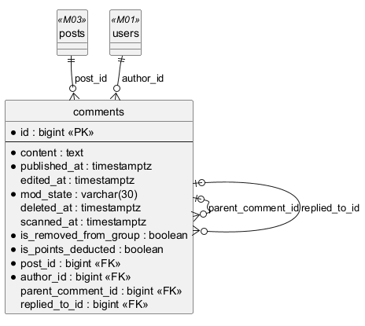

# Thiết kế cơ sở dữ liệu — M04 Comment

<!-- [Vietnamese Doc] Tài liệu tiếng Việt; tên bảng, cột, kiểu viết tiếng Anh. -->

| Mã tài liệu | DB-M04 |
|---|---|
| Dự án | iShare |
| Module | M04 — Comment |
| Đầu vào | CD-M04 phiên bản 1.0 |
| Trạng thái | Đã chốt |
| Phiên bản | 1.0 |
| Ngày | 2026-11-22 |
| Tác giả | Phạm Văn Đức |

<!-- Quy ước chung cho mọi bảng dưới đây:
     - Không đổi tên cột, không xóa cột, không đổi số mục: tool đọc bảng theo số mục và tên cột.
     - Ô không có nội dung ghi "—". Mục chưa tới bước làm thì để dòng "(Chưa làm — bước N)".
     - Bảng chỉ sinh từ lớp, cột chỉ sinh từ thuộc tính, khóa ngoại chỉ sinh từ quan hệ (giữ mã R-Mxx-nn).
     - Mục 6 do build_schema.py sinh; không sửa tay.
     - Quy ước dùng (data-model/conventions.md): QU-06, QU-07; QU-08 cách ghép tên khóa ngoại và QU-09 kiểu cột
       (người dùng xác nhận 2026-11-22, DB-M01 Q-01, Q-02). Mọi khóa chính id kiểu bigint (QU-02: long). -->

## 1. Bảng

| Bảng | Từ lớp | Nhóm | Sở hữu | Ghi chú |
|---|---|---|---|---|
| comments | Comment | Thực thể | M04 | — |

## 2. Cột

### 2.1 Cột từ thuộc tính

| Bảng | Cột | Kiểu | Null | Duy nhất | Từ thuộc tính | Ghi chú |
|---|---|---|---|---|---|---|
| comments | id | bigint | Không | Có | Comment.id | — |
| comments | content | text | Không | Không | Comment.content | Không trống, không chỉ khoảng trắng; tối đa 1.000 từ đếm trên phần chữ người đọc thấy, khối trích dẫn tự gõ có tính, dòng trích dẫn khi trả lời không tính (BR-M04-19); chỉ in đậm, in nghiêng, code trong dòng, LaTeX, liên kết, nhắc tên, trích dẫn (BR-M04-01); không tệp đính kèm (BR-M04-02); dạng JSON của Tiptap như Post.content (DEC-137); giữ khi bình luận bị xóa (BR-M04-21) |
| comments | published_at | timestamptz | Không | Không | Comment.publishedAt | Lúc hệ thống ghi nhận bình luận được gửi; không đổi khi sửa (FR-M04-04.03) |
| comments | edited_at | timestamptz | Có | Không | Comment.editedAt | Chỉ có khi đã sửa; lần sửa gần nhất thay lần trước (FR-M04-04.02) |
| comments | mod_state | varchar(30) | Không | Không | Comment.modState | Giá trị: NORMAL, HIDDEN; Bình luận mới là NORMAL (FR-M04-02.02, FR-M04-03.04); không đổi khi sửa (FR-M04-04.03); M08 đổi |
| comments | deleted_at | timestamptz | Có | Không | Comment.deletedAt | Chỉ có khi tác giả đã xóa; không xóa lại, không khôi phục (FR-M04-05.04, FR-M04-05.06) |
| comments | is_deleted | boolean | Không | Không | Comment.isDeleted | Đúng khi deletedAt có giá trị (FR-M04-05.01); Dẫn xuất ở CD: xét ở bước 5 |
| comments | is_edited | boolean | Không | Không | Comment.isEdited | Đúng khi editedAt có giá trị (BR-M04-07); Dẫn xuất ở CD: xét ở bước 5 |
| comments | is_visible | boolean | Không | Không | Comment.isVisible | Đúng khi chưa bị xóa và modState = NORMAL (TN:Bình luận hiển thị bình thường); Dẫn xuất ở CD: xét ở bước 5 |
| comments | upvote_count | integer | Không | Không | Comment.upvoteCount | ≥ 0; số người đang upvote, upvote đã rút không tính (TN:Số upvote của bình luận); Dẫn xuất ở CD: xét ở bước 5 |
| comments | scanned_at | timestamptz | Có | Không | Comment.scannedAt | — |
| comments | is_scanned_current | boolean | Không | Không | Comment.isScannedCurrent | Đúng khi có scannedAt và scannedAt không sớm hơn editedAt (TN:Đã quét với nội dung hiện tại, BR-M08-21); Dẫn xuất ở CD: xét ở bước 5 |
| comments | reply_rate | integer | Có | Không | Comment.replyRate | ≥ 0; chỉ có ở bình luận gốc: số trả lời của luồng đăng trong khoảng thời gian trượt (BR-M08-20); ngưỡng tạm 10 trả lời trong 5 phút (TBD-M08-04); Dẫn xuất ở CD: xét ở bước 5 |
| comments | is_removed_from_group | boolean | Không | Không | Comment.isRemovedFromGroup | Như Post.isRemovedFromGroup (BR-M11-30) |
| comments | is_points_deducted | boolean | Không | Không | Comment.isPointsDeducted | Sai = Đang tính điểm, đúng = Đã trừ điểm; với bình luận Đã trừ điểm là trạng thái cuối |

### 2.2 Thuộc tính đối tượng không chuyển

| Lớp | Thuộc tính | Kiểu | Lý do không chuyển |
|---|---|---|---|
| Comment | author | User | Thuộc tính đối tượng; được thay bằng khóa ngoại comments.author_id ở bước 4 (R-M04-02) |
| Comment | replies | List<Comment> | Thuộc tính đối tượng; được thay bằng khóa ngoại comments.parent_comment_id ở bước 4 (R-M04-03) |
| Comment | repliedTo | Comment | Thuộc tính đối tượng; được thay bằng khóa ngoại comments.replied_to_id ở bước 4 (R-M04-04) |
| Comment | upvotes | List<Upvote> | Thuộc tính đối tượng; được thay bằng khóa ngoại upvotes.comment_id đặt ở bảng của module khác, ghi thành đề nghị ở mục 7.2 (R-M04-05) |

## 3. Quan hệ giữa các bảng

"Dạng" đọc theo thứ tự Bảng A – Bảng B; quan hệ 1-n viết bảng phía 1 ở cột Bảng A.

| ID | Bảng A | Bảng B | Dạng | Xử lý | Ghi chú |
|---|---|---|---|---|---|
| R-M04-01 | posts | comments | 1-n | Tách riêng | — |
| R-M04-02 | users | comments | 1-n | Tách riêng | — |
| R-M04-03 | comments | comments | 1-n | Tách riêng | Quan hệ của bảng với chính nó: bình luận gốc – các trả lời của luồng. Khóa ngoại ở trả lời, tên theo vai trò như register (parent_comment_id, nullable) |
| R-M04-04 | comments | comments | 1-n | Tách riêng | Quan hệ của bảng với chính nó: trả lời – bình luận được trả lời (bình luận gốc hoặc một trả lời khác trong luồng). Khóa ngoại tên theo vai trò |
| R-M04-05 | comments | upvotes | 1-n | Tách riêng | Bảng phía n upvotes thuộc M12: khóa ngoại đề nghị ở mục 7.2 |

Không có quan hệ n-n.

## 4. Khóa

### 4.1 Khóa chính

| Bảng | Khóa chính | Ghi chú |
|---|---|---|
| comments | id | — |

### 4.2 Khóa ngoại

| Bảng | Cột | Kiểu | Null | Duy nhất | Tham chiếu | Từ quan hệ | Ghi chú |
|---|---|---|---|---|---|---|---|
| comments | post_id | bigint | Không | Không | posts(id) | R-M04-01 | 1 posts – n comments |
| comments | author_id | bigint | Không | Không | users(id) | R-M04-02 | 1 users – n comments |
| comments | parent_comment_id | bigint | Có | Không | comments(id) | R-M04-03 | 1 comments – n comments; quan hệ của bảng với chính nó, tên cột theo vai trò; null ở bình luận gốc |
| comments | replied_to_id | bigint | Có | Không | comments(id) | R-M04-04 | 1 comments – n comments; quan hệ của bảng với chính nó, tên cột theo vai trò; null ở bình luận gốc |

## 5. Loại dư thừa

### 5.1 Cột bị loại

| Bảng | Cột | Loại dư thừa | Căn cứ | Cách có lại giá trị |
|---|---|---|---|---|
| comments | is_deleted | Dẫn xuất | Thuộc tính dẫn xuất ở CD-M04; FR-M04-05.01 | comments.deleted_at khác null |
| comments | is_edited | Dẫn xuất | Thuộc tính dẫn xuất ở CD-M04; BR-M04-07 | comments.edited_at khác null |
| comments | is_visible | Dẫn xuất | Thuộc tính dẫn xuất ở CD-M04; TN:Bình luận hiển thị bình thường | comments.deleted_at null và comments.mod_state = NORMAL |
| comments | upvote_count | Dẫn xuất | Thuộc tính dẫn xuất ở CD-M04; TN:Số upvote của bình luận | Đếm upvotes có comment_id = comments.id (bảng của M12) |
| comments | is_scanned_current | Dẫn xuất | Thuộc tính dẫn xuất ở CD-M04; BR-M08-21 | comments.scanned_at khác null và (comments.edited_at null hoặc scanned_at không sớm hơn edited_at) |
| comments | reply_rate | Dẫn xuất | Thuộc tính dẫn xuất ở CD-M04; BR-M08-20, TBD-M08-04 | Với bình luận gốc: đếm comments có parent_comment_id = comments.id và published_at trong khoảng thời gian trượt tính tới lúc xét (ngưỡng tạm 10 trả lời trong 5 phút) |

### 5.2 Bảng bị loại

| Bảng | Lý do |
|---|---|
| — | — |

### 5.3 Dẫn xuất nhưng giữ lại

Không có.

| Bảng | Cột | Lý do giữ | Nguồn |
|---|---|---|---|
| — | — | — | — |

### 5.4 Đã xét nhưng không coi là dư thừa

| Bảng | Cột | Vì sao không dư thừa |
|---|---|---|
| — | — | — |

## 6. Lược đồ cuối

### 6.1 Bảng và cột

<!-- BEGIN:SCHEMA -->
| Bảng | Cột | Kiểu | Khóa | Null | Duy nhất | Tham chiếu |
|---|---|---|---|---|---|---|
| comments | id | bigint | PK | Không | Có | — |
| comments | content | text | — | Không | Không | — |
| comments | published_at | timestamptz | — | Không | Không | — |
| comments | edited_at | timestamptz | — | Có | Không | — |
| comments | mod_state | varchar(30) | — | Không | Không | — |
| comments | deleted_at | timestamptz | — | Có | Không | — |
| comments | scanned_at | timestamptz | — | Có | Không | — |
| comments | is_removed_from_group | boolean | — | Không | Không | — |
| comments | is_points_deducted | boolean | — | Không | Không | — |
| comments | post_id | bigint | FK | Không | Không | posts(id) |
| comments | author_id | bigint | FK | Không | Không | users(id) |
| comments | parent_comment_id | bigint | FK | Có | Không | comments(id) |
| comments | replied_to_id | bigint | FK | Có | Không | comments(id) |
<!-- END:SCHEMA -->

### 6.2 Sơ đồ quan hệ

<!-- BEGIN:DIAGRAM -->

Mã nguồn sơ đồ: [diagrams/DB-M04.puml](diagrams/DB-M04.puml). Ảnh và tệp .puml do `build_schema.py` sinh từ các bảng của tài liệu này; muốn đổi sơ đồ thì sửa bảng rồi chạy lại tool, không sửa tay.
<!-- END:DIAGRAM -->

## 7. Liên module

### 7.1 Bảng của module khác được tham chiếu

| Bảng ngoài | Module sở hữu | Dùng thế nào |
|---|---|---|
| posts | M03 | Bình luận thuộc bài viết (R-M04-01). Đọc lockLevel để từ chối bình luận gốc, trả lời mới và việc sửa bình luận khi bài bị khóa; đọc isPubliclyVisible để chỉ hiển thị và nhận bình luận trên bài người xem xem được. Bổ sung commentCount, tức số bình luận gốc và trả lời đang hiển thị bình thường, hiện trên bài viết (BR-M04-18) |
| users | M01 | Ghi tác giả bình luận (R-M04-02, cùng R-M01-12). Đọc displayName để hiện tên tác giả của bình luận được trả lời trong dòng trích dẫn |
| upvotes | M12 | Bình luận nhận upvote (R-M04-05); M04 đếm upvote đang có của bình luận để xếp Top (Comment./upvoteCount). Tên lớp và bội số đầu Comment là tạm, chờ EC-M12 |

### 7.2 Khóa ngoại đề nghị cho bảng của module khác

<!-- Khi bảng của module khác là phía n của một quan hệ với bảng của module này. -->

| Bảng của module khác | Cột | Kiểu | Tham chiếu | Từ quan hệ |
|---|---|---|---|---|
| upvotes | comment_id | bigint | comments(id) | R-M04-05 |

## 8. Quyết định thiết kế

| Mã | Quyết định | Lý do |
|---|---|---|
| — | — | — |

## 9. Câu hỏi và điểm chưa chốt

| Mã | Loại | Câu hỏi | Trả lời | Ghi vào |
|---|---|---|---|---|
| Q-01 | Xác nhận | Hai quan hệ của bảng comments với chính nó, khóa ngoại tên theo vai trò: comments.parent_comment_id (R-M04-03, bình luận gốc của luồng, đúng tên register đã dùng) và comments.replied_to_id (R-M04-04, bình luận được trả lời); cả hai null ở bình luận gốc. Đồng ý? | Đồng ý (người dùng, 2026-11-22). Soát nghiệp vụ: bình luận gốc của luồng và bình luận được trả lời là hai dữ liệu riêng của bình luận trả lời (FR-M04 mục Dữ liệu nghiệp vụ); trả lời chỉ một cấp nên parent_comment_id luôn trỏ bình luận gốc | Mục 4.2 |

## 10. Lịch sử sửa đổi

| Phiên bản | Ngày | Nội dung | Người sửa |
|---|---|---|---|
| 0.1 | 2026-11-20 | Tạo mới từ CD-M04 v1.0; làm liền bước 1–5 theo yêu cầu của người dùng (không dừng ở cổng); chưa qua duyệt, câu hỏi ở mục 9 chờ trả lời | Phạm Văn Đức |
| 0.2 | 2026-11-22 | Ghi trả lời mục 9: tên parent_comment_id, replied_to_id đồng ý; soát lại các cột dẫn xuất bị loại theo tiêu chí của người dùng, không đổi; chờ chốt | Phạm Văn Đức |
| 1.0 | 2026-11-22 | Chốt: người dùng chốt DB-M04 | Phạm Văn Đức |
