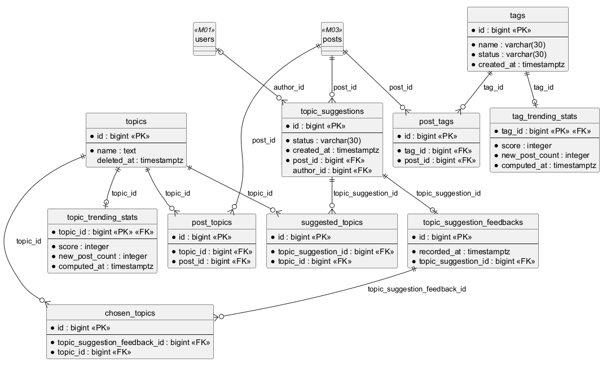

# Thiết kế cơ sở dữ liệu — M05 Topic & Tag

<!-- [Vietnamese Doc] Tài liệu tiếng Việt; tên bảng, cột, kiểu viết tiếng Anh. -->

| Mã tài liệu | DB-M05 |
|---|---|
| Dự án | iShare |
| Module | M05 — Topic & Tag |
| Đầu vào | CD-M05 phiên bản 1.0 |
| Trạng thái | Đã chốt |
| Phiên bản | 1.0 |
| Ngày | 2026-11-22 |
| Tác giả | Phạm Văn Đức |

<!-- Quy ước chung cho mọi bảng dưới đây:
     - Không đổi tên cột, không xóa cột, không đổi số mục: tool đọc bảng theo số mục và tên cột.
     - Ô không có nội dung ghi "—". Mục chưa tới bước làm thì để dòng "(Chưa làm — bước N)".
     - Bảng chỉ sinh từ lớp, cột chỉ sinh từ thuộc tính, khóa ngoại chỉ sinh từ quan hệ (giữ mã R-Mxx-nn).
     - Mục 6 do build_schema.py sinh; không sửa tay.
     - Quy ước dùng (data-model/conventions.md): QU-06, QU-07; QU-08 cách ghép tên khóa ngoại và QU-09 kiểu cột
       (người dùng xác nhận 2026-11-22, DB-M01 Q-01, Q-02). Mọi khóa chính id kiểu bigint (QU-02: long). -->

## 1. Bảng

| Bảng | Từ lớp | Nhóm | Sở hữu | Ghi chú |
|---|---|---|---|---|
| topics | Topic | Thực thể | M05 | — |
| tags | Tag | Thực thể | M05 | — |
| topic_suggestions | TopicSuggestion | Thực thể | M05 | — |
| topic_suggestion_feedbacks | TopicSuggestionFeedback | Thực thể | M05 | — |
| topic_trending_stats | TopicTrendingStat | Thống kê | M05 | Lớp con của Topic (kế thừa): không có id riêng, dùng khóa của bảng cha |
| tag_trending_stats | TagTrendingStat | Thống kê | M05 | Lớp con của Tag (kế thừa): không có id riêng, dùng khóa của bảng cha |
| post_topics | PostTopic | Liên kết | M05 | — |
| post_tags | PostTag | Liên kết | M05 | — |
| suggested_topics | SuggestedTopic | Liên kết | M05 | — |
| chosen_topics | ChosenTopic | Liên kết | M05 | — |

## 2. Cột

### 2.1 Cột từ thuộc tính

| Bảng | Cột | Kiểu | Null | Duy nhất | Từ thuộc tính | Ghi chú |
|---|---|---|---|---|---|---|
| topics | id | bigint | Không | Có | Topic.id | — |
| topics | name | text | Không | Có | Topic.name | Không trùng trong danh mục: so không phân biệt hoa thường, bỏ khoảng trắng thừa ở đầu, cuối, giữa, phân biệt dấu (BR-M05-05, FR-M05-06.08); không đổi sau khi tạo |
| topics | deleted_at | timestamptz | Có | Không | Topic.deletedAt | — |
| tags | id | bigint | Không | Có | Tag.id | — |
| tags | name | varchar(30) | Không | Có | Tag.name | Lưu không kèm dấu '#'; Duy nhất; chữ thường, không bỏ dấu (BR-M05-24); chỉ chữ cái, chữ số, "_", ít nhất một chữ cái (BR-M05-20); tối đa 30 ký tự, không tính "#" (BR-M05-23); không sửa (BR-M05-25) |
| tags | status | varchar(30) | Không | Không | Tag.status | Giá trị: ACTIVE, DISABLED; Mới tạo là ACTIVE (FR-M05-03.02); chỉ đổi bằng FR-M05-09.01, FR-M05-10.01 |
| tags | created_at | timestamptz | Không | Không | Tag.createdAt | — |
| topic_suggestions | id | bigint | Không | Có | TopicSuggestion.id | — |
| topic_suggestions | status | varchar(30) | Không | Không | TopicSuggestion.status | Giá trị: VALID, OUTDATED; Mới tạo là VALID khi AI trả về Topic hợp lệ (mục Chuyển trạng thái của FR) |
| topic_suggestions | created_at | timestamptz | Không | Không | TopicSuggestion.createdAt | — |
| topic_suggestion_feedbacks | id | bigint | Không | Có | TopicSuggestionFeedback.id | — |
| topic_suggestion_feedbacks | recorded_at | timestamptz | Không | Không | TopicSuggestionFeedback.recordedAt | — |
| topic_trending_stats | score | integer | Không | Không | TopicTrendingStat.score | > 0 mới vào danh sách (FR-M05-05.14); đăng bài 1, upvote 2, bình luận (kể cả trả lời) 1, bookmark 1 trong cửa sổ 7 ngày, chỉ bài đang hiện trên feed chính, tương tác đã rút không tính (BR-M05-29); tính lại mỗi 15–30 phút (BR-M05-30); Dẫn xuất ở CD: xét ở bước 5 |
| topic_trending_stats | new_post_count | integer | Không | Không | TopicTrendingStat.newPostCount | ≥ 0; số bài có Topic được đăng trong cửa sổ 7 ngày (TN:Bài mới); Dẫn xuất ở CD: xét ở bước 5 |
| topic_trending_stats | rank | integer | Không | Không | TopicTrendingStat.rank | Từ 1; xếp theo score giảm, newPostCount giảm, tên A–Z; mỗi mục một hạng riêng (BR-M05-31); Dẫn xuất ở CD: xét ở bước 5 |
| topic_trending_stats | computed_at | timestamptz | Không | Không | TopicTrendingStat.computedAt | Cửa sổ 7 ngày tính ngược từ thời điểm này (FR-M05-05.03); Dẫn xuất ở CD: xét ở bước 5 |
| tag_trending_stats | score | integer | Không | Không | TagTrendingStat.score | Như TopicTrendingStat.score, trên các bài có Tag; chỉ Tag ACTIVE (FR-M05-05.07); Dẫn xuất ở CD: xét ở bước 5 |
| tag_trending_stats | new_post_count | integer | Không | Không | TagTrendingStat.newPostCount | ≥ 0; số bài có Tag được đăng trong cửa sổ 7 ngày (TN:Bài mới); Dẫn xuất ở CD: xét ở bước 5 |
| tag_trending_stats | rank | integer | Không | Không | TagTrendingStat.rank | Từ 1; xếp theo score giảm, newPostCount giảm, tên A–Z; mỗi mục một hạng riêng (BR-M05-31); Dẫn xuất ở CD: xét ở bước 5 |
| tag_trending_stats | computed_at | timestamptz | Không | Không | TagTrendingStat.computedAt | Cửa sổ 7 ngày tính ngược từ thời điểm này (FR-M05-05.03); Dẫn xuất ở CD: xét ở bước 5 |
| post_topics | id | bigint | Không | Có | PostTopic.id | — |
| post_tags | id | bigint | Không | Có | PostTag.id | — |
| suggested_topics | id | bigint | Không | Có | SuggestedTopic.id | — |
| chosen_topics | id | bigint | Không | Có | ChosenTopic.id | — |

### 2.2 Thuộc tính đối tượng không chuyển

| Lớp | Thuộc tính | Kiểu | Lý do không chuyển |
|---|---|---|---|
| PostTopic | topic | Topic | Thuộc tính đối tượng; được thay bằng khóa ngoại post_topics.topic_id ở bước 4 (R-M05-01) |
| PostTag | tag | Tag | Thuộc tính đối tượng; được thay bằng khóa ngoại post_tags.tag_id ở bước 4 (R-M05-03) |
| TopicSuggestion | suggestedTopics | List<SuggestedTopic> | Thuộc tính đối tượng; được thay bằng khóa ngoại suggested_topics.topic_suggestion_id ở bước 4 (R-M05-05) |
| SuggestedTopic | topic | Topic | Thuộc tính đối tượng; được thay bằng khóa ngoại suggested_topics.topic_id ở bước 4 (R-M05-06) |
| TopicSuggestionFeedback | chosenTopics | List<ChosenTopic> | Thuộc tính đối tượng; được thay bằng khóa ngoại chosen_topics.topic_suggestion_feedback_id ở bước 4 (R-M05-07) |
| ChosenTopic | topic | Topic | Thuộc tính đối tượng; được thay bằng khóa ngoại chosen_topics.topic_id ở bước 4 (R-M05-08) |
| TopicSuggestionFeedback | topicSuggestion | TopicSuggestion | Thuộc tính đối tượng; được thay bằng khóa ngoại topic_suggestion_feedbacks.topic_suggestion_id ở bước 4 (R-M05-09) |
| TopicSuggestion | post | Post | Thuộc tính đối tượng; được thay bằng khóa ngoại topic_suggestions.post_id ở bước 4 (R-M05-10) |
| TopicSuggestion | author | User | Thuộc tính đối tượng; được thay bằng khóa ngoại topic_suggestions.author_id ở bước 4 (R-M05-11) |

## 3. Quan hệ giữa các bảng

"Dạng" đọc theo thứ tự Bảng A – Bảng B; quan hệ 1-n viết bảng phía 1 ở cột Bảng A.

| ID | Bảng A | Bảng B | Dạng | Xử lý | Ghi chú |
|---|---|---|---|---|---|
| R-M05-01 | topics | post_topics | 1-n | Tách riêng | — |
| R-M05-02 | posts | post_topics | 1-n | Tách riêng | — |
| R-M05-03 | tags | post_tags | 1-n | Tách riêng | — |
| R-M05-04 | posts | post_tags | 1-n | Tách riêng | — |
| R-M05-05 | topic_suggestions | suggested_topics | 1-n | Tách riêng | — |
| R-M05-06 | topics | suggested_topics | 1-n | Tách riêng | — |
| R-M05-07 | topic_suggestion_feedbacks | chosen_topics | 1-n | Tách riêng | — |
| R-M05-08 | topics | chosen_topics | 1-n | Tách riêng | — |
| R-M05-09 | topic_suggestion_feedbacks | topic_suggestions | 1-1 | Tách riêng | Hai bảng cùng M05, mặc định của phương pháp là gộp. Tách riêng (DD-M05-02): phản hồi là bên tùy chọn (0..1 mỗi lượt gợi ý), được tạo sau (khi gửi bài hoặc lưu bản sửa, FR-M05-02.12) và có bảng con chosen_topics. Khóa ngoại ở topic_suggestion_feedbacks: topic_suggestion_id, Duy nhất |
| R-M05-10 | posts | topic_suggestions | 1-n | Tách riêng | — |
| R-M05-11 | users | topic_suggestions | 1-n | Tách riêng | — |
| R-M05-12 | topics | follows | 1-n | Tách riêng | Bảng phía n follows thuộc M07: khóa ngoại đề nghị ở mục 7.2 |
| R-M05-13 | topics | admin_logs | 1-n | Tách riêng | Bảng phía n admin_logs thuộc M10: khóa ngoại đề nghị ở mục 7.2 |
| R-M05-14 | tags | moderation_logs | 1-n | Tách riêng | Bảng phía n moderation_logs thuộc M08: khóa ngoại đề nghị ở mục 7.2 |
| R-M05-15 | topics | topic_trending_stats | 1-1 | Cha–con | Kế thừa: bảng con không có id riêng, dùng khóa của bảng cha |
| R-M05-16 | tags | tag_trending_stats | 1-1 | Cha–con | Kế thừa: bảng con không có id riêng, dùng khóa của bảng cha |

Không có quan hệ n-n.

## 4. Khóa

### 4.1 Khóa chính

| Bảng | Khóa chính | Ghi chú |
|---|---|---|
| topics | id | — |
| tags | id | — |
| topic_suggestions | id | — |
| topic_suggestion_feedbacks | id | — |
| topic_trending_stats | topic_id | Bảng con: khóa chính là khóa ngoại tới bảng cha |
| tag_trending_stats | tag_id | Bảng con: khóa chính là khóa ngoại tới bảng cha |
| post_topics | id | — |
| post_tags | id | — |
| suggested_topics | id | — |
| chosen_topics | id | — |

### 4.2 Khóa ngoại

| Bảng | Cột | Kiểu | Null | Duy nhất | Tham chiếu | Từ quan hệ | Ghi chú |
|---|---|---|---|---|---|---|---|
| post_topics | topic_id | bigint | Không | Không | topics(id) | R-M05-01 | 1 topics – n post_topics |
| post_topics | post_id | bigint | Không | Không | posts(id) | R-M05-02 | 1 posts – n post_topics |
| post_tags | tag_id | bigint | Không | Không | tags(id) | R-M05-03 | 1 tags – n post_tags |
| post_tags | post_id | bigint | Không | Không | posts(id) | R-M05-04 | 1 posts – n post_tags |
| suggested_topics | topic_suggestion_id | bigint | Không | Không | topic_suggestions(id) | R-M05-05 | 1 topic_suggestions – n suggested_topics |
| suggested_topics | topic_id | bigint | Không | Không | topics(id) | R-M05-06 | 1 topics – n suggested_topics |
| chosen_topics | topic_suggestion_feedback_id | bigint | Không | Không | topic_suggestion_feedbacks(id) | R-M05-07 | 1 topic_suggestion_feedbacks – n chosen_topics |
| chosen_topics | topic_id | bigint | Không | Không | topics(id) | R-M05-08 | 1 topics – n chosen_topics |
| topic_suggestion_feedbacks | topic_suggestion_id | bigint | Không | Có | topic_suggestions(id) | R-M05-09 | 1-1 tách riêng: mỗi dòng topic_suggestions ứng với nhiều nhất một dòng topic_suggestion_feedbacks |
| topic_suggestions | post_id | bigint | Không | Không | posts(id) | R-M05-10 | 1 posts – n topic_suggestions |
| topic_suggestions | author_id | bigint | Có | Không | users(id) | R-M05-11 | 1 users – n topic_suggestions |
| topic_trending_stats | topic_id | bigint | Không | Có | topics(id) | R-M05-15 | Cha–con: cũng là khóa chính của topic_trending_stats |
| tag_trending_stats | tag_id | bigint | Không | Có | tags(id) | R-M05-16 | Cha–con: cũng là khóa chính của tag_trending_stats |

## 5. Loại dư thừa

### 5.1 Cột bị loại

| Bảng | Cột | Loại dư thừa | Căn cứ | Cách có lại giá trị |
|---|---|---|---|---|
| topic_trending_stats | rank | Dẫn xuất | Thuộc tính dẫn xuất ở CD-M05; BR-M05-31; DD-M05-01 | Số thứ tự của dòng trong các topic_trending_stats có score > 0 của Topic còn trong danh mục (topics.deleted_at null), xếp theo score giảm, new_post_count giảm, topics.name A–Z (mỗi mục một hạng) |
| tag_trending_stats | rank | Dẫn xuất | Thuộc tính dẫn xuất ở CD-M05; BR-M05-31; DD-M05-01 | Số thứ tự của dòng trong các tag_trending_stats có score > 0 và tags.status = ACTIVE (Tag bị vô hiệu hóa không hiện, BR-M05-26), xếp theo score giảm, new_post_count giảm, tags.name A–Z (mỗi mục một hạng) |

### 5.2 Bảng bị loại

| Bảng | Lý do |
|---|---|
| — | — |

### 5.3 Dẫn xuất nhưng giữ lại

Người dùng quyết giữ theo tiêu chí dẫn xuất (DD-M05-01).

| Bảng | Cột | Lý do giữ | Nguồn |
|---|---|---|---|
| topic_trending_stats | score | Kết quả của lần tính định kỳ 15–30 phút; người xem thấy kết quả lần tính gần nhất cho tới lần kế tiếp, không tính lại khi xem (FR-M05-05.10, BR-M05-30); dữ liệu của FR gồm Topic hoặc Tag, điểm, thời điểm tính | FR-M05-05.10, BR-M05-30; DD-M05-01 |
| topic_trending_stats | new_post_count | Kết quả của lần tính định kỳ 15–30 phút; người xem thấy kết quả lần tính gần nhất cho tới lần kế tiếp, không tính lại khi xem (FR-M05-05.10, BR-M05-30); dữ liệu của FR gồm Topic hoặc Tag, điểm, thời điểm tính; dùng xếp thứ tự khi bằng điểm (FR-M05-05.09) | FR-M05-05.09, FR-M05-05.10; DD-M05-01 |
| topic_trending_stats | computed_at | Kết quả của lần tính định kỳ 15–30 phút; người xem thấy kết quả lần tính gần nhất cho tới lần kế tiếp, không tính lại khi xem (FR-M05-05.10, BR-M05-30); dữ liệu của FR gồm Topic hoặc Tag, điểm, thời điểm tính; cửa sổ 7 ngày tính ngược từ thời điểm này (FR-M05-05.03) | FR-M05-05.03, FR-M05-05.10; DD-M05-01 |
| tag_trending_stats | score | Kết quả của lần tính định kỳ 15–30 phút; người xem thấy kết quả lần tính gần nhất cho tới lần kế tiếp, không tính lại khi xem (FR-M05-05.10, BR-M05-30); dữ liệu của FR gồm Topic hoặc Tag, điểm, thời điểm tính | FR-M05-05.10, BR-M05-30; DD-M05-01 |
| tag_trending_stats | new_post_count | Kết quả của lần tính định kỳ 15–30 phút; người xem thấy kết quả lần tính gần nhất cho tới lần kế tiếp, không tính lại khi xem (FR-M05-05.10, BR-M05-30); dữ liệu của FR gồm Topic hoặc Tag, điểm, thời điểm tính; dùng xếp thứ tự khi bằng điểm (FR-M05-05.09) | FR-M05-05.09, FR-M05-05.10; DD-M05-01 |
| tag_trending_stats | computed_at | Kết quả của lần tính định kỳ 15–30 phút; người xem thấy kết quả lần tính gần nhất cho tới lần kế tiếp, không tính lại khi xem (FR-M05-05.10, BR-M05-30); dữ liệu của FR gồm Topic hoặc Tag, điểm, thời điểm tính; cửa sổ 7 ngày tính ngược từ thời điểm này (FR-M05-05.03) | FR-M05-05.03, FR-M05-05.10; DD-M05-01 |

### 5.4 Đã xét nhưng không coi là dư thừa

| Bảng | Cột | Vì sao không dư thừa |
|---|---|---|
| chosen_topics | (cả bảng, so với post_topics) | Topic tác giả chọn cuối, ghi cùng phản hồi lúc gửi bài hoặc lưu bản sửa (FR-M05-02.12); post_topics là Topic hiện tại của bài, có thể đổi về sau (tác giả, Mod). Hai dữ liệu khác nhau |
| suggested_topics | (cả bảng, so với chosen_topics) | Topic AI gợi ý (tối đa 3, BR-M05-13), khác Topic tác giả chọn cuối (chosen_topics); cả hai cần cho tỷ lệ giữ lại (M13) |

## 6. Lược đồ cuối

### 6.1 Bảng và cột

<!-- BEGIN:SCHEMA -->
| Bảng | Cột | Kiểu | Khóa | Null | Duy nhất | Tham chiếu |
|---|---|---|---|---|---|---|
| topics | id | bigint | PK | Không | Có | — |
| topics | name | text | — | Không | Có | — |
| topics | deleted_at | timestamptz | — | Có | Không | — |
| tags | id | bigint | PK | Không | Có | — |
| tags | name | varchar(30) | — | Không | Có | — |
| tags | status | varchar(30) | — | Không | Không | — |
| tags | created_at | timestamptz | — | Không | Không | — |
| topic_suggestions | id | bigint | PK | Không | Có | — |
| topic_suggestions | status | varchar(30) | — | Không | Không | — |
| topic_suggestions | created_at | timestamptz | — | Không | Không | — |
| topic_suggestions | post_id | bigint | FK | Không | Không | posts(id) |
| topic_suggestions | author_id | bigint | FK | Có | Không | users(id) |
| topic_suggestion_feedbacks | id | bigint | PK | Không | Có | — |
| topic_suggestion_feedbacks | recorded_at | timestamptz | — | Không | Không | — |
| topic_suggestion_feedbacks | topic_suggestion_id | bigint | FK | Không | Có | topic_suggestions(id) |
| topic_trending_stats | score | integer | — | Không | Không | — |
| topic_trending_stats | new_post_count | integer | — | Không | Không | — |
| topic_trending_stats | computed_at | timestamptz | — | Không | Không | — |
| topic_trending_stats | topic_id | bigint | PK, FK | Không | Có | topics(id) |
| tag_trending_stats | score | integer | — | Không | Không | — |
| tag_trending_stats | new_post_count | integer | — | Không | Không | — |
| tag_trending_stats | computed_at | timestamptz | — | Không | Không | — |
| tag_trending_stats | tag_id | bigint | PK, FK | Không | Có | tags(id) |
| post_topics | id | bigint | PK | Không | Có | — |
| post_topics | topic_id | bigint | FK | Không | Không | topics(id) |
| post_topics | post_id | bigint | FK | Không | Không | posts(id) |
| post_tags | id | bigint | PK | Không | Có | — |
| post_tags | tag_id | bigint | FK | Không | Không | tags(id) |
| post_tags | post_id | bigint | FK | Không | Không | posts(id) |
| suggested_topics | id | bigint | PK | Không | Có | — |
| suggested_topics | topic_suggestion_id | bigint | FK | Không | Không | topic_suggestions(id) |
| suggested_topics | topic_id | bigint | FK | Không | Không | topics(id) |
| chosen_topics | id | bigint | PK | Không | Có | — |
| chosen_topics | topic_suggestion_feedback_id | bigint | FK | Không | Không | topic_suggestion_feedbacks(id) |
| chosen_topics | topic_id | bigint | FK | Không | Không | topics(id) |
<!-- END:SCHEMA -->

### 6.2 Sơ đồ quan hệ

<!-- BEGIN:DIAGRAM -->

Mã nguồn sơ đồ: [diagrams/DB-M05.puml](diagrams/DB-M05.puml). Ảnh và tệp .puml do `build_schema.py` sinh từ các bảng của tài liệu này; muốn đổi sơ đồ thì sửa bảng rồi chạy lại tool, không sửa tay.
<!-- END:DIAGRAM -->

## 7. Liên module

### 7.1 Bảng của module khác được tham chiếu

| Bảng ngoài | Module sở hữu | Dùng thế nào |
|---|---|---|
| posts | M03 | Gán Topic, Tag qua PostTopic, PostTag (R-M05-01–04); gợi ý Topic cho bài (R-M05-10); đọc title, contentText, publishState, modState, publishedAt |
| users | M01 | Ghi tác giả yêu cầu gợi ý (R-M05-11), bỏ liên kết khi DELETED; đọc role để kiểm quyền, status để lọc Trending |
| follows | M07 | Chuyển lượt theo dõi sang Topic đích khi gộp, bỏ lượt theo dõi khi xóa Topic (R-M05-12) |
| moderation_logs | M08 | Ghi dòng nhật ký khi vô hiệu hóa, kích hoạt lại Tag (R-M05-14) và khi đổi Topic, Tag trên bài người khác (quan hệ với bài viết và người thực hiện là giữa hai lớp ngoài, do M08 ghi) |
| admin_logs | M10 | Ghi mục nhật ký khi thêm, gộp, xóa Topic (R-M05-13) |

### 7.2 Khóa ngoại đề nghị cho bảng của module khác

<!-- Khi bảng của module khác là phía n của một quan hệ với bảng của module này. -->

| Bảng của module khác | Cột | Kiểu | Tham chiếu | Từ quan hệ |
|---|---|---|---|---|
| follows | topic_id | bigint | topics(id) | R-M05-12 |
| admin_logs | topic_id | bigint | topics(id) | R-M05-13 |
| moderation_logs | tag_id | bigint | tags(id) | R-M05-14 |

## 8. Quyết định thiết kế

| Mã | Quyết định | Lý do |
|---|---|---|
| DD-M05-01 | Giữ score, new_post_count, computed_at của topic_trending_stats và tag_trending_stats; loại rank | Trả lời Q-01 theo tiêu chí dẫn xuất của người dùng: kết quả lần tính định kỳ không tính lại được khi xem (FR-M05-05.10, BR-M05-30); rank xếp lại được từ các dòng đã lưu và phải bỏ mục không còn hiển thị (BR-M05-26) |
| DD-M05-02 | Quan hệ 1-1 topic_suggestions–topic_suggestion_feedbacks (R-M05-09) tách riêng; khóa ngoại topic_suggestion_feedbacks.topic_suggestion_id, Duy nhất, không null | Trả lời Q-02: cùng lựa chọn với posts–polls (DD-M03-01); phản hồi là bên tùy chọn, tạo sau, có bảng con chosen_topics |

## 9. Câu hỏi và điểm chưa chốt

| Mã | Loại | Câu hỏi | Trả lời | Ghi vào |
|---|---|---|---|---|
| Q-01 | Dẫn xuất FR yêu cầu lưu | Điểm Trending của Topic và Tag được tính định kỳ 15–30 phút và người xem thấy kết quả lần tính gần nhất (FR-M05-05.10, BR-M05-30), nên không tính lại khi xem được. Đề xuất (a) giữ score, new_post_count, computed_at của topic_trending_stats và tag_trending_stats (mục 5.3); loại rank vì xếp lại được từ ba cột đó và tên. Phương án (b) loại cả bảng, tính khi xem (trái FR-M05-05.10). Chọn (a)? | Theo tiêu chí của người dùng (2026-11-22): (1) có phải dẫn xuất; (2) tính lại mỗi lần có ra đúng giá trị lúc tạo và các lần sau không đổi: score, new_post_count là dẫn xuất nhưng tính khi xem sẽ khác kết quả lần tính (cửa sổ 7 ngày trượt theo thời điểm tính, tương tác bị rút, bài bị ẩn), trái FR-M05-05.10 → giữ; computed_at là thời điểm lần tính, không tính lại được → giữ; rank tính lại từ chính các dòng đã lưu luôn ra cùng thứ tự, và phải tính khi xem để bỏ Tag bị vô hiệu hóa khỏi danh sách (BR-M05-26) → loại; DD-M05-01 | Mục 5.1, 5.3; DD-M05-nn |
| Q-02 | Lựa chọn | Quan hệ 1-1 TopicSuggestion–TopicSuggestionFeedback (R-M05-09), hai bảng cùng M05. Phương pháp mặc định gộp. Đề xuất (a) tách riêng: phản hồi là bên tùy chọn, tạo sau, có bảng con chosen_topics; khóa ngoại topic_suggestion_feedbacks.topic_suggestion_id, Duy nhất. Phương án (b) gộp: recorded_at chuyển vào topic_suggestions (trống khi chưa có phản hồi) và chosen_topics tham chiếu topic_suggestions. Chọn (a)? | Tách riêng: áp cùng lựa chọn của người dùng cho quan hệ 1-1 cùng dạng posts–polls (DB-M03 Q-01, người dùng, 2026-11-22); câu này không phải câu về dẫn xuất; DD-M05-02 | Mục 3, 4.2, 5.2; DD-M05-nn |

## 10. Lịch sử sửa đổi

| Phiên bản | Ngày | Nội dung | Người sửa |
|---|---|---|---|
| 0.1 | 2026-11-20 | Tạo mới từ CD-M05 v1.0; làm liền bước 1–5 theo yêu cầu của người dùng (không dừng ở cổng); chưa qua duyệt, câu hỏi ở mục 9 chờ trả lời | Phạm Văn Đức |
| 0.2 | 2026-11-22 | Ghi trả lời mục 9: giữ kết quả Trending, loại rank (DD-M05-01); 1-1 lượt gợi ý – phản hồi tách riêng (DD-M05-02); chờ chốt | Phạm Văn Đức |
| 1.0 | 2026-11-22 | Chốt: người dùng chốt DB-M05 | Phạm Văn Đức |
