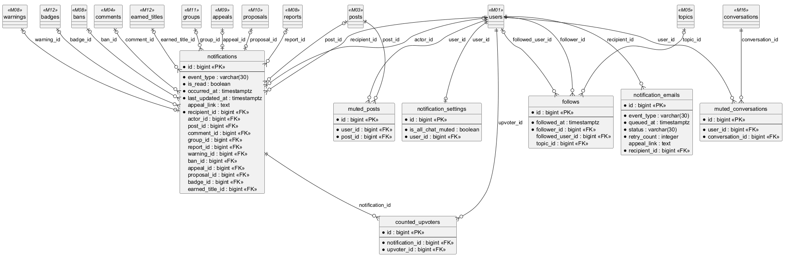

# Thiết kế cơ sở dữ liệu — M07 Notification

<!-- [Vietnamese Doc] Tài liệu tiếng Việt; tên bảng, cột, kiểu viết tiếng Anh. -->

| Mã tài liệu | DB-M07 |
|---|---|
| Dự án | iShare |
| Module | M07 — Notification |
| Đầu vào | CD-M07 phiên bản 1.0 |
| Trạng thái | Đã chốt |
| Phiên bản | 1.0 |
| Ngày | 2026-11-22 |
| Tác giả | Phạm Văn Đức |

<!-- Quy ước chung cho mọi bảng dưới đây:
     - Không đổi tên cột, không xóa cột, không đổi số mục: tool đọc bảng theo số mục và tên cột.
     - Ô không có nội dung ghi "—". Mục chưa tới bước làm thì để dòng "(Chưa làm — bước N)".
     - Bảng chỉ sinh từ lớp, cột chỉ sinh từ thuộc tính, khóa ngoại chỉ sinh từ quan hệ (giữ mã R-Mxx-nn).
     - Mục 6 do build_schema.py sinh; không sửa tay.
     - Quy ước dùng (data-model/conventions.md): QU-06, QU-07; QU-08 cách ghép tên khóa ngoại và QU-09 kiểu cột
       (người dùng xác nhận 2026-11-22, DB-M01 Q-01, Q-02). Mọi khóa chính id kiểu bigint (QU-02: long). -->

## 1. Bảng

| Bảng | Từ lớp | Nhóm | Sở hữu | Ghi chú |
|---|---|---|---|---|
| notifications | Notification | Thực thể | M07 | — |
| follows | Follow | Thực thể | M07 | — |
| notification_emails | NotificationEmail | Thực thể | M07 | — |
| notification_settings | NotificationSetting | Thực thể | M07 | — |
| counted_upvoters | CountedUpvoter | Liên kết | M07 | — |
| muted_posts | MutedPost | Liên kết | M07 | — |
| muted_conversations | MutedConversation | Liên kết | M07 | — |

## 2. Cột

### 2.1 Cột từ thuộc tính

| Bảng | Cột | Kiểu | Null | Duy nhất | Từ thuộc tính | Ghi chú |
|---|---|---|---|---|---|---|
| notifications | id | bigint | Không | Có | Notification.id | — |
| notifications | event_type | varchar(30) | Không | Không | Notification.eventType | Giá trị: PASSWORD_CHANGED, GOOGLE_LINKED, NEW_FOLLOWER, FOLLOWED_USER_NEW_POST, POST_PUBLISHED, POST_REJECTED, POST_HIDDEN, POLL_ENDED, POST_UPVOTED, COMMENT_UPVOTED, NEW_COMMENT, REPLY, MENTION, COMMENT_HIDDEN, REPORT_RESULT, WARNING_ISSUED, BANNED, UNBANNED, BAN_APPEAL_CONCLUDED, POST_APPEAL_CONCLUDED, WARNING_APPEAL_CONCLUDED, GROUP_INVITED, GROUP_JOIN_REQUESTED, GROUP_JOIN_APPROVED, GROUP_MOD_APPOINTED, GROUP_KICKED, GROUP_OWNER_TRANSFERRED, GROUP_CONTENT_REMOVED, BADGE_EARNED, WEEKLY_STAR_EARNED, MOD_PROPOSAL, ADMIN_PROPOSAL; Một trong các sự kiện của BR-M07-01; không có tin nhắn (FR-M07-02.10), không có cảnh báo trước khi tự xóa (FR-M07-04.06), không có các trường hợp của BR-M07-21 |
| notifications | is_read | boolean | Không | Không | Notification.isRead | Mới tạo là sai (Chưa đọc) (FR-M07-02.01); đúng khi người nhận bấm vào hoặc "Đánh dấu tất cả đã đọc" (FR-M07-06.01, FR-M07-06.03); về sai chỉ khi thông báo upvote được gộp thêm (FR-M07-02.04) |
| notifications | occurred_at | timestamptz | Không | Không | Notification.occurredAt | Do module phát sinh sự kiện cung cấp (FR-M07-02.02); lưu UTC, hiển thị giờ Asia/Ho_Chi_Minh (BR-M07-22) |
| notifications | last_updated_at | timestamptz | Không | Không | Notification.lastUpdatedAt | Bằng occurredAt khi tạo; đổi thành thời điểm của lượt upvote gộp thêm (FR-M07-02.04); chuông hiện 10 thông báo mới nhất theo giá trị này (BR-M07-12) |
| notifications | appeal_link | text | Có | Không | Notification.appealLink | Chỉ có khi sự kiện là cảnh cáo, ban, bài bị Mod hoặc Admin gỡ, bài bị AI từ chối (FR-M07-02.13) |
| notifications | is_upvote_window_open | boolean | Có | Không | Notification.isUpvoteWindowOpen | Chỉ có ở thông báo upvote: đúng khi hiện tại còn trước occurredAt + 5 × 60 giây; không kéo dài theo lượt upvote sau (BR-M07-05); Dẫn xuất ở CD: xét ở bước 5 |
| notifications | other_upvoter_count | integer | Có | Không | Notification.otherUpvoterCount | ≥ 0; chỉ có ở thông báo upvote: số người khác nhau đã được đếm trong cửa sổ, trừ người upvote mới nhất (FR-M07-02.20); bỏ upvote không làm giảm (FR-M07-02.19); Dẫn xuất ở CD: xét ở bước 5 |
| follows | id | bigint | Không | Có | Follow.id | — |
| follows | followed_at | timestamptz | Không | Không | Follow.followedAt | Ghi khi người dùng bắt đầu theo dõi (FR-M07-01.01) |
| notification_emails | id | bigint | Không | Có | NotificationEmail.id | — |
| notification_emails | event_type | varchar(30) | Không | Không | NotificationEmail.eventType | Giá trị: PASSWORD_CHANGED, GOOGLE_LINKED, DELETION_WARNING, BANNED, UNBANNED, BAN_APPEAL_CONCLUDED; Chỉ các sự kiện có email (BR-M07-03) |
| notification_emails | queued_at | timestamptz | Không | Không | NotificationEmail.queuedAt | Ghi khi email vào hàng đợi |
| notification_emails | status | varchar(30) | Không | Không | NotificationEmail.status | Giá trị: PENDING, SENT, STOPPED; PENDING khi vào hàng đợi; SENT khi gửi thành công (FR-M07-04.02); STOPPED khi vẫn lỗi sau 3 lần gửi lại (FR-M07-04.10) |
| notification_emails | retry_count | integer | Không | Không | NotificationEmail.retryCount | 0–3; tăng 1 mỗi lần gửi lại sau lần lỗi; hết 3 lần vẫn lỗi thì dừng (BR-M07-26) |
| notification_emails | appeal_link | text | Có | Không | NotificationEmail.appealLink | Chỉ có với email về ban (FR-M07-04.08) |
| notification_settings | id | bigint | Không | Có | NotificationSetting.id | — |
| notification_settings | is_all_chat_muted | boolean | Không | Không | NotificationSetting.isAllChatMuted | Sai = Đang nhận, đúng = Đã tắt; khi đúng thì mọi cuộc trò chuyện không hiện popup, không ngoại lệ; khi sai thì theo cài đặt riêng từng cuộc (BR-M07-08) |
| counted_upvoters | id | bigint | Không | Có | CountedUpvoter.id | — |
| muted_posts | id | bigint | Không | Có | MutedPost.id | — |
| muted_conversations | id | bigint | Không | Có | MutedConversation.id | — |

### 2.2 Thuộc tính đối tượng không chuyển

| Lớp | Thuộc tính | Kiểu | Lý do không chuyển |
|---|---|---|---|
| Notification | recipient | User | Thuộc tính đối tượng; được thay bằng khóa ngoại notifications.recipient_id ở bước 4 (R-M07-01) |
| Notification | actor | User | Thuộc tính đối tượng; được thay bằng khóa ngoại notifications.actor_id ở bước 4 (R-M07-02) |
| Notification | countedUpvoters | List<CountedUpvoter> | Thuộc tính đối tượng; được thay bằng khóa ngoại counted_upvoters.notification_id ở bước 4 (R-M07-03) |
| CountedUpvoter | upvoter | User | Thuộc tính đối tượng; được thay bằng khóa ngoại counted_upvoters.upvoter_id ở bước 4 (R-M07-04) |
| Notification | post | Post | Thuộc tính đối tượng; được thay bằng khóa ngoại notifications.post_id ở bước 4 (R-M07-05) |
| Notification | comment | Comment | Thuộc tính đối tượng; được thay bằng khóa ngoại notifications.comment_id ở bước 4 (R-M07-06) |
| Notification | group | Group | Thuộc tính đối tượng; được thay bằng khóa ngoại notifications.group_id ở bước 4 (R-M07-07) |
| Notification | report | Report | Thuộc tính đối tượng; được thay bằng khóa ngoại notifications.report_id ở bước 4 (R-M07-08) |
| Notification | warning | Warning | Thuộc tính đối tượng; được thay bằng khóa ngoại notifications.warning_id ở bước 4 (R-M07-09) |
| Notification | ban | Ban | Thuộc tính đối tượng; được thay bằng khóa ngoại notifications.ban_id ở bước 4 (R-M07-10) |
| Notification | appeal | Appeal | Thuộc tính đối tượng; được thay bằng khóa ngoại notifications.appeal_id ở bước 4 (R-M07-11) |
| Notification | proposal | Proposal | Thuộc tính đối tượng; được thay bằng khóa ngoại notifications.proposal_id ở bước 4 (R-M07-12) |
| Notification | badge | Badge | Thuộc tính đối tượng; được thay bằng khóa ngoại notifications.badge_id ở bước 4 (R-M07-13) |
| Notification | earnedTitle | EarnedTitle | Thuộc tính đối tượng; được thay bằng khóa ngoại notifications.earned_title_id ở bước 4 (R-M07-14) |
| Follow | follower | User | Thuộc tính đối tượng; được thay bằng khóa ngoại follows.follower_id ở bước 4 (R-M07-15) |
| Follow | followedUser | User | Thuộc tính đối tượng; được thay bằng khóa ngoại follows.followed_user_id ở bước 4 (R-M07-16) |
| Follow | topic | Topic | Thuộc tính đối tượng; được thay bằng khóa ngoại follows.topic_id ở bước 4 (R-M07-17) |
| NotificationEmail | recipient | User | Thuộc tính đối tượng; được thay bằng khóa ngoại notification_emails.recipient_id ở bước 4 (R-M07-18) |
| MutedPost | post | Post | Thuộc tính đối tượng; được thay bằng khóa ngoại muted_posts.post_id ở bước 4 (R-M07-21) |
| MutedConversation | conversation | Conversation | Thuộc tính đối tượng; được thay bằng khóa ngoại muted_conversations.conversation_id ở bước 4 (R-M07-23) |

## 3. Quan hệ giữa các bảng

"Dạng" đọc theo thứ tự Bảng A – Bảng B; quan hệ 1-n viết bảng phía 1 ở cột Bảng A.

| ID | Bảng A | Bảng B | Dạng | Xử lý | Ghi chú |
|---|---|---|---|---|---|
| R-M07-01 | users | notifications | 1-n | Tách riêng | — |
| R-M07-02 | users | notifications | 1-n | Tách riêng | — |
| R-M07-03 | notifications | counted_upvoters | 1-n | Tách riêng | — |
| R-M07-04 | users | counted_upvoters | 1-n | Tách riêng | — |
| R-M07-05 | posts | notifications | 1-n | Tách riêng | — |
| R-M07-06 | comments | notifications | 1-n | Tách riêng | — |
| R-M07-07 | groups | notifications | 1-n | Tách riêng | — |
| R-M07-08 | reports | notifications | 1-n | Tách riêng | — |
| R-M07-09 | notifications | warnings | 1-1 | Tách riêng | Không gộp: warnings là bảng của M08. Tách riêng; khóa ngoại ở notifications (bên được tạo sau cảnh cáo): warning_id, Duy nhất, cho phép null |
| R-M07-10 | bans | notifications | 1-n | Tách riêng | — |
| R-M07-11 | notifications | appeals | 1-1 | Tách riêng | Không gộp: appeals là bảng của M09. Tách riêng; khóa ngoại ở notifications (bên được tạo sau kết luận khiếu nại): appeal_id, Duy nhất, cho phép null |
| R-M07-12 | notifications | proposals | 1-1 | Tách riêng | Không gộp: proposals là bảng của M10. Tách riêng; khóa ngoại ở notifications (thông báo tạo sau đề xuất; mỗi đề xuất đúng một thông báo): proposal_id, Duy nhất, cho phép null |
| R-M07-13 | badges | notifications | 1-n | Tách riêng | — |
| R-M07-14 | earned_titles | notifications | 1-n | Tách riêng | — |
| R-M07-15 | users | follows | 1-n | Tách riêng | — |
| R-M07-16 | users | follows | 1-n | Tách riêng | — |
| R-M07-17 | topics | follows | 1-n | Tách riêng | — |
| R-M07-18 | users | notification_emails | 1-n | Tách riêng | — |
| R-M07-19 | users | notification_settings | 1-1 | Tách riêng | Không gộp: users là bảng của M01. Tách riêng; khóa ngoại ở notification_settings (bên tùy chọn, tạo sau tài khoản): user_id, Duy nhất |
| R-M07-20 | users | muted_posts | 1-n | Tách riêng | — |
| R-M07-21 | posts | muted_posts | 1-n | Tách riêng | — |
| R-M07-22 | users | muted_conversations | 1-n | Tách riêng | — |
| R-M07-23 | conversations | muted_conversations | 1-n | Tách riêng | — |

Không có quan hệ n-n.

## 4. Khóa

### 4.1 Khóa chính

| Bảng | Khóa chính | Ghi chú |
|---|---|---|
| notifications | id | — |
| follows | id | — |
| notification_emails | id | — |
| notification_settings | id | — |
| counted_upvoters | id | — |
| muted_posts | id | — |
| muted_conversations | id | — |

### 4.2 Khóa ngoại

| Bảng | Cột | Kiểu | Null | Duy nhất | Tham chiếu | Từ quan hệ | Ghi chú |
|---|---|---|---|---|---|---|---|
| notifications | recipient_id | bigint | Không | Không | users(id) | R-M07-01 | 1 users – n notifications |
| notifications | actor_id | bigint | Có | Không | users(id) | R-M07-02 | 1 users – n notifications |
| counted_upvoters | notification_id | bigint | Không | Không | notifications(id) | R-M07-03 | 1 notifications – n counted_upvoters |
| counted_upvoters | upvoter_id | bigint | Không | Không | users(id) | R-M07-04 | 1 users – n counted_upvoters |
| notifications | post_id | bigint | Có | Không | posts(id) | R-M07-05 | 1 posts – n notifications |
| notifications | comment_id | bigint | Có | Không | comments(id) | R-M07-06 | 1 comments – n notifications |
| notifications | group_id | bigint | Có | Không | groups(id) | R-M07-07 | 1 groups – n notifications |
| notifications | report_id | bigint | Có | Không | reports(id) | R-M07-08 | 1 reports – n notifications |
| notifications | warning_id | bigint | Có | Có | warnings(id) | R-M07-09 | 1-1 tách riêng: mỗi dòng warnings ứng với nhiều nhất một dòng notifications |
| notifications | ban_id | bigint | Có | Không | bans(id) | R-M07-10 | 1 bans – n notifications |
| notifications | appeal_id | bigint | Có | Có | appeals(id) | R-M07-11 | 1-1 tách riêng: mỗi dòng appeals ứng với nhiều nhất một dòng notifications |
| notifications | proposal_id | bigint | Có | Có | proposals(id) | R-M07-12 | 1-1 tách riêng: mỗi dòng proposals ứng với nhiều nhất một dòng notifications |
| notifications | badge_id | bigint | Có | Không | badges(id) | R-M07-13 | 1 badges – n notifications |
| notifications | earned_title_id | bigint | Có | Không | earned_titles(id) | R-M07-14 | 1 earned_titles – n notifications |
| follows | follower_id | bigint | Không | Không | users(id) | R-M07-15 | 1 users – n follows |
| follows | followed_user_id | bigint | Có | Không | users(id) | R-M07-16 | 1 users – n follows |
| follows | topic_id | bigint | Có | Không | topics(id) | R-M07-17 | 1 topics – n follows |
| notification_emails | recipient_id | bigint | Không | Không | users(id) | R-M07-18 | 1 users – n notification_emails |
| notification_settings | user_id | bigint | Không | Có | users(id) | R-M07-19 | 1-1 tách riêng: mỗi dòng users ứng với nhiều nhất một dòng notification_settings; Null = Không vì mỗi dòng cài đặt thuộc đúng một tài khoản (bội số phía tài khoản là 1) |
| muted_posts | user_id | bigint | Không | Không | users(id) | R-M07-20 | 1 users – n muted_posts |
| muted_posts | post_id | bigint | Không | Không | posts(id) | R-M07-21 | 1 posts – n muted_posts |
| muted_conversations | user_id | bigint | Không | Không | users(id) | R-M07-22 | 1 users – n muted_conversations |
| muted_conversations | conversation_id | bigint | Không | Không | conversations(id) | R-M07-23 | 1 conversations – n muted_conversations; Bỏ liên kết khi thành viên rời cuộc trò chuyện (FR-M07-09.08) |

## 5. Loại dư thừa

### 5.1 Cột bị loại

| Bảng | Cột | Loại dư thừa | Căn cứ | Cách có lại giá trị |
|---|---|---|---|---|
| notifications | is_upvote_window_open | Dẫn xuất | Thuộc tính dẫn xuất ở CD-M07; BR-M07-05 | Chỉ với thông báo upvote (event_type POST_UPVOTED, COMMENT_UPVOTED): thời điểm hiện tại trước notifications.occurred_at + 5 × 60 giây |
| notifications | other_upvoter_count | Dẫn xuất | Thuộc tính dẫn xuất ở CD-M07; FR-M07-02.19, FR-M07-02.20 | Đếm counted_upvoters có notification_id = notifications.id, trừ 1 cho người upvote mới nhất (EC-M07) |

### 5.2 Bảng bị loại

| Bảng | Lý do |
|---|---|
| — | — |

### 5.3 Dẫn xuất nhưng giữ lại

Không có.

| Bảng | Cột | Lý do giữ | Nguồn |
|---|---|---|---|
| — | — | — | — |

### 5.4 Đã xét nhưng không coi là dư thừa

| Bảng | Cột | Vì sao không dư thừa |
|---|---|---|
| notifications | last_updated_at | Bằng occurred_at khi tạo nhưng đổi theo lượt upvote gộp thêm (FR-M07-02.04); counted_upvoters không giữ thời điểm nên không suy ra được |

## 6. Lược đồ cuối

### 6.1 Bảng và cột

<!-- BEGIN:SCHEMA -->
| Bảng | Cột | Kiểu | Khóa | Null | Duy nhất | Tham chiếu |
|---|---|---|---|---|---|---|
| notifications | id | bigint | PK | Không | Có | — |
| notifications | event_type | varchar(30) | — | Không | Không | — |
| notifications | is_read | boolean | — | Không | Không | — |
| notifications | occurred_at | timestamptz | — | Không | Không | — |
| notifications | last_updated_at | timestamptz | — | Không | Không | — |
| notifications | appeal_link | text | — | Có | Không | — |
| notifications | recipient_id | bigint | FK | Không | Không | users(id) |
| notifications | actor_id | bigint | FK | Có | Không | users(id) |
| notifications | post_id | bigint | FK | Có | Không | posts(id) |
| notifications | comment_id | bigint | FK | Có | Không | comments(id) |
| notifications | group_id | bigint | FK | Có | Không | groups(id) |
| notifications | report_id | bigint | FK | Có | Không | reports(id) |
| notifications | warning_id | bigint | FK | Có | Có | warnings(id) |
| notifications | ban_id | bigint | FK | Có | Không | bans(id) |
| notifications | appeal_id | bigint | FK | Có | Có | appeals(id) |
| notifications | proposal_id | bigint | FK | Có | Có | proposals(id) |
| notifications | badge_id | bigint | FK | Có | Không | badges(id) |
| notifications | earned_title_id | bigint | FK | Có | Không | earned_titles(id) |
| follows | id | bigint | PK | Không | Có | — |
| follows | followed_at | timestamptz | — | Không | Không | — |
| follows | follower_id | bigint | FK | Không | Không | users(id) |
| follows | followed_user_id | bigint | FK | Có | Không | users(id) |
| follows | topic_id | bigint | FK | Có | Không | topics(id) |
| notification_emails | id | bigint | PK | Không | Có | — |
| notification_emails | event_type | varchar(30) | — | Không | Không | — |
| notification_emails | queued_at | timestamptz | — | Không | Không | — |
| notification_emails | status | varchar(30) | — | Không | Không | — |
| notification_emails | retry_count | integer | — | Không | Không | — |
| notification_emails | appeal_link | text | — | Có | Không | — |
| notification_emails | recipient_id | bigint | FK | Không | Không | users(id) |
| notification_settings | id | bigint | PK | Không | Có | — |
| notification_settings | is_all_chat_muted | boolean | — | Không | Không | — |
| notification_settings | user_id | bigint | FK | Không | Có | users(id) |
| counted_upvoters | id | bigint | PK | Không | Có | — |
| counted_upvoters | notification_id | bigint | FK | Không | Không | notifications(id) |
| counted_upvoters | upvoter_id | bigint | FK | Không | Không | users(id) |
| muted_posts | id | bigint | PK | Không | Có | — |
| muted_posts | user_id | bigint | FK | Không | Không | users(id) |
| muted_posts | post_id | bigint | FK | Không | Không | posts(id) |
| muted_conversations | id | bigint | PK | Không | Có | — |
| muted_conversations | user_id | bigint | FK | Không | Không | users(id) |
| muted_conversations | conversation_id | bigint | FK | Không | Không | conversations(id) |
<!-- END:SCHEMA -->

### 6.2 Sơ đồ quan hệ

<!-- BEGIN:DIAGRAM -->

Mã nguồn sơ đồ: [diagrams/DB-M07.puml](diagrams/DB-M07.puml). Ảnh và tệp .puml do `build_schema.py` sinh từ các bảng của tài liệu này; muốn đổi sơ đồ thì sửa bảng rồi chạy lại tool, không sửa tay.
<!-- END:DIAGRAM -->

## 7. Liên module

### 7.1 Bảng của module khác được tham chiếu

| Bảng ngoài | Module sở hữu | Dùng thế nào |
|---|---|---|
| users | M01 | Người nhận của thông báo và email (R-M07-01, R-M07-18), người gây sự kiện (R-M07-02), người upvote đã được đếm (R-M07-04), người theo dõi và người được theo dõi (R-M07-15, R-M07-16), chủ cài đặt thông báo (R-M07-19), người tắt thông báo bài và cuộc trò chuyện (R-M07-20, R-M07-22); đọc displayName, status, email |
| topics | M05 | Đối tượng theo dõi (R-M07-17); M05 chuyển, bỏ lượt theo dõi khi gộp, xóa Topic |
| posts | M03 | Nội dung liên quan của thông báo (R-M07-05); bài bị tắt thông báo (R-M07-21); đọc isAnonymous (do M11 bổ sung) và /isPubliclyVisible |
| comments | M04 | Nội dung liên quan của thông báo (R-M07-06); đọc /isVisible |
| groups | M11 | Nội dung liên quan của thông báo sự kiện nhóm (R-M07-07); đọc inviteLink |
| reports | M08 | Nội dung liên quan của thông báo kết quả báo cáo (R-M07-08) |
| warnings | M08 | Nội dung liên quan của thông báo nhận cảnh cáo (R-M07-09) |
| bans | M08 | Nội dung liên quan của thông báo ban, gỡ ban (R-M07-10) |
| appeals | M09 | Nội dung liên quan của thông báo kết luận khiếu nại (R-M07-11) |
| proposals | M10 | Thông báo đề xuất trỏ tới đề xuất (R-M07-12); chuyển lựa chọn Chấp nhận, Từ chối cho M10 ghi, đọc status để hiện lựa chọn đã chọn hoặc "Đã hết hạn" (Q-02) |
| badges | M12 | Nội dung liên quan của thông báo đạt huy hiệu (R-M07-13) |
| earned_titles | M12 | Lần đạt danh hiệu "Ngôi sao tuần" mà thông báo đạt danh hiệu trỏ tới (R-M07-14) |
| conversations | M16 | Cuộc trò chuyện bị tắt thông báo (R-M07-23); M16 báo việc thành viên rời, bị xóa khỏi nhóm chat để bỏ MutedConversation |

### 7.2 Khóa ngoại đề nghị cho bảng của module khác

<!-- Khi bảng của module khác là phía n của một quan hệ với bảng của module này. -->

| Bảng của module khác | Cột | Kiểu | Tham chiếu | Từ quan hệ |
|---|---|---|---|---|
| — | — | — | — | — |

## 8. Quyết định thiết kế

| Mã | Quyết định | Lý do |
|---|---|---|
| DD-M07-01 | Bốn quan hệ 1-1 tách riêng: notifications.warning_id, appeal_id, proposal_id (Duy nhất, cho phép null); notification_settings.user_id (Duy nhất, không null) | Trả lời Q-01: một bên là bảng của module khác nên không gộp; khóa ngoại đặt ở bên được tạo sau |

## 9. Câu hỏi và điểm chưa chốt

| Mã | Loại | Câu hỏi | Trả lời | Ghi vào |
|---|---|---|---|---|
| Q-01 | Xác nhận | Bốn quan hệ 1-1 đều có một bên là bảng của module khác nên không gộp. Vị trí khóa ngoại đề xuất: notifications.warning_id (R-M07-09), notifications.appeal_id (R-M07-11), notifications.proposal_id (R-M07-12) — Duy nhất, cho phép null, đặt ở thông báo vì thông báo được tạo sau; notification_settings.user_id (R-M07-19) — Duy nhất, không null (tool báo WARN vì bội số 0..1 ở CD là của phía cài đặt). Đồng ý? | Đồng ý (người dùng, 2026-11-22). Soát nghiệp vụ: mỗi cảnh cáo, mỗi kết luận khiếu nại, mỗi đề xuất sinh nhiều nhất một thông báo (R-M07-09, R-M07-11, R-M07-12); ban có tới hai thông báo (ban, gỡ ban, R-M07-10) nên ban_id không duy nhất; dòng cài đặt chỉ có khi người dùng đổi cài đặt (0..1, R-M07-19); DD-M07-01 | Mục 3, 4.2 |

## 10. Lịch sử sửa đổi

| Phiên bản | Ngày | Nội dung | Người sửa |
|---|---|---|---|
| 0.1 | 2026-11-20 | Tạo mới từ CD-M07 v1.0; làm liền bước 1–5 theo yêu cầu của người dùng (không dừng ở cổng); chưa qua duyệt, câu hỏi ở mục 9 chờ trả lời | Phạm Văn Đức |
| 0.2 | 2026-11-22 | Ghi trả lời mục 9: vị trí khóa ngoại của bốn quan hệ 1-1 (DD-M07-01); chờ chốt | Phạm Văn Đức |
| 1.0 | 2026-11-22 | Chốt: người dùng chốt DB-M07 | Phạm Văn Đức |
