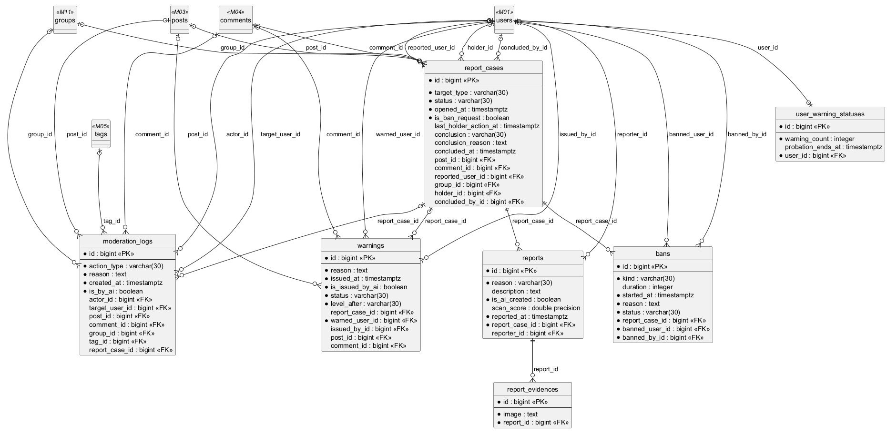

# Thiết kế cơ sở dữ liệu — M08 Moderation

<!-- [Vietnamese Doc] Tài liệu tiếng Việt; tên bảng, cột, kiểu viết tiếng Anh. -->

| Mã tài liệu | DB-M08 |
|---|---|
| Dự án | iShare |
| Module | M08 — Moderation |
| Đầu vào | CD-M08 phiên bản 1.0 |
| Trạng thái | Đã chốt |
| Phiên bản | 1.0 |
| Ngày | 2026-11-22 |
| Tác giả | Phạm Văn Đức |

<!-- Quy ước chung cho mọi bảng dưới đây:
     - Không đổi tên cột, không xóa cột, không đổi số mục: tool đọc bảng theo số mục và tên cột.
     - Ô không có nội dung ghi "—". Mục chưa tới bước làm thì để dòng "(Chưa làm — bước N)".
     - Bảng chỉ sinh từ lớp, cột chỉ sinh từ thuộc tính, khóa ngoại chỉ sinh từ quan hệ (giữ mã R-Mxx-nn).
     - Mục 6 do build_schema.py sinh; không sửa tay.
     - Quy ước dùng (data-model/conventions.md): QU-06, QU-07; QU-08 cách ghép tên khóa ngoại và QU-09 kiểu cột
       (người dùng xác nhận 2026-11-22, DB-M01 Q-01, Q-02). Mọi khóa chính id kiểu bigint (QU-02: long). -->

## 1. Bảng

| Bảng | Từ lớp | Nhóm | Sở hữu | Ghi chú |
|---|---|---|---|---|
| reports | Report | Thực thể | M08 | — |
| report_evidences | ReportEvidence | Thực thể | M08 | — |
| report_cases | ReportCase | Thực thể | M08 | — |
| warnings | Warning | Thực thể | M08 | — |
| user_warning_statuses | UserWarningStatus | Thực thể | M08 | — |
| bans | Ban | Thực thể | M08 | — |
| moderation_logs | ModerationLog | Thực thể | M08 | — |

## 2. Cột

### 2.1 Cột từ thuộc tính

| Bảng | Cột | Kiểu | Null | Duy nhất | Từ thuộc tính | Ghi chú |
|---|---|---|---|---|---|---|
| reports | id | bigint | Không | Có | Report.id | — |
| reports | reason | varchar(30) | Không | Không | Report.reason | Giá trị: SPAM, MISINFORMATION, PLAGIARISM, HARASSMENT, HATE, SEXUAL, VIOLENCE, SYSTEMATIC_HARASSMENT, FAKE_GROUP, OTHER; Đúng một lý do (FR-M08-01.07, FR-M08-01.19), chọn từ danh sách của loại đối tượng: bài viết 8, bình luận 7, người dùng 2, nhóm 4 (BR-M08-02); mức nặng 10, 5, 2 theo lý do (BR-M08-06); mục do AI tạo là HARASSMENT, HATE, SEXUAL hoặc VIOLENCE theo nhóm có điểm cao nhất (BR-M08-25, BR-M08-51); không sửa sau khi gửi |
| reports | description | text | Có | Không | Report.description | Bắt buộc khi reason = OTHER (BR-M08-04); không sửa sau khi gửi (FR-M08-01.18) |
| reports | is_ai_created | boolean | Không | Không | Report.isAiCreated | Đúng khi người báo cáo là "Hệ thống (AI)" (TN:Mục do AI tạo); các trường hợp tạo theo BR-M08-49 |
| reports | scan_score | double precision | Có | Không | Report.scanScore | 0 đến 1, điểm cao nhất trong bốn nhóm vi phạm (BR-M08-51); chỉ có ở mục do AI tạo |
| reports | status | varchar(30) | Không | Không | Report.status | Giá trị: OPEN, RESOLVED; Bằng ReportCase.status của vụ chứa báo cáo (BR-M08-05, BR-M08-10); Dẫn xuất ở CD: xét ở bước 5 |
| reports | conclusion | varchar(30) | Có | Không | Report.conclusion | Giá trị: ACTION_TAKEN, DISMISSED; Chỉ có khi RESOLVED; bằng ReportCase.conclusion của vụ (BR-M08-10); Dẫn xuất ở CD: xét ở bước 5 |
| reports | concentration_index | double precision | Có | Không | Report.concentrationIndex | 0–1; = số báo cáo của người báo cáo nhắm vào đối tượng của vụ bị DISMISSED ÷ tổng số báo cáo của người đó đã xử lý, chỉ tính vụ kết luận trong 90 × 24 giờ gần nhất (BR-M08-19); không có khi người báo cáo chưa có báo cáo đã xử lý hoặc là mục do AI tạo; chỉ tham khảo (BR-M08-18); Dẫn xuất ở CD: xét ở bước 5 |
| reports | reported_at | timestamptz | Không | Không | Report.reportedAt | — |
| report_evidences | id | bigint | Không | Có | ReportEvidence.id | — |
| report_evidences | image | text | Không | Không | ReportEvidence.image | Đường dẫn ảnh trên nơi lưu ảnh (Cloudinary, DEC-137); JPEG, PNG hoặc WebP, tối đa 5 MB; mỗi báo cáo tối đa 3 ảnh (BR-M08-03) |
| report_cases | id | bigint | Không | Có | ReportCase.id | — |
| report_cases | target_type | varchar(30) | Không | Không | ReportCase.targetType | Giá trị: POST, COMMENT, USER, GROUP; Quyết định danh sách lý do dùng được (BR-M08-02); khớp đúng một đối tượng của vụ (R-M08-04 đến R-M08-07) |
| report_cases | status | varchar(30) | Không | Không | ReportCase.status | Giá trị: OPEN, RESOLVED; Vụ mới là OPEN; RESOLVED là trạng thái cuối, không mở lại; mỗi đối tượng nhiều nhất một vụ OPEN (BR-M08-05) |
| report_cases | opened_at | timestamptz | Không | Không | ReportCase.openedAt | Hai vụ bằng điểm ưu tiên thì vụ mở trước đứng trước (BR-M08-07) |
| report_cases | report_count | integer | Không | Không | ReportCase.reportCount | ≥ 1; mục do AI tạo tính là một báo cáo (BR-M08-06, BR-M08-49); Dẫn xuất ở CD: xét ở bước 5 |
| report_cases | priority_score | integer | Không | Không | ReportCase.priorityScore | = mức nặng cao nhất (10, 5, 2) trong các lý do của vụ + reportCount × 2 (BR-M08-06); hàng chờ xếp giảm dần (BR-M08-07); Dẫn xuất ở CD: xét ở bước 5 |
| report_cases | is_ban_request | boolean | Không | Không | ReportCase.isBanRequest | Đánh dấu khi người đang ở mức HEAVY lại bị xác định vi phạm (BR-M08-36) |
| report_cases | last_holder_action_at | timestamptz | Có | Không | ReportCase.lastHolderActionAt | Chỉ có khi vụ đang có người giữ; thao tác gồm mở xem, ẩn nội dung, cảnh cáo, ban, kết luận; 30 phút không thao tác thì tự nhả (BR-M08-09) |
| report_cases | conclusion | varchar(30) | Có | Không | ReportCase.conclusion | Giá trị: ACTION_TAKEN, DISMISSED; Chỉ có khi RESOLVED; chỉ người đang giữ vụ kết luận (BR-M08-08); không kết luận lại (FR-M08-05.08) |
| report_cases | conclusion_reason | text | Có | Không | ReportCase.conclusionReason | Bắt buộc khi kết luận (FR-M08-05.09); không cần trùng lý do báo cáo (FR-M08-05.03) |
| report_cases | concluded_at | timestamptz | Có | Không | ReportCase.concludedAt | Chỉ có khi RESOLVED; dùng cho cửa sổ 90 × 24 giờ của chỉ số tập trung (BR-M08-19) |
| warnings | id | bigint | Không | Có | Warning.id | — |
| warnings | reason | text | Không | Không | Warning.reason | Do Mod, Admin nhập khi ra cảnh cáo (FR-M08-10.01); cảnh cáo do AI ra là tên nhóm vi phạm có điểm cao nhất (BR-M08-51) |
| warnings | issued_at | timestamptz | Không | Không | Warning.issuedAt | Thời gian thử thách tính đủ N × 24 giờ từ lúc này (BR-M08-29, FR-M08-12.03) |
| warnings | is_issued_by_ai | boolean | Không | Không | Warning.isIssuedByAi | Đúng khi người ra là AI (FR-M08-09.01); chỉ cảnh cáo do AI ra mới bỏ được (FR-M08-11.01) |
| warnings | status | varchar(30) | Không | Không | Warning.status | Giá trị: ACTIVE, REMOVED, OVERTURNED; Cảnh cáo mới là ACTIVE; bỏ hoặc bị lật thì giữ bản ghi, chỉ đổi trạng thái (BR-M08-54); OVERTURNED do M09 đặt |
| warnings | level_after | varchar(30) | Không | Không | Warning.levelAfter | Giá trị: CLEAN, LIGHT, MEDIUM, HEAVY; LIGHT, MEDIUM hoặc HEAVY (không bao giờ CLEAN): mức của người bị cảnh cáo ngay sau cảnh cáo này (BR-M08-28) |
| user_warning_statuses | id | bigint | Không | Có | UserWarningStatus.id | — |
| user_warning_statuses | warning_count | integer | Không | Không | UserWarningStatus.warningCount | 0–6; tài khoản mới là 0; tăng 1 mỗi cảnh cáo (FR-M08-09.04, FR-M08-10.02); giảm 1 khi cảnh cáo bị bỏ hoặc bị lật (BR-M08-54); hết thời gian thử thách thì thành 4, 2 hoặc 0 (BR-M08-30) |
| user_warning_statuses | level | varchar(30) | Không | Không | UserWarningStatus.level | Giá trị: CLEAN, LIGHT, MEDIUM, HEAVY; CLEAN (0), LIGHT (1–2), MEDIUM (3–4), HEAVY (5–6) theo warningCount (BR-M08-28); chỉ chính người đó và Mod, Admin thấy (BR-M08-32); Dẫn xuất ở CD: xét ở bước 5 |
| user_warning_statuses | probation_ends_at | timestamptz | Có | Không | UserWarningStatus.probationEndsAt | = lúc cảnh cáo hoặc lúc giảm mức + 7, 10, 15 × 24 giờ theo LIGHT, MEDIUM, HEAVY (BR-M08-29, BR-M08-30); không đổi khi cảnh cáo bị bỏ (FR-M08-11.05); không có khi CLEAN |
| bans | id | bigint | Không | Có | Ban.id | — |
| bans | kind | varchar(30) | Không | Không | Ban.kind | Giá trị: TEMPORARY, PERMANENT; Thao tác "Ban" lần thứ 3 trở đi ra PERMANENT (BR-M08-34); "Ban vĩnh viễn" bỏ qua cách tính leo thang (BR-M08-35) |
| bans | duration | integer | Có | Không | Ban.duration | Đơn vị ngày, N ngày = N × 24 giờ (BR-M08-43); 30 khi chưa từng bị ban, 90 khi đã bị ban 1 lần (BR-M08-34); không có với ban PERMANENT |
| bans | started_at | timestamptz | Không | Không | Ban.startedAt | — |
| bans | ends_at | timestamptz | Có | Không | Ban.endsAt | = startedAt + duration (BR-M08-43); không có với ban PERMANENT; Dẫn xuất ở CD: xét ở bước 5 |
| bans | reason | text | Không | Không | Ban.reason | — |
| bans | status | varchar(30) | Không | Không | Ban.status | Giá trị: ACTIVE, EXPIRED, LIFTED, OVERTURNED; Ban mới là ACTIVE; EXPIRED, LIFTED, OVERTURNED là trạng thái cuối; mỗi tài khoản nhiều nhất một ban ACTIVE (BR-M08-52); OVERTURNED do M09 đặt |
| bans | appeal_deadline | timestamptz | Không | Không | Ban.appealDeadline | Ban tạm thời: = startedAt + duration; ban vĩnh viễn: = startedAt + 90 × 24 giờ (BR-M09-04); quá hạn với ban vĩnh viễn thì mất quyền khiếu nại (BR-M09-05); Dẫn xuất ở CD: xét ở bước 5 |
| moderation_logs | id | bigint | Không | Có | ModerationLog.id | — |
| moderation_logs | action_type | varchar(30) | Không | Không | ModerationLog.actionType | Giá trị: WARN, REMOVE_AI_WARNING, BAN, UNBAN, HIDE_CONTENT, HIDE_GROUP, LOCK_GROUP, UNLOCK_GROUP, CONCLUDE_CASE, DISABLE_TAG, ENABLE_TAG, CHANGE_POST_TOPIC_TAG; Không ghi việc nhận, nhả vụ (FR-M08-16.07) |
| moderation_logs | reason | text | Không | Không | ModerationLog.reason | — |
| moderation_logs | created_at | timestamptz | Không | Không | ModerationLog.createdAt | Giữ vĩnh viễn, không sửa, không xóa (BR-M08-40) |
| moderation_logs | is_by_ai | boolean | Không | Không | ModerationLog.isByAi | Đúng khi người làm là AI; người làm là Mod, Admin hoặc AI (BR-M08-39) |

### 2.2 Thuộc tính đối tượng không chuyển

| Lớp | Thuộc tính | Kiểu | Lý do không chuyển |
|---|---|---|---|
| ReportCase | reports | List<Report> | Thuộc tính đối tượng; được thay bằng khóa ngoại reports.report_case_id ở bước 4 (R-M08-01) |
| Report | evidences | List<ReportEvidence> | Thuộc tính đối tượng; được thay bằng khóa ngoại report_evidences.report_id ở bước 4 (R-M08-02) |
| Report | reporter | User | Thuộc tính đối tượng; được thay bằng khóa ngoại reports.reporter_id ở bước 4 (R-M08-03) |
| ReportCase | post | Post | Thuộc tính đối tượng; được thay bằng khóa ngoại report_cases.post_id ở bước 4 (R-M08-04) |
| ReportCase | comment | Comment | Thuộc tính đối tượng; được thay bằng khóa ngoại report_cases.comment_id ở bước 4 (R-M08-05) |
| ReportCase | reportedUser | User | Thuộc tính đối tượng; được thay bằng khóa ngoại report_cases.reported_user_id ở bước 4 (R-M08-06) |
| ReportCase | group | Group | Thuộc tính đối tượng; được thay bằng khóa ngoại report_cases.group_id ở bước 4 (R-M08-07) |
| ReportCase | holder | User | Thuộc tính đối tượng; được thay bằng khóa ngoại report_cases.holder_id ở bước 4 (R-M08-08) |
| ReportCase | concludedBy | User | Thuộc tính đối tượng; được thay bằng khóa ngoại report_cases.concluded_by_id ở bước 4 (R-M08-09) |
| Warning | reportCase | ReportCase | Thuộc tính đối tượng; được thay bằng khóa ngoại warnings.report_case_id ở bước 4 (R-M08-10) |
| Ban | reportCase | ReportCase | Thuộc tính đối tượng; được thay bằng khóa ngoại bans.report_case_id ở bước 4 (R-M08-11) |
| Warning | warnedUser | User | Thuộc tính đối tượng; được thay bằng khóa ngoại warnings.warned_user_id ở bước 4 (R-M08-12) |
| Warning | issuedBy | User | Thuộc tính đối tượng; được thay bằng khóa ngoại warnings.issued_by_id ở bước 4 (R-M08-13) |
| Warning | post | Post | Thuộc tính đối tượng; được thay bằng khóa ngoại warnings.post_id ở bước 4 (R-M08-14) |
| Warning | comment | Comment | Thuộc tính đối tượng; được thay bằng khóa ngoại warnings.comment_id ở bước 4 (R-M08-15) |
| UserWarningStatus | user | User | Thuộc tính đối tượng; được thay bằng khóa ngoại user_warning_statuses.user_id ở bước 4 (R-M08-16) |
| Ban | bannedUser | User | Thuộc tính đối tượng; được thay bằng khóa ngoại bans.banned_user_id ở bước 4 (R-M08-17) |
| Ban | bannedBy | User | Thuộc tính đối tượng; được thay bằng khóa ngoại bans.banned_by_id ở bước 4 (R-M08-18) |
| ModerationLog | actor | User | Thuộc tính đối tượng; được thay bằng khóa ngoại moderation_logs.actor_id ở bước 4 (R-M08-19) |
| ModerationLog | targetUser | User | Thuộc tính đối tượng; được thay bằng khóa ngoại moderation_logs.target_user_id ở bước 4 (R-M08-20) |
| ModerationLog | post | Post | Thuộc tính đối tượng; được thay bằng khóa ngoại moderation_logs.post_id ở bước 4 (R-M08-21) |
| ModerationLog | comment | Comment | Thuộc tính đối tượng; được thay bằng khóa ngoại moderation_logs.comment_id ở bước 4 (R-M08-22) |
| ModerationLog | group | Group | Thuộc tính đối tượng; được thay bằng khóa ngoại moderation_logs.group_id ở bước 4 (R-M08-23) |
| ModerationLog | tag | Tag | Thuộc tính đối tượng; được thay bằng khóa ngoại moderation_logs.tag_id ở bước 4 (R-M08-24) |
| ModerationLog | reportCase | ReportCase | Thuộc tính đối tượng; được thay bằng khóa ngoại moderation_logs.report_case_id ở bước 4 (R-M08-25) |

## 3. Quan hệ giữa các bảng

"Dạng" đọc theo thứ tự Bảng A – Bảng B; quan hệ 1-n viết bảng phía 1 ở cột Bảng A.

| ID | Bảng A | Bảng B | Dạng | Xử lý | Ghi chú |
|---|---|---|---|---|---|
| R-M08-01 | report_cases | reports | 1-n | Tách riêng | — |
| R-M08-02 | reports | report_evidences | 1-n | Tách riêng | — |
| R-M08-03 | users | reports | 1-n | Tách riêng | — |
| R-M08-04 | posts | report_cases | 1-n | Tách riêng | — |
| R-M08-05 | comments | report_cases | 1-n | Tách riêng | — |
| R-M08-06 | users | report_cases | 1-n | Tách riêng | — |
| R-M08-07 | groups | report_cases | 1-n | Tách riêng | — |
| R-M08-08 | users | report_cases | 1-n | Tách riêng | — |
| R-M08-09 | users | report_cases | 1-n | Tách riêng | — |
| R-M08-10 | report_cases | warnings | 1-n | Tách riêng | — |
| R-M08-11 | report_cases | bans | 1-n | Tách riêng | — |
| R-M08-12 | users | warnings | 1-n | Tách riêng | — |
| R-M08-13 | users | warnings | 1-n | Tách riêng | — |
| R-M08-14 | posts | warnings | 1-n | Tách riêng | — |
| R-M08-15 | comments | warnings | 1-n | Tách riêng | — |
| R-M08-16 | user_warning_statuses | users | 1-1 | Tách riêng | Không gộp: users là bảng của M01. Tách riêng; khóa ngoại ở user_warning_statuses (lớp toàn thể giữ user): user_id, Duy nhất (mỗi tài khoản đúng một trạng thái cảnh cáo) |
| R-M08-17 | users | bans | 1-n | Tách riêng | — |
| R-M08-18 | users | bans | 1-n | Tách riêng | — |
| R-M08-19 | users | moderation_logs | 1-n | Tách riêng | — |
| R-M08-20 | users | moderation_logs | 1-n | Tách riêng | — |
| R-M08-21 | posts | moderation_logs | 1-n | Tách riêng | — |
| R-M08-22 | comments | moderation_logs | 1-n | Tách riêng | — |
| R-M08-23 | groups | moderation_logs | 1-n | Tách riêng | — |
| R-M08-24 | tags | moderation_logs | 1-n | Tách riêng | — |
| R-M08-25 | report_cases | moderation_logs | 1-n | Tách riêng | — |

Không có quan hệ n-n.

## 4. Khóa

### 4.1 Khóa chính

| Bảng | Khóa chính | Ghi chú |
|---|---|---|
| reports | id | — |
| report_evidences | id | — |
| report_cases | id | — |
| warnings | id | — |
| user_warning_statuses | id | — |
| bans | id | — |
| moderation_logs | id | — |

### 4.2 Khóa ngoại

| Bảng | Cột | Kiểu | Null | Duy nhất | Tham chiếu | Từ quan hệ | Ghi chú |
|---|---|---|---|---|---|---|---|
| reports | report_case_id | bigint | Không | Không | report_cases(id) | R-M08-01 | 1 report_cases – n reports |
| report_evidences | report_id | bigint | Không | Không | reports(id) | R-M08-02 | 1 reports – n report_evidences |
| reports | reporter_id | bigint | Có | Không | users(id) | R-M08-03 | 1 users – n reports |
| report_cases | post_id | bigint | Có | Không | posts(id) | R-M08-04 | 1 posts – n report_cases |
| report_cases | comment_id | bigint | Có | Không | comments(id) | R-M08-05 | 1 comments – n report_cases |
| report_cases | reported_user_id | bigint | Có | Không | users(id) | R-M08-06 | 1 users – n report_cases |
| report_cases | group_id | bigint | Có | Không | groups(id) | R-M08-07 | 1 groups – n report_cases |
| report_cases | holder_id | bigint | Có | Không | users(id) | R-M08-08 | 1 users – n report_cases |
| report_cases | concluded_by_id | bigint | Có | Không | users(id) | R-M08-09 | 1 users – n report_cases |
| warnings | report_case_id | bigint | Có | Không | report_cases(id) | R-M08-10 | 1 report_cases – n warnings |
| bans | report_case_id | bigint | Không | Không | report_cases(id) | R-M08-11 | 1 report_cases – n bans |
| warnings | warned_user_id | bigint | Không | Không | users(id) | R-M08-12 | 1 users – n warnings |
| warnings | issued_by_id | bigint | Có | Không | users(id) | R-M08-13 | 1 users – n warnings |
| warnings | post_id | bigint | Có | Không | posts(id) | R-M08-14 | 1 posts – n warnings |
| warnings | comment_id | bigint | Có | Không | comments(id) | R-M08-15 | 1 comments – n warnings |
| user_warning_statuses | user_id | bigint | Không | Có | users(id) | R-M08-16 | 1-1 tách riêng: mỗi dòng users ứng với nhiều nhất một dòng user_warning_statuses |
| bans | banned_user_id | bigint | Không | Không | users(id) | R-M08-17 | 1 users – n bans |
| bans | banned_by_id | bigint | Không | Không | users(id) | R-M08-18 | 1 users – n bans |
| moderation_logs | actor_id | bigint | Có | Không | users(id) | R-M08-19 | 1 users – n moderation_logs |
| moderation_logs | target_user_id | bigint | Có | Không | users(id) | R-M08-20 | 1 users – n moderation_logs |
| moderation_logs | post_id | bigint | Có | Không | posts(id) | R-M08-21 | 1 posts – n moderation_logs |
| moderation_logs | comment_id | bigint | Có | Không | comments(id) | R-M08-22 | 1 comments – n moderation_logs |
| moderation_logs | group_id | bigint | Có | Không | groups(id) | R-M08-23 | 1 groups – n moderation_logs |
| moderation_logs | tag_id | bigint | Có | Không | tags(id) | R-M08-24 | 1 tags – n moderation_logs |
| moderation_logs | report_case_id | bigint | Có | Không | report_cases(id) | R-M08-25 | 1 report_cases – n moderation_logs |

## 5. Loại dư thừa

### 5.1 Cột bị loại

| Bảng | Cột | Loại dư thừa | Căn cứ | Cách có lại giá trị |
|---|---|---|---|---|
| reports | status | Trùng lặp | CD ghi Dẫn xuất: bằng report_cases.status của vụ chứa báo cáo (BR-M08-05, BR-M08-10); là dữ liệu của vụ lặp ở bảng báo cáo | report_cases.status qua reports.report_case_id |
| reports | conclusion | Trùng lặp | CD ghi Dẫn xuất: bằng report_cases.conclusion của vụ (BR-M08-10); là dữ liệu của vụ lặp ở bảng báo cáo | report_cases.conclusion qua reports.report_case_id |
| reports | concentration_index | Dẫn xuất | Thuộc tính dẫn xuất ở CD-M08; BR-M08-19 | Với người báo cáo reports.reporter_id: số reports của người đó thuộc report_cases nhắm vào cùng đối tượng của vụ (post_id, comment_id, reported_user_id hoặc group_id) có conclusion = DISMISSED ÷ số reports của người đó thuộc report_cases có status = RESOLVED; chỉ tính vụ có concluded_at trong 90 × 24 giờ gần nhất; không có khi is_ai_created hoặc mẫu số bằng 0 |
| report_cases | report_count | Dẫn xuất | Thuộc tính dẫn xuất ở CD-M08; BR-M08-06, BR-M08-49 | Đếm reports có report_case_id = report_cases.id |
| report_cases | priority_score | Dẫn xuất | Thuộc tính dẫn xuất ở CD-M08; BR-M08-06 | Mức nặng cao nhất (10, 5, 2 theo lý do, BR-M08-06) trong reports.reason của vụ + số reports của vụ × 2 |
| user_warning_statuses | level | Dẫn xuất | Thuộc tính dẫn xuất ở CD-M08; BR-M08-28 | Theo user_warning_statuses.warning_count: 0 → CLEAN, 1–2 → LIGHT, 3–4 → MEDIUM, 5–6 → HEAVY |
| bans | ends_at | Dẫn xuất | Thuộc tính dẫn xuất ở CD-M08; BR-M08-43 | bans.started_at + bans.duration × 24 giờ; không có khi kind = PERMANENT |
| bans | appeal_deadline | Dẫn xuất | Thuộc tính dẫn xuất ở CD-M08; BR-M09-04 | kind = TEMPORARY: bans.started_at + bans.duration × 24 giờ; kind = PERMANENT: bans.started_at + 90 × 24 giờ |

### 5.2 Bảng bị loại

| Bảng | Lý do |
|---|---|
| — | — |

### 5.3 Dẫn xuất nhưng giữ lại

Không có.

| Bảng | Cột | Lý do giữ | Nguồn |
|---|---|---|---|
| — | — | — | — |

### 5.4 Đã xét nhưng không coi là dư thừa

| Bảng | Cột | Vì sao không dư thừa |
|---|---|---|
| report_cases | status, conclusion | Bảng sở hữu dữ liệu của vụ; bản lặp ở reports.status, reports.conclusion đã loại (5.1) |
| warnings | level_after | Mức ngay sau cảnh cáo, chụp tại lúc cảnh cáo (BR-M08-28); mức hiện tại đổi theo thời gian thử thách, bỏ, lật cảnh cáo, nên không suy ra được từ user_warning_statuses |
| reports | scan_score | Điểm cao nhất trong bốn nhóm của lần quét tạo mục do AI (BR-M08-51); reports không có khóa ngoại tới nhật ký AI (ai_decision_logs, M13) nên không lấy lại được qua khóa ngoại; lượt gộp DB-SYS xét lại |

## 6. Lược đồ cuối

### 6.1 Bảng và cột

<!-- BEGIN:SCHEMA -->
| Bảng | Cột | Kiểu | Khóa | Null | Duy nhất | Tham chiếu |
|---|---|---|---|---|---|---|
| reports | id | bigint | PK | Không | Có | — |
| reports | reason | varchar(30) | — | Không | Không | — |
| reports | description | text | — | Có | Không | — |
| reports | is_ai_created | boolean | — | Không | Không | — |
| reports | scan_score | double precision | — | Có | Không | — |
| reports | reported_at | timestamptz | — | Không | Không | — |
| reports | report_case_id | bigint | FK | Không | Không | report_cases(id) |
| reports | reporter_id | bigint | FK | Có | Không | users(id) |
| report_evidences | id | bigint | PK | Không | Có | — |
| report_evidences | image | text | — | Không | Không | — |
| report_evidences | report_id | bigint | FK | Không | Không | reports(id) |
| report_cases | id | bigint | PK | Không | Có | — |
| report_cases | target_type | varchar(30) | — | Không | Không | — |
| report_cases | status | varchar(30) | — | Không | Không | — |
| report_cases | opened_at | timestamptz | — | Không | Không | — |
| report_cases | is_ban_request | boolean | — | Không | Không | — |
| report_cases | last_holder_action_at | timestamptz | — | Có | Không | — |
| report_cases | conclusion | varchar(30) | — | Có | Không | — |
| report_cases | conclusion_reason | text | — | Có | Không | — |
| report_cases | concluded_at | timestamptz | — | Có | Không | — |
| report_cases | post_id | bigint | FK | Có | Không | posts(id) |
| report_cases | comment_id | bigint | FK | Có | Không | comments(id) |
| report_cases | reported_user_id | bigint | FK | Có | Không | users(id) |
| report_cases | group_id | bigint | FK | Có | Không | groups(id) |
| report_cases | holder_id | bigint | FK | Có | Không | users(id) |
| report_cases | concluded_by_id | bigint | FK | Có | Không | users(id) |
| warnings | id | bigint | PK | Không | Có | — |
| warnings | reason | text | — | Không | Không | — |
| warnings | issued_at | timestamptz | — | Không | Không | — |
| warnings | is_issued_by_ai | boolean | — | Không | Không | — |
| warnings | status | varchar(30) | — | Không | Không | — |
| warnings | level_after | varchar(30) | — | Không | Không | — |
| warnings | report_case_id | bigint | FK | Có | Không | report_cases(id) |
| warnings | warned_user_id | bigint | FK | Không | Không | users(id) |
| warnings | issued_by_id | bigint | FK | Có | Không | users(id) |
| warnings | post_id | bigint | FK | Có | Không | posts(id) |
| warnings | comment_id | bigint | FK | Có | Không | comments(id) |
| user_warning_statuses | id | bigint | PK | Không | Có | — |
| user_warning_statuses | warning_count | integer | — | Không | Không | — |
| user_warning_statuses | probation_ends_at | timestamptz | — | Có | Không | — |
| user_warning_statuses | user_id | bigint | FK | Không | Có | users(id) |
| bans | id | bigint | PK | Không | Có | — |
| bans | kind | varchar(30) | — | Không | Không | — |
| bans | duration | integer | — | Có | Không | — |
| bans | started_at | timestamptz | — | Không | Không | — |
| bans | reason | text | — | Không | Không | — |
| bans | status | varchar(30) | — | Không | Không | — |
| bans | report_case_id | bigint | FK | Không | Không | report_cases(id) |
| bans | banned_user_id | bigint | FK | Không | Không | users(id) |
| bans | banned_by_id | bigint | FK | Không | Không | users(id) |
| moderation_logs | id | bigint | PK | Không | Có | — |
| moderation_logs | action_type | varchar(30) | — | Không | Không | — |
| moderation_logs | reason | text | — | Không | Không | — |
| moderation_logs | created_at | timestamptz | — | Không | Không | — |
| moderation_logs | is_by_ai | boolean | — | Không | Không | — |
| moderation_logs | actor_id | bigint | FK | Có | Không | users(id) |
| moderation_logs | target_user_id | bigint | FK | Có | Không | users(id) |
| moderation_logs | post_id | bigint | FK | Có | Không | posts(id) |
| moderation_logs | comment_id | bigint | FK | Có | Không | comments(id) |
| moderation_logs | group_id | bigint | FK | Có | Không | groups(id) |
| moderation_logs | tag_id | bigint | FK | Có | Không | tags(id) |
| moderation_logs | report_case_id | bigint | FK | Có | Không | report_cases(id) |
<!-- END:SCHEMA -->

### 6.2 Sơ đồ quan hệ

<!-- BEGIN:DIAGRAM -->

Mã nguồn sơ đồ: [diagrams/DB-M08.puml](diagrams/DB-M08.puml). Ảnh và tệp .puml do `build_schema.py` sinh từ các bảng của tài liệu này; muốn đổi sơ đồ thì sửa bảng rồi chạy lại tool, không sửa tay.
<!-- END:DIAGRAM -->

## 7. Liên module

### 7.1 Bảng của module khác được tham chiếu

| Bảng ngoài | Module sở hữu | Dùng thế nào |
|---|---|---|
| users | M01 | Ghi người báo cáo (R-M08-03); đối tượng, người giữ vụ, người kết luận của vụ (R-M08-06, R-M08-08, R-M08-09); người bị cảnh cáo, người ra cảnh cáo (R-M08-12, R-M08-13); trạng thái cảnh cáo (R-M08-16); người bị ban, người ban (R-M08-17, R-M08-18); người làm và đối tượng của dòng nhật ký (R-M08-19, R-M08-20). Đọc role, username; ban, gỡ ban làm M01 đổi status |
| posts | M03 | Đối tượng của vụ (R-M08-04); nội dung liên quan của cảnh cáo do AI ra (R-M08-14); đối tượng của dòng nhật ký (R-M08-21). Đọc title, content; ghi modState (Bị ẩn, Bình thường) |
| comments | M04 | Đối tượng của vụ (R-M08-05); nội dung liên quan của cảnh cáo do AI ra (R-M08-15); đối tượng của dòng nhật ký (R-M08-22). Đọc content, publishedAt, editedAt để quét luồng; ghi modState (Bị ẩn, Bình thường) |
| groups | M11 | Đối tượng của vụ (R-M08-07); đối tượng của dòng nhật ký (R-M08-23) |
| tags | M05 | Đối tượng của dòng nhật ký (R-M08-24, trùng R-M05-14 của EC-M05; lượt gộp khử trùng). Đọc name |

### 7.2 Khóa ngoại đề nghị cho bảng của module khác

<!-- Khi bảng của module khác là phía n của một quan hệ với bảng của module này. -->

| Bảng của module khác | Cột | Kiểu | Tham chiếu | Từ quan hệ |
|---|---|---|---|---|
| — | — | — | — | — |

## 8. Quyết định thiết kế

| Mã | Quyết định | Lý do |
|---|---|---|
| DD-M08-01 | Quan hệ 1-1 users–user_warning_statuses (R-M08-16) tách riêng; khóa ngoại user_warning_statuses.user_id, Duy nhất, không null | Trả lời Q-01: users thuộc M01 nên không gộp |
| DD-M08-02 | reports.status, reports.conclusion loại với Loại dư thừa = Trùng lặp | Trả lời Q-01: là dữ liệu của vụ (report_cases) lặp ở bảng báo cáo, lấy qua reports.report_case_id |

## 9. Câu hỏi và điểm chưa chốt

| Mã | Loại | Câu hỏi | Trả lời | Ghi vào |
|---|---|---|---|---|
| Q-01 | Xác nhận | (1) Quan hệ 1-1 User–UserWarningStatus (R-M08-16): không gộp được vì users thuộc M01; khóa ngoại user_warning_statuses.user_id, Duy nhất, không null. (2) reports.status, reports.conclusion (CD ghi Dẫn xuất) xếp loại Trùng lặp vì chính là dữ liệu của vụ lặp lại, lấy qua reports.report_case_id; vẫn bị loại. Đồng ý? | Đồng ý (người dùng, 2026-11-22). Soát nghiệp vụ: mỗi tài khoản đúng một trạng thái cảnh cáo (R-M08-16); trạng thái, kết luận của báo cáo theo vụ chứa nó (BR-M08-05, BR-M08-10); DD-M08-01, DD-M08-02 | Mục 3, 4.2, 5.1 |

## 10. Lịch sử sửa đổi

| Phiên bản | Ngày | Nội dung | Người sửa |
|---|---|---|---|
| 0.1 | 2026-11-20 | Tạo mới từ CD-M08 v1.0; làm liền bước 1–5 theo yêu cầu của người dùng (không dừng ở cổng); chưa qua duyệt, câu hỏi ở mục 9 chờ trả lời | Phạm Văn Đức |
| 0.2 | 2026-11-22 | Ghi trả lời mục 9 (DD-M08-01, DD-M08-02); soát lại các cột dẫn xuất bị loại theo tiêu chí của người dùng, không đổi; chờ chốt | Phạm Văn Đức |
| 1.0 | 2026-11-22 | Chốt: người dùng chốt DB-M08 | Phạm Văn Đức |
