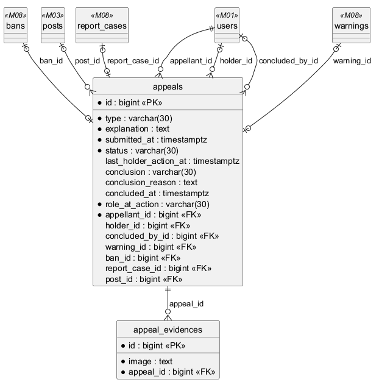

# Thiết kế cơ sở dữ liệu — M09 Appeal

<!-- [Vietnamese Doc] Tài liệu tiếng Việt; tên bảng, cột, kiểu viết tiếng Anh. -->

| Mã tài liệu | DB-M09 |
|---|---|
| Dự án | iShare |
| Module | M09 — Appeal |
| Đầu vào | CD-M09 phiên bản 1.0 |
| Trạng thái | Đã chốt |
| Phiên bản | 1.0 |
| Ngày | 2026-11-22 |
| Tác giả | Phạm Văn Đức |

<!-- Quy ước chung cho mọi bảng dưới đây:
     - Không đổi tên cột, không xóa cột, không đổi số mục: tool đọc bảng theo số mục và tên cột.
     - Ô không có nội dung ghi "—". Mục chưa tới bước làm thì để dòng "(Chưa làm — bước N)".
     - Bảng chỉ sinh từ lớp, cột chỉ sinh từ thuộc tính, khóa ngoại chỉ sinh từ quan hệ (giữ mã R-Mxx-nn).
     - Mục 6 do build_schema.py sinh; không sửa tay.
     - Quy ước dùng (data-model/conventions.md): QU-06, QU-07; QU-08 cách ghép tên khóa ngoại và QU-09 kiểu cột
       (người dùng xác nhận 2026-11-22, DB-M01 Q-01, Q-02). Mọi khóa chính id kiểu bigint (QU-02: long). -->

## 1. Bảng

| Bảng | Từ lớp | Nhóm | Sở hữu | Ghi chú |
|---|---|---|---|---|
| appeals | Appeal | Thực thể | M09 | — |
| appeal_evidences | AppealEvidence | Thực thể | M09 | — |

## 2. Cột

### 2.1 Cột từ thuộc tính

| Bảng | Cột | Kiểu | Null | Duy nhất | Từ thuộc tính | Ghi chú |
|---|---|---|---|---|---|---|
| appeals | id | bigint | Không | Có | Appeal.id | — |
| appeals | type | varchar(30) | Không | Không | Appeal.type | Giá trị: BAN, WARNING, POST; Gắn theo xử lý bị khiếu nại; khiếu nại bài bị gỡ và khiếu nại gộp đều là POST (FR-M09-01.03, TN:Loại khiếu nại); hàng chờ xếp BAN, rồi WARNING, rồi POST (BR-M09-10); khớp với quan hệ tới xử lý (R-M09-05 đến R-M09-08) |
| appeals | explanation | text | Không | Không | Appeal.explanation | Không trống (BR-M09-03, FR-M09-01.10); không sửa sau khi gửi (BR-M09-27) |
| appeals | submitted_at | timestamptz | Không | Không | Appeal.submittedAt | Phải trước hạn khiếu nại của xử lý (BR-M09-04); cùng loại thì gửi trước đứng trước (BR-M09-10) |
| appeals | status | varchar(30) | Không | Không | Appeal.status | Giá trị: PENDING, CONCLUDED; Khiếu nại mới là PENDING (FR-M09-01.01); CONCLUDED là trạng thái cuối, không kết luận lại (FR-M09-07.08); "chưa ai giữ", "đang được giữ" suy từ quan hệ người giữ |
| appeals | last_holder_action_at | timestamptz | Có | Không | Appeal.lastHolderActionAt | Chỉ có khi đang có người giữ; đặt lúc nhận và mỗi lần người giữ mở xem; 30 phút không thao tác thì tự nhả (BR-M09-11) |
| appeals | conclusion | varchar(30) | Có | Không | Appeal.conclusion | Giá trị: ACCEPTED, REJECTED; Chỉ có khi CONCLUDED; chỉ người đang giữ kết luận (FR-M09-07.06); REJECTED là cuối cùng, không gửi lại cho cùng xử lý (BR-M09-06) |
| appeals | conclusion_reason | text | Có | Không | Appeal.conclusionReason | Chỉ có khi CONCLUDED; bắt buộc ở cả ACCEPTED và REJECTED (BR-M09-27, FR-M09-07.11); gửi kèm thông báo kết luận (BR-M09-20) |
| appeals | concluded_at | timestamptz | Có | Không | Appeal.concludedAt | Chỉ có khi CONCLUDED |
| appeals | role_at_action | varchar(30) | Không | Không | Appeal.roleAtAction | Giá trị: USER, MODERATOR, ADMIN; Chỉ USER hoặc MODERATOR (Admin không có khiếu nại, BR-M09-01); vai trò tại thời điểm có xử lý, vẫn là MODERATOR khi đã mất vai trò Mod vì bị ban (FR-M09-03.08); MODERATOR thì chỉ Admin xét (BR-M09-12); Dẫn xuất ở CD: xét ở bước 5 |
| appeal_evidences | id | bigint | Không | Có | AppealEvidence.id | — |
| appeal_evidences | image | text | Không | Không | AppealEvidence.image | Đường dẫn ảnh trên nơi lưu ảnh (Cloudinary, DEC-137); JPEG, PNG hoặc WebP, tối đa 5 MB; mỗi khiếu nại tối đa 3 ảnh (BR-M09-03); không sửa sau khi gửi (BR-M09-27) |

### 2.2 Thuộc tính đối tượng không chuyển

| Lớp | Thuộc tính | Kiểu | Lý do không chuyển |
|---|---|---|---|
| Appeal | evidences | List<AppealEvidence> | Thuộc tính đối tượng; được thay bằng khóa ngoại appeal_evidences.appeal_id ở bước 4 (R-M09-01) |
| Appeal | appellant | User | Thuộc tính đối tượng; được thay bằng khóa ngoại appeals.appellant_id ở bước 4 (R-M09-02) |
| Appeal | holder | User | Thuộc tính đối tượng; được thay bằng khóa ngoại appeals.holder_id ở bước 4 (R-M09-03) |
| Appeal | concludedBy | User | Thuộc tính đối tượng; được thay bằng khóa ngoại appeals.concluded_by_id ở bước 4 (R-M09-04) |
| Appeal | warning | Warning | Thuộc tính đối tượng; được thay bằng khóa ngoại appeals.warning_id ở bước 4 (R-M09-05) |
| Appeal | ban | Ban | Thuộc tính đối tượng; được thay bằng khóa ngoại appeals.ban_id ở bước 4 (R-M09-06) |
| Appeal | reportCase | ReportCase | Thuộc tính đối tượng; được thay bằng khóa ngoại appeals.report_case_id ở bước 4 (R-M09-07) |
| Appeal | post | Post | Thuộc tính đối tượng; được thay bằng khóa ngoại appeals.post_id ở bước 4 (R-M09-08) |

## 3. Quan hệ giữa các bảng

"Dạng" đọc theo thứ tự Bảng A – Bảng B; quan hệ 1-n viết bảng phía 1 ở cột Bảng A.

| ID | Bảng A | Bảng B | Dạng | Xử lý | Ghi chú |
|---|---|---|---|---|---|
| R-M09-01 | appeals | appeal_evidences | 1-n | Tách riêng | — |
| R-M09-02 | users | appeals | 1-n | Tách riêng | — |
| R-M09-03 | users | appeals | 1-n | Tách riêng | — |
| R-M09-04 | users | appeals | 1-n | Tách riêng | — |
| R-M09-05 | appeals | warnings | 1-1 | Tách riêng | Không gộp: warnings là bảng của M08. Tách riêng; khóa ngoại ở appeals (bên được tạo sau xử lý): warning_id, Duy nhất, cho phép null |
| R-M09-06 | appeals | bans | 1-1 | Tách riêng | Không gộp: bans là bảng của M08. Tách riêng; khóa ngoại ở appeals (bên được tạo sau xử lý): ban_id, Duy nhất, cho phép null |
| R-M09-07 | appeals | report_cases | 1-1 | Tách riêng | Không gộp: report_cases là bảng của M08. Tách riêng; khóa ngoại ở appeals (bên được tạo sau): report_case_id, Duy nhất, cho phép null |
| R-M09-08 | posts | appeals | 1-n | Tách riêng | — |

Không có quan hệ n-n.

## 4. Khóa

### 4.1 Khóa chính

| Bảng | Khóa chính | Ghi chú |
|---|---|---|
| appeals | id | — |
| appeal_evidences | id | — |

### 4.2 Khóa ngoại

| Bảng | Cột | Kiểu | Null | Duy nhất | Tham chiếu | Từ quan hệ | Ghi chú |
|---|---|---|---|---|---|---|---|
| appeal_evidences | appeal_id | bigint | Không | Không | appeals(id) | R-M09-01 | 1 appeals – n appeal_evidences |
| appeals | appellant_id | bigint | Không | Không | users(id) | R-M09-02 | 1 users – n appeals |
| appeals | holder_id | bigint | Có | Không | users(id) | R-M09-03 | 1 users – n appeals |
| appeals | concluded_by_id | bigint | Có | Không | users(id) | R-M09-04 | 1 users – n appeals |
| appeals | warning_id | bigint | Có | Có | warnings(id) | R-M09-05 | 1-1 tách riêng: mỗi dòng warnings ứng với nhiều nhất một dòng appeals |
| appeals | ban_id | bigint | Có | Có | bans(id) | R-M09-06 | 1-1 tách riêng: mỗi dòng bans ứng với nhiều nhất một dòng appeals |
| appeals | report_case_id | bigint | Có | Có | report_cases(id) | R-M09-07 | 1-1 tách riêng: mỗi dòng report_cases ứng với nhiều nhất một dòng appeals |
| appeals | post_id | bigint | Có | Không | posts(id) | R-M09-08 | 1 posts – n appeals |

## 5. Loại dư thừa

### 5.1 Cột bị loại

| Bảng | Cột | Loại dư thừa | Căn cứ | Cách có lại giá trị |
|---|---|---|---|---|
| — | — | — | — | — |

### 5.2 Bảng bị loại

| Bảng | Lý do |
|---|---|
| — | — |

### 5.3 Dẫn xuất nhưng giữ lại

Người dùng quyết giữ theo tiêu chí dẫn xuất (DD-M09-01).

| Bảng | Cột | Lý do giữ | Nguồn |
|---|---|---|---|
| appeals | role_at_action | Vai trò của người khiếu nại lúc bị xử lý; Mod bị ban mất vai trò ngay lúc ban nhưng khiếu nại vẫn tính là của Mod, chỉ Admin xét (BR-M09-12, FR-M09-03.08). users.role là vai trò hiện tại; tính lại qua nhật ký đổi vai trò (admin_logs) không đảm bảo ra đúng giá trị lúc tạo | BR-M09-12, FR-M09-03.08; DD-M09-01 |

### 5.4 Đã xét nhưng không coi là dư thừa

| Bảng | Cột | Vì sao không dư thừa |
|---|---|---|
| — | — | — |

## 6. Lược đồ cuối

### 6.1 Bảng và cột

<!-- BEGIN:SCHEMA -->
| Bảng | Cột | Kiểu | Khóa | Null | Duy nhất | Tham chiếu |
|---|---|---|---|---|---|---|
| appeals | id | bigint | PK | Không | Có | — |
| appeals | type | varchar(30) | — | Không | Không | — |
| appeals | explanation | text | — | Không | Không | — |
| appeals | submitted_at | timestamptz | — | Không | Không | — |
| appeals | status | varchar(30) | — | Không | Không | — |
| appeals | last_holder_action_at | timestamptz | — | Có | Không | — |
| appeals | conclusion | varchar(30) | — | Có | Không | — |
| appeals | conclusion_reason | text | — | Có | Không | — |
| appeals | concluded_at | timestamptz | — | Có | Không | — |
| appeals | role_at_action | varchar(30) | — | Không | Không | — |
| appeals | appellant_id | bigint | FK | Không | Không | users(id) |
| appeals | holder_id | bigint | FK | Có | Không | users(id) |
| appeals | concluded_by_id | bigint | FK | Có | Không | users(id) |
| appeals | warning_id | bigint | FK | Có | Có | warnings(id) |
| appeals | ban_id | bigint | FK | Có | Có | bans(id) |
| appeals | report_case_id | bigint | FK | Có | Có | report_cases(id) |
| appeals | post_id | bigint | FK | Có | Không | posts(id) |
| appeal_evidences | id | bigint | PK | Không | Có | — |
| appeal_evidences | image | text | — | Không | Không | — |
| appeal_evidences | appeal_id | bigint | FK | Không | Không | appeals(id) |
<!-- END:SCHEMA -->

### 6.2 Sơ đồ quan hệ

<!-- BEGIN:DIAGRAM -->

Mã nguồn sơ đồ: [diagrams/DB-M09.puml](diagrams/DB-M09.puml). Ảnh và tệp .puml do `build_schema.py` sinh từ các bảng của tài liệu này; muốn đổi sơ đồ thì sửa bảng rồi chạy lại tool, không sửa tay.
<!-- END:DIAGRAM -->

## 7. Liên module

### 7.1 Bảng của module khác được tham chiếu

| Bảng ngoài | Module sở hữu | Dùng thế nào |
|---|---|---|
| users | M01 | Người khiếu nại, người đang giữ, người kết luận (R-M09-02, R-M09-03, R-M09-04). Đọc role để kiểm quyền Mod, Admin; đọc status để tài khoản BANNED chỉ khiếu nại được ban đang hiệu lực; đọc username để hiển thị người khiếu nại. Khiếu nại một ban đang hiệu lực được chấp nhận thì M01 đưa status về ACTIVE; không ghi role |
| warnings | M08 | Xử lý bị khiếu nại của khiếu nại cảnh cáo và khiếu nại gộp (R-M09-05); cảnh cáo ra cùng lần gỡ bài đọc qua vụ (R-M08-10); người ra cảnh cáo đọc qua R-M08-13. Đọc reason, issuedAt, isIssuedByAi, levelAfter; ghi status (Bị lật), rồi M08 giảm số lần cảnh cáo và tính lại mức |
| bans | M08 | Xử lý bị khiếu nại của khiếu nại ban (R-M09-06); ban ra cùng lần gỡ bài đọc qua vụ (R-M08-11); người ban đọc qua R-M08-18. Đọc kind, duration, startedAt, reason; ghi status (Bị lật) |
| report_cases | M08 | Lần gỡ bài viết của khiếu nại bài bị gỡ (R-M09-07, Q-01); bài bị gỡ đọc qua R-M08-04, người ra xử lý là người kết luận vụ (R-M08-09). Đọc conclusionReason, concludedAt; không ghi |
| posts | M03 | Bài bị AI tự từ chối của khiếu nại gộp (R-M09-08); bài bị gỡ đọc qua vụ (R-M08-04). Đọc title, content, violationCategory, rejectedAt; ghi modState (Bình thường) và publishState (Đã đăng) |

### 7.2 Khóa ngoại đề nghị cho bảng của module khác

<!-- Khi bảng của module khác là phía n của một quan hệ với bảng của module này. -->

| Bảng của module khác | Cột | Kiểu | Tham chiếu | Từ quan hệ |
|---|---|---|---|---|
| — | — | — | — | — |

## 8. Quyết định thiết kế

| Mã | Quyết định | Lý do |
|---|---|---|
| DD-M09-01 | Giữ appeals.role_at_action (dẫn xuất nhưng giữ lại) | Trả lời Q-01 theo tiêu chí dẫn xuất của người dùng: tính lại không đảm bảo đúng vai trò lúc bị xử lý mà BR-M09-12 đòi |
| DD-M09-02 | Ba quan hệ 1-1 tách riêng: appeals.warning_id, ban_id, report_case_id, Duy nhất, cho phép null | Trả lời Q-02: ba bảng thuộc M08 nên không gộp; mỗi xử lý chỉ khiếu nại một lần (BR-M09-06) |

## 9. Câu hỏi và điểm chưa chốt

| Mã | Loại | Câu hỏi | Trả lời | Ghi vào |
|---|---|---|---|---|
| Q-01 | Dẫn xuất cần quyết | appeals.role_at_action (vai trò lúc bị xử lý, quyết định Mod hay chỉ Admin xét, BR-M09-12). EC-M09 ghi tính được từ thời điểm xử lý và nhật ký đổi vai trò của M10, nên theo phương pháp bị loại (mục 5.1, công thức lần ngược admin_logs). Rủi ro: công thức phụ thuộc nhật ký đổi vai trò phải đủ và đúng thứ tự; hàng chờ khiếu nại phải tính lại mỗi lần mở. Đề xuất (a) loại theo phương pháp. Phương án (b) giữ như bản chụp lúc gửi khiếu nại: phải sửa CD-M09 (Tính chất → Lưu, tăng phiên bản) rồi ghi ở mục 5.4. Chọn (a)? | Theo tiêu chí của người dùng (2026-11-22): (1) có phải dẫn xuất; (2) tính lại mỗi lần có ra đúng giá trị lúc tạo và các lần sau không đổi: là dẫn xuất (EC-M09) nhưng tính lại không đảm bảo ra đúng vai trò lúc bị xử lý: phải lần ngược nhật ký đổi vai trò, và Mod bị ban mất vai trò ngay lúc ban nên dòng REVOKE_MOD_ON_BAN và lệnh ban cùng thời điểm, thứ tự không chắc; BR-M09-12 đòi vai trò lúc bị xử lý → giữ (mục 5.3); DD-M09-01 | Mục 5.1 hoặc 5.4; DD-M09-nn; có thể sửa CD-M09 |
| Q-02 | Xác nhận | Ba quan hệ 1-1 Appeal với Warning, Ban, ReportCase (R-M09-05, R-M09-06, R-M09-07): không gộp được vì ba bảng thuộc M08; khóa ngoại ở appeals: warning_id, ban_id, report_case_id, Duy nhất (mỗi xử lý nhiều nhất một khiếu nại), cho phép null. Đồng ý? | Đồng ý (người dùng, 2026-11-22). Soát nghiệp vụ: mỗi xử lý chỉ khiếu nại một lần (BR-M09-06); khiếu nại gộp đặt cả post_id và warning_id nên cảnh cáo AI đi kèm không khiếu nại riêng được; report_case_id chỉ có ở khiếu nại bài bị gỡ, mỗi vụ nhiều nhất một lần gỡ bài (EC-M09 R-M09-07); DD-M09-02 | Mục 3, 4.2 |

## 10. Lịch sử sửa đổi

| Phiên bản | Ngày | Nội dung | Người sửa |
|---|---|---|---|
| 0.1 | 2026-11-20 | Tạo mới từ CD-M09 v1.0; làm liền bước 1–5 theo yêu cầu của người dùng (không dừng ở cổng); chưa qua duyệt, câu hỏi ở mục 9 chờ trả lời | Phạm Văn Đức |
| 0.2 | 2026-11-22 | Ghi trả lời mục 9: giữ appeals.role_at_action (DD-M09-01); 1-1 với xử lý tách riêng (DD-M09-02); chờ chốt | Phạm Văn Đức |
| 1.0 | 2026-11-22 | Chốt: người dùng chốt DB-M09 | Phạm Văn Đức |
