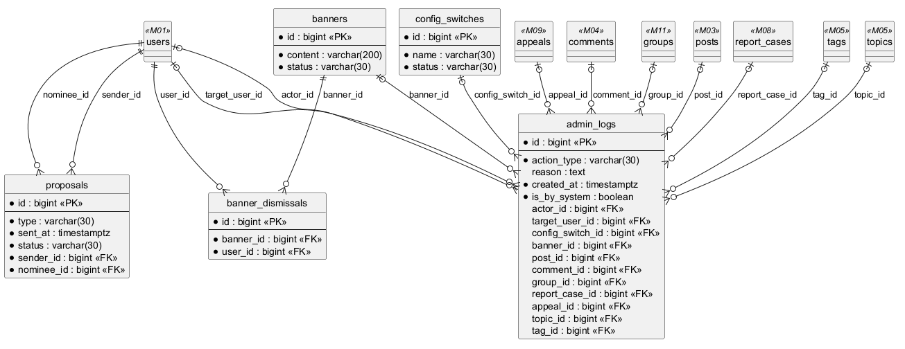

# Thiết kế cơ sở dữ liệu — M10 Admin Panel

<!-- [Vietnamese Doc] Tài liệu tiếng Việt; tên bảng, cột, kiểu viết tiếng Anh. -->

| Mã tài liệu | DB-M10 |
|---|---|
| Dự án | iShare |
| Module | M10 — Admin Panel |
| Đầu vào | CD-M10 phiên bản 1.0 |
| Trạng thái | Đã chốt |
| Phiên bản | 1.0 |
| Ngày | 2026-11-22 |
| Tác giả | Phạm Văn Đức |

<!-- Quy ước chung cho mọi bảng dưới đây:
     - Không đổi tên cột, không xóa cột, không đổi số mục: tool đọc bảng theo số mục và tên cột.
     - Ô không có nội dung ghi "—". Mục chưa tới bước làm thì để dòng "(Chưa làm — bước N)".
     - Bảng chỉ sinh từ lớp, cột chỉ sinh từ thuộc tính, khóa ngoại chỉ sinh từ quan hệ (giữ mã R-Mxx-nn).
     - Mục 6 do build_schema.py sinh; không sửa tay.
     - Quy ước dùng (data-model/conventions.md): QU-06, QU-07; QU-08 cách ghép tên khóa ngoại và QU-09 kiểu cột
       (người dùng xác nhận 2026-11-22, DB-M01 Q-01, Q-02). Mọi khóa chính id kiểu bigint (QU-02: long). -->

## 1. Bảng

| Bảng | Từ lớp | Nhóm | Sở hữu | Ghi chú |
|---|---|---|---|---|
| proposals | Proposal | Thực thể | M10 | — |
| config_switches | ConfigSwitch | Thực thể | M10 | — |
| banners | Banner | Thực thể | M10 | — |
| banner_dismissals | BannerDismissal | Liên kết | M10 | — |
| admin_logs | AdminLog | Thực thể | M10 | — |

## 2. Cột

### 2.1 Cột từ thuộc tính

| Bảng | Cột | Kiểu | Null | Duy nhất | Từ thuộc tính | Ghi chú |
|---|---|---|---|---|---|---|
| proposals | id | bigint | Không | Có | Proposal.id | — |
| proposals | type | varchar(30) | Không | Không | Proposal.type | Giá trị: MOD, ADMIN; MOD gửi cho tài khoản USER (FR-M10-02.07); ADMIN gửi cho USER hoặc MODERATOR (FR-M10-07.02, BR-M10-11); mỗi người được đề xuất nhiều nhất một đề xuất PENDING cho mỗi loại (BR-M10-27) |
| proposals | sent_at | timestamptz | Không | Không | Proposal.sentAt | Lúc hệ thống lưu đề xuất; hạn đề xuất = sentAt + 7 × 24 giờ, hằng số chính sách (BR-M10-07, BR-M10-04) |
| proposals | status | varchar(30) | Không | Không | Proposal.status | Giá trị: PENDING, ACCEPTED, DECLINED, EXPIRED; Mới gửi là PENDING; trả lời một lần (BR-M10-07); PENDING sang EXPIRED khi đủ 7 × 24 giờ từ sentAt hoặc có đề xuất mới cùng loại cho cùng người (BR-M10-27) |
| config_switches | id | bigint | Không | Có | ConfigSwitch.id | — |
| config_switches | name | varchar(30) | Không | Có | ConfigSwitch.name | Giá trị: AI_ENABLED, AI_SEARCH, AI_MODERATION, AI_TOPIC_SUGGESTION, MAINTENANCE_MODE, REGISTRATION_PAUSED, GROUP_ENABLED, CHAT_ENABLED, GAMIFICATION_ENABLED; Duy nhất; đúng chín công tắc, không tạo thêm, không xóa (FR-M10-09.01, FR-M10-12.03, BR-M10-12, BR-M10-19) |
| config_switches | status | varchar(30) | Không | Không | ConfigSwitch.status | Giá trị: ON, OFF; Khởi tạo: công tắc AI và ba cờ tính năng ON, chế độ bảo trì và tạm dừng đăng ký OFF (BR-M10-26); áp cho mọi thao tác sau thời điểm đổi (BR-M10-13); công tắc AI riêng vẫn lưu khi công tắc tổng OFF, chỉ có tác dụng khi công tắc tổng ON (FR-M10-09.06, BR-M10-14) |
| banners | id | bigint | Không | Có | Banner.id | — |
| banners | content | varchar(200) | Không | Không | Banner.content | Độ dài đếm sau khi bỏ khoảng trắng đầu, cuối (FR-M10-13.05); varchar(200) lưu chuỗi đã bỏ (DD-M10-01); 1–200 ký tự đếm sau khi bỏ khoảng trắng đầu và cuối (TN:Ký tự của banner); văn bản thuần (BR-M10-20, FR-M10-13.05, FR-M10-13.06) |
| banners | status | varchar(30) | Không | Không | Banner.status | Giá trị: SHOWN, HIDDEN; Nhiều nhất một banner SHOWN (BR-M10-20); đặt banner mới thì banner đang hiện được thay (FR-M10-13.04) |
| banner_dismissals | id | bigint | Không | Có | BannerDismissal.id | — |
| admin_logs | id | bigint | Không | Có | AdminLog.id | — |
| admin_logs | action_type | varchar(30) | Không | Không | AdminLog.actionType | Giá trị: PROPOSE_MOD, PROPOSE_ADMIN, ACCEPT_PROPOSAL, DEMOTE_MOD, REVOKE_ADMIN, RESIGN, REVOKE_MOD_ON_BAN, CHANGE_SWITCH, SET_BANNER, EDIT_BANNER, REMOVE_BANNER, WARN, REMOVE_AI_WARNING, BAN, UNBAN, HIDE_CONTENT, HIDE_GROUP, LOCK_GROUP, UNLOCK_GROUP, CONCLUDE_CASE, CONCLUDE_APPEAL, ADD_TOPIC, MERGE_TOPIC, DELETE_TOPIC, DISABLE_TAG, ENABLE_TAG, CHANGE_POST_TOPIC_TAG; Không ghi việc xem, nhận, nhả vụ hay khiếu nại, việc Admin làm như người dùng thường, quyết định của AI (FR-M10-14.05, FR-M10-14.08) |
| admin_logs | reason | text | Có | Không | AdminLog.reason | Tùy chọn; thao tác mà module gốc bắt buộc lý do thì lấy đúng lý do đó (BR-M10-23, FR-M10-14.09) |
| admin_logs | created_at | timestamptz | Không | Không | AdminLog.createdAt | Lúc thao tác hoàn tất; mới nhất trước (BR-M10-23); không sửa, không xóa, giữ vĩnh viễn (BR-M10-22) |
| admin_logs | is_by_system | boolean | Không | Không | AdminLog.isBySystem | Đúng khi Mod mất vai trò do bị ban (FR-M10-14.07, BR-M10-21) |

### 2.2 Thuộc tính đối tượng không chuyển

| Lớp | Thuộc tính | Kiểu | Lý do không chuyển |
|---|---|---|---|
| Proposal | sender | User | Thuộc tính đối tượng; được thay bằng khóa ngoại proposals.sender_id ở bước 4 (R-M10-01) |
| Proposal | nominee | User | Thuộc tính đối tượng; được thay bằng khóa ngoại proposals.nominee_id ở bước 4 (R-M10-02) |
| AdminLog | actor | User | Thuộc tính đối tượng; được thay bằng khóa ngoại admin_logs.actor_id ở bước 4 (R-M10-03) |
| AdminLog | targetUser | User | Thuộc tính đối tượng; được thay bằng khóa ngoại admin_logs.target_user_id ở bước 4 (R-M10-04) |
| AdminLog | configSwitch | ConfigSwitch | Thuộc tính đối tượng; được thay bằng khóa ngoại admin_logs.config_switch_id ở bước 4 (R-M10-05) |
| AdminLog | banner | Banner | Thuộc tính đối tượng; được thay bằng khóa ngoại admin_logs.banner_id ở bước 4 (R-M10-06) |
| AdminLog | post | Post | Thuộc tính đối tượng; được thay bằng khóa ngoại admin_logs.post_id ở bước 4 (R-M10-07) |
| AdminLog | comment | Comment | Thuộc tính đối tượng; được thay bằng khóa ngoại admin_logs.comment_id ở bước 4 (R-M10-08) |
| AdminLog | group | Group | Thuộc tính đối tượng; được thay bằng khóa ngoại admin_logs.group_id ở bước 4 (R-M10-09) |
| AdminLog | reportCase | ReportCase | Thuộc tính đối tượng; được thay bằng khóa ngoại admin_logs.report_case_id ở bước 4 (R-M10-10) |
| AdminLog | appeal | Appeal | Thuộc tính đối tượng; được thay bằng khóa ngoại admin_logs.appeal_id ở bước 4 (R-M10-11) |
| AdminLog | topic | Topic | Thuộc tính đối tượng; được thay bằng khóa ngoại admin_logs.topic_id ở bước 4 (R-M10-12) |
| AdminLog | tag | Tag | Thuộc tính đối tượng; được thay bằng khóa ngoại admin_logs.tag_id ở bước 4 (R-M10-13) |
| Banner | dismissals | List<BannerDismissal> | Thuộc tính đối tượng; được thay bằng khóa ngoại banner_dismissals.banner_id ở bước 4 (R-M10-14) |
| BannerDismissal | user | User | Thuộc tính đối tượng; được thay bằng khóa ngoại banner_dismissals.user_id ở bước 4 (R-M10-15) |

## 3. Quan hệ giữa các bảng

"Dạng" đọc theo thứ tự Bảng A – Bảng B; quan hệ 1-n viết bảng phía 1 ở cột Bảng A.

| ID | Bảng A | Bảng B | Dạng | Xử lý | Ghi chú |
|---|---|---|---|---|---|
| R-M10-01 | users | proposals | 1-n | Tách riêng | — |
| R-M10-02 | users | proposals | 1-n | Tách riêng | — |
| R-M10-03 | users | admin_logs | 1-n | Tách riêng | — |
| R-M10-04 | users | admin_logs | 1-n | Tách riêng | — |
| R-M10-05 | config_switches | admin_logs | 1-n | Tách riêng | — |
| R-M10-06 | banners | admin_logs | 1-n | Tách riêng | — |
| R-M10-07 | posts | admin_logs | 1-n | Tách riêng | — |
| R-M10-08 | comments | admin_logs | 1-n | Tách riêng | — |
| R-M10-09 | groups | admin_logs | 1-n | Tách riêng | — |
| R-M10-10 | report_cases | admin_logs | 1-n | Tách riêng | — |
| R-M10-11 | appeals | admin_logs | 1-n | Tách riêng | — |
| R-M10-12 | topics | admin_logs | 1-n | Tách riêng | — |
| R-M10-13 | tags | admin_logs | 1-n | Tách riêng | — |
| R-M10-14 | banners | banner_dismissals | 1-n | Tách riêng | — |
| R-M10-15 | users | banner_dismissals | 1-n | Tách riêng | — |

Không có quan hệ n-n.

## 4. Khóa

### 4.1 Khóa chính

| Bảng | Khóa chính | Ghi chú |
|---|---|---|
| proposals | id | — |
| config_switches | id | — |
| banners | id | — |
| banner_dismissals | id | — |
| admin_logs | id | — |

### 4.2 Khóa ngoại

| Bảng | Cột | Kiểu | Null | Duy nhất | Tham chiếu | Từ quan hệ | Ghi chú |
|---|---|---|---|---|---|---|---|
| proposals | sender_id | bigint | Không | Không | users(id) | R-M10-01 | 1 users – n proposals |
| proposals | nominee_id | bigint | Không | Không | users(id) | R-M10-02 | 1 users – n proposals |
| admin_logs | actor_id | bigint | Có | Không | users(id) | R-M10-03 | 1 users – n admin_logs |
| admin_logs | target_user_id | bigint | Có | Không | users(id) | R-M10-04 | 1 users – n admin_logs |
| admin_logs | config_switch_id | bigint | Có | Không | config_switches(id) | R-M10-05 | 1 config_switches – n admin_logs |
| admin_logs | banner_id | bigint | Có | Không | banners(id) | R-M10-06 | 1 banners – n admin_logs |
| admin_logs | post_id | bigint | Có | Không | posts(id) | R-M10-07 | 1 posts – n admin_logs |
| admin_logs | comment_id | bigint | Có | Không | comments(id) | R-M10-08 | 1 comments – n admin_logs |
| admin_logs | group_id | bigint | Có | Không | groups(id) | R-M10-09 | 1 groups – n admin_logs |
| admin_logs | report_case_id | bigint | Có | Không | report_cases(id) | R-M10-10 | 1 report_cases – n admin_logs |
| admin_logs | appeal_id | bigint | Có | Không | appeals(id) | R-M10-11 | 1 appeals – n admin_logs |
| admin_logs | topic_id | bigint | Có | Không | topics(id) | R-M10-12 | 1 topics – n admin_logs |
| admin_logs | tag_id | bigint | Có | Không | tags(id) | R-M10-13 | 1 tags – n admin_logs |
| banner_dismissals | banner_id | bigint | Không | Không | banners(id) | R-M10-14 | 1 banners – n banner_dismissals |
| banner_dismissals | user_id | bigint | Không | Không | users(id) | R-M10-15 | 1 users – n banner_dismissals |

## 5. Loại dư thừa

### 5.1 Cột bị loại

| Bảng | Cột | Loại dư thừa | Căn cứ | Cách có lại giá trị |
|---|---|---|---|---|
| — | — | — | — | — |

### 5.2 Bảng bị loại

| Bảng | Lý do |
|---|---|
| — | — |

### 5.3 Dẫn xuất nhưng giữ lại

Không có.

| Bảng | Cột | Lý do giữ | Nguồn |
|---|---|---|---|
| — | — | — | — |

### 5.4 Đã xét nhưng không coi là dư thừa

| Bảng | Cột | Vì sao không dư thừa |
|---|---|---|
| admin_logs | reason | Với thao tác mà module gốc bắt buộc lý do, nhật ký lấy đúng lý do đó (BR-M10-23), nhưng admin_logs không có khóa ngoại tới bản ghi gốc (ban, cảnh cáo, kết luận) và giữ vĩnh viễn, không sửa (BR-M10-22), nên không lấy lại được qua khóa ngoại |

## 6. Lược đồ cuối

### 6.1 Bảng và cột

<!-- BEGIN:SCHEMA -->
| Bảng | Cột | Kiểu | Khóa | Null | Duy nhất | Tham chiếu |
|---|---|---|---|---|---|---|
| proposals | id | bigint | PK | Không | Có | — |
| proposals | type | varchar(30) | — | Không | Không | — |
| proposals | sent_at | timestamptz | — | Không | Không | — |
| proposals | status | varchar(30) | — | Không | Không | — |
| proposals | sender_id | bigint | FK | Không | Không | users(id) |
| proposals | nominee_id | bigint | FK | Không | Không | users(id) |
| config_switches | id | bigint | PK | Không | Có | — |
| config_switches | name | varchar(30) | — | Không | Có | — |
| config_switches | status | varchar(30) | — | Không | Không | — |
| banners | id | bigint | PK | Không | Có | — |
| banners | content | varchar(200) | — | Không | Không | — |
| banners | status | varchar(30) | — | Không | Không | — |
| banner_dismissals | id | bigint | PK | Không | Có | — |
| banner_dismissals | banner_id | bigint | FK | Không | Không | banners(id) |
| banner_dismissals | user_id | bigint | FK | Không | Không | users(id) |
| admin_logs | id | bigint | PK | Không | Có | — |
| admin_logs | action_type | varchar(30) | — | Không | Không | — |
| admin_logs | reason | text | — | Có | Không | — |
| admin_logs | created_at | timestamptz | — | Không | Không | — |
| admin_logs | is_by_system | boolean | — | Không | Không | — |
| admin_logs | actor_id | bigint | FK | Có | Không | users(id) |
| admin_logs | target_user_id | bigint | FK | Có | Không | users(id) |
| admin_logs | config_switch_id | bigint | FK | Có | Không | config_switches(id) |
| admin_logs | banner_id | bigint | FK | Có | Không | banners(id) |
| admin_logs | post_id | bigint | FK | Có | Không | posts(id) |
| admin_logs | comment_id | bigint | FK | Có | Không | comments(id) |
| admin_logs | group_id | bigint | FK | Có | Không | groups(id) |
| admin_logs | report_case_id | bigint | FK | Có | Không | report_cases(id) |
| admin_logs | appeal_id | bigint | FK | Có | Không | appeals(id) |
| admin_logs | topic_id | bigint | FK | Có | Không | topics(id) |
| admin_logs | tag_id | bigint | FK | Có | Không | tags(id) |
<!-- END:SCHEMA -->

### 6.2 Sơ đồ quan hệ

<!-- BEGIN:DIAGRAM -->

Mã nguồn sơ đồ: [diagrams/DB-M10.puml](diagrams/DB-M10.puml). Ảnh và tệp .puml do `build_schema.py` sinh từ các bảng của tài liệu này; muốn đổi sơ đồ thì sửa bảng rồi chạy lại tool, không sửa tay.
<!-- END:DIAGRAM -->

## 7. Liên module

### 7.1 Bảng của module khác được tham chiếu

| Bảng ngoài | Module sở hữu | Dùng thế nào |
|---|---|---|
| users | M01 | Người gửi, người được đề xuất (R-M10-01, R-M10-02); người làm và đối tượng của mục nhật ký (R-M10-03, R-M10-04); người đã đóng banner (R-M10-15). Ghi role khi chấp nhận đề xuất, giáng cấp, tự từ chức, thu hồi vai trò Mod khi bị ban, thu hồi vai trò Admin; đọc username, displayName, status, verificationLevel để tìm, hiển thị người dùng và xét người nhận đề xuất. Tài khoản ADMIN gốc tạo sẵn khi khởi tạo (FR-M10-07.04) |
| posts | M03 | Đối tượng của mục nhật ký khi Admin ẩn bài hoặc đổi Topic, Tag (R-M10-07); không đọc, không ghi thuộc tính |
| comments | M04 | Đối tượng của mục nhật ký khi Admin ẩn bình luận (R-M10-08); không đọc, không ghi thuộc tính |
| groups | M11 | Đối tượng của mục nhật ký khi Admin ẩn, khóa, mở khóa nhóm (R-M10-09); không đọc, không ghi thuộc tính |
| report_cases | M08 | Đối tượng của mục nhật ký khi Admin kết luận vụ (R-M10-10); không đọc, không ghi thuộc tính |
| appeals | M09 | Đối tượng của mục nhật ký khi Admin kết luận khiếu nại (R-M10-11); không đọc, không ghi thuộc tính |
| topics | M05 | Đối tượng của mục nhật ký khi Admin thêm, gộp, xóa Topic (R-M10-12, trùng R-M05-13); không đọc, không ghi thuộc tính |
| tags | M05 | Đối tượng của mục nhật ký khi Admin vô hiệu hóa, kích hoạt lại Tag (R-M10-13); không đọc, không ghi thuộc tính |

### 7.2 Khóa ngoại đề nghị cho bảng của module khác

<!-- Khi bảng của module khác là phía n của một quan hệ với bảng của module này. -->

| Bảng của module khác | Cột | Kiểu | Tham chiếu | Từ quan hệ |
|---|---|---|---|---|
| — | — | — | — | — |

## 8. Quyết định thiết kế

| Mã | Quyết định | Lý do |
|---|---|---|
| DD-M10-01 | banners.content varchar(200), lưu chuỗi đã bỏ khoảng trắng đầu, cuối | Trả lời Q-01: FR đếm độ dài sau khi bỏ khoảng trắng đầu, cuối (FR-M10-13.05); lưu chuỗi đã bỏ để varchar(200) luôn đủ |

## 9. Câu hỏi và điểm chưa chốt

| Mã | Loại | Câu hỏi | Trả lời | Ghi vào |
|---|---|---|---|---|
| Q-01 | Xác nhận | banners.content varchar(200): FR đếm độ dài sau khi bỏ khoảng trắng đầu, cuối (FR-M10-13.05) nhưng không nói lưu chuỗi đã bỏ. Đề xuất lưu chuỗi đã bỏ khoảng trắng đầu, cuối (như display_name, tên nhóm chat) để varchar(200) luôn đủ. Đồng ý? | Đồng ý (người dùng, 2026-11-22). Soát nghiệp vụ: banner là văn bản thuần, đếm độ dài sau khi bỏ khoảng trắng đầu, cuối (BR-M10-20), nên lưu chuỗi đã bỏ không làm đổi nội dung hiển thị; DD-M10-01 | Mục 2.1 |

## 10. Lịch sử sửa đổi

| Phiên bản | Ngày | Nội dung | Người sửa |
|---|---|---|---|
| 0.1 | 2026-11-20 | Tạo mới từ CD-M10 v1.0; làm liền bước 1–5 theo yêu cầu của người dùng (không dừng ở cổng); chưa qua duyệt, câu hỏi ở mục 9 chờ trả lời | Phạm Văn Đức |
| 0.2 | 2026-11-22 | Ghi trả lời mục 9 (DD-M10-01); chờ chốt | Phạm Văn Đức |
| 1.0 | 2026-11-22 | Chốt: người dùng chốt DB-M10 | Phạm Văn Đức |
