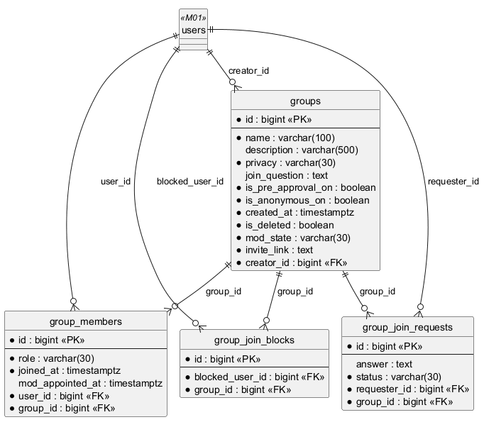

# Thiết kế cơ sở dữ liệu — M11 Group

<!-- [Vietnamese Doc] Tài liệu tiếng Việt; tên bảng, cột, kiểu viết tiếng Anh. -->

| Mã tài liệu | DB-M11 |
|---|---|
| Dự án | iShare |
| Module | M11 — Group |
| Đầu vào | CD-M11 phiên bản 1.0 |
| Trạng thái | Đã chốt |
| Phiên bản | 1.0 |
| Ngày | 2026-11-22 |
| Tác giả | Phạm Văn Đức |

<!-- Quy ước chung cho mọi bảng dưới đây:
     - Không đổi tên cột, không xóa cột, không đổi số mục: tool đọc bảng theo số mục và tên cột.
     - Ô không có nội dung ghi "—". Mục chưa tới bước làm thì để dòng "(Chưa làm — bước N)".
     - Bảng chỉ sinh từ lớp, cột chỉ sinh từ thuộc tính, khóa ngoại chỉ sinh từ quan hệ (giữ mã R-Mxx-nn).
     - Mục 6 do build_schema.py sinh; không sửa tay.
     - Quy ước dùng (data-model/conventions.md): QU-06, QU-07; QU-08 cách ghép tên khóa ngoại và QU-09 kiểu cột
       (người dùng xác nhận 2026-11-22, DB-M01 Q-01, Q-02). Mọi khóa chính id kiểu bigint (QU-02: long). -->

## 1. Bảng

| Bảng | Từ lớp | Nhóm | Sở hữu | Ghi chú |
|---|---|---|---|---|
| groups | Group | Thực thể | M11 | — |
| group_members | GroupMember | Liên kết | M11 | — |
| group_join_requests | GroupJoinRequest | Thực thể | M11 | — |
| group_join_blocks | GroupJoinBlock | Liên kết | M11 | — |

## 2. Cột

### 2.1 Cột từ thuộc tính

| Bảng | Cột | Kiểu | Null | Duy nhất | Từ thuộc tính | Ghi chú |
|---|---|---|---|---|---|---|
| groups | id | bigint | Không | Có | Group.id | — |
| groups | name | varchar(100) | Không | Không | Group.name | Tối đa 100 ký tự (BR-M11-31); được trùng với nhóm khác (FR-M11-01.10) |
| groups | description | varchar(500) | Có | Không | Group.description | Tối đa 500 ký tự (BR-M11-31) |
| groups | privacy | varchar(30) | Không | Không | Group.privacy | Giá trị: PUBLIC, PRIVATE; Người tạo chọn khi tạo; Owner đổi bất kỳ lúc nào, chế độ mới áp cho thao tác sau thời điểm đổi (BR-M11-15) |
| groups | join_question | text | Có | Không | Group.joinQuestion | Tối đa một câu hỏi mỗi nhóm, mặc định trống (BR-M11-08, BR-M11-31); câu hỏi mới áp cho yêu cầu gửi sau đó (FR-M11-02.07) |
| groups | is_pre_approval_on | boolean | Không | Không | Group.isPreApprovalOn | Mặc định sai (Tắt) (BR-M11-31); giá trị mới dùng cho bài gửi sau thời điểm đổi; tắt không nhả các bài đang chờ (BR-M11-18) |
| groups | is_anonymous_on | boolean | Không | Không | Group.isAnonymousOn | Mặc định sai (Tắt) (BR-M11-31); tắt chỉ chặn chọn ẩn danh cho bài mới (BR-M11-16) |
| groups | created_at | timestamptz | Không | Không | Group.createdAt | Mỗi người tạo tối đa 5 nhóm trong 24 giờ gần nhất, tính cả nhóm đã xóa (BR-M11-03); danh sách nhóm xếp mới nhất trước (BR-M11-35) |
| groups | is_deleted | boolean | Không | Không | Group.isDeleted | Mới tạo là sai (Hoạt động); đúng (Đã xóa) là trạng thái cuối; xóa mềm, dữ liệu được giữ (BR-M11-23) |
| groups | mod_state | varchar(30) | Không | Không | Group.modState | Giá trị: NORMAL, LOCKED, HIDDEN; Mới tạo là NORMAL (FR-M11-01.01); M08 quyết trong vụ báo cáo; HIDDEN là trạng thái cuối, không bỏ ẩn (FR-M08-18.03, BR-M08-50, BR-M11-27); nhóm LOCKED có thể bị ẩn ở vụ sau (FR-M08-18.08) |
| groups | invite_link | text | Không | Có | Group.inviteLink | Duy nhất; một link chung mỗi nhóm, không hết hạn, không thu hồi, không tạo lại (BR-M11-12) |
| groups | is_instant_join | boolean | Không | Không | Group.isInstantJoin | Đúng khi privacy = PUBLIC và joinQuestion trống (TN:Nhóm vào ngay, BR-M11-07); Dẫn xuất ở CD: xét ở bước 5 |
| group_members | id | bigint | Không | Có | GroupMember.id | — |
| group_members | role | varchar(30) | Không | Không | GroupMember.role | Giá trị: OWNER, GROUP_MOD, MEMBER; Thứ bậc MEMBER < GROUP_MOD < OWNER (BR-M11-05); mỗi nhóm đúng một OWNER (BR-M11-04); khác User.role |
| group_members | joined_at | timestamptz | Không | Không | GroupMember.joinedAt | Lúc vào ngay, lúc yêu cầu được chấp nhận, hoặc lúc tạo nhóm với Owner đầu tiên (TN:Thời điểm tham gia); dùng chọn Owner thay thế (BR-M11-26) |
| group_members | mod_appointed_at | timestamptz | Có | Không | GroupMember.modAppointedAt | Chỉ có khi role = GROUP_MOD; ghi mỗi lần bổ nhiệm, thâm niên tính từ lần gần nhất (BR-M11-26, FR-M11-11.06) |
| group_join_requests | id | bigint | Không | Có | GroupJoinRequest.id | — |
| group_join_requests | answer | text | Có | Không | GroupJoinRequest.answer | Chỉ có và không được trống khi nhóm có câu hỏi tham gia (BR-M11-08, FR-M11-04.08) |
| group_join_requests | status | varchar(30) | Không | Không | GroupJoinRequest.status | Giá trị: PENDING, APPROVED, REJECTED, WITHDRAWN; Mới gửi là PENDING; mỗi người nhiều nhất một yêu cầu PENDING cho mỗi nhóm (BR-M11-09); không xóa |
| group_join_blocks | id | bigint | Không | Có | GroupJoinBlock.id | — |

### 2.2 Thuộc tính đối tượng không chuyển

| Lớp | Thuộc tính | Kiểu | Lý do không chuyển |
|---|---|---|---|
| Group | creator | User | Thuộc tính đối tượng; được thay bằng khóa ngoại groups.creator_id ở bước 4 (R-M11-01) |
| GroupMember | user | User | Thuộc tính đối tượng; được thay bằng khóa ngoại group_members.user_id ở bước 4 (R-M11-02) |
| Group | members | List<GroupMember> | Thuộc tính đối tượng; được thay bằng khóa ngoại group_members.group_id ở bước 4 (R-M11-03) |
| GroupJoinBlock | blockedUser | User | Thuộc tính đối tượng; được thay bằng khóa ngoại group_join_blocks.blocked_user_id ở bước 4 (R-M11-04) |
| Group | joinBlocks | List<GroupJoinBlock> | Thuộc tính đối tượng; được thay bằng khóa ngoại group_join_blocks.group_id ở bước 4 (R-M11-05) |
| GroupJoinRequest | requester | User | Thuộc tính đối tượng; được thay bằng khóa ngoại group_join_requests.requester_id ở bước 4 (R-M11-06) |
| Group | joinRequests | List<GroupJoinRequest> | Thuộc tính đối tượng; được thay bằng khóa ngoại group_join_requests.group_id ở bước 4 (R-M11-07) |
| Group | posts | List<Post> | Thuộc tính đối tượng; được thay bằng khóa ngoại posts.group_id đặt ở bảng của module khác, ghi thành đề nghị ở mục 7.2 (R-M11-08) |

## 3. Quan hệ giữa các bảng

"Dạng" đọc theo thứ tự Bảng A – Bảng B; quan hệ 1-n viết bảng phía 1 ở cột Bảng A.

| ID | Bảng A | Bảng B | Dạng | Xử lý | Ghi chú |
|---|---|---|---|---|---|
| R-M11-01 | users | groups | 1-n | Tách riêng | — |
| R-M11-02 | users | group_members | 1-n | Tách riêng | — |
| R-M11-03 | groups | group_members | 1-n | Tách riêng | — |
| R-M11-04 | users | group_join_blocks | 1-n | Tách riêng | — |
| R-M11-05 | groups | group_join_blocks | 1-n | Tách riêng | — |
| R-M11-06 | users | group_join_requests | 1-n | Tách riêng | — |
| R-M11-07 | groups | group_join_requests | 1-n | Tách riêng | — |
| R-M11-08 | groups | posts | 1-n | Tách riêng | Bảng phía n posts thuộc M03: khóa ngoại đề nghị ở mục 7.2 |
| R-M11-09 | group_members | posts | 1-n | Tách riêng | Bảng phía n posts thuộc M03: khóa ngoại đề nghị ở mục 7.2 |

Không có quan hệ n-n.

## 4. Khóa

### 4.1 Khóa chính

| Bảng | Khóa chính | Ghi chú |
|---|---|---|
| groups | id | — |
| group_members | id | — |
| group_join_requests | id | — |
| group_join_blocks | id | — |

### 4.2 Khóa ngoại

| Bảng | Cột | Kiểu | Null | Duy nhất | Tham chiếu | Từ quan hệ | Ghi chú |
|---|---|---|---|---|---|---|---|
| groups | creator_id | bigint | Không | Không | users(id) | R-M11-01 | 1 users – n groups |
| group_members | user_id | bigint | Không | Không | users(id) | R-M11-02 | 1 users – n group_members |
| group_members | group_id | bigint | Không | Không | groups(id) | R-M11-03 | 1 groups – n group_members |
| group_join_blocks | blocked_user_id | bigint | Không | Không | users(id) | R-M11-04 | 1 users – n group_join_blocks |
| group_join_blocks | group_id | bigint | Không | Không | groups(id) | R-M11-05 | 1 groups – n group_join_blocks |
| group_join_requests | requester_id | bigint | Không | Không | users(id) | R-M11-06 | 1 users – n group_join_requests |
| group_join_requests | group_id | bigint | Không | Không | groups(id) | R-M11-07 | 1 groups – n group_join_requests |

## 5. Loại dư thừa

### 5.1 Cột bị loại

| Bảng | Cột | Loại dư thừa | Căn cứ | Cách có lại giá trị |
|---|---|---|---|---|
| groups | is_instant_join | Dẫn xuất | Thuộc tính dẫn xuất ở CD-M11; BR-M11-07, TN:Nhóm vào ngay | groups.privacy = PUBLIC và groups.join_question null |

### 5.2 Bảng bị loại

| Bảng | Lý do |
|---|---|
| — | — |

### 5.3 Dẫn xuất nhưng giữ lại

Không có.

| Bảng | Cột | Lý do giữ | Nguồn |
|---|---|---|---|
| — | — | — | — |

### 5.4 Đã xét nhưng không coi là dư thừa

| Bảng | Cột | Vì sao không dư thừa |
|---|---|---|
| group_members | role | Vai trò trong nhóm (GroupRole), khác vai trò hệ thống users.role (UserRole) |

## 6. Lược đồ cuối

### 6.1 Bảng và cột

<!-- BEGIN:SCHEMA -->
| Bảng | Cột | Kiểu | Khóa | Null | Duy nhất | Tham chiếu |
|---|---|---|---|---|---|---|
| groups | id | bigint | PK | Không | Có | — |
| groups | name | varchar(100) | — | Không | Không | — |
| groups | description | varchar(500) | — | Có | Không | — |
| groups | privacy | varchar(30) | — | Không | Không | — |
| groups | join_question | text | — | Có | Không | — |
| groups | is_pre_approval_on | boolean | — | Không | Không | — |
| groups | is_anonymous_on | boolean | — | Không | Không | — |
| groups | created_at | timestamptz | — | Không | Không | — |
| groups | is_deleted | boolean | — | Không | Không | — |
| groups | mod_state | varchar(30) | — | Không | Không | — |
| groups | invite_link | text | — | Không | Có | — |
| groups | creator_id | bigint | FK | Không | Không | users(id) |
| group_members | id | bigint | PK | Không | Có | — |
| group_members | role | varchar(30) | — | Không | Không | — |
| group_members | joined_at | timestamptz | — | Không | Không | — |
| group_members | mod_appointed_at | timestamptz | — | Có | Không | — |
| group_members | user_id | bigint | FK | Không | Không | users(id) |
| group_members | group_id | bigint | FK | Không | Không | groups(id) |
| group_join_requests | id | bigint | PK | Không | Có | — |
| group_join_requests | answer | text | — | Có | Không | — |
| group_join_requests | status | varchar(30) | — | Không | Không | — |
| group_join_requests | requester_id | bigint | FK | Không | Không | users(id) |
| group_join_requests | group_id | bigint | FK | Không | Không | groups(id) |
| group_join_blocks | id | bigint | PK | Không | Có | — |
| group_join_blocks | blocked_user_id | bigint | FK | Không | Không | users(id) |
| group_join_blocks | group_id | bigint | FK | Không | Không | groups(id) |
<!-- END:SCHEMA -->

### 6.2 Sơ đồ quan hệ

<!-- BEGIN:DIAGRAM -->

Mã nguồn sơ đồ: [diagrams/DB-M11.puml](diagrams/DB-M11.puml). Ảnh và tệp .puml do `build_schema.py` sinh từ các bảng của tài liệu này; muốn đổi sơ đồ thì sửa bảng rồi chạy lại tool, không sửa tay.
<!-- END:DIAGRAM -->

## 7. Liên module

### 7.1 Bảng của module khác được tham chiếu

| Bảng ngoài | Module sở hữu | Dùng thế nào |
|---|---|---|
| users | M01 | Người tạo nhóm (R-M11-01), thành viên nhóm (R-M11-02), người bị chặn (R-M11-04), người gửi yêu cầu tham gia (R-M11-06). Đọc role (Admin, Mod), status (kích hoạt kế nhiệm Owner), displayName (danh sách thành viên) |
| posts | M03 | Bài nhóm (R-M11-08, trùng R-M03-06); người đang giữ bài trong hàng chờ duyệt của nhóm (R-M11-09). Ghi publishState và rejectionReason theo cổng duyệt của nhóm |
| comments | M04 | Đặt dấu bị gỡ khỏi nhóm khi Owner, Group Mod gỡ bình luận; không có quan hệ với lớp nào của M11 |

### 7.2 Khóa ngoại đề nghị cho bảng của module khác

<!-- Khi bảng của module khác là phía n của một quan hệ với bảng của module này. -->

| Bảng của module khác | Cột | Kiểu | Tham chiếu | Từ quan hệ |
|---|---|---|---|---|
| posts | group_id | bigint | groups(id) | R-M11-08 |
| posts | group_holder_id | bigint | group_members(id) | R-M11-09 |

## 8. Quyết định thiết kế

| Mã | Quyết định | Lý do |
|---|---|---|
| — | — | — |

## 9. Câu hỏi và điểm chưa chốt

| Mã | Loại | Câu hỏi | Trả lời | Ghi vào |
|---|---|---|---|---|
| — | — | — | — | — |

## 10. Lịch sử sửa đổi

| Phiên bản | Ngày | Nội dung | Người sửa |
|---|---|---|---|
| 0.1 | 2026-11-20 | Tạo mới từ CD-M11 v1.0; làm liền bước 1–5 theo yêu cầu của người dùng (không dừng ở cổng); chưa qua duyệt, câu hỏi ở mục 9 chờ trả lời | Phạm Văn Đức |
| 0.2 | 2026-11-22 | Soát lại các cột dẫn xuất bị loại theo tiêu chí của người dùng (2026-11-22), không đổi; chờ chốt | Phạm Văn Đức |
| 1.0 | 2026-11-22 | Chốt: người dùng chốt DB-M11 | Phạm Văn Đức |
