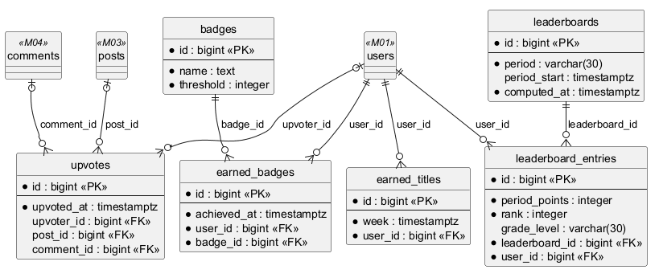

# Thiết kế cơ sở dữ liệu — M12 Gamification

<!-- [Vietnamese Doc] Tài liệu tiếng Việt; tên bảng, cột, kiểu viết tiếng Anh. -->

| Mã tài liệu | DB-M12 |
|---|---|
| Dự án | iShare |
| Module | M12 — Gamification |
| Đầu vào | CD-M12 phiên bản 1.0 |
| Trạng thái | Đã chốt |
| Phiên bản | 1.0 |
| Ngày | 2026-11-22 |
| Tác giả | Phạm Văn Đức |

<!-- Quy ước chung cho mọi bảng dưới đây:
     - Không đổi tên cột, không xóa cột, không đổi số mục: tool đọc bảng theo số mục và tên cột.
     - Ô không có nội dung ghi "—". Mục chưa tới bước làm thì để dòng "(Chưa làm — bước N)".
     - Bảng chỉ sinh từ lớp, cột chỉ sinh từ thuộc tính, khóa ngoại chỉ sinh từ quan hệ (giữ mã R-Mxx-nn).
     - Mục 6 do build_schema.py sinh; không sửa tay.
     - Quy ước dùng (data-model/conventions.md): QU-06, QU-07; QU-08 cách ghép tên khóa ngoại và QU-09 kiểu cột
       (người dùng xác nhận 2026-11-22, DB-M01 Q-01, Q-02). Mọi khóa chính id kiểu bigint (QU-02: long). -->

## 1. Bảng

| Bảng | Từ lớp | Nhóm | Sở hữu | Ghi chú |
|---|---|---|---|---|
| upvotes | Upvote | Thực thể | M12 | — |
| badges | Badge | Thực thể | M12 | — |
| earned_badges | EarnedBadge | Liên kết | M12 | — |
| earned_titles | EarnedTitle | Thực thể | M12 | — |
| leaderboards | Leaderboard | Thực thể | M12 | — |
| leaderboard_entries | LeaderboardEntry | Liên kết | M12 | — |

## 2. Cột

### 2.1 Cột từ thuộc tính

| Bảng | Cột | Kiểu | Null | Duy nhất | Từ thuộc tính | Ghi chú |
|---|---|---|---|---|---|---|
| upvotes | id | bigint | Không | Có | Upvote.id | — |
| upvotes | upvoted_at | timestamptz | Không | Không | Upvote.upvotedAt | Lúc người dùng bấm upvote và upvote có hiệu lực (TN:Thời điểm upvote); xếp upvote vào chu kỳ theo giờ Việt Nam (BR-M12-14) |
| badges | id | bigint | Không | Có | Badge.id | — |
| badges | name | text | Không | Không | Badge.name | Một trong năm tên cố định: Người mới nổi, Cây bút triển vọng, Cây bút tích cực, Chuyên gia cộng đồng, Huyền thoại iShare (BR-M12-11); chỉ đổi bằng triển khai (BR-M12-06) |
| badges | threshold | integer | Không | Không | Badge.threshold | 25, 100, 300, 600, 1000 theo thứ tự tên (BR-M12-11); không hiển thị cùng huy hiệu (BR-M12-12) |
| earned_badges | id | bigint | Không | Có | EarnedBadge.id | — |
| earned_badges | achieved_at | timestamptz | Không | Không | EarnedBadge.achievedAt | Thời điểm đạt đầu tiên, không đổi; hồ sơ hiện ngày đạt theo giờ Việt Nam; huy hiệu không thu hồi, không trao lại (BR-M12-12) |
| earned_titles | id | bigint | Không | Có | EarnedTitle.id | — |
| earned_titles | week | timestamptz | Không | Không | EarnedTitle.week | Mốc 00:00 thứ Hai đầu tuần lịch theo giờ Việt Nam, lưu UTC (tuần từ 00:00 thứ Hai đến trước 00:00 thứ Hai tuần sau, BR-M12-14); mỗi người mỗi tuần một bản ghi (BR-M12-24) |
| leaderboards | id | bigint | Không | Có | Leaderboard.id | — |
| leaderboards | period | varchar(30) | Không | Có | Leaderboard.period | Giá trị: WEEK, MONTH, ALL_TIME; Duy nhất: mỗi loại chu kỳ một kết quả hiện hành (mục Dữ liệu nghiệp vụ); không có chu kỳ năm (FR-M12-04.05) |
| leaderboards | period_start | timestamptz | Có | Không | Leaderboard.periodStart | Mốc 00:00 ngày đầu của tuần (thứ Hai) hoặc tháng (ngày 1) đã chốt theo giờ Việt Nam, lưu UTC; không có với ALL_TIME |
| leaderboards | computed_at | timestamptz | Không | Không | Leaderboard.computedAt | ALL_TIME tính lại mỗi 60 phút; WEEK, MONTH tính một lần khi chốt, trễ tối đa 60 phút sau mốc cuối (BR-M12-19, BR-M12-25) |
| leaderboard_entries | id | bigint | Không | Có | LeaderboardEntry.id | — |
| leaderboard_entries | period_points | integer | Không | Không | LeaderboardEntry.periodPoints | > 0; điểm theo trọng số BR-M12-05 từ upvote có thời điểm trong chu kỳ, còn hiệu lực lúc tính, trên nội dung chưa bị trừ điểm (BR-M12-15); ALL_TIME dùng tổng điểm (FR-M12-04.04) |
| leaderboard_entries | rank | integer | Không | Không | LeaderboardEntry.rank | ≥ 1; cùng điểm đồng hạng, người kế tiếp nhận hạng = số người đứng trên + 1 (BR-M12-18) |
| leaderboard_entries | grade_level | varchar(30) | Có | Không | LeaderboardEntry.gradeLevel | Giá trị: GRADE_10, GRADE_11, GRADE_12; Chụp từ hồ sơ lúc chốt, với ALL_TIME lúc tính gần nhất; trống khi hồ sơ chưa đặt (BR-M12-16) |
| leaderboard_entries | is_weekly_star | boolean | Không | Không | LeaderboardEntry.isWeeklyStar | Đúng khi dòng thuộc kết quả WEEK và rank từ 1 đến 3 (BR-M12-23); Dẫn xuất ở CD: xét ở bước 5 |

### 2.2 Thuộc tính đối tượng không chuyển

| Lớp | Thuộc tính | Kiểu | Lý do không chuyển |
|---|---|---|---|
| Upvote | upvoter | User | Thuộc tính đối tượng; được thay bằng khóa ngoại upvotes.upvoter_id ở bước 4 (R-M12-01) |
| EarnedBadge | badge | Badge | Thuộc tính đối tượng; được thay bằng khóa ngoại earned_badges.badge_id ở bước 4 (R-M12-05) |
| EarnedTitle | user | User | Thuộc tính đối tượng; được thay bằng khóa ngoại earned_titles.user_id ở bước 4 (R-M12-06) |
| Leaderboard | entries | List<LeaderboardEntry> | Thuộc tính đối tượng; được thay bằng khóa ngoại leaderboard_entries.leaderboard_id ở bước 4 (R-M12-07) |
| LeaderboardEntry | user | User | Thuộc tính đối tượng; được thay bằng khóa ngoại leaderboard_entries.user_id ở bước 4 (R-M12-08) |

## 3. Quan hệ giữa các bảng

"Dạng" đọc theo thứ tự Bảng A – Bảng B; quan hệ 1-n viết bảng phía 1 ở cột Bảng A.

| ID | Bảng A | Bảng B | Dạng | Xử lý | Ghi chú |
|---|---|---|---|---|---|
| R-M12-01 | users | upvotes | 1-n | Tách riêng | — |
| R-M12-02 | posts | upvotes | 1-n | Tách riêng | — |
| R-M12-03 | comments | upvotes | 1-n | Tách riêng | — |
| R-M12-04 | users | earned_badges | 1-n | Tách riêng | — |
| R-M12-05 | badges | earned_badges | 1-n | Tách riêng | — |
| R-M12-06 | users | earned_titles | 1-n | Tách riêng | — |
| R-M12-07 | leaderboards | leaderboard_entries | 1-n | Tách riêng | — |
| R-M12-08 | users | leaderboard_entries | 1-n | Tách riêng | — |

Không có quan hệ n-n.

## 4. Khóa

### 4.1 Khóa chính

| Bảng | Khóa chính | Ghi chú |
|---|---|---|
| upvotes | id | — |
| badges | id | — |
| earned_badges | id | — |
| earned_titles | id | — |
| leaderboards | id | — |
| leaderboard_entries | id | — |

### 4.2 Khóa ngoại

| Bảng | Cột | Kiểu | Null | Duy nhất | Tham chiếu | Từ quan hệ | Ghi chú |
|---|---|---|---|---|---|---|---|
| upvotes | upvoter_id | bigint | Có | Không | users(id) | R-M12-01 | 1 users – n upvotes |
| upvotes | post_id | bigint | Có | Không | posts(id) | R-M12-02 | 1 posts – n upvotes |
| upvotes | comment_id | bigint | Có | Không | comments(id) | R-M12-03 | 1 comments – n upvotes |
| earned_badges | user_id | bigint | Không | Không | users(id) | R-M12-04 | 1 users – n earned_badges |
| earned_badges | badge_id | bigint | Không | Không | badges(id) | R-M12-05 | 1 badges – n earned_badges |
| earned_titles | user_id | bigint | Không | Không | users(id) | R-M12-06 | 1 users – n earned_titles |
| leaderboard_entries | leaderboard_id | bigint | Không | Không | leaderboards(id) | R-M12-07 | 1 leaderboards – n leaderboard_entries; Các dòng mất khi kết quả mới thay kết quả cũ (FR-M12-04.14) |
| leaderboard_entries | user_id | bigint | Không | Không | users(id) | R-M12-08 | 1 users – n leaderboard_entries |

## 5. Loại dư thừa

### 5.1 Cột bị loại

| Bảng | Cột | Loại dư thừa | Căn cứ | Cách có lại giá trị |
|---|---|---|---|---|
| leaderboard_entries | is_weekly_star | Dẫn xuất | Thuộc tính dẫn xuất ở CD-M12; BR-M12-23 | leaderboards.period = WEEK (qua leaderboard_entries.leaderboard_id) và leaderboard_entries.rank từ 1 đến 3 |

### 5.2 Bảng bị loại

| Bảng | Lý do |
|---|---|
| — | — |

### 5.3 Dẫn xuất nhưng giữ lại

Không có.

| Bảng | Cột | Lý do giữ | Nguồn |
|---|---|---|---|
| — | — | — | — |

### 5.4 Đã xét nhưng không coi là dư thừa

| Bảng | Cột | Vì sao không dư thừa |
|---|---|---|
| leaderboard_entries | period_points, rank | CD ghi Lưu: kết quả của lần chốt hoặc lần tính định kỳ (BR-M12-15, BR-M12-18, FR-M12-04.14); upvote và tình trạng tài khoản đổi về sau nên không tính lại được bảng đã chốt |
| leaderboard_entries | grade_level | Bản chụp Lớp/Khối lúc chốt, với ALL_TIME lúc tính gần nhất (BR-M12-16); profiles.grade_level có thể đổi sau đó |
| earned_titles | week | Tuần nhận danh hiệu, giữ vĩnh viễn; leaderboards chỉ giữ kết quả hiện hành (FR-M12-04.14) nên không suy ra được |

## 6. Lược đồ cuối

### 6.1 Bảng và cột

<!-- BEGIN:SCHEMA -->
| Bảng | Cột | Kiểu | Khóa | Null | Duy nhất | Tham chiếu |
|---|---|---|---|---|---|---|
| upvotes | id | bigint | PK | Không | Có | — |
| upvotes | upvoted_at | timestamptz | — | Không | Không | — |
| upvotes | upvoter_id | bigint | FK | Có | Không | users(id) |
| upvotes | post_id | bigint | FK | Có | Không | posts(id) |
| upvotes | comment_id | bigint | FK | Có | Không | comments(id) |
| badges | id | bigint | PK | Không | Có | — |
| badges | name | text | — | Không | Không | — |
| badges | threshold | integer | — | Không | Không | — |
| earned_badges | id | bigint | PK | Không | Có | — |
| earned_badges | achieved_at | timestamptz | — | Không | Không | — |
| earned_badges | user_id | bigint | FK | Không | Không | users(id) |
| earned_badges | badge_id | bigint | FK | Không | Không | badges(id) |
| earned_titles | id | bigint | PK | Không | Có | — |
| earned_titles | week | timestamptz | — | Không | Không | — |
| earned_titles | user_id | bigint | FK | Không | Không | users(id) |
| leaderboards | id | bigint | PK | Không | Có | — |
| leaderboards | period | varchar(30) | — | Không | Có | — |
| leaderboards | period_start | timestamptz | — | Có | Không | — |
| leaderboards | computed_at | timestamptz | — | Không | Không | — |
| leaderboard_entries | id | bigint | PK | Không | Có | — |
| leaderboard_entries | period_points | integer | — | Không | Không | — |
| leaderboard_entries | rank | integer | — | Không | Không | — |
| leaderboard_entries | grade_level | varchar(30) | — | Có | Không | — |
| leaderboard_entries | leaderboard_id | bigint | FK | Không | Không | leaderboards(id) |
| leaderboard_entries | user_id | bigint | FK | Không | Không | users(id) |
<!-- END:SCHEMA -->

### 6.2 Sơ đồ quan hệ

<!-- BEGIN:DIAGRAM -->

Mã nguồn sơ đồ: [diagrams/DB-M12.puml](diagrams/DB-M12.puml). Ảnh và tệp .puml do `build_schema.py` sinh từ các bảng của tài liệu này; muốn đổi sơ đồ thì sửa bảng rồi chạy lại tool, không sửa tay.
<!-- END:DIAGRAM -->

## 7. Liên module

### 7.1 Bảng của module khác được tham chiếu

| Bảng ngoài | Module sở hữu | Dùng thế nào |
|---|---|---|
| users | M01 | Người upvote (R-M12-01, trùng R-M01-16), người đạt huy hiệu (R-M12-04), người nhận danh hiệu (R-M12-06), người được xếp hạng (R-M12-08). Đọc role, status, username, displayName; ghi totalPoints |
| posts | M03 | Bài viết nhận upvote (R-M12-02). Đọc lockLevel, isPubliclyVisible, modState, isPermanentlyDeleted để chặn upvote và trừ điểm; ghi isPointsDeducted, deductedPoints |
| comments | M04 | Bình luận nhận upvote (R-M12-03, trùng R-M04-05). Đọc modState, isDeleted, isVisible; ghi isPointsDeducted |
| profiles | M02 | Đọc gradeLevel (chụp vào dòng bảng xếp hạng) và avatar (hiển thị); không có quan hệ với lớp nào của M12 |
| user_warning_statuses | M08 | Đọc level để loại người ở HEAVY khỏi bảng xếp hạng và việc trao danh hiệu; không có quan hệ với lớp nào của M12 |

### 7.2 Khóa ngoại đề nghị cho bảng của module khác

<!-- Khi bảng của module khác là phía n của một quan hệ với bảng của module này. -->

| Bảng của module khác | Cột | Kiểu | Tham chiếu | Từ quan hệ |
|---|---|---|---|---|
| — | — | — | — | — |

## 8. Quyết định thiết kế

| Mã | Quyết định | Lý do |
|---|---|---|
| — | — | — |

## 9. Câu hỏi và điểm chưa chốt

| Mã | Loại | Câu hỏi | Trả lời | Ghi vào |
|---|---|---|---|---|
| — | — | — | — | — |

## 10. Lịch sử sửa đổi

| Phiên bản | Ngày | Nội dung | Người sửa |
|---|---|---|---|
| 0.1 | 2026-11-20 | Tạo mới từ CD-M12 v1.0; làm liền bước 1–5 theo yêu cầu của người dùng (không dừng ở cổng); chưa qua duyệt, câu hỏi ở mục 9 chờ trả lời | Phạm Văn Đức |
| 0.2 | 2026-11-22 | Soát lại các cột dẫn xuất bị loại theo tiêu chí của người dùng (2026-11-22), không đổi; chờ chốt | Phạm Văn Đức |
| 1.0 | 2026-11-22 | Chốt: người dùng chốt DB-M12 | Phạm Văn Đức |
