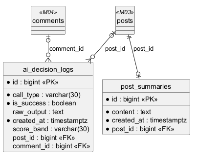

# Thiết kế cơ sở dữ liệu — M13 AI Layer

<!-- [Vietnamese Doc] Tài liệu tiếng Việt; tên bảng, cột, kiểu viết tiếng Anh. -->

| Mã tài liệu | DB-M13 |
|---|---|
| Dự án | iShare |
| Module | M13 — AI Layer |
| Đầu vào | CD-M13 phiên bản 1.0 |
| Trạng thái | Đã chốt |
| Phiên bản | 1.0 |
| Ngày | 2026-11-22 |
| Tác giả | Phạm Văn Đức |

<!-- Quy ước chung cho mọi bảng dưới đây:
     - Không đổi tên cột, không xóa cột, không đổi số mục: tool đọc bảng theo số mục và tên cột.
     - Ô không có nội dung ghi "—". Mục chưa tới bước làm thì để dòng "(Chưa làm — bước N)".
     - Bảng chỉ sinh từ lớp, cột chỉ sinh từ thuộc tính, khóa ngoại chỉ sinh từ quan hệ (giữ mã R-Mxx-nn).
     - Mục 6 do build_schema.py sinh; không sửa tay.
     - Quy ước dùng (data-model/conventions.md): QU-06, QU-07; QU-08 cách ghép tên khóa ngoại và QU-09 kiểu cột
       (người dùng xác nhận 2026-11-22, DB-M01 Q-01, Q-02). Mọi khóa chính id kiểu bigint (QU-02: long). -->

## 1. Bảng

| Bảng | Từ lớp | Nhóm | Sở hữu | Ghi chú |
|---|---|---|---|---|
| ai_decision_logs | AiDecisionLog | Thực thể | M13 | — |
| post_summaries | PostSummary | Thực thể | M13 | — |
| topic_suggestion_stats | TopicSuggestionStat | Thống kê | M13 | Lớp thống kê: các cột được xét loại ở bước 5 |

## 2. Cột

### 2.1 Cột từ thuộc tính

| Bảng | Cột | Kiểu | Null | Duy nhất | Từ thuộc tính | Ghi chú |
|---|---|---|---|---|---|---|
| ai_decision_logs | id | bigint | Không | Có | AiDecisionLog.id | — |
| ai_decision_logs | call_type | varchar(30) | Không | Không | AiDecisionLog.callType | Giá trị: MODERATION_SCAN, POST_EMBEDDING, TOPIC_SUGGESTION; Không có tóm tắt và embedding truy vấn (FR-M13-08.05) |
| ai_decision_logs | is_success | boolean | Không | Không | AiDecisionLog.isSuccess | Đúng khi một trong hai lần thử có kết quả, sai khi cả hai lần lỗi (BR-M13-21) |
| ai_decision_logs | raw_output | text | Có | Không | AiDecisionLog.rawOutput | Kết quả dịch vụ AI trả về, giữ nguyên dạng JSON chưa xử lý (TN:Đầu ra thô); chỉ có khi lời gọi có kết quả (FR-M13-08.02); không sửa, không xóa (BR-M13-22) |
| ai_decision_logs | created_at | timestamptz | Không | Không | AiDecisionLog.createdAt | Không sửa, không xóa (BR-M13-22) |
| ai_decision_logs | scan_score | double precision | Có | Không | AiDecisionLog.scanScore | 0 đến 1; = điểm cao nhất trong bốn điểm nhóm vi phạm của rawOutput (BR-M13-12); chỉ có ở lời gọi chấm điểm kiểm duyệt thành công; Dẫn xuất ở CD: xét ở bước 5 |
| ai_decision_logs | violation_category | varchar(30) | Có | Không | AiDecisionLog.violationCategory | Giá trị: HARASSMENT, HATE, SEXUAL, VIOLENCE; = nhóm có điểm quét; nhiều nhóm cùng điểm cao nhất thì lấy nhóm đứng trước theo thứ tự HARASSMENT, HATE, SEXUAL, VIOLENCE (BR-M13-12); chỉ có khi có scanScore; Dẫn xuất ở CD: xét ở bước 5 |
| ai_decision_logs | score_band | varchar(30) | Có | Không | AiDecisionLog.scoreBand | Giá trị: HIGH, SUSPICIOUS, CLEAN; HIGH (≥ 0,9), SUSPICIOUS (0,5 đến < 0,9), CLEAN (< 0,5), một cặp ngưỡng chung cho bài viết, bình luận và mọi tác giả (BR-M13-13); ngưỡng là hằng số chính sách (BR-M13-14); chỉ có khi có scanScore; Dẫn xuất ở CD: xét ở bước 5 |
| post_summaries | id | bigint | Không | Có | PostSummary.id | — |
| post_summaries | content | text | Không | Không | PostSummary.content | Tạo từ tiêu đề và nội dung chữ của bài, không gồm tệp đính kèm và bình chọn (BR-M13-28); kết quả thất bại không được giữ (BR-M13-27) |
| post_summaries | created_at | timestamptz | Không | Không | PostSummary.createdAt | Kết quả bị bỏ khi đủ 24 × 60 phút từ thời điểm này (BR-M13-27) |
| topic_suggestion_stats | period | varchar(30) | Không | Không | TopicSuggestionStat.period | Giá trị: TODAY, LAST_7_DAYS, LAST_30_DAYS, ALL_TIME; Theo giờ Việt Nam (FR-M13-10.02, BR-M13-29); Admin chọn ở bộ lọc của M15 |
| topic_suggestion_stats | suggested_count | integer | Không | Không | TopicSuggestionStat.suggestedCount | ≥ 0; tổng số Topic AI gợi ý trên các phản hồi ghi trong khoảng, kể cả của tài khoản đã xóa (BR-M13-29, BR-M13-23); Dẫn xuất ở CD: xét ở bước 5 |
| topic_suggestion_stats | kept_count | integer | Không | Không | TopicSuggestionStat.keptCount | 0 ≤ keptCount ≤ suggestedCount; số Topic gợi ý có trong Topic tác giả chọn cuối (BR-M13-29); Dẫn xuất ở CD: xét ở bước 5 |
| topic_suggestion_stats | retention_rate | double precision | Có | Không | TopicSuggestionStat.retentionRate | = keptCount ÷ suggestedCount, 0–1; không có giá trị khi khoảng không có phản hồi nào (FR-M13-10.03, BR-M13-29); Dẫn xuất ở CD: xét ở bước 5 |

### 2.2 Thuộc tính đối tượng không chuyển

| Lớp | Thuộc tính | Kiểu | Lý do không chuyển |
|---|---|---|---|
| AiDecisionLog | post | Post | Thuộc tính đối tượng; được thay bằng khóa ngoại ai_decision_logs.post_id ở bước 4 (R-M13-01) |
| AiDecisionLog | comment | Comment | Thuộc tính đối tượng; được thay bằng khóa ngoại ai_decision_logs.comment_id ở bước 4 (R-M13-02) |

## 3. Quan hệ giữa các bảng

"Dạng" đọc theo thứ tự Bảng A – Bảng B; quan hệ 1-n viết bảng phía 1 ở cột Bảng A.

| ID | Bảng A | Bảng B | Dạng | Xử lý | Ghi chú |
|---|---|---|---|---|---|
| R-M13-01 | posts | ai_decision_logs | 1-n | Tách riêng | — |
| R-M13-02 | comments | ai_decision_logs | 1-n | Tách riêng | — |
| R-M13-03 | posts | post_summaries | 1-1 | Tách riêng | Không gộp: posts là bảng của M03. Tách riêng; khóa ngoại ở post_summaries (bên tùy chọn, tạo sau và bị bỏ sau 24 giờ, BR-M13-27): post_id, Duy nhất |

R-M13-04 (TopicSuggestionStat → TopicSuggestionFeedback) (Phụ thuộc) không sinh quan hệ giữa các bảng: lớp phụ thuộc chỉ dùng lớp đích để tính, không giữ đối tượng của nó.

Không có quan hệ n-n.

## 4. Khóa

### 4.1 Khóa chính

| Bảng | Khóa chính | Ghi chú |
|---|---|---|
| ai_decision_logs | id | — |
| post_summaries | id | — |
| topic_suggestion_stats | Không có | Lớp thống kê không có id, không có lớp cha; bảng bị loại ở bước 5 |

### 4.2 Khóa ngoại

| Bảng | Cột | Kiểu | Null | Duy nhất | Tham chiếu | Từ quan hệ | Ghi chú |
|---|---|---|---|---|---|---|---|
| ai_decision_logs | post_id | bigint | Có | Không | posts(id) | R-M13-01 | 1 posts – n ai_decision_logs |
| ai_decision_logs | comment_id | bigint | Có | Không | comments(id) | R-M13-02 | 1 comments – n ai_decision_logs |
| post_summaries | post_id | bigint | Không | Có | posts(id) | R-M13-03 | 1-1 tách riêng: mỗi dòng posts ứng với nhiều nhất một dòng post_summaries; Null = Không vì mỗi bản tóm tắt thuộc đúng một bài (bội số phía bài là 1) |

## 5. Loại dư thừa

### 5.1 Cột bị loại

| Bảng | Cột | Loại dư thừa | Căn cứ | Cách có lại giá trị |
|---|---|---|---|---|
| ai_decision_logs | scan_score | Dẫn xuất | Thuộc tính dẫn xuất ở CD-M13; BR-M13-12; tính lại luôn ra như lúc tạo vì raw_output không sửa, không xóa (BR-M13-22) | Điểm cao nhất trong bốn điểm nhóm vi phạm của ai_decision_logs.raw_output (đầu ra thô, không sửa, không xóa); chỉ có ở lời gọi MODERATION_SCAN thành công |
| ai_decision_logs | violation_category | Dẫn xuất | Thuộc tính dẫn xuất ở CD-M13; BR-M13-12; tính lại luôn ra như lúc tạo vì raw_output không sửa, không xóa (BR-M13-22) | Nhóm có điểm cao nhất trong raw_output; bằng điểm thì lấy nhóm đứng trước theo thứ tự HARASSMENT, HATE, SEXUAL, VIOLENCE |
| topic_suggestion_stats | period | Dẫn xuất | Thuộc tính của lớp thống kê; là tham số khoảng thời gian Admin chọn ở bộ lọc (FR-M13-10.02), không phải dữ liệu nghiệp vụ | Admin chọn ở bộ lọc của M15; dùng làm điều kiện trên topic_suggestion_feedbacks.recorded_at theo giờ Việt Nam |
| topic_suggestion_stats | suggested_count | Dẫn xuất | Thuộc tính của lớp thống kê; BR-M13-29, BR-M13-23 | Đếm suggested_topics của các topic_suggestions có topic_suggestion_feedbacks với recorded_at trong khoảng (bảng của M05; gồm cả của tài khoản đã xóa) |
| topic_suggestion_stats | kept_count | Dẫn xuất | Thuộc tính của lớp thống kê; BR-M13-29 | Trong các phản hồi trên: đếm suggested_topics có topic_id nằm trong chosen_topics của chính phản hồi đó |
| topic_suggestion_stats | retention_rate | Dẫn xuất | Thuộc tính của lớp thống kê; FR-M13-10.03, BR-M13-29 | Số giữ lại ÷ số gợi ý (hai đếm trên); không có giá trị khi khoảng không có phản hồi |

### 5.2 Bảng bị loại

| Bảng | Lý do |
|---|---|
| topic_suggestion_stats | Lớp thống kê không có id, không có lớp cha; sau khi loại cột dẫn xuất không còn cột nào. Số liệu tính trực tiếp mỗi lần xem (FR-M13: "tính lại từ dữ liệu"; BR-M15-05) |

### 5.3 Dẫn xuất nhưng giữ lại

Người dùng quyết giữ theo tiêu chí dẫn xuất (DD-M13-01).

| Bảng | Cột | Lý do giữ | Nguồn |
|---|---|---|---|
| ai_decision_logs | score_band | Khoảng điểm đã dùng lúc AI quyết định. Cặp ngưỡng 0,9 / 0,5 là tạm thời, chỉnh qua triển khai mới (BR-M13-13, BR-M13-14), nên tính lại sau khi chỉnh sẽ ra khác; người xét khiếu nại và đội phát triển đọc nhật ký để biết AI đã quyết gì (BR-M09-15, BR-M13-14) | BR-M13-13, BR-M13-14; DD-M13-01 |

### 5.4 Đã xét nhưng không coi là dư thừa

| Bảng | Cột | Vì sao không dư thừa |
|---|---|---|
| — | — | — |

## 6. Lược đồ cuối

### 6.1 Bảng và cột

<!-- BEGIN:SCHEMA -->
| Bảng | Cột | Kiểu | Khóa | Null | Duy nhất | Tham chiếu |
|---|---|---|---|---|---|---|
| ai_decision_logs | id | bigint | PK | Không | Có | — |
| ai_decision_logs | call_type | varchar(30) | — | Không | Không | — |
| ai_decision_logs | is_success | boolean | — | Không | Không | — |
| ai_decision_logs | raw_output | text | — | Có | Không | — |
| ai_decision_logs | created_at | timestamptz | — | Không | Không | — |
| ai_decision_logs | score_band | varchar(30) | — | Có | Không | — |
| ai_decision_logs | post_id | bigint | FK | Có | Không | posts(id) |
| ai_decision_logs | comment_id | bigint | FK | Có | Không | comments(id) |
| post_summaries | id | bigint | PK | Không | Có | — |
| post_summaries | content | text | — | Không | Không | — |
| post_summaries | created_at | timestamptz | — | Không | Không | — |
| post_summaries | post_id | bigint | FK | Không | Có | posts(id) |
<!-- END:SCHEMA -->

### 6.2 Sơ đồ quan hệ

<!-- BEGIN:DIAGRAM -->

Mã nguồn sơ đồ: [diagrams/DB-M13.puml](diagrams/DB-M13.puml). Ảnh và tệp .puml do `build_schema.py` sinh từ các bảng của tài liệu này; muốn đổi sơ đồ thì sửa bảng rồi chạy lại tool, không sửa tay.
<!-- END:DIAGRAM -->

## 7. Liên module

### 7.1 Bảng của module khác được tham chiếu

| Bảng ngoài | Module sở hữu | Dùng thế nào |
|---|---|---|
| posts | M03 | Bài được quét, tạo embedding, gợi ý Topic, tóm tắt; có bản ghi nhật ký quyết định AI (R-M13-01) và kết quả tóm tắt đang giữ (R-M13-03). Đọc title, contentText, publishState; ghi embedding và needsEmbedding |
| comments | M04 | Bình luận được chấm điểm khi M08 quét luồng; có bản ghi nhật ký quyết định AI (R-M13-02). Đọc content |
| topic_suggestion_feedbacks | M05 | Dữ liệu của lớp thống kê TopicSuggestionStat (R-M13-04). Đọc recordedAt; đọc các Topic gợi ý và Topic chọn cuối qua SuggestedTopic, ChosenTopic của EC-M05 |

### 7.2 Khóa ngoại đề nghị cho bảng của module khác

<!-- Khi bảng của module khác là phía n của một quan hệ với bảng của module này. -->

| Bảng của module khác | Cột | Kiểu | Tham chiếu | Từ quan hệ |
|---|---|---|---|---|
| — | — | — | — | — |

## 8. Quyết định thiết kế

| Mã | Quyết định | Lý do |
|---|---|---|
| DD-M13-01 | Giữ ai_decision_logs.score_band (dẫn xuất nhưng giữ lại); loại scan_score, violation_category | Trả lời Q-01 theo tiêu chí dẫn xuất của người dùng: ngưỡng tạm thời nên khoảng điểm tính lại không đảm bảo như lúc quyết định; điểm và nhóm vi phạm tính từ đầu ra thô không đổi |
| DD-M13-02 | Quan hệ 1-1 posts–post_summaries (R-M13-03) tách riêng; khóa ngoại post_summaries.post_id, Duy nhất, không null; loại bảng topic_suggestion_stats, cột period xếp loại Dẫn xuất | Trả lời Q-02: posts thuộc M03 nên không gộp; số liệu tỷ lệ giữ lại tính trực tiếp mỗi lần xem |

## 9. Câu hỏi và điểm chưa chốt

| Mã | Loại | Câu hỏi | Trả lời | Ghi vào |
|---|---|---|---|---|
| Q-01 | Dẫn xuất cần quyết | ai_decision_logs.score_band tính lại được từ raw_output theo cặp ngưỡng 0,9 / 0,5 (BR-M13-13), nên theo phương pháp bị loại. Nhưng ngưỡng "tạm thời, sẽ chỉnh theo dữ liệu thật" qua triển khai mới (BR-M13-14): sau khi chỉnh, tính lại sẽ ra khoảng theo ngưỡng mới, không phải khoảng đã dùng lúc quyết định. Đề xuất (a) loại: đầu ra thô và hậu quả của quyết định (trạng thái bài, nhật ký kiểm duyệt) vẫn còn. Phương án (b) giữ như bản chụp lúc quyết định: phải sửa CD-M13 (Tính chất → Lưu) rồi ghi ở mục 5.4. Chọn (a)? | Theo tiêu chí của người dùng (2026-11-22): (1) có phải dẫn xuất; (2) tính lại mỗi lần có ra đúng giá trị lúc tạo và các lần sau không đổi: score_band là dẫn xuất (từ raw_output và cặp ngưỡng) nhưng ngưỡng là tạm thời, chỉnh qua triển khai mới (BR-M13-13, BR-M13-14): sau khi chỉnh, tính lại ra khoảng khác khoảng đã dùng lúc quyết định → giữ (mục 5.3). scan_score, violation_category tính từ raw_output không sửa, không xóa (BR-M13-22) theo quy tắc cố định (BR-M13-12) nên luôn ra như lúc tạo → loại; DD-M13-01 | Mục 5.1 hoặc 5.4; DD-M13-nn; có thể sửa CD-M13 |
| Q-02 | Xác nhận | (1) Quan hệ 1-1 Post–PostSummary (R-M13-03): khóa ngoại post_summaries.post_id, Duy nhất, không null (tool báo WARN vì bội số 0..1 ở CD là của phía tóm tắt). (2) Bảng topic_suggestion_stats bị loại; cột period (tham số khoảng thời gian, CD ghi Lưu) xếp loại Dẫn xuất như cột kỳ của lớp thống kê trong case study, vì không phải dữ liệu lưu. Đồng ý? | Đồng ý (người dùng, 2026-11-22). Soát nghiệp vụ: mỗi bài nhiều nhất một bản tóm tắt còn hiệu lực, bị bỏ sau 24 giờ (BR-M13-27); tỷ lệ giữ lại tính lại từ dữ liệu mỗi lần xem (FR-M13 mục Dữ liệu nghiệp vụ, BR-M15-05); DD-M13-02 | Mục 3, 4.2, 5.1, 5.2 |

## 10. Lịch sử sửa đổi

| Phiên bản | Ngày | Nội dung | Người sửa |
|---|---|---|---|
| 0.1 | 2026-11-20 | Tạo mới từ CD-M13 v1.0; làm liền bước 1–5 theo yêu cầu của người dùng (không dừng ở cổng); chưa qua duyệt, câu hỏi ở mục 9 chờ trả lời | Phạm Văn Đức |
| 0.2 | 2026-11-22 | Ghi trả lời mục 9: giữ score_band (DD-M13-01); DD-M13-02; chờ chốt | Phạm Văn Đức |
| 1.0 | 2026-11-22 | Chốt: người dùng chốt DB-M13 | Phạm Văn Đức |
