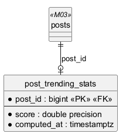

# Thiết kế cơ sở dữ liệu — M14 Feed & Discovery

<!-- [Vietnamese Doc] Tài liệu tiếng Việt; tên bảng, cột, kiểu viết tiếng Anh. -->

| Mã tài liệu | DB-M14 |
|---|---|
| Dự án | iShare |
| Module | M14 — Feed & Discovery |
| Đầu vào | CD-M14 phiên bản 1.0 |
| Trạng thái | Đã chốt |
| Phiên bản | 1.0 |
| Ngày | 2026-11-22 |
| Tác giả | Phạm Văn Đức |

<!-- Quy ước chung cho mọi bảng dưới đây:
     - Không đổi tên cột, không xóa cột, không đổi số mục: tool đọc bảng theo số mục và tên cột.
     - Ô không có nội dung ghi "—". Mục chưa tới bước làm thì để dòng "(Chưa làm — bước N)".
     - Bảng chỉ sinh từ lớp, cột chỉ sinh từ thuộc tính, khóa ngoại chỉ sinh từ quan hệ (giữ mã R-Mxx-nn).
     - Mục 6 do build_schema.py sinh; không sửa tay.
     - Quy ước dùng (data-model/conventions.md): QU-06, QU-07; QU-08 cách ghép tên khóa ngoại và QU-09 kiểu cột
       (người dùng xác nhận 2026-11-22, DB-M01 Q-01, Q-02). Mọi khóa chính id kiểu bigint (QU-02: long). -->

## 1. Bảng

| Bảng | Từ lớp | Nhóm | Sở hữu | Ghi chú |
|---|---|---|---|---|
| post_trending_stats | PostTrendingStat | Thống kê | M14 | Lớp con của Post (kế thừa): không có id riêng, dùng khóa của bảng cha |

## 2. Cột

### 2.1 Cột từ thuộc tính

| Bảng | Cột | Kiểu | Null | Duy nhất | Từ thuộc tính | Ghi chú |
|---|---|---|---|---|---|---|
| post_trending_stats | score | double precision | Không | Không | PostTrendingStat.score | = 0,5^(age / 7) × (1 + 2 × upvoteCount + commentCount + bookmarkCount), số đếm lấy tại lần tính; không tính lượt xem (BR-M14-10); không ngưỡng tối thiểu (BR-M14-12); xếp giảm dần, bằng điểm thì publishedAt sau đứng trước (BR-M14-13); Dẫn xuất ở CD: xét ở bước 5 |
| post_trending_stats | age | double precision | Không | Không | PostTrendingStat.age | 0–28; = (computedAt − publishedAt) tính bằng ngày, 24 giờ là một ngày, giữ phần lẻ (TN:Tuổi bài); bài có age > 28 bị loại (BR-M14-11); Dẫn xuất ở CD: xét ở bước 5 |
| post_trending_stats | computed_at | timestamptz | Không | Không | PostTrendingStat.computedAt | Lần tính cách nhau 15–30 phút (BR-M14-14); một lượt xem tab Trending giữ kết quả của lần tính hiện hành lúc mở tab (BR-M14-19); Dẫn xuất ở CD: xét ở bước 5 |

### 2.2 Thuộc tính đối tượng không chuyển

Không có: lớp của module không có thuộc tính đối tượng.

| Lớp | Thuộc tính | Kiểu | Lý do không chuyển |
|---|---|---|---|
| — | — | — | — |

## 3. Quan hệ giữa các bảng

"Dạng" đọc theo thứ tự Bảng A – Bảng B; quan hệ 1-n viết bảng phía 1 ở cột Bảng A.

| ID | Bảng A | Bảng B | Dạng | Xử lý | Ghi chú |
|---|---|---|---|---|---|
| R-M14-01 | posts | post_trending_stats | 1-1 | Cha–con | Kế thừa: bảng con không có id riêng, dùng khóa của bảng cha |

Không có quan hệ n-n.

## 4. Khóa

### 4.1 Khóa chính

| Bảng | Khóa chính | Ghi chú |
|---|---|---|
| post_trending_stats | post_id | Bảng con: khóa chính là khóa ngoại tới bảng cha |

### 4.2 Khóa ngoại

| Bảng | Cột | Kiểu | Null | Duy nhất | Tham chiếu | Từ quan hệ | Ghi chú |
|---|---|---|---|---|---|---|---|
| post_trending_stats | post_id | bigint | Không | Có | posts(id) | R-M14-01 | Cha–con: cũng là khóa chính của post_trending_stats |

## 5. Loại dư thừa

### 5.1 Cột bị loại

| Bảng | Cột | Loại dư thừa | Căn cứ | Cách có lại giá trị |
|---|---|---|---|---|
| post_trending_stats | age | Dẫn xuất | Thuộc tính dẫn xuất ở CD-M14; TN:Tuổi bài | (post_trending_stats.computed_at − posts.published_at) tính bằng ngày, 24 giờ là một ngày, giữ phần lẻ; posts.published_at không đổi sau lần đăng đầu |

### 5.2 Bảng bị loại

| Bảng | Lý do |
|---|---|
| — | — |

### 5.3 Dẫn xuất nhưng giữ lại

Người dùng quyết giữ theo tiêu chí dẫn xuất (DD-M14-01).

| Bảng | Cột | Lý do giữ | Nguồn |
|---|---|---|---|
| post_trending_stats | score | Kết quả lần tính định kỳ 15–30 phút; giữa hai lần tính dùng kết quả gần nhất (FR-M14-03.04, BR-M14-14); số đếm lấy tại lần tính đổi về sau nên không tính lại được kết quả đã hiển thị | FR-M14-03.04, BR-M14-14; DD-M14-01 |
| post_trending_stats | computed_at | Thời điểm của lần tính, mốc của tuổi bài và của kết quả hiện hành (FR-M14-02.03, BR-M14-19) | FR-M14-02.03, BR-M14-19; DD-M14-01 |

### 5.4 Đã xét nhưng không coi là dư thừa

| Bảng | Cột | Vì sao không dư thừa |
|---|---|---|
| — | — | — |

## 6. Lược đồ cuối

### 6.1 Bảng và cột

<!-- BEGIN:SCHEMA -->
| Bảng | Cột | Kiểu | Khóa | Null | Duy nhất | Tham chiếu |
|---|---|---|---|---|---|---|
| post_trending_stats | score | double precision | — | Không | Không | — |
| post_trending_stats | computed_at | timestamptz | — | Không | Không | — |
| post_trending_stats | post_id | bigint | PK, FK | Không | Có | posts(id) |
<!-- END:SCHEMA -->

### 6.2 Sơ đồ quan hệ

<!-- BEGIN:DIAGRAM -->

Mã nguồn sơ đồ: [diagrams/DB-M14.puml](diagrams/DB-M14.puml). Ảnh và tệp .puml do `build_schema.py` sinh từ các bảng của tài liệu này; muốn đổi sơ đồ thì sửa bảng rồi chạy lại tool, không sửa tay.
<!-- END:DIAGRAM -->

## 7. Liên module

### 7.1 Bảng của module khác được tham chiếu

| Bảng ngoài | Module sở hữu | Dùng thế nào |
|---|---|---|
| posts | M03 | Lớp cha của PostTrendingStat (R-M14-01); nguồn của mọi tab. Đọc isPubliclyVisible, publishedAt, upvoteCount (M12), commentCount (M04), isAnonymous (M11), bookmarkCount |
| users | M01 | Đọc status của tác giả để ẩn bài của tài khoản DEACTIVATED, DELETED; không có quan hệ với lớp nào của M14 |
| groups | M11 | Đọc privacy để chọn bài nhóm cho Trending Post, Following, Group, Newest; không có quan hệ với lớp nào của M14 |
| topic_trending_stats | M05 | Đọc score, rank để hiển thị mục con Trending Topic; không có quan hệ với lớp nào của M14 |
| tag_trending_stats | M05 | Đọc score, rank để hiển thị mục con Trending Tag; không có quan hệ với lớp nào của M14 |

### 7.2 Khóa ngoại đề nghị cho bảng của module khác

<!-- Khi bảng của module khác là phía n của một quan hệ với bảng của module này. -->

| Bảng của module khác | Cột | Kiểu | Tham chiếu | Từ quan hệ |
|---|---|---|---|---|
| — | — | — | — | — |

## 8. Quyết định thiết kế

| Mã | Quyết định | Lý do |
|---|---|---|
| DD-M14-01 | Giữ score, computed_at của post_trending_stats; loại age | Trả lời Q-01 theo tiêu chí dẫn xuất của người dùng: kết quả lần tính định kỳ không tính lại được khi xem (FR-M14-03.04, BR-M14-14); age tính lại từ hai cột không đổi |
| DD-M14-02 | Không đổi lược đồ cho BR-M14-19: post_trending_stats giữ kết quả lần tính gần nhất; kết quả của lần tính mà một lượt xem đang dùng được máy chủ giữ ở bộ nhớ đệm | Trả lời Q-02: bộ nhớ đệm phía ứng dụng là thiết kế vật lý, ngoài phạm vi lược đồ logic |

## 9. Câu hỏi và điểm chưa chốt

| Mã | Loại | Câu hỏi | Trả lời | Ghi vào |
|---|---|---|---|---|
| Q-01 | Dẫn xuất FR yêu cầu lưu | Điểm Trending Post tính định kỳ 15–30 phút, giữa hai lần dùng kết quả gần nhất (FR-M14-03.04, BR-M14-14). Đề xuất (a) giữ score, computed_at của post_trending_stats (mục 5.3); loại age vì tính lại được từ computed_at và posts.published_at. Phương án (b) loại cả bảng, tính khi xem (trái FR-M14-03.04). Chọn (a)? | Theo tiêu chí của người dùng (2026-11-22): (1) có phải dẫn xuất; (2) tính lại mỗi lần có ra đúng giá trị lúc tạo và các lần sau không đổi: score là dẫn xuất nhưng số đếm lấy tại lần tính đổi về sau nên tính khi xem ra khác kết quả lần tính, trái FR-M14-03.04 → giữ; computed_at là thời điểm lần tính, không tính lại được → giữ; age = computed_at − posts.published_at, hai cột không đổi nên luôn ra như lúc tính → loại; DD-M14-01 | Mục 5.1, 5.3; DD-M14-nn |
| Q-02 | Phát hiện | BR-M14-19: một lượt xem tab Trending giữ kết quả của lần tính hiện hành lúc mở tab, kể cả khi đã có lần tính mới. Theo CD-M14, PostTrendingStat kế thừa Post nên mỗi bài chỉ một dòng (khóa post_id): lần tính mới ghi đè lần cũ, nên lượt xem đang mở không còn kết quả cũ trong CSDL. Đề xuất (a) giữ lược đồ, máy chủ giữ danh sách kết quả của lần tính lúc mở tab cho lượt xem đó (bộ nhớ đệm ngoài CSDL, ngoài phạm vi lược đồ logic). Phương án (b) quay lại EC/CD-M14 để kết quả có nhiều lần tính (lớp riêng có id, gắn lần tính). Chọn (a)? | (a) theo ý người dùng (người dùng, 2026-11-22): giữ lược đồ; bảng giữ kết quả lần tính gần nhất, máy chủ giữ danh sách kết quả của lần tính mà mỗi lượt xem đang dùng ở bộ nhớ đệm (BR-M14-19); DD-M14-02 | Mục 9; có thể sửa EC/CD-M14 |

## 10. Lịch sử sửa đổi

| Phiên bản | Ngày | Nội dung | Người sửa |
|---|---|---|---|
| 0.1 | 2026-11-20 | Tạo mới từ CD-M14 v1.0; làm liền bước 1–5 theo yêu cầu của người dùng (không dừng ở cổng); chưa qua duyệt, câu hỏi ở mục 9 chờ trả lời | Phạm Văn Đức |
| 0.2 | 2026-11-22 | Ghi trả lời mục 9: giữ score, computed_at, loại age (DD-M14-01); BR-M14-19 dùng bộ nhớ đệm (DD-M14-02); chờ chốt | Phạm Văn Đức |
| 1.0 | 2026-11-22 | Chốt: người dùng chốt DB-M14 | Phạm Văn Đức |
