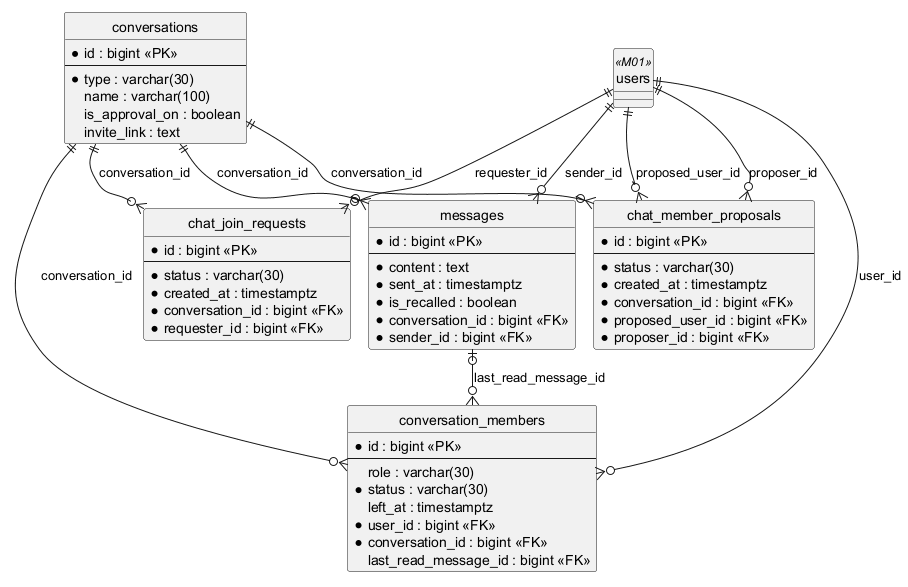

# Thiết kế cơ sở dữ liệu — M16 Chat & Messaging

<!-- [Vietnamese Doc] Tài liệu tiếng Việt; tên bảng, cột, kiểu viết tiếng Anh. -->

| Mã tài liệu | DB-M16 |
|---|---|
| Dự án | iShare |
| Module | M16 — Chat & Messaging |
| Đầu vào | CD-M16 phiên bản 1.0 |
| Trạng thái | Đã chốt |
| Phiên bản | 1.0 |
| Ngày | 2026-11-22 |
| Tác giả | Phạm Văn Đức |

<!-- Quy ước chung cho mọi bảng dưới đây:
     - Không đổi tên cột, không xóa cột, không đổi số mục: tool đọc bảng theo số mục và tên cột.
     - Ô không có nội dung ghi "—". Mục chưa tới bước làm thì để dòng "(Chưa làm — bước N)".
     - Bảng chỉ sinh từ lớp, cột chỉ sinh từ thuộc tính, khóa ngoại chỉ sinh từ quan hệ (giữ mã R-Mxx-nn).
     - Mục 6 do build_schema.py sinh; không sửa tay.
     - Quy ước dùng (data-model/conventions.md): QU-06, QU-07; QU-08 cách ghép tên khóa ngoại và QU-09 kiểu cột
       (người dùng xác nhận 2026-11-22, DB-M01 Q-01, Q-02). Mọi khóa chính id kiểu bigint (QU-02: long). -->

## 1. Bảng

| Bảng | Từ lớp | Nhóm | Sở hữu | Ghi chú |
|---|---|---|---|---|
| conversations | Conversation | Thực thể | M16 | — |
| conversation_members | ConversationMember | Liên kết | M16 | — |
| messages | Message | Thực thể | M16 | — |
| chat_member_proposals | ChatMemberProposal | Thực thể | M16 | — |
| chat_join_requests | ChatJoinRequest | Thực thể | M16 | — |

## 2. Cột

### 2.1 Cột từ thuộc tính

| Bảng | Cột | Kiểu | Null | Duy nhất | Từ thuộc tính | Ghi chú |
|---|---|---|---|---|---|---|
| conversations | id | bigint | Không | Có | Conversation.id | — |
| conversations | type | varchar(30) | Không | Không | Conversation.type | Giá trị: DIRECT, GROUP; DIRECT có đúng 2 thành viên, mỗi cặp người dùng nhiều nhất một cuộc (BR-M16-24) |
| conversations | name | varchar(100) | Có | Không | Conversation.name | Lưu chuỗi đã bỏ khoảng trắng đầu, cuối (BR-M16-32) nên varchar(100) đủ; Chỉ có và bắt buộc ở nhóm chat; 1–100 ký tự sau khi bỏ khoảng trắng đầu, cuối; được trùng với nhóm chat khác (BR-M16-32); mọi thành viên đổi được (BR-M16-05) |
| conversations | is_approval_on | boolean | Có | Không | Conversation.isApprovalOn | Chỉ có ở nhóm chat; sai (Tắt) khi tạo (BR-M16-06); chỉ Admin nhóm chat đổi; hệ thống tự tắt khi Admin nhóm chat không thể khôi phục (BR-M16-30) |
| conversations | invite_link | text | Có | Có | Conversation.inviteLink | Chỉ có ở nhóm chat; duy nhất; một link chung, không hết hạn, không thu hồi, không tạo lại (BR-M16-29) |
| conversation_members | id | bigint | Không | Có | ConversationMember.id | — |
| conversation_members | role | varchar(30) | Có | Không | ConversationMember.role | Giá trị: ADMIN, MEMBER; Chỉ có ở nhóm chat; người tạo là ADMIN đầu tiên; mỗi nhóm chat nhiều nhất một ADMIN (BR-M16-04); chuyển quyền thì đổi vai trò của hai người (BR-M16-07); khác User.role |
| conversation_members | status | varchar(30) | Không | Không | ConversationMember.status | Giá trị: ACTIVE, LEFT, REMOVED; LEFT, REMOVED chỉ ở nhóm chat; vào lại thì về ACTIVE (mục Chuyển trạng thái của FR-M16) |
| conversation_members | left_at | timestamptz | Có | Không | ConversationMember.leftAt | Chỉ có khi LEFT hoặc REMOVED; thành viên cũ chỉ xem tin gửi trước thời điểm này (TN:Thời điểm rời, BR-M16-27) |
| messages | id | bigint | Không | Có | Message.id | — |
| messages | content | text | Không | Không | Message.content | Văn bản thuần, có thể kèm emoji; không trống, không chỉ khoảng trắng; tối đa 1.000 từ (BR-M16-08); không sửa (BR-M16-10); giữ cả khi thu hồi nhưng không hiện (BR-M16-12) |
| messages | sent_at | timestamptz | Không | Không | Message.sentAt | Lúc hệ thống nhận tin; thu hồi được khi chưa quá 5 phút từ thời điểm này (BR-M16-11); mỗi người tối đa 30 tin trong 60 giây ở một cuộc (BR-M16-09) |
| messages | is_recalled | boolean | Không | Không | Message.isRecalled | Mặc định sai (Bình thường); chỉ người gửi đặt, một lần (FR-M16-06.04, FR-M16-06.06); xóa mềm (BR-M16-12) |
| chat_member_proposals | id | bigint | Không | Có | ChatMemberProposal.id | — |
| chat_member_proposals | status | varchar(30) | Không | Không | ChatMemberProposal.status | Giá trị: PENDING, APPROVED, REJECTED; Mới tạo là PENDING; không xóa |
| chat_member_proposals | created_at | timestamptz | Không | Không | ChatMemberProposal.createdAt | Thứ tự chờ tính theo thời điểm này (BR-M16-33) |
| chat_join_requests | id | bigint | Không | Có | ChatJoinRequest.id | — |
| chat_join_requests | status | varchar(30) | Không | Không | ChatJoinRequest.status | Giá trị: PENDING, APPROVED, REJECTED; Mới tạo là PENDING; mỗi người nhiều nhất một yêu cầu PENDING tới một nhóm chat; bị từ chối thì gửi lại ngay được (BR-M16-29); không xóa |
| chat_join_requests | created_at | timestamptz | Không | Không | ChatJoinRequest.createdAt | Thứ tự chờ tính theo thời điểm này (BR-M16-33) |

### 2.2 Thuộc tính đối tượng không chuyển

| Lớp | Thuộc tính | Kiểu | Lý do không chuyển |
|---|---|---|---|
| ConversationMember | user | User | Thuộc tính đối tượng; được thay bằng khóa ngoại conversation_members.user_id ở bước 4 (R-M16-01) |
| Conversation | members | List<ConversationMember> | Thuộc tính đối tượng; được thay bằng khóa ngoại conversation_members.conversation_id ở bước 4 (R-M16-02) |
| Conversation | messages | List<Message> | Thuộc tính đối tượng; được thay bằng khóa ngoại messages.conversation_id ở bước 4 (R-M16-03) |
| Message | sender | User | Thuộc tính đối tượng; được thay bằng khóa ngoại messages.sender_id ở bước 4 (R-M16-04) |
| ConversationMember | lastReadMessage | Message | Thuộc tính đối tượng; được thay bằng khóa ngoại conversation_members.last_read_message_id ở bước 4 (R-M16-05) |
| Conversation | memberProposals | List<ChatMemberProposal> | Thuộc tính đối tượng; được thay bằng khóa ngoại chat_member_proposals.conversation_id ở bước 4 (R-M16-06) |
| ChatMemberProposal | proposedUser | User | Thuộc tính đối tượng; được thay bằng khóa ngoại chat_member_proposals.proposed_user_id ở bước 4 (R-M16-07) |
| ChatMemberProposal | proposer | User | Thuộc tính đối tượng; được thay bằng khóa ngoại chat_member_proposals.proposer_id ở bước 4 (R-M16-08) |
| Conversation | chatJoinRequests | List<ChatJoinRequest> | Thuộc tính đối tượng; được thay bằng khóa ngoại chat_join_requests.conversation_id ở bước 4 (R-M16-09) |
| ChatJoinRequest | requester | User | Thuộc tính đối tượng; được thay bằng khóa ngoại chat_join_requests.requester_id ở bước 4 (R-M16-10) |

## 3. Quan hệ giữa các bảng

"Dạng" đọc theo thứ tự Bảng A – Bảng B; quan hệ 1-n viết bảng phía 1 ở cột Bảng A.

| ID | Bảng A | Bảng B | Dạng | Xử lý | Ghi chú |
|---|---|---|---|---|---|
| R-M16-01 | users | conversation_members | 1-n | Tách riêng | — |
| R-M16-02 | conversations | conversation_members | 1-n | Tách riêng | — |
| R-M16-03 | conversations | messages | 1-n | Tách riêng | — |
| R-M16-04 | users | messages | 1-n | Tách riêng | — |
| R-M16-05 | messages | conversation_members | 1-n | Tách riêng | — |
| R-M16-06 | conversations | chat_member_proposals | 1-n | Tách riêng | — |
| R-M16-07 | users | chat_member_proposals | 1-n | Tách riêng | — |
| R-M16-08 | users | chat_member_proposals | 1-n | Tách riêng | — |
| R-M16-09 | conversations | chat_join_requests | 1-n | Tách riêng | — |
| R-M16-10 | users | chat_join_requests | 1-n | Tách riêng | — |

Không có quan hệ n-n.

## 4. Khóa

### 4.1 Khóa chính

| Bảng | Khóa chính | Ghi chú |
|---|---|---|
| conversations | id | — |
| conversation_members | id | — |
| messages | id | — |
| chat_member_proposals | id | — |
| chat_join_requests | id | — |

### 4.2 Khóa ngoại

| Bảng | Cột | Kiểu | Null | Duy nhất | Tham chiếu | Từ quan hệ | Ghi chú |
|---|---|---|---|---|---|---|---|
| conversation_members | user_id | bigint | Không | Không | users(id) | R-M16-01 | 1 users – n conversation_members |
| conversation_members | conversation_id | bigint | Không | Không | conversations(id) | R-M16-02 | 1 conversations – n conversation_members |
| messages | conversation_id | bigint | Không | Không | conversations(id) | R-M16-03 | 1 conversations – n messages |
| messages | sender_id | bigint | Không | Không | users(id) | R-M16-04 | 1 users – n messages |
| conversation_members | last_read_message_id | bigint | Có | Không | messages(id) | R-M16-05 | 1 messages – n conversation_members |
| chat_member_proposals | conversation_id | bigint | Không | Không | conversations(id) | R-M16-06 | 1 conversations – n chat_member_proposals |
| chat_member_proposals | proposed_user_id | bigint | Không | Không | users(id) | R-M16-07 | 1 users – n chat_member_proposals |
| chat_member_proposals | proposer_id | bigint | Không | Không | users(id) | R-M16-08 | 1 users – n chat_member_proposals |
| chat_join_requests | conversation_id | bigint | Không | Không | conversations(id) | R-M16-09 | 1 conversations – n chat_join_requests |
| chat_join_requests | requester_id | bigint | Không | Không | users(id) | R-M16-10 | 1 users – n chat_join_requests |

## 5. Loại dư thừa

### 5.1 Cột bị loại

| Bảng | Cột | Loại dư thừa | Căn cứ | Cách có lại giá trị |
|---|---|---|---|---|
| — | — | — | — | — |

### 5.2 Bảng bị loại

| Bảng | Lý do |
|---|---|
| — | — |

### 5.3 Dẫn xuất nhưng giữ lại

Không có.

| Bảng | Cột | Lý do giữ | Nguồn |
|---|---|---|---|
| — | — | — | — |

### 5.4 Đã xét nhưng không coi là dư thừa

| Bảng | Cột | Vì sao không dư thừa |
|---|---|---|
| conversation_members | role | Vai trò trong nhóm chat (ChatRole), khác vai trò hệ thống users.role và vai trò trong nhóm group_members.role |

## 6. Lược đồ cuối

### 6.1 Bảng và cột

<!-- BEGIN:SCHEMA -->
| Bảng | Cột | Kiểu | Khóa | Null | Duy nhất | Tham chiếu |
|---|---|---|---|---|---|---|
| conversations | id | bigint | PK | Không | Có | — |
| conversations | type | varchar(30) | — | Không | Không | — |
| conversations | name | varchar(100) | — | Có | Không | — |
| conversations | is_approval_on | boolean | — | Có | Không | — |
| conversations | invite_link | text | — | Có | Có | — |
| conversation_members | id | bigint | PK | Không | Có | — |
| conversation_members | role | varchar(30) | — | Có | Không | — |
| conversation_members | status | varchar(30) | — | Không | Không | — |
| conversation_members | left_at | timestamptz | — | Có | Không | — |
| conversation_members | user_id | bigint | FK | Không | Không | users(id) |
| conversation_members | conversation_id | bigint | FK | Không | Không | conversations(id) |
| conversation_members | last_read_message_id | bigint | FK | Có | Không | messages(id) |
| messages | id | bigint | PK | Không | Có | — |
| messages | content | text | — | Không | Không | — |
| messages | sent_at | timestamptz | — | Không | Không | — |
| messages | is_recalled | boolean | — | Không | Không | — |
| messages | conversation_id | bigint | FK | Không | Không | conversations(id) |
| messages | sender_id | bigint | FK | Không | Không | users(id) |
| chat_member_proposals | id | bigint | PK | Không | Có | — |
| chat_member_proposals | status | varchar(30) | — | Không | Không | — |
| chat_member_proposals | created_at | timestamptz | — | Không | Không | — |
| chat_member_proposals | conversation_id | bigint | FK | Không | Không | conversations(id) |
| chat_member_proposals | proposed_user_id | bigint | FK | Không | Không | users(id) |
| chat_member_proposals | proposer_id | bigint | FK | Không | Không | users(id) |
| chat_join_requests | id | bigint | PK | Không | Có | — |
| chat_join_requests | status | varchar(30) | — | Không | Không | — |
| chat_join_requests | created_at | timestamptz | — | Không | Không | — |
| chat_join_requests | conversation_id | bigint | FK | Không | Không | conversations(id) |
| chat_join_requests | requester_id | bigint | FK | Không | Không | users(id) |
<!-- END:SCHEMA -->

### 6.2 Sơ đồ quan hệ

<!-- BEGIN:DIAGRAM -->

Mã nguồn sơ đồ: [diagrams/DB-M16.puml](diagrams/DB-M16.puml). Ảnh và tệp .puml do `build_schema.py` sinh từ các bảng của tài liệu này; muốn đổi sơ đồ thì sửa bảng rồi chạy lại tool, không sửa tay.
<!-- END:DIAGRAM -->

## 7. Liên module

### 7.1 Bảng của module khác được tham chiếu

| Bảng ngoài | Module sở hữu | Dùng thế nào |
|---|---|---|
| users | M01 | Thành viên cuộc trò chuyện (R-M16-01), người gửi tin (R-M16-04), người được đề nghị và người đề nghị (R-M16-07, R-M16-08), người xin gia nhập (R-M16-10). Đọc status, role, displayName |
| profiles | M02 | Đọc avatar để hiển thị; không có quan hệ với lớp nào của M16 |

### 7.2 Khóa ngoại đề nghị cho bảng của module khác

<!-- Khi bảng của module khác là phía n của một quan hệ với bảng của module này. -->

| Bảng của module khác | Cột | Kiểu | Tham chiếu | Từ quan hệ |
|---|---|---|---|---|
| — | — | — | — | — |

## 8. Quyết định thiết kế

| Mã | Quyết định | Lý do |
|---|---|---|
| — | — | — |

## 9. Câu hỏi và điểm chưa chốt

| Mã | Loại | Câu hỏi | Trả lời | Ghi vào |
|---|---|---|---|---|
| — | — | — | — | — |

## 10. Lịch sử sửa đổi

| Phiên bản | Ngày | Nội dung | Người sửa |
|---|---|---|---|
| 0.1 | 2026-11-20 | Tạo mới từ CD-M16 v1.0; làm liền bước 1–5 theo yêu cầu của người dùng (không dừng ở cổng); chưa qua duyệt, câu hỏi ở mục 9 chờ trả lời | Phạm Văn Đức |
| 0.2 | 2026-11-22 | Không có câu hỏi; chờ chốt | Phạm Văn Đức |
| 1.0 | 2026-11-22 | Chốt: người dùng chốt DB-M16 | Phạm Văn Đức |
