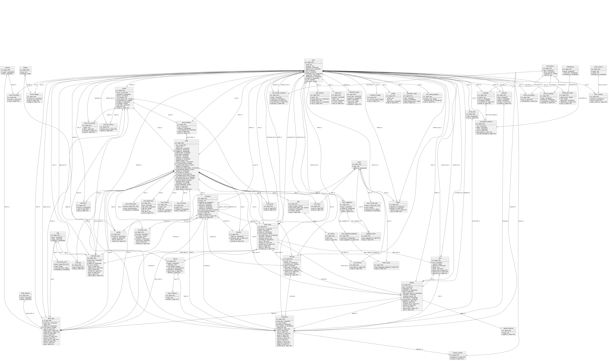

# Thiết kế cơ sở dữ liệu — Toàn hệ thống iShare

<!-- [Vietnamese Doc] Bản gộp từ các DB-Mxx.md, khớp với CD-SYS.md.
     Số mục giữ giống tài liệu module để tool đọc được. Ở bản hệ thống không còn bảng ngoài: mục 7.1, 7.2 để trống.
     Mục 6 do build_schema.py sinh; không sửa tay. Quy ước: data-model/conventions.md (QU-06…QU-09, QU-12). -->

| Mã tài liệu | DB-SYS |
|---|---|
| Dự án | iShare |
| Phạm vi | Toàn hệ thống (M01–M16) |
| Đầu vào | CD-SYS phiên bản 1.0; DB-M01 … DB-M16 phiên bản 1.0 |
| Trạng thái | Đã chốt |
| Phiên bản | 1.0 |
| Ngày | 2026-11-22 |
| Tác giả | Phạm Văn Đức |

## 1. Bảng

| Bảng | Từ lớp | Nhóm | Sở hữu | Ghi chú |
|---|---|---|---|---|
| admin_logs | AdminLog | Thực thể | M10 | — |
| ai_decision_logs | AiDecisionLog | Thực thể | M13 | — |
| appeals | Appeal | Thực thể | M09 | — |
| appeal_evidences | AppealEvidence | Thực thể | M09 | — |
| appeal_stats | AppealStat | Thống kê | M15 | Lớp thống kê: các cột được xét loại ở bước 5 |
| badges | Badge | Thực thể | M12 | — |
| bans | Ban | Thực thể | M08 | — |
| ban_stats | BanStat | Thống kê | M15 | Lớp thống kê: các cột được xét loại ở bước 5 |
| banners | Banner | Thực thể | M10 | — |
| banner_dismissals | BannerDismissal | Liên kết | M10 | — |
| bookmarks | Bookmark | Liên kết | M02 | — |
| chat_join_requests | ChatJoinRequest | Thực thể | M16 | — |
| chat_member_proposals | ChatMemberProposal | Thực thể | M16 | — |
| chosen_topics | ChosenTopic | Liên kết | M05 | — |
| comments | Comment | Thực thể | M04 | — |
| comment_stats | CommentStat | Thống kê | M15 | Lớp thống kê: các cột được xét loại ở bước 5 |
| config_switches | ConfigSwitch | Thực thể | M10 | — |
| conversations | Conversation | Thực thể | M16 | — |
| conversation_members | ConversationMember | Liên kết | M16 | — |
| counted_upvoters | CountedUpvoter | Liên kết | M07 | — |
| earned_badges | EarnedBadge | Liên kết | M12 | — |
| earned_titles | EarnedTitle | Thực thể | M12 | — |
| follows | Follow | Thực thể | M07 | — |
| groups | Group | Thực thể | M11 | — |
| group_join_blocks | GroupJoinBlock | Liên kết | M11 | — |
| group_join_requests | GroupJoinRequest | Thực thể | M11 | — |
| group_members | GroupMember | Liên kết | M11 | — |
| leaderboards | Leaderboard | Thực thể | M12 | — |
| leaderboard_entries | LeaderboardEntry | Liên kết | M12 | — |
| login_sessions | LoginSession | Thực thể | M01 | — |
| magic_links | MagicLink | Thực thể | M01 | — |
| mentions | Mention | Thực thể | M01 | — |
| messages | Message | Thực thể | M16 | — |
| moderation_logs | ModerationLog | Thực thể | M08 | — |
| muted_conversations | MutedConversation | Liên kết | M07 | — |
| muted_posts | MutedPost | Liên kết | M07 | — |
| notifications | Notification | Thực thể | M07 | — |
| notification_emails | NotificationEmail | Thực thể | M07 | — |
| notification_settings | NotificationSetting | Thực thể | M07 | — |
| policy_consents | PolicyConsent | Liên kết | M01 | — |
| policy_versions | PolicyVersion | Thực thể | M01 | — |
| polls | Poll | Thực thể | M03 | — |
| poll_options | PollOption | Thực thể | M03 | — |
| poll_selections | PollSelection | Liên kết | M03 | — |
| posts | Post | Thực thể | M03 | — |
| post_attachments | PostAttachment | Thực thể | M03 | — |
| post_revisions | PostRevision | Thực thể | M03 | — |
| post_search_stats | PostSearchStat | Thống kê | M06 | Lớp con của Post (kế thừa): không có id riêng, dùng khóa của bảng cha |
| post_stats | PostStat | Thống kê | M15 | Lớp thống kê: các cột được xét loại ở bước 5 |
| post_summaries | PostSummary | Thực thể | M13 | — |
| post_tags | PostTag | Liên kết | M05 | — |
| post_topics | PostTopic | Liên kết | M05 | — |
| post_trending_stats | PostTrendingStat | Thống kê | M14 | Lớp con của Post (kế thừa): không có id riêng, dùng khóa của bảng cha |
| profiles | Profile | Thực thể | M02 | — |
| proposals | Proposal | Thực thể | M10 | — |
| reactivation_codes | ReactivationCode | Thực thể | M01 | — |
| reports | Report | Thực thể | M08 | — |
| report_cases | ReportCase | Thực thể | M08 | — |
| report_evidences | ReportEvidence | Thực thể | M08 | — |
| report_stats | ReportStat | Thống kê | M15 | Lớp thống kê: các cột được xét loại ở bước 5 |
| suggested_topics | SuggestedTopic | Liên kết | M05 | — |
| tags | Tag | Thực thể | M05 | — |
| tag_trending_stats | TagTrendingStat | Thống kê | M05 | Lớp con của Tag (kế thừa): không có id riêng, dùng khóa của bảng cha |
| topics | Topic | Thực thể | M05 | — |
| topic_suggestions | TopicSuggestion | Thực thể | M05 | — |
| topic_suggestion_feedbacks | TopicSuggestionFeedback | Thực thể | M05 | — |
| topic_suggestion_stats | TopicSuggestionStat | Thống kê | M13 | Lớp thống kê: các cột được xét loại ở bước 5 |
| topic_trending_stats | TopicTrendingStat | Thống kê | M05 | Lớp con của Topic (kế thừa): không có id riêng, dùng khóa của bảng cha |
| upvotes | Upvote | Thực thể | M12 | — |
| users | User | Thực thể | M01 | — |
| user_stats | UserStat | Thống kê | M15 | Lớp thống kê: các cột được xét loại ở bước 5 |
| user_warning_statuses | UserWarningStatus | Thực thể | M08 | — |
| warnings | Warning | Thực thể | M08 | — |
| warning_stats | WarningStat | Thống kê | M15 | Lớp thống kê: các cột được xét loại ở bước 5 |

## 2. Cột

### 2.1 Cột từ thuộc tính

| Bảng | Cột | Kiểu | Null | Duy nhất | Từ thuộc tính | Ghi chú |
|---|---|---|---|---|---|---|
| admin_logs | id | bigint | Không | Có | AdminLog.id | — |
| admin_logs | action_type | varchar(30) | Không | Không | AdminLog.actionType | Giá trị: PROPOSE_MOD, PROPOSE_ADMIN, ACCEPT_PROPOSAL, DEMOTE_MOD, REVOKE_ADMIN, RESIGN, REVOKE_MOD_ON_BAN, CHANGE_SWITCH, SET_BANNER, EDIT_BANNER, REMOVE_BANNER, WARN, REMOVE_AI_WARNING, BAN, UNBAN, HIDE_CONTENT, HIDE_GROUP, LOCK_GROUP, UNLOCK_GROUP, CONCLUDE_CASE, CONCLUDE_APPEAL, ADD_TOPIC, MERGE_TOPIC, DELETE_TOPIC, DISABLE_TAG, ENABLE_TAG, CHANGE_POST_TOPIC_TAG; Không ghi việc xem, nhận, nhả vụ hay khiếu nại, việc Admin làm như người dùng thường, quyết định của AI (FR-M10-14.05, FR-M10-14.08) |
| admin_logs | reason | text | Có | Không | AdminLog.reason | Tùy chọn; thao tác mà module gốc bắt buộc lý do thì lấy đúng lý do đó (BR-M10-23, FR-M10-14.09) |
| admin_logs | created_at | timestamptz | Không | Không | AdminLog.createdAt | Lúc thao tác hoàn tất; mới nhất trước (BR-M10-23); không sửa, không xóa, giữ vĩnh viễn (BR-M10-22) |
| admin_logs | is_by_system | boolean | Không | Không | AdminLog.isBySystem | Đúng khi Mod mất vai trò do bị ban (FR-M10-14.07, BR-M10-21) |
| ai_decision_logs | id | bigint | Không | Có | AiDecisionLog.id | — |
| ai_decision_logs | call_type | varchar(30) | Không | Không | AiDecisionLog.callType | Giá trị: MODERATION_SCAN, POST_EMBEDDING, TOPIC_SUGGESTION; Không có tóm tắt và embedding truy vấn (FR-M13-08.05) |
| ai_decision_logs | is_success | boolean | Không | Không | AiDecisionLog.isSuccess | Đúng khi một trong hai lần thử có kết quả, sai khi cả hai lần lỗi (BR-M13-21) |
| ai_decision_logs | raw_output | text | Có | Không | AiDecisionLog.rawOutput | Kết quả dịch vụ AI trả về, giữ nguyên dạng JSON chưa xử lý (TN:Đầu ra thô); chỉ có khi lời gọi có kết quả (FR-M13-08.02); không sửa, không xóa (BR-M13-22) |
| ai_decision_logs | created_at | timestamptz | Không | Không | AiDecisionLog.createdAt | Không sửa, không xóa (BR-M13-22) |
| ai_decision_logs | scan_score | double precision | Có | Không | AiDecisionLog.scanScore | 0 đến 1; = điểm cao nhất trong bốn điểm nhóm vi phạm của rawOutput (BR-M13-12); chỉ có ở lời gọi chấm điểm kiểm duyệt thành công; Dẫn xuất ở CD: xét ở bước 5 |
| ai_decision_logs | violation_category | varchar(30) | Có | Không | AiDecisionLog.violationCategory | Giá trị: HARASSMENT, HATE, SEXUAL, VIOLENCE; = nhóm có điểm quét; nhiều nhóm cùng điểm cao nhất thì lấy nhóm đứng trước theo thứ tự HARASSMENT, HATE, SEXUAL, VIOLENCE (BR-M13-12); chỉ có khi có scanScore; Dẫn xuất ở CD: xét ở bước 5 |
| ai_decision_logs | score_band | varchar(30) | Có | Không | AiDecisionLog.scoreBand | Giá trị: HIGH, SUSPICIOUS, CLEAN; HIGH (≥ 0,9), SUSPICIOUS (0,5 đến < 0,9), CLEAN (< 0,5), một cặp ngưỡng chung cho bài viết, bình luận và mọi tác giả (BR-M13-13); ngưỡng là hằng số chính sách (BR-M13-14); chỉ có khi có scanScore; Dẫn xuất ở CD: xét ở bước 5 |
| appeals | id | bigint | Không | Có | Appeal.id | — |
| appeals | type | varchar(30) | Không | Không | Appeal.type | Giá trị: BAN, WARNING, POST; Gắn theo xử lý bị khiếu nại; khiếu nại bài bị gỡ và khiếu nại gộp đều là POST (FR-M09-01.03, TN:Loại khiếu nại); hàng chờ xếp BAN, rồi WARNING, rồi POST (BR-M09-10); khớp với quan hệ tới xử lý (R-M09-05 đến R-M09-08) |
| appeals | explanation | text | Không | Không | Appeal.explanation | Không trống (BR-M09-03, FR-M09-01.10); không sửa sau khi gửi (BR-M09-27) |
| appeals | submitted_at | timestamptz | Không | Không | Appeal.submittedAt | Phải trước hạn khiếu nại của xử lý (BR-M09-04); cùng loại thì gửi trước đứng trước (BR-M09-10) |
| appeals | status | varchar(30) | Không | Không | Appeal.status | Giá trị: PENDING, CONCLUDED; Khiếu nại mới là PENDING (FR-M09-01.01); CONCLUDED là trạng thái cuối, không kết luận lại (FR-M09-07.08); "chưa ai giữ", "đang được giữ" suy từ quan hệ người giữ |
| appeals | last_holder_action_at | timestamptz | Có | Không | Appeal.lastHolderActionAt | Chỉ có khi đang có người giữ; đặt lúc nhận và mỗi lần người giữ mở xem; 30 phút không thao tác thì tự nhả (BR-M09-11) |
| appeals | conclusion | varchar(30) | Có | Không | Appeal.conclusion | Giá trị: ACCEPTED, REJECTED; Chỉ có khi CONCLUDED; chỉ người đang giữ kết luận (FR-M09-07.06); REJECTED là cuối cùng, không gửi lại cho cùng xử lý (BR-M09-06) |
| appeals | conclusion_reason | text | Có | Không | Appeal.conclusionReason | Chỉ có khi CONCLUDED; bắt buộc ở cả ACCEPTED và REJECTED (BR-M09-27, FR-M09-07.11); gửi kèm thông báo kết luận (BR-M09-20) |
| appeals | concluded_at | timestamptz | Có | Không | Appeal.concludedAt | Chỉ có khi CONCLUDED |
| appeals | role_at_action | varchar(30) | Không | Không | Appeal.roleAtAction | Giá trị: USER, MODERATOR, ADMIN; Chỉ USER hoặc MODERATOR (Admin không có khiếu nại, BR-M09-01); vai trò tại thời điểm có xử lý, vẫn là MODERATOR khi đã mất vai trò Mod vì bị ban (FR-M09-03.08); MODERATOR thì chỉ Admin xét (BR-M09-12); Dẫn xuất ở CD: xét ở bước 5 |
| appeal_evidences | id | bigint | Không | Có | AppealEvidence.id | — |
| appeal_evidences | image | text | Không | Không | AppealEvidence.image | Đường dẫn ảnh trên nơi lưu ảnh (Cloudinary, DEC-137); JPEG, PNG hoặc WebP, tối đa 5 MB; mỗi khiếu nại tối đa 3 ảnh (BR-M09-03); không sửa sau khi gửi (BR-M09-27) |
| appeal_stats | period | varchar(30) | Không | Không | AppealStat.period | Giá trị: TODAY, LAST_7_DAYS, LAST_30_DAYS, ALL_TIME; Như UserStat.period |
| appeal_stats | count_by_type | jsonb | Không | Không | AppealStat.countByType | Map<AppealType, Integer> lưu dạng jsonb (khóa → số đếm); Khiếu nại bài bị gỡ và khiếu nại gộp thuộc POST (BR-M15-10); Dẫn xuất ở CD: xét ở bước 5 |
| appeal_stats | count_by_result | jsonb | Không | Không | AppealStat.countByResult | Map<AppealResultGroup, Integer> lưu dạng jsonb (khóa → số đếm); Đếm theo kết quả hiện tại của khiếu nại (BR-M15-10, BR-M15-22); Dẫn xuất ở CD: xét ở bước 5 |
| badges | id | bigint | Không | Có | Badge.id | — |
| badges | name | text | Không | Không | Badge.name | Một trong năm tên cố định: Người mới nổi, Cây bút triển vọng, Cây bút tích cực, Chuyên gia cộng đồng, Huyền thoại iShare (BR-M12-11); chỉ đổi bằng triển khai (BR-M12-06) |
| badges | threshold | integer | Không | Không | Badge.threshold | 25, 100, 300, 600, 1000 theo thứ tự tên (BR-M12-11); không hiển thị cùng huy hiệu (BR-M12-12) |
| bans | id | bigint | Không | Có | Ban.id | — |
| bans | kind | varchar(30) | Không | Không | Ban.kind | Giá trị: TEMPORARY, PERMANENT; Thao tác "Ban" lần thứ 3 trở đi ra PERMANENT (BR-M08-34); "Ban vĩnh viễn" bỏ qua cách tính leo thang (BR-M08-35) |
| bans | duration | integer | Có | Không | Ban.duration | Đơn vị ngày, N ngày = N × 24 giờ (BR-M08-43); 30 khi chưa từng bị ban, 90 khi đã bị ban 1 lần (BR-M08-34); không có với ban PERMANENT |
| bans | started_at | timestamptz | Không | Không | Ban.startedAt | — |
| bans | ends_at | timestamptz | Có | Không | Ban.endsAt | = startedAt + duration (BR-M08-43); không có với ban PERMANENT; Dẫn xuất ở CD: xét ở bước 5 |
| bans | reason | text | Không | Không | Ban.reason | — |
| bans | status | varchar(30) | Không | Không | Ban.status | Giá trị: ACTIVE, EXPIRED, LIFTED, OVERTURNED; Ban mới là ACTIVE; EXPIRED, LIFTED, OVERTURNED là trạng thái cuối; mỗi tài khoản nhiều nhất một ban ACTIVE (BR-M08-52); OVERTURNED do M09 đặt |
| bans | appeal_deadline | timestamptz | Không | Không | Ban.appealDeadline | Ban tạm thời: = startedAt + duration; ban vĩnh viễn: = startedAt + 90 × 24 giờ (BR-M09-04); quá hạn với ban vĩnh viễn thì mất quyền khiếu nại (BR-M09-05); Dẫn xuất ở CD: xét ở bước 5 |
| ban_stats | period | varchar(30) | Không | Không | BanStat.period | Giá trị: TODAY, LAST_7_DAYS, LAST_30_DAYS, ALL_TIME; Như UserStat.period |
| ban_stats | ban_trend | jsonb | Không | Không | BanStat.banTrend | Map<Instant, Map<BanKind, Integer>> lưu dạng jsonb (khóa → số đếm); Số ban theo từng giờ, ngày hoặc tháng, tách TEMPORARY và PERMANENT, kể cả ban về sau bị lật (BR-M15-14, BR-M15-22); Dẫn xuất ở CD: xét ở bước 5 |
| ban_stats | unban_trend | jsonb | Không | Không | BanStat.unbanTrend | Map<Instant, Integer> lưu dạng jsonb (khóa → số đếm); Chỉ đếm thao tác gỡ ban của Mod, Admin (dòng ModerationLog UNBAN); ban hết hạn, bị lật không tính (BR-M15-14, BR-M15-22); Dẫn xuất ở CD: xét ở bước 5 |
| banners | id | bigint | Không | Có | Banner.id | — |
| banners | content | varchar(200) | Không | Không | Banner.content | Độ dài đếm sau khi bỏ khoảng trắng đầu, cuối (FR-M10-13.05); varchar(200) lưu chuỗi đã bỏ (DD-M10-01); 1–200 ký tự đếm sau khi bỏ khoảng trắng đầu và cuối (TN:Ký tự của banner); văn bản thuần (BR-M10-20, FR-M10-13.05, FR-M10-13.06) |
| banners | status | varchar(30) | Không | Không | Banner.status | Giá trị: SHOWN, HIDDEN; Nhiều nhất một banner SHOWN (BR-M10-20); đặt banner mới thì banner đang hiện được thay (FR-M10-13.04) |
| banner_dismissals | id | bigint | Không | Có | BannerDismissal.id | — |
| bookmarks | id | bigint | Không | Có | Bookmark.id | — |
| bookmarks | saved_at | timestamptz | Không | Không | Bookmark.savedAt | Mỗi người dùng lưu một bài viết nhiều nhất một lần (BR-M02-22); tab Bookmark xếp mới nhất trước (BR-M02-31) |
| chat_join_requests | id | bigint | Không | Có | ChatJoinRequest.id | — |
| chat_join_requests | status | varchar(30) | Không | Không | ChatJoinRequest.status | Giá trị: PENDING, APPROVED, REJECTED; Mới tạo là PENDING; mỗi người nhiều nhất một yêu cầu PENDING tới một nhóm chat; bị từ chối thì gửi lại ngay được (BR-M16-29); không xóa |
| chat_join_requests | created_at | timestamptz | Không | Không | ChatJoinRequest.createdAt | Thứ tự chờ tính theo thời điểm này (BR-M16-33) |
| chat_member_proposals | id | bigint | Không | Có | ChatMemberProposal.id | — |
| chat_member_proposals | status | varchar(30) | Không | Không | ChatMemberProposal.status | Giá trị: PENDING, APPROVED, REJECTED; Mới tạo là PENDING; không xóa |
| chat_member_proposals | created_at | timestamptz | Không | Không | ChatMemberProposal.createdAt | Thứ tự chờ tính theo thời điểm này (BR-M16-33) |
| chosen_topics | id | bigint | Không | Có | ChosenTopic.id | — |
| comments | id | bigint | Không | Có | Comment.id | — |
| comments | content | text | Không | Không | Comment.content | Không trống, không chỉ khoảng trắng; tối đa 1.000 từ đếm trên phần chữ người đọc thấy, khối trích dẫn tự gõ có tính, dòng trích dẫn khi trả lời không tính (BR-M04-19); chỉ in đậm, in nghiêng, code trong dòng, LaTeX, liên kết, nhắc tên, trích dẫn (BR-M04-01); không tệp đính kèm (BR-M04-02); dạng JSON của Tiptap như Post.content (DEC-137); giữ khi bình luận bị xóa (BR-M04-21) |
| comments | published_at | timestamptz | Không | Không | Comment.publishedAt | Lúc hệ thống ghi nhận bình luận được gửi; không đổi khi sửa (FR-M04-04.03) |
| comments | edited_at | timestamptz | Có | Không | Comment.editedAt | Chỉ có khi đã sửa; lần sửa gần nhất thay lần trước (FR-M04-04.02) |
| comments | mod_state | varchar(30) | Không | Không | Comment.modState | Giá trị: NORMAL, HIDDEN; Bình luận mới là NORMAL (FR-M04-02.02, FR-M04-03.04); không đổi khi sửa (FR-M04-04.03); M08 đổi |
| comments | deleted_at | timestamptz | Có | Không | Comment.deletedAt | Chỉ có khi tác giả đã xóa; không xóa lại, không khôi phục (FR-M04-05.04, FR-M04-05.06) |
| comments | is_deleted | boolean | Không | Không | Comment.isDeleted | Đúng khi deletedAt có giá trị (FR-M04-05.01); Dẫn xuất ở CD: xét ở bước 5 |
| comments | is_edited | boolean | Không | Không | Comment.isEdited | Đúng khi editedAt có giá trị (BR-M04-07); Dẫn xuất ở CD: xét ở bước 5 |
| comments | is_visible | boolean | Không | Không | Comment.isVisible | Đúng khi chưa bị xóa và modState = NORMAL (TN:Bình luận hiển thị bình thường); Dẫn xuất ở CD: xét ở bước 5 |
| comments | upvote_count | integer | Không | Không | Comment.upvoteCount | ≥ 0; số người đang upvote, upvote đã rút không tính (TN:Số upvote của bình luận); Dẫn xuất ở CD: xét ở bước 5 |
| comments | scanned_at | timestamptz | Có | Không | Comment.scannedAt | — |
| comments | is_scanned_current | boolean | Không | Không | Comment.isScannedCurrent | Đúng khi có scannedAt và scannedAt không sớm hơn editedAt (TN:Đã quét với nội dung hiện tại, BR-M08-21); Dẫn xuất ở CD: xét ở bước 5 |
| comments | reply_rate | integer | Có | Không | Comment.replyRate | ≥ 0; chỉ có ở bình luận gốc: số trả lời của luồng đăng trong khoảng thời gian trượt (BR-M08-20); ngưỡng tạm 10 trả lời trong 5 phút (TBD-M08-04); Dẫn xuất ở CD: xét ở bước 5 |
| comments | is_removed_from_group | boolean | Không | Không | Comment.isRemovedFromGroup | Như Post.isRemovedFromGroup (BR-M11-30) |
| comments | is_points_deducted | boolean | Không | Không | Comment.isPointsDeducted | Sai = Đang tính điểm, đúng = Đã trừ điểm; với bình luận Đã trừ điểm là trạng thái cuối |
| comment_stats | period | varchar(30) | Không | Không | CommentStat.period | Giá trị: TODAY, LAST_7_DAYS, LAST_30_DAYS, ALL_TIME; Như UserStat.period |
| comment_stats | new_comment_trend | jsonb | Không | Không | CommentStat.newCommentTrend | Map<Instant, Integer> lưu dạng jsonb (khóa → số đếm); Số bình luận theo từng giờ, ngày hoặc tháng theo thời điểm đăng, kể cả bình luận về sau bị ẩn hoặc bị xóa (BR-M15-21, BR-M15-19); Dẫn xuất ở CD: xét ở bước 5 |
| config_switches | id | bigint | Không | Có | ConfigSwitch.id | — |
| config_switches | name | varchar(30) | Không | Có | ConfigSwitch.name | Giá trị: AI_ENABLED, AI_SEARCH, AI_MODERATION, AI_TOPIC_SUGGESTION, MAINTENANCE_MODE, REGISTRATION_PAUSED, GROUP_ENABLED, CHAT_ENABLED, GAMIFICATION_ENABLED; Duy nhất; đúng chín công tắc, không tạo thêm, không xóa (FR-M10-09.01, FR-M10-12.03, BR-M10-12, BR-M10-19) |
| config_switches | status | varchar(30) | Không | Không | ConfigSwitch.status | Giá trị: ON, OFF; Khởi tạo: công tắc AI và ba cờ tính năng ON, chế độ bảo trì và tạm dừng đăng ký OFF (BR-M10-26); áp cho mọi thao tác sau thời điểm đổi (BR-M10-13); công tắc AI riêng vẫn lưu khi công tắc tổng OFF, chỉ có tác dụng khi công tắc tổng ON (FR-M10-09.06, BR-M10-14) |
| conversations | id | bigint | Không | Có | Conversation.id | — |
| conversations | type | varchar(30) | Không | Không | Conversation.type | Giá trị: DIRECT, GROUP; DIRECT có đúng 2 thành viên, mỗi cặp người dùng nhiều nhất một cuộc (BR-M16-24) |
| conversations | name | varchar(100) | Có | Không | Conversation.name | Lưu chuỗi đã bỏ khoảng trắng đầu, cuối (BR-M16-32) nên varchar(100) đủ; Chỉ có và bắt buộc ở nhóm chat; 1–100 ký tự sau khi bỏ khoảng trắng đầu, cuối; được trùng với nhóm chat khác (BR-M16-32); mọi thành viên đổi được (BR-M16-05) |
| conversations | is_approval_on | boolean | Có | Không | Conversation.isApprovalOn | Chỉ có ở nhóm chat; sai (Tắt) khi tạo (BR-M16-06); chỉ Admin nhóm chat đổi; hệ thống tự tắt khi Admin nhóm chat không thể khôi phục (BR-M16-30) |
| conversations | invite_link | text | Có | Có | Conversation.inviteLink | Chỉ có ở nhóm chat; duy nhất; một link chung, không hết hạn, không thu hồi, không tạo lại (BR-M16-29) |
| conversation_members | id | bigint | Không | Có | ConversationMember.id | — |
| conversation_members | role | varchar(30) | Có | Không | ConversationMember.role | Giá trị: ADMIN, MEMBER; Chỉ có ở nhóm chat; người tạo là ADMIN đầu tiên; mỗi nhóm chat nhiều nhất một ADMIN (BR-M16-04); chuyển quyền thì đổi vai trò của hai người (BR-M16-07); khác User.role |
| conversation_members | status | varchar(30) | Không | Không | ConversationMember.status | Giá trị: ACTIVE, LEFT, REMOVED; LEFT, REMOVED chỉ ở nhóm chat; vào lại thì về ACTIVE (mục Chuyển trạng thái của FR-M16) |
| conversation_members | left_at | timestamptz | Có | Không | ConversationMember.leftAt | Chỉ có khi LEFT hoặc REMOVED; thành viên cũ chỉ xem tin gửi trước thời điểm này (TN:Thời điểm rời, BR-M16-27) |
| counted_upvoters | id | bigint | Không | Có | CountedUpvoter.id | — |
| earned_badges | id | bigint | Không | Có | EarnedBadge.id | — |
| earned_badges | achieved_at | timestamptz | Không | Không | EarnedBadge.achievedAt | Thời điểm đạt đầu tiên, không đổi; hồ sơ hiện ngày đạt theo giờ Việt Nam; huy hiệu không thu hồi, không trao lại (BR-M12-12) |
| earned_titles | id | bigint | Không | Có | EarnedTitle.id | — |
| earned_titles | week | timestamptz | Không | Không | EarnedTitle.week | Mốc 00:00 thứ Hai đầu tuần lịch theo giờ Việt Nam, lưu UTC (tuần từ 00:00 thứ Hai đến trước 00:00 thứ Hai tuần sau, BR-M12-14); mỗi người mỗi tuần một bản ghi (BR-M12-24) |
| follows | id | bigint | Không | Có | Follow.id | — |
| follows | followed_at | timestamptz | Không | Không | Follow.followedAt | Ghi khi người dùng bắt đầu theo dõi (FR-M07-01.01) |
| groups | id | bigint | Không | Có | Group.id | — |
| groups | name | varchar(100) | Không | Không | Group.name | Tối đa 100 ký tự (BR-M11-31); được trùng với nhóm khác (FR-M11-01.10) |
| groups | description | varchar(500) | Có | Không | Group.description | Tối đa 500 ký tự (BR-M11-31) |
| groups | privacy | varchar(30) | Không | Không | Group.privacy | Giá trị: PUBLIC, PRIVATE; Người tạo chọn khi tạo; Owner đổi bất kỳ lúc nào, chế độ mới áp cho thao tác sau thời điểm đổi (BR-M11-15) |
| groups | join_question | text | Có | Không | Group.joinQuestion | Tối đa một câu hỏi mỗi nhóm, mặc định trống (BR-M11-08, BR-M11-31); câu hỏi mới áp cho yêu cầu gửi sau đó (FR-M11-02.07) |
| groups | is_pre_approval_on | boolean | Không | Không | Group.isPreApprovalOn | Mặc định sai (Tắt) (BR-M11-31); giá trị mới dùng cho bài gửi sau thời điểm đổi; tắt không nhả các bài đang chờ (BR-M11-18) |
| groups | is_anonymous_on | boolean | Không | Không | Group.isAnonymousOn | Mặc định sai (Tắt) (BR-M11-31); tắt chỉ chặn chọn ẩn danh cho bài mới (BR-M11-16) |
| groups | created_at | timestamptz | Không | Không | Group.createdAt | Mỗi người tạo tối đa 5 nhóm trong 24 giờ gần nhất, tính cả nhóm đã xóa (BR-M11-03); danh sách nhóm xếp mới nhất trước (BR-M11-35) |
| groups | is_deleted | boolean | Không | Không | Group.isDeleted | Mới tạo là sai (Hoạt động); đúng (Đã xóa) là trạng thái cuối; xóa mềm, dữ liệu được giữ (BR-M11-23) |
| groups | mod_state | varchar(30) | Không | Không | Group.modState | Giá trị: NORMAL, LOCKED, HIDDEN; Mới tạo là NORMAL (FR-M11-01.01); M08 quyết trong vụ báo cáo; HIDDEN là trạng thái cuối, không bỏ ẩn (FR-M08-18.03, BR-M08-50, BR-M11-27); nhóm LOCKED có thể bị ẩn ở vụ sau (FR-M08-18.08) |
| groups | invite_link | text | Không | Có | Group.inviteLink | Duy nhất; một link chung mỗi nhóm, không hết hạn, không thu hồi, không tạo lại (BR-M11-12) |
| groups | is_instant_join | boolean | Không | Không | Group.isInstantJoin | Đúng khi privacy = PUBLIC và joinQuestion trống (TN:Nhóm vào ngay, BR-M11-07); Dẫn xuất ở CD: xét ở bước 5 |
| group_join_blocks | id | bigint | Không | Có | GroupJoinBlock.id | — |
| group_join_requests | id | bigint | Không | Có | GroupJoinRequest.id | — |
| group_join_requests | answer | text | Có | Không | GroupJoinRequest.answer | Chỉ có và không được trống khi nhóm có câu hỏi tham gia (BR-M11-08, FR-M11-04.08) |
| group_join_requests | status | varchar(30) | Không | Không | GroupJoinRequest.status | Giá trị: PENDING, APPROVED, REJECTED, WITHDRAWN; Mới gửi là PENDING; mỗi người nhiều nhất một yêu cầu PENDING cho mỗi nhóm (BR-M11-09); không xóa |
| group_members | id | bigint | Không | Có | GroupMember.id | — |
| group_members | role | varchar(30) | Không | Không | GroupMember.role | Giá trị: OWNER, GROUP_MOD, MEMBER; Thứ bậc MEMBER < GROUP_MOD < OWNER (BR-M11-05); mỗi nhóm đúng một OWNER (BR-M11-04); khác User.role |
| group_members | joined_at | timestamptz | Không | Không | GroupMember.joinedAt | Lúc vào ngay, lúc yêu cầu được chấp nhận, hoặc lúc tạo nhóm với Owner đầu tiên (TN:Thời điểm tham gia); dùng chọn Owner thay thế (BR-M11-26) |
| group_members | mod_appointed_at | timestamptz | Có | Không | GroupMember.modAppointedAt | Chỉ có khi role = GROUP_MOD; ghi mỗi lần bổ nhiệm, thâm niên tính từ lần gần nhất (BR-M11-26, FR-M11-11.06) |
| leaderboards | id | bigint | Không | Có | Leaderboard.id | — |
| leaderboards | period | varchar(30) | Không | Có | Leaderboard.period | Giá trị: WEEK, MONTH, ALL_TIME; Duy nhất: mỗi loại chu kỳ một kết quả hiện hành (mục Dữ liệu nghiệp vụ); không có chu kỳ năm (FR-M12-04.05) |
| leaderboards | period_start | timestamptz | Có | Không | Leaderboard.periodStart | Mốc 00:00 ngày đầu của tuần (thứ Hai) hoặc tháng (ngày 1) đã chốt theo giờ Việt Nam, lưu UTC; không có với ALL_TIME |
| leaderboards | computed_at | timestamptz | Không | Không | Leaderboard.computedAt | ALL_TIME tính lại mỗi 60 phút; WEEK, MONTH tính một lần khi chốt, trễ tối đa 60 phút sau mốc cuối (BR-M12-19, BR-M12-25) |
| leaderboard_entries | id | bigint | Không | Có | LeaderboardEntry.id | — |
| leaderboard_entries | period_points | integer | Không | Không | LeaderboardEntry.periodPoints | > 0; điểm theo trọng số BR-M12-05 từ upvote có thời điểm trong chu kỳ, còn hiệu lực lúc tính, trên nội dung chưa bị trừ điểm (BR-M12-15); ALL_TIME dùng tổng điểm (FR-M12-04.04) |
| leaderboard_entries | rank | integer | Không | Không | LeaderboardEntry.rank | ≥ 1; cùng điểm đồng hạng, người kế tiếp nhận hạng = số người đứng trên + 1 (BR-M12-18) |
| leaderboard_entries | grade_level | varchar(30) | Có | Không | LeaderboardEntry.gradeLevel | Giá trị: GRADE_10, GRADE_11, GRADE_12; Chụp từ hồ sơ lúc chốt, với ALL_TIME lúc tính gần nhất; trống khi hồ sơ chưa đặt (BR-M12-16) |
| leaderboard_entries | is_weekly_star | boolean | Không | Không | LeaderboardEntry.isWeeklyStar | Đúng khi dòng thuộc kết quả WEEK và rank từ 1 đến 3 (BR-M12-23); Dẫn xuất ở CD: xét ở bước 5 |
| login_sessions | id | bigint | Không | Có | LoginSession.id | — |
| login_sessions | device | text | Không | Không | LoginSession.device | Mỗi thiết bị một phiên đăng nhập riêng (BR-M01-17) |
| login_sessions | access_expires_at | timestamptz | Không | Không | LoginSession.accessExpiresAt | 1 giờ từ lúc cấp phiên truy cập (BR-M01-16) |
| login_sessions | refresh_token | text | Không | Không | LoginSession.refreshToken | — |
| login_sessions | refresh_expires_at | timestamptz | Không | Không | LoginSession.refreshExpiresAt | 30 ngày từ lúc cấp phiên làm mới (BR-M01-16) |
| magic_links | id | bigint | Không | Có | MagicLink.id | — |
| magic_links | purpose | varchar(30) | Không | Không | MagicLink.purpose | Giá trị: EMAIL_VERIFICATION, PASSWORD_RESET; Với mỗi tài khoản chỉ link mới nhất cùng loại còn hiệu lực (BR-M01-38) |
| magic_links | token | text | Không | Không | MagicLink.token | — |
| magic_links | sent_at | timestamptz | Không | Không | MagicLink.sentAt | Hai lần gửi link xác minh cách nhau ít nhất 60 giây (BR-M01-11) |
| magic_links | expires_at | timestamptz | Không | Không | MagicLink.expiresAt | = sentAt + 1 giờ với link xác minh email (BR-M01-10); = sentAt + 15 phút với link đặt lại mật khẩu (BR-M01-12); Dẫn xuất ở CD: xét ở bước 5 |
| magic_links | is_used | boolean | Không | Không | MagicLink.isUsed | Mỗi link chỉ dùng được một lần (BR-M01-38) |
| mentions | id | bigint | Không | Có | Mention.id | — |
| mentions | notified_at | timestamptz | Có | Không | Mention.notifiedAt | — |
| messages | id | bigint | Không | Có | Message.id | — |
| messages | content | text | Không | Không | Message.content | Văn bản thuần, có thể kèm emoji; không trống, không chỉ khoảng trắng; tối đa 1.000 từ (BR-M16-08); không sửa (BR-M16-10); giữ cả khi thu hồi nhưng không hiện (BR-M16-12) |
| messages | sent_at | timestamptz | Không | Không | Message.sentAt | Lúc hệ thống nhận tin; thu hồi được khi chưa quá 5 phút từ thời điểm này (BR-M16-11); mỗi người tối đa 30 tin trong 60 giây ở một cuộc (BR-M16-09) |
| messages | is_recalled | boolean | Không | Không | Message.isRecalled | Mặc định sai (Bình thường); chỉ người gửi đặt, một lần (FR-M16-06.04, FR-M16-06.06); xóa mềm (BR-M16-12) |
| moderation_logs | id | bigint | Không | Có | ModerationLog.id | — |
| moderation_logs | action_type | varchar(30) | Không | Không | ModerationLog.actionType | Giá trị: WARN, REMOVE_AI_WARNING, BAN, UNBAN, HIDE_CONTENT, HIDE_GROUP, LOCK_GROUP, UNLOCK_GROUP, CONCLUDE_CASE, DISABLE_TAG, ENABLE_TAG, CHANGE_POST_TOPIC_TAG; Không ghi việc nhận, nhả vụ (FR-M08-16.07) |
| moderation_logs | reason | text | Không | Không | ModerationLog.reason | — |
| moderation_logs | created_at | timestamptz | Không | Không | ModerationLog.createdAt | Giữ vĩnh viễn, không sửa, không xóa (BR-M08-40) |
| moderation_logs | is_by_ai | boolean | Không | Không | ModerationLog.isByAi | Đúng khi người làm là AI; người làm là Mod, Admin hoặc AI (BR-M08-39) |
| muted_conversations | id | bigint | Không | Có | MutedConversation.id | — |
| muted_posts | id | bigint | Không | Có | MutedPost.id | — |
| notifications | id | bigint | Không | Có | Notification.id | — |
| notifications | event_type | varchar(30) | Không | Không | Notification.eventType | Giá trị: PASSWORD_CHANGED, GOOGLE_LINKED, NEW_FOLLOWER, FOLLOWED_USER_NEW_POST, POST_PUBLISHED, POST_REJECTED, POST_HIDDEN, POLL_ENDED, POST_UPVOTED, COMMENT_UPVOTED, NEW_COMMENT, REPLY, MENTION, COMMENT_HIDDEN, REPORT_RESULT, WARNING_ISSUED, BANNED, UNBANNED, BAN_APPEAL_CONCLUDED, POST_APPEAL_CONCLUDED, WARNING_APPEAL_CONCLUDED, GROUP_INVITED, GROUP_JOIN_REQUESTED, GROUP_JOIN_APPROVED, GROUP_MOD_APPOINTED, GROUP_KICKED, GROUP_OWNER_TRANSFERRED, GROUP_CONTENT_REMOVED, BADGE_EARNED, WEEKLY_STAR_EARNED, MOD_PROPOSAL, ADMIN_PROPOSAL; Một trong các sự kiện của BR-M07-01; không có tin nhắn (FR-M07-02.10), không có cảnh báo trước khi tự xóa (FR-M07-04.06), không có các trường hợp của BR-M07-21 |
| notifications | is_read | boolean | Không | Không | Notification.isRead | Mới tạo là sai (Chưa đọc) (FR-M07-02.01); đúng khi người nhận bấm vào hoặc "Đánh dấu tất cả đã đọc" (FR-M07-06.01, FR-M07-06.03); về sai chỉ khi thông báo upvote được gộp thêm (FR-M07-02.04) |
| notifications | occurred_at | timestamptz | Không | Không | Notification.occurredAt | Do module phát sinh sự kiện cung cấp (FR-M07-02.02); lưu UTC, hiển thị giờ Asia/Ho_Chi_Minh (BR-M07-22) |
| notifications | last_updated_at | timestamptz | Không | Không | Notification.lastUpdatedAt | Bằng occurredAt khi tạo; đổi thành thời điểm của lượt upvote gộp thêm (FR-M07-02.04); chuông hiện 10 thông báo mới nhất theo giá trị này (BR-M07-12) |
| notifications | appeal_link | text | Có | Không | Notification.appealLink | Chỉ có khi sự kiện là cảnh cáo, ban, bài bị Mod hoặc Admin gỡ, bài bị AI từ chối (FR-M07-02.13) |
| notifications | is_upvote_window_open | boolean | Có | Không | Notification.isUpvoteWindowOpen | Chỉ có ở thông báo upvote: đúng khi hiện tại còn trước occurredAt + 5 × 60 giây; không kéo dài theo lượt upvote sau (BR-M07-05); Dẫn xuất ở CD: xét ở bước 5 |
| notifications | other_upvoter_count | integer | Có | Không | Notification.otherUpvoterCount | ≥ 0; chỉ có ở thông báo upvote: số người khác nhau đã được đếm trong cửa sổ, trừ người upvote mới nhất (FR-M07-02.20); bỏ upvote không làm giảm (FR-M07-02.19); Dẫn xuất ở CD: xét ở bước 5 |
| notification_emails | id | bigint | Không | Có | NotificationEmail.id | — |
| notification_emails | event_type | varchar(30) | Không | Không | NotificationEmail.eventType | Giá trị: PASSWORD_CHANGED, GOOGLE_LINKED, DELETION_WARNING, BANNED, UNBANNED, BAN_APPEAL_CONCLUDED; Chỉ các sự kiện có email (BR-M07-03) |
| notification_emails | queued_at | timestamptz | Không | Không | NotificationEmail.queuedAt | Ghi khi email vào hàng đợi |
| notification_emails | status | varchar(30) | Không | Không | NotificationEmail.status | Giá trị: PENDING, SENT, STOPPED; PENDING khi vào hàng đợi; SENT khi gửi thành công (FR-M07-04.02); STOPPED khi vẫn lỗi sau 3 lần gửi lại (FR-M07-04.10) |
| notification_emails | retry_count | integer | Không | Không | NotificationEmail.retryCount | 0–3; tăng 1 mỗi lần gửi lại sau lần lỗi; hết 3 lần vẫn lỗi thì dừng (BR-M07-26) |
| notification_emails | appeal_link | text | Có | Không | NotificationEmail.appealLink | Chỉ có với email về ban (FR-M07-04.08) |
| notification_settings | id | bigint | Không | Có | NotificationSetting.id | — |
| notification_settings | is_all_chat_muted | boolean | Không | Không | NotificationSetting.isAllChatMuted | Sai = Đang nhận, đúng = Đã tắt; khi đúng thì mọi cuộc trò chuyện không hiện popup, không ngoại lệ; khi sai thì theo cài đặt riêng từng cuộc (BR-M07-08) |
| policy_consents | id | bigint | Không | Có | PolicyConsent.id | — |
| policy_consents | agreed_at | timestamptz | Không | Không | PolicyConsent.agreedAt | Mỗi lần đồng ý là một bản ghi mới (BR-M01-44); xóa khi DELETED (BR-M01-47) |
| policy_versions | id | bigint | Không | Có | PolicyVersion.id | — |
| policy_versions | version | text | Không | Không | PolicyVersion.version | — |
| policy_versions | content | text | Không | Không | PolicyVersion.content | Gồm các mục của BR-M01-42, dữ liệu trình bày theo bốn nhóm của BR-M01-43; chỉ đổi qua triển khai bản mới (FR-M01-15.09) |
| policy_versions | released_at | timestamptz | Không | Không | PolicyVersion.releasedAt | — |
| policy_versions | is_current | boolean | Không | Không | PolicyVersion.isCurrent | Đúng ở phiên bản có releasedAt muộn nhất (BR-M01-44); Dẫn xuất ở CD: xét ở bước 5 |
| polls | id | bigint | Không | Có | Poll.id | — |
| polls | allow_multiple | boolean | Không | Không | Poll.allowMultiple | Mặc định đúng (chọn nhiều); không đổi được sau khi bài được gửi (BR-M03-11) |
| polls | show_result_before_vote | boolean | Không | Không | Poll.showResultBeforeVote | Mặc định sai; không đổi được sau khi bài được gửi (BR-M03-11) |
| polls | expires_at | timestamptz | Không | Không | Poll.expiresAt | Không trước thời điểm hiện tại khi đặt hoặc đổi (BR-M03-12); kết thúc ngay = đặt bằng thời điểm hiện tại (BR-M03-14) |
| polls | is_closed | boolean | Không | Không | Poll.isClosed | Đóng khi đến hạn hoặc tác giả kết thúc ngay; không mở lại được (BR-M03-13, BR-M03-14) |
| polls | total_selection_count | integer | Không | Không | Poll.totalSelectionCount | ≥ 0; số PollSelection của mọi lựa chọn trong poll (BR-M03-15); Dẫn xuất ở CD: xét ở bước 5 |
| poll_options | id | bigint | Không | Có | PollOption.id | — |
| poll_options | label | text | Không | Không | PollOption.label | Do tác giả đặt; không sửa được sau khi bài được gửi (BR-M03-44) |
| poll_options | selection_count | integer | Không | Không | PollOption.selectionCount | ≥ 0; số PollSelection của lựa chọn (BR-M03-15); Dẫn xuất ở CD: xét ở bước 5 |
| poll_options | percentage | integer | Không | Không | PollOption.percentage | 0–100; = selectionCount ÷ Poll.totalSelectionCount, làm tròn tới số nguyên (BR-M03-15); Dẫn xuất ở CD: xét ở bước 5 |
| poll_selections | id | bigint | Không | Có | PollSelection.id | — |
| posts | id | bigint | Không | Có | Post.id | — |
| posts | title | varchar(150) | Có | Không | Post.title | Tối đa 150 ký tự (BR-M03-42); bắt buộc khi gửi (BR-M03-40); bài nháp được thiếu nếu có phần khác (BR-M03-41) |
| posts | content | text | Có | Không | Post.content | Nội dung giàu định dạng dạng JSON của Tiptap (DEC-137) theo BR-M03-03; LaTeX dạng mã thô (BR-M03-05); không chứa ảnh (BR-M03-04); tối đa 6.000 từ đếm trên phần chữ người đọc thấy (BR-M03-42); khi gửi phải có nội dung hoặc poll (BR-M03-40) |
| posts | content_text | text | Có | Không | Post.contentText | Phần chữ người đọc thấy của content, không kèm định dạng; có khi content có; Dẫn xuất ở CD: xét ở bước 5 |
| posts | grade_level | varchar(30) | Có | Không | Post.gradeLevel | Giá trị: GRADE_10, GRADE_11, GRADE_12; Tùy chọn (BR-M03-06); độc lập với Profile.gradeLevel |
| posts | created_at | timestamptz | Không | Không | Post.createdAt | — |
| posts | updated_at | timestamptz | Không | Không | Post.updatedAt | — |
| posts | publish_state | varchar(30) | Không | Không | Post.publishState | Giá trị: DRAFT, PENDING, PUBLISHED, HIDDEN, REJECTED, DELETED; Bài mới là DRAFT; chuyển theo mục Chuyển trạng thái của FR |
| posts | mod_state | varchar(30) | Không | Không | Post.modState | Giá trị: NORMAL, FLAGGED, HIDDEN; Bài mới là NORMAL (BR-M03-48); sang FLAGGED khi quét lại sau khi sửa cho điểm ≥ 0.5 (BR-M03-26) |
| posts | lock_level | varchar(30) | Không | Không | Post.lockLevel | Giá trị: NONE, COMMENT_LOCKED, FULLY_LOCKED; Bài mới là NONE (FR-M03-01.09); chỉ Mod, Admin đặt FULLY_LOCKED (BR-M03-31) |
| posts | locked_by | varchar(30) | Có | Không | Post.lockedBy | Giá trị: AUTHOR, MOD; Chỉ có khi lockLevel khác NONE; Admin khóa cũng ghi MOD (FR-M03-14.02); MOD thì tác giả không mở hay đổi mức khóa (BR-M03-32) |
| posts | published_at | timestamptz | Có | Không | Post.publishedAt | Lúc bài chuyển sang PUBLISHED lần đầu; không đổi khi hiện lại sau Tự ẩn hay khôi phục (EC-M03 Q-02) |
| posts | rejection_reason | text | Có | Không | Post.rejectionReason | Bắt buộc khi Mod, Admin từ chối (FR-M03-06.04); tác giả xem được (FR-M03-06.05) |
| posts | violation_category | varchar(30) | Có | Không | Post.violationCategory | Giá trị: HARASSMENT, HATE, SEXUAL, VIOLENCE; Chỉ có khi AI tự từ chối bài vừa gửi (FR-M03-05.03); tác giả xem được (BR-M03-46) |
| posts | is_in_review_queue | boolean | Không | Không | Post.isInReviewQueue | — |
| posts | is_edited_while_hidden | boolean | Không | Không | Post.isEditedWhileHidden | Đặt khi tác giả lưu bản sửa của bài Tự ẩn (FR-M03-05.14); khi hiện lại thì quét (FR-M03-05.05) |
| posts | deleted_at | timestamptz | Có | Không | Post.deletedAt | Chỉ có khi bài DELETED; hạn khôi phục 7 × 24 giờ từ thời điểm này (BR-M03-35) |
| posts | publish_state_before_delete | varchar(30) | Có | Không | Post.publishStateBeforeDelete | Giá trị: DRAFT, PENDING, PUBLISHED, HIDDEN, REJECTED, DELETED; Chỉ có khi bài DELETED; một giá trị khác DELETED; khôi phục về giá trị này, riêng PENDING thì về DRAFT (BR-M03-35) |
| posts | is_permanently_deleted | boolean | Không | Không | Post.isPermanentlyDeleted | Gắn khi bài DELETED hết hạn khôi phục (BR-M03-37); chỉ là cờ, dữ liệu bài được giữ (FR-M03-17.02); không gỡ được |
| posts | is_publicly_visible | boolean | Không | Không | Post.isPubliclyVisible | publishState = PUBLISHED và modState = NORMAL; không phụ thuộc mức khóa (BR-M03-18); Dẫn xuất ở CD: xét ở bước 5 |
| posts | is_edited | boolean | Không | Không | Post.isEdited | Đúng khi bài có ít nhất một PostRevision (BR-M03-27); Mod, Admin đổi Topic, Tag không tính (BR-M03-28); Dẫn xuất ở CD: xét ở bước 5 |
| posts | comment_count | integer | Không | Không | Post.commentCount | ≥ 0; số bình luận gốc và trả lời đang hiển thị, không tính dấu "[Bình luận đã bị xóa]" và bình luận bị ẩn (BR-M04-18); Dẫn xuất ở CD: xét ở bước 5 |
| posts | rejected_at | timestamptz | Có | Không | Post.rejectedAt | Chỉ có khi bài bị từ chối; hạn khiếu nại khi không có cảnh cáo đi kèm = rejectedAt + 3 × 24 giờ (BR-M09-04) |
| posts | is_anonymous | boolean | Không | Không | Post.isAnonymous | Chỉ chọn được khi bài thuộc nhóm có công tắc ẩn danh bật (BR-M11-16); giữ nguyên khi công tắc tắt sau đó; danh tính thật luôn được giữ (BR-M11-17) |
| posts | scan_score | double precision | Có | Không | Post.scanScore | 0 đến 1, do M13 trả về (TN:Điểm quét); không có khi AI tắt, quét thất bại hoặc tác giả là Admin; cổng duyệt nhóm dùng ngưỡng 0.9 và 0.5 (BR-M11-18) |
| posts | is_awaiting_group_review | boolean | Không | Không | Post.isAwaitingGroupReview | Đúng khi bài Chờ duyệt (chờ nhóm duyệt); sai khi đang quét hoặc đã ra khỏi hàng chờ của nhóm |
| posts | last_holder_action_at | timestamptz | Có | Không | Post.lastHolderActionAt | Có khi bài nhóm đang có người giữ; đặt lúc nhận bài và mỗi lần người giữ mở xem, chấp nhận, từ chối; 30 phút không thao tác thì nhả về hàng chờ (BR-M11-20) |
| posts | is_removed_from_group | boolean | Không | Không | Post.isRemovedFromGroup | Đặt khi Owner, Group Mod gỡ khỏi nhóm (xóa mềm); tác giả không tự bỏ được (BR-M11-30) |
| posts | is_points_deducted | boolean | Không | Không | Post.isPointsDeducted | Sai = Đang tính điểm, đúng = Đã trừ điểm; về sai khi khiếu nại bài bị gỡ được chấp nhận (FR-M12-02.18) |
| posts | deducted_points | integer | Có | Không | Post.deductedPoints | ≥ 0; chỉ có khi đã trừ điểm; = điểm từ các upvote có hiệu lực tại thời điểm trừ (BR-M12-09); dùng để hoàn đúng số đó (BR-M12-10) |
| posts | upvote_count | integer | Không | Không | Post.upvoteCount | ≥ 0; số upvote đang có hiệu lực (BR-M12-02); Dẫn xuất ở CD: xét ở bước 5 |
| posts | embedding | vector(1536) | Có | Không | Post.embedding | Kiểu vector của pgvector, 1536 chiều theo text-embedding-3-small (DEC-095, QA-168); Vector biểu diễn tiêu đề và nội dung chữ, lưu bằng pgvector (DEC-137, text-embedding-3-small); chỉ có ở bài PUBLISHED, mỗi bài đúng một; tạo lại khi tiêu đề hoặc nội dung chữ đổi (BR-M13-17, BR-M13-18) |
| posts | needs_embedding | boolean | Không | Không | Post.needsEmbedding | Đúng khi bài PUBLISHED chưa có embedding theo nội dung hiện tại (công tắc tắt hoặc lời gọi thất bại); về sai khi đã tạo (BR-M13-26) |
| posts | bookmark_count | integer | Không | Không | Post.bookmarkCount | ≥ 0; bookmark đã bỏ không tính (BR-M14-10); Dẫn xuất ở CD: xét ở bước 5 |
| post_attachments | id | bigint | Không | Có | PostAttachment.id | — |
| post_attachments | kind | varchar(30) | Không | Không | PostAttachment.kind | Giá trị: IMAGE, DOCUMENT; Mỗi bài tối đa 10 ảnh và 3 tài liệu, tính riêng (BR-M03-07, BR-M03-08) |
| post_attachments | file_format | varchar(30) | Không | Không | PostAttachment.fileFormat | Giá trị: JPEG, PNG, WEBP, PDF, DOCX, XLSX, PPTX; Ảnh: JPEG, PNG, WEBP (BR-M03-07); tài liệu: PDF, DOCX, XLSX, PPTX (BR-M03-08) |
| post_attachments | file_size | integer | Không | Không | PostAttachment.fileSize | Đơn vị byte; ảnh tối đa 5 MB, tài liệu tối đa 20 MB (BR-M03-07, BR-M03-08) |
| post_attachments | file_url | text | Không | Không | PostAttachment.fileUrl | — |
| post_attachments | file_name | text | Không | Không | PostAttachment.fileName | — |
| post_revisions | id | bigint | Không | Có | PostRevision.id | — |
| post_revisions | content | text | Không | Không | PostRevision.content | Nội dung bài ngay trước lần lưu bản sửa, cùng dạng với Post.content (BR-M03-27); không sửa được |
| post_revisions | title | text | Không | Không | PostRevision.title | — |
| post_revisions | edited_at | timestamptz | Không | Không | PostRevision.editedAt | — |
| post_search_stats | relevance_score | double precision | Có | Không | PostSearchStat.relevanceScore | 0–1; chỉ có với truy vấn có chữ; tìm ngữ nghĩa: (cosine(embedding truy vấn, embedding bài) + 1) ÷ 2; tìm full-text: số từ của truy vấn có trong tiêu đề hoặc nội dung chữ ÷ số từ của truy vấn (BR-M06-13, BR-M06-08); tập ứng viên là 120 bài có điểm cao nhất (FR-M06-02.28); Dẫn xuất ở CD: xét ở bước 5 |
| post_search_stats | engagement_raw | double precision | Không | Không | PostSearchStat.engagementRaw | = log(1 + Post.upvoteCount) × 2 + log(1 + Post.commentCount) × 1 (BR-M06-13); Dẫn xuất ở CD: xét ở bước 5 |
| post_search_stats | engagement_score | double precision | Có | Không | PostSearchStat.engagementScore | 0–1; chỉ có với truy vấn có chữ; chuẩn hóa min–max của engagementRaw trong tập ứng viên, mọi ứng viên bằng nhau thì 0 (BR-M06-13); Dẫn xuất ở CD: xét ở bước 5 |
| post_search_stats | final_score | double precision | Có | Không | PostSearchStat.finalScore | Chỉ có với truy vấn có chữ; = relevanceScore × 0,8 + engagementScore × 0,2; × 0,5 khi tác giả ở mức cảnh cáo HEAVY và đang xếp theo Liên quan (BR-M06-13, BR-M06-14); không hiện cho người tìm (FR-M06-02.12); Dẫn xuất ở CD: xét ở bước 5 |
| post_search_stats | snippet | text | Có | Không | PostSearchStat.snippet | Gồm 150 ký tự đầu cộng dấu '…' nên có thể dài 151 ký tự: dùng text, không đặt n; Tối đa 150 ký tự đầu của Post.contentText, cắt trước từ bị cắt dở và thêm "…"; không có khi bài không có nội dung chữ (BR-M06-18); không tô sáng từ khóa (FR-M06-02.15); Dẫn xuất ở CD: xét ở bước 5 |
| post_stats | period | varchar(30) | Không | Không | PostStat.period | Giá trị: TODAY, LAST_7_DAYS, LAST_30_DAYS, ALL_TIME; Như UserStat.period (BR-M15-03, BR-M15-04) |
| post_stats | count_by_publish_state | jsonb | Không | Không | PostStat.countByPublishState | Map<PostStateGroup, Integer> lưu dạng jsonb (khóa → số đếm); Bài tạo trong khoảng theo Post.createdAt; không đếm nháp; bài nhóm, ẩn danh, bị ẩn vì tác giả, vì nhóm, bị gỡ khỏi nhóm đếm theo trạng thái của chính bài (BR-M15-21); Dẫn xuất ở CD: xét ở bước 5 |
| post_stats | count_by_mod_state | jsonb | Không | Không | PostStat.countByModState | Map<ModState, Integer> lưu dạng jsonb (khóa → số đếm); Bài tạo trong khoảng, không đếm nháp (BR-M15-21); Dẫn xuất ở CD: xét ở bước 5 |
| post_stats | new_post_trend | jsonb | Không | Không | PostStat.newPostTrend | Map<Instant, Integer> lưu dạng jsonb (khóa → số đếm); Số bài theo từng giờ, ngày hoặc tháng của khoảng, theo thời điểm đăng (BR-M15-21, BR-M15-19); Dẫn xuất ở CD: xét ở bước 5 |
| post_stats | count_by_topic | jsonb | Không | Không | PostStat.countByTopic | Map<String, Integer> lưu dạng jsonb (khóa → số đếm); Khóa là tên Topic trong danh mục hiện tại; bài nhiều Topic đếm một lần ở mỗi Topic; bài của Topic đã gộp đếm ở Topic đích (BR-M15-17, BR-M15-21); Dẫn xuất ở CD: xét ở bước 5 |
| post_summaries | id | bigint | Không | Có | PostSummary.id | — |
| post_summaries | content | text | Không | Không | PostSummary.content | Tạo từ tiêu đề và nội dung chữ của bài, không gồm tệp đính kèm và bình chọn (BR-M13-28); kết quả thất bại không được giữ (BR-M13-27) |
| post_summaries | created_at | timestamptz | Không | Không | PostSummary.createdAt | Kết quả bị bỏ khi đủ 24 × 60 phút từ thời điểm này (BR-M13-27) |
| post_tags | id | bigint | Không | Có | PostTag.id | — |
| post_topics | id | bigint | Không | Có | PostTopic.id | — |
| post_trending_stats | score | double precision | Không | Không | PostTrendingStat.score | = 0,5^(age / 7) × (1 + 2 × upvoteCount + commentCount + bookmarkCount), số đếm lấy tại lần tính; không tính lượt xem (BR-M14-10); không ngưỡng tối thiểu (BR-M14-12); xếp giảm dần, bằng điểm thì publishedAt sau đứng trước (BR-M14-13); Dẫn xuất ở CD: xét ở bước 5 |
| post_trending_stats | age | double precision | Không | Không | PostTrendingStat.age | 0–28; = (computedAt − publishedAt) tính bằng ngày, 24 giờ là một ngày, giữ phần lẻ (TN:Tuổi bài); bài có age > 28 bị loại (BR-M14-11); Dẫn xuất ở CD: xét ở bước 5 |
| post_trending_stats | computed_at | timestamptz | Không | Không | PostTrendingStat.computedAt | Lần tính cách nhau 15–30 phút (BR-M14-14); một lượt xem tab Trending giữ kết quả của lần tính hiện hành lúc mở tab (BR-M14-19); Dẫn xuất ở CD: xét ở bước 5 |
| profiles | id | bigint | Không | Có | Profile.id | — |
| profiles | avatar | text | Có | Không | Profile.avatar | Nguồn không nêu độ dài đường dẫn: text; Đường dẫn ảnh trên nơi lưu ảnh (Cloudinary, DEC-137); ảnh JPEG, PNG hoặc WebP, tối đa 5 MB, không nhận GIF động (BR-M02-06); lưu ảnh gốc, hiển thị cắt tròn (BR-M02-08); trống thì hiện avatar mặc định (BR-M02-32); đặt ảnh mới thì xóa ảnh cũ (BR-M02-07) |
| profiles | bio | text | Có | Không | Profile.bio | Nguồn đếm mỗi emoji là một ký tự (BR-M02-33) còn varchar(n) đếm theo điểm mã Unicode (một emoji có thể gồm nhiều điểm mã), nên dùng text; giới hạn 155 kiểm ở tầng ứng dụng (DD-M02-01); Tối đa 155 ký tự đếm sau khi cắt khoảng trắng đầu và cuối, mỗi emoji, mỗi lần xuống dòng là một ký tự; chỉ gồm khoảng trắng thì lưu là trống (BR-M02-04, BR-M02-33) |
| profiles | grade_level | varchar(30) | Có | Không | Profile.gradeLevel | Giá trị: GRADE_10, GRADE_11, GRADE_12; Bỏ chọn được; chỉ đổi khi chủ hồ sơ tự sửa, không tự tăng theo năm học; độc lập với Lớp/Khối trên bài viết (BR-M02-09, BR-M02-10) |
| profiles | follower_count | integer | Không | Không | Profile.followerCount | ≥ 0; không đếm người theo dõi có tài khoản DEACTIVATED hoặc BANNED (BR-M02-27); Dẫn xuất ở CD: xét ở bước 5 |
| profiles | following_count | integer | Không | Không | Profile.followingCount | ≥ 0; chỉ lượt theo dõi người dùng, không gồm Topic; không đếm tài khoản DEACTIVATED hoặc BANNED (BR-M02-27); Dẫn xuất ở CD: xét ở bước 5 |
| proposals | id | bigint | Không | Có | Proposal.id | — |
| proposals | type | varchar(30) | Không | Không | Proposal.type | Giá trị: MOD, ADMIN; MOD gửi cho tài khoản USER (FR-M10-02.07); ADMIN gửi cho USER hoặc MODERATOR (FR-M10-07.02, BR-M10-11); mỗi người được đề xuất nhiều nhất một đề xuất PENDING cho mỗi loại (BR-M10-27) |
| proposals | sent_at | timestamptz | Không | Không | Proposal.sentAt | Lúc hệ thống lưu đề xuất; hạn đề xuất = sentAt + 7 × 24 giờ, hằng số chính sách (BR-M10-07, BR-M10-04) |
| proposals | status | varchar(30) | Không | Không | Proposal.status | Giá trị: PENDING, ACCEPTED, DECLINED, EXPIRED; Mới gửi là PENDING; trả lời một lần (BR-M10-07); PENDING sang EXPIRED khi đủ 7 × 24 giờ từ sentAt hoặc có đề xuất mới cùng loại cho cùng người (BR-M10-27) |
| reactivation_codes | id | bigint | Không | Có | ReactivationCode.id | — |
| reactivation_codes | code | varchar(6) | Không | Không | ReactivationCode.code | Đúng 6 chữ số, giữ cả số 0 đầu (BR-M01-22) |
| reactivation_codes | sent_at | timestamptz | Không | Không | ReactivationCode.sentAt | Hai lần gửi cách nhau ít nhất 60 giây (BR-M01-22) |
| reactivation_codes | expires_at | timestamptz | Không | Không | ReactivationCode.expiresAt | = sentAt + 15 phút (BR-M01-22); Dẫn xuất ở CD: xét ở bước 5 |
| reactivation_codes | failed_attempt_count | integer | Không | Không | ReactivationCode.failedAttemptCount | 0–5; tới lần sai thứ 5 mã mất hiệu lực (BR-M01-22) |
| reports | id | bigint | Không | Có | Report.id | — |
| reports | reason | varchar(30) | Không | Không | Report.reason | Giá trị: SPAM, MISINFORMATION, PLAGIARISM, HARASSMENT, HATE, SEXUAL, VIOLENCE, SYSTEMATIC_HARASSMENT, FAKE_GROUP, OTHER; Đúng một lý do (FR-M08-01.07, FR-M08-01.19), chọn từ danh sách của loại đối tượng: bài viết 8, bình luận 7, người dùng 2, nhóm 4 (BR-M08-02); mức nặng 10, 5, 2 theo lý do (BR-M08-06); mục do AI tạo là HARASSMENT, HATE, SEXUAL hoặc VIOLENCE theo nhóm có điểm cao nhất (BR-M08-25, BR-M08-51); không sửa sau khi gửi |
| reports | description | text | Có | Không | Report.description | Bắt buộc khi reason = OTHER (BR-M08-04); không sửa sau khi gửi (FR-M08-01.18) |
| reports | is_ai_created | boolean | Không | Không | Report.isAiCreated | Đúng khi người báo cáo là "Hệ thống (AI)" (TN:Mục do AI tạo); các trường hợp tạo theo BR-M08-49 |
| reports | scan_score | double precision | Có | Không | Report.scanScore | 0 đến 1, điểm cao nhất trong bốn nhóm vi phạm (BR-M08-51); chỉ có ở mục do AI tạo |
| reports | status | varchar(30) | Không | Không | Report.status | Giá trị: OPEN, RESOLVED; Bằng ReportCase.status của vụ chứa báo cáo (BR-M08-05, BR-M08-10); Dẫn xuất ở CD: xét ở bước 5 |
| reports | conclusion | varchar(30) | Có | Không | Report.conclusion | Giá trị: ACTION_TAKEN, DISMISSED; Chỉ có khi RESOLVED; bằng ReportCase.conclusion của vụ (BR-M08-10); Dẫn xuất ở CD: xét ở bước 5 |
| reports | concentration_index | double precision | Có | Không | Report.concentrationIndex | 0–1; = số báo cáo của người báo cáo nhắm vào đối tượng của vụ bị DISMISSED ÷ tổng số báo cáo của người đó đã xử lý, chỉ tính vụ kết luận trong 90 × 24 giờ gần nhất (BR-M08-19); không có khi người báo cáo chưa có báo cáo đã xử lý hoặc là mục do AI tạo; chỉ tham khảo (BR-M08-18); Dẫn xuất ở CD: xét ở bước 5 |
| reports | reported_at | timestamptz | Không | Không | Report.reportedAt | — |
| report_cases | id | bigint | Không | Có | ReportCase.id | — |
| report_cases | target_type | varchar(30) | Không | Không | ReportCase.targetType | Giá trị: POST, COMMENT, USER, GROUP; Quyết định danh sách lý do dùng được (BR-M08-02); khớp đúng một đối tượng của vụ (R-M08-04 đến R-M08-07) |
| report_cases | status | varchar(30) | Không | Không | ReportCase.status | Giá trị: OPEN, RESOLVED; Vụ mới là OPEN; RESOLVED là trạng thái cuối, không mở lại; mỗi đối tượng nhiều nhất một vụ OPEN (BR-M08-05) |
| report_cases | opened_at | timestamptz | Không | Không | ReportCase.openedAt | Hai vụ bằng điểm ưu tiên thì vụ mở trước đứng trước (BR-M08-07) |
| report_cases | report_count | integer | Không | Không | ReportCase.reportCount | ≥ 1; mục do AI tạo tính là một báo cáo (BR-M08-06, BR-M08-49); Dẫn xuất ở CD: xét ở bước 5 |
| report_cases | priority_score | integer | Không | Không | ReportCase.priorityScore | = mức nặng cao nhất (10, 5, 2) trong các lý do của vụ + reportCount × 2 (BR-M08-06); hàng chờ xếp giảm dần (BR-M08-07); Dẫn xuất ở CD: xét ở bước 5 |
| report_cases | is_ban_request | boolean | Không | Không | ReportCase.isBanRequest | Đánh dấu khi người đang ở mức HEAVY lại bị xác định vi phạm (BR-M08-36) |
| report_cases | last_holder_action_at | timestamptz | Có | Không | ReportCase.lastHolderActionAt | Chỉ có khi vụ đang có người giữ; thao tác gồm mở xem, ẩn nội dung, cảnh cáo, ban, kết luận; 30 phút không thao tác thì tự nhả (BR-M08-09) |
| report_cases | conclusion | varchar(30) | Có | Không | ReportCase.conclusion | Giá trị: ACTION_TAKEN, DISMISSED; Chỉ có khi RESOLVED; chỉ người đang giữ vụ kết luận (BR-M08-08); không kết luận lại (FR-M08-05.08) |
| report_cases | conclusion_reason | text | Có | Không | ReportCase.conclusionReason | Bắt buộc khi kết luận (FR-M08-05.09); không cần trùng lý do báo cáo (FR-M08-05.03) |
| report_cases | concluded_at | timestamptz | Có | Không | ReportCase.concludedAt | Chỉ có khi RESOLVED; dùng cho cửa sổ 90 × 24 giờ của chỉ số tập trung (BR-M08-19) |
| report_evidences | id | bigint | Không | Có | ReportEvidence.id | — |
| report_evidences | image | text | Không | Không | ReportEvidence.image | Đường dẫn ảnh trên nơi lưu ảnh (Cloudinary, DEC-137); JPEG, PNG hoặc WebP, tối đa 5 MB; mỗi báo cáo tối đa 3 ảnh (BR-M08-03) |
| report_stats | period | varchar(30) | Không | Không | ReportStat.period | Giá trị: TODAY, LAST_7_DAYS, LAST_30_DAYS, ALL_TIME; Như UserStat.period |
| report_stats | count_by_status | jsonb | Không | Không | ReportStat.countByStatus | Map<ReportStatGroup, Integer> lưu dạng jsonb (khóa → số đếm); Đếm theo từng báo cáo, không theo vụ; mục do AI tạo, kể cả yêu cầu ban của hệ thống, là một báo cáo (BR-M15-11, BR-M15-22); Dẫn xuất ở CD: xét ở bước 5 |
| report_stats | count_by_reason | jsonb | Không | Không | ReportStat.countByReason | Map<ReportTargetType, Map<ReportReason, Integer>> lưu dạng jsonb (khóa → số đếm); Tách theo loại đối tượng: bài viết 8, bình luận 7, người dùng 2, nhóm 4 lý do; không gộp lý do cùng tên của hai loại (BR-M15-12, BR-M15-22); Dẫn xuất ở CD: xét ở bước 5 |
| suggested_topics | id | bigint | Không | Có | SuggestedTopic.id | — |
| tags | id | bigint | Không | Có | Tag.id | — |
| tags | name | varchar(30) | Không | Có | Tag.name | Lưu không kèm dấu '#'; Duy nhất; chữ thường, không bỏ dấu (BR-M05-24); chỉ chữ cái, chữ số, "_", ít nhất một chữ cái (BR-M05-20); tối đa 30 ký tự, không tính "#" (BR-M05-23); không sửa (BR-M05-25) |
| tags | status | varchar(30) | Không | Không | Tag.status | Giá trị: ACTIVE, DISABLED; Mới tạo là ACTIVE (FR-M05-03.02); chỉ đổi bằng FR-M05-09.01, FR-M05-10.01 |
| tags | created_at | timestamptz | Không | Không | Tag.createdAt | — |
| tag_trending_stats | score | integer | Không | Không | TagTrendingStat.score | Như TopicTrendingStat.score, trên các bài có Tag; chỉ Tag ACTIVE (FR-M05-05.07); Dẫn xuất ở CD: xét ở bước 5 |
| tag_trending_stats | new_post_count | integer | Không | Không | TagTrendingStat.newPostCount | ≥ 0; số bài có Tag được đăng trong cửa sổ 7 ngày (TN:Bài mới); Dẫn xuất ở CD: xét ở bước 5 |
| tag_trending_stats | rank | integer | Không | Không | TagTrendingStat.rank | Từ 1; xếp theo score giảm, newPostCount giảm, tên A–Z; mỗi mục một hạng riêng (BR-M05-31); Dẫn xuất ở CD: xét ở bước 5 |
| tag_trending_stats | computed_at | timestamptz | Không | Không | TagTrendingStat.computedAt | Cửa sổ 7 ngày tính ngược từ thời điểm này (FR-M05-05.03); Dẫn xuất ở CD: xét ở bước 5 |
| topics | id | bigint | Không | Có | Topic.id | — |
| topics | name | text | Không | Có | Topic.name | Không trùng trong danh mục: so không phân biệt hoa thường, bỏ khoảng trắng thừa ở đầu, cuối, giữa, phân biệt dấu (BR-M05-05, FR-M05-06.08); không đổi sau khi tạo |
| topics | deleted_at | timestamptz | Có | Không | Topic.deletedAt | — |
| topic_suggestions | id | bigint | Không | Có | TopicSuggestion.id | — |
| topic_suggestions | status | varchar(30) | Không | Không | TopicSuggestion.status | Giá trị: VALID, OUTDATED; Mới tạo là VALID khi AI trả về Topic hợp lệ (mục Chuyển trạng thái của FR) |
| topic_suggestions | created_at | timestamptz | Không | Không | TopicSuggestion.createdAt | — |
| topic_suggestion_feedbacks | id | bigint | Không | Có | TopicSuggestionFeedback.id | — |
| topic_suggestion_feedbacks | recorded_at | timestamptz | Không | Không | TopicSuggestionFeedback.recordedAt | — |
| topic_suggestion_stats | period | varchar(30) | Không | Không | TopicSuggestionStat.period | Giá trị: TODAY, LAST_7_DAYS, LAST_30_DAYS, ALL_TIME; Theo giờ Việt Nam (FR-M13-10.02, BR-M13-29); Admin chọn ở bộ lọc của M15 |
| topic_suggestion_stats | suggested_count | integer | Không | Không | TopicSuggestionStat.suggestedCount | ≥ 0; tổng số Topic AI gợi ý trên các phản hồi ghi trong khoảng, kể cả của tài khoản đã xóa (BR-M13-29, BR-M13-23); Dẫn xuất ở CD: xét ở bước 5 |
| topic_suggestion_stats | kept_count | integer | Không | Không | TopicSuggestionStat.keptCount | 0 ≤ keptCount ≤ suggestedCount; số Topic gợi ý có trong Topic tác giả chọn cuối (BR-M13-29); Dẫn xuất ở CD: xét ở bước 5 |
| topic_suggestion_stats | retention_rate | double precision | Có | Không | TopicSuggestionStat.retentionRate | = keptCount ÷ suggestedCount, 0–1; không có giá trị khi khoảng không có phản hồi nào (FR-M13-10.03, BR-M13-29); Dẫn xuất ở CD: xét ở bước 5 |
| topic_trending_stats | score | integer | Không | Không | TopicTrendingStat.score | > 0 mới vào danh sách (FR-M05-05.14); đăng bài 1, upvote 2, bình luận (kể cả trả lời) 1, bookmark 1 trong cửa sổ 7 ngày, chỉ bài đang hiện trên feed chính, tương tác đã rút không tính (BR-M05-29); tính lại mỗi 15–30 phút (BR-M05-30); Dẫn xuất ở CD: xét ở bước 5 |
| topic_trending_stats | new_post_count | integer | Không | Không | TopicTrendingStat.newPostCount | ≥ 0; số bài có Topic được đăng trong cửa sổ 7 ngày (TN:Bài mới); Dẫn xuất ở CD: xét ở bước 5 |
| topic_trending_stats | rank | integer | Không | Không | TopicTrendingStat.rank | Từ 1; xếp theo score giảm, newPostCount giảm, tên A–Z; mỗi mục một hạng riêng (BR-M05-31); Dẫn xuất ở CD: xét ở bước 5 |
| topic_trending_stats | computed_at | timestamptz | Không | Không | TopicTrendingStat.computedAt | Cửa sổ 7 ngày tính ngược từ thời điểm này (FR-M05-05.03); Dẫn xuất ở CD: xét ở bước 5 |
| upvotes | id | bigint | Không | Có | Upvote.id | — |
| upvotes | upvoted_at | timestamptz | Không | Không | Upvote.upvotedAt | Lúc người dùng bấm upvote và upvote có hiệu lực (TN:Thời điểm upvote); xếp upvote vào chu kỳ theo giờ Việt Nam (BR-M12-14) |
| users | id | bigint | Không | Có | User.id | — |
| users | email | text | Có | Có | User.email | Nhiều dòng null không vi phạm duy nhất; Có ở mọi trạng thái trừ DELETED; duy nhất: mỗi email thuộc tối đa một tài khoản (BR-M01-04); xóa và giải phóng khi DELETED (BR-M01-21, BR-M01-47) |
| users | password | text | Có | Không | User.password | Cột lưu chuỗi băm của mật khẩu nên dùng text, không đặt varchar(64) (DD-M01-01); 8–64 ký tự khi nhập, nhận mọi ký tự, không tự cắt khoảng trắng; mật khẩu mới khác mật khẩu hiện tại (BR-M01-35); không có ở tài khoản Google; xóa khi DELETED (BR-M01-47) |
| users | username | varchar(20) | Có | Có | User.username | Duy nhất theo lower(username); Có từ bước 3; 3–20 ký tự a–z, A–Z, 0–9, "_"; duy nhất khi so không phân biệt hoa thường, kể cả tài khoản DELETED; lưu đúng hoa thường đã nhập (BR-M01-05); giữ khi DELETED (BR-M01-21) |
| users | display_name | varchar(50) | Có | Không | User.displayName | Lưu chuỗi đã bỏ khoảng trắng đầu, cuối (FR-M01-03.12) nên varchar(50) đủ; Có từ bước 3; sau khi bỏ khoảng trắng đầu, cuối dài 1–50 ký tự; chỉ chữ cái (kể cả có dấu), chữ số, khoảng trắng và . , - _ ' ( ); được trùng (BR-M01-06); xóa khi DELETED (BR-M01-47) |
| users | role | varchar(30) | Không | Không | User.role | Giá trị: USER, MODERATOR, ADMIN; Mặc định USER khi tạo (BR-M01-01); đổi ở M10 |
| users | status | varchar(30) | Không | Không | User.status | Giá trị: ACTIVE, DEACTIVATED, DELETED, BANNED; Mặc định ACTIVE; DELETED là trạng thái kết thúc (FR-M01-12.04) |
| users | verification_level | varchar(30) | Không | Không | User.verificationLevel | Giá trị: NONE, EMAIL_VERIFIED, SETUP_COMPLETED; Bắt đầu NONE khi đăng ký email, EMAIL_VERIFIED khi tạo bằng Google; không đi ngược (BR-M01-02, BR-M01-08) |
| users | google_link | varchar(255) | Có | Có | User.googleLink | Mã định danh tài khoản Google (giá trị sub Google trả về khi đăng nhập, tối đa 255 ký tự, không đổi khi người dùng đổi email Google); duy nhất; lần đầu khớp tài khoản email theo email rồi ghi mã này (FR-M01-04.04), các lần sau khớp theo mã; chỉ có ở tài khoản Google và tài khoản email đã liên kết Google; xóa khi DELETED (BR-M01-47) |
| users | deactivated_at | timestamptz | Có | Không | User.deactivatedAt | Chỉ có khi DEACTIVATED |
| users | deactivation_ends_at | timestamptz | Có | Không | User.deactivationEndsAt | = deactivatedAt + 14 × 24 giờ (BR-M01-21); chỉ có khi DEACTIVATED; Dẫn xuất ở CD: xét ở bước 5 |
| users | is_google_account | boolean | Không | Không | User.isGoogleAccount | Đúng khi tài khoản không có password (TN:Tài khoản Google); Dẫn xuất ở CD: xét ở bước 5 |
| users | created_at | timestamptz | Không | Không | User.createdAt | — |
| users | unread_notification_count | integer | Không | Không | User.unreadNotificationCount | ≥ 0; số Notification đang Chưa đọc, không tính tin nhắn (FR-M07-05.10, BR-M07-12); Dẫn xuất ở CD: xét ở bước 5 |
| users | ban_count | integer | Không | Không | User.banCount | ≥ 0; số ban từng có hiệu lực, kể cả gỡ sớm và vĩnh viễn, trừ ban Bị lật (BR-M08-34); Dẫn xuất ở CD: xét ở bước 5 |
| users | is_root | boolean | Không | Không | User.isRoot | Đúng ở đúng một tài khoản ADMIN tạo sẵn khi khởi tạo hệ thống (BR-M10-10) |
| users | total_points | integer | Không | Không | User.totalPoints | ≥ 0; = 2 × upvote có hiệu lực trên bài viết + 1 × upvote có hiệu lực trên bình luận, chỉ nội dung chưa bị trừ điểm (BR-M12-05); không giảm theo thời gian, không chỉnh tay (BR-M12-06); cộng lại điểm đã trừ khi khiếu nại bài bị gỡ được chấp nhận (BR-M12-10) |
| user_stats | period | varchar(30) | Không | Không | UserStat.period | Giá trị: TODAY, LAST_7_DAYS, LAST_30_DAYS, ALL_TIME; Chọn sẵn ALL_TIME; ranh giới theo giờ Việt Nam, 7 ngày và 30 ngày theo ngày lịch gồm hôm nay (BR-M15-03, BR-M15-04) |
| user_stats | count_by_status | jsonb | Không | Không | UserStat.countByStatus | Map<UserStatGroup, Integer> lưu dạng jsonb (khóa → số đếm); Tài khoản tạo trong khoảng, mỗi tài khoản đúng một nhóm theo trạng thái lúc xem (BR-M15-20, BR-M15-18); Dẫn xuất ở CD: xét ở bước 5 |
| user_stats | registration_trend | jsonb | Không | Không | UserStat.registrationTrend | Map<Instant, Integer> lưu dạng jsonb (khóa → số đếm); Số tài khoản tạo theo từng giờ, ngày hoặc tháng của khoảng, kể cả chưa hoàn tất hoặc đã xóa (BR-M15-20, BR-M15-19); Dẫn xuất ở CD: xét ở bước 5 |
| user_stats | count_by_role | jsonb | Không | Không | UserStat.countByRole | Map<UserRole, Integer> lưu dạng jsonb (khóa → số đếm); Chỉ tài khoản đã xong bước 3, không DELETED (BR-M15-20); Dẫn xuất ở CD: xét ở bước 5 |
| user_stats | count_by_grade_level | jsonb | Không | Không | UserStat.countByGradeLevel | Map<GradeLevelGroup, Integer> lưu dạng jsonb (khóa → số đếm); Chỉ tài khoản đã xong bước 3, không DELETED (BR-M15-20); Dẫn xuất ở CD: xét ở bước 5 |
| user_stats | count_by_warning_level | jsonb | Không | Không | UserStat.countByWarningLevel | Map<WarningLevelGroup, Integer> lưu dạng jsonb (khóa → số đếm); Mỗi tài khoản đúng một nhóm: tài khoản BANNED chỉ ở nhóm BANNED, ADMIN ở nhóm CLEAN; chỉ tài khoản đã xong bước 3, không DELETED (BR-M15-20); Dẫn xuất ở CD: xét ở bước 5 |
| user_warning_statuses | id | bigint | Không | Có | UserWarningStatus.id | — |
| user_warning_statuses | warning_count | integer | Không | Không | UserWarningStatus.warningCount | 0–6; tài khoản mới là 0; tăng 1 mỗi cảnh cáo (FR-M08-09.04, FR-M08-10.02); giảm 1 khi cảnh cáo bị bỏ hoặc bị lật (BR-M08-54); hết thời gian thử thách thì thành 4, 2 hoặc 0 (BR-M08-30) |
| user_warning_statuses | level | varchar(30) | Không | Không | UserWarningStatus.level | Giá trị: CLEAN, LIGHT, MEDIUM, HEAVY; CLEAN (0), LIGHT (1–2), MEDIUM (3–4), HEAVY (5–6) theo warningCount (BR-M08-28); chỉ chính người đó và Mod, Admin thấy (BR-M08-32); Dẫn xuất ở CD: xét ở bước 5 |
| user_warning_statuses | probation_ends_at | timestamptz | Có | Không | UserWarningStatus.probationEndsAt | = lúc cảnh cáo hoặc lúc giảm mức + 7, 10, 15 × 24 giờ theo LIGHT, MEDIUM, HEAVY (BR-M08-29, BR-M08-30); không đổi khi cảnh cáo bị bỏ (FR-M08-11.05); không có khi CLEAN |
| warnings | id | bigint | Không | Có | Warning.id | — |
| warnings | reason | text | Không | Không | Warning.reason | Do Mod, Admin nhập khi ra cảnh cáo (FR-M08-10.01); cảnh cáo do AI ra là tên nhóm vi phạm có điểm cao nhất (BR-M08-51) |
| warnings | issued_at | timestamptz | Không | Không | Warning.issuedAt | Thời gian thử thách tính đủ N × 24 giờ từ lúc này (BR-M08-29, FR-M08-12.03) |
| warnings | is_issued_by_ai | boolean | Không | Không | Warning.isIssuedByAi | Đúng khi người ra là AI (FR-M08-09.01); chỉ cảnh cáo do AI ra mới bỏ được (FR-M08-11.01) |
| warnings | status | varchar(30) | Không | Không | Warning.status | Giá trị: ACTIVE, REMOVED, OVERTURNED; Cảnh cáo mới là ACTIVE; bỏ hoặc bị lật thì giữ bản ghi, chỉ đổi trạng thái (BR-M08-54); OVERTURNED do M09 đặt |
| warnings | level_after | varchar(30) | Không | Không | Warning.levelAfter | Giá trị: CLEAN, LIGHT, MEDIUM, HEAVY; LIGHT, MEDIUM hoặc HEAVY (không bao giờ CLEAN): mức của người bị cảnh cáo ngay sau cảnh cáo này (BR-M08-28) |
| warning_stats | period | varchar(30) | Không | Không | WarningStat.period | Giá trị: TODAY, LAST_7_DAYS, LAST_30_DAYS, ALL_TIME; Như UserStat.period |
| warning_stats | level_trend | jsonb | Không | Không | WarningStat.levelTrend | Map<Instant, Map<WarningLevel, Integer>> lưu dạng jsonb (khóa → số đếm); Số cảnh cáo theo từng giờ, ngày hoặc tháng, tách theo mức LIGHT, MEDIUM, HEAVY đạt ngay sau cảnh cáo; gồm cảnh cáo do AI và do Mod, Admin, kể cả về sau bị bỏ hoặc bị lật (BR-M15-13, BR-M15-22); Dẫn xuất ở CD: xét ở bước 5 |

### 2.2 Thuộc tính đối tượng không chuyển

| Lớp | Thuộc tính | Kiểu | Lý do không chuyển |
|---|---|---|---|
| User | magicLinks | List<MagicLink> | Thuộc tính đối tượng; được thay bằng khóa ngoại magic_links.user_id (R-M01-01) |
| User | reactivationCodes | List<ReactivationCode> | Thuộc tính đối tượng; được thay bằng khóa ngoại reactivation_codes.user_id (R-M01-02) |
| User | loginSessions | List<LoginSession> | Thuộc tính đối tượng; được thay bằng khóa ngoại login_sessions.user_id (R-M01-03) |
| User | policyConsents | List<PolicyConsent> | Thuộc tính đối tượng; được thay bằng khóa ngoại policy_consents.user_id (R-M01-04) |
| PolicyConsent | policyVersion | PolicyVersion | Thuộc tính đối tượng; được thay bằng khóa ngoại policy_consents.policy_version_id (R-M01-05) |
| Mention | mentionedUser | User | Thuộc tính đối tượng; được thay bằng khóa ngoại mentions.mentioned_user_id (R-M01-06) |
| Post | mentions | List<Mention> | Thuộc tính đối tượng; được thay bằng khóa ngoại mentions.post_id (R-M01-07) |
| Comment | mentions | List<Mention> | Thuộc tính đối tượng; được thay bằng khóa ngoại mentions.comment_id (R-M01-08) |
| User | profile | Profile | Thuộc tính đối tượng; được thay bằng khóa ngoại profiles.user_id (R-M02-01) |
| User | bookmarks | List<Bookmark> | Thuộc tính đối tượng; được thay bằng khóa ngoại bookmarks.user_id (R-M02-02) |
| Bookmark | post | Post | Thuộc tính đối tượng; được thay bằng khóa ngoại bookmarks.post_id (R-M02-03) |
| Post | attachments | List<PostAttachment> | Thuộc tính đối tượng; được thay bằng khóa ngoại post_attachments.post_id (R-M03-01) |
| Post | poll | Poll | Thuộc tính đối tượng; được thay bằng khóa ngoại polls.post_id (R-M03-02) |
| Poll | options | List<PollOption> | Thuộc tính đối tượng; được thay bằng khóa ngoại poll_options.poll_id (R-M03-03) |
| Post | revisions | List<PostRevision> | Thuộc tính đối tượng; được thay bằng khóa ngoại post_revisions.post_id (R-M03-04) |
| Post | author | User | Thuộc tính đối tượng; được thay bằng khóa ngoại posts.author_id (R-M03-05) |
| Group | posts | List<Post> | Thuộc tính đối tượng; được thay bằng khóa ngoại posts.group_id (R-M03-06) |
| PollOption | selections | List<PollSelection> | Thuộc tính đối tượng; được thay bằng khóa ngoại poll_selections.poll_option_id (R-M03-07) |
| PollSelection | voter | User | Thuộc tính đối tượng; được thay bằng khóa ngoại poll_selections.voter_id (R-M03-08) |
| Post | comments | List<Comment> | Thuộc tính đối tượng; được thay bằng khóa ngoại comments.post_id (R-M04-01) |
| Comment | author | User | Thuộc tính đối tượng; được thay bằng khóa ngoại comments.author_id (R-M04-02) |
| Comment | replies | List<Comment> | Thuộc tính đối tượng; được thay bằng khóa ngoại comments.parent_comment_id (R-M04-03) |
| Comment | repliedTo | Comment | Thuộc tính đối tượng; được thay bằng khóa ngoại comments.replied_to_id (R-M04-04) |
| PostTopic | topic | Topic | Thuộc tính đối tượng; được thay bằng khóa ngoại post_topics.topic_id (R-M05-01) |
| Post | postTopics | List<PostTopic> | Thuộc tính đối tượng; được thay bằng khóa ngoại post_topics.post_id (R-M05-02) |
| PostTag | tag | Tag | Thuộc tính đối tượng; được thay bằng khóa ngoại post_tags.tag_id (R-M05-03) |
| Post | postTags | List<PostTag> | Thuộc tính đối tượng; được thay bằng khóa ngoại post_tags.post_id (R-M05-04) |
| TopicSuggestion | suggestedTopics | List<SuggestedTopic> | Thuộc tính đối tượng; được thay bằng khóa ngoại suggested_topics.topic_suggestion_id (R-M05-05) |
| SuggestedTopic | topic | Topic | Thuộc tính đối tượng; được thay bằng khóa ngoại suggested_topics.topic_id (R-M05-06) |
| TopicSuggestionFeedback | chosenTopics | List<ChosenTopic> | Thuộc tính đối tượng; được thay bằng khóa ngoại chosen_topics.topic_suggestion_feedback_id (R-M05-07) |
| ChosenTopic | topic | Topic | Thuộc tính đối tượng; được thay bằng khóa ngoại chosen_topics.topic_id (R-M05-08) |
| TopicSuggestionFeedback | topicSuggestion | TopicSuggestion | Thuộc tính đối tượng; được thay bằng khóa ngoại topic_suggestion_feedbacks.topic_suggestion_id (R-M05-09) |
| TopicSuggestion | post | Post | Thuộc tính đối tượng; được thay bằng khóa ngoại topic_suggestions.post_id (R-M05-10) |
| TopicSuggestion | author | User | Thuộc tính đối tượng; được thay bằng khóa ngoại topic_suggestions.author_id (R-M05-11) |
| Notification | recipient | User | Thuộc tính đối tượng; được thay bằng khóa ngoại notifications.recipient_id (R-M07-01) |
| Notification | actor | User | Thuộc tính đối tượng; được thay bằng khóa ngoại notifications.actor_id (R-M07-02) |
| Notification | countedUpvoters | List<CountedUpvoter> | Thuộc tính đối tượng; được thay bằng khóa ngoại counted_upvoters.notification_id (R-M07-03) |
| CountedUpvoter | upvoter | User | Thuộc tính đối tượng; được thay bằng khóa ngoại counted_upvoters.upvoter_id (R-M07-04) |
| Notification | post | Post | Thuộc tính đối tượng; được thay bằng khóa ngoại notifications.post_id (R-M07-05) |
| Notification | comment | Comment | Thuộc tính đối tượng; được thay bằng khóa ngoại notifications.comment_id (R-M07-06) |
| Notification | group | Group | Thuộc tính đối tượng; được thay bằng khóa ngoại notifications.group_id (R-M07-07) |
| Notification | report | Report | Thuộc tính đối tượng; được thay bằng khóa ngoại notifications.report_id (R-M07-08) |
| Notification | warning | Warning | Thuộc tính đối tượng; được thay bằng khóa ngoại notifications.warning_id (R-M07-09) |
| Notification | ban | Ban | Thuộc tính đối tượng; được thay bằng khóa ngoại notifications.ban_id (R-M07-10) |
| Notification | appeal | Appeal | Thuộc tính đối tượng; được thay bằng khóa ngoại notifications.appeal_id (R-M07-11) |
| Notification | proposal | Proposal | Thuộc tính đối tượng; được thay bằng khóa ngoại notifications.proposal_id (R-M07-12) |
| Notification | badge | Badge | Thuộc tính đối tượng; được thay bằng khóa ngoại notifications.badge_id (R-M07-13) |
| Notification | earnedTitle | EarnedTitle | Thuộc tính đối tượng; được thay bằng khóa ngoại notifications.earned_title_id (R-M07-14) |
| Follow | follower | User | Thuộc tính đối tượng; được thay bằng khóa ngoại follows.follower_id (R-M07-15) |
| Follow | followedUser | User | Thuộc tính đối tượng; được thay bằng khóa ngoại follows.followed_user_id (R-M07-16) |
| Follow | topic | Topic | Thuộc tính đối tượng; được thay bằng khóa ngoại follows.topic_id (R-M07-17) |
| NotificationEmail | recipient | User | Thuộc tính đối tượng; được thay bằng khóa ngoại notification_emails.recipient_id (R-M07-18) |
| User | notificationSetting | NotificationSetting | Thuộc tính đối tượng; được thay bằng khóa ngoại notification_settings.user_id (R-M07-19) |
| User | mutedPosts | List<MutedPost> | Thuộc tính đối tượng; được thay bằng khóa ngoại muted_posts.user_id (R-M07-20) |
| MutedPost | post | Post | Thuộc tính đối tượng; được thay bằng khóa ngoại muted_posts.post_id (R-M07-21) |
| User | mutedConversations | List<MutedConversation> | Thuộc tính đối tượng; được thay bằng khóa ngoại muted_conversations.user_id (R-M07-22) |
| MutedConversation | conversation | Conversation | Thuộc tính đối tượng; được thay bằng khóa ngoại muted_conversations.conversation_id (R-M07-23) |
| ReportCase | reports | List<Report> | Thuộc tính đối tượng; được thay bằng khóa ngoại reports.report_case_id (R-M08-01) |
| Report | evidences | List<ReportEvidence> | Thuộc tính đối tượng; được thay bằng khóa ngoại report_evidences.report_id (R-M08-02) |
| Report | reporter | User | Thuộc tính đối tượng; được thay bằng khóa ngoại reports.reporter_id (R-M08-03) |
| ReportCase | post | Post | Thuộc tính đối tượng; được thay bằng khóa ngoại report_cases.post_id (R-M08-04) |
| ReportCase | comment | Comment | Thuộc tính đối tượng; được thay bằng khóa ngoại report_cases.comment_id (R-M08-05) |
| ReportCase | reportedUser | User | Thuộc tính đối tượng; được thay bằng khóa ngoại report_cases.reported_user_id (R-M08-06) |
| ReportCase | group | Group | Thuộc tính đối tượng; được thay bằng khóa ngoại report_cases.group_id (R-M08-07) |
| ReportCase | holder | User | Thuộc tính đối tượng; được thay bằng khóa ngoại report_cases.holder_id (R-M08-08) |
| ReportCase | concludedBy | User | Thuộc tính đối tượng; được thay bằng khóa ngoại report_cases.concluded_by_id (R-M08-09) |
| Warning | reportCase | ReportCase | Thuộc tính đối tượng; được thay bằng khóa ngoại warnings.report_case_id (R-M08-10) |
| Ban | reportCase | ReportCase | Thuộc tính đối tượng; được thay bằng khóa ngoại bans.report_case_id (R-M08-11) |
| Warning | warnedUser | User | Thuộc tính đối tượng; được thay bằng khóa ngoại warnings.warned_user_id (R-M08-12) |
| Warning | issuedBy | User | Thuộc tính đối tượng; được thay bằng khóa ngoại warnings.issued_by_id (R-M08-13) |
| Warning | post | Post | Thuộc tính đối tượng; được thay bằng khóa ngoại warnings.post_id (R-M08-14) |
| Warning | comment | Comment | Thuộc tính đối tượng; được thay bằng khóa ngoại warnings.comment_id (R-M08-15) |
| UserWarningStatus | user | User | Thuộc tính đối tượng; được thay bằng khóa ngoại user_warning_statuses.user_id (R-M08-16) |
| Ban | bannedUser | User | Thuộc tính đối tượng; được thay bằng khóa ngoại bans.banned_user_id (R-M08-17) |
| Ban | bannedBy | User | Thuộc tính đối tượng; được thay bằng khóa ngoại bans.banned_by_id (R-M08-18) |
| ModerationLog | actor | User | Thuộc tính đối tượng; được thay bằng khóa ngoại moderation_logs.actor_id (R-M08-19) |
| ModerationLog | targetUser | User | Thuộc tính đối tượng; được thay bằng khóa ngoại moderation_logs.target_user_id (R-M08-20) |
| ModerationLog | post | Post | Thuộc tính đối tượng; được thay bằng khóa ngoại moderation_logs.post_id (R-M08-21) |
| ModerationLog | comment | Comment | Thuộc tính đối tượng; được thay bằng khóa ngoại moderation_logs.comment_id (R-M08-22) |
| ModerationLog | group | Group | Thuộc tính đối tượng; được thay bằng khóa ngoại moderation_logs.group_id (R-M08-23) |
| ModerationLog | tag | Tag | Thuộc tính đối tượng; được thay bằng khóa ngoại moderation_logs.tag_id (R-M08-24) |
| ModerationLog | reportCase | ReportCase | Thuộc tính đối tượng; được thay bằng khóa ngoại moderation_logs.report_case_id (R-M08-25) |
| Appeal | evidences | List<AppealEvidence> | Thuộc tính đối tượng; được thay bằng khóa ngoại appeal_evidences.appeal_id (R-M09-01) |
| Appeal | appellant | User | Thuộc tính đối tượng; được thay bằng khóa ngoại appeals.appellant_id (R-M09-02) |
| Appeal | holder | User | Thuộc tính đối tượng; được thay bằng khóa ngoại appeals.holder_id (R-M09-03) |
| Appeal | concludedBy | User | Thuộc tính đối tượng; được thay bằng khóa ngoại appeals.concluded_by_id (R-M09-04) |
| Appeal | warning | Warning | Thuộc tính đối tượng; được thay bằng khóa ngoại appeals.warning_id (R-M09-05) |
| Appeal | ban | Ban | Thuộc tính đối tượng; được thay bằng khóa ngoại appeals.ban_id (R-M09-06) |
| Appeal | reportCase | ReportCase | Thuộc tính đối tượng; được thay bằng khóa ngoại appeals.report_case_id (R-M09-07) |
| Appeal | post | Post | Thuộc tính đối tượng; được thay bằng khóa ngoại appeals.post_id (R-M09-08) |
| Proposal | sender | User | Thuộc tính đối tượng; được thay bằng khóa ngoại proposals.sender_id (R-M10-01) |
| Proposal | nominee | User | Thuộc tính đối tượng; được thay bằng khóa ngoại proposals.nominee_id (R-M10-02) |
| AdminLog | actor | User | Thuộc tính đối tượng; được thay bằng khóa ngoại admin_logs.actor_id (R-M10-03) |
| AdminLog | targetUser | User | Thuộc tính đối tượng; được thay bằng khóa ngoại admin_logs.target_user_id (R-M10-04) |
| AdminLog | configSwitch | ConfigSwitch | Thuộc tính đối tượng; được thay bằng khóa ngoại admin_logs.config_switch_id (R-M10-05) |
| AdminLog | banner | Banner | Thuộc tính đối tượng; được thay bằng khóa ngoại admin_logs.banner_id (R-M10-06) |
| AdminLog | post | Post | Thuộc tính đối tượng; được thay bằng khóa ngoại admin_logs.post_id (R-M10-07) |
| AdminLog | comment | Comment | Thuộc tính đối tượng; được thay bằng khóa ngoại admin_logs.comment_id (R-M10-08) |
| AdminLog | group | Group | Thuộc tính đối tượng; được thay bằng khóa ngoại admin_logs.group_id (R-M10-09) |
| AdminLog | reportCase | ReportCase | Thuộc tính đối tượng; được thay bằng khóa ngoại admin_logs.report_case_id (R-M10-10) |
| AdminLog | appeal | Appeal | Thuộc tính đối tượng; được thay bằng khóa ngoại admin_logs.appeal_id (R-M10-11) |
| AdminLog | topic | Topic | Thuộc tính đối tượng; được thay bằng khóa ngoại admin_logs.topic_id (R-M10-12) |
| AdminLog | tag | Tag | Thuộc tính đối tượng; được thay bằng khóa ngoại admin_logs.tag_id (R-M10-13) |
| Banner | dismissals | List<BannerDismissal> | Thuộc tính đối tượng; được thay bằng khóa ngoại banner_dismissals.banner_id (R-M10-14) |
| BannerDismissal | user | User | Thuộc tính đối tượng; được thay bằng khóa ngoại banner_dismissals.user_id (R-M10-15) |
| Group | creator | User | Thuộc tính đối tượng; được thay bằng khóa ngoại groups.creator_id (R-M11-01) |
| GroupMember | user | User | Thuộc tính đối tượng; được thay bằng khóa ngoại group_members.user_id (R-M11-02) |
| Group | members | List<GroupMember> | Thuộc tính đối tượng; được thay bằng khóa ngoại group_members.group_id (R-M11-03) |
| GroupJoinBlock | blockedUser | User | Thuộc tính đối tượng; được thay bằng khóa ngoại group_join_blocks.blocked_user_id (R-M11-04) |
| Group | joinBlocks | List<GroupJoinBlock> | Thuộc tính đối tượng; được thay bằng khóa ngoại group_join_blocks.group_id (R-M11-05) |
| GroupJoinRequest | requester | User | Thuộc tính đối tượng; được thay bằng khóa ngoại group_join_requests.requester_id (R-M11-06) |
| Group | joinRequests | List<GroupJoinRequest> | Thuộc tính đối tượng; được thay bằng khóa ngoại group_join_requests.group_id (R-M11-07) |
| Post | groupHolder | GroupMember | Thuộc tính đối tượng; được thay bằng khóa ngoại posts.group_holder_id (R-M11-09) |
| Upvote | upvoter | User | Thuộc tính đối tượng; được thay bằng khóa ngoại upvotes.upvoter_id (R-M12-01) |
| Post | upvotes | List<Upvote> | Thuộc tính đối tượng; được thay bằng khóa ngoại upvotes.post_id (R-M12-02) |
| Comment | upvotes | List<Upvote> | Thuộc tính đối tượng; được thay bằng khóa ngoại upvotes.comment_id (R-M12-03) |
| User | earnedBadges | List<EarnedBadge> | Thuộc tính đối tượng; được thay bằng khóa ngoại earned_badges.user_id (R-M12-04) |
| EarnedBadge | badge | Badge | Thuộc tính đối tượng; được thay bằng khóa ngoại earned_badges.badge_id (R-M12-05) |
| EarnedTitle | user | User | Thuộc tính đối tượng; được thay bằng khóa ngoại earned_titles.user_id (R-M12-06) |
| Leaderboard | entries | List<LeaderboardEntry> | Thuộc tính đối tượng; được thay bằng khóa ngoại leaderboard_entries.leaderboard_id (R-M12-07) |
| LeaderboardEntry | user | User | Thuộc tính đối tượng; được thay bằng khóa ngoại leaderboard_entries.user_id (R-M12-08) |
| AiDecisionLog | post | Post | Thuộc tính đối tượng; được thay bằng khóa ngoại ai_decision_logs.post_id (R-M13-01) |
| AiDecisionLog | comment | Comment | Thuộc tính đối tượng; được thay bằng khóa ngoại ai_decision_logs.comment_id (R-M13-02) |
| Post | summary | PostSummary | Thuộc tính đối tượng; được thay bằng khóa ngoại post_summaries.post_id (R-M13-03) |
| ConversationMember | user | User | Thuộc tính đối tượng; được thay bằng khóa ngoại conversation_members.user_id (R-M16-01) |
| Conversation | members | List<ConversationMember> | Thuộc tính đối tượng; được thay bằng khóa ngoại conversation_members.conversation_id (R-M16-02) |
| Conversation | messages | List<Message> | Thuộc tính đối tượng; được thay bằng khóa ngoại messages.conversation_id (R-M16-03) |
| Message | sender | User | Thuộc tính đối tượng; được thay bằng khóa ngoại messages.sender_id (R-M16-04) |
| ConversationMember | lastReadMessage | Message | Thuộc tính đối tượng; được thay bằng khóa ngoại conversation_members.last_read_message_id (R-M16-05) |
| Conversation | memberProposals | List<ChatMemberProposal> | Thuộc tính đối tượng; được thay bằng khóa ngoại chat_member_proposals.conversation_id (R-M16-06) |
| ChatMemberProposal | proposedUser | User | Thuộc tính đối tượng; được thay bằng khóa ngoại chat_member_proposals.proposed_user_id (R-M16-07) |
| ChatMemberProposal | proposer | User | Thuộc tính đối tượng; được thay bằng khóa ngoại chat_member_proposals.proposer_id (R-M16-08) |
| Conversation | chatJoinRequests | List<ChatJoinRequest> | Thuộc tính đối tượng; được thay bằng khóa ngoại chat_join_requests.conversation_id (R-M16-09) |
| ChatJoinRequest | requester | User | Thuộc tính đối tượng; được thay bằng khóa ngoại chat_join_requests.requester_id (R-M16-10) |

## 3. Quan hệ giữa các bảng

"Dạng" đọc theo thứ tự Bảng A – Bảng B; quan hệ 1-n viết bảng phía 1 ở cột Bảng A. Mã quan hệ theo CD-SYS: quan hệ khai ở hai module giữ một mã (MD-08).

| ID | Bảng A | Bảng B | Dạng | Xử lý | Ghi chú |
|---|---|---|---|---|---|
| R-M01-01 | users | magic_links | 1-n | Tách riêng | — |
| R-M01-02 | users | reactivation_codes | 1-n | Tách riêng | — |
| R-M01-03 | users | login_sessions | 1-n | Tách riêng | — |
| R-M01-04 | users | policy_consents | 1-n | Tách riêng | — |
| R-M01-05 | policy_versions | policy_consents | 1-n | Tách riêng | — |
| R-M01-06 | users | mentions | 1-n | Tách riêng | — |
| R-M01-07 | posts | mentions | 1-n | Tách riêng | — |
| R-M01-08 | comments | mentions | 1-n | Tách riêng | — |
| R-M02-01 | users | profiles | 1-1 | Tách riêng | Không gộp: users là bảng của M01. Tách riêng; khóa ngoại ở profiles (hồ sơ là bên được tạo sau, ở bước 3 đăng ký): profiles.user_id, Duy nhất. Cùng quan hệ với R-M01-09 (DD-M02-02) |
| R-M02-02 | users | bookmarks | 1-n | Tách riêng | — |
| R-M02-03 | posts | bookmarks | 1-n | Tách riêng | — |
| R-M03-01 | posts | post_attachments | 1-n | Tách riêng | — |
| R-M03-02 | posts | polls | 1-1 | Tách riêng | Hai bảng cùng M03, mặc định của phương pháp là gộp. Tách riêng theo quyết định của người dùng (DD-M03-01): bài không bắt buộc có poll (bội số 0..1) nên gộp sẽ để trống mọi cột poll ở phần lớn bài, và poll có bảng con poll_options. Khóa ngoại ở polls (bên tùy chọn): polls.post_id, Duy nhất |
| R-M03-03 | polls | poll_options | 1-n | Tách riêng | — |
| R-M03-04 | posts | post_revisions | 1-n | Tách riêng | — |
| R-M03-05 | users | posts | 1-n | Tách riêng | — |
| R-M03-06 | groups | posts | 1-n | Tách riêng | — |
| R-M03-07 | poll_options | poll_selections | 1-n | Tách riêng | — |
| R-M03-08 | users | poll_selections | 1-n | Tách riêng | — |
| R-M04-01 | posts | comments | 1-n | Tách riêng | — |
| R-M04-02 | users | comments | 1-n | Tách riêng | — |
| R-M04-03 | comments | comments | 1-n | Tách riêng | Quan hệ của bảng với chính nó: bình luận gốc – các trả lời của luồng. Khóa ngoại ở trả lời, tên theo vai trò như register (parent_comment_id, nullable) |
| R-M04-04 | comments | comments | 1-n | Tách riêng | Quan hệ của bảng với chính nó: trả lời – bình luận được trả lời (bình luận gốc hoặc một trả lời khác trong luồng). Khóa ngoại tên theo vai trò |
| R-M05-01 | topics | post_topics | 1-n | Tách riêng | — |
| R-M05-02 | posts | post_topics | 1-n | Tách riêng | — |
| R-M05-03 | tags | post_tags | 1-n | Tách riêng | — |
| R-M05-04 | posts | post_tags | 1-n | Tách riêng | — |
| R-M05-05 | topic_suggestions | suggested_topics | 1-n | Tách riêng | — |
| R-M05-06 | topics | suggested_topics | 1-n | Tách riêng | — |
| R-M05-07 | topic_suggestion_feedbacks | chosen_topics | 1-n | Tách riêng | — |
| R-M05-08 | topics | chosen_topics | 1-n | Tách riêng | — |
| R-M05-09 | topic_suggestion_feedbacks | topic_suggestions | 1-1 | Tách riêng | Hai bảng cùng M05, mặc định của phương pháp là gộp. Tách riêng (DD-M05-02): phản hồi là bên tùy chọn (0..1 mỗi lượt gợi ý), được tạo sau (khi gửi bài hoặc lưu bản sửa, FR-M05-02.12) và có bảng con chosen_topics. Khóa ngoại ở topic_suggestion_feedbacks: topic_suggestion_id, Duy nhất |
| R-M05-10 | posts | topic_suggestions | 1-n | Tách riêng | — |
| R-M05-11 | users | topic_suggestions | 1-n | Tách riêng | — |
| R-M07-01 | users | notifications | 1-n | Tách riêng | — |
| R-M07-02 | users | notifications | 1-n | Tách riêng | — |
| R-M07-03 | notifications | counted_upvoters | 1-n | Tách riêng | — |
| R-M07-04 | users | counted_upvoters | 1-n | Tách riêng | — |
| R-M07-05 | posts | notifications | 1-n | Tách riêng | — |
| R-M07-06 | comments | notifications | 1-n | Tách riêng | — |
| R-M07-07 | groups | notifications | 1-n | Tách riêng | — |
| R-M07-08 | reports | notifications | 1-n | Tách riêng | — |
| R-M07-09 | notifications | warnings | 1-1 | Tách riêng | Không gộp: warnings là bảng của M08. Tách riêng; khóa ngoại ở notifications (bên được tạo sau cảnh cáo): warning_id, Duy nhất, cho phép null |
| R-M07-10 | bans | notifications | 1-n | Tách riêng | — |
| R-M07-11 | notifications | appeals | 1-1 | Tách riêng | Không gộp: appeals là bảng của M09. Tách riêng; khóa ngoại ở notifications (bên được tạo sau kết luận khiếu nại): appeal_id, Duy nhất, cho phép null |
| R-M07-12 | notifications | proposals | 1-1 | Tách riêng | Không gộp: proposals là bảng của M10. Tách riêng; khóa ngoại ở notifications (thông báo tạo sau đề xuất; mỗi đề xuất đúng một thông báo): proposal_id, Duy nhất, cho phép null |
| R-M07-13 | badges | notifications | 1-n | Tách riêng | — |
| R-M07-14 | earned_titles | notifications | 1-n | Tách riêng | — |
| R-M07-15 | users | follows | 1-n | Tách riêng | — |
| R-M07-16 | users | follows | 1-n | Tách riêng | — |
| R-M07-17 | topics | follows | 1-n | Tách riêng | — |
| R-M07-18 | users | notification_emails | 1-n | Tách riêng | — |
| R-M07-19 | users | notification_settings | 1-1 | Tách riêng | Không gộp: users là bảng của M01. Tách riêng; khóa ngoại ở notification_settings (bên tùy chọn, tạo sau tài khoản): user_id, Duy nhất |
| R-M07-20 | users | muted_posts | 1-n | Tách riêng | — |
| R-M07-21 | posts | muted_posts | 1-n | Tách riêng | — |
| R-M07-22 | users | muted_conversations | 1-n | Tách riêng | — |
| R-M07-23 | conversations | muted_conversations | 1-n | Tách riêng | — |
| R-M08-01 | report_cases | reports | 1-n | Tách riêng | — |
| R-M08-02 | reports | report_evidences | 1-n | Tách riêng | — |
| R-M08-03 | users | reports | 1-n | Tách riêng | — |
| R-M08-04 | posts | report_cases | 1-n | Tách riêng | — |
| R-M08-05 | comments | report_cases | 1-n | Tách riêng | — |
| R-M08-06 | users | report_cases | 1-n | Tách riêng | — |
| R-M08-07 | groups | report_cases | 1-n | Tách riêng | — |
| R-M08-08 | users | report_cases | 1-n | Tách riêng | — |
| R-M08-09 | users | report_cases | 1-n | Tách riêng | — |
| R-M08-10 | report_cases | warnings | 1-n | Tách riêng | — |
| R-M08-11 | report_cases | bans | 1-n | Tách riêng | — |
| R-M08-12 | users | warnings | 1-n | Tách riêng | — |
| R-M08-13 | users | warnings | 1-n | Tách riêng | — |
| R-M08-14 | posts | warnings | 1-n | Tách riêng | — |
| R-M08-15 | comments | warnings | 1-n | Tách riêng | — |
| R-M08-16 | user_warning_statuses | users | 1-1 | Tách riêng | Không gộp: users là bảng của M01. Tách riêng; khóa ngoại ở user_warning_statuses (lớp toàn thể giữ user): user_id, Duy nhất (mỗi tài khoản đúng một trạng thái cảnh cáo) |
| R-M08-17 | users | bans | 1-n | Tách riêng | — |
| R-M08-18 | users | bans | 1-n | Tách riêng | — |
| R-M08-19 | users | moderation_logs | 1-n | Tách riêng | — |
| R-M08-20 | users | moderation_logs | 1-n | Tách riêng | — |
| R-M08-21 | posts | moderation_logs | 1-n | Tách riêng | — |
| R-M08-22 | comments | moderation_logs | 1-n | Tách riêng | — |
| R-M08-23 | groups | moderation_logs | 1-n | Tách riêng | — |
| R-M08-24 | tags | moderation_logs | 1-n | Tách riêng | — |
| R-M08-25 | report_cases | moderation_logs | 1-n | Tách riêng | — |
| R-M09-01 | appeals | appeal_evidences | 1-n | Tách riêng | — |
| R-M09-02 | users | appeals | 1-n | Tách riêng | — |
| R-M09-03 | users | appeals | 1-n | Tách riêng | — |
| R-M09-04 | users | appeals | 1-n | Tách riêng | — |
| R-M09-05 | appeals | warnings | 1-1 | Tách riêng | Không gộp: warnings là bảng của M08. Tách riêng; khóa ngoại ở appeals (bên được tạo sau xử lý): warning_id, Duy nhất, cho phép null |
| R-M09-06 | appeals | bans | 1-1 | Tách riêng | Không gộp: bans là bảng của M08. Tách riêng; khóa ngoại ở appeals (bên được tạo sau xử lý): ban_id, Duy nhất, cho phép null |
| R-M09-07 | appeals | report_cases | 1-1 | Tách riêng | Không gộp: report_cases là bảng của M08. Tách riêng; khóa ngoại ở appeals (bên được tạo sau): report_case_id, Duy nhất, cho phép null |
| R-M09-08 | posts | appeals | 1-n | Tách riêng | — |
| R-M10-01 | users | proposals | 1-n | Tách riêng | — |
| R-M10-02 | users | proposals | 1-n | Tách riêng | — |
| R-M10-03 | users | admin_logs | 1-n | Tách riêng | — |
| R-M10-04 | users | admin_logs | 1-n | Tách riêng | — |
| R-M10-05 | config_switches | admin_logs | 1-n | Tách riêng | — |
| R-M10-06 | banners | admin_logs | 1-n | Tách riêng | — |
| R-M10-07 | posts | admin_logs | 1-n | Tách riêng | — |
| R-M10-08 | comments | admin_logs | 1-n | Tách riêng | — |
| R-M10-09 | groups | admin_logs | 1-n | Tách riêng | — |
| R-M10-10 | report_cases | admin_logs | 1-n | Tách riêng | — |
| R-M10-11 | appeals | admin_logs | 1-n | Tách riêng | — |
| R-M10-12 | topics | admin_logs | 1-n | Tách riêng | — |
| R-M10-13 | tags | admin_logs | 1-n | Tách riêng | — |
| R-M10-14 | banners | banner_dismissals | 1-n | Tách riêng | — |
| R-M10-15 | users | banner_dismissals | 1-n | Tách riêng | — |
| R-M11-01 | users | groups | 1-n | Tách riêng | — |
| R-M11-02 | users | group_members | 1-n | Tách riêng | — |
| R-M11-03 | groups | group_members | 1-n | Tách riêng | — |
| R-M11-04 | users | group_join_blocks | 1-n | Tách riêng | — |
| R-M11-05 | groups | group_join_blocks | 1-n | Tách riêng | — |
| R-M11-06 | users | group_join_requests | 1-n | Tách riêng | — |
| R-M11-07 | groups | group_join_requests | 1-n | Tách riêng | — |
| R-M11-09 | group_members | posts | 1-n | Tách riêng | Khóa ngoại đề nghị của DB-M11 (mục 7.2) đưa vào posts khi gộp (MD-15) |
| R-M12-01 | users | upvotes | 1-n | Tách riêng | — |
| R-M12-02 | posts | upvotes | 1-n | Tách riêng | — |
| R-M12-03 | comments | upvotes | 1-n | Tách riêng | — |
| R-M12-04 | users | earned_badges | 1-n | Tách riêng | — |
| R-M12-05 | badges | earned_badges | 1-n | Tách riêng | — |
| R-M12-06 | users | earned_titles | 1-n | Tách riêng | — |
| R-M12-07 | leaderboards | leaderboard_entries | 1-n | Tách riêng | — |
| R-M12-08 | users | leaderboard_entries | 1-n | Tách riêng | — |
| R-M13-01 | posts | ai_decision_logs | 1-n | Tách riêng | — |
| R-M13-02 | comments | ai_decision_logs | 1-n | Tách riêng | — |
| R-M13-03 | posts | post_summaries | 1-1 | Tách riêng | Không gộp: posts là bảng của M03. Tách riêng; khóa ngoại ở post_summaries (bên tùy chọn, tạo sau và bị bỏ sau 24 giờ, BR-M13-27): post_id, Duy nhất |
| R-M16-01 | users | conversation_members | 1-n | Tách riêng | — |
| R-M16-02 | conversations | conversation_members | 1-n | Tách riêng | — |
| R-M16-03 | conversations | messages | 1-n | Tách riêng | — |
| R-M16-04 | users | messages | 1-n | Tách riêng | — |
| R-M16-05 | messages | conversation_members | 1-n | Tách riêng | — |
| R-M16-06 | conversations | chat_member_proposals | 1-n | Tách riêng | — |
| R-M16-07 | users | chat_member_proposals | 1-n | Tách riêng | — |
| R-M16-08 | users | chat_member_proposals | 1-n | Tách riêng | — |
| R-M16-09 | conversations | chat_join_requests | 1-n | Tách riêng | — |
| R-M16-10 | users | chat_join_requests | 1-n | Tách riêng | — |
| R-M05-15 | topics | topic_trending_stats | 1-1 | Cha–con | Kế thừa: bảng con không có id riêng, dùng khóa của bảng cha |
| R-M05-16 | tags | tag_trending_stats | 1-1 | Cha–con | Kế thừa: bảng con không có id riêng, dùng khóa của bảng cha |
| R-M06-01 | posts | post_search_stats | 1-1 | Cha–con | Kế thừa: bảng con không có id riêng, dùng khóa của bảng cha |
| R-M14-01 | posts | post_trending_stats | 1-1 | Cha–con | Kế thừa: bảng con không có id riêng, dùng khóa của bảng cha |

R-M13-04 (TopicSuggestionStat → TopicSuggestionFeedback), R-M15-01 (UserStat → User), R-M15-02 (PostStat → Post), R-M15-03 (CommentStat → Comment), R-M15-04 (ReportStat → Report), R-M15-05 (WarningStat → Warning), R-M15-06 (BanStat → Ban), R-M15-07 (AppealStat → Appeal) (Phụ thuộc) không sinh quan hệ giữa các bảng: lớp phụ thuộc chỉ dùng lớp đích để tính.

Không có quan hệ n-n.

## 4. Khóa

### 4.1 Khóa chính

| Bảng | Khóa chính | Ghi chú |
|---|---|---|
| admin_logs | id | — |
| ai_decision_logs | id | — |
| appeals | id | — |
| appeal_evidences | id | — |
| appeal_stats | Không có | Lớp thống kê không có id, không có lớp cha; bảng bị loại ở bước 5 |
| badges | id | — |
| bans | id | — |
| ban_stats | Không có | Lớp thống kê không có id, không có lớp cha; bảng bị loại ở bước 5 |
| banners | id | — |
| banner_dismissals | id | — |
| bookmarks | id | — |
| chat_join_requests | id | — |
| chat_member_proposals | id | — |
| chosen_topics | id | — |
| comments | id | — |
| comment_stats | Không có | Lớp thống kê không có id, không có lớp cha; bảng bị loại ở bước 5 |
| config_switches | id | — |
| conversations | id | — |
| conversation_members | id | — |
| counted_upvoters | id | — |
| earned_badges | id | — |
| earned_titles | id | — |
| follows | id | — |
| groups | id | — |
| group_join_blocks | id | — |
| group_join_requests | id | — |
| group_members | id | — |
| leaderboards | id | — |
| leaderboard_entries | id | — |
| login_sessions | id | — |
| magic_links | id | — |
| mentions | id | — |
| messages | id | — |
| moderation_logs | id | — |
| muted_conversations | id | — |
| muted_posts | id | — |
| notifications | id | — |
| notification_emails | id | — |
| notification_settings | id | — |
| policy_consents | id | — |
| policy_versions | id | — |
| polls | id | — |
| poll_options | id | — |
| poll_selections | id | — |
| posts | id | — |
| post_attachments | id | — |
| post_revisions | id | — |
| post_search_stats | post_id | Bảng con: khóa chính là khóa ngoại tới bảng cha |
| post_stats | Không có | Lớp thống kê không có id, không có lớp cha; bảng bị loại ở bước 5 |
| post_summaries | id | — |
| post_tags | id | — |
| post_topics | id | — |
| post_trending_stats | post_id | Bảng con: khóa chính là khóa ngoại tới bảng cha |
| profiles | id | — |
| proposals | id | — |
| reactivation_codes | id | — |
| reports | id | — |
| report_cases | id | — |
| report_evidences | id | — |
| report_stats | Không có | Lớp thống kê không có id, không có lớp cha; bảng bị loại ở bước 5 |
| suggested_topics | id | — |
| tags | id | — |
| tag_trending_stats | tag_id | Bảng con: khóa chính là khóa ngoại tới bảng cha |
| topics | id | — |
| topic_suggestions | id | — |
| topic_suggestion_feedbacks | id | — |
| topic_suggestion_stats | Không có | Lớp thống kê không có id, không có lớp cha; bảng bị loại ở bước 5 |
| topic_trending_stats | topic_id | Bảng con: khóa chính là khóa ngoại tới bảng cha |
| upvotes | id | — |
| users | id | — |
| user_stats | Không có | Lớp thống kê không có id, không có lớp cha; bảng bị loại ở bước 5 |
| user_warning_statuses | id | — |
| warnings | id | — |
| warning_stats | Không có | Lớp thống kê không có id, không có lớp cha; bảng bị loại ở bước 5 |

### 4.2 Khóa ngoại

| Bảng | Cột | Kiểu | Null | Duy nhất | Tham chiếu | Từ quan hệ | Ghi chú |
|---|---|---|---|---|---|---|---|
| magic_links | user_id | bigint | Không | Không | users(id) | R-M01-01 | 1 users – n magic_links |
| reactivation_codes | user_id | bigint | Không | Không | users(id) | R-M01-02 | 1 users – n reactivation_codes |
| login_sessions | user_id | bigint | Không | Không | users(id) | R-M01-03 | 1 users – n login_sessions |
| policy_consents | user_id | bigint | Không | Không | users(id) | R-M01-04 | 1 users – n policy_consents; Xóa theo tài khoản khi DELETED (FR-M01-12.08) |
| policy_consents | policy_version_id | bigint | Không | Không | policy_versions(id) | R-M01-05 | 1 policy_versions – n policy_consents |
| mentions | mentioned_user_id | bigint | Không | Không | users(id) | R-M01-06 | 1 users – n mentions |
| mentions | post_id | bigint | Có | Không | posts(id) | R-M01-07 | 1 posts – n mentions |
| mentions | comment_id | bigint | Có | Không | comments(id) | R-M01-08 | 1 comments – n mentions |
| profiles | user_id | bigint | Không | Có | users(id) | R-M02-01 | 1-1 tách riêng: mỗi dòng users ứng với nhiều nhất một dòng profiles |
| bookmarks | user_id | bigint | Không | Không | users(id) | R-M02-02 | 1 users – n bookmarks; Bookmark bị xóa theo tài khoản khi DELETED (FR-M01-12.08) |
| bookmarks | post_id | bigint | Không | Không | posts(id) | R-M02-03 | 1 posts – n bookmarks; Bookmark bị xóa khi bài bị xóa hẳn (BR-M02-30) |
| post_attachments | post_id | bigint | Không | Không | posts(id) | R-M03-01 | 1 posts – n post_attachments |
| polls | post_id | bigint | Không | Có | posts(id) | R-M03-02 | 1-1 tách riêng: mỗi dòng posts ứng với nhiều nhất một dòng polls; Null = Không vì mỗi poll thuộc đúng một bài (bội số phía bài là 1) |
| poll_options | poll_id | bigint | Không | Không | polls(id) | R-M03-03 | 1 polls – n poll_options; Hợp thành ở CD: lựa chọn không tồn tại ngoài poll |
| post_revisions | post_id | bigint | Không | Không | posts(id) | R-M03-04 | 1 posts – n post_revisions |
| posts | author_id | bigint | Không | Không | users(id) | R-M03-05 | 1 users – n posts |
| posts | group_id | bigint | Có | Không | groups(id) | R-M03-06 | 1 groups – n posts |
| poll_selections | poll_option_id | bigint | Không | Không | poll_options(id) | R-M03-07 | 1 poll_options – n poll_selections |
| poll_selections | voter_id | bigint | Không | Không | users(id) | R-M03-08 | 1 users – n poll_selections |
| comments | post_id | bigint | Không | Không | posts(id) | R-M04-01 | 1 posts – n comments |
| comments | author_id | bigint | Không | Không | users(id) | R-M04-02 | 1 users – n comments |
| comments | parent_comment_id | bigint | Có | Không | comments(id) | R-M04-03 | 1 comments – n comments; quan hệ của bảng với chính nó, tên cột theo vai trò; null ở bình luận gốc |
| comments | replied_to_id | bigint | Có | Không | comments(id) | R-M04-04 | 1 comments – n comments; quan hệ của bảng với chính nó, tên cột theo vai trò; null ở bình luận gốc |
| post_topics | topic_id | bigint | Không | Không | topics(id) | R-M05-01 | 1 topics – n post_topics |
| post_topics | post_id | bigint | Không | Không | posts(id) | R-M05-02 | 1 posts – n post_topics |
| post_tags | tag_id | bigint | Không | Không | tags(id) | R-M05-03 | 1 tags – n post_tags |
| post_tags | post_id | bigint | Không | Không | posts(id) | R-M05-04 | 1 posts – n post_tags |
| suggested_topics | topic_suggestion_id | bigint | Không | Không | topic_suggestions(id) | R-M05-05 | 1 topic_suggestions – n suggested_topics |
| suggested_topics | topic_id | bigint | Không | Không | topics(id) | R-M05-06 | 1 topics – n suggested_topics |
| chosen_topics | topic_suggestion_feedback_id | bigint | Không | Không | topic_suggestion_feedbacks(id) | R-M05-07 | 1 topic_suggestion_feedbacks – n chosen_topics |
| chosen_topics | topic_id | bigint | Không | Không | topics(id) | R-M05-08 | 1 topics – n chosen_topics |
| topic_suggestion_feedbacks | topic_suggestion_id | bigint | Không | Có | topic_suggestions(id) | R-M05-09 | 1-1 tách riêng: mỗi dòng topic_suggestions ứng với nhiều nhất một dòng topic_suggestion_feedbacks |
| topic_suggestions | post_id | bigint | Không | Không | posts(id) | R-M05-10 | 1 posts – n topic_suggestions |
| topic_suggestions | author_id | bigint | Có | Không | users(id) | R-M05-11 | 1 users – n topic_suggestions |
| notifications | recipient_id | bigint | Không | Không | users(id) | R-M07-01 | 1 users – n notifications |
| notifications | actor_id | bigint | Có | Không | users(id) | R-M07-02 | 1 users – n notifications |
| counted_upvoters | notification_id | bigint | Không | Không | notifications(id) | R-M07-03 | 1 notifications – n counted_upvoters |
| counted_upvoters | upvoter_id | bigint | Không | Không | users(id) | R-M07-04 | 1 users – n counted_upvoters |
| notifications | post_id | bigint | Có | Không | posts(id) | R-M07-05 | 1 posts – n notifications |
| notifications | comment_id | bigint | Có | Không | comments(id) | R-M07-06 | 1 comments – n notifications |
| notifications | group_id | bigint | Có | Không | groups(id) | R-M07-07 | 1 groups – n notifications |
| notifications | report_id | bigint | Có | Không | reports(id) | R-M07-08 | 1 reports – n notifications |
| notifications | warning_id | bigint | Có | Có | warnings(id) | R-M07-09 | 1-1 tách riêng: mỗi dòng warnings ứng với nhiều nhất một dòng notifications |
| notifications | ban_id | bigint | Có | Không | bans(id) | R-M07-10 | 1 bans – n notifications |
| notifications | appeal_id | bigint | Có | Có | appeals(id) | R-M07-11 | 1-1 tách riêng: mỗi dòng appeals ứng với nhiều nhất một dòng notifications |
| notifications | proposal_id | bigint | Có | Có | proposals(id) | R-M07-12 | 1-1 tách riêng: mỗi dòng proposals ứng với nhiều nhất một dòng notifications |
| notifications | badge_id | bigint | Có | Không | badges(id) | R-M07-13 | 1 badges – n notifications |
| notifications | earned_title_id | bigint | Có | Không | earned_titles(id) | R-M07-14 | 1 earned_titles – n notifications |
| follows | follower_id | bigint | Không | Không | users(id) | R-M07-15 | 1 users – n follows |
| follows | followed_user_id | bigint | Có | Không | users(id) | R-M07-16 | 1 users – n follows |
| follows | topic_id | bigint | Có | Không | topics(id) | R-M07-17 | 1 topics – n follows |
| notification_emails | recipient_id | bigint | Không | Không | users(id) | R-M07-18 | 1 users – n notification_emails |
| notification_settings | user_id | bigint | Không | Có | users(id) | R-M07-19 | 1-1 tách riêng: mỗi dòng users ứng với nhiều nhất một dòng notification_settings; Null = Không vì mỗi dòng cài đặt thuộc đúng một tài khoản (bội số phía tài khoản là 1) |
| muted_posts | user_id | bigint | Không | Không | users(id) | R-M07-20 | 1 users – n muted_posts |
| muted_posts | post_id | bigint | Không | Không | posts(id) | R-M07-21 | 1 posts – n muted_posts |
| muted_conversations | user_id | bigint | Không | Không | users(id) | R-M07-22 | 1 users – n muted_conversations |
| muted_conversations | conversation_id | bigint | Không | Không | conversations(id) | R-M07-23 | 1 conversations – n muted_conversations; Bỏ liên kết khi thành viên rời cuộc trò chuyện (FR-M07-09.08) |
| reports | report_case_id | bigint | Không | Không | report_cases(id) | R-M08-01 | 1 report_cases – n reports |
| report_evidences | report_id | bigint | Không | Không | reports(id) | R-M08-02 | 1 reports – n report_evidences |
| reports | reporter_id | bigint | Có | Không | users(id) | R-M08-03 | 1 users – n reports |
| report_cases | post_id | bigint | Có | Không | posts(id) | R-M08-04 | 1 posts – n report_cases |
| report_cases | comment_id | bigint | Có | Không | comments(id) | R-M08-05 | 1 comments – n report_cases |
| report_cases | reported_user_id | bigint | Có | Không | users(id) | R-M08-06 | 1 users – n report_cases |
| report_cases | group_id | bigint | Có | Không | groups(id) | R-M08-07 | 1 groups – n report_cases |
| report_cases | holder_id | bigint | Có | Không | users(id) | R-M08-08 | 1 users – n report_cases |
| report_cases | concluded_by_id | bigint | Có | Không | users(id) | R-M08-09 | 1 users – n report_cases |
| warnings | report_case_id | bigint | Có | Không | report_cases(id) | R-M08-10 | 1 report_cases – n warnings |
| bans | report_case_id | bigint | Không | Không | report_cases(id) | R-M08-11 | 1 report_cases – n bans |
| warnings | warned_user_id | bigint | Không | Không | users(id) | R-M08-12 | 1 users – n warnings |
| warnings | issued_by_id | bigint | Có | Không | users(id) | R-M08-13 | 1 users – n warnings |
| warnings | post_id | bigint | Có | Không | posts(id) | R-M08-14 | 1 posts – n warnings |
| warnings | comment_id | bigint | Có | Không | comments(id) | R-M08-15 | 1 comments – n warnings |
| user_warning_statuses | user_id | bigint | Không | Có | users(id) | R-M08-16 | 1-1 tách riêng: mỗi dòng users ứng với nhiều nhất một dòng user_warning_statuses |
| bans | banned_user_id | bigint | Không | Không | users(id) | R-M08-17 | 1 users – n bans |
| bans | banned_by_id | bigint | Không | Không | users(id) | R-M08-18 | 1 users – n bans |
| moderation_logs | actor_id | bigint | Có | Không | users(id) | R-M08-19 | 1 users – n moderation_logs |
| moderation_logs | target_user_id | bigint | Có | Không | users(id) | R-M08-20 | 1 users – n moderation_logs |
| moderation_logs | post_id | bigint | Có | Không | posts(id) | R-M08-21 | 1 posts – n moderation_logs |
| moderation_logs | comment_id | bigint | Có | Không | comments(id) | R-M08-22 | 1 comments – n moderation_logs |
| moderation_logs | group_id | bigint | Có | Không | groups(id) | R-M08-23 | 1 groups – n moderation_logs |
| moderation_logs | tag_id | bigint | Có | Không | tags(id) | R-M08-24 | 1 tags – n moderation_logs |
| moderation_logs | report_case_id | bigint | Có | Không | report_cases(id) | R-M08-25 | 1 report_cases – n moderation_logs |
| appeal_evidences | appeal_id | bigint | Không | Không | appeals(id) | R-M09-01 | 1 appeals – n appeal_evidences |
| appeals | appellant_id | bigint | Không | Không | users(id) | R-M09-02 | 1 users – n appeals |
| appeals | holder_id | bigint | Có | Không | users(id) | R-M09-03 | 1 users – n appeals |
| appeals | concluded_by_id | bigint | Có | Không | users(id) | R-M09-04 | 1 users – n appeals |
| appeals | warning_id | bigint | Có | Có | warnings(id) | R-M09-05 | 1-1 tách riêng: mỗi dòng warnings ứng với nhiều nhất một dòng appeals |
| appeals | ban_id | bigint | Có | Có | bans(id) | R-M09-06 | 1-1 tách riêng: mỗi dòng bans ứng với nhiều nhất một dòng appeals |
| appeals | report_case_id | bigint | Có | Có | report_cases(id) | R-M09-07 | 1-1 tách riêng: mỗi dòng report_cases ứng với nhiều nhất một dòng appeals |
| appeals | post_id | bigint | Có | Không | posts(id) | R-M09-08 | 1 posts – n appeals |
| proposals | sender_id | bigint | Không | Không | users(id) | R-M10-01 | 1 users – n proposals |
| proposals | nominee_id | bigint | Không | Không | users(id) | R-M10-02 | 1 users – n proposals |
| admin_logs | actor_id | bigint | Có | Không | users(id) | R-M10-03 | 1 users – n admin_logs |
| admin_logs | target_user_id | bigint | Có | Không | users(id) | R-M10-04 | 1 users – n admin_logs |
| admin_logs | config_switch_id | bigint | Có | Không | config_switches(id) | R-M10-05 | 1 config_switches – n admin_logs |
| admin_logs | banner_id | bigint | Có | Không | banners(id) | R-M10-06 | 1 banners – n admin_logs |
| admin_logs | post_id | bigint | Có | Không | posts(id) | R-M10-07 | 1 posts – n admin_logs |
| admin_logs | comment_id | bigint | Có | Không | comments(id) | R-M10-08 | 1 comments – n admin_logs |
| admin_logs | group_id | bigint | Có | Không | groups(id) | R-M10-09 | 1 groups – n admin_logs |
| admin_logs | report_case_id | bigint | Có | Không | report_cases(id) | R-M10-10 | 1 report_cases – n admin_logs |
| admin_logs | appeal_id | bigint | Có | Không | appeals(id) | R-M10-11 | 1 appeals – n admin_logs |
| admin_logs | topic_id | bigint | Có | Không | topics(id) | R-M10-12 | 1 topics – n admin_logs |
| admin_logs | tag_id | bigint | Có | Không | tags(id) | R-M10-13 | 1 tags – n admin_logs |
| banner_dismissals | banner_id | bigint | Không | Không | banners(id) | R-M10-14 | 1 banners – n banner_dismissals |
| banner_dismissals | user_id | bigint | Không | Không | users(id) | R-M10-15 | 1 users – n banner_dismissals |
| groups | creator_id | bigint | Không | Không | users(id) | R-M11-01 | 1 users – n groups |
| group_members | user_id | bigint | Không | Không | users(id) | R-M11-02 | 1 users – n group_members |
| group_members | group_id | bigint | Không | Không | groups(id) | R-M11-03 | 1 groups – n group_members |
| group_join_blocks | blocked_user_id | bigint | Không | Không | users(id) | R-M11-04 | 1 users – n group_join_blocks |
| group_join_blocks | group_id | bigint | Không | Không | groups(id) | R-M11-05 | 1 groups – n group_join_blocks |
| group_join_requests | requester_id | bigint | Không | Không | users(id) | R-M11-06 | 1 users – n group_join_requests |
| group_join_requests | group_id | bigint | Không | Không | groups(id) | R-M11-07 | 1 groups – n group_join_requests |
| posts | group_holder_id | bigint | Có | Không | group_members(id) | R-M11-09 | 1 group_members – n posts; thêm khi gộp (MD-15) |
| upvotes | upvoter_id | bigint | Có | Không | users(id) | R-M12-01 | 1 users – n upvotes |
| upvotes | post_id | bigint | Có | Không | posts(id) | R-M12-02 | 1 posts – n upvotes |
| upvotes | comment_id | bigint | Có | Không | comments(id) | R-M12-03 | 1 comments – n upvotes |
| earned_badges | user_id | bigint | Không | Không | users(id) | R-M12-04 | 1 users – n earned_badges |
| earned_badges | badge_id | bigint | Không | Không | badges(id) | R-M12-05 | 1 badges – n earned_badges |
| earned_titles | user_id | bigint | Không | Không | users(id) | R-M12-06 | 1 users – n earned_titles |
| leaderboard_entries | leaderboard_id | bigint | Không | Không | leaderboards(id) | R-M12-07 | 1 leaderboards – n leaderboard_entries; Các dòng mất khi kết quả mới thay kết quả cũ (FR-M12-04.14) |
| leaderboard_entries | user_id | bigint | Không | Không | users(id) | R-M12-08 | 1 users – n leaderboard_entries |
| ai_decision_logs | post_id | bigint | Có | Không | posts(id) | R-M13-01 | 1 posts – n ai_decision_logs |
| ai_decision_logs | comment_id | bigint | Có | Không | comments(id) | R-M13-02 | 1 comments – n ai_decision_logs |
| post_summaries | post_id | bigint | Không | Có | posts(id) | R-M13-03 | 1-1 tách riêng: mỗi dòng posts ứng với nhiều nhất một dòng post_summaries; Null = Không vì mỗi bản tóm tắt thuộc đúng một bài (bội số phía bài là 1) |
| conversation_members | user_id | bigint | Không | Không | users(id) | R-M16-01 | 1 users – n conversation_members |
| conversation_members | conversation_id | bigint | Không | Không | conversations(id) | R-M16-02 | 1 conversations – n conversation_members |
| messages | conversation_id | bigint | Không | Không | conversations(id) | R-M16-03 | 1 conversations – n messages |
| messages | sender_id | bigint | Không | Không | users(id) | R-M16-04 | 1 users – n messages |
| conversation_members | last_read_message_id | bigint | Có | Không | messages(id) | R-M16-05 | 1 messages – n conversation_members |
| chat_member_proposals | conversation_id | bigint | Không | Không | conversations(id) | R-M16-06 | 1 conversations – n chat_member_proposals |
| chat_member_proposals | proposed_user_id | bigint | Không | Không | users(id) | R-M16-07 | 1 users – n chat_member_proposals |
| chat_member_proposals | proposer_id | bigint | Không | Không | users(id) | R-M16-08 | 1 users – n chat_member_proposals |
| chat_join_requests | conversation_id | bigint | Không | Không | conversations(id) | R-M16-09 | 1 conversations – n chat_join_requests |
| chat_join_requests | requester_id | bigint | Không | Không | users(id) | R-M16-10 | 1 users – n chat_join_requests |
| topic_trending_stats | topic_id | bigint | Không | Có | topics(id) | R-M05-15 | Cha–con: cũng là khóa chính của topic_trending_stats |
| tag_trending_stats | tag_id | bigint | Không | Có | tags(id) | R-M05-16 | Cha–con: cũng là khóa chính của tag_trending_stats |
| post_search_stats | post_id | bigint | Không | Có | posts(id) | R-M06-01 | Cha–con: cũng là khóa chính của post_search_stats |
| post_trending_stats | post_id | bigint | Không | Có | posts(id) | R-M14-01 | Cha–con: cũng là khóa chính của post_trending_stats |

## 5. Loại dư thừa

### 5.1 Cột bị loại

<!-- Gồm cột đã loại ở từng module và cột loại thêm khi gộp (ghi "loại khi gộp, MD-nn" ở cột Căn cứ). -->

Gồm các cột đã loại ở 16 module; lượt gộp không loại thêm cột nào (MD-13, MD-17, MD-18).

| Bảng | Cột | Loại dư thừa | Căn cứ | Cách có lại giá trị |
|---|---|---|---|---|
| users | deactivation_ends_at | Dẫn xuất | Thuộc tính dẫn xuất ở CD-M01; BR-M01-21 | users.deactivated_at + 14 × 24 giờ (BR-M01-21); chỉ có khi users.status = DEACTIVATED |
| users | is_google_account | Dẫn xuất | Thuộc tính dẫn xuất ở CD-M01; TN:Tài khoản Google | Đúng khi users.password null (tài khoản không có mật khẩu); tài khoản DELETED bị xóa mật khẩu (BR-M01-47) nên giá trị chỉ dùng cho tài khoản chưa DELETED |
| users | unread_notification_count | Dẫn xuất | Thuộc tính dẫn xuất ở CD-M01; FR-M07-05.10, BR-M07-12 | Đếm notifications có recipient_id = users.id và is_read = false (bảng của M07; tin nhắn không nằm ở bảng này) |
| users | ban_count | Dẫn xuất | Thuộc tính dẫn xuất ở CD-M01; BR-M08-34 | Đếm bans có banned_user_id = users.id và status khác OVERTURNED (bảng của M08; gồm ban gỡ sớm và ban vĩnh viễn) |
| magic_links | expires_at | Dẫn xuất | Thuộc tính dẫn xuất ở CD-M01; BR-M01-10, BR-M01-12 | magic_links.sent_at + 1 giờ khi purpose = EMAIL_VERIFICATION (BR-M01-10); + 15 phút khi purpose = PASSWORD_RESET (BR-M01-12) |
| reactivation_codes | expires_at | Dẫn xuất | Thuộc tính dẫn xuất ở CD-M01; BR-M01-22 | reactivation_codes.sent_at + 15 phút (BR-M01-22) |
| policy_versions | is_current | Dẫn xuất | Thuộc tính dẫn xuất ở CD-M01; BR-M01-44 | Đúng ở dòng policy_versions có released_at lớn nhất |
| profiles | follower_count | Dẫn xuất | Thuộc tính dẫn xuất ở CD-M02; BR-M02-27 | Đếm follows có followed_user_id = profiles.user_id mà tài khoản follows.follower_id có users.status khác DEACTIVATED và BANNED (follows của M07, users của M01) |
| profiles | following_count | Dẫn xuất | Thuộc tính dẫn xuất ở CD-M02; BR-M02-27 | Đếm follows có follower_id = profiles.user_id và followed_user_id khác null (chỉ theo dõi người dùng, không gồm Topic) mà tài khoản followed_user_id có users.status khác DEACTIVATED và BANNED |
| posts | content_text | Dẫn xuất | Thuộc tính dẫn xuất ở CD-M03; DD-M03-02 | Phần chữ người đọc thấy của posts.content (JSON Tiptap), bỏ định dạng; trống khi content trống |
| posts | is_publicly_visible | Dẫn xuất | Thuộc tính dẫn xuất ở CD-M03; BR-M03-18 | posts.publish_state = PUBLISHED và posts.mod_state = NORMAL |
| posts | is_edited | Dẫn xuất | Thuộc tính dẫn xuất ở CD-M03; BR-M03-27, BR-M03-28 | Có ít nhất một dòng post_revisions với post_id = posts.id |
| posts | comment_count | Dẫn xuất | Thuộc tính dẫn xuất ở CD-M03; BR-M04-18 | Đếm comments có post_id = posts.id đang hiển thị bình thường: deleted_at null và mod_state = NORMAL (bảng của M04) |
| posts | upvote_count | Dẫn xuất | Thuộc tính dẫn xuất ở CD-M03; BR-M12-02. FR-M06-04.07 và FR-M06-04.17 xếp theo số upvote trên mọi bài khớp bộ lọc; người dùng chọn loại (DD-M03-03) | Đếm upvotes có post_id = posts.id (bảng của M12) |
| posts | bookmark_count | Dẫn xuất | Thuộc tính dẫn xuất ở CD-M03; BR-M14-10 | Đếm bookmarks có post_id = posts.id (bảng của M02) |
| polls | total_selection_count | Dẫn xuất | Thuộc tính dẫn xuất ở CD-M03; BR-M03-15 | Đếm poll_selections có poll_option_id thuộc các poll_options có poll_id = polls.id |
| poll_options | selection_count | Dẫn xuất | Thuộc tính dẫn xuất ở CD-M03; BR-M03-15 | Đếm poll_selections có poll_option_id = poll_options.id |
| poll_options | percentage | Dẫn xuất | Thuộc tính dẫn xuất ở CD-M03; BR-M03-15 | Số poll_selections của lựa chọn × 100 ÷ số poll_selections của mọi lựa chọn cùng poll_id, làm tròn tới số nguyên |
| comments | is_deleted | Dẫn xuất | Thuộc tính dẫn xuất ở CD-M04; FR-M04-05.01 | comments.deleted_at khác null |
| comments | is_edited | Dẫn xuất | Thuộc tính dẫn xuất ở CD-M04; BR-M04-07 | comments.edited_at khác null |
| comments | is_visible | Dẫn xuất | Thuộc tính dẫn xuất ở CD-M04; TN:Bình luận hiển thị bình thường | comments.deleted_at null và comments.mod_state = NORMAL |
| comments | upvote_count | Dẫn xuất | Thuộc tính dẫn xuất ở CD-M04; TN:Số upvote của bình luận | Đếm upvotes có comment_id = comments.id (bảng của M12) |
| comments | is_scanned_current | Dẫn xuất | Thuộc tính dẫn xuất ở CD-M04; BR-M08-21 | comments.scanned_at khác null và (comments.edited_at null hoặc scanned_at không sớm hơn edited_at) |
| comments | reply_rate | Dẫn xuất | Thuộc tính dẫn xuất ở CD-M04; BR-M08-20, TBD-M08-04 | Với bình luận gốc: đếm comments có parent_comment_id = comments.id và published_at trong khoảng thời gian trượt tính tới lúc xét (ngưỡng tạm 10 trả lời trong 5 phút) |
| topic_trending_stats | rank | Dẫn xuất | Thuộc tính dẫn xuất ở CD-M05; BR-M05-31; DD-M05-01 | Số thứ tự của dòng trong các topic_trending_stats có score > 0 của Topic còn trong danh mục (topics.deleted_at null), xếp theo score giảm, new_post_count giảm, topics.name A–Z (mỗi mục một hạng) |
| tag_trending_stats | rank | Dẫn xuất | Thuộc tính dẫn xuất ở CD-M05; BR-M05-31; DD-M05-01 | Số thứ tự của dòng trong các tag_trending_stats có score > 0 và tags.status = ACTIVE (Tag bị vô hiệu hóa không hiện, BR-M05-26), xếp theo score giảm, new_post_count giảm, tags.name A–Z (mỗi mục một hạng) |
| post_search_stats | relevance_score | Dẫn xuất | Thuộc tính của lớp thống kê; BR-M06-13, BR-M06-08; tính theo từng truy vấn | Tính ở mỗi lần tìm: ngữ nghĩa = (cosine(embedding của truy vấn, posts.embedding) + 1) ÷ 2; full-text = số từ của truy vấn có trong posts.title hoặc phần chữ của posts.content ÷ số từ của truy vấn |
| post_search_stats | engagement_raw | Dẫn xuất | Thuộc tính của lớp thống kê; BR-M06-13 | log(1 + số upvotes của bài) × 2 + log(1 + số comments đang hiển thị của bài) × 1 |
| post_search_stats | engagement_score | Dẫn xuất | Thuộc tính của lớp thống kê; BR-M06-13 | Chuẩn hóa min–max của engagement_raw trong tập ứng viên của truy vấn; mọi ứng viên bằng nhau thì 0 |
| post_search_stats | final_score | Dẫn xuất | Thuộc tính của lớp thống kê; BR-M06-13, BR-M06-14 | relevance × 0,8 + engagement_score × 0,2; nhân 0,5 khi tác giả ở mức HEAVY (user_warning_statuses.warning_count 5–6) và đang xếp theo Liên quan |
| post_search_stats | snippet | Dẫn xuất | Thuộc tính của lớp thống kê; BR-M06-18 | 150 ký tự đầu phần chữ của posts.content, cắt trước từ bị cắt dở, thêm '…'; không có khi bài không có nội dung chữ |
| notifications | is_upvote_window_open | Dẫn xuất | Thuộc tính dẫn xuất ở CD-M07; BR-M07-05 | Chỉ với thông báo upvote (event_type POST_UPVOTED, COMMENT_UPVOTED): thời điểm hiện tại trước notifications.occurred_at + 5 × 60 giây |
| notifications | other_upvoter_count | Dẫn xuất | Thuộc tính dẫn xuất ở CD-M07; FR-M07-02.19, FR-M07-02.20 | Đếm counted_upvoters có notification_id = notifications.id, trừ 1 cho người upvote mới nhất (EC-M07) |
| reports | status | Trùng lặp | CD ghi Dẫn xuất: bằng report_cases.status của vụ chứa báo cáo (BR-M08-05, BR-M08-10); là dữ liệu của vụ lặp ở bảng báo cáo | report_cases.status qua reports.report_case_id |
| reports | conclusion | Trùng lặp | CD ghi Dẫn xuất: bằng report_cases.conclusion của vụ (BR-M08-10); là dữ liệu của vụ lặp ở bảng báo cáo | report_cases.conclusion qua reports.report_case_id |
| reports | concentration_index | Dẫn xuất | Thuộc tính dẫn xuất ở CD-M08; BR-M08-19 | Với người báo cáo reports.reporter_id: số reports của người đó thuộc report_cases nhắm vào cùng đối tượng của vụ (post_id, comment_id, reported_user_id hoặc group_id) có conclusion = DISMISSED ÷ số reports của người đó thuộc report_cases có status = RESOLVED; chỉ tính vụ có concluded_at trong 90 × 24 giờ gần nhất; không có khi is_ai_created hoặc mẫu số bằng 0 |
| report_cases | report_count | Dẫn xuất | Thuộc tính dẫn xuất ở CD-M08; BR-M08-06, BR-M08-49 | Đếm reports có report_case_id = report_cases.id |
| report_cases | priority_score | Dẫn xuất | Thuộc tính dẫn xuất ở CD-M08; BR-M08-06 | Mức nặng cao nhất (10, 5, 2 theo lý do, BR-M08-06) trong reports.reason của vụ + số reports của vụ × 2 |
| user_warning_statuses | level | Dẫn xuất | Thuộc tính dẫn xuất ở CD-M08; BR-M08-28 | Theo user_warning_statuses.warning_count: 0 → CLEAN, 1–2 → LIGHT, 3–4 → MEDIUM, 5–6 → HEAVY |
| bans | ends_at | Dẫn xuất | Thuộc tính dẫn xuất ở CD-M08; BR-M08-43 | bans.started_at + bans.duration × 24 giờ; không có khi kind = PERMANENT |
| bans | appeal_deadline | Dẫn xuất | Thuộc tính dẫn xuất ở CD-M08; BR-M09-04 | kind = TEMPORARY: bans.started_at + bans.duration × 24 giờ; kind = PERMANENT: bans.started_at + 90 × 24 giờ |
| groups | is_instant_join | Dẫn xuất | Thuộc tính dẫn xuất ở CD-M11; BR-M11-07, TN:Nhóm vào ngay | groups.privacy = PUBLIC và groups.join_question null |
| leaderboard_entries | is_weekly_star | Dẫn xuất | Thuộc tính dẫn xuất ở CD-M12; BR-M12-23 | leaderboards.period = WEEK (qua leaderboard_entries.leaderboard_id) và leaderboard_entries.rank từ 1 đến 3 |
| ai_decision_logs | scan_score | Dẫn xuất | Thuộc tính dẫn xuất ở CD-M13; BR-M13-12; tính lại luôn ra như lúc tạo vì raw_output không sửa, không xóa (BR-M13-22) | Điểm cao nhất trong bốn điểm nhóm vi phạm của ai_decision_logs.raw_output (đầu ra thô, không sửa, không xóa); chỉ có ở lời gọi MODERATION_SCAN thành công |
| ai_decision_logs | violation_category | Dẫn xuất | Thuộc tính dẫn xuất ở CD-M13; BR-M13-12; tính lại luôn ra như lúc tạo vì raw_output không sửa, không xóa (BR-M13-22) | Nhóm có điểm cao nhất trong raw_output; bằng điểm thì lấy nhóm đứng trước theo thứ tự HARASSMENT, HATE, SEXUAL, VIOLENCE |
| topic_suggestion_stats | period | Dẫn xuất | Thuộc tính của lớp thống kê; là tham số khoảng thời gian Admin chọn ở bộ lọc (FR-M13-10.02), không phải dữ liệu nghiệp vụ | Admin chọn ở bộ lọc của M15; dùng làm điều kiện trên topic_suggestion_feedbacks.recorded_at theo giờ Việt Nam |
| topic_suggestion_stats | suggested_count | Dẫn xuất | Thuộc tính của lớp thống kê; BR-M13-29, BR-M13-23 | Đếm suggested_topics của các topic_suggestions có topic_suggestion_feedbacks với recorded_at trong khoảng (bảng của M05; gồm cả của tài khoản đã xóa) |
| topic_suggestion_stats | kept_count | Dẫn xuất | Thuộc tính của lớp thống kê; BR-M13-29 | Trong các phản hồi trên: đếm suggested_topics có topic_id nằm trong chosen_topics của chính phản hồi đó |
| topic_suggestion_stats | retention_rate | Dẫn xuất | Thuộc tính của lớp thống kê; FR-M13-10.03, BR-M13-29 | Số giữ lại ÷ số gợi ý (hai đếm trên); không có giá trị khi khoảng không có phản hồi |
| post_trending_stats | age | Dẫn xuất | Thuộc tính dẫn xuất ở CD-M14; TN:Tuổi bài | (post_trending_stats.computed_at − posts.published_at) tính bằng ngày, 24 giờ là một ngày, giữ phần lẻ; posts.published_at không đổi sau lần đăng đầu |
| user_stats | period | Dẫn xuất | Thuộc tính của lớp thống kê; là tham số khoảng thời gian Admin chọn (BR-M15-03), không phải dữ liệu nghiệp vụ | Admin chọn ở bộ lọc (mặc định ALL_TIME); dùng làm điều kiện trên cột thời điểm của bảng nguồn theo giờ Việt Nam (BR-M15-04) |
| user_stats | count_by_status | Dẫn xuất | Thuộc tính của lớp thống kê; BR-M15-20, BR-M15-18; tính trực tiếp mỗi lần xem (BR-M15-05) | Đếm users tạo trong khoảng (created_at) theo nhóm trạng thái lúc xem: users.status, users.verification_level (chờ xác minh email, chờ hoàn tất hồ sơ) trong khoảng đã chọn |
| user_stats | registration_trend | Dẫn xuất | Thuộc tính của lớp thống kê; BR-M15-20, BR-M15-19; tính trực tiếp mỗi lần xem (BR-M15-05) | Đếm users theo created_at gom theo từng giờ, ngày hoặc tháng của khoảng, kể cả chưa hoàn tất hoặc đã xóa trong khoảng đã chọn |
| user_stats | count_by_role | Dẫn xuất | Thuộc tính của lớp thống kê; BR-M15-20; tính trực tiếp mỗi lần xem (BR-M15-05) | Đếm users theo role, chỉ tài khoản đã xong bước 3, không DELETED trong khoảng đã chọn |
| user_stats | count_by_grade_level | Dẫn xuất | Thuộc tính của lớp thống kê; BR-M15-20; tính trực tiếp mỗi lần xem (BR-M15-05) | Đếm theo profiles.grade_level (trống → NOT_SET), chỉ tài khoản đã xong bước 3, không DELETED trong khoảng đã chọn |
| user_stats | count_by_warning_level | Dẫn xuất | Thuộc tính của lớp thống kê; BR-M15-20; tính trực tiếp mỗi lần xem (BR-M15-05) | Đếm theo mức từ user_warning_statuses.warning_count; tài khoản BANNED vào nhóm BANNED, ADMIN vào CLEAN; chỉ tài khoản đã xong bước 3, không DELETED trong khoảng đã chọn |
| post_stats | period | Dẫn xuất | Thuộc tính của lớp thống kê; là tham số khoảng thời gian Admin chọn (BR-M15-03), không phải dữ liệu nghiệp vụ | Admin chọn ở bộ lọc (mặc định ALL_TIME); dùng làm điều kiện trên cột thời điểm của bảng nguồn theo giờ Việt Nam (BR-M15-04) |
| post_stats | count_by_publish_state | Dẫn xuất | Thuộc tính của lớp thống kê; BR-M15-21; tính trực tiếp mỗi lần xem (BR-M15-05) | Đếm posts tạo trong khoảng (created_at) theo publish_state, is_permanently_deleted; không đếm DRAFT trong khoảng đã chọn |
| post_stats | count_by_mod_state | Dẫn xuất | Thuộc tính của lớp thống kê; BR-M15-21; tính trực tiếp mỗi lần xem (BR-M15-05) | Đếm posts tạo trong khoảng theo mod_state; không đếm DRAFT trong khoảng đã chọn |
| post_stats | new_post_trend | Dẫn xuất | Thuộc tính của lớp thống kê; BR-M15-21, BR-M15-19; tính trực tiếp mỗi lần xem (BR-M15-05) | Đếm posts theo published_at gom theo từng giờ, ngày hoặc tháng của khoảng trong khoảng đã chọn |
| post_stats | count_by_topic | Dẫn xuất | Thuộc tính của lớp thống kê; BR-M15-17, BR-M15-21; tính trực tiếp mỗi lần xem (BR-M15-05) | Đếm post_topics của bài trong khoảng theo topics.name của danh mục hiện tại trong khoảng đã chọn |
| comment_stats | period | Dẫn xuất | Thuộc tính của lớp thống kê; là tham số khoảng thời gian Admin chọn (BR-M15-03), không phải dữ liệu nghiệp vụ | Admin chọn ở bộ lọc (mặc định ALL_TIME); dùng làm điều kiện trên cột thời điểm của bảng nguồn theo giờ Việt Nam (BR-M15-04) |
| comment_stats | new_comment_trend | Dẫn xuất | Thuộc tính của lớp thống kê; BR-M15-21, BR-M15-19; tính trực tiếp mỗi lần xem (BR-M15-05) | Đếm comments theo published_at gom theo từng giờ, ngày hoặc tháng, kể cả bình luận bị ẩn, bị xóa trong khoảng đã chọn |
| report_stats | period | Dẫn xuất | Thuộc tính của lớp thống kê; là tham số khoảng thời gian Admin chọn (BR-M15-03), không phải dữ liệu nghiệp vụ | Admin chọn ở bộ lọc (mặc định ALL_TIME); dùng làm điều kiện trên cột thời điểm của bảng nguồn theo giờ Việt Nam (BR-M15-04) |
| report_stats | count_by_status | Dẫn xuất | Thuộc tính của lớp thống kê; BR-M15-11, BR-M15-22; tính trực tiếp mỗi lần xem (BR-M15-05) | Đếm reports theo report_cases.status, conclusion của vụ chứa báo cáo trong khoảng đã chọn |
| report_stats | count_by_reason | Dẫn xuất | Thuộc tính của lớp thống kê; BR-M15-12, BR-M15-22; tính trực tiếp mỗi lần xem (BR-M15-05) | Đếm reports theo report_cases.target_type rồi theo reports.reason trong khoảng đã chọn |
| warning_stats | period | Dẫn xuất | Thuộc tính của lớp thống kê; là tham số khoảng thời gian Admin chọn (BR-M15-03), không phải dữ liệu nghiệp vụ | Admin chọn ở bộ lọc (mặc định ALL_TIME); dùng làm điều kiện trên cột thời điểm của bảng nguồn theo giờ Việt Nam (BR-M15-04) |
| warning_stats | level_trend | Dẫn xuất | Thuộc tính của lớp thống kê; BR-M15-13, BR-M15-22; tính trực tiếp mỗi lần xem (BR-M15-05) | Đếm warnings theo issued_at gom theo giờ, ngày hoặc tháng, tách theo level_after, kể cả bị bỏ, bị lật trong khoảng đã chọn |
| ban_stats | period | Dẫn xuất | Thuộc tính của lớp thống kê; là tham số khoảng thời gian Admin chọn (BR-M15-03), không phải dữ liệu nghiệp vụ | Admin chọn ở bộ lọc (mặc định ALL_TIME); dùng làm điều kiện trên cột thời điểm của bảng nguồn theo giờ Việt Nam (BR-M15-04) |
| ban_stats | ban_trend | Dẫn xuất | Thuộc tính của lớp thống kê; BR-M15-14, BR-M15-22; tính trực tiếp mỗi lần xem (BR-M15-05) | Đếm bans theo started_at gom theo giờ, ngày hoặc tháng, tách theo kind, kể cả bị lật trong khoảng đã chọn |
| ban_stats | unban_trend | Dẫn xuất | Thuộc tính của lớp thống kê; BR-M15-14, BR-M15-22; tính trực tiếp mỗi lần xem (BR-M15-05) | Đếm moderation_logs có action_type = UNBAN theo created_at gom theo giờ, ngày hoặc tháng trong khoảng đã chọn |
| appeal_stats | period | Dẫn xuất | Thuộc tính của lớp thống kê; là tham số khoảng thời gian Admin chọn (BR-M15-03), không phải dữ liệu nghiệp vụ | Admin chọn ở bộ lọc (mặc định ALL_TIME); dùng làm điều kiện trên cột thời điểm của bảng nguồn theo giờ Việt Nam (BR-M15-04) |
| appeal_stats | count_by_type | Dẫn xuất | Thuộc tính của lớp thống kê; BR-M15-10; tính trực tiếp mỗi lần xem (BR-M15-05) | Đếm appeals theo type trong khoảng đã chọn |
| appeal_stats | count_by_result | Dẫn xuất | Thuộc tính của lớp thống kê; BR-M15-10, BR-M15-22; tính trực tiếp mỗi lần xem (BR-M15-05) | Đếm appeals theo kết quả hiện tại: status = PENDING → PENDING; còn lại theo conclusion trong khoảng đã chọn |

### 5.2 Bảng bị loại

| Bảng | Lý do |
|---|---|
| post_search_stats | Bảng con của posts (kế thừa R-M06-01). Sau khi loại cột dẫn xuất chỉ còn khóa post_id, là một khóa ngoại; số liệu tính theo từng lần tìm, không lưu |
| topic_suggestion_stats | Lớp thống kê không có id, không có lớp cha; sau khi loại cột dẫn xuất không còn cột nào. Số liệu tính trực tiếp mỗi lần xem (FR-M13: "tính lại từ dữ liệu"; BR-M15-05) |
| user_stats | Lớp thống kê không có id, không có lớp cha; sau khi loại cột dẫn xuất không còn cột nào. Số liệu tính trực tiếp mỗi lần Admin mở trang hoặc đổi khoảng thời gian, không lưu sẵn (BR-M15-05) |
| post_stats | Lớp thống kê không có id, không có lớp cha; sau khi loại cột dẫn xuất không còn cột nào. Số liệu tính trực tiếp mỗi lần Admin mở trang hoặc đổi khoảng thời gian, không lưu sẵn (BR-M15-05) |
| comment_stats | Lớp thống kê không có id, không có lớp cha; sau khi loại cột dẫn xuất không còn cột nào. Số liệu tính trực tiếp mỗi lần Admin mở trang hoặc đổi khoảng thời gian, không lưu sẵn (BR-M15-05) |
| report_stats | Lớp thống kê không có id, không có lớp cha; sau khi loại cột dẫn xuất không còn cột nào. Số liệu tính trực tiếp mỗi lần Admin mở trang hoặc đổi khoảng thời gian, không lưu sẵn (BR-M15-05) |
| warning_stats | Lớp thống kê không có id, không có lớp cha; sau khi loại cột dẫn xuất không còn cột nào. Số liệu tính trực tiếp mỗi lần Admin mở trang hoặc đổi khoảng thời gian, không lưu sẵn (BR-M15-05) |
| ban_stats | Lớp thống kê không có id, không có lớp cha; sau khi loại cột dẫn xuất không còn cột nào. Số liệu tính trực tiếp mỗi lần Admin mở trang hoặc đổi khoảng thời gian, không lưu sẵn (BR-M15-05) |
| appeal_stats | Lớp thống kê không có id, không có lớp cha; sau khi loại cột dẫn xuất không còn cột nào. Số liệu tính trực tiếp mỗi lần Admin mở trang hoặc đổi khoảng thời gian, không lưu sẵn (BR-M15-05) |

### 5.3 Dẫn xuất nhưng giữ lại

Các cột người dùng quyết giữ ở từng module theo tiêu chí QU-12 (mã DD ở cột Nguồn).

| Bảng | Cột | Lý do giữ | Nguồn |
|---|---|---|---|
| topic_trending_stats | score | Kết quả của lần tính định kỳ 15–30 phút; người xem thấy kết quả lần tính gần nhất cho tới lần kế tiếp, không tính lại khi xem (FR-M05-05.10, BR-M05-30); dữ liệu của FR gồm Topic hoặc Tag, điểm, thời điểm tính | FR-M05-05.10, BR-M05-30; DD-M05-01 |
| topic_trending_stats | new_post_count | Kết quả của lần tính định kỳ 15–30 phút; người xem thấy kết quả lần tính gần nhất cho tới lần kế tiếp, không tính lại khi xem (FR-M05-05.10, BR-M05-30); dữ liệu của FR gồm Topic hoặc Tag, điểm, thời điểm tính; dùng xếp thứ tự khi bằng điểm (FR-M05-05.09) | FR-M05-05.09, FR-M05-05.10; DD-M05-01 |
| topic_trending_stats | computed_at | Kết quả của lần tính định kỳ 15–30 phút; người xem thấy kết quả lần tính gần nhất cho tới lần kế tiếp, không tính lại khi xem (FR-M05-05.10, BR-M05-30); dữ liệu của FR gồm Topic hoặc Tag, điểm, thời điểm tính; cửa sổ 7 ngày tính ngược từ thời điểm này (FR-M05-05.03) | FR-M05-05.03, FR-M05-05.10; DD-M05-01 |
| tag_trending_stats | score | Kết quả của lần tính định kỳ 15–30 phút; người xem thấy kết quả lần tính gần nhất cho tới lần kế tiếp, không tính lại khi xem (FR-M05-05.10, BR-M05-30); dữ liệu của FR gồm Topic hoặc Tag, điểm, thời điểm tính | FR-M05-05.10, BR-M05-30; DD-M05-01 |
| tag_trending_stats | new_post_count | Kết quả của lần tính định kỳ 15–30 phút; người xem thấy kết quả lần tính gần nhất cho tới lần kế tiếp, không tính lại khi xem (FR-M05-05.10, BR-M05-30); dữ liệu của FR gồm Topic hoặc Tag, điểm, thời điểm tính; dùng xếp thứ tự khi bằng điểm (FR-M05-05.09) | FR-M05-05.09, FR-M05-05.10; DD-M05-01 |
| tag_trending_stats | computed_at | Kết quả của lần tính định kỳ 15–30 phút; người xem thấy kết quả lần tính gần nhất cho tới lần kế tiếp, không tính lại khi xem (FR-M05-05.10, BR-M05-30); dữ liệu của FR gồm Topic hoặc Tag, điểm, thời điểm tính; cửa sổ 7 ngày tính ngược từ thời điểm này (FR-M05-05.03) | FR-M05-05.03, FR-M05-05.10; DD-M05-01 |
| appeals | role_at_action | Vai trò của người khiếu nại lúc bị xử lý; Mod bị ban mất vai trò ngay lúc ban nhưng khiếu nại vẫn tính là của Mod, chỉ Admin xét (BR-M09-12, FR-M09-03.08). users.role là vai trò hiện tại; tính lại qua nhật ký đổi vai trò (admin_logs) không đảm bảo ra đúng giá trị lúc tạo | BR-M09-12, FR-M09-03.08; DD-M09-01 |
| ai_decision_logs | score_band | Khoảng điểm đã dùng lúc AI quyết định. Cặp ngưỡng 0,9 / 0,5 là tạm thời, chỉnh qua triển khai mới (BR-M13-13, BR-M13-14), nên tính lại sau khi chỉnh sẽ ra khác; người xét khiếu nại và đội phát triển đọc nhật ký để biết AI đã quyết gì (BR-M09-15, BR-M13-14) | BR-M13-13, BR-M13-14; DD-M13-01 |
| post_trending_stats | score | Kết quả lần tính định kỳ 15–30 phút; giữa hai lần tính dùng kết quả gần nhất (FR-M14-03.04, BR-M14-14); số đếm lấy tại lần tính đổi về sau nên không tính lại được kết quả đã hiển thị | FR-M14-03.04, BR-M14-14; DD-M14-01 |
| post_trending_stats | computed_at | Thời điểm của lần tính, mốc của tuổi bài và của kết quả hiện hành (FR-M14-02.03, BR-M14-19) | FR-M14-02.03, BR-M14-19; DD-M14-01 |

### 5.4 Đã xét nhưng không coi là dư thừa

| Bảng | Cột | Vì sao không dư thừa |
|---|---|---|
| users | total_points | Đã xét ở lượt gộp theo QU-12 (MD-18): tính được từ upvotes, posts, comments nhưng không đảm bảo ra đúng giá trị đã tích: trọng số là hằng số đổi được qua triển khai (BR-M12-06) và phần hoàn điểm cộng đúng số đã trừ (posts.deducted_points, BR-M12-10). Giữ |
| profiles | grade_level | Lớp/Khối do chủ hồ sơ tự đặt. posts.grade_level (M03) là Lớp/Khối của bài, độc lập với hồ sơ (BR-M02-09, BR-M02-10); leaderboard_entries.grade_level (M12) là bản chụp lúc chốt bảng (BR-M12-16). Ba cột là ba dữ liệu khác nhau |
| posts | grade_level | Lớp/Khối của bài do tác giả chọn, độc lập với profiles.grade_level (BR-M02-09, BR-M02-10): không suy ra từ hồ sơ |
| post_revisions | title, content | Nội dung ngay trước một lần lưu bản sửa (BR-M03-27); posts.title, posts.content là nội dung hiện tại. Hai dữ liệu khác nhau |
| posts | deducted_points | Điểm từ các upvote có hiệu lực tại thời điểm trừ (BR-M12-09), dùng để hoàn đúng số đó (BR-M12-10); upvote đổi về sau nên không tính lại được |
| posts | scan_score | Đã xét ở lượt gộp (MD-13, MD-17): giữ: điểm của lần quét áp cho nội dung hiện tại (cổng duyệt nhóm BR-M11-18 dùng lúc gửi); ai_decision_logs có cả lần thất bại và không có dòng khi AI tắt hay tác giả là Admin, nên không biết dòng nào ứng với nội dung hiện tại |
| chosen_topics | (cả bảng, so với post_topics) | Topic tác giả chọn cuối, ghi cùng phản hồi lúc gửi bài hoặc lưu bản sửa (FR-M05-02.12); post_topics là Topic hiện tại của bài, có thể đổi về sau (tác giả, Mod). Hai dữ liệu khác nhau |
| suggested_topics | (cả bảng, so với chosen_topics) | Topic AI gợi ý (tối đa 3, BR-M05-13), khác Topic tác giả chọn cuối (chosen_topics); cả hai cần cho tỷ lệ giữ lại (M13) |
| notifications | last_updated_at | Bằng occurred_at khi tạo nhưng đổi theo lượt upvote gộp thêm (FR-M07-02.04); counted_upvoters không giữ thời điểm nên không suy ra được |
| report_cases | status, conclusion | Bảng sở hữu dữ liệu của vụ; bản lặp ở reports.status, reports.conclusion đã loại (5.1) |
| warnings | level_after | Mức ngay sau cảnh cáo, chụp tại lúc cảnh cáo (BR-M08-28); mức hiện tại đổi theo thời gian thử thách, bỏ, lật cảnh cáo, nên không suy ra được từ user_warning_statuses |
| reports | scan_score | Đã xét ở lượt gộp (MD-13, MD-17): giữ: reports không có khóa ngoại tới dòng nhật ký AI đã tạo mục; cần điểm để biết vụ thuộc nhánh nào khi xét (BR-M08-51) |
| admin_logs | reason | Với thao tác mà module gốc bắt buộc lý do, nhật ký lấy đúng lý do đó (BR-M10-23), nhưng admin_logs không có khóa ngoại tới bản ghi gốc (ban, cảnh cáo, kết luận) và giữ vĩnh viễn, không sửa (BR-M10-22), nên không lấy lại được qua khóa ngoại |
| group_members | role | Vai trò trong nhóm (GroupRole), khác vai trò hệ thống users.role (UserRole) |
| leaderboard_entries | period_points, rank | CD ghi Lưu: kết quả của lần chốt hoặc lần tính định kỳ (BR-M12-15, BR-M12-18, FR-M12-04.14); upvote và tình trạng tài khoản đổi về sau nên không tính lại được bảng đã chốt |
| leaderboard_entries | grade_level | Bản chụp Lớp/Khối lúc chốt, với ALL_TIME lúc tính gần nhất (BR-M12-16); profiles.grade_level có thể đổi sau đó |
| earned_titles | week | Tuần nhận danh hiệu, giữ vĩnh viễn; leaderboards chỉ giữ kết quả hiện hành (FR-M12-04.14) nên không suy ra được |
| conversation_members | role | Vai trò trong nhóm chat (ChatRole), khác vai trò hệ thống users.role và vai trò trong nhóm group_members.role |
| comments | scanned_at | Đã xét ở lượt gộp (MD-13, MD-17): giữ: lấy được bằng thời điểm muộn nhất của các dòng ai_decision_logs quét bình luận thành công, nhưng theo MD-17 trạng thái nghiệp vụ (bình luận đã quét với nội dung hiện tại, BR-M08-21) không tính từ nhật ký |
| report_cases | concluded_at, concluded_by_id, conclusion_reason | Dòng moderation_logs CONCLUDE_CASE của vụ (qua report_case_id) ghi lại người, thời điểm, lý do kết luận. Không coi là trùng lặp (MD-17): nhật ký là bản ghi lịch sử FR bắt buộc có đủ trường (BR-M08-39, BR-M08-40); kết luận là dữ liệu của vụ (FR-M08-05) |
| moderation_logs, admin_logs | reason, actor_id, created_at | Lặp lý do, người làm, thời điểm của xử lý gốc (bans, warnings, report_cases…). Nhật ký giữ vĩnh viễn, không sửa, không xóa (BR-M08-40, BR-M10-22) là bản chụp lịch sử, như giá lúc đặt của case study (MD-17) |
| notifications, notification_emails | appeal_link, event_type | Cùng tên nhưng của hai đối tượng khác nhau: thông báo trong ứng dụng và email; notification_emails không có khóa ngoại tới thông báo hay xử lý (MD-17) |

## 6. Lược đồ cuối

### 6.1 Bảng và cột

<!-- BEGIN:SCHEMA -->
| Bảng | Cột | Kiểu | Khóa | Null | Duy nhất | Tham chiếu |
|---|---|---|---|---|---|---|
| admin_logs | id | bigint | PK | Không | Có | — |
| admin_logs | action_type | varchar(30) | — | Không | Không | — |
| admin_logs | reason | text | — | Có | Không | — |
| admin_logs | created_at | timestamptz | — | Không | Không | — |
| admin_logs | is_by_system | boolean | — | Không | Không | — |
| admin_logs | actor_id | bigint | FK | Có | Không | users(id) |
| admin_logs | target_user_id | bigint | FK | Có | Không | users(id) |
| admin_logs | config_switch_id | bigint | FK | Có | Không | config_switches(id) |
| admin_logs | banner_id | bigint | FK | Có | Không | banners(id) |
| admin_logs | post_id | bigint | FK | Có | Không | posts(id) |
| admin_logs | comment_id | bigint | FK | Có | Không | comments(id) |
| admin_logs | group_id | bigint | FK | Có | Không | groups(id) |
| admin_logs | report_case_id | bigint | FK | Có | Không | report_cases(id) |
| admin_logs | appeal_id | bigint | FK | Có | Không | appeals(id) |
| admin_logs | topic_id | bigint | FK | Có | Không | topics(id) |
| admin_logs | tag_id | bigint | FK | Có | Không | tags(id) |
| ai_decision_logs | id | bigint | PK | Không | Có | — |
| ai_decision_logs | call_type | varchar(30) | — | Không | Không | — |
| ai_decision_logs | is_success | boolean | — | Không | Không | — |
| ai_decision_logs | raw_output | text | — | Có | Không | — |
| ai_decision_logs | created_at | timestamptz | — | Không | Không | — |
| ai_decision_logs | score_band | varchar(30) | — | Có | Không | — |
| ai_decision_logs | post_id | bigint | FK | Có | Không | posts(id) |
| ai_decision_logs | comment_id | bigint | FK | Có | Không | comments(id) |
| appeals | id | bigint | PK | Không | Có | — |
| appeals | type | varchar(30) | — | Không | Không | — |
| appeals | explanation | text | — | Không | Không | — |
| appeals | submitted_at | timestamptz | — | Không | Không | — |
| appeals | status | varchar(30) | — | Không | Không | — |
| appeals | last_holder_action_at | timestamptz | — | Có | Không | — |
| appeals | conclusion | varchar(30) | — | Có | Không | — |
| appeals | conclusion_reason | text | — | Có | Không | — |
| appeals | concluded_at | timestamptz | — | Có | Không | — |
| appeals | role_at_action | varchar(30) | — | Không | Không | — |
| appeals | appellant_id | bigint | FK | Không | Không | users(id) |
| appeals | holder_id | bigint | FK | Có | Không | users(id) |
| appeals | concluded_by_id | bigint | FK | Có | Không | users(id) |
| appeals | warning_id | bigint | FK | Có | Có | warnings(id) |
| appeals | ban_id | bigint | FK | Có | Có | bans(id) |
| appeals | report_case_id | bigint | FK | Có | Có | report_cases(id) |
| appeals | post_id | bigint | FK | Có | Không | posts(id) |
| appeal_evidences | id | bigint | PK | Không | Có | — |
| appeal_evidences | image | text | — | Không | Không | — |
| appeal_evidences | appeal_id | bigint | FK | Không | Không | appeals(id) |
| badges | id | bigint | PK | Không | Có | — |
| badges | name | text | — | Không | Không | — |
| badges | threshold | integer | — | Không | Không | — |
| bans | id | bigint | PK | Không | Có | — |
| bans | kind | varchar(30) | — | Không | Không | — |
| bans | duration | integer | — | Có | Không | — |
| bans | started_at | timestamptz | — | Không | Không | — |
| bans | reason | text | — | Không | Không | — |
| bans | status | varchar(30) | — | Không | Không | — |
| bans | report_case_id | bigint | FK | Không | Không | report_cases(id) |
| bans | banned_user_id | bigint | FK | Không | Không | users(id) |
| bans | banned_by_id | bigint | FK | Không | Không | users(id) |
| banners | id | bigint | PK | Không | Có | — |
| banners | content | varchar(200) | — | Không | Không | — |
| banners | status | varchar(30) | — | Không | Không | — |
| banner_dismissals | id | bigint | PK | Không | Có | — |
| banner_dismissals | banner_id | bigint | FK | Không | Không | banners(id) |
| banner_dismissals | user_id | bigint | FK | Không | Không | users(id) |
| bookmarks | id | bigint | PK | Không | Có | — |
| bookmarks | saved_at | timestamptz | — | Không | Không | — |
| bookmarks | user_id | bigint | FK | Không | Không | users(id) |
| bookmarks | post_id | bigint | FK | Không | Không | posts(id) |
| chat_join_requests | id | bigint | PK | Không | Có | — |
| chat_join_requests | status | varchar(30) | — | Không | Không | — |
| chat_join_requests | created_at | timestamptz | — | Không | Không | — |
| chat_join_requests | conversation_id | bigint | FK | Không | Không | conversations(id) |
| chat_join_requests | requester_id | bigint | FK | Không | Không | users(id) |
| chat_member_proposals | id | bigint | PK | Không | Có | — |
| chat_member_proposals | status | varchar(30) | — | Không | Không | — |
| chat_member_proposals | created_at | timestamptz | — | Không | Không | — |
| chat_member_proposals | conversation_id | bigint | FK | Không | Không | conversations(id) |
| chat_member_proposals | proposed_user_id | bigint | FK | Không | Không | users(id) |
| chat_member_proposals | proposer_id | bigint | FK | Không | Không | users(id) |
| chosen_topics | id | bigint | PK | Không | Có | — |
| chosen_topics | topic_suggestion_feedback_id | bigint | FK | Không | Không | topic_suggestion_feedbacks(id) |
| chosen_topics | topic_id | bigint | FK | Không | Không | topics(id) |
| comments | id | bigint | PK | Không | Có | — |
| comments | content | text | — | Không | Không | — |
| comments | published_at | timestamptz | — | Không | Không | — |
| comments | edited_at | timestamptz | — | Có | Không | — |
| comments | mod_state | varchar(30) | — | Không | Không | — |
| comments | deleted_at | timestamptz | — | Có | Không | — |
| comments | scanned_at | timestamptz | — | Có | Không | — |
| comments | is_removed_from_group | boolean | — | Không | Không | — |
| comments | is_points_deducted | boolean | — | Không | Không | — |
| comments | post_id | bigint | FK | Không | Không | posts(id) |
| comments | author_id | bigint | FK | Không | Không | users(id) |
| comments | parent_comment_id | bigint | FK | Có | Không | comments(id) |
| comments | replied_to_id | bigint | FK | Có | Không | comments(id) |
| config_switches | id | bigint | PK | Không | Có | — |
| config_switches | name | varchar(30) | — | Không | Có | — |
| config_switches | status | varchar(30) | — | Không | Không | — |
| conversations | id | bigint | PK | Không | Có | — |
| conversations | type | varchar(30) | — | Không | Không | — |
| conversations | name | varchar(100) | — | Có | Không | — |
| conversations | is_approval_on | boolean | — | Có | Không | — |
| conversations | invite_link | text | — | Có | Có | — |
| conversation_members | id | bigint | PK | Không | Có | — |
| conversation_members | role | varchar(30) | — | Có | Không | — |
| conversation_members | status | varchar(30) | — | Không | Không | — |
| conversation_members | left_at | timestamptz | — | Có | Không | — |
| conversation_members | user_id | bigint | FK | Không | Không | users(id) |
| conversation_members | conversation_id | bigint | FK | Không | Không | conversations(id) |
| conversation_members | last_read_message_id | bigint | FK | Có | Không | messages(id) |
| counted_upvoters | id | bigint | PK | Không | Có | — |
| counted_upvoters | notification_id | bigint | FK | Không | Không | notifications(id) |
| counted_upvoters | upvoter_id | bigint | FK | Không | Không | users(id) |
| earned_badges | id | bigint | PK | Không | Có | — |
| earned_badges | achieved_at | timestamptz | — | Không | Không | — |
| earned_badges | user_id | bigint | FK | Không | Không | users(id) |
| earned_badges | badge_id | bigint | FK | Không | Không | badges(id) |
| earned_titles | id | bigint | PK | Không | Có | — |
| earned_titles | week | timestamptz | — | Không | Không | — |
| earned_titles | user_id | bigint | FK | Không | Không | users(id) |
| follows | id | bigint | PK | Không | Có | — |
| follows | followed_at | timestamptz | — | Không | Không | — |
| follows | follower_id | bigint | FK | Không | Không | users(id) |
| follows | followed_user_id | bigint | FK | Có | Không | users(id) |
| follows | topic_id | bigint | FK | Có | Không | topics(id) |
| groups | id | bigint | PK | Không | Có | — |
| groups | name | varchar(100) | — | Không | Không | — |
| groups | description | varchar(500) | — | Có | Không | — |
| groups | privacy | varchar(30) | — | Không | Không | — |
| groups | join_question | text | — | Có | Không | — |
| groups | is_pre_approval_on | boolean | — | Không | Không | — |
| groups | is_anonymous_on | boolean | — | Không | Không | — |
| groups | created_at | timestamptz | — | Không | Không | — |
| groups | is_deleted | boolean | — | Không | Không | — |
| groups | mod_state | varchar(30) | — | Không | Không | — |
| groups | invite_link | text | — | Không | Có | — |
| groups | creator_id | bigint | FK | Không | Không | users(id) |
| group_join_blocks | id | bigint | PK | Không | Có | — |
| group_join_blocks | blocked_user_id | bigint | FK | Không | Không | users(id) |
| group_join_blocks | group_id | bigint | FK | Không | Không | groups(id) |
| group_join_requests | id | bigint | PK | Không | Có | — |
| group_join_requests | answer | text | — | Có | Không | — |
| group_join_requests | status | varchar(30) | — | Không | Không | — |
| group_join_requests | requester_id | bigint | FK | Không | Không | users(id) |
| group_join_requests | group_id | bigint | FK | Không | Không | groups(id) |
| group_members | id | bigint | PK | Không | Có | — |
| group_members | role | varchar(30) | — | Không | Không | — |
| group_members | joined_at | timestamptz | — | Không | Không | — |
| group_members | mod_appointed_at | timestamptz | — | Có | Không | — |
| group_members | user_id | bigint | FK | Không | Không | users(id) |
| group_members | group_id | bigint | FK | Không | Không | groups(id) |
| leaderboards | id | bigint | PK | Không | Có | — |
| leaderboards | period | varchar(30) | — | Không | Có | — |
| leaderboards | period_start | timestamptz | — | Có | Không | — |
| leaderboards | computed_at | timestamptz | — | Không | Không | — |
| leaderboard_entries | id | bigint | PK | Không | Có | — |
| leaderboard_entries | period_points | integer | — | Không | Không | — |
| leaderboard_entries | rank | integer | — | Không | Không | — |
| leaderboard_entries | grade_level | varchar(30) | — | Có | Không | — |
| leaderboard_entries | leaderboard_id | bigint | FK | Không | Không | leaderboards(id) |
| leaderboard_entries | user_id | bigint | FK | Không | Không | users(id) |
| login_sessions | id | bigint | PK | Không | Có | — |
| login_sessions | device | text | — | Không | Không | — |
| login_sessions | access_expires_at | timestamptz | — | Không | Không | — |
| login_sessions | refresh_token | text | — | Không | Không | — |
| login_sessions | refresh_expires_at | timestamptz | — | Không | Không | — |
| login_sessions | user_id | bigint | FK | Không | Không | users(id) |
| magic_links | id | bigint | PK | Không | Có | — |
| magic_links | purpose | varchar(30) | — | Không | Không | — |
| magic_links | token | text | — | Không | Không | — |
| magic_links | sent_at | timestamptz | — | Không | Không | — |
| magic_links | is_used | boolean | — | Không | Không | — |
| magic_links | user_id | bigint | FK | Không | Không | users(id) |
| mentions | id | bigint | PK | Không | Có | — |
| mentions | notified_at | timestamptz | — | Có | Không | — |
| mentions | mentioned_user_id | bigint | FK | Không | Không | users(id) |
| mentions | post_id | bigint | FK | Có | Không | posts(id) |
| mentions | comment_id | bigint | FK | Có | Không | comments(id) |
| messages | id | bigint | PK | Không | Có | — |
| messages | content | text | — | Không | Không | — |
| messages | sent_at | timestamptz | — | Không | Không | — |
| messages | is_recalled | boolean | — | Không | Không | — |
| messages | conversation_id | bigint | FK | Không | Không | conversations(id) |
| messages | sender_id | bigint | FK | Không | Không | users(id) |
| moderation_logs | id | bigint | PK | Không | Có | — |
| moderation_logs | action_type | varchar(30) | — | Không | Không | — |
| moderation_logs | reason | text | — | Không | Không | — |
| moderation_logs | created_at | timestamptz | — | Không | Không | — |
| moderation_logs | is_by_ai | boolean | — | Không | Không | — |
| moderation_logs | actor_id | bigint | FK | Có | Không | users(id) |
| moderation_logs | target_user_id | bigint | FK | Có | Không | users(id) |
| moderation_logs | post_id | bigint | FK | Có | Không | posts(id) |
| moderation_logs | comment_id | bigint | FK | Có | Không | comments(id) |
| moderation_logs | group_id | bigint | FK | Có | Không | groups(id) |
| moderation_logs | tag_id | bigint | FK | Có | Không | tags(id) |
| moderation_logs | report_case_id | bigint | FK | Có | Không | report_cases(id) |
| muted_conversations | id | bigint | PK | Không | Có | — |
| muted_conversations | user_id | bigint | FK | Không | Không | users(id) |
| muted_conversations | conversation_id | bigint | FK | Không | Không | conversations(id) |
| muted_posts | id | bigint | PK | Không | Có | — |
| muted_posts | user_id | bigint | FK | Không | Không | users(id) |
| muted_posts | post_id | bigint | FK | Không | Không | posts(id) |
| notifications | id | bigint | PK | Không | Có | — |
| notifications | event_type | varchar(30) | — | Không | Không | — |
| notifications | is_read | boolean | — | Không | Không | — |
| notifications | occurred_at | timestamptz | — | Không | Không | — |
| notifications | last_updated_at | timestamptz | — | Không | Không | — |
| notifications | appeal_link | text | — | Có | Không | — |
| notifications | recipient_id | bigint | FK | Không | Không | users(id) |
| notifications | actor_id | bigint | FK | Có | Không | users(id) |
| notifications | post_id | bigint | FK | Có | Không | posts(id) |
| notifications | comment_id | bigint | FK | Có | Không | comments(id) |
| notifications | group_id | bigint | FK | Có | Không | groups(id) |
| notifications | report_id | bigint | FK | Có | Không | reports(id) |
| notifications | warning_id | bigint | FK | Có | Có | warnings(id) |
| notifications | ban_id | bigint | FK | Có | Không | bans(id) |
| notifications | appeal_id | bigint | FK | Có | Có | appeals(id) |
| notifications | proposal_id | bigint | FK | Có | Có | proposals(id) |
| notifications | badge_id | bigint | FK | Có | Không | badges(id) |
| notifications | earned_title_id | bigint | FK | Có | Không | earned_titles(id) |
| notification_emails | id | bigint | PK | Không | Có | — |
| notification_emails | event_type | varchar(30) | — | Không | Không | — |
| notification_emails | queued_at | timestamptz | — | Không | Không | — |
| notification_emails | status | varchar(30) | — | Không | Không | — |
| notification_emails | retry_count | integer | — | Không | Không | — |
| notification_emails | appeal_link | text | — | Có | Không | — |
| notification_emails | recipient_id | bigint | FK | Không | Không | users(id) |
| notification_settings | id | bigint | PK | Không | Có | — |
| notification_settings | is_all_chat_muted | boolean | — | Không | Không | — |
| notification_settings | user_id | bigint | FK | Không | Có | users(id) |
| policy_consents | id | bigint | PK | Không | Có | — |
| policy_consents | agreed_at | timestamptz | — | Không | Không | — |
| policy_consents | user_id | bigint | FK | Không | Không | users(id) |
| policy_consents | policy_version_id | bigint | FK | Không | Không | policy_versions(id) |
| policy_versions | id | bigint | PK | Không | Có | — |
| policy_versions | version | text | — | Không | Không | — |
| policy_versions | content | text | — | Không | Không | — |
| policy_versions | released_at | timestamptz | — | Không | Không | — |
| polls | id | bigint | PK | Không | Có | — |
| polls | allow_multiple | boolean | — | Không | Không | — |
| polls | show_result_before_vote | boolean | — | Không | Không | — |
| polls | expires_at | timestamptz | — | Không | Không | — |
| polls | is_closed | boolean | — | Không | Không | — |
| polls | post_id | bigint | FK | Không | Có | posts(id) |
| poll_options | id | bigint | PK | Không | Có | — |
| poll_options | label | text | — | Không | Không | — |
| poll_options | poll_id | bigint | FK | Không | Không | polls(id) |
| poll_selections | id | bigint | PK | Không | Có | — |
| poll_selections | poll_option_id | bigint | FK | Không | Không | poll_options(id) |
| poll_selections | voter_id | bigint | FK | Không | Không | users(id) |
| posts | id | bigint | PK | Không | Có | — |
| posts | title | varchar(150) | — | Có | Không | — |
| posts | content | text | — | Có | Không | — |
| posts | grade_level | varchar(30) | — | Có | Không | — |
| posts | created_at | timestamptz | — | Không | Không | — |
| posts | updated_at | timestamptz | — | Không | Không | — |
| posts | publish_state | varchar(30) | — | Không | Không | — |
| posts | mod_state | varchar(30) | — | Không | Không | — |
| posts | lock_level | varchar(30) | — | Không | Không | — |
| posts | locked_by | varchar(30) | — | Có | Không | — |
| posts | published_at | timestamptz | — | Có | Không | — |
| posts | rejection_reason | text | — | Có | Không | — |
| posts | violation_category | varchar(30) | — | Có | Không | — |
| posts | is_in_review_queue | boolean | — | Không | Không | — |
| posts | is_edited_while_hidden | boolean | — | Không | Không | — |
| posts | deleted_at | timestamptz | — | Có | Không | — |
| posts | publish_state_before_delete | varchar(30) | — | Có | Không | — |
| posts | is_permanently_deleted | boolean | — | Không | Không | — |
| posts | rejected_at | timestamptz | — | Có | Không | — |
| posts | is_anonymous | boolean | — | Không | Không | — |
| posts | scan_score | double precision | — | Có | Không | — |
| posts | is_awaiting_group_review | boolean | — | Không | Không | — |
| posts | last_holder_action_at | timestamptz | — | Có | Không | — |
| posts | is_removed_from_group | boolean | — | Không | Không | — |
| posts | is_points_deducted | boolean | — | Không | Không | — |
| posts | deducted_points | integer | — | Có | Không | — |
| posts | embedding | vector(1536) | — | Có | Không | — |
| posts | needs_embedding | boolean | — | Không | Không | — |
| posts | author_id | bigint | FK | Không | Không | users(id) |
| posts | group_id | bigint | FK | Có | Không | groups(id) |
| posts | group_holder_id | bigint | FK | Có | Không | group_members(id) |
| post_attachments | id | bigint | PK | Không | Có | — |
| post_attachments | kind | varchar(30) | — | Không | Không | — |
| post_attachments | file_format | varchar(30) | — | Không | Không | — |
| post_attachments | file_size | integer | — | Không | Không | — |
| post_attachments | file_url | text | — | Không | Không | — |
| post_attachments | file_name | text | — | Không | Không | — |
| post_attachments | post_id | bigint | FK | Không | Không | posts(id) |
| post_revisions | id | bigint | PK | Không | Có | — |
| post_revisions | content | text | — | Không | Không | — |
| post_revisions | title | text | — | Không | Không | — |
| post_revisions | edited_at | timestamptz | — | Không | Không | — |
| post_revisions | post_id | bigint | FK | Không | Không | posts(id) |
| post_summaries | id | bigint | PK | Không | Có | — |
| post_summaries | content | text | — | Không | Không | — |
| post_summaries | created_at | timestamptz | — | Không | Không | — |
| post_summaries | post_id | bigint | FK | Không | Có | posts(id) |
| post_tags | id | bigint | PK | Không | Có | — |
| post_tags | tag_id | bigint | FK | Không | Không | tags(id) |
| post_tags | post_id | bigint | FK | Không | Không | posts(id) |
| post_topics | id | bigint | PK | Không | Có | — |
| post_topics | topic_id | bigint | FK | Không | Không | topics(id) |
| post_topics | post_id | bigint | FK | Không | Không | posts(id) |
| post_trending_stats | score | double precision | — | Không | Không | — |
| post_trending_stats | computed_at | timestamptz | — | Không | Không | — |
| post_trending_stats | post_id | bigint | PK, FK | Không | Có | posts(id) |
| profiles | id | bigint | PK | Không | Có | — |
| profiles | avatar | text | — | Có | Không | — |
| profiles | bio | text | — | Có | Không | — |
| profiles | grade_level | varchar(30) | — | Có | Không | — |
| profiles | user_id | bigint | FK | Không | Có | users(id) |
| proposals | id | bigint | PK | Không | Có | — |
| proposals | type | varchar(30) | — | Không | Không | — |
| proposals | sent_at | timestamptz | — | Không | Không | — |
| proposals | status | varchar(30) | — | Không | Không | — |
| proposals | sender_id | bigint | FK | Không | Không | users(id) |
| proposals | nominee_id | bigint | FK | Không | Không | users(id) |
| reactivation_codes | id | bigint | PK | Không | Có | — |
| reactivation_codes | code | varchar(6) | — | Không | Không | — |
| reactivation_codes | sent_at | timestamptz | — | Không | Không | — |
| reactivation_codes | failed_attempt_count | integer | — | Không | Không | — |
| reactivation_codes | user_id | bigint | FK | Không | Không | users(id) |
| reports | id | bigint | PK | Không | Có | — |
| reports | reason | varchar(30) | — | Không | Không | — |
| reports | description | text | — | Có | Không | — |
| reports | is_ai_created | boolean | — | Không | Không | — |
| reports | scan_score | double precision | — | Có | Không | — |
| reports | reported_at | timestamptz | — | Không | Không | — |
| reports | report_case_id | bigint | FK | Không | Không | report_cases(id) |
| reports | reporter_id | bigint | FK | Có | Không | users(id) |
| report_cases | id | bigint | PK | Không | Có | — |
| report_cases | target_type | varchar(30) | — | Không | Không | — |
| report_cases | status | varchar(30) | — | Không | Không | — |
| report_cases | opened_at | timestamptz | — | Không | Không | — |
| report_cases | is_ban_request | boolean | — | Không | Không | — |
| report_cases | last_holder_action_at | timestamptz | — | Có | Không | — |
| report_cases | conclusion | varchar(30) | — | Có | Không | — |
| report_cases | conclusion_reason | text | — | Có | Không | — |
| report_cases | concluded_at | timestamptz | — | Có | Không | — |
| report_cases | post_id | bigint | FK | Có | Không | posts(id) |
| report_cases | comment_id | bigint | FK | Có | Không | comments(id) |
| report_cases | reported_user_id | bigint | FK | Có | Không | users(id) |
| report_cases | group_id | bigint | FK | Có | Không | groups(id) |
| report_cases | holder_id | bigint | FK | Có | Không | users(id) |
| report_cases | concluded_by_id | bigint | FK | Có | Không | users(id) |
| report_evidences | id | bigint | PK | Không | Có | — |
| report_evidences | image | text | — | Không | Không | — |
| report_evidences | report_id | bigint | FK | Không | Không | reports(id) |
| suggested_topics | id | bigint | PK | Không | Có | — |
| suggested_topics | topic_suggestion_id | bigint | FK | Không | Không | topic_suggestions(id) |
| suggested_topics | topic_id | bigint | FK | Không | Không | topics(id) |
| tags | id | bigint | PK | Không | Có | — |
| tags | name | varchar(30) | — | Không | Có | — |
| tags | status | varchar(30) | — | Không | Không | — |
| tags | created_at | timestamptz | — | Không | Không | — |
| tag_trending_stats | score | integer | — | Không | Không | — |
| tag_trending_stats | new_post_count | integer | — | Không | Không | — |
| tag_trending_stats | computed_at | timestamptz | — | Không | Không | — |
| tag_trending_stats | tag_id | bigint | PK, FK | Không | Có | tags(id) |
| topics | id | bigint | PK | Không | Có | — |
| topics | name | text | — | Không | Có | — |
| topics | deleted_at | timestamptz | — | Có | Không | — |
| topic_suggestions | id | bigint | PK | Không | Có | — |
| topic_suggestions | status | varchar(30) | — | Không | Không | — |
| topic_suggestions | created_at | timestamptz | — | Không | Không | — |
| topic_suggestions | post_id | bigint | FK | Không | Không | posts(id) |
| topic_suggestions | author_id | bigint | FK | Có | Không | users(id) |
| topic_suggestion_feedbacks | id | bigint | PK | Không | Có | — |
| topic_suggestion_feedbacks | recorded_at | timestamptz | — | Không | Không | — |
| topic_suggestion_feedbacks | topic_suggestion_id | bigint | FK | Không | Có | topic_suggestions(id) |
| topic_trending_stats | score | integer | — | Không | Không | — |
| topic_trending_stats | new_post_count | integer | — | Không | Không | — |
| topic_trending_stats | computed_at | timestamptz | — | Không | Không | — |
| topic_trending_stats | topic_id | bigint | PK, FK | Không | Có | topics(id) |
| upvotes | id | bigint | PK | Không | Có | — |
| upvotes | upvoted_at | timestamptz | — | Không | Không | — |
| upvotes | upvoter_id | bigint | FK | Có | Không | users(id) |
| upvotes | post_id | bigint | FK | Có | Không | posts(id) |
| upvotes | comment_id | bigint | FK | Có | Không | comments(id) |
| users | id | bigint | PK | Không | Có | — |
| users | email | text | — | Có | Có | — |
| users | password | text | — | Có | Không | — |
| users | username | varchar(20) | — | Có | Có | — |
| users | display_name | varchar(50) | — | Có | Không | — |
| users | role | varchar(30) | — | Không | Không | — |
| users | status | varchar(30) | — | Không | Không | — |
| users | verification_level | varchar(30) | — | Không | Không | — |
| users | google_link | varchar(255) | — | Có | Có | — |
| users | deactivated_at | timestamptz | — | Có | Không | — |
| users | created_at | timestamptz | — | Không | Không | — |
| users | is_root | boolean | — | Không | Không | — |
| users | total_points | integer | — | Không | Không | — |
| user_warning_statuses | id | bigint | PK | Không | Có | — |
| user_warning_statuses | warning_count | integer | — | Không | Không | — |
| user_warning_statuses | probation_ends_at | timestamptz | — | Có | Không | — |
| user_warning_statuses | user_id | bigint | FK | Không | Có | users(id) |
| warnings | id | bigint | PK | Không | Có | — |
| warnings | reason | text | — | Không | Không | — |
| warnings | issued_at | timestamptz | — | Không | Không | — |
| warnings | is_issued_by_ai | boolean | — | Không | Không | — |
| warnings | status | varchar(30) | — | Không | Không | — |
| warnings | level_after | varchar(30) | — | Không | Không | — |
| warnings | report_case_id | bigint | FK | Có | Không | report_cases(id) |
| warnings | warned_user_id | bigint | FK | Không | Không | users(id) |
| warnings | issued_by_id | bigint | FK | Có | Không | users(id) |
| warnings | post_id | bigint | FK | Có | Không | posts(id) |
| warnings | comment_id | bigint | FK | Có | Không | comments(id) |
<!-- END:SCHEMA -->

### 6.2 Sơ đồ quan hệ toàn hệ thống

<!-- BEGIN:DIAGRAM -->

Mã nguồn sơ đồ: [diagrams/DB-SYS.puml](diagrams/DB-SYS.puml). Ảnh và tệp .puml do `build_schema.py` sinh từ các bảng của tài liệu này; muốn đổi sơ đồ thì sửa bảng rồi chạy lại tool, không sửa tay.
<!-- END:DIAGRAM -->

## 7. Liên module

Ở bản hệ thống không còn bảng ngoài; mọi khóa ngoại đề nghị đã nằm ở mục 4.2 của bảng đích (MD-08, MD-15).

### 7.1 Bảng của module khác được tham chiếu

| Bảng ngoài | Module sở hữu | Dùng thế nào |
|---|---|---|
| — | — | — |

### 7.2 Khóa ngoại đề nghị cho bảng của module khác

| Bảng của module khác | Cột | Kiểu | Tham chiếu | Từ quan hệ |
|---|---|---|---|---|
| — | — | — | — | — |

## 8. Quyết định gộp

<!-- Quyết định đã có ở EC-SYS, CD-SYS thì dẫn lại đúng mã MD-nn; quyết định mới của lượt gộp này đánh số tiếp. -->

| Mã | Vấn đề | Các module | Quyết định | Áp dụng cho |
|---|---|---|---|---|
| MD-08 | 13 quan hệ khai ở hai module; CD-SYS giữ một mã cho mỗi quan hệ. Ở DB, khóa ngoại đề nghị ở mục 7.2 của module này trùng khóa ngoại module kia đã đặt ở mục 4.2 | M01, M02, M03, M04, M05, M07, M08, M10, M11, M12 | Mỗi quan hệ một khóa ngoại, theo mã CD-SYS giữ: profiles.user_id (R-M02-01), bookmarks.user_id (R-M02-02), posts.author_id (R-M03-05), comments.author_id (R-M04-02), follows.follower_id (R-M07-15), follows.followed_user_id (R-M07-16), bans.banned_user_id (R-M08-17), upvotes.upvoter_id (R-M12-01), upvotes.comment_id (R-M12-03), follows.topic_id (R-M07-17), admin_logs.topic_id (R-M10-12), moderation_logs.tag_id (R-M08-24), posts.group_id (R-M03-06). Tên, kiểu, null của hai bên khớp nhau | Mục 3, 4.2 |
| MD-13 | Comment.scannedAt, Post.scanScore, Report.scanScore có thể suy từ nhật ký AI (ghi chú của EC-SYS cho bước loại dư thừa) | M03, M04, M08, M13 | Đã xét theo QU-12 và MD-17: giữ cả ba (lý do từng cột ở mục 5.4) | Mục 5.4 |
| MD-14 | Quan hệ 1-1 giữa bảng của hai module | M01, M02, M03, M07, M08, M09, M13, M14 | Giữ riêng như EC-SYS: users–profiles, users–notification_settings, users–user_warning_statuses, posts–post_summaries, appeals với warnings, bans, report_cases; áp thêm cho notifications với warnings, appeals, proposals (R-M07-09, R-M07-11, R-M07-12) và bảng con post_trending_stats của posts (R-M14-01). Khóa ngoại ở bên được tạo sau, Duy nhất | Mục 3, 4.2 |
| MD-15 | Thuộc tính đối tượng module đề nghị cho lớp của module khác thành khóa ngoại đề nghị (mục 7.2 của module) | M01, M04, M05, M11 | Đưa vào bảng đích ở DB-SYS. 13 khóa ngoại đã có ở bảng đích (MD-08); posts.group_holder_id → group_members(id) (R-M11-09, Owner hoặc Group Mod đang giữ bài trong hàng chờ của nhóm) chưa có ở DB-M03 nên thêm vào posts, cho phép null | Mục 4.2 (posts.group_holder_id) |
| MD-16 | Kiểu liệt kê dùng ở bảng của nhiều module nhưng khai ở một CD | M01, M02, M03, M08, M09, M12, M13, M15 | Cột kiểu liệt kê ghi varchar(30), giá trị cho phép lấy từ CD khai kiểu đó | Mục 2.1 |
| MD-17 | Cột cùng tên ở nhiều bảng (31 tên, tool gợi ý) và dữ liệu nhật ký lặp dữ liệu của xử lý gốc | Mọi module | Áp phép thử trùng lặp của bước 5: không cặp nào là cùng dữ liệu của cùng đối tượng lấy được qua khóa ngoại. Nhật ký (moderation_logs, admin_logs, ai_decision_logs) là bản ghi lịch sử FR bắt buộc giữ vĩnh viễn, không sửa, không xóa, có đủ trường riêng (BR-M08-39, BR-M08-40, BR-M10-22, BR-M10-23, BR-M13-21, BR-M13-22): không coi là dư thừa, và trạng thái nghiệp vụ không tính từ nhật ký. Không loại cột nào | Mục 5.4 |
| MD-18 | users.total_points (M01) có nguồn tính ở bảng của M03, M04, M12: xét dẫn xuất xuyên module | M01, M03, M04, M12 | Giữ theo QU-12: trọng số đổi được qua triển khai (BR-M12-06), phần hoàn điểm cộng đúng số đã trừ (BR-M12-10), nên tính lại không đảm bảo ra đúng điểm đã tích | Mục 5.4 |
| MD-19 | topic_suggestion_stats bị loại ở DB-M13 nhưng DB-M15 ghi là bảng ngoài | M13, M15 | Không có bảng này ở DB-SYS; M15 tính tỷ lệ Topic gợi ý được giữ lại từ suggested_topics, chosen_topics, topic_suggestion_feedbacks (M05) mỗi lần xem (BR-M15-05) | Mục 5.2 |

Việc C (đưa thay đổi về tài liệu module): không quyết định nào ở trên đổi bảng, cột hay khóa của một DB-Mxx. Khóa ngoại đề nghị vẫn ở mục 7.2 của module đề nghị và chỉ được đặt vào bảng đích ở bản hệ thống, như CD-SYS làm với MD-15; các cột đã xét đều giữ. Không sửa tài liệu module.

## 9. Câu hỏi và điểm chưa chốt

| Mã | Loại | Câu hỏi | Trả lời | Ghi vào |
|---|---|---|---|---|
| — | — | — | — | — |

## 10. Lịch sử sửa đổi

| Phiên bản | Ngày | Nội dung | Người sửa |
|---|---|---|---|
| 0.1 | 2026-11-22 | Tạo mới: gộp DB-M01 … DB-M16 v1.0 theo CD-SYS v1.0 (việc A, B, C); quyết định gộp MD-17 … MD-19; không có thay đổi đưa về tài liệu module | Phạm Văn Đức |
| 1.0 | 2026-11-22 | Chốt: người dùng chốt DB-SYS | Phạm Văn Đức |
