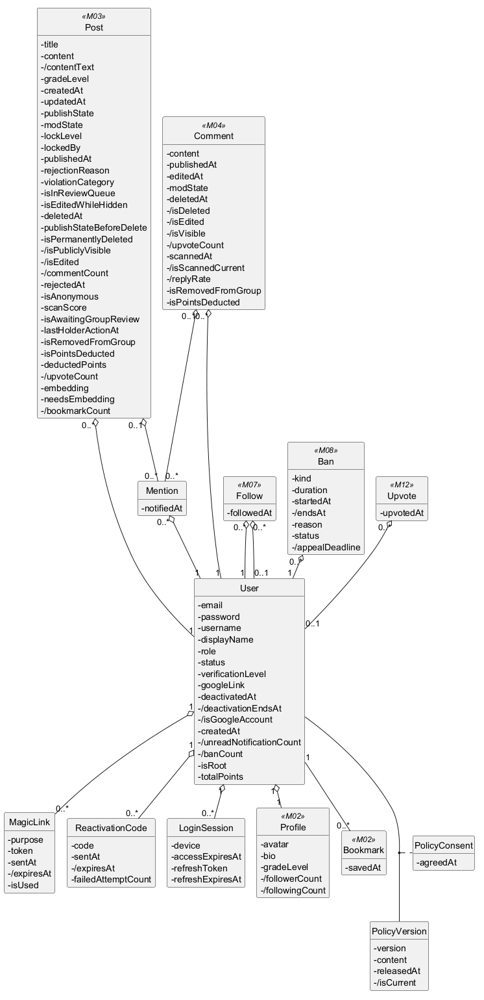

# Phân tích lớp thực thể — M01 Authentication & Account

<!-- [Vietnamese Doc] Tài liệu tiếng Việt; tên lớp và thuộc tính viết tiếng Anh (input/CONVENTIONS.md mục 3). -->

| Mã tài liệu | EC-M01 |
|---|---|
| Dự án | iShare |
| Module | M01 — Authentication & Account |
| Đầu vào | FR-M01 phiên bản 1.10 |
| Trạng thái | Bản nháp |
| Phiên bản | 0.1 |
| Ngày | 2026-11-20 |
| Tác giả | Phạm Văn Đức |

<!-- Quy ước chung cho mọi bảng dưới đây:
     - Không đổi tên cột, không xóa cột, không đổi số mục: tool đọc bảng theo số mục và tên cột.
     - Ô không có nội dung ghi "—".
     - Mục chưa tới bước làm thì để dòng "(Chưa làm — bước N)".
     - Cột Nguồn ghi mã trong FR: FR-Mxx-nn, FR-Mxx-nn.mm, BR-Mxx-nn, hoặc TN:<thuật ngữ> (mục 2.1 của FR).
     - Mục 4 chỉ chứa ảnh sơ đồ. gen_puml.py ghi mã PlantUML vào tệp riêng diagrams/EC-Mxx.puml, render
       diagrams/EC-Mxx.png và đặt ảnh vào mục 4. Không chép mã PlantUML vào tài liệu, không sửa tay tệp .puml hay ảnh. -->

## 1. Mô tả chức năng

### 1.1 Đoạn mô tả

Hệ thống quản lý tài khoản của người dùng iShare cùng các magic link, mã kích hoạt lại, phiên đăng nhập, lượt nhắc
tên, phiên bản chính sách của trang Privacy Policy/ToS và bản ghi đồng ý của tài khoản.

Hệ thống cho phép Guest đăng ký tài khoản email bằng email và mật khẩu khi đồng ý Privacy Policy/ToS; tài khoản mới ở
trạng thái tài khoản ACTIVE, mức xác minh NONE và mang vai trò USER. Khi tạo tài khoản, hệ thống ghi một bản ghi đồng
ý gồm phiên bản chính sách mà người đăng ký đã đồng ý và thời điểm đồng ý. Hệ thống gửi magic link xác minh tới email
của tài khoản email và cho chủ tài khoản yêu cầu gửi lại magic link xác minh; mỗi magic link xác minh có thời điểm gửi
và thời hạn, chỉ dùng được một lần, và mất hiệu lực khi một magic link xác minh mới được gửi. Khi chủ tài khoản mở
magic link xác minh còn hạn, mức xác minh của tài khoản chuyển sang EMAIL_VERIFIED. Hệ thống cho phép chủ tài khoản ở
mức xác minh EMAIL_VERIFIED thiết lập tài khoản bằng username, display_name và thông tin tùy chọn của hồ sơ, rồi mức
xác minh chuyển sang SETUP_COMPLETED. Username là duy nhất trong mọi tài khoản, kể cả tài khoản ở trạng thái DELETED,
còn display_name là tên hiển thị chính của người dùng và không cần duy nhất; người dùng đổi username và display_name ở
trang sửa hồ sơ của M02 theo cùng quy tắc của M01.

Hệ thống cho phép Guest đăng ký và đăng nhập bằng Google. Khi Guest đăng nhập Google lần đầu với email chưa thuộc tài
khoản nào, hệ thống tạo tài khoản Google ở trạng thái tài khoản ACTIVE và mức xác minh EMAIL_VERIFIED, không có mật
khẩu, với display_name điền sẵn bằng tên lấy từ Google. Khi Guest đăng nhập Google với email trùng email của một tài
khoản email, hệ thống tạo liên kết Google cho tài khoản email đó, chuyển mức xác minh NONE của tài khoản sang
EMAIL_VERIFIED và thông báo cho chủ tài khoản.

Hệ thống cho phép Guest đăng nhập bằng email và mật khẩu; cổng đăng nhập xét trạng thái tài khoản trước, mức xác minh
sau, để cho vào, từ chối, hoặc đưa người dùng về bước đăng ký còn dở. Tài khoản ở trạng thái BANNED đăng nhập được
nhưng chỉ được xem lý do ban, thời hạn khiếu nại của lần ban và gửi khiếu nại; lần ban và khiếu nại do M08 và M09 quản
lý. Trạng thái tài khoản chuyển giữa ACTIVE và BANNED khi Mod hoặc Admin ban hoặc gỡ ban ở M08, khi khiếu nại ban được
chấp nhận ở M09, hoặc khi ban tạm thời hết hạn. Hệ thống từ chối tạo tài khoản mới khi công tắc tạm dừng đăng ký hoặc
chế độ bảo trì của M10 đang bật, và trong khi chế độ bảo trì đang bật thì chỉ tài khoản có vai trò ADMIN được đăng
nhập và thao tác.

Mỗi lần đăng nhập thành công trên một thiết bị, hệ thống tạo một phiên đăng nhập riêng cho thiết bị đó, gồm phiên truy
cập và phiên làm mới, nên một tài khoản có thể có nhiều phiên đăng nhập cùng lúc. Hệ thống duy trì phiên đăng nhập
bằng cách cấp phiên truy cập mới từ phiên làm mới còn hạn; mỗi phiên làm mới đã dùng được thay bằng một phiên làm mới
mới và mất hiệu lực. Hệ thống cho phép người dùng đăng xuất, kết thúc phiên đăng nhập của thiết bị đang dùng mà giữ
nguyên các phiên đăng nhập khác của tài khoản.

Hệ thống cho phép người dùng của tài khoản email đổi mật khẩu bằng mật khẩu cũ và mật khẩu mới, giữ nguyên các phiên
đăng nhập khác và thông báo cho chủ tài khoản. Hệ thống cho phép Guest lấy lại mật khẩu của tài khoản email bằng magic
link đặt lại mật khẩu gửi tới email của tài khoản; mỗi magic link đặt lại mật khẩu có thời điểm gửi và thời hạn, chỉ
dùng được một lần, và mất hiệu lực khi một magic link đặt lại mật khẩu mới được gửi. Khi đặt lại mật khẩu thành công,
hệ thống thay mật khẩu, kết thúc mọi phiên đăng nhập của tài khoản, tạo một phiên đăng nhập mới cho thiết bị đang dùng
và thông báo cho chủ tài khoản.

Hệ thống cho phép người dùng tự vô hiệu hóa tài khoản ACTIVE của mình, là cách duy nhất để đi tới xóa tài khoản; tài
khoản chuyển sang DEACTIVATED, mọi phiên đăng nhập của tài khoản bị kết thúc, và thời hạn vô hiệu hóa được tính từ
thời điểm vô hiệu hóa. Hệ thống cho phép chủ tài khoản ở trạng thái DEACTIVATED kích hoạt lại tài khoản trong thời hạn
vô hiệu hóa bằng mã kích hoạt lại gửi tới email của tài khoản; mỗi mã kích hoạt lại có thời điểm gửi và thời hạn, và
mất hiệu lực sau một số lần nhập sai. Khi kích hoạt lại thành công, tài khoản về ACTIVE, bài viết và bình luận của tài
khoản hiển thị lại với display_name và avatar của chủ tài khoản, và hệ thống tạo một phiên đăng nhập mới cho thiết bị
đang dùng. Khi hết thời hạn vô hiệu hóa mà tài khoản chưa được kích hoạt lại, hệ thống tự chuyển tài khoản sang
DELETED, sau khi đã gửi email cảnh báo cho chủ tài khoản trước thời điểm đó. Tài khoản ở trạng thái DELETED vẫn được
giữ, không chuyển sang trạng thái khác và giữ username vĩnh viễn, còn email của tài khoản được giải phóng để đăng ký
tài khoản mới. Khi tài khoản chuyển sang DELETED, hệ thống xóa dữ liệu cá nhân của tài khoản: email, mật khẩu, liên
kết Google, display_name, avatar, bio, Lớp/Khối, mọi phiên đăng nhập, bookmark, các lượt theo dõi người dùng và Topic
của tài khoản, các lượt người khác theo dõi tài khoản, và các bản ghi đồng ý. Upvote tài khoản đã cho vẫn được tính
cho người nhận mà không còn ghi người cho, nhật ký kiểm duyệt và nhật ký AI vẫn liên kết với tài khoản qua username,
và phản hồi gợi ý Topic của tài khoản được giữ mà không gắn với danh tính.

Trong khi tài khoản tác giả ở trạng thái DEACTIVATED hoặc DELETED, hệ thống ẩn bài viết của tài khoản và hiển thị bình
luận của tài khoản với nội dung gốc, tên thay thế và avatar mặc định. Trong khi tài khoản tác giả ở trạng thái
DEACTIVATED, hệ thống cho Mod và Admin xem bài viết bị ẩn và danh tính thật của tác giả. Hệ thống cung cấp cho M16 tên
thay thế làm tên người gửi tin nhắn của tài khoản ở trạng thái DEACTIVATED hoặc DELETED.

Hệ thống cho phép người dùng nhắc tên người dùng khác khi soạn bài viết hoặc bình luận bằng cách chọn từ danh sách gợi
ý nhắc tên, tìm theo display_name và username trong các tài khoản ACTIVE đã hoàn tất thiết lập tài khoản. Danh sách
gợi ý nhắc tên xếp trước người mà người soạn đang theo dõi, rồi người cùng Group với người soạn, rồi những người còn
lại. Mỗi lượt nhắc tên được ghi nhận theo tài khoản người được nhắc và hiển thị bằng display_name hiện tại của người
được nhắc, hoặc bằng tên thay thế khi tài khoản người được nhắc ở trạng thái DEACTIVATED hoặc DELETED. Khi nội dung
chứa lượt nhắc tên được hiển thị công khai, hệ thống gửi thông báo cho người được nhắc, và khi nội dung đã công khai
được sửa thì chỉ gửi thông báo cho người mới được nhắc thêm.

Hệ thống cho phép mọi người, kể cả Guest, xem trang Privacy Policy/ToS; mỗi bản nội dung của trang Privacy Policy/ToS
gắn với một phiên bản chính sách do đội phát triển triển khai. Khi phiên bản chính sách hiện hành mới hơn phiên bản
chính sách người dùng đã đồng ý, hệ thống yêu cầu người dùng đồng ý lại và ghi một bản ghi đồng ý mới; người dùng
không đồng ý thì chỉ được đăng xuất hoặc vô hiệu hóa tài khoản.

<!-- Văn xuôi bình thường, có thể chia vài đoạn. KHÔNG ghi mã câu (S1), (S2)… trong đoạn văn: người đọc không hiểu
     các mã đó. Số câu chỉ nằm ở bảng 1.2. Xem steps/01-describe-functions.md. -->

### 1.2 Truy vết câu

<!-- Mỗi câu của đoạn mô tả một dòng, theo đúng thứ tự. Câu: 1, 2, 3…
     Nội dung câu: chép NGUYÊN VĂN câu đó từ mục 1.1 (tool so khớp từng câu với đoạn văn).
     Nguồn: mã chức năng hoặc yêu cầu của FR mà câu dựa vào. -->

| Câu | Nội dung câu | Nguồn |
|---|---|---|
| 1 | Hệ thống quản lý tài khoản của người dùng iShare cùng các magic link, mã kích hoạt lại, phiên đăng nhập, lượt nhắc tên, phiên bản chính sách của trang Privacy Policy/ToS và bản ghi đồng ý của tài khoản. | FR-M01-01, FR-M01-02, FR-M01-06, FR-M01-11, FR-M01-14, FR-M01-15, FR-M01-16 |
| 2 | Hệ thống cho phép Guest đăng ký tài khoản email bằng email và mật khẩu khi đồng ý Privacy Policy/ToS; tài khoản mới ở trạng thái tài khoản ACTIVE, mức xác minh NONE và mang vai trò USER. | FR-M01-01.01, FR-M01-01.02, FR-M01-01.05, FR-M01-01.06 |
| 3 | Khi tạo tài khoản, hệ thống ghi một bản ghi đồng ý gồm phiên bản chính sách mà người đăng ký đã đồng ý và thời điểm đồng ý. | FR-M01-01.14, FR-M01-04.13 |
| 4 | Hệ thống gửi magic link xác minh tới email của tài khoản email và cho chủ tài khoản yêu cầu gửi lại magic link xác minh; mỗi magic link xác minh có thời điểm gửi và thời hạn, chỉ dùng được một lần, và mất hiệu lực khi một magic link xác minh mới được gửi. | FR-M01-01.03, FR-M01-02.03, FR-M01-02.04, FR-M01-02.05, FR-M01-02.06, FR-M01-02.07 |
| 5 | Khi chủ tài khoản mở magic link xác minh còn hạn, mức xác minh của tài khoản chuyển sang EMAIL_VERIFIED. | FR-M01-02.01, FR-M01-02.02 |
| 6 | Hệ thống cho phép chủ tài khoản ở mức xác minh EMAIL_VERIFIED thiết lập tài khoản bằng username, display_name và thông tin tùy chọn của hồ sơ, rồi mức xác minh chuyển sang SETUP_COMPLETED. | FR-M01-03.01, FR-M01-03.02, FR-M01-03.03, FR-M01-03.08 |
| 7 | Username là duy nhất trong mọi tài khoản, kể cả tài khoản ở trạng thái DELETED, còn display_name là tên hiển thị chính của người dùng và không cần duy nhất; người dùng đổi username và display_name ở trang sửa hồ sơ của M02 theo cùng quy tắc của M01. | FR-M01-03.06, FR-M01-03.07, FR-M01-03.10, FR-M01-03.15, FR-M01-03.16 |
| 8 | Hệ thống cho phép Guest đăng ký và đăng nhập bằng Google. | FR-M01-04 |
| 9 | Khi Guest đăng nhập Google lần đầu với email chưa thuộc tài khoản nào, hệ thống tạo tài khoản Google ở trạng thái tài khoản ACTIVE và mức xác minh EMAIL_VERIFIED, không có mật khẩu, với display_name điền sẵn bằng tên lấy từ Google. | FR-M01-04.01, FR-M01-04.02, FR-M01-04.03, FR-M01-04.07, FR-M01-04.12 |
| 10 | Khi Guest đăng nhập Google với email trùng email của một tài khoản email, hệ thống tạo liên kết Google cho tài khoản email đó, chuyển mức xác minh NONE của tài khoản sang EMAIL_VERIFIED và thông báo cho chủ tài khoản. | FR-M01-04.04, FR-M01-04.05, FR-M01-04.09, FR-M01-04.11 |
| 11 | Hệ thống cho phép Guest đăng nhập bằng email và mật khẩu; cổng đăng nhập xét trạng thái tài khoản trước, mức xác minh sau, để cho vào, từ chối, hoặc đưa người dùng về bước đăng ký còn dở. | FR-M01-05.01, FR-M01-05.02, FR-M01-05.03, FR-M01-05.04, FR-M01-05.10, FR-M01-05.11, FR-M01-05.13, FR-M01-04.06 |
| 12 | Tài khoản ở trạng thái BANNED đăng nhập được nhưng chỉ được xem lý do ban, thời hạn khiếu nại của lần ban và gửi khiếu nại; lần ban và khiếu nại do M08 và M09 quản lý. | FR-M01-05.05, FR-M01-05.06, FR-M01-05.07, FR-M01-05.08, FR-M01-05.09 |
| 13 | Trạng thái tài khoản chuyển giữa ACTIVE và BANNED khi Mod hoặc Admin ban hoặc gỡ ban ở M08, khi khiếu nại ban được chấp nhận ở M09, hoặc khi ban tạm thời hết hạn. | FR-M01-05.14, FR-M01-05.15, FR-M01-05.16, FR-M01-05.17 |
| 14 | Hệ thống từ chối tạo tài khoản mới khi công tắc tạm dừng đăng ký hoặc chế độ bảo trì của M10 đang bật, và trong khi chế độ bảo trì đang bật thì chỉ tài khoản có vai trò ADMIN được đăng nhập và thao tác. | FR-M01-01.08, FR-M01-01.09, FR-M01-01.12, FR-M01-04.10, FR-M01-05.19, FR-M01-05.20 |
| 15 | Mỗi lần đăng nhập thành công trên một thiết bị, hệ thống tạo một phiên đăng nhập riêng cho thiết bị đó, gồm phiên truy cập và phiên làm mới, nên một tài khoản có thể có nhiều phiên đăng nhập cùng lúc. | FR-M01-05.12, FR-M01-04.08, FR-M01-06.05, FR-M01-06.06 |
| 16 | Hệ thống duy trì phiên đăng nhập bằng cách cấp phiên truy cập mới từ phiên làm mới còn hạn; mỗi phiên làm mới đã dùng được thay bằng một phiên làm mới mới và mất hiệu lực. | FR-M01-06.01, FR-M01-06.02, FR-M01-06.03, FR-M01-06.04, FR-M01-06.07 |
| 17 | Hệ thống cho phép người dùng đăng xuất, kết thúc phiên đăng nhập của thiết bị đang dùng mà giữ nguyên các phiên đăng nhập khác của tài khoản. | FR-M01-07.01, FR-M01-07.02 |
| 18 | Hệ thống cho phép người dùng của tài khoản email đổi mật khẩu bằng mật khẩu cũ và mật khẩu mới, giữ nguyên các phiên đăng nhập khác và thông báo cho chủ tài khoản. | FR-M01-08.01, FR-M01-08.04, FR-M01-08.05, FR-M01-08.06, FR-M01-08.10 |
| 19 | Hệ thống cho phép Guest lấy lại mật khẩu của tài khoản email bằng magic link đặt lại mật khẩu gửi tới email của tài khoản; mỗi magic link đặt lại mật khẩu có thời điểm gửi và thời hạn, chỉ dùng được một lần, và mất hiệu lực khi một magic link đặt lại mật khẩu mới được gửi. | FR-M01-09.01, FR-M01-09.05, FR-M01-09.07, FR-M01-09.10, FR-M01-09.11, FR-M01-09.16 |
| 20 | Khi đặt lại mật khẩu thành công, hệ thống thay mật khẩu, kết thúc mọi phiên đăng nhập của tài khoản, tạo một phiên đăng nhập mới cho thiết bị đang dùng và thông báo cho chủ tài khoản. | FR-M01-09.02, FR-M01-09.03, FR-M01-09.04, FR-M01-09.12 |
| 21 | Hệ thống cho phép người dùng tự vô hiệu hóa tài khoản ACTIVE của mình, là cách duy nhất để đi tới xóa tài khoản; tài khoản chuyển sang DEACTIVATED, mọi phiên đăng nhập của tài khoản bị kết thúc, và thời hạn vô hiệu hóa được tính từ thời điểm vô hiệu hóa. | FR-M01-10.01, FR-M01-10.02, FR-M01-10.03, FR-M01-10.05, FR-M01-10.07 |
| 22 | Hệ thống cho phép chủ tài khoản ở trạng thái DEACTIVATED kích hoạt lại tài khoản trong thời hạn vô hiệu hóa bằng mã kích hoạt lại gửi tới email của tài khoản; mỗi mã kích hoạt lại có thời điểm gửi và thời hạn, và mất hiệu lực sau một số lần nhập sai. | FR-M01-11.01, FR-M01-11.05, FR-M01-11.07, FR-M01-11.08, FR-M01-11.09, FR-M01-11.10 |
| 23 | Khi kích hoạt lại thành công, tài khoản về ACTIVE, bài viết và bình luận của tài khoản hiển thị lại với display_name và avatar của chủ tài khoản, và hệ thống tạo một phiên đăng nhập mới cho thiết bị đang dùng. | FR-M01-11.02, FR-M01-11.03, FR-M01-11.04, FR-M01-11.06 |
| 24 | Khi hết thời hạn vô hiệu hóa mà tài khoản chưa được kích hoạt lại, hệ thống tự chuyển tài khoản sang DELETED, sau khi đã gửi email cảnh báo cho chủ tài khoản trước thời điểm đó. | FR-M01-12.01, FR-M01-12.05 |
| 25 | Tài khoản ở trạng thái DELETED vẫn được giữ, không chuyển sang trạng thái khác và giữ username vĩnh viễn, còn email của tài khoản được giải phóng để đăng ký tài khoản mới. | FR-M01-12.03, FR-M01-12.04, FR-M01-12.06, FR-M01-12.07 |
| 26 | Khi tài khoản chuyển sang DELETED, hệ thống xóa dữ liệu cá nhân của tài khoản: email, mật khẩu, liên kết Google, display_name, avatar, bio, Lớp/Khối, mọi phiên đăng nhập, bookmark, các lượt theo dõi người dùng và Topic của tài khoản, các lượt người khác theo dõi tài khoản, và các bản ghi đồng ý. | FR-M01-12.02, FR-M01-12.08 |
| 27 | Upvote tài khoản đã cho vẫn được tính cho người nhận mà không còn ghi người cho, nhật ký kiểm duyệt và nhật ký AI vẫn liên kết với tài khoản qua username, và phản hồi gợi ý Topic của tài khoản được giữ mà không gắn với danh tính. | FR-M01-12.09, FR-M01-12.10, FR-M01-12.11 |
| 28 | Trong khi tài khoản tác giả ở trạng thái DEACTIVATED hoặc DELETED, hệ thống ẩn bài viết của tài khoản và hiển thị bình luận của tài khoản với nội dung gốc, tên thay thế và avatar mặc định. | FR-M01-13.01, FR-M01-13.02, FR-M01-13.03, FR-M01-13.04 |
| 29 | Trong khi tài khoản tác giả ở trạng thái DEACTIVATED, hệ thống cho Mod và Admin xem bài viết bị ẩn và danh tính thật của tác giả. | FR-M01-13.05 |
| 30 | Hệ thống cung cấp cho M16 tên thay thế làm tên người gửi tin nhắn của tài khoản ở trạng thái DEACTIVATED hoặc DELETED. | FR-M01-13.06, FR-M01-13.07 |
| 31 | Hệ thống cho phép người dùng nhắc tên người dùng khác khi soạn bài viết hoặc bình luận bằng cách chọn từ danh sách gợi ý nhắc tên, tìm theo display_name và username trong các tài khoản ACTIVE đã hoàn tất thiết lập tài khoản. | FR-M01-14.01, FR-M01-14.02, FR-M01-14.03, FR-M01-14.11, FR-M01-14.14 |
| 32 | Danh sách gợi ý nhắc tên xếp trước người mà người soạn đang theo dõi, rồi người cùng Group với người soạn, rồi những người còn lại. | FR-M01-14.04, FR-M01-14.05, FR-M01-14.12, FR-M01-14.13 |
| 33 | Mỗi lượt nhắc tên được ghi nhận theo tài khoản người được nhắc và hiển thị bằng display_name hiện tại của người được nhắc, hoặc bằng tên thay thế khi tài khoản người được nhắc ở trạng thái DEACTIVATED hoặc DELETED. | FR-M01-14.06, FR-M01-14.07, FR-M01-14.08, FR-M01-14.15, FR-M01-14.16 |
| 34 | Khi nội dung chứa lượt nhắc tên được hiển thị công khai, hệ thống gửi thông báo cho người được nhắc, và khi nội dung đã công khai được sửa thì chỉ gửi thông báo cho người mới được nhắc thêm. | FR-M01-14.10, FR-M01-14.17 |
| 35 | Hệ thống cho phép mọi người, kể cả Guest, xem trang Privacy Policy/ToS; mỗi bản nội dung của trang Privacy Policy/ToS gắn với một phiên bản chính sách do đội phát triển triển khai. | FR-M01-15.01, FR-M01-15.02, FR-M01-15.08, FR-M01-15.09 |
| 36 | Khi phiên bản chính sách hiện hành mới hơn phiên bản chính sách người dùng đã đồng ý, hệ thống yêu cầu người dùng đồng ý lại và ghi một bản ghi đồng ý mới; người dùng không đồng ý thì chỉ được đăng xuất hoặc vô hiệu hóa tài khoản. | FR-M01-16.01, FR-M01-16.02, FR-M01-16.03, FR-M01-16.04, FR-M01-16.05 |

## 2. Danh từ và phân loại

### 2.1 Sổ danh từ

<!-- Phân loại: Lớp | Thuộc tính | Loại bỏ.
     Kết quả: tên lớp; hoặc Lớp.thuộcTính; hoặc "—" khi loại bỏ.
     Xuất hiện ở: "Câu n" (số câu ở bảng 1.2) hoặc "Quét: <mã FR>" (lượt quét bổ sung). -->

| # | Danh từ | Xuất hiện ở | Phân loại | Kết quả | Lý do |
|---|---|---|---|---|---|
| 1 | hệ thống | Câu 1 | Loại bỏ | — | Trừu tượng: chỉ chính phần mềm |
| 2 | iShare | Câu 1 | Loại bỏ | — | Trừu tượng: tên của chính hệ thống |
| 3 | tài khoản / người dùng | Câu 1 | Lớp | User | Hệ thống tạo, đổi trạng thái và giữ tài khoản cả sau khi xóa; có nhiều thông tin riêng (email, username, trạng thái…). "Tài khoản" và "người dùng" chỉ cùng một đối tượng; dùng tên User mà EC-M05 đã tham chiếu |
| 4 | magic link | Câu 1 | Lớp | MagicLink | Mỗi link được tạo, gửi, dùng một lần, hết hạn riêng; có thời điểm gửi và trạng thái đã dùng (BR-M01-38). Hai loại link xét ở dòng 23, 59 (Q-01) |
| 5 | mã kích hoạt lại | Câu 1 | Lớp | ReactivationCode | Mỗi mã được tạo, gửi, hết hạn và mất hiệu lực riêng; có mã số, thời điểm gửi, số lần nhập sai (BR-M01-22) |
| 6 | phiên đăng nhập | Câu 1 | Lớp | LoginSession | Một tài khoản có nhiều phiên, mỗi thiết bị một phiên; được tạo, làm mới, kết thúc riêng (BR-M01-16, BR-M01-17) |
| 7 | lượt nhắc tên | Câu 1 | Lớp | Mention | FR yêu cầu ghi nhận từng lượt nhắc theo tài khoản người được nhắc và gửi thông báo theo từng lượt (BR-M01-28, BR-M01-30) |
| 8 | phiên bản chính sách | Câu 1 | Lớp | PolicyVersion | Mỗi bản nội dung của trang chính sách là một phiên bản riêng, có số phiên bản; bản ghi đồng ý trỏ tới nó (FR-M01-15.08) |
| 9 | trang Privacy Policy, ToS | Câu 1 | Loại bỏ | — | Giao diện: trang công khai hiển thị nội dung của phiên bản chính sách hiện hành; nội dung xét ở dòng 93 |
| 10 | bản ghi đồng ý | Câu 1 | Lớp | PolicyConsent | Mỗi lần đồng ý tạo một bản ghi mới với thời điểm và phiên bản (BR-M01-44); bị xóa khi tài khoản DELETED |
| 11 | Guest | Câu 2 | Loại bỏ | — | Không lưu: tác nhân không có dữ liệu (chưa đăng nhập) |
| 12 | tài khoản email | Câu 2 | Loại bỏ | — | Giá trị của User.isGoogleAccount (sai) |
| 13 | email | Câu 2 | Thuộc tính | User.email | Mô tả tài khoản; mỗi email thuộc tối đa một tài khoản (BR-M01-04) |
| 14 | mật khẩu | Câu 2 | Thuộc tính | User.password | Mô tả tài khoản email; quy tắc ở BR-M01-35 |
| 15 | trạng thái tài khoản | Câu 2 | Thuộc tính | User.status | Thuộc tính trạng thái có bảng chuyển trạng thái riêng (mục 5.19 của FR) |
| 16 | ACTIVE | Câu 2 | Loại bỏ | — | Giá trị của User.status |
| 17 | mức xác minh | Câu 2 | Thuộc tính | User.verificationLevel | Thuộc tính tiến độ đăng ký có bảng chuyển trạng thái riêng (mục 5.19 của FR) |
| 18 | NONE | Câu 2 | Loại bỏ | — | Giá trị của User.verificationLevel |
| 19 | vai trò | Câu 2 | Thuộc tính | User.role | Giá trị phân quyền của tài khoản (BR-M01-01) |
| 20 | USER | Câu 2 | Loại bỏ | — | Giá trị của User.role |
| 21 | người đăng ký | Câu 3 | Lớp | User | Vai trò theo ngữ cảnh của người có tài khoản vừa tạo |
| 22 | thời điểm đồng ý | Câu 3 | Thuộc tính | PolicyConsent.agreedAt | Mô tả bản ghi đồng ý (FR-M01-01.14) |
| 23 | magic link xác minh | Câu 4 | Loại bỏ | — | Giá trị của MagicLink.purpose (Q-01) |
| 24 | chủ tài khoản | Câu 4 | Lớp | User | Vai trò theo ngữ cảnh: người sở hữu tài khoản đang được thao tác |
| 25 | thời điểm gửi magic link | Câu 4 | Thuộc tính | MagicLink.sentAt | Dùng để xét hạn link và khoảng cách giữa hai lần gửi (BR-M01-10, BR-M01-11) |
| 26 | thời hạn của magic link | Câu 4 | Thuộc tính | MagicLink.expiresAt | Dẫn xuất từ thời điểm gửi và loại link; độ dài hạn là hằng số của BR-M01-10, BR-M01-12 |
| 27 | một lần dùng (magic link) | Câu 4 | Thuộc tính | MagicLink.isUsed | Dấu vết "đã được dùng" phải lưu để từ chối dùng lại (BR-M01-38) |
| 28 | EMAIL_VERIFIED | Câu 5 | Loại bỏ | — | Giá trị của User.verificationLevel |
| 29 | username | Câu 6 | Thuộc tính | User.username | Mô tả tài khoản; duy nhất (BR-M01-05) |
| 30 | display_name / tên hiển thị chính | Câu 6 | Thuộc tính | User.displayName | Mô tả tài khoản (BR-M01-06, BR-M01-07) |
| 31 | thông tin tùy chọn của hồ sơ / hồ sơ | Câu 6 | Lớp | Profile | Lớp ngoài: hồ sơ thuộc M02 (TN:Thông tin tùy chọn); M01 ghi các trường tùy chọn ở bước 3 và xóa chúng khi DELETED |
| 32 | SETUP_COMPLETED | Câu 6 | Loại bỏ | — | Giá trị của User.verificationLevel |
| 33 | DELETED | Câu 7 | Loại bỏ | — | Giá trị của User.status |
| 34 | trang sửa hồ sơ | Câu 7 | Loại bỏ | — | Giao diện: trang của M02; M01 chỉ đặt quy tắc username, display_name |
| 35 | quy tắc | Câu 7 | Loại bỏ | — | Chung chung: các quy tắc đã ghi vào cột Ràng buộc của username, displayName |
| 36 | M01, M02, M08, M09, M10, M16 (tên module) | Câu 7 | Loại bỏ | — | Trừu tượng: tên các phần của hệ thống |
| 37 | Google | Câu 8 | Loại bỏ | — | Ngoài phạm vi hệ thống: nhà cung cấp đăng nhập bên ngoài |
| 38 | tài khoản Google | Câu 9 | Loại bỏ | — | Giá trị của User.isGoogleAccount (đúng) |
| 39 | tên lấy từ Google | Câu 9 | Loại bỏ | — | Hành động không lưu dấu vết: chỉ dùng để điền sẵn User.displayName ở bước 3 (FR-M01-04.02), không lưu riêng |
| 40 | liên kết Google | Câu 10 | Thuộc tính | User.googleLink | Mô tả tài khoản; bị xóa khi DELETED (BR-M01-47) |
| 41 | thông báo / email cảnh báo | Câu 10 | Loại bỏ | — | Ngoài phạm vi module (M07): M01 chỉ phát sự kiện, M07 gửi và lưu thông báo, email |
| 42 | cổng đăng nhập | Câu 11 | Loại bỏ | — | Hành động không lưu dấu vết: phép kiểm tra lúc đăng nhập (BR-M01-18) |
| 43 | bước đăng ký còn dở | Câu 11 | Loại bỏ | — | Giá trị của User.verificationLevel: bước còn dở suy ra từ mức xác minh (BR-M01-18) |
| 44 | BANNED | Câu 12 | Loại bỏ | — | Giá trị của User.status |
| 45 | lý do ban | Câu 12 | Thuộc tính | Ban.reason | Thông tin của lớp ngoài Ban mà M01 đọc để hiển thị (FR-M01-05.07) |
| 46 | thời hạn khiếu nại | Câu 12 | Thuộc tính | Ban.appealDeadline | Thông tin của lớp ngoài Ban mà M01 đọc để hiện hoặc ẩn thời gian khiếu nại (FR-M01-05.08, FR-M01-05.09); quy tắc của M09 |
| 47 | lần ban | Câu 12 | Lớp | Ban | Lớp ngoài (M08): M01 đọc lần ban của tài khoản BANNED để hiển thị và để về ACTIVE khi ban tạm thời hết hạn |
| 48 | khiếu nại | Câu 12 | Loại bỏ | — | Ngoài phạm vi module (M09): M01 chỉ nhận kết quả khiếu nại được chấp nhận để đổi User.status |
| 49 | Mod | Câu 13 | Lớp | User | Vai trò có tài khoản; phân biệt bằng User.role |
| 50 | Admin | Câu 13 | Lớp | User | Vai trò có tài khoản; phân biệt bằng User.role |
| 51 | ban tạm thời hết hạn | Câu 13 | Thuộc tính | Ban.endsAt | Thông tin của lớp ngoài Ban mà M01 đọc để chuyển tài khoản về ACTIVE ngay lúc hết hạn (FR-M01-05.17) |
| 52 | công tắc tạm dừng đăng ký | Câu 14 | Loại bỏ | — | Ngoài phạm vi module (M10): M01 chỉ đọc công tắc khi tạo tài khoản; không có dữ liệu của M01 gắn với công tắc |
| 53 | chế độ bảo trì | Câu 14 | Loại bỏ | — | Ngoài phạm vi module (M10): như dòng 52 |
| 54 | vai trò ADMIN | Câu 14 | Loại bỏ | — | Giá trị của User.role |
| 55 | thiết bị | Câu 15 | Thuộc tính | LoginSession.device | Mô tả phiên đăng nhập; FR không nêu thông tin riêng nào của thiết bị ngoài việc mỗi thiết bị một phiên (BR-M01-17) |
| 56 | phiên truy cập | Câu 15 | Thuộc tính | LoginSession.accessExpiresAt | Phần của phiên đăng nhập, không có vòng đời riêng ngoài phiên đăng nhập; thông tin cần lưu là hạn (BR-M01-16) |
| 57 | phiên làm mới / phiên làm mới mới | Câu 15 | Thuộc tính | LoginSession.refreshToken | Phần của phiên đăng nhập; mỗi lúc chỉ phiên làm mới mới nhất còn hiệu lực (FR-M01-06.02), nên lưu phiên làm mới hiện tại trên phiên đăng nhập |
| 58 | mật khẩu cũ / mật khẩu mới | Câu 18 | Loại bỏ | — | Chung chung: giá trị nhập khi đổi hoặc đặt lại; chỉ mật khẩu hiện tại được lưu ở User.password |
| 59 | magic link đặt lại mật khẩu | Câu 19 | Loại bỏ | — | Giá trị của MagicLink.purpose (Q-01) |
| 60 | DEACTIVATED | Câu 21 | Loại bỏ | — | Giá trị của User.status |
| 61 | thời hạn vô hiệu hóa | Câu 21 | Thuộc tính | User.deactivationEndsAt | Dẫn xuất từ thời điểm vô hiệu hóa (TN:Thời hạn vô hiệu hóa); độ dài 14 × 24 giờ là hằng số của BR-M01-21 |
| 62 | thời điểm vô hiệu hóa | Câu 21 | Thuộc tính | User.deactivatedAt | Mốc tính thời hạn vô hiệu hóa (FR-M01-10.07) |
| 63 | thời điểm gửi mã kích hoạt lại | Câu 22 | Thuộc tính | ReactivationCode.sentAt | Dùng để xét hạn mã và khoảng cách giữa hai lần gửi (BR-M01-22) |
| 64 | thời hạn của mã kích hoạt lại | Câu 22 | Thuộc tính | ReactivationCode.expiresAt | Dẫn xuất từ thời điểm gửi; 15 phút là hằng số của BR-M01-22 |
| 65 | lần nhập sai | Câu 22 | Thuộc tính | ReactivationCode.failedAttemptCount | Phải đếm theo từng mã để làm mã mất hiệu lực ở lần sai thứ 5 (FR-M01-11.08) |
| 66 | bài viết | Câu 23 | Lớp | Post | Lớp ngoài (M03): bài viết có tác giả là tài khoản (bị ẩn theo trạng thái tác giả) và chứa lượt nhắc tên |
| 67 | bình luận | Câu 23 | Lớp | Comment | Lớp ngoài (M04): bình luận có tác giả là tài khoản và chứa lượt nhắc tên |
| 68 | avatar | Câu 23 | Thuộc tính | Profile.avatar | Thông tin của lớp ngoài Profile mà M01 ghi ở bước 3, đọc cho danh sách gợi ý nhắc tên, xóa khi DELETED |
| 69 | dữ liệu cá nhân | Câu 26 | Loại bỏ | — | Chung chung: danh mục các thuộc tính bị xóa khi DELETED (BR-M01-47), đã ghi ở cột Ràng buộc của từng thuộc tính |
| 70 | bio | Câu 26 | Thuộc tính | Profile.bio | Thông tin của lớp ngoài Profile mà M01 ghi ở bước 3 và xóa khi DELETED |
| 71 | Lớp/Khối | Câu 26 | Thuộc tính | Profile.gradeLevel | Như dòng 70; tên theo register (grade_level) |
| 72 | bookmark | Câu 26 | Lớp | Bookmark | Lớp ngoài (M02): M01 xóa mọi bookmark của tài khoản khi DELETED (FR-M01-12.08) |
| 73 | lượt theo dõi / người đang theo dõi | Câu 26 | Lớp | Follow | Lớp ngoài (M07): M01 đọc để xếp danh sách gợi ý nhắc tên và xóa lượt theo dõi của và tới tài khoản khi DELETED |
| 74 | Topic | Câu 26 | Loại bỏ | — | Ngoài phạm vi module (M05): lượt theo dõi Topic là Follow (dòng 73) trỏ tới Topic; quan hệ đó thuộc M05, M07 |
| 75 | upvote | Câu 27 | Lớp | Upvote | Lớp ngoài (M12): M01 giữ upvote của tài khoản DELETED nhưng bỏ người cho (FR-M01-12.09) |
| 76 | người nhận (upvote) | Câu 27 | Lớp | User | Vai trò theo ngữ cảnh của tài khoản nhận upvote; quan hệ thuộc M12 |
| 77 | người cho (upvote) | Câu 27 | Lớp | User | Vai trò theo ngữ cảnh của tài khoản cho upvote |
| 78 | nhật ký kiểm duyệt | Câu 27 | Loại bỏ | — | Ngoài phạm vi module (M08): M01 chỉ giữ tài khoản DELETED cùng username để nhật ký vẫn trỏ tới, không đọc ghi nhật ký |
| 79 | nhật ký AI | Câu 27 | Loại bỏ | — | Ngoài phạm vi module (M13): như dòng 78 |
| 80 | phản hồi gợi ý Topic | Câu 27 | Loại bỏ | — | Ngoài phạm vi module (M05): quan hệ với User đã ghi ở EC-M05; M01 không đọc ghi |
| 81 | danh tính / danh tính thật | Câu 27 | Loại bỏ | — | Chung chung: chỉ các thông tin nhận diện của User (displayName, username, avatar) |
| 82 | tác giả / tài khoản tác giả | Câu 28 | Lớp | User | Vai trò theo ngữ cảnh của tài khoản viết bài viết, bình luận |
| 83 | nội dung gốc | Câu 28 | Loại bỏ | — | Ngoài phạm vi module (M04): nội dung của bình luận |
| 84 | tên thay thế | Câu 28 | Loại bỏ | — | Hằng số của FR-M01-13.03, FR-M01-13.04 (TN:Tên thay thế): chọn theo User.status, không lưu |
| 85 | avatar mặc định | Câu 28 | Loại bỏ | — | Hằng số của FR-M01-13.03: ảnh dùng chung, không lưu theo tài khoản |
| 86 | tin nhắn / tên người gửi tin nhắn | Câu 30 | Loại bỏ | — | Ngoài phạm vi module (M16): M01 chỉ cung cấp tên thay thế |
| 87 | danh sách gợi ý nhắc tên | Câu 31 | Loại bỏ | — | Hành động không lưu dấu vết: tính lại mỗi lần người soạn gõ, không lưu |
| 88 | người soạn | Câu 31 | Lớp | User | Vai trò theo ngữ cảnh của tài khoản đang soạn nội dung |
| 89 | Group | Câu 32 | Loại bỏ | — | Ngoài phạm vi module (M11): M01 chỉ đọc thành viên Group để xếp danh sách gợi ý (không lưu); không có quan hệ dữ liệu với lớp của M01 |
| 90 | những người còn lại / mọi người | Câu 32 | Loại bỏ | — | Chung chung |
| 91 | người được nhắc | Câu 33 | Lớp | User | Vai trò theo ngữ cảnh của tài khoản được nhắc tên |
| 92 | nội dung (chứa lượt nhắc tên) | Câu 34 | Loại bỏ | — | Chung chung: là bài viết hoặc bình luận (dòng 66, 67) |
| 93 | bản nội dung của trang chính sách | Câu 35 | Thuộc tính | PolicyVersion.content | Mỗi phiên bản chính sách gắn với một bản nội dung (FR-M01-15.08) |
| 94 | đội phát triển | Câu 35 | Loại bỏ | — | Ngoài phạm vi hệ thống: người triển khai, không có tài khoản trong hệ thống |
| 95 | phiên bản chính sách hiện hành | Câu 36 | Thuộc tính | PolicyVersion.isCurrent | Dẫn xuất: phiên bản phát hành gần nhất (BR-M01-44) |
| 96 | số phiên bản | Quét: TN:Phiên bản chính sách | Thuộc tính | PolicyVersion.version | Mô tả phiên bản chính sách |
| 97 | thời điểm triển khai bản mới | Quét: BR-M01-44 | Thuộc tính | PolicyVersion.releasedAt | Cần để xác định phiên bản hiện hành và so "mới hơn" |
| 98 | mã 6 chữ số | Quét: FR-M01-11.01 | Thuộc tính | ReactivationCode.code | Giá trị của mã kích hoạt lại mà chủ tài khoản nhập |
| 99 | hạn phiên làm mới tính từ lúc cấp | Quét: FR-M01-06.07 | Thuộc tính | LoginSession.refreshExpiresAt | Mỗi phiên làm mới có hạn riêng tính từ lúc cấp (BR-M01-16) |
| 100 | việc tạo tài khoản mới (cho thống kê) | Quét: FR-M01-01.01 | Thuộc tính | User.createdAt | Mục Giao tiếp với module khác: M01 cung cấp cho M15 việc tạo tài khoản mới để thống kê lượt đăng ký |
| 101 | lượt nhắc đã được thông báo | Quét: FR-M01-14.17 | Thuộc tính | Mention.notifiedAt | Khi nội dung đã công khai được sửa chỉ người mới được nhắc thêm nhận thông báo, nên phải biết lượt nào đã được thông báo |
| 102 | nhãn của lượt nhắc tên | Quét: FR-M01-14.08 | Loại bỏ | — | Hành động không lưu dấu vết: nhãn luôn là display_name hiện tại của người được nhắc (BR-M01-28), không lưu |
| 103 | magic link mới nhất | Quét: BR-M01-38 | Loại bỏ | — | Chung chung: link mới nhất cùng loại của tài khoản suy ra từ MagicLink.sentAt |
| 104 | chuỗi tìm | Quét: BR-M01-26 | Loại bỏ | — | Hành động không lưu dấu vết: chuỗi người soạn gõ, không lưu |
| 105 | ô đồng ý | Quét: FR-M01-01.13 | Loại bỏ | — | Giao diện |
| 106 | màn hình tài khoản bị khóa | Quét: TN:Màn hình tài khoản bị khóa | Loại bỏ | — | Giao diện: hiển thị Ban.reason, Ban.appealDeadline |
| 107 | trang kích hoạt | Quét: TN:Trang kích hoạt | Loại bỏ | — | Giao diện |
| 108 | nội dung hiển thị công khai | Quét: TN:Nội dung hiển thị công khai | Loại bỏ | — | Ngoài phạm vi module (M03, M04): bước quét và trạng thái hiển thị là của bài viết, bình luận |

### 2.2 Lớp

<!-- Nhóm: Thực thể | Liên kết | Thống kê. Sở hữu: mã module sở hữu lớp (Mxx của tài liệu này, hoặc Myy với lớp ngoài).
     Thuộc tính: tên mọi thuộc tính của lớp ở mục 2.3, ngăn bởi dấu phẩy, thuộc tính dẫn xuất có "/" phía trước;
     để người đọc thấy lớp và thuộc tính trên cùng một dòng. Lớp chưa có thuộc tính ghi "—". -->

| Lớp | Tên tiếng Việt | Nhóm | Sở hữu | Mô tả | Thuộc tính | Nguồn |
|---|---|---|---|---|---|---|
| User | Người dùng (tài khoản) | Thực thể | M01 | Tài khoản của một người dùng iShare; một loại tài khoản cho mọi vai trò (BR-M01-01) | email, password, username, displayName, role, status, verificationLevel, googleLink, deactivatedAt, /deactivationEndsAt, /isGoogleAccount, createdAt, /unreadNotificationCount, /banCount, isRoot, totalPoints | FR-M01-01, FR-M01-03, FR-M01-04, FR-M01-10, FR-M01-12 |
| MagicLink | Magic link | Thực thể | M01 | Liên kết gửi tới email của tài khoản để xác minh email hoặc đặt lại mật khẩu | purpose, token, sentAt, /expiresAt, isUsed | FR-M01-01.03, FR-M01-02, FR-M01-09 |
| ReactivationCode | Mã kích hoạt lại | Thực thể | M01 | Mã gửi tới email của tài khoản đã vô hiệu hóa để xác nhận kích hoạt lại | code, sentAt, /expiresAt, failedAttemptCount | FR-M01-11 |
| LoginSession | Phiên đăng nhập | Thực thể | M01 | Trạng thái đã đăng nhập của một tài khoản trên một thiết bị, gồm phiên truy cập và phiên làm mới | device, accessExpiresAt, refreshToken, refreshExpiresAt | FR-M01-05.12, FR-M01-06, FR-M01-07 |
| Mention | Lượt nhắc tên | Thực thể | M01 | Một lần nhắc một người dùng trong bài viết hoặc bình luận | notifiedAt | FR-M01-14 |
| PolicyVersion | Phiên bản chính sách | Thực thể | M01 | Một bản nội dung của trang Privacy Policy/ToS | version, content, releasedAt, /isCurrent | FR-M01-15 |
| PolicyConsent | Bản ghi đồng ý | Liên kết | M01 | Ghi nhận một tài khoản đã đồng ý một phiên bản chính sách vào một thời điểm | agreedAt | FR-M01-01.14, FR-M01-04.13, FR-M01-16.02 |
| Profile | Hồ sơ | Thực thể | M02 | Hồ sơ của người dùng; M01 ghi các trường tùy chọn ở bước 3 và xóa chúng khi DELETED | avatar, bio, gradeLevel, /followerCount, /followingCount | FR-M01-03.03, FR-M01-12.08 |
| Bookmark | Bookmark | Liên kết | M02 | Bài viết người dùng đã lưu; M01 xóa khi tài khoản DELETED | savedAt | FR-M01-12.08 |
| Post | Bài viết | Thực thể | M03 | Bài viết có tác giả là tài khoản, chứa lượt nhắc tên | title, content, /contentText, gradeLevel, createdAt, updatedAt, publishState, modState, lockLevel, lockedBy, publishedAt, rejectionReason, violationCategory, isInReviewQueue, isEditedWhileHidden, deletedAt, publishStateBeforeDelete, isPermanentlyDeleted, /isPubliclyVisible, /isEdited, /commentCount, rejectedAt, isAnonymous, scanScore, isAwaitingGroupReview, lastHolderActionAt, isRemovedFromGroup, isPointsDeducted, deductedPoints, /upvoteCount, embedding, needsEmbedding, /bookmarkCount | FR-M01-13.01, FR-M01-14.06 |
| Comment | Bình luận | Thực thể | M04 | Bình luận có tác giả là tài khoản, chứa lượt nhắc tên | content, publishedAt, editedAt, modState, deletedAt, /isDeleted, /isEdited, /isVisible, /upvoteCount, scannedAt, /isScannedCurrent, /replyRate, isRemovedFromGroup, isPointsDeducted | FR-M01-13.03, FR-M01-14.06 |
| Follow | Lượt theo dõi | Thực thể | M07 | Lượt theo dõi người dùng hoặc Topic; M01 đọc để xếp gợi ý nhắc tên, xóa khi DELETED | followedAt | FR-M01-14.04, FR-M01-12.08 |
| Ban | Lần ban | Thực thể | M08 | Một lần Mod hoặc Admin ban tài khoản; M01 đọc lý do, hạn ban, hạn khiếu nại | kind, duration, startedAt, /endsAt, reason, status, /appealDeadline | FR-M01-05.07, FR-M01-05.08, FR-M01-05.17 |
| Upvote | Upvote | Thực thể | M12 | Một upvote cho bài viết hoặc bình luận; M01 bỏ người cho khi tài khoản DELETED | upvotedAt | FR-M01-12.09 |

### 2.3 Thuộc tính

<!-- Mỗi lớp có ĐỦ thuộc tính để người đọc hình dung được nó; xếp các dòng theo lớp.
     Tính chất: Lưu | Dẫn xuất. Chưa có id, chưa có kiểu, chưa có khóa ngoại.
     Căn cứ: Nguồn nêu (FR nói tới) | Đề xuất (FR không nói, nhưng chức năng hoặc quy tắc ở cột Nguồn cần nó) |
             Tham chiếu (thuộc tính của lớp ngoài; module sở hữu lớp đó định nghĩa. Sau lượt gộp hệ thống,
             lớp ngoài ghi đủ thuộc tính như EC-SYS, MD-05).
     Ràng buộc nguồn nêu: độ dài tối đa, duy nhất, bắt buộc/tùy chọn, tập giá trị, mặc định, công thức (với Dẫn xuất)
             — chép từ FR kèm mã. Đề xuất mà FR không nêu ràng buộc thì ghi "—".
     Nguồn: mã FR/BR nêu thuộc tính; với Đề xuất là mã chức năng hoặc quy tắc cần nó.
     Ghi chú: bắt buộc với Đề xuất (vì sao cần) và Tham chiếu (module này dùng nó làm gì). -->

| Lớp | Thuộc tính | Tên tiếng Việt | Tính chất | Căn cứ | Ràng buộc nguồn nêu | Nguồn | Ghi chú |
|---|---|---|---|---|---|---|---|
| User | email | Email | Lưu | Nguồn nêu | Bắt buộc; mỗi email thuộc tối đa một tài khoản (BR-M01-04); bị xóa và giải phóng khi DELETED (BR-M01-21, BR-M01-47) | FR-M01-01.01, FR-M01-01.06, FR-M01-12.06 | — |
| User | password | Mật khẩu | Lưu | Nguồn nêu | 8–64 ký tự, nhận mọi ký tự, không tự cắt khoảng trắng; mật khẩu mới phải khác mật khẩu hiện tại (BR-M01-35); không có ở tài khoản Google (TN:Tài khoản Google); bị xóa khi DELETED (BR-M01-47) | FR-M01-01.10, FR-M01-08.01, FR-M01-09.02 | — |
| User | username | Tên định danh | Lưu | Nguồn nêu | Bắt buộc từ bước 3; 3–20 ký tự a–z, A–Z, 0–9, "_"; duy nhất khi so không phân biệt hoa thường, kể cả tài khoản DELETED; hiển thị đúng hoa thường đã nhập (BR-M01-05); username cũ được giải phóng khi đổi (BR-M01-36); giữ vĩnh viễn khi DELETED (BR-M01-21) | FR-M01-03.01, FR-M01-03.05, FR-M01-03.06, FR-M01-12.07 | Chưa có giá trị trước khi xong bước 3 |
| User | displayName | Tên hiển thị | Lưu | Nguồn nêu | Bắt buộc từ bước 3; bỏ khoảng trắng đầu, cuối rồi dài 1–50 ký tự, chỉ gồm chữ cái (kể cả có dấu), chữ số, khoảng trắng và . , - _ ' ( ); được trùng (BR-M01-06); tài khoản Google được điền sẵn tên Google (BR-M01-08); bị xóa khi DELETED (BR-M01-47) | FR-M01-03.01, FR-M01-03.12, FR-M01-03.13, FR-M01-03.14, FR-M01-04.02 | — |
| User | role | Vai trò | Lưu | Nguồn nêu | USER, MODERATOR, ADMIN (MD-02); mặc định USER khi tạo (BR-M01-01); đổi về sau ở M10 | FR-M01-01.02, FR-M01-05.19 | — |
| User | status | Trạng thái tài khoản | Lưu | Nguồn nêu | ACTIVE, DEACTIVATED, DELETED, BANNED (TN:Trạng thái tài khoản); mặc định ACTIVE; DELETED là trạng thái kết thúc (FR-M01-12.04) | FR-M01-01.01, FR-M01-05.14, FR-M01-10.01, FR-M01-12.01 | — |
| User | verificationLevel | Mức xác minh | Lưu | Nguồn nêu | NONE, EMAIL_VERIFIED, SETUP_COMPLETED (TN:Mức xác minh); bắt đầu NONE khi đăng ký email, EMAIL_VERIFIED khi tạo bằng Google; không đi ngược (BR-M01-02, BR-M01-08) | FR-M01-01.01, FR-M01-02.01, FR-M01-03.01, FR-M01-04.01 | — |
| User | googleLink | Liên kết Google | Lưu | Nguồn nêu | Tùy chọn: có ở tài khoản Google và tài khoản email đã liên kết (TN:Liên kết Google); bị xóa khi DELETED (BR-M01-47) | FR-M01-04.04, FR-M01-12.08 | Ghi nhận tài khoản Google đã gắn với tài khoản |
| User | deactivatedAt | Thời điểm vô hiệu hóa | Lưu | Nguồn nêu | Có giá trị khi tài khoản đã vô hiệu hóa | FR-M01-10.07 | — |
| User | deactivationEndsAt | Thời điểm hết thời hạn vô hiệu hóa | Dẫn xuất | Nguồn nêu | deactivatedAt + 14 × 24 giờ (TN:Thời hạn vô hiệu hóa, BR-M01-21) | FR-M01-10.07, FR-M01-11.05, FR-M01-12.01, FR-M01-12.05 | Dùng để từ chối kích hoạt lại khi quá hạn, tự chuyển sang DELETED và gửi email cảnh báo 24 giờ trước |
| User | isGoogleAccount | Là tài khoản Google | Dẫn xuất | Nguồn nêu | Đúng khi tài khoản không có password (TN:Tài khoản Google) | FR-M01-05.13, FR-M01-08.06, FR-M01-09.07 | — |
| User | createdAt | Thời điểm tạo tài khoản | Lưu | Đề xuất | — | FR-M01-01.01, FR-M01-04.01 | Mục Giao tiếp với module khác: M01 cung cấp cho M15 việc tạo tài khoản mới để thống kê lượt đăng ký mới theo thời gian; cần thời điểm tạo |
| User | unreadNotificationCount | Số thông báo chưa đọc | Dẫn xuất | Nguồn nêu | Số Notification của người dùng đang Chưa đọc; không tính tin nhắn (FR-M07-05.10, BR-M07-12) | FR-M07-05.10, BR-M07-12 | Bổ sung từ EC-M07 (MD-05). Hiện trên chuông; M07 định nghĩa, bổ sung trên lớp của M01 (mục 5) |
| User | banCount | Số lần đã bị ban | Dẫn xuất | Nguồn nêu | Số ban của tài khoản từng có hiệu lực, kể cả ban được gỡ sớm và ban vĩnh viễn, trừ ban Bị lật (BR-M08-34) | FR-M08-14.12, BR-M08-34 | Bổ sung từ EC-M08 (MD-05). M08 định nghĩa trên lớp ngoài User; dùng tính thời hạn của thao tác "Ban" (mục 5) |
| User | isRoot | Là tài khoản ADMIN gốc | Lưu | Nguồn nêu | Chỉ đúng ở một tài khoản, tạo sẵn khi khởi tạo hệ thống, mang vai trò ADMIN (BR-M10-10); tài khoản này không bị thu hồi vai trò, không tự từ chức, là tài khoản duy nhất gửi đề xuất làm Admin và thu hồi vai trò Admin (BR-M10-10, BR-M10-11) | FR-M10-07.04, FR-M10-01.05, BR-M10-10, BR-M10-11 | Bổ sung từ EC-M10 (MD-05). FR-M10 ghi "dấu gốc — phần M10 quản lý" trên Tài khoản (M01); EC-M01 chưa có, M10 bổ sung trên lớp ngoài User (mục 5) |
| User | totalPoints | Tổng điểm | Lưu | Nguồn nêu | = 2 × số upvote có hiệu lực trên bài viết + 1 × số upvote có hiệu lực trên bình luận của người đó, chỉ trên nội dung chưa bị trừ điểm, kể cả upvote của tài khoản đã xóa (BR-M12-05); cập nhật tức thời (BR-M12-07); không giảm theo thời gian, không chỉnh tay (BR-M12-06); cộng lại số điểm đã trừ khi khiếu nại bài bị gỡ được chấp nhận (BR-M12-10) | FR-M12-02.01, FR-M12-02.02, FR-M12-02.03, FR-M12-02.12 | Bổ sung từ EC-M12 (MD-05). Thực thể "Điểm của người dùng" của FR (Q-02); lưu, không tính lại, vì phần hoàn điểm cộng đúng số điểm đã trừ được ghi; M02 hiển thị (EC-M02 dòng 21). EC-M01 chưa có; M12 bổ sung trên lớp ngoài User (mục 5) |
| MagicLink | purpose | Loại magic link | Lưu | Nguồn nêu | Xác minh email hoặc đặt lại mật khẩu; với mỗi tài khoản, chỉ link mới nhất cùng loại còn hiệu lực (BR-M01-38) | FR-M01-01.03, FR-M01-09.01 | Xem Q-01 |
| MagicLink | token | Mã của link | Lưu | Đề xuất | — | FR-M01-02.01, FR-M01-09.02 | Khi chủ tài khoản mở magic link, hệ thống phải xác định được đó là link nào của tài khoản nào; giá trị này nằm trong liên kết gửi qua email |
| MagicLink | sentAt | Thời điểm gửi | Lưu | Nguồn nêu | Hai lần gửi link xác minh cách nhau ít nhất 60 giây (BR-M01-11) | FR-M01-02.03, FR-M01-02.05, FR-M01-09.05 | — |
| MagicLink | expiresAt | Thời điểm hết hạn | Dẫn xuất | Nguồn nêu | sentAt + 1 giờ với link xác minh email (BR-M01-10); sentAt + 15 phút với link đặt lại mật khẩu (BR-M01-12) | FR-M01-02.03, FR-M01-09.05 | — |
| MagicLink | isUsed | Đã dùng | Lưu | Nguồn nêu | Mỗi link chỉ dùng được một lần (BR-M01-38) | FR-M01-02.06, FR-M01-09.10 | — |
| ReactivationCode | code | Mã | Lưu | Nguồn nêu | 6 chữ số (BR-M01-22) | FR-M01-11.01 | — |
| ReactivationCode | sentAt | Thời điểm gửi | Lưu | Nguồn nêu | Hai lần gửi cách nhau ít nhất 60 giây (BR-M01-22) | FR-M01-11.07, FR-M01-11.09 | — |
| ReactivationCode | expiresAt | Thời điểm hết hạn | Dẫn xuất | Nguồn nêu | sentAt + 15 phút (BR-M01-22) | FR-M01-11.07 | — |
| ReactivationCode | failedAttemptCount | Số lần nhập sai | Lưu | Đề xuất | Tới lần sai thứ 5 thì mã mất hiệu lực (BR-M01-22) | FR-M01-11.08 | FR-M01-11.08 làm mã mất hiệu lực ở lần nhập sai thứ 5, nên phải đếm số lần sai của từng mã |
| LoginSession | device | Thiết bị | Lưu | Nguồn nêu | Mỗi thiết bị một phiên đăng nhập riêng (BR-M01-17) | FR-M01-06.05 | — |
| LoginSession | accessExpiresAt | Hạn phiên truy cập | Lưu | Nguồn nêu | 1 giờ từ lúc cấp (BR-M01-16) | FR-M01-06.01 | Đổi mỗi lần cấp phiên truy cập mới |
| LoginSession | refreshToken | Phiên làm mới hiện tại | Lưu | Đề xuất | — | FR-M01-06.02, FR-M01-06.03 | Mỗi lần dùng, phiên làm mới được thay bằng phiên mới và phiên cũ mất hiệu lực; cần lưu giá trị của phiên làm mới hiện tại để nhận ra và từ chối phiên cũ bị dùng lại |
| LoginSession | refreshExpiresAt | Hạn phiên làm mới | Lưu | Nguồn nêu | 30 ngày từ lúc cấp phiên làm mới (BR-M01-16) | FR-M01-06.04, FR-M01-06.07 | — |
| Mention | notifiedAt | Thời điểm gửi thông báo nhắc tên | Lưu | Đề xuất | — | FR-M01-14.10, FR-M01-14.17 | Thông báo gửi khi nội dung hiển thị công khai; khi nội dung đã công khai được sửa chỉ người mới được nhắc thêm nhận thông báo, nên cần biết lượt nhắc nào đã được thông báo |
| PolicyVersion | version | Số phiên bản | Lưu | Nguồn nêu | — | FR-M01-15.08 | — |
| PolicyVersion | content | Nội dung trang | Lưu | Nguồn nêu | Gồm các mục của BR-M01-42; dữ liệu trình bày theo bốn nhóm của BR-M01-43; chỉ đổi qua việc triển khai bản mới (FR-M01-15.09) | FR-M01-15.02, FR-M01-15.08 | — |
| PolicyVersion | releasedAt | Thời điểm phát hành | Lưu | Đề xuất | — | BR-M01-44, FR-M01-16.01 | FR-M01-16.01 so phiên bản hiện hành với phiên bản người dùng đã đồng ý; cần thời điểm phát hành để biết phiên bản nào hiện hành và "mới hơn" |
| PolicyVersion | isCurrent | Là phiên bản hiện hành | Dẫn xuất | Nguồn nêu | Phiên bản có releasedAt muộn nhất (BR-M01-44) | FR-M01-16.01, FR-M01-16.05 | — |
| PolicyConsent | agreedAt | Thời điểm đồng ý | Lưu | Nguồn nêu | Mỗi lần đồng ý một bản ghi mới (BR-M01-44); bị xóa khi DELETED (BR-M01-47) | FR-M01-01.14, FR-M01-04.13, FR-M01-16.02 | — |
| Profile | avatar | Avatar | Lưu | Tham chiếu | Quy tắc thuộc M02 | FR-M01-03.03, FR-M01-12.08, FR-M01-14.03 | M01 ghi ở bước 3, đọc để hiện trong danh sách gợi ý nhắc tên, xóa khi tài khoản DELETED |
| Profile | bio | Bio | Lưu | Tham chiếu | Quy tắc thuộc M02 | FR-M01-03.03, FR-M01-12.08 | M01 ghi khi người dùng nhập ở bước 3 và xóa khi tài khoản DELETED |
| Profile | gradeLevel | Lớp/Khối | Lưu | Tham chiếu | Quy tắc thuộc M02 | FR-M01-03.03, FR-M01-12.08 | Như bio |
| Profile | followerCount | Số người theo dõi | Dẫn xuất | Tham chiếu | — | FR-M02-01.02, FR-M02-02.07, FR-M02-02.08 | Ghi đủ lớp sau gộp (MD-05); EC-M02 định nghĩa |
| Profile | followingCount | Số đang theo dõi | Dẫn xuất | Tham chiếu | — | FR-M02-01.02, FR-M02-02.06, FR-M02-02.07 | Ghi đủ lớp sau gộp (MD-05); EC-M02 định nghĩa |
| Bookmark | savedAt | Thời điểm lưu | Lưu | Tham chiếu | — | FR-M02-07.07 | Ghi đủ lớp sau gộp (MD-05); EC-M02 định nghĩa |
| Post | title | Tiêu đề | Lưu | Tham chiếu | — | FR-M03-01.14, FR-M03-04.08, FR-M03-07.04 | Ghi đủ lớp sau gộp (MD-05); EC-M03 định nghĩa |
| Post | content | Nội dung | Lưu | Tham chiếu | — | FR-M03-01.02, FR-M03-01.03, FR-M03-01.15, FR-M03-04.09 | Ghi đủ lớp sau gộp (MD-05); EC-M03 định nghĩa |
| Post | contentText | Nội dung chữ | Dẫn xuất | Tham chiếu | — | FR-M03-07.01 | Ghi đủ lớp sau gộp (MD-05); EC-M03 định nghĩa |
| Post | gradeLevel | Lớp/Khối | Lưu | Tham chiếu | — | FR-M03-01.05, FR-M03-01.06, FR-M03-01.07 | Ghi đủ lớp sau gộp (MD-05); EC-M03 định nghĩa |
| Post | createdAt | Thời điểm tạo | Lưu | Tham chiếu | — | FR-M03-01.08 | Ghi đủ lớp sau gộp (MD-05); EC-M03 định nghĩa |
| Post | updatedAt | Thời điểm cập nhật | Lưu | Tham chiếu | — | FR-M03-01.08 | Ghi đủ lớp sau gộp (MD-05); EC-M03 định nghĩa |
| Post | publishState | Trạng thái đăng | Lưu | Tham chiếu | — | FR-M03-01.01, FR-M03-04.01, FR-M03-13.01, FR-M03-15.01 | Ghi đủ lớp sau gộp (MD-05); EC-M03 định nghĩa |
| Post | modState | Trạng thái kiểm duyệt | Lưu | Tham chiếu | — | FR-M03-01.12, FR-M03-05.07 | Ghi đủ lớp sau gộp (MD-05); EC-M03 định nghĩa |
| Post | lockLevel | Mức khóa | Lưu | Tham chiếu | — | FR-M03-01.09, FR-M03-14.01, FR-M03-14.03 | Ghi đủ lớp sau gộp (MD-05); EC-M03 định nghĩa |
| Post | lockedBy | Người khóa | Lưu | Tham chiếu | — | FR-M03-14.01, FR-M03-14.02, FR-M03-14.09 | Ghi đủ lớp sau gộp (MD-05); EC-M03 định nghĩa |
| Post | publishedAt | Thời điểm đăng | Lưu | Tham chiếu | — | FR-M03-04.03, FR-M03-05.01, FR-M03-06.02 | Ghi đủ lớp sau gộp (MD-05); EC-M03 định nghĩa |
| Post | rejectionReason | Lý do từ chối | Lưu | Tham chiếu | — | FR-M03-06.03, FR-M03-06.05 | Ghi đủ lớp sau gộp (MD-05); EC-M03 định nghĩa |
| Post | violationCategory | Nhóm vi phạm | Lưu | Tham chiếu | — | FR-M03-05.12 | Ghi đủ lớp sau gộp (MD-05); EC-M03 định nghĩa |
| Post | isInReviewQueue | Đang trong hàng chờ duyệt | Lưu | Tham chiếu | — | FR-M03-06.01, FR-M03-05.02, FR-M03-05.04, FR-M03-15.06 | Ghi đủ lớp sau gộp (MD-05); EC-M03 định nghĩa |
| Post | isEditedWhileHidden | Có bản sửa lưu trong lúc Tự ẩn chưa quét | Lưu | Tham chiếu | — | FR-M03-13.06, FR-M03-05.14 | Ghi đủ lớp sau gộp (MD-05); EC-M03 định nghĩa |
| Post | deletedAt | Thời điểm xóa | Lưu | Tham chiếu | — | FR-M03-15.01, FR-M03-16.02 | Ghi đủ lớp sau gộp (MD-05); EC-M03 định nghĩa |
| Post | publishStateBeforeDelete | Trạng thái trước khi xóa | Lưu | Tham chiếu | — | FR-M03-15.01, FR-M03-16.01, FR-M03-16.06 | Ghi đủ lớp sau gộp (MD-05); EC-M03 định nghĩa |
| Post | isPermanentlyDeleted | Đã xóa hẳn | Lưu | Tham chiếu | — | FR-M03-17.01, FR-M03-17.02 | Ghi đủ lớp sau gộp (MD-05); EC-M03 định nghĩa |
| Post | isPubliclyVisible | Hiển thị công khai | Dẫn xuất | Tham chiếu | — | FR-M03-07.01, BR-M03-18 | Ghi đủ lớp sau gộp (MD-05); EC-M03 định nghĩa |
| Post | isEdited | Đã chỉnh sửa | Dẫn xuất | Tham chiếu | — | FR-M03-12.01 | Ghi đủ lớp sau gộp (MD-05); EC-M03 định nghĩa |
| Post | commentCount | Số bình luận của bài | Dẫn xuất | Tham chiếu | — | FR-M04-01.10, BR-M04-18 | Ghi đủ lớp sau gộp (MD-05); EC-M03 định nghĩa |
| Post | rejectedAt | Thời điểm bị từ chối | Lưu | Tham chiếu | — | BR-M09-04, FR-M09-01.14, FR-M09-06.02, FR-M09-08.14 | Ghi đủ lớp sau gộp (MD-05); EC-M03 định nghĩa |
| Post | isAnonymous | Đăng ẩn danh | Lưu | Tham chiếu | — | FR-M11-12.07, FR-M11-12.08, FR-M11-12.09, FR-M11-12.10 | Ghi đủ lớp sau gộp (MD-05); EC-M03 định nghĩa |
| Post | scanScore | Điểm quét | Lưu | Tham chiếu | — | FR-M11-12.02, FR-M11-12.03, FR-M11-12.04, FR-M11-12.05 | Ghi đủ lớp sau gộp (MD-05); EC-M03 định nghĩa |
| Post | isAwaitingGroupReview | Đang chờ nhóm duyệt | Lưu | Tham chiếu | — | FR-M11-12.03, FR-M11-12.04, FR-M11-13.01, FR-M11-02.15 | Ghi đủ lớp sau gộp (MD-05); EC-M03 định nghĩa |
| Post | lastHolderActionAt | Thời điểm thao tác cuối | Lưu | Tham chiếu | — | FR-M11-13.02, FR-M11-13.04, BR-M11-20 | Ghi đủ lớp sau gộp (MD-05); EC-M03 định nghĩa |
| Post | isRemovedFromGroup | Bị gỡ khỏi nhóm | Lưu | Tham chiếu | — | FR-M11-14.01, FR-M11-14.05 | Ghi đủ lớp sau gộp (MD-05); EC-M03 định nghĩa |
| Post | isPointsDeducted | Đã trừ điểm | Lưu | Tham chiếu | — | FR-M12-02.08, FR-M12-02.10, FR-M12-02.12, FR-M12-02.18 | Ghi đủ lớp sau gộp (MD-05); EC-M03 định nghĩa |
| Post | deductedPoints | Số điểm đã trừ | Lưu | Tham chiếu | — | FR-M12-02.08, FR-M12-02.10, FR-M12-02.12 | Ghi đủ lớp sau gộp (MD-05); EC-M03 định nghĩa |
| Post | upvoteCount | Số upvote | Dẫn xuất | Tham chiếu | — | FR-M12-01.01, FR-M12-01.02 | Ghi đủ lớp sau gộp (MD-05); EC-M03 định nghĩa |
| Post | embedding | Embedding | Lưu | Tham chiếu | — | FR-M13-03.01, FR-M13-03.02, FR-M13-03.03, FR-M13-03.07 | Ghi đủ lớp sau gộp (MD-05); EC-M03 định nghĩa |
| Post | needsEmbedding | Đang chờ tạo bù embedding | Lưu | Tham chiếu | — | FR-M13-03.08, FR-M13-03.09, FR-M13-03.10, BR-M13-26 | Ghi đủ lớp sau gộp (MD-05); EC-M03 định nghĩa |
| Post | bookmarkCount | Số bookmark | Dẫn xuất | Tham chiếu | — | FR-M14-03.02, FR-M14-03.10 | Ghi đủ lớp sau gộp (MD-05); EC-M03 định nghĩa |
| Comment | content | Nội dung bình luận | Lưu | Tham chiếu | — | FR-M04-04.01, FR-M04-05.07, BR-M04-01, BR-M04-19 | Ghi đủ lớp sau gộp (MD-05); EC-M04 định nghĩa |
| Comment | publishedAt | Thời điểm đăng | Lưu | Tham chiếu | — | FR-M04-02.01, FR-M04-04.03 | Ghi đủ lớp sau gộp (MD-05); EC-M04 định nghĩa |
| Comment | editedAt | Thời điểm sửa | Lưu | Tham chiếu | — | FR-M04-04.02, BR-M04-07 | Ghi đủ lớp sau gộp (MD-05); EC-M04 định nghĩa |
| Comment | modState | Trạng thái kiểm duyệt | Lưu | Tham chiếu | — | FR-M04-01.09, FR-M04-02.02, FR-M04-03.04 | Ghi đủ lớp sau gộp (MD-05); EC-M04 định nghĩa |
| Comment | deletedAt | Thời điểm xóa | Lưu | Tham chiếu | — | FR-M04-05.01, FR-M04-05.02, FR-M04-05.03 | Ghi đủ lớp sau gộp (MD-05); EC-M04 định nghĩa |
| Comment | isDeleted | Đã xóa | Dẫn xuất | Tham chiếu | — | FR-M04-05.01, FR-M04-05.07 | Ghi đủ lớp sau gộp (MD-05); EC-M04 định nghĩa |
| Comment | isEdited | Đã chỉnh sửa | Dẫn xuất | Tham chiếu | — | FR-M04-01.06 | Ghi đủ lớp sau gộp (MD-05); EC-M04 định nghĩa |
| Comment | isVisible | Hiển thị bình thường | Dẫn xuất | Tham chiếu | — | FR-M04-01.07, FR-M04-03.01, BR-M04-18 | Ghi đủ lớp sau gộp (MD-05); EC-M04 định nghĩa |
| Comment | upvoteCount | Số upvote | Dẫn xuất | Tham chiếu | — | FR-M04-01.03, FR-M04-01.14, BR-M04-05 | Ghi đủ lớp sau gộp (MD-05); EC-M04 định nghĩa |
| Comment | scannedAt | Thời điểm quét gần nhất | Lưu | Tham chiếu | — | FR-M08-08.01, FR-M08-08.08 | Ghi đủ lớp sau gộp (MD-05); EC-M04 định nghĩa |
| Comment | isScannedCurrent | Đã quét với nội dung hiện tại | Dẫn xuất | Tham chiếu | — | FR-M08-08.01, FR-M08-08.08 | Ghi đủ lớp sau gộp (MD-05); EC-M04 định nghĩa |
| Comment | replyRate | Tốc độ trả lời | Dẫn xuất | Tham chiếu | — | FR-M08-08.01, BR-M08-20 | Ghi đủ lớp sau gộp (MD-05); EC-M04 định nghĩa |
| Comment | isRemovedFromGroup | Bị gỡ khỏi nhóm | Lưu | Tham chiếu | — | FR-M11-14.01, FR-M11-14.05 | Ghi đủ lớp sau gộp (MD-05); EC-M04 định nghĩa |
| Comment | isPointsDeducted | Đã trừ điểm | Lưu | Tham chiếu | — | FR-M12-02.11, FR-M12-02.19, FR-M12-02.20, FR-M12-02.18 | Ghi đủ lớp sau gộp (MD-05); EC-M04 định nghĩa |
| Follow | followedAt | Thời điểm bắt đầu theo dõi | Lưu | Tham chiếu | — | FR-M07-01.01 | Ghi đủ lớp sau gộp (MD-05); EC-M07 định nghĩa |
| Ban | kind | Loại ban | Lưu | Tham chiếu | — | FR-M08-14.01, FR-M08-14.02 | Ghi đủ lớp sau gộp (MD-05); EC-M08 định nghĩa |
| Ban | duration | Thời hạn | Lưu | Tham chiếu | — | FR-M08-14.01, BR-M08-34 | Ghi đủ lớp sau gộp (MD-05); EC-M08 định nghĩa |
| Ban | startedAt | Thời điểm bắt đầu | Lưu | Tham chiếu | — | FR-M08-14.01 | Ghi đủ lớp sau gộp (MD-05); EC-M08 định nghĩa |
| Ban | endsAt | Thời điểm hết hạn | Dẫn xuất | Tham chiếu | Chỉ có ở ban tạm thời | FR-M01-05.17 | M01 chuyển tài khoản từ BANNED về ACTIVE ngay lúc này |
| Ban | reason | Lý do | Lưu | Tham chiếu | — | FR-M01-05.07 | M01 hiển thị cho tài khoản BANNED sau khi đăng nhập |
| Ban | status | Trạng thái | Lưu | Tham chiếu | — | FR-M08-14.01, FR-M08-14.08, FR-M08-15.01 | Ghi đủ lớp sau gộp (MD-05); EC-M08 định nghĩa |
| Ban | appealDeadline | Hết thời hạn khiếu nại | Dẫn xuất | Tham chiếu | Ban tạm thời: bằng thời hạn ban; ban vĩnh viễn: 90 ngày từ ngày ban (TN:Thời hạn khiếu nại; quy tắc của M09) | FR-M01-05.08, FR-M01-05.09 | M01 hiện thời gian khiếu nại còn lại và nút khiếu nại, ẩn khi đã hết hạn |
| Upvote | upvotedAt | Thời điểm upvote | Lưu | Tham chiếu | — | FR-M12-01.01, FR-M12-04.15, BR-M12-14 | Ghi đủ lớp sau gộp (MD-05); EC-M12 định nghĩa |

### 2.4 Đối chiếu với mục Dữ liệu nghiệp vụ của FR

<!-- Mỗi thực thể ở bảng "Dữ liệu nghiệp vụ" của FR một dòng; chép đúng tên ở cột Thực thể của FR.
     Xử lý: Khớp | Đã thêm qua sổ danh từ | Mô hình có thêm: … | Lệch: … (kèm Q-nn). -->

| Thực thể trong FR | Trong mô hình | Xử lý |
|---|---|---|
| Tài khoản | User | Mô hình có thêm: createdAt (Đề xuất, cho thống kê lượt đăng ký của M15), deactivationEndsAt và isGoogleAccount (dẫn xuất từ thuật ngữ của FR); các thuộc tính FR nêu đều khớp |
| Magic link xác minh email | MagicLink (purpose = xác minh email) | Lệch: FR tách hai thực thể, mô hình gộp thành một lớp có thuộc tính purpose (Q-01, đã chọn gộp) |
| Magic link đặt lại mật khẩu | MagicLink (purpose = đặt lại mật khẩu) | Lệch: như dòng trên (Q-01) |
| Mã kích hoạt lại | ReactivationCode | Mô hình có thêm: code (FR-M01-11.01), sentAt, expiresAt (FR-M01-11.07, FR-M01-11.09), failedAttemptCount (FR-M01-11.08) |
| Phiên đăng nhập | LoginSession | Mô hình có thêm: refreshToken (Đề xuất, FR-M01-06.02); phiên truy cập, phiên làm mới thành các thuộc tính hạn của LoginSession |
| Lượt nhắc tên | Mention | Mô hình có thêm: notifiedAt (Đề xuất, FR-M01-14.17); người được nhắc và nội dung chứa lượt nhắc là quan hệ, xét ở bước 3 |
| Phiên bản chính sách | PolicyVersion | Mô hình có thêm: releasedAt (Đề xuất, BR-M01-44), isCurrent (dẫn xuất) |
| Bản ghi đồng ý | PolicyConsent | Khớp: tài khoản và phiên bản chính sách là quan hệ; lớp trở thành lớp liên kết của User – PolicyVersion (mục 3.3) |

## 3. Quan hệ giữa các lớp

### 3.1 Ma trận cặp lớp

Ô ghi: `T` = có quan hệ trực tiếp; `G(X)` = chỉ liên hệ gián tiếp qua lớp X; để trống = không liên quan.
Chỉ điền nửa trên. Không có dòng cho các lớp ngoài vì không xét cặp hai lớp ngoài. Module không có lớp thống kê.

| | MagicLink | ReactivationCode | LoginSession | Mention | PolicyVersion | PolicyConsent | Profile | Bookmark | Post | Comment | Follow | Ban | Upvote |
|---|---|---|---|---|---|---|---|---|---|---|---|---|---|
| User | T | T | T | T | G(PolicyConsent) | T | T | T | T | T | T | T | T |
| MagicLink |  |  | G(User) |  |  |  |  |  |  |  |  |  |  |
| ReactivationCode |  |  | G(User) |  |  |  |  |  |  |  |  |  |  |
| LoginSession |  |  |  |  |  |  |  |  |  |  |  |  |  |
| Mention |  |  |  |  |  |  |  |  | T | T |  |  |  |
| PolicyVersion |  |  |  |  |  | T |  |  |  |  |  |  |  |
| PolicyConsent |  |  |  |  |  |  |  |  |  |  |  |  |  |

### 3.2 Quan hệ số lượng

<!-- Mỗi ô T của ma trận một dòng. Dạng đọc theo thứ tự A–B: 1-1 | 1-n | n-1 | n-n.
     Xử lý: Giữ nguyên | Gộp vào <Lớp>: … | Giữ: … | Tách: thêm lớp <X>. -->

| Cặp | Câu A → B | Câu B → A | Dạng | Xử lý |
|---|---|---|---|---|
| User – MagicLink | Một tài khoản có thể có nhiều magic link ở các thời điểm khác nhau (gửi lại link xác minh, nhiều lần lấy lại mật khẩu). | Một magic link thuộc đúng một tài khoản. | 1-n | Giữ nguyên |
| User – ReactivationCode | Một tài khoản có thể có nhiều mã kích hoạt lại ở các thời điểm khác nhau (gửi lại mã, nhiều lần vô hiệu hóa). | Một mã kích hoạt lại thuộc đúng một tài khoản đang DEACTIVATED. | 1-n | Giữ nguyên |
| User – LoginSession | Một tài khoản có thể có nhiều phiên đăng nhập, mỗi thiết bị một phiên. | Một phiên đăng nhập thuộc đúng một tài khoản. | 1-n | Giữ nguyên |
| User – PolicyVersion | Một tài khoản có thể đồng ý nhiều phiên bản chính sách ở các thời điểm khác nhau (lúc đăng ký và mỗi lần chính sách đổi). | Một phiên bản chính sách có thể được nhiều tài khoản đồng ý. | n-n | Tách: thêm lớp liên kết PolicyConsent (đã có từ bước 2, đổi Nhóm thành Liên kết); một tài khoản và một phiên bản xác định duy nhất một bản ghi đồng ý vì cùng một phiên bản không bị hỏi lại (FR-M01-16.05) |
| User – PolicyConsent | Một tài khoản có thể có nhiều bản ghi đồng ý. | Một bản ghi đồng ý thuộc đúng một tài khoản. | 1-n | Giữ nguyên |
| PolicyVersion – PolicyConsent | Một phiên bản chính sách có thể có nhiều bản ghi đồng ý. | Một bản ghi đồng ý ứng với đúng một phiên bản chính sách. | 1-n | Giữ nguyên |
| User – Post (nhắc tên) | Một tài khoản có thể được nhắc tên trong nhiều bài viết. | Một bài viết có thể nhắc tên nhiều tài khoản. | n-n | Tách: thêm lớp Mention (đã có từ bước 2); Mention còn nối với Comment nên là lớp Thực thể, không phải Liên kết; xét tiếp User – Mention và Post – Mention |
| User – Comment (nhắc tên) | Một tài khoản có thể được nhắc tên trong nhiều bình luận. | Một bình luận có thể nhắc tên nhiều tài khoản. | n-n | Tách: qua lớp Mention như dòng trên; xét tiếp Comment – Mention |
| User – Mention | Một tài khoản có thể được nhắc trong nhiều lượt nhắc tên. | Một lượt nhắc tên trỏ tới đúng một tài khoản (người được nhắc). | 1-n | Giữ nguyên |
| Post – Mention | Một bài viết có thể chứa nhiều lượt nhắc tên. | Một lượt nhắc tên thuộc tối đa một bài viết (nó thuộc một bài viết hoặc một bình luận). | 1-n | Giữ nguyên |
| Comment – Mention | Một bình luận có thể chứa nhiều lượt nhắc tên. | Một lượt nhắc tên thuộc tối đa một bình luận (nó thuộc một bài viết hoặc một bình luận). | 1-n | Giữ nguyên |
| User – Profile | Một tài khoản có đúng một hồ sơ. | Một hồ sơ thuộc đúng một tài khoản. | 1-1 | Giữ: hồ sơ do M02 sở hữu, khác module với tài khoản |
| User – Bookmark | Một tài khoản có thể có nhiều bookmark. | Một bookmark thuộc đúng một tài khoản (người lưu). | 1-n | Giữ nguyên |
| User – Post (tác giả) | Một tài khoản có thể là tác giả của nhiều bài viết. | Một bài viết do đúng một tài khoản viết. | 1-n | Giữ nguyên |
| User – Comment (tác giả) | Một tài khoản có thể là tác giả của nhiều bình luận. | Một bình luận do đúng một tài khoản viết. | 1-n | Giữ nguyên |
| User – Follow (người theo dõi) | Một tài khoản có thể có nhiều lượt theo dõi người dùng và Topic. | Một lượt theo dõi do đúng một tài khoản tạo. | 1-n | Giữ nguyên |
| User – Follow (người được theo dõi) | Một tài khoản có thể được nhiều lượt theo dõi trỏ tới. | Một lượt theo dõi trỏ tới tối đa một tài khoản (lượt theo dõi Topic không trỏ tới tài khoản nào). | 1-n | Giữ nguyên |
| User – Ban | Một tài khoản có thể bị ban nhiều lần ở các thời điểm khác nhau (sau khi được gỡ ban hoặc hết hạn ban). | Một lần ban áp cho đúng một tài khoản. | 1-n | Giữ nguyên |
| User – Upvote | Một tài khoản có thể cho nhiều upvote. | Một upvote do tối đa một tài khoản cho (khi người cho chuyển sang DELETED, upvote được giữ nhưng không còn ghi nhận người cho). | 1-n | Giữ nguyên |

### 3.3 Lớp liên kết

<!-- Mỗi lớp có Nhóm = Liên kết một dòng. "Tách từ quan hệ n-n" viết dạng "LớpA – LớpB".
     "Thuộc tính riêng của liên kết": tên các thuộc tính (đã ghi ở mục 2.3); không có thì ghi rõ vì sao. -->

| Lớp liên kết | Tách từ quan hệ n-n | Thuộc tính riêng của liên kết | Nguồn |
|---|---|---|---|
| PolicyConsent | User – PolicyVersion | agreedAt | FR-M01-01.14, FR-M01-16.02 |

### 3.4 Quan hệ

<!-- Bội số A = số đối tượng A ứng với một đối tượng B (ghi ở đầu A trên sơ đồ). Cú pháp: 1, 0..1, 0..*, 1..*, 1..3.
     Loại: Kế thừa | Hợp thành | Kết tập | Liên kết | Phụ thuộc.
     Bên chính: lớp cha (Kế thừa), lớp toàn thể (Hợp thành, Kết tập), lớp được dùng (Phụ thuộc); "—" với Liên kết.
     Kế thừa và Phụ thuộc ghi "—" ở Bội số A, Bội số B, Dạng. Không được còn dạng n-n. -->

| ID | Lớp A | Bội số A | Lớp B | Bội số B | Dạng | Loại | Bên chính | Căn cứ | Nguồn |
|---|---|---|---|---|---|---|---|---|---|
| R-M01-01 | User | 1 | MagicLink | 0..* | 1-n | Kết tập | User | Tài khoản gồm các magic link gửi tới email của nó (magic link thuộc một tài khoản); không ghi hợp thành vì tài khoản không bao giờ bị xóa hẳn (FR-M01-12.03), link chỉ mất khi đã dùng hoặc hết hạn | FR-M01-01.03, FR-M01-09.01, FR-M01-12.03 |
| R-M01-02 | User | 1 | ReactivationCode | 0..* | 1-n | Kết tập | User | Tài khoản gồm các mã kích hoạt lại gửi tới email của nó; không ghi hợp thành vì tài khoản không bao giờ bị xóa hẳn (FR-M01-12.03), mã chỉ mất khi đã dùng, hết hạn hoặc nhập sai 5 lần | FR-M01-11.01, FR-M01-11.08, FR-M01-12.03 |
| R-M01-03 | User | 1 | LoginSession | 0..* | 1-n | Kết tập | User | Tài khoản có nhiều phiên đăng nhập; không ghi hợp thành vì tài khoản không bao giờ bị xóa hẳn (FR-M01-12.03): khi chuyển DELETED các phiên bị xóa nhưng tài khoản vẫn còn (FR-M01-12.08) | FR-M01-05.12, FR-M01-06.05, FR-M01-12.08 |
| R-M01-04 | User | 1 | PolicyConsent | 0..* | 1-n | Liên kết | — | Nửa thứ nhất của quan hệ n-n User – PolicyVersion đã tách qua lớp liên kết PolicyConsent | FR-M01-01.14, FR-M01-04.13, FR-M01-16.02 |
| R-M01-05 | PolicyVersion | 1 | PolicyConsent | 0..* | 1-n | Liên kết | — | Nửa thứ hai của quan hệ n-n User – PolicyVersion đã tách qua lớp liên kết PolicyConsent | FR-M01-16.01, FR-M01-16.02 |
| R-M01-06 | User | 1 | Mention | 0..* | 1-n | Kết tập | Mention | Lượt nhắc tên ghi lại tài khoản người được nhắc; tài khoản tồn tại độc lập | FR-M01-14.06, FR-M01-14.15 |
| R-M01-07 | Post | 0..1 | Mention | 0..* | 1-n | Kết tập | Post | Bài viết chứa các lượt nhắc tên, lượt nhắc đi theo nội dung; không ghi hợp thành vì một lượt nhắc thuộc bài viết hoặc bình luận nên bội số phía bài viết là 0..1 | FR-M01-14.06, FR-M01-14.17 |
| R-M01-08 | Comment | 0..1 | Mention | 0..* | 1-n | Kết tập | Comment | Bình luận chứa các lượt nhắc tên, lượt nhắc đi theo nội dung; không ghi hợp thành vì lý do như dòng trên | FR-M01-14.06, FR-M01-14.13 |
| R-M01-09 | User | 1 | Profile | 1 | 1-1 | Kết tập | User | Tài khoản có một hồ sơ; không ghi hợp thành vì tài khoản không bao giờ bị xóa hẳn (FR-M01-12.03): khi DELETED chỉ các trường của hồ sơ bị xóa (FR-M01-12.08). Trùng R-M02-01 (MD-08) | FR-M01-03.03, FR-M01-12.08 |
| R-M01-10 | User | 1 | Bookmark | 0..* | 1-n | Liên kết | — | Nửa thứ nhất của quan hệ n-n User – Post (lưu bài), đã tách qua lớp liên kết Bookmark ở EC-M02; người lưu. Trùng R-M02-02 (MD-07) | FR-M01-12.08 |
| R-M01-11 | User | 1 | Post | 0..* | 1-n | Kết tập | Post | Bài viết ghi lại tác giả; tài khoản tồn tại độc lập. Trùng R-M03-05 (MD-08) | FR-M01-13.01, FR-M01-13.05 |
| R-M01-12 | User | 1 | Comment | 0..* | 1-n | Kết tập | Comment | Bình luận ghi lại tác giả; tài khoản tồn tại độc lập. Trùng R-M04-02 (MD-08) | FR-M01-13.03, FR-M01-13.04 |
| R-M01-13 | User | 1 | Follow | 0..* | 1-n | Kết tập | Follow | Lượt theo dõi ghi lại tài khoản theo dõi (người theo dõi); tài khoản tồn tại độc lập. Trùng R-M07-15 (MD-08) | FR-M01-12.08, FR-M01-14.04 |
| R-M01-14 | User | 0..1 | Follow | 0..* | 1-n | Kết tập | Follow | Lượt theo dõi ghi lại tài khoản được theo dõi; bội số phía tài khoản là 0..1 vì lượt theo dõi Topic không trỏ tới tài khoản. Trùng R-M07-16 (MD-08) | FR-M01-12.08, FR-M01-14.04 |
| R-M01-15 | User | 1 | Ban | 0..* | 1-n | Kết tập | Ban | Lần ban ghi lại tài khoản bị ban; tài khoản tồn tại độc lập. Trùng R-M08-17 (MD-08) | FR-M01-05.05, FR-M01-05.07, FR-M01-05.17 |
| R-M01-16 | User | 0..1 | Upvote | 0..* | 1-n | Kết tập | Upvote | Upvote ghi lại tài khoản đã cho; khi tài khoản chuyển DELETED, upvote được giữ nhưng bỏ người cho. Trùng R-M12-01 (MD-08) | FR-M01-12.09 |

## 4. Sơ đồ lớp phân tích

<!-- BEGIN:DIAGRAM -->

Mã nguồn sơ đồ: [diagrams/EC-M01.puml](diagrams/EC-M01.puml). Ảnh và tệp .puml do `gen_puml.py` sinh từ các bảng của tài liệu này; muốn đổi sơ đồ thì sửa bảng rồi chạy lại tool, không sửa tay.
<!-- END:DIAGRAM -->

## 5. Liên module

<!-- Mỗi lớp có Sở hữu khác module này một dòng. -->

| Lớp | Module sở hữu | Module này dùng thế nào | Thuộc tính module này bổ sung |
|---|---|---|---|
| Profile | M02 | Ghi bio, gradeLevel, avatar ở bước 3 đăng ký; đọc avatar cho danh sách gợi ý nhắc tên; xóa các trường này khi tài khoản DELETED (R-M01-09) | — |
| Bookmark | M02 | Xóa bookmark của tài khoản khi tài khoản DELETED (R-M01-10) | — |
| Post | M03 | Ẩn bài của tác giả DEACTIVATED, DELETED (R-M01-11); bài chứa lượt nhắc tên (R-M01-07) | — |
| Comment | M04 | Hiển thị bình luận của tác giả DEACTIVATED, DELETED với tên thay thế (R-M01-12); bình luận chứa lượt nhắc tên (R-M01-08) | — |
| Follow | M07 | Đọc người đang theo dõi để xếp danh sách gợi ý nhắc tên; xóa lượt theo dõi của tài khoản và tới tài khoản khi DELETED (R-M01-13, R-M01-14) | — |
| Ban | M08 | Đọc reason, endsAt, appealDeadline cho màn hình tài khoản bị khóa; đưa tài khoản về ACTIVE khi hết hạn ban (R-M01-15) | — |
| Upvote | M12 | Bỏ người cho khỏi upvote khi tài khoản DELETED, giữ upvote cho người nhận (R-M01-16) | — |

## 6. Câu hỏi và điểm chưa chốt

<!-- Loại: Thiếu | Mơ hồ | Mâu thuẫn | Lệch. Ghi vào: mục của tài liệu này đã sửa theo câu trả lời, hoặc "Chờ cập nhật FR-Mxx". -->

| Mã | Loại | Câu hỏi | Trả lời | Ghi vào |
|---|---|---|---|---|
| Q-01 | Lệch | Mục Dữ liệu nghiệp vụ của FR có hai thực thể "Magic link xác minh email" và "Magic link đặt lại mật khẩu" với cùng thông tin (tài khoản, thời điểm gửi, hạn), cùng quy tắc dùng một lần và link mới làm mất hiệu lực link cùng loại (BR-M01-38). Đề xuất gộp thành một lớp MagicLink có thuộc tính purpose. Phương án khác: giữ hai lớp EmailVerificationLink và PasswordResetLink như FR. | Gộp thành một lớp MagicLink có thuộc tính purpose. | Mục 2.2, 2.3, 2.4 |

## 7. Lịch sử sửa đổi

| Phiên bản | Ngày | Nội dung | Người sửa |
|---|---|---|---|
| 0.1 | 2026-11-18 | Tạo mới | Phạm Văn Đức |
| 1.0 | 2026-11-18 | Chốt: 3 bước; Q-01 đã trả lời (gộp hai loại magic link thành MagicLink có purpose); nhận 6 thuộc tính đề xuất; 16 quan hệ, PolicyConsent là lớp liên kết của User – PolicyVersion | Phạm Văn Đức |
| 1.1 | 2026-11-20 | Áp dụng quyết định gộp hệ thống (EC-SYS): MD-02: User.role dùng giá trị MODERATOR; MD-05: thêm User.unreadNotificationCount, thêm User.banCount, thêm User.isRoot, thêm User.totalPoints, ghi đủ thuộc tính của lớp ngoài theo EC-SYS: thêm 56 dòng Tham chiếu, tên tiếng Việt của thuộc tính lớp ngoài theo module sở hữu: Profile.avatar: Ảnh đại diện → Avatar; Profile.bio: Tiểu sử → Bio; Ban.endsAt: Thời điểm hết hạn ban → Thời điểm hết hạn; Ban.reason: Lý do ban → Lý do; MD-07: Bookmark: Nhóm Thực thể → Liên kết, R-M01-10 đổi Kết tập thành Liên kết, ghi là trùng R-M02-02; MD-08: R-M01-09 ghi là trùng R-M02-01, R-M01-11 ghi là trùng R-M03-05, R-M01-12 ghi là trùng R-M04-02, R-M01-13 ghi là trùng R-M07-15, R-M01-14 ghi là trùng R-M07-16, R-M01-15 ghi là trùng R-M08-17, R-M01-16 ghi là trùng R-M12-01; MD-11: Tính chất theo module sở hữu: Ban.endsAt Lưu → Dẫn xuất; bỏ các ghi chú "tên tạm, chờ EC-…" đã hết hiệu lực ở mô tả lớp và mục Liên module | Phạm Văn Đức |
