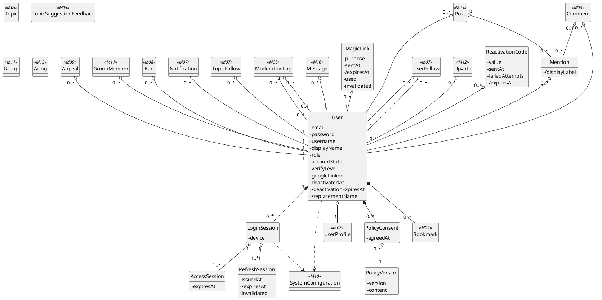

# Phân tích lớp thực thể — M01 Authentication & Account

<!-- [Vietnamese Doc] Tài liệu tiếng Việt; tên lớp và thuộc tính viết tiếng Anh (input/CONVENTIONS.md mục 3). -->

| Mã tài liệu | EC-M01 |
|---|---|
| Dự án | iShare |
| Module | M01 — Authentication & Account |
| Đầu vào | FR-M01 phiên bản 1.10 |
| Trạng thái | Bản nháp |
| Phiên bản | 0.3 |
| Ngày | 2026-11-16 |
| Tác giả | Phạm Văn Đức |

<!-- Quy ước chung cho mọi bảng dưới đây:
     - Không đổi tên cột, không xóa cột, không đổi số mục: tool đọc bảng theo số mục và tên cột.
     - Ô không có nội dung ghi "—".
     - Mục chưa tới bước làm thì để dòng "(Chưa làm — bước N)".
     - Cột Nguồn ghi mã trong FR: FR-M01-nn, FR-M01-nn.mm, BR-M01-nn, hoặc TN:<thuật ngữ> (mục 2.1 của FR).
     - Sơ đồ ở mục 4 do gen_puml.py sinh; không sửa tay. -->

## 1. Mô tả chức năng

### 1.1 Đoạn mô tả

(S1) Module Authentication & Account quản lý tài khoản iShare, thông tin định danh, trạng thái tài khoản, mức xác minh, liên kết Google, phiên đăng nhập, lượt nhắc tên và bản ghi đồng ý chính sách của người dùng. (S2) Hệ thống cho phép Guest đăng ký bằng email và mật khẩu khi đồng ý Privacy Policy/ToS, tạo tài khoản ACTIVE ở mức xác minh NONE với vai trò USER, đồng thời lưu bản ghi đồng ý gồm phiên bản chính sách và thời điểm đồng ý. (S3) Hệ thống cho phép chủ tài khoản xác minh email bằng magic link để chuyển mức xác minh sang EMAIL_VERIFIED và yêu cầu gửi lại magic link xác minh. (S4) Hệ thống cho phép chủ tài khoản thiết lập username và display_name để hoàn tất mức xác minh SETUP_COMPLETED, đồng thời nhập hoặc bỏ qua bio, Lớp/Khối và avatar thuộc hồ sơ của M02. (S5) Hệ thống cho phép Guest đăng ký, đăng nhập bằng Google và tự liên kết Google với tài khoản email cùng email; tài khoản Google mới phải có bản ghi đồng ý chính sách và thực hiện thiết lập tài khoản. (S6) Hệ thống cho phép Guest đăng nhập bằng email và mật khẩu, kiểm tra trạng thái tài khoản rồi mức xác minh để cho sử dụng hệ thống, từ chối hoặc yêu cầu hoàn tất đăng ký, và tạo phiên đăng nhập cho thiết bị khi điều kiện đăng nhập được đáp ứng. (S7) Hệ thống chỉ cho tài khoản BANNED khiếu nại lệnh ban và đăng xuất, dùng lý do ban của M08 và thời hạn khiếu nại của M09, đồng thời cập nhật trạng thái tài khoản theo việc ban, gỡ ban, hết hạn ban tạm thời hoặc khiếu nại ban được chấp nhận. (S8) Hệ thống dùng công tắc tạm dừng đăng ký và chế độ bảo trì của M10 để kiểm soát việc tạo tài khoản mới, đăng nhập và thao tác qua phiên đăng nhập theo vai trò của tài khoản. (S9) Hệ thống duy trì phiên đăng nhập riêng trên từng thiết bị bằng phiên truy cập và phiên làm mới, cấp phiên truy cập mới khi đủ điều kiện, thay phiên làm mới sau mỗi lần dùng và giữ độc lập phiên đăng nhập trên các thiết bị khác. (S10) Hệ thống cho phép User, Mod và Admin đăng xuất khỏi thiết bị đang dùng bằng cách kết thúc phiên đăng nhập của thiết bị đó và giữ phiên đăng nhập trên các thiết bị khác. (S11) Hệ thống cho phép chủ tài khoản email đang ACTIVE và đã đăng nhập đổi mật khẩu bằng mật khẩu cũ và mật khẩu mới được nhập lại khớp nhau, đồng thời giữ phiên đăng nhập trên các thiết bị khác. (S12) Hệ thống cho phép Guest lấy lại mật khẩu của tài khoản email ACTIVE hoặc BANNED bằng magic link đặt lại mật khẩu; khi đặt lại thành công, hệ thống kết thúc mọi phiên đăng nhập hiện có và tạo phiên đăng nhập mới cho thiết bị đang dùng. (S13) Hệ thống cho phép User, Mod và Admin tự vô hiệu hóa tài khoản ACTIVE của mình, chuyển tài khoản sang DEACTIVATED, kết thúc mọi phiên đăng nhập và xác định thời hạn vô hiệu hóa từ thời điểm vô hiệu hóa. (S14) Hệ thống cho phép chủ tài khoản DEACTIVATED xác nhận bằng mã kích hoạt lại gửi tới email trong thời hạn vô hiệu hóa để đưa tài khoản về ACTIVE, tạo phiên đăng nhập mới và khôi phục cách hiển thị bài viết, bình luận cùng tên và avatar của chủ tài khoản. (S15) Khi hết thời hạn vô hiệu hóa mà chưa kích hoạt lại, hệ thống chuyển tài khoản sang DELETED, giữ tài khoản và username, giải phóng email, xóa email, mật khẩu, liên kết Google, display_name, avatar, bio, Lớp/Khối, phiên đăng nhập, bookmark, bản ghi đồng ý, các lượt tài khoản theo dõi người dùng hoặc Topic và các lượt người khác theo dõi tài khoản. (S16) Khi tài khoản chuyển sang DELETED, hệ thống giữ upvote đã cho trong điểm của người nhận và phản hồi gợi ý Topic mà không gắn với danh tính người cho, đồng thời giữ liên kết giữa tài khoản với nhật ký kiểm duyệt và nhật ký AI qua username để Mod và Admin tra cứu. (S17) Hệ thống hiển thị bài viết của M03, bình luận của M04 và tác giả theo trạng thái tài khoản, ẩn bài viết khi tác giả DEACTIVATED hoặc DELETED, giữ nội dung bình luận với tên thay thế và avatar mặc định, cho Mod và Admin xem bài viết bị ẩn cùng danh tính thật của tác giả DEACTIVATED, và cung cấp tên thay thế của người gửi cho M16. (S18) Hệ thống cho phép User, Mod và Admin nhắc tên người dùng trong bài viết hoặc bình luận, tìm theo username và display_name, ưu tiên theo các lượt theo dõi người dùng của M07 và thành viên Group của M11, ghi nhận lượt nhắc tên theo tài khoản người được nhắc và hiển thị tên theo thông tin hiện tại hoặc trạng thái tài khoản của người được nhắc. (S19) Hệ thống cung cấp cho M07 các sự kiện liên kết Google, đổi mật khẩu, đặt lại mật khẩu, cảnh báo trước khi tài khoản tự chuyển sang DELETED và nhắc tên khi nội dung hiển thị công khai để gửi thông báo hoặc email tương ứng; khi sửa nội dung đã công khai, thông báo nhắc tên chỉ được gửi cho người mới được nhắc thêm. (S20) Hệ thống cho Guest, User, Mod và Admin xem nội dung Privacy Policy/ToS có phiên bản chính sách, mô tả dữ liệu được thu thập, cách xử lý, quyền của người dùng và điều khoản sử dụng. (S21) Hệ thống yêu cầu người dùng đồng ý lại khi phiên bản chính sách hiện hành mới hơn phiên bản đã đồng ý, lưu phiên bản cùng thời điểm đồng ý mới trước khi cho dùng tiếp, và chỉ cho đăng xuất hoặc vô hiệu hóa tài khoản nếu người dùng không đồng ý.

### 1.2 Truy vết câu

| Câu | Nội dung tóm tắt | Nguồn |
|---|---|---|
| S1 | Phạm vi tài khoản, định danh, trạng thái, xác minh, Google, phiên, nhắc tên và đồng ý chính sách | FR-M01-01, FR-M01-03, FR-M01-04, FR-M01-05, FR-M01-06, FR-M01-14, FR-M01-16 |
| S2 | Đăng ký email, trạng thái và mức xác minh ban đầu, vai trò USER, bản ghi đồng ý | FR-M01-01, FR-M01-01.01, FR-M01-01.02, FR-M01-01.14 |
| S3 | Xác minh và gửi lại magic link xác minh email | FR-M01-02, FR-M01-02.01, FR-M01-02.04 |
| S4 | Thiết lập username, display_name và thông tin hồ sơ tùy chọn của M02 | FR-M01-03, FR-M01-03.01, FR-M01-03.02, FR-M01-03.03 |
| S5 | Đăng ký, đăng nhập, liên kết Google; đồng ý chính sách và thiết lập | FR-M01-04, FR-M01-04.01, FR-M01-04.03, FR-M01-04.04, FR-M01-04.06, FR-M01-04.07, FR-M01-04.13 |
| S6 | Đăng nhập bằng email, kiểm trạng thái rồi mức xác minh, tạo phiên theo điều kiện | FR-M01-05, FR-M01-05.01, FR-M01-05.03, FR-M01-05.04, FR-M01-05.05, FR-M01-05.10, FR-M01-05.11, FR-M01-05.12 |
| S7 | Giới hạn tài khoản BANNED, lý do ban, thời hạn khiếu nại và các chuyển trạng thái liên quan | FR-M01-05.06, FR-M01-05.07, FR-M01-05.08, FR-M01-05.09, FR-M01-05.14, FR-M01-05.15, FR-M01-05.16, FR-M01-05.17 |
| S8 | Dùng cấu hình tạm dừng đăng ký, bảo trì và vai trò từ M10 | FR-M01-01.08, FR-M01-01.09, FR-M01-01.12, FR-M01-04.10, FR-M01-04.11, FR-M01-05.19, FR-M01-05.20 |
| S9 | Duy trì phiên riêng từng thiết bị, cấp phiên truy cập và thay phiên làm mới | FR-M01-06, FR-M01-06.01, FR-M01-06.02, FR-M01-06.03, FR-M01-06.04, FR-M01-06.05, FR-M01-06.06, FR-M01-06.07 |
| S10 | Đăng xuất thiết bị hiện tại, giữ phiên trên thiết bị khác | FR-M01-07, FR-M01-07.01, FR-M01-07.02 |
| S11 | Đổi mật khẩu tài khoản email ACTIVE, giữ phiên trên thiết bị khác | FR-M01-08, FR-M01-08.01, FR-M01-08.04, FR-M01-08.06, FR-M01-08.07, FR-M01-08.10 |
| S12 | Lấy lại mật khẩu bằng magic link, kết thúc phiên cũ và tạo phiên mới | FR-M01-09, FR-M01-09.01, FR-M01-09.02, FR-M01-09.03, FR-M01-09.04, FR-M01-09.16 |
| S13 | Chủ tài khoản tự vô hiệu hóa, kết thúc phiên, xác định thời hạn từ thời điểm vô hiệu hóa | FR-M01-10, FR-M01-10.01, FR-M01-10.02, FR-M01-10.04, FR-M01-10.07 |
| S14 | Kích hoạt lại bằng mã gửi email, khôi phục trạng thái, phiên và cách hiển thị nội dung | FR-M01-11, FR-M01-11.01, FR-M01-11.02, FR-M01-11.03, FR-M01-11.06 |
| S15 | Tự chuyển sang DELETED, giữ tài khoản và username, giải phóng email, xóa dữ liệu được FR liệt kê | FR-M01-12, FR-M01-12.01, FR-M01-12.02, FR-M01-12.03, FR-M01-12.06, FR-M01-12.07, FR-M01-12.08 |
| S16 | Giữ upvote và phản hồi gợi ý không gắn danh tính; tra cứu nhật ký qua username | FR-M01-12.09, FR-M01-12.10, FR-M01-12.11 |
| S17 | Hiển thị bài viết, bình luận, tác giả theo trạng thái; quyền xem của Mod/Admin; tên người gửi cho M16 | FR-M01-13, FR-M01-13.01, FR-M01-13.03, FR-M01-13.04, FR-M01-13.05, FR-M01-13.06, FR-M01-13.07 |
| S18 | Nhắc tên gắn tài khoản, tìm theo tên, ưu tiên Follow và Group, hiển thị theo trạng thái | FR-M01-14, FR-M01-14.02, FR-M01-14.04, FR-M01-14.05, FR-M01-14.06, FR-M01-14.07, FR-M01-14.13, FR-M01-14.14, FR-M01-14.15 |
| S19 | Sự kiện cho M07: liên kết Google, mật khẩu, cảnh báo tự xóa và thông báo nhắc tên | FR-M01-04.05, FR-M01-08.05, FR-M01-09.12, FR-M01-12.05, FR-M01-14.10, FR-M01-14.17 |
| S20 | Nội dung Privacy Policy/ToS công khai, có phiên bản chính sách | FR-M01-15, FR-M01-15.01, FR-M01-15.02, FR-M01-15.08 |
| S21 | Đồng ý lại khi đổi phiên bản, lưu thời điểm và phiên bản; lựa chọn khi không đồng ý | FR-M01-16, FR-M01-16.01, FR-M01-16.02, FR-M01-16.03, FR-M01-16.04, FR-M01-16.05 |

**Phạm vi của bước 1:** Đã được người dùng duyệt khi yêu cầu chuyển sang bước 2 ngày 2026-11-16. Đoạn mô tả S1–S21 được giữ nguyên làm đầu vào.

**Quy ước cần xác nhận ở cổng đầu tiên:** QU-10 — mã PlantUML do tool sinh từ bảng, không viết hoặc sửa tay; QU-11 — bội số ghi `1`, `0..1`, `0..*`, `1..*` hoặc khoảng cụ thể theo FR. QU-01 (tên lớp PascalCase) và QU-03 (tên thuộc tính camelCase) đã chốt. Chỉ tạo `data-model/conventions.md` sau khi người dùng xác nhận QU-10 và QU-11.

**Những nội dung cố ý không triển khai trong đoạn mô tả:**

- Bố cục, nút, màn hình, thông báo giao diện, độ dài trường, thời hạn cụ thể và công thức: bước 1 tập trung đối tượng dữ liệu và hành vi; ràng buộc được xét ở các bước sau theo FR.
- Hỏi tuổi hoặc ngày sinh, xác nhận riêng của phụ huynh, phân biệt tài khoản Giáo viên/Học sinh, xóa trực tiếp, Mod/Admin xóa tài khoản người khác, nhà cung cấp đăng nhập ngoài Google, lịch sử đổi username và sửa nhãn nhắc tên: FR mục 1.2 đã quyết không làm.
- Tải bản sao dữ liệu và email liên hệ chính sách: FR mục 1.2 để chốt khi triển khai; không suy ra chức năng hoặc dữ liệu mới.
- Quản lý hồ sơ, gửi thông báo/email, kiểm duyệt, khiếu nại, quản trị, Group, thống kê và hiển thị tin nhắn: thuộc các module tương ứng trong FR mục 1.2 và 5.20; đoạn mô tả chỉ giữ dữ liệu hoặc giao tiếp mà M01 chạm tới. M01 không có chức năng thống kê riêng.
- S5 giữ mô tả chung của bước 1. Trong bước 2 đã tìm được đáp án điều kiện liên kết Google ở FR-M01 Phụ lục B.1 Q-06 và BR-M01-09; xem kết quả đối chiếu tại Q-01, mục 6.

## 2. Danh từ và phân loại

**Tiến độ:** Bước 2 được người dùng duyệt khi yêu cầu chuyển sang bước 3. Bước 3 làm rõ thêm quyền sở hữu dữ liệu ngoài; các hiệu chỉnh so với bản 0.2 được ghi ở đây để duyệt cùng toàn bộ EC.

**Kết quả sau đối chiếu bước 3:** 106 dòng danh từ/cụm danh từ: 88 từ đoạn S1–S21 và 18 từ lượt quét FR; 38 dòng thành Lớp, 30 dòng thành Thuộc tính, 38 dòng Loại bỏ. Có 27 lớp (9 M01, 18 ngoài), 29 thuộc tính M01 (23 Lưu, 6 Dẫn xuất). So với bản 0.2, hai dòng Bookmark/Upvote đã chuyển từ chờ sở hữu sang lớp ngoài; không trích thêm danh từ hoặc thêm dữ liệu nghiệp vụ.

**Cách thực hiện:** Bước 2 đã trích và phân loại từ đoạn đã duyệt, quét thuật ngữ/yêu cầu cấp dưới/BR/chuyển trạng thái/giao tiếp, sau đó mới đối chiếu FR mục 5.18. Bước 3 chỉ tiếp tục từ danh sách đó và đọc các FR đã chốt được dẫn tới để xác định lớp ngoài. `merge_ec.py --list --exclude M01` cho thấy chưa có EC module khác để thống nhất tên lớp.

### 2.1 Sổ danh từ

“Loại bỏ” không xóa yêu cầu hoặc dữ liệu khỏi hệ thống: danh từ có thể là khái niệm chung, giá trị thuộc tính, hoặc dữ liệu đã thuộc lớp ngoài được tham chiếu. Bookmark/Upvote trước đó chưa khai lớp vì chưa rõ sở hữu; nay đã xác định và giữ thành lớp ngoài.

| # | Danh từ | Xuất hiện ở | Phân loại | Kết quả | Lý do |
|---|---|---|---|---|---|
| 1 | module Authentication & Account / iShare / hệ thống / ứng dụng | S1 | Loại bỏ | — | Trừu tượng: tên phần mềm, phạm vi module và tác nhân tự động; không phải đối tượng nghiệp vụ cần quản lý. |
| 2 | tài khoản / người dùng | S1 | Lớp | User | T8: danh tính được tạo, cập nhật và giữ lại khi DELETED; có thông tin và trạng thái riêng. |
| 3 | thông tin định danh / thông tin hiện tại | S1 | Loại bỏ | — | Chung chung: nhóm thông tin được phân tích cụ thể thành username, displayName và trạng thái; không có đối tượng riêng. |
| 4 | trạng thái tài khoản | S1 | Thuộc tính | User.accountState | T9: trạng thái của tài khoản; phân biệt với tiến độ xác minh. |
| 5 | mức xác minh | S1 | Thuộc tính | User.verifyLevel | T9: tiến độ đăng ký của tài khoản. |
| 6 | liên kết Google | S1 | Thuộc tính | User.googleLinked | T9: FR chỉ đòi biết tài khoản đã liên kết Google; chưa nêu bộ dữ liệu hoặc vòng đời riêng để tạo lớp GoogleLink. |
| 7 | phiên đăng nhập | S1 | Lớp | LoginSession | T8: mỗi thiết bị có phiên riêng, được tạo và kết thúc độc lập (BR-M01-17). |
| 8 | lượt nhắc tên | S1 | Lớp | Mention | T8: từng lượt được chèn và xóa, gắn với nội dung và người được nhắc; nhãn hiển thị tính từ tài khoản (FR-M01-14.06–14.09). |
| 9 | bản ghi đồng ý chính sách / bản ghi đồng ý | S1 | Lớp | PolicyConsent | T8: mỗi lần đồng ý tạo một bản ghi với thời điểm, tài khoản và phiên bản chính sách (BR-M01-44). |
| 10 | Guest | S2 | Loại bỏ | — | Không lưu: tác nhân chưa đăng nhập; FR không quản lý một hồ sơ Guest riêng. |
| 11 | email (địa chỉ) | S2 | Thuộc tính | User.email | T9: địa chỉ dùng cho tài khoản; phân biệt với email là thư được gửi ở S19. |
| 12 | mật khẩu / mật khẩu cũ / mật khẩu mới | S2 | Thuộc tính | User.password | T9: mật khẩu cũ và mới là các giá trị của cùng thuộc tính khi thay đổi, không lưu thành lịch sử mật khẩu. |
| 13 | Privacy Policy/ToS / nội dung chính sách / nội dung trang chính sách | S2 | Thuộc tính | PolicyVersion.content | T9: nội dung của một phiên bản chính sách; được thay bằng bản mới khi triển khai. |
| 14 | ACTIVE | S2 | Loại bỏ | — | Giá trị của User.accountState; không tạo lớp trạng thái. |
| 15 | NONE | S2 | Loại bỏ | — | Giá trị của User.verifyLevel; không tạo lớp mức xác minh. |
| 16 | vai trò | S2 | Thuộc tính | User.role | T6/T9: tập giá trị USER, MOD, ADMIN của tài khoản; M01 gán USER, M10 quản lý thay đổi. |
| 17 | USER | S2 | Lớp | User | T3: vai trò người dùng có tài khoản; bao gồm cách viết User ở S10, không tạo lớp riêng cho vai trò. |
| 18 | phiên bản chính sách / phiên bản hiện hành / phiên bản mới / phiên bản đã đồng ý | S2 | Lớp | PolicyVersion | T8: mỗi bản có số phiên bản và nội dung; bản hiện hành và bản đã đồng ý là các ngữ cảnh sử dụng của cùng khái niệm. |
| 19 | thời điểm đồng ý / thời điểm đồng ý mới | S2 | Thuộc tính | PolicyConsent.agreedAt | T9: thời điểm của từng bản ghi đồng ý. |
| 20 | chủ tài khoản | S3 | Lớp | User | T3: người dùng trong vai trò sở hữu tài khoản đang được thao tác; không có dữ liệu riêng để thành lớp con. |
| 21 | magic link / magic link xác minh / magic link xác minh email / magic link đặt lại mật khẩu | S3 | Lớp | MagicLink | T8: liên kết được gửi, dùng một lần và vô hiệu hóa; đề xuất chung một lớp với purpose, cần duyệt Q-02. |
| 22 | EMAIL_VERIFIED | S3 | Loại bỏ | — | Giá trị của User.verifyLevel. |
| 23 | yêu cầu | S3 | Loại bỏ | — | Chung chung: yêu cầu thực hiện chức năng; FR không yêu cầu lưu bản ghi yêu cầu riêng. |
| 24 | username | S4 | Thuộc tính | User.username | T9: tên định danh duy nhất của tài khoản. |
| 25 | display_name / tên (của chủ tài khoản) / tên tác giả | S4 | Thuộc tính | User.displayName | T9: tên hiển thị của tài khoản; trường hợp tên thay thế được xét riêng. |
| 26 | SETUP_COMPLETED | S4 | Loại bỏ | — | Giá trị của User.verifyLevel. |
| 27 | bio | S4 | Loại bỏ | — | Ngoài phạm vi module (M02): thuộc tính của UserProfile; M01 cho nhập tùy chọn và chuyển cho M02 theo FR-M01-03.03, không khai lại thuộc tính ngoài. |
| 28 | Lớp/Khối | S4 | Loại bỏ | — | Ngoài phạm vi module (M02): thuộc tính của UserProfile; quy tắc của trường thuộc M02, không tạo lớp Grade trong M01. |
| 29 | avatar | S4 | Loại bỏ | — | Ngoài phạm vi module (M02): dữ liệu hồ sơ; M01 dùng để hiển thị và yêu cầu xóa cùng dữ liệu cá nhân. |
| 30 | hồ sơ | S4 | Lớp | UserProfile | T4: hồ sơ thuộc M02, M01 chuyển thông tin tùy chọn và dùng dữ liệu hiển thị; chỉ tham chiếu lớp ngoài. |
| 31 | mã module (M02, M03, M04, M07, M08, M09, M10, M11, M16) | S4 | Loại bỏ | — | Trừu tượng: ký hiệu phân chia phạm vi tài liệu, không phải dữ liệu nghiệp vụ. |
| 32 | Google | S5 | Loại bỏ | — | Ngoài phạm vi hệ thống: nhà cung cấp đăng nhập; tài khoản iShare tạo bằng Google đã được xét ở dòng riêng. |
| 33 | tài khoản email | S5 | Lớp | User | T3/T8: cùng danh tính User, được tạo bằng email và có mật khẩu; không thêm lớp con hoặc trường phân loại mà FR chưa yêu cầu lưu. |
| 34 | tài khoản Google | S5 | Lớp | User | T3/T8: tài khoản iShare được tạo bằng Google và không có mật khẩu theo BR-M01-15; không tạo lớp GoogleAccount hoặc tự thêm thuộc tính loại tài khoản. |
| 35 | thiết lập tài khoản | S5 | Loại bỏ | — | Hành động không lưu dấu vết: cập nhật định danh và mức xác minh, FR không yêu cầu lịch sử từng lần thiết lập. |
| 36 | thiết bị | S6 | Thuộc tính | LoginSession.device | T9: thông tin xác định ngữ cảnh thiết bị của phiên (FR mục 5.18); FR không quản lý danh mục thiết bị hay thông số phần cứng. |
| 37 | điều kiện đăng nhập | S6 | Loại bỏ | — | Trừu tượng: quy tắc xét accountState, verifyLevel và cấu hình; không là bản ghi riêng. |
| 38 | BANNED | S7 | Loại bỏ | — | Giá trị của User.accountState. |
| 39 | khiếu nại / khiếu nại ban | S7 | Lớp | Appeal | T4: dữ liệu M09; kết quả khiếu nại ban làm đổi trạng thái tài khoản, chỉ tham chiếu. |
| 40 | lệnh ban / ban tạm thời | S7 | Lớp | Ban | T4: dữ liệu M08 mà M01 dùng để kiểm trạng thái và hết hạn ban; tên tạm chờ EC-M08. |
| 41 | lý do ban | S7 | Loại bỏ | — | Ngoài phạm vi module (M08): thuộc tính của lệnh ban; M01 đọc để hiển thị, không khai lại trên User. |
| 42 | thời hạn khiếu nại | S7 | Loại bỏ | — | Ngoài phạm vi module (M09): quy tắc và dữ liệu hạn khiếu nại do M09 cung cấp; không thêm trường vào User. |
| 43 | việc ban | S7 | Loại bỏ | — | Hành động không lưu dấu vết trong M01: cập nhật trạng thái; lệnh ban và nhật ký thuộc M08 đã được xét riêng. |
| 44 | gỡ ban | S7 | Loại bỏ | — | Hành động không lưu dấu vết trong M01: đưa tài khoản về ACTIVE theo M08; không tạo lớp Unban. |
| 45 | công tắc tạm dừng đăng ký | S8 | Loại bỏ | — | Ngoài phạm vi module (M10): giá trị cấu hình trong SystemConfiguration; M01 chỉ đọc cấu hình để quyết định nhận đăng ký. |
| 46 | chế độ bảo trì | S8 | Loại bỏ | — | Ngoài phạm vi module (M10): giá trị cấu hình trong SystemConfiguration; M01 chỉ áp dụng điều kiện theo vai trò. |
| 47 | thao tác | S8 | Loại bỏ | — | Chung chung: hành động sử dụng hệ thống, không phải thực thể được FR yêu cầu lưu. |
| 48 | phiên truy cập | S9 | Lớp | AccessSession | T8: được cấp và hết hạn riêng, có mốc hết hạn; đề xuất lớp dữ liệu của phiên đăng nhập, cần duyệt Q-03. |
| 49 | phiên làm mới | S9 | Lớp | RefreshSession | T8: mỗi lần cấp có thời điểm, thời hạn và hiệu lực riêng; bị thay và mất hiệu lực khi dùng, cần duyệt Q-03. |
| 50 | Mod | S10 | Lớp | User | T3: vai trò MOD của tài khoản; dữ liệu chung nằm trên User, không tạo lớp con. |
| 51 | Admin | S10 | Lớp | User | T3: vai trò ADMIN của tài khoản; dữ liệu chung nằm trên User, không tạo lớp con. |
| 52 | DEACTIVATED | S13 | Loại bỏ | — | Giá trị của User.accountState. |
| 53 | thời hạn vô hiệu hóa | S13 | Loại bỏ | — | Hằng số của BR-M01-21: 14 × 24 giờ; thời điểm bắt đầu và thời điểm hết hạn được xét thành thuộc tính riêng. |
| 54 | thời điểm vô hiệu hóa | S13 | Thuộc tính | User.deactivatedAt | T9: mốc của lần vô hiệu hóa hiện tại để tính thời hạn, không suy ra lịch sử các lần vô hiệu hóa. |
| 55 | mã kích hoạt lại / OTP | S14 | Lớp | ReactivationCode | T8: mã có giá trị, thời điểm gửi và số lần nhập sai; có hiệu lực riêng theo BR-M01-22. |
| 56 | bài viết | S14 | Lớp | Post | T4: M03 sở hữu; M01 dùng tác giả, nội dung chứa lượt nhắc và quy tắc ẩn theo trạng thái. |
| 57 | bình luận | S14 | Lớp | Comment | T4: M04 sở hữu; M01 dùng tác giả, nội dung chứa lượt nhắc và quy tắc hiển thị theo trạng thái. |
| 58 | DELETED | S15 | Loại bỏ | — | Giá trị của User.accountState. |
| 59 | bookmark | S15 | Lớp | Bookmark | T4: lớp ngoài M02; FR-M01-12.08 yêu cầu xóa khi tài khoản DELETED. Đã xác định module sở hữu bằng dữ liệu và CRUD của FR-M02-05/06; tên tạm, chờ EC-M02. |
| 60 | lượt theo dõi người dùng / lượt người khác theo dõi tài khoản | S15 | Lớp | UserFollow | T4: dữ liệu theo dõi của M07; hai chiều là hai vai trò của tài khoản trong cùng khái niệm theo dõi, chưa xét quan hệ. |
| 61 | Topic | S15 | Lớp | Topic | T4: M05 sở hữu; dùng trong phạm vi dữ liệu theo dõi Topic bị xóa và phản hồi gợi ý được giữ. |
| 62 | lượt theo dõi Topic | S15 | Lớp | TopicFollow | T4: lớp ngoài do M07 sở hữu và tạo; M05 là module sử dụng và yêu cầu xóa khi gộp/xóa Topic. Đối chiếu FR-M07 mục Dữ liệu nghiệp vụ/CRUD sửa nhầm sở hữu M05 ở bản 0.2; yêu cầu M01 vẫn là FR-M01-12.08. |
| 63 | upvote | S16 | Lớp | Upvote | T4: lớp ngoài M12; FR-M01-12.09 yêu cầu giữ điểm nhưng bỏ người cho khi DELETED. Đối chiếu FR-M12 mục Dữ liệu nghiệp vụ và CRUD xác nhận một khái niệm Upvote cho bài viết/bình luận; không tự tách thêm lớp. |
| 64 | điểm | S16 | Loại bỏ | — | Ngoài phạm vi module (M12): số liệu tính từ tương tác; M01 chỉ yêu cầu bảo toàn đóng góp của upvote, không định nghĩa công thức hay lớp thống kê. |
| 65 | người nhận | S16 | Lớp | User | T3: tài khoản nhận điểm từ upvote; không thêm lớp Recipient. |
| 66 | phản hồi gợi ý Topic | S16 | Lớp | TopicSuggestionFeedback | T4: dữ liệu M05 được giữ để đánh giá AI nhưng bỏ liên hệ danh tính khi tài khoản DELETED. |
| 67 | danh tính / danh tính thật | S16 | Loại bỏ | — | Chung chung: chỉ tài khoản và thông tin nhận diện đã xét; không là một đối tượng Identity mới. |
| 68 | người cho | S16 | Lớp | User | T3: tài khoản đã cho upvote; việc bỏ dấu vết người cho không xóa điểm người nhận. |
| 69 | nhật ký kiểm duyệt | S16 | Lớp | ModerationLog | T4: M08 sở hữu; giữ khả năng tra cứu tài khoản đã xóa qua username. |
| 70 | nhật ký AI | S16 | Lớp | AiLog | T4: M13 sở hữu; giữ khả năng tra cứu tài khoản đã xóa qua username. |
| 71 | AI | S16 | Loại bỏ | — | Trừu tượng: khả năng hoặc dịch vụ xử lý; dữ liệu cụ thể đã xét là AiLog và TopicSuggestionFeedback. |
| 72 | tác giả | S17 | Lớp | User | T3: vai trò của tài khoản đối với bài viết/bình luận; không phải thuộc tính authorId. |
| 73 | nội dung bình luận | S17 | Loại bỏ | — | Ngoài phạm vi module (M04): thuộc tính của Comment; M01 chỉ quy định giữ nội dung khi tác giả bị vô hiệu hóa hoặc xóa. |
| 74 | tên thay thế | S17 | Thuộc tính | User.replacementName | T7: tính từ accountState theo FR-M01-13 và FR-M01-14.15, không lưu một tên thay thế riêng. |
| 75 | avatar mặc định | S17 | Loại bỏ | — | Hằng số của BR-M01-23 và BR-M01-24: ảnh dùng khi hiển thị thay thế; không phải ảnh cá nhân mới hay lớp riêng. |
| 76 | người gửi | S17 | Lớp | User | T3: tài khoản được M16 hiển thị là người gửi; không thêm lớp Sender. |
| 77 | nội dung (chứa lượt nhắc hoặc đã công khai) | S18 | Loại bỏ | — | Chung chung: chỉ bài viết hoặc bình luận đã có Post/Comment; không tự tạo lớp Content. |
| 78 | Group | S18 | Lớp | Group | T4: M11 sở hữu; M01 dùng ngữ cảnh nhóm để ưu tiên gợi ý nhắc tên. |
| 79 | thành viên Group | S18 | Lớp | GroupMember | T4: M11 sở hữu, tên theo glossary; M01 dùng tư cách thành viên khi xếp gợi ý. |
| 80 | người được nhắc | S18 | Lớp | User | T3: tài khoản đích của lượt nhắc, không phải một thuộc tính đối tượng tại bước phân tích. |
| 81 | sự kiện | S19 | Loại bỏ | — | Hành động không lưu dấu vết: FR mô tả việc cung cấp sự kiện cho M07, không yêu cầu kho sự kiện riêng trong M01. |
| 82 | thông báo | S19 | Lớp | Notification | T4: M07 sở hữu; M01 phát sinh nhu cầu gửi thông báo về tài khoản và nhắc tên. |
| 83 | email (thư thông báo) | S19 | Loại bỏ | — | Ngoài phạm vi module (M07): thư được gửi theo sự kiện; FR M01 không định nghĩa bản ghi thư riêng, khác User.email. |
| 84 | cảnh báo trước khi tự xóa | S19 | Loại bỏ | — | Ngoài phạm vi module (M07): một email theo BR-M01-32, không phải cảnh báo kiểm duyệt hoặc lớp Warning của M01. |
| 85 | dữ liệu được thu thập | S20 | Loại bỏ | — | Chung chung: nội dung mô tả các nhóm dữ liệu trong chính sách, không là một thực thể gom mọi dữ liệu. |
| 86 | cách xử lý | S20 | Loại bỏ | — | Trừu tượng: phần giải thích trong nội dung chính sách, không là bản ghi nghiệp vụ riêng. |
| 87 | quyền của người dùng | S20 | Loại bỏ | — | Trừu tượng: nội dung về quyền trong chính sách; không đồng nhất với vai trò hay tạo danh mục quyền mới. |
| 88 | điều khoản sử dụng | S20 | Thuộc tính | PolicyVersion.content | T9: một phần của nội dung chính sách đã có; không tách thêm lớp điều khoản. |
| 89 | thời điểm hết thời hạn vô hiệu hóa | Quét: FR-M01-12.05; BR-M01-21 | Thuộc tính | User.deactivationExpiresAt | T7: mốc tính từ thời điểm vô hiệu hóa cộng thời hạn cố định. |
| 90 | thời điểm hết hạn phiên truy cập | Quét: FR-M01-06.01; BR-M01-16 | Thuộc tính | AccessSession.expiresAt | T9: mỗi phiên truy cập có thời hạn riêng để kiểm tra hiệu lực. |
| 91 | thời điểm cấp phiên làm mới | Quét: FR-M01-06.07 | Thuộc tính | RefreshSession.issuedAt | T9: mốc của từng lần cấp phiên làm mới. |
| 92 | thời điểm hết hạn phiên làm mới | Quét: FR-M01-06.04; FR-M01-06.07 | Thuộc tính | RefreshSession.expiresAt | T7: tính từ thời điểm cấp cộng 30 ngày. |
| 93 | hiệu lực của phiên làm mới | Quét: FR-M01-06.02; FR-M01-06.03 | Thuộc tính | RefreshSession.invalidated | T9: dấu vết phiên cũ đã mất hiệu lực sau khi dùng. |
| 94 | mục đích magic link | Quét: TN:Magic link; BR-M01-38 | Thuộc tính | MagicLink.purpose | T9: phân biệt xác minh email với đặt lại mật khẩu; đề xuất đi cùng Q-02. |
| 95 | thời điểm gửi magic link | Quét: FR-M01-02.03; FR-M01-09.05 | Thuộc tính | MagicLink.sentAt | T9: nguồn nêu mốc gửi để tính hạn dùng và kiểm soát gửi lại. |
| 96 | thời điểm hết hạn magic link | Quét: FR-M01-02.03; FR-M01-09.05 | Thuộc tính | MagicLink.expiresAt | T7: tính từ thời điểm gửi và mục đích. |
| 97 | dấu vết magic link đã dùng | Quét: FR-M01-02.06; FR-M01-09.10 | Thuộc tính | MagicLink.used | T9: cần biết đã dùng để từ chối dùng lần nữa, không suy thêm thời điểm dùng. |
| 98 | hiệu lực của magic link khi gửi lại | Quét: FR-M01-02.07; FR-M01-09.11 | Thuộc tính | MagicLink.invalidated | T9: cần biết link cũ mất hiệu lực khi link cùng loại mới được gửi. |
| 99 | giá trị mã kích hoạt lại | Quét: FR-M01-11.01 | Thuộc tính | ReactivationCode.value | T9: chuỗi mã 6 chữ số dùng để xác nhận, không phải khóa định danh được tự thêm. |
| 100 | thời điểm gửi mã kích hoạt lại | Quét: FR-M01-11.07; FR-M01-11.09 | Thuộc tính | ReactivationCode.sentAt | T9: mốc để kiểm tra hạn dùng và khoảng cách gửi lại. |
| 101 | số lần nhập sai mã kích hoạt lại | Quét: FR-M01-11.08 | Thuộc tính | ReactivationCode.failedAttempts | T9: bộ đếm từng mã cần giữ để vô hiệu hóa sau lần sai thứ 5; không có yêu cầu lưu lịch sử từng lần sai. |
| 102 | thời điểm hết hạn mã kích hoạt lại | Quét: FR-M01-11.07 | Thuộc tính | ReactivationCode.expiresAt | T7: tính từ thời điểm gửi cộng 15 phút. |
| 103 | số phiên bản chính sách | Quét: TN:Phiên bản chính sách; FR-M01-15.08 | Thuộc tính | PolicyVersion.version | T9: giá trị nhận biết một bản chính sách, khác đối tượng PolicyVersion. |
| 104 | nhãn của lượt nhắc tên | Quét: FR-M01-14.07; FR-M01-14.08 | Thuộc tính | Mention.displayLabel | T7: dữ liệu hiển thị lấy từ tên và trạng thái hiện tại của người được nhắc. |
| 105 | cấu hình hệ thống | Quét: TN:Công tắc tạm dừng đăng ký; TN:Chế độ bảo trì | Lớp | SystemConfiguration | T4: đối tượng cấu hình do M10 quản lý; công tắc và chế độ là dữ liệu của đối tượng ngoài. |
| 106 | tin nhắn | Quét: FR-M01-13.06; FR-M01-15.06; BR-M01-47 | Lớp | Message | T4: M16 sở hữu; M01 cung cấp tên người gửi và quy định giữ nội dung khi xóa tài khoản. |

### 2.2 Lớp

Có 9 lớp của M01, giữ nhóm Thực thể của bước 2; không có lớp thống kê và không sinh thêm lớp M01 do tách n-n. Nhóm chi tiết của các lớp ngoài sẽ do EC module sở hữu xác nhận; M01 không sửa tài liệu hoặc khai thuộc tính của module khác.

| Lớp | Tên tiếng Việt | Nhóm | Sở hữu | Mô tả | Nguồn |
|---|---|---|---|---|---|
| User | Tài khoản | Thực thể | M01 | Danh tính iShare; bao gồm tài khoản email, Google và các vai trò người dùng. | FR-M01-01.01, FR-M01-04.01, BR-M01-01 |
| LoginSession | Phiên đăng nhập | Thực thể | M01 | Phiên riêng của một tài khoản trên một thiết bị, được tạo và kết thúc. | FR-M01-04.08, FR-M01-05.12, FR-M01-06.05, FR-M01-07.01 |
| AccessSession | Phiên truy cập | Thực thể | M01 | Phần truy cập được cấp và hết hạn riêng; giữ cách biểu diễn của bước 2 khi người dùng yêu cầu sang bước 3. | FR-M01-06.01, BR-M01-16, TN:Phiên truy cập |
| RefreshSession | Phiên làm mới | Thực thể | M01 | Lần cấp phiên làm mới có thời điểm cấp và hiệu lực riêng; bị thay sau khi dùng. | FR-M01-06.02, FR-M01-06.03, FR-M01-06.07 |
| MagicLink | Magic link | Thực thể | M01 | Liên kết dùng một lần cho xác minh email hoặc đặt lại mật khẩu; chung một lớp với purpose theo bản bước 2 được duyệt. | FR-M01-02, FR-M01-09, BR-M01-38 |
| ReactivationCode | Mã kích hoạt lại | Thực thể | M01 | Mã gửi email để kích hoạt lại tài khoản, bị giới hạn thời gian và số lần sai. | FR-M01-11.01, FR-M01-11.07, FR-M01-11.08 |
| PolicyVersion | Phiên bản chính sách | Thực thể | M01 | Một bản nội dung chính sách có số phiên bản, do đội phát triển phát hành khi triển khai; không suy ra chức năng quản trị nội dung hoặc cách lưu CSDL. | FR-M01-15.08, FR-M01-15.09, BR-M01-44 |
| PolicyConsent | Bản ghi đồng ý | Thực thể | M01 | Bản ghi của mỗi lần tài khoản đồng ý một phiên bản chính sách, có thời điểm đồng ý. | FR-M01-01.14, FR-M01-04.13, FR-M01-16.02, BR-M01-44 |
| Mention | Lượt nhắc tên | Thực thể | M01 | Một lượt nhắc được chèn/xóa theo FR-M01-14; M03/M04 lưu cùng nội dung. Nhãn là dữ liệu dẫn xuất. | FR-M01-14.06, FR-M01-14.07, FR-M01-14.09, FR-M01-14.15 |
| UserProfile | Hồ sơ | Thực thể | M02 | Nhận bio, Lớp/Khối, avatar tùy chọn; M01 dùng dữ liệu hiển thị và yêu cầu xóa khi DELETED. Tên tạm, chờ EC-M02. | FR-M01-03.03, FR-M01-12.08 |
| Post | Bài viết | Thực thể | M03 | Nội dung có tác giả, chứa nhắc tên, bị ẩn theo trạng thái tài khoản. Tên theo glossary, chờ EC-M03 xác nhận. | FR-M01-13.01, FR-M01-13.05, FR-M01-14.10 |
| Comment | Bình luận | Thực thể | M04 | Nội dung có tác giả và nhắc tên, được giữ khi tài khoản bị xóa. Tên theo glossary, chờ EC-M04 xác nhận. | FR-M01-13.03, FR-M01-13.04, FR-M01-14.10 |
| UserFollow | Lượt theo dõi người dùng | Thực thể | M07 | M01 dùng để ưu tiên nhắc tên và yêu cầu xóa cả hai chiều khi DELETED; M07 được nêu ở FR mục 5.20. Tên tạm, chờ EC-M07. | FR-M01-14.04, FR-M01-14.05, FR-M01-12.08 |
| Topic | Topic | Thực thể | M05 | Đối tượng được theo dõi, liên quan yêu cầu xóa lượt theo dõi khi DELETED. Tên theo glossary, chờ EC-M05 xác nhận. | FR-M01-12.08, BR-M01-47 |
| TopicFollow | Lượt theo dõi Topic | Thực thể | M07 | Quan hệ theo dõi Topic do M07 tạo, M05 sử dụng và xử lý khi gộp/xóa Topic; M01 yêu cầu xóa khi DELETED. Sửa sở hữu M05 của bản 0.2 sau đối chiếu FR-M07. Tên tạm, chờ EC-M07. | FR-M01-12.08, BR-M01-47 |
| TopicSuggestionFeedback | Phản hồi gợi ý Topic | Thực thể | M05 | Giữ dữ liệu đánh giá AI nhưng không gắn danh tính tài khoản đã xóa. Tên tạm, chờ EC-M05. | FR-M01-12.11 |
| Ban | Lệnh ban | Thực thể | M08 | Cung cấp lý do và hạn ban cho trạng thái tài khoản. Tên tạm, chờ EC-M08. | FR-M01-05.07, FR-M01-05.14, FR-M01-05.15, FR-M01-05.17 |
| Appeal | Khiếu nại | Thực thể | M09 | M01 dùng hạn khiếu nại và kết quả chấp nhận khiếu nại ban. Thuật ngữ theo glossary, chờ EC-M09 xác nhận. | FR-M01-05.08, FR-M01-05.09, FR-M01-05.16 |
| SystemConfiguration | Cấu hình hệ thống | Thực thể | M10 | M01 đọc tạm dừng đăng ký và bảo trì; Admin bật/tắt ở M10. Tên tạm, chờ EC-M10. | FR-M01-01.08, FR-M01-05.19, FR-M01-05.20, TN:Công tắc tạm dừng đăng ký, TN:Chế độ bảo trì |
| Group | Group | Thực thể | M11 | Ngữ cảnh nhóm dùng để xếp gợi ý nhắc tên. Tên theo glossary, chờ EC-M11 xác nhận. | FR-M01-14.04, FR-M01-14.05 |
| GroupMember | Thành viên Group | Thực thể | M11 | Tư cách thành viên dùng khi xét người cùng nhóm. Tên theo glossary, chờ EC-M11 xác nhận. | FR-M01-14.04, FR-M01-14.05 |
| ModerationLog | Nhật ký kiểm duyệt | Thực thể | M08 | Giữ liên kết tra cứu qua username khi tài khoản DELETED. Tên tạm, chờ EC-M08. | FR-M01-12.10 |
| AiLog | Nhật ký AI | Thực thể | M13 | Giữ liên kết tra cứu qua username khi tài khoản DELETED. Tên tạm, chờ EC-M13. | FR-M01-12.10 |
| Notification | Thông báo | Thực thể | M07 | M01 cung cấp sự kiện tài khoản và nhắc tên cho M07 gửi thông báo. Tên tạm, chờ EC-M07. | FR-M01-04.05, FR-M01-08.05, FR-M01-09.12, FR-M01-14.10 |
| Message | Tin nhắn | Thực thể | M16 | M01 cung cấp tên người gửi theo trạng thái tài khoản; nội dung tin nhắn được giữ. Tên tạm, chờ EC-M16. | FR-M01-13.06, FR-M01-13.07, FR-M01-15.06, BR-M01-47 |
| Bookmark | Bookmark | Thực thể | M02 | Dữ liệu lưu bài của M02; M01 yêu cầu xóa khi người lưu DELETED. Sở hữu được đối chiếu FR-M02 phần Dữ liệu nghiệp vụ và CRUD; tên tạm, chờ EC-M02. | FR-M01-12.08, BR-M01-47 |
| Upvote | Upvote | Thực thể | M12 | Dữ liệu upvote bài viết hoặc bình luận của M12; giữ đóng góp nhưng bỏ người cho khi tài khoản DELETED. Sở hữu đối chiếu FR-M12, không tự tách thành hai lớp; tên tạm, chờ EC-M12. | FR-M01-12.09, BR-M01-47 |

Post, Comment, Topic, Group, GroupMember và Appeal dùng thuật ngữ glossary. Các tên ngoài còn lại là tên đề xuất theo khái niệm nghiệp vụ; tất cả lớp ngoài đều chờ EC module sở hữu để xác nhận tên. UserProfile, Bookmark, Upvote và TopicFollow đã được đối chiếu quyền sở hữu bằng FR đã chốt, khác với việc tên lớp đã được duyệt ở EC module đó.

### 2.3 Thuộc tính

Giữ 29 thuộc tính của bước 2: 23 Lưu, 6 Dẫn xuất. Không thêm thuộc tính của lớp ngoài, thuộc tính đối tượng, định danh kỹ thuật, kiểu dữ liệu, khóa ngoại hoặc tên bảng. “Lưu” mô tả dữ liệu nghiệp vụ phải giữ, chưa quyết định cơ chế lưu trữ.

| Lớp | Thuộc tính | Tên tiếng Việt | Tính chất | Ràng buộc nguồn nêu | Nguồn |
|---|---|---|---|---|---|
| User | email | Email | Lưu | Không trùng giữa các tài khoản (BR-M01-04); bắt buộc khi đăng ký email; giải phóng và xóa khi DELETED (BR-M01-47). Không suy thêm độ dài. | FR-M01-01.06, FR-M01-01.07, FR-M01-12.06, FR-M01-12.08, BR-M01-04 |
| User | password | Mật khẩu | Lưu | 8–64 ký tự; nhận mọi ký tự, không tự cắt khoảng trắng; mật khẩu mới khác hiện tại (BR-M01-35); tài khoản tạo bằng Google không có mật khẩu (BR-M01-15); xóa khi DELETED. Cách bảo vệ/lưu mật khẩu thuộc thiết kế. | FR-M01-01.10, FR-M01-01.11, FR-M01-08.09, FR-M01-09.09, FR-M01-12.08, BR-M01-15, BR-M01-35 |
| User | username | Tên định danh | Lưu | Bắt buộc khi hoàn tất thiết lập; 3–20 ký tự a–z, A–Z, 0–9, dấu gạch dưới; so trùng không phân biệt hoa/thường, hiển thị giữ nguyên; đổi tên giải phóng tên cũ; DELETED giữ tên vĩnh viễn (BR-M01-05, BR-M01-36). | FR-M01-03.01, FR-M01-03.05, FR-M01-03.06, FR-M01-03.11, FR-M01-03.15, FR-M01-12.07, BR-M01-05, BR-M01-36 |
| User | displayName | Tên hiển thị | Lưu | Bắt buộc khi hoàn tất thiết lập; được trùng; bỏ khoảng trắng đầu/cuối rồi dài 1–50 ký tự, chỉ chữ có dấu, số, khoảng trắng và . , - _ ' ( ); không emoji; Google điền sẵn và cho sửa; xóa khi DELETED (BR-M01-06, BR-M01-08, BR-M01-47). | FR-M01-03.07, FR-M01-03.12, FR-M01-03.13, FR-M01-03.14, FR-M01-04.02, FR-M01-12.08, BR-M01-06 |
| User | role | Vai trò | Lưu | Giá trị USER, MOD, ADMIN; tài khoản mới mang USER; thay đổi sau đó thuộc M10; giữ khi DELETED (BR-M01-01, BR-M01-47). | FR-M01-01.02, BR-M01-01, BR-M01-47 |
| User | accountState | Trạng thái tài khoản | Lưu | Giá trị ACTIVE, DEACTIVATED, DELETED, BANNED; mới tạo ACTIVE; DELETED không quay lại; các chuyển trạng thái theo FR mục 5.19 và BR-M01-18, BR-M01-21, BR-M01-34. | FR-M01-01.01, FR-M01-04.01, FR-M01-10.01, FR-M01-11.02, FR-M01-12.01, FR-M01-12.04, BR-M01-18, BR-M01-21, BR-M01-34 |
| User | verifyLevel | Mức xác minh | Lưu | Giá trị NONE, EMAIL_VERIFIED, SETUP_COMPLETED; tạo bằng email bắt đầu NONE, Google bắt đầu EMAIL_VERIFIED; hoàn tất username/displayName lên SETUP_COMPLETED (BR-M01-02, BR-M01-08). | FR-M01-01.01, FR-M01-02.01, FR-M01-03.01, FR-M01-04.01, FR-M01-04.09, BR-M01-02, BR-M01-08 |
| User | googleLinked | Đã liên kết Google | Lưu | Ghi nhận đã gắn đăng nhập Google với tài khoản email; cùng email thì liên kết kể cả NONE và chuyển lên EMAIL_VERIFIED (BR-M01-09; Q-01 đã tìm được câu trả lời trong FR); xóa liên kết khi DELETED. Không tự thêm mã Google hoặc dữ liệu nhà cung cấp. | FR-M01-04.04, FR-M01-04.09, FR-M01-12.08, BR-M01-09 |
| User | deactivatedAt | Thời điểm vô hiệu hóa | Lưu | Mốc lần vô hiệu hóa hiện tại để tính đủ 14 × 24 giờ; không thêm lịch sử các lần vô hiệu hóa (BR-M01-21). | FR-M01-10.07, BR-M01-21 |
| User | deactivationExpiresAt | Thời điểm hết thời hạn vô hiệu hóa | Dẫn xuất | Tính từ deactivatedAt + 14 × 24 giờ khi DEACTIVATED; là mốc chuyển DELETED và tính thời điểm gửi cảnh báo trước 24 giờ (BR-M01-21, BR-M01-32). | FR-M01-10.07, FR-M01-12.01, FR-M01-12.05, BR-M01-21, BR-M01-32 |
| User | replacementName | Tên thay thế | Dẫn xuất | Tính từ accountState: DEACTIVATED → “Tài khoản tạm thời vô hiệu hoá”; DELETED → “[Người dùng đã xóa]”; áp dụng nơi hiển thị thay thế, không ghi đè displayName trong DEACTIVATED. | FR-M01-13.03, FR-M01-13.04, FR-M01-13.06, FR-M01-13.07, FR-M01-14.15 |
| LoginSession | device | Thiết bị của phiên | Lưu | Mỗi thiết bị có phiên riêng, độc lập với thiết bị khác (BR-M01-17); FR mục 5.18 nêu thiết bị là thông tin của phiên. Chưa quy định định dạng hay thông số thiết bị, không tự thêm IP/trình duyệt. | FR-M01-06.05, FR-M01-06.06, BR-M01-17 |
| AccessSession | expiresAt | Thời điểm hết hạn phiên truy cập | Lưu | Mỗi phiên truy cập được cấp có hạn 1 giờ; hết hạn thì chỉ cấp phiên mới nếu phiên làm mới còn hạn (BR-M01-16). | FR-M01-06.01, BR-M01-16 |
| RefreshSession | issuedAt | Thời điểm cấp phiên làm mới | Lưu | Mốc của chính lần cấp này; mỗi lần làm mới đặt lại mốc tính thời hạn (FR-M01-06.07). | FR-M01-06.07, BR-M01-16 |
| RefreshSession | expiresAt | Thời điểm hết hạn phiên làm mới | Dẫn xuất | Tính từ issuedAt + 30 ngày; tính lại từ lần cấp mới, không giữ mốc lần đăng nhập đầu (BR-M01-16). | FR-M01-06.04, FR-M01-06.07, BR-M01-16 |
| RefreshSession | invalidated | Phiên làm mới đã mất hiệu lực | Lưu | Lần dùng làm phiên làm mới cũ mất hiệu lực; dùng lại phiên đã mất hiệu lực bị từ chối (BR-M01-16). Không suy ra thời điểm thu hồi hoặc lịch sử truy cập. | FR-M01-06.02, FR-M01-06.03, BR-M01-16 |
| MagicLink | purpose | Mục đích magic link | Lưu | Giá trị nghiệp vụ: xác minh email hoặc đặt lại mật khẩu; gửi mới làm link cùng loại cũ mất hiệu lực (BR-M01-38); dùng cách biểu diễn chung một lớp của bước 2 đã được duyệt để sang bước 3. | FR-M01-02, FR-M01-09, BR-M01-38, TN:Magic link |
| MagicLink | sentAt | Thời điểm gửi magic link | Lưu | Mốc tính hạn dùng; gửi lại link xác minh cách lần trước ít nhất 60 giây (BR-M01-10, BR-M01-11, BR-M01-12). | FR-M01-02.03, FR-M01-02.05, FR-M01-09.05, BR-M01-10, BR-M01-11, BR-M01-12 |
| MagicLink | expiresAt | Thời điểm hết hạn magic link | Dẫn xuất | Tính từ sentAt và purpose: xác minh email +1 giờ, đặt lại mật khẩu +15 phút (BR-M01-10, BR-M01-12). | FR-M01-02.03, FR-M01-09.05, BR-M01-10, BR-M01-12 |
| MagicLink | used | Magic link đã dùng | Lưu | Mỗi link chỉ dùng được một lần; đã dùng thì từ chối dùng lại (BR-M01-38). Không suy ra usedAt vì FR không yêu cầu thời điểm sử dụng. | FR-M01-02.06, FR-M01-09.10, BR-M01-38 |
| MagicLink | invalidated | Magic link đã mất hiệu lực do thay thế | Lưu | Khi gửi link mới, link cùng loại gửi trước mất hiệu lực dù chưa dùng hoặc chưa hết hạn (BR-M01-38). | FR-M01-02.07, FR-M01-09.11, BR-M01-38 |
| ReactivationCode | value | Giá trị mã kích hoạt lại | Lưu | Mã gồm 6 chữ số, gửi tới email tài khoản DEACTIVATED (BR-M01-22); không chọn kiểu dữ liệu ở bước này. | FR-M01-11.01, BR-M01-22 |
| ReactivationCode | sentAt | Thời điểm gửi mã kích hoạt lại | Lưu | Mốc tính hạn dùng; yêu cầu gửi lại cách lần gửi trước ít nhất 60 giây (BR-M01-22). | FR-M01-11.07, FR-M01-11.09, BR-M01-22 |
| ReactivationCode | failedAttempts | Số lần nhập sai mã kích hoạt lại | Lưu | Đếm số lần sai của chính mã này; sai lần thứ 5 thì mã mất hiệu lực (BR-M01-22). Đây là bộ đếm cần giữ để kiểm tra, không là thống kê để tính lại từ lịch sử chưa được FR yêu cầu. | FR-M01-11.08, BR-M01-22 |
| ReactivationCode | expiresAt | Thời điểm hết hạn mã kích hoạt lại | Dẫn xuất | Tính từ sentAt +15 phút; nhập sai đủ 5 lần là điều kiện mất hiệu lực khác với hết hạn (BR-M01-22). | FR-M01-11.07, BR-M01-22 |
| PolicyVersion | version | Số phiên bản chính sách | Lưu | Mỗi bản nội dung gắn một số phiên bản; đổi nội dung thì phát hành bản mới khi triển khai; tại mỗi thời điểm có một bản hiện hành. Chưa suy thêm định dạng số phiên bản. | FR-M01-15.08, FR-M01-15.09, BR-M01-44 |
| PolicyVersion | content | Nội dung Privacy Policy và ToS | Lưu | Nội dung theo BR-M01-42, trình bày nhóm dữ liệu theo BR-M01-43; do đội phát triển triển khai, không có chức năng Admin chỉnh sửa. “Lưu” là nội dung được giữ theo phiên bản, chưa quyết định lưu ở CSDL hay tệp. | FR-M01-15.02, FR-M01-15.03, FR-M01-15.08, FR-M01-15.09, BR-M01-42, BR-M01-43 |
| PolicyConsent | agreedAt | Thời điểm đồng ý chính sách | Lưu | Mỗi lần đồng ý lưu thời điểm và phiên bản; bản ghi mới cho lần đồng ý mới; xóa khi tài khoản DELETED (BR-M01-44, BR-M01-47). Phiên bản và tài khoản là đối tượng để xét ở bước 3, không phải thuộc tính khóa ngoại. | FR-M01-01.14, FR-M01-04.13, FR-M01-16.02, FR-M01-12.08, BR-M01-44 |
| Mention | displayLabel | Nhãn hiển thị của lượt nhắc | Dẫn xuất | Lấy displayName hiện tại của người được nhắc; DEACTIVATED/DELETED thì lấy tên thay thế; không cho sửa nhãn, không lưu bản sao tên lúc chèn (BR-M01-28, BR-M01-29, BR-M01-40). | FR-M01-14.07, FR-M01-14.08, FR-M01-14.15, BR-M01-28, BR-M01-29, BR-M01-40 |

### 2.4 Đối chiếu với mục Dữ liệu nghiệp vụ của FR

Tám dòng đầu chép đúng tên thực thể trong FR-M01 mục 5.18. Các dòng sau ghi bổ sung có nguồn và kết quả làm rõ quyền sở hữu.

| Thực thể trong FR | Trong mô hình | Xử lý |
|---|---|---|
| Tài khoản | User | Khớp các dữ liệu nguồn: email, password, username, displayName, role, accountState, verifyLevel, googleLinked, deactivatedAt. Có thêm deactivationExpiresAt và replacementName dẫn xuất từ FR-M01-10.07, FR-M01-13.03, FR-M01-13.04, FR-M01-14.15; không thêm dữ liệu lưu cho hai giá trị này. |
| Magic link xác minh email | MagicLink, purpose = xác minh email | Lệch về cách biểu diễn đã trình ở Q-02 bước 2: hai mục đích dùng chung lớp MagicLink; người dùng duyệt bước 2 bằng yêu cầu sang bước 3. Hành vi và hạn 1 giờ giữ theo BR-M01-10. |
| Magic link đặt lại mật khẩu | MagicLink, purpose = đặt lại mật khẩu | Giữ cách biểu diễn chung MagicLink của Q-02 đã qua cổng bước 2; purpose phân biệt đặt lại mật khẩu, hạn 15 phút theo BR-M01-12. Không thay đổi hành vi FR. |
| Mã kích hoạt lại | ReactivationCode | Khớp đối tượng. value, sentAt, failedAttempts và expiresAt được trích từ FR-M01-11.01, FR-M01-11.07, FR-M01-11.08, FR-M01-11.09 và BR-M01-22; bảng 5.18 mới chỉ liệt kê Tài khoản. Tài khoản được thể hiện bằng R-M01-05. |
| Phiên đăng nhập | LoginSession; AccessSession; RefreshSession | Lệch về cách biểu diễn của Q-03 đã qua cổng bước 2: giữ ba lớp do có các lần cấp/hiệu lực riêng. Ở bước 3 xét toàn vòng đời thành 1-n qua R-M01-02/03, không gộp 1-1 và không đặt thêm chính sách lưu lịch sử. |
| Lượt nhắc tên | Mention | Khớp đối tượng. displayLabel dẫn xuất từ FR-M01-14.07, FR-M01-14.15; không lưu bản sao nhãn. Quan hệ tới người được nhắc ở R-M01-08; tới Post/Comment ở R-M01-12/13 với XOR đúng một chủ chứa. |
| Phiên bản chính sách | PolicyVersion | Khớp version và content; giữ nội dung theo phiên bản nhưng chưa quyết định CSDL hay tệp. Việc phát hành khi triển khai theo FR-M01-15.09; không thêm quản trị nội dung. |
| Bản ghi đồng ý | PolicyConsent | Khớp agreedAt và ý nghĩa mỗi lần đồng ý tạo bản ghi; User/PolicyVersion được biểu diễn bằng R-M01-06/07, không thêm khóa ngoại hoặc lặp số phiên bản thành thuộc tính của bản ghi. |
| Bổ sung có nguồn: hiệu lực magic link | MagicLink.used; MagicLink.invalidated; MagicLink.expiresAt | Mô hình có thêm dữ liệu từ FR-M01-02.06, FR-M01-02.07, FR-M01-09.10, FR-M01-09.11; expiresAt tính theo BR-M01-10 và BR-M01-12. Không thêm thời điểm sử dụng hoặc lịch sử sử dụng. |
| Bổ sung có nguồn: lớp ngoài | 18 lớp ngoài ở mục 2.2 | Mô hình có thêm tham chiếu từ yêu cầu/giao tiếp của FR-M01, không thêm thuộc tính của lớp ngoài. Ở bước 3 thêm Bookmark và Upvote từ hai danh từ đã có; sửa TopicFollow sang M07 sau đối chiếu quyền sở hữu. |
| Đối chiếu quyền sở hữu từ Q-04 | Bookmark (M02); Upvote (M12); TopicFollow (M07) | Q-04 đã có căn cứ từ các FR đã chốt: FR-M02 v1.6 mục 5.9/CRUD Tạo Bookmark tại FR-M02-05.01; FR-M12 v1.1 mục 5.10/CRUD Tạo Upvote tại FR-M12-01.01; FR-M07 v1.5 mục 5.11/CRUD Tạo Quan hệ theo dõi tại FR-M07-01.01. Chỉ làm rõ lớp ngoài đã được yêu cầu ở FR-M01-12.08/12.09, không nhập yêu cầu mới. |

## 3. Quan hệ giữa các lớp

**Trạng thái:** Người dùng yêu cầu thực hiện bước 3, ghi nhận bước 2 đã duyệt và giữ các cách biểu diễn của bản 0.2: MagicLink có purpose; phiên đăng nhập, truy cập và làm mới là các lớp riêng. Bước 3 đang chờ chốt; `steps_completed: [1, 2]`.

**Phạm vi đối chiếu:** FR-M01 v1.10 vẫn là nguồn yêu cầu của M01. Đã đọc tối thiểu dữ liệu/CRUD của FR-M02 v1.6, FR-M07 v1.5, FR-M08 v1.7, FR-M12 v1.1 và FR-M13 v1.3 (đều Đã chốt) để xác định chủ sở hữu và tránh hiểu sai vai trò của dữ liệu ngoài mà M01 đã dẫn tới. Không thêm chức năng hay thuộc tính từ các module đó. Cột Nguồn giữ mã M01; căn cứ hoặc mục 5 nêu nơi đối chiếu thêm.

**Sửa sau đối chiếu:** Bổ sung tham chiếu Bookmark (M02), Upvote (M12) từ hai danh từ đã có; sửa sở hữu TopicFollow từ M05 thành M07 vì M07 có CRUD Tạo, M05 chỉ sử dụng. Có 27 lớp (9 M01, 18 ngoài), giữ 29 thuộc tính M01; không tạo lớp M01 mới.

### 3.1 Ma trận cặp lớp

Mỗi mã cột tương ứng lớp ở hàng cùng số. `T` là quan hệ trực tiếp được trình ở mục 3.2/3.4; `G(X)` là đường gián tiếp; ô trống là không thêm quan hệ trực tiếp trong phạm vi M01. Chỉ xét nửa trên và tự liên hệ; cặp hai lớp ngoài không được xét trong M01. Hai quan hệ Phụ thuộc cũng đánh T nhưng không có bội số, giải thích riêng ở cuối mục 3.2.

| Lớp / mã cột | 01 | 02 | 03 | 04 | 05 | 06 | 07 | 08 | 09 | 10 | 11 | 12 | 13 | 14 | 15 | 16 | 17 | 18 | 19 | 20 | 21 | 22 | 23 | 24 | 25 | 26 | 27 |
|---|---|---|---|---|---|---|---|---|---|---|---|---|---|---|---|---|---|---|---|---|---|---|---|---|---|---|---|
| 01 User | G(UserFollow) | T | G(LoginSession) | G(LoginSession) | T | T | G(PolicyConsent) | T | T | T | T | T | T | G(TopicFollow) | T | G(Post) | T | T | T | G(GroupMember) | T | T | G(Post/Comment) | T | T | T | T |
| 02 LoginSession |  |  | T | T | G(User) |  |  | G(User) |  |  |  |  |  |  |  |  |  |  | T |  |  |  |  |  |  |  |  |
| 03 AccessSession |  |  |  |  |  |  |  |  |  |  |  |  |  |  |  |  |  |  |  |  |  |  |  |  |  |  |  |
| 04 RefreshSession |  |  |  |  |  |  |  |  |  |  |  |  |  |  |  |  |  |  |  |  |  |  |  |  |  |  |  |
| 05 MagicLink |  |  |  |  |  |  |  | G(User) |  |  |  |  |  |  |  |  |  |  |  |  |  |  |  |  |  |  |  |
| 06 ReactivationCode |  |  |  |  |  |  |  |  |  |  |  |  |  |  |  |  |  |  |  |  |  |  |  |  |  |  |  |
| 07 PolicyVersion |  |  |  |  |  |  |  | T |  |  |  |  |  |  |  |  |  |  |  |  |  |  |  |  |  |  |  |
| 08 PolicyConsent |  |  |  |  |  |  |  |  |  |  |  |  |  |  |  |  |  |  |  |  |  |  |  |  |  |  |  |
| 09 Mention |  |  |  |  |  |  |  |  |  |  | T | T |  |  |  |  |  |  |  |  |  |  |  |  |  |  |  |
| 10 UserProfile |  |  |  |  |  |  |  |  |  |  |  |  |  |  |  |  |  |  |  |  |  |  |  |  |  |  |  |
| 11 Post |  |  |  |  |  |  |  |  |  |  |  |  |  |  |  |  |  |  |  |  |  |  |  |  |  |  |  |
| 12 Comment |  |  |  |  |  |  |  |  |  |  |  |  |  |  |  |  |  |  |  |  |  |  |  |  |  |  |  |
| 13 UserFollow |  |  |  |  |  |  |  |  |  |  |  |  |  |  |  |  |  |  |  |  |  |  |  |  |  |  |  |
| 14 Topic |  |  |  |  |  |  |  |  |  |  |  |  |  |  |  |  |  |  |  |  |  |  |  |  |  |  |  |
| 15 TopicFollow |  |  |  |  |  |  |  |  |  |  |  |  |  |  |  |  |  |  |  |  |  |  |  |  |  |  |  |
| 16 TopicSuggestionFeedback |  |  |  |  |  |  |  |  |  |  |  |  |  |  |  |  |  |  |  |  |  |  |  |  |  |  |  |
| 17 Ban |  |  |  |  |  |  |  |  |  |  |  |  |  |  |  |  |  |  |  |  |  |  |  |  |  |  |  |
| 18 Appeal |  |  |  |  |  |  |  |  |  |  |  |  |  |  |  |  |  |  |  |  |  |  |  |  |  |  |  |
| 19 SystemConfiguration |  |  |  |  |  |  |  |  |  |  |  |  |  |  |  |  |  |  |  |  |  |  |  |  |  |  |  |
| 20 Group |  |  |  |  |  |  |  |  |  |  |  |  |  |  |  |  |  |  |  |  |  |  |  |  |  |  |  |
| 21 GroupMember |  |  |  |  |  |  |  |  |  |  |  |  |  |  |  |  |  |  |  |  |  |  |  |  |  |  |  |
| 22 ModerationLog |  |  |  |  |  |  |  |  |  |  |  |  |  |  |  |  |  |  |  |  |  |  |  |  |  |  |  |
| 23 AiLog |  |  |  |  |  |  |  |  |  |  |  |  |  |  |  |  |  |  |  |  |  |  |  |  |  |  |  |
| 24 Notification |  |  |  |  |  |  |  |  |  |  |  |  |  |  |  |  |  |  |  |  |  |  |  |  |  |  |  |
| 25 Message |  |  |  |  |  |  |  |  |  |  |  |  |  |  |  |  |  |  |  |  |  |  |  |  |  |  |  |
| 26 Bookmark |  |  |  |  |  |  |  |  |  |  |  |  |  |  |  |  |  |  |  |  |  |  |  |  |  |  |  |
| 27 Upvote |  |  |  |  |  |  |  |  |  |  |  |  |  |  |  |  |  |  |  |  |  |  |  |  |  |  |  |

Một ô T có thể có nhiều vai trò: User–UserFollow có người theo dõi/người được theo dõi; User–ModerationLog có người làm/đối tượng. User–Post và User–Comment là quan hệ trực tiếp ở vai trò tác giả; quan hệ được nhắc là gián tiếp qua Mention.

**Lớp ngoài chỉ liên hệ gián tiếp hoặc làm ngữ cảnh:** Topic qua TopicFollow, Group qua GroupMember, AiLog qua Post/Comment, TopicSuggestionFeedback qua dữ liệu gợi ý của Post. Không tạo liên kết trực tiếp User–AiLog hoặc User–TopicSuggestionFeedback chỉ vì yêu cầu giữ dữ liệu khi DELETED. FR-M13 mục Dữ liệu nghiệp vụ xác nhận AiLog gắn nội dung rồi mới tới tác giả. Mọi cặp hai lớp ngoài nằm trên các đường này do module sở hữu mô hình.

### 3.2 Quan hệ số lượng

Bảng đầu ghi từng quan hệ số lượng còn giữ, theo cả hai chiều, trong suốt vòng đời đối tượng. Tại một thời điểm có thể chỉ một phần phiên còn hiệu lực; điều này không biến các lần cấp trong vòng đời thành quan hệ 1-1. Bội số vòng đời không tự đặt yêu cầu lưu lịch sử các lần cấp.

| Cặp | Câu A → B | Câu B → A | Dạng | Xử lý |
|---|---|---|---|---|
| User – LoginSession (R-M01-01) | Một tài khoản có thể có nhiều phiên đăng nhập trên các thiết bị và các lần đăng nhập. | Một phiên đăng nhập thuộc đúng một tài khoản. | 1-n | Giữ nguyên; phiên có thể kết thúc trước khi tài khoản bị xóa. |
| LoginSession – AccessSession (R-M01-02) | Một phiên đăng nhập có một hoặc nhiều lần cấp phiên truy cập trong suốt vòng đời. | Một phiên truy cập thuộc đúng một phiên đăng nhập. | 1-n | Giữ nguyên theo vòng đời; không thêm yêu cầu lưu lịch sử toàn bộ phiên đã hết hạn. |
| LoginSession – RefreshSession (R-M01-03) | Một phiên đăng nhập có một hoặc nhiều lần cấp phiên làm mới trong suốt vòng đời. | Một phiên làm mới thuộc đúng một phiên đăng nhập. | 1-n | Giữ nguyên; không phải 1-1 tại mọi thời điểm, không suy ra chính sách lưu lịch sử. |
| User – MagicLink (R-M01-04) | Một tài khoản có thể có nhiều magic link xác minh hoặc đặt lại mật khẩu ở các thời điểm khác nhau. | Một magic link ứng với đúng một tài khoản. | 1-n | Giữ nguyên; nhiều link từng phát hành không có nghĩa cùng lúc đều còn hiệu lực. |
| User – ReactivationCode (R-M01-05) | Một tài khoản có thể được gửi nhiều mã kích hoạt lại ở các thời điểm khác nhau. | Một mã kích hoạt lại thuộc đúng một tài khoản được yêu cầu kích hoạt. | 1-n | Giữ nguyên; trạng thái DEACTIVATED là điều kiện cấp/dùng mã, không phải lớp tài khoản khác. |
| User – PolicyConsent (R-M01-06) | Một tài khoản có thể có nhiều bản ghi đồng ý qua các phiên bản chính sách; không mặc định mọi tài khoản tạo sẵn đã qua luồng đăng ký. | Một bản ghi đồng ý thuộc đúng một tài khoản đã đồng ý. | 1-n | Giữ nguyên; cận 0 bao quát tài khoản DELETED đã xóa bản ghi đồng ý. |
| PolicyVersion – PolicyConsent (R-M01-07) | Một phiên bản chính sách có thể chưa có hoặc có nhiều bản ghi đồng ý. | Một bản ghi đồng ý ghi nhận đúng một phiên bản chính sách. | 1-n | Giữ nguyên; không áp đặt một bản ghi duy nhất cho cặp User–PolicyVersion. |
| User – Mention (R-M01-08) | Một tài khoản có thể được nhắc trong nhiều lượt nhắc tên. | Một lượt nhắc tên trỏ tới đúng một tài khoản được nhắc. | 1-n | Giữ nguyên; không suy ra cấm nhắc cùng một tài khoản nhiều lần trong một nội dung. |
| User – UserProfile (R-M01-09) | Một tài khoản có đúng một hồ sơ theo FR mục 5.18, dù các trường hồ sơ tùy chọn có thể để trống. | Một hồ sơ thuộc đúng một tài khoản. | 1-1 | Giữ: 1-1 nhưng khác module sở hữu; không gộp User và UserProfile. |
| User – Post (R-M01-10) | Một tài khoản có thể là tác giả của nhiều bài viết. | Một bài viết có đúng một tài khoản tác giả thực. | 1-n | Giữ nguyên ở vai trò tác giả; ẩn tên hoặc ẩn bài không làm tác giả trở thành tùy chọn. |
| User – Comment (R-M01-11) | Một tài khoản có thể là tác giả của nhiều bình luận. | Một bình luận có đúng một tài khoản tác giả. | 1-n | Giữ nguyên; tên thay thế là cách hiển thị, không xóa liên kết tác giả. |
| Post – Mention (R-M01-12) | Một bài viết có thể chứa nhiều lượt nhắc tên. | Một lượt nhắc tên thuộc tối đa một bài viết; nếu thuộc bình luận thì không thuộc bài viết theo nghĩa chủ chứa trực tiếp. | 1-n | Giữ nguyên; ràng buộc XOR với quan hệ Comment–Mention, không tự thêm lớp Content. |
| Comment – Mention (R-M01-13) | Một bình luận có thể chứa nhiều lượt nhắc tên. | Một lượt nhắc tên thuộc tối đa một bình luận; nếu thuộc bài viết thì không thuộc bình luận. | 1-n | Giữ nguyên; đúng một trong hai đầu Post/Comment có giá trị với mỗi Mention. |
| User – UserFollow (R-M01-14) | Một tài khoản có thể tạo nhiều lượt theo dõi người dùng trong vai trò người theo dõi. | Một lượt theo dõi người dùng ghi đúng một tài khoản là người theo dõi. | 1-n | Giữ nguyên ở vai trò người theo dõi; khác vai trò người được theo dõi ở dòng kế tiếp. |
| User – UserFollow (R-M01-15) | Một tài khoản có thể là người được theo dõi của nhiều lượt theo dõi. | Một lượt theo dõi người dùng ghi đúng một tài khoản là người được theo dõi. | 1-n | Giữ nguyên ở vai trò người được theo dõi; hai vai trò của cùng một lớp, không gộp thành một đầu không rõ nghĩa. |
| User – TopicFollow (R-M01-16) | Một tài khoản có thể có nhiều lượt theo dõi Topic. | Một lượt theo dõi Topic thuộc đúng một tài khoản theo dõi. | 1-n | Giữ nguyên; không vẽ quan hệ giữa hai lớp ngoài TopicFollow–Topic trong M01. |
| User – GroupMember (R-M01-17) | Một tài khoản có thể có nhiều tư cách thành viên Group. | Một tư cách thành viên Group ghi nhận đúng một tài khoản. | 1-n | Giữ nguyên; quan hệ GroupMember–Group do M11 trình, M01 không suy ra xóa thành viên khi đổi trạng thái. |
| User – Notification (R-M01-18) | Một tài khoản có thể nhận nhiều thông báo của các sự kiện liên quan. | Một thông báo thuộc đúng một tài khoản người nhận. | 1-n | Giữ nguyên; dữ liệu người gây sự kiện và gộp thông báo do M07 mô hình, không suy ra tại M01. |
| User – Message (R-M01-19) | Một tài khoản có thể gửi nhiều tin nhắn. | Một tin nhắn có đúng một tài khoản người gửi, kể cả khi tài khoản được giữ dạng DELETED. | 1-n | Giữ nguyên; không suy thêm quan hệ người nhận hoặc cuộc trò chuyện của M16. |
| User – Ban (R-M01-20) | Một tài khoản có thể bị ban nhiều lần ở các thời điểm khác nhau. | Một lệnh ban áp dụng cho đúng một tài khoản bị ban. | 1-n | Giữ nguyên ở vai trò người bị ban; không bổ sung thuộc tính hay người ra lệnh của M08. |
| User – Appeal (R-M01-21) | Một tài khoản có thể gửi các khiếu nại ban qua các lần ban khác nhau. | Một khiếu nại ban do đúng một tài khoản gửi. | 1-n | Giữ nguyên trong phạm vi khiếu nại ban; không suy ra mỗi lệnh ban có nhiều khiếu nại. |
| User – Bookmark (R-M01-22) | Một tài khoản có thể có nhiều bookmark. | Một bookmark thuộc đúng một tài khoản người lưu. | 1-n | Giữ nguyên; đối chiếu FR-M02 xác định M02 sở hữu, quan hệ Bookmark–Post để M02 trình. |
| User – Upvote (R-M01-23) | Một tài khoản có thể cho nhiều upvote trước khi liên hệ danh tính được gỡ khi DELETED. | Một upvote ghi tối đa một tài khoản người cho; sau khi người cho DELETED thì không còn ghi nhận người cho. | 1-n | Giữ nguyên; không bắt buộc người cho sau khi xóa, không thêm hai lớp upvote theo loại nội dung. |
| User – ModerationLog (R-M01-24) | Một tài khoản có thể là người làm của nhiều dòng nhật ký kiểm duyệt. | Một dòng nhật ký có tối đa một tài khoản người làm; khi AI thực hiện thì không có tài khoản người làm. | 1-n | Giữ nguyên ở vai trò người làm; không gộp với tài khoản là đối tượng thao tác. |
| User – ModerationLog (R-M01-25) | Một tài khoản có thể là đối tượng thao tác của nhiều dòng nhật ký kiểm duyệt. | Một dòng nhật ký có tối đa một tài khoản là đối tượng trực tiếp; thao tác trên loại đối tượng khác thì không có User ở vai trò này. | 1-n | Giữ nguyên ở vai trò đối tượng; một dòng có thể đồng thời có User người làm khác với User đối tượng. |

**Các quan hệ n-n ở mức khái niệm đã có đối tượng trung gian:**

| Cặp | Câu A → B | Câu B → A | Dạng | Xử lý |
|---|---|---|---|---|
| User – PolicyVersion (đồng ý) | Một tài khoản có thể đồng ý nhiều phiên bản chính sách qua các lần phát hành. | Một phiên bản chính sách có thể được nhiều tài khoản đồng ý. | n-n | Đã đi qua lớp Thực thể PolicyConsent ở bước 2; giữ R-M01-06 và R-M01-07. Không thêm User–PolicyVersion trực tiếp; FR chưa quy định một cặp xác định duy nhất một bản ghi đồng ý. |
| User – Post (được nhắc) | Một tài khoản có thể được nhắc trong nhiều bài viết. | Một bài viết có thể nhắc nhiều tài khoản. | n-n | Đã đi qua Mention; giữ R-M01-08 và R-M01-12, phân biệt với quan hệ User tác giả của Post ở R-M01-10. |
| User – Comment (được nhắc) | Một tài khoản có thể được nhắc trong nhiều bình luận. | Một bình luận có thể nhắc nhiều tài khoản. | n-n | Đã đi qua Mention; giữ R-M01-08 và R-M01-13, phân biệt tác giả ở R-M01-11. |
| User – User (theo dõi) | Một tài khoản có thể theo dõi nhiều tài khoản. | Một tài khoản có thể được nhiều tài khoản theo dõi. | n-n | Đã đi qua lớp ngoài UserFollow (M07); giữ hai vai trò R-M01-14, R-M01-15; không thêm quan hệ tự nối User–User. |
| User – Topic (theo dõi) | Một tài khoản có thể theo dõi nhiều Topic. | Một Topic có thể được nhiều tài khoản theo dõi. | n-n | Đã đi qua lớp ngoài TopicFollow (M07). M01 ghi R-M01-16 tới User; TopicFollow–Topic là cặp hai lớp ngoài, để M07 ghi. |
| User – Group (thành viên) | Một tài khoản có thể tham gia nhiều Group. | Một Group có thể có nhiều tài khoản thành viên. | n-n | Đã đi qua lớp ngoài GroupMember (M11). M01 ghi R-M01-17; GroupMember–Group để M11 ghi. |
| User – Post (lưu bài) | Một tài khoản có thể lưu nhiều bài viết. | Một bài viết có thể được nhiều tài khoản lưu. | n-n | Đã đi qua lớp ngoài Bookmark (M02); M01 ghi R-M01-22 theo yêu cầu xóa khi DELETED; Bookmark–Post để M02 ghi. |
| User – Post/Comment (upvote) | Một tài khoản có thể upvote nhiều nội dung. | Một nội dung có thể nhận upvote của nhiều tài khoản. | n-n | Đã đi qua lớp ngoài Upvote (M12); M01 ghi R-M01-23 với người cho 0..1 sau khi DELETED. Cặp Upvote–Post/Comment thuộc hai lớp ngoài, để M12 ghi. |

Không giữ dòng n-n trực tiếp trong mục 3.4. Các lớp trung gian đã có tên và vòng đời trong FR; không tạo thêm một bản ghi kết nối trùng nghĩa. Với lớp trung gian thuộc module khác, M01 chỉ ghi đầu quan hệ chạm tới lớp của M01; không vẽ cặp hai lớp ngoài để ép hoàn thành sơ đồ của module khác.

**Quan hệ Phụ thuộc không xét bội số:**

| ID | Cặp | Chiều A → B | Chiều B → A | Xử lý |
|---|---|---|---|---|
| R-M01-26 | User → SystemConfiguration | Việc tạo và cho tài khoản đăng nhập dùng cấu hình hệ thống. | Cấu hình hệ thống không được tạo riêng hoặc gán sở hữu cho từng tài khoản. | Không áp dụng bội số hoặc dạng số lượng |
| R-M01-27 | LoginSession → SystemConfiguration | Một phiên đăng nhập cần kiểm tra cấu hình bảo trì khi được dùng để thao tác. | Cấu hình bảo trì áp dụng chung theo vai trò, không thuộc một phiên đăng nhập. | Không áp dụng bội số hoặc dạng số lượng |

**Ràng buộc chủ chứa lượt nhắc:** Với mỗi Mention, số chủ chứa trực tiếp Post cộng số chủ chứa trực tiếp Comment bằng đúng 1 (XOR): hoặc một Post và không Comment, hoặc một Comment và không Post. Việc bình luận nằm trong một bài viết không làm Post trở thành chủ chứa trực tiếp thứ hai của lượt nhắc trong bình luận.

**Quan hệ 1-1:** R-M01-09 User–UserProfile được giữ vì khác module sở hữu; không gộp. Các trường bio/avatar/Lớp–Khối có thể để trống không có nghĩa bản thân hồ sơ phải là một lớp tùy chọn. FR mục 5.18 nêu tài khoản có một hồ sơ.

### 3.3 Lớp liên kết

Không sinh thêm lớp có Nhóm = Liên kết trong M01. Bảng dưới không có dòng dữ liệu.

| Lớp liên kết | Tách từ quan hệ n-n | Thuộc tính riêng của liên kết | Nguồn |
|---|---|---|---|

PolicyConsent và Mention giữ Nhóm = Thực thể: FR gọi tên chúng, có thao tác/vòng đời riêng; chưa quy định cặp User–PolicyVersion hoặc nội dung–người được nhắc xác định duy nhất một đối tượng. Không tự thêm tính duy nhất để đổi sang Liên kết.

UserFollow, TopicFollow, GroupMember, Bookmark và Upvote là lớp ngoài đã được tham chiếu, không phải lớp liên kết mới được M01 phát minh. Nhóm chi tiết và thuộc tính của các lớp này sẽ do EC module sở hữu xác nhận; không khai thêm thuộc tính hoặc thay tài liệu module khác.

### 3.4 Quan hệ

Bội số A là số A ứng với một B, và ngược lại. Bên chính của Kết tập tuân theo quy tắc cụ thể của skill: lớp ghi lại thông tin về tài khoản thường là bên toàn thể. Ba quan hệ Hợp thành dưới đây dùng thao tác xóa nghiệp vụ tài khoản (chuyển DELETED, xóa thành phần), đồng thời bảo toàn User dạng bản ghi DELETED theo FR-M01-12.03.

| ID | Lớp A | Bội số A | Lớp B | Bội số B | Dạng | Loại | Bên chính | Căn cứ | Nguồn |
|---|---|---|---|---|---|---|---|---|---|
| R-M01-01 | User | 1 | LoginSession | 0..* | 1-n | Hợp thành | User | User có các phiên của tài khoản; phiên chỉ được tạo cho tài khoản đó và không có thao tác chuyển tài khoản. FR yêu cầu xóa mọi phiên khi tài khoản chuyển DELETED. Hợp thành ở đây theo xóa nghiệp vụ; User vẫn giữ bản ghi DELETED, không suy ra xóa cứng tài khoản. | FR-M01-04.08, FR-M01-05.12, FR-M01-06.05, FR-M01-12.03, FR-M01-12.08 |
| R-M01-02 | LoginSession | 1 | AccessSession | 1..* | 1-n | Kết tập | LoginSession | Phiên đăng nhập gồm phần truy cập; FR cho cấp phiên truy cập mới nhiều lần khi hết hạn, nên xét toàn vòng đời là 1-n. Chưa có quy tắc xóa đối tượng phần khi kết thúc phiên để kết luận Hợp thành. | FR-M01-06.01, BR-M01-16, TN:Phiên đăng nhập |
| R-M01-03 | LoginSession | 1 | RefreshSession | 1..* | 1-n | Kết tập | LoginSession | Phiên đăng nhập gồm phần làm mới; mỗi lần dùng thay bằng lần cấp mới. Các lần cấp khác vòng đời với phiên đăng nhập; FR chưa nói xóa chúng theo đối tượng cha. | FR-M01-06.02, FR-M01-06.03, FR-M01-06.07, BR-M01-16 |
| R-M01-04 | User | 1 | MagicLink | 0..* | 1-n | Kết tập | MagicLink | MagicLink ghi lại tài khoản đích của liên kết. FR nêu dùng một lần, hết hạn và thay link nhưng chưa yêu cầu xóa link khi tài khoản DELETED, nên không chọn Hợp thành. | FR-M01-01.03, FR-M01-02.04, FR-M01-09.01, BR-M01-38 |
| R-M01-05 | User | 1 | ReactivationCode | 0..* | 1-n | Kết tập | ReactivationCode | Mã kích hoạt lại ghi tài khoản cần kích hoạt. Cho gửi lại mã; nguồn chưa nêu xóa mã theo User nên không dùng Hợp thành. | FR-M01-11.01, FR-M01-11.02, FR-M01-11.09, BR-M01-22 |
| R-M01-06 | User | 1 | PolicyConsent | 0..* | 1-n | Hợp thành | User | Bản ghi được tạo khi chính tài khoản đồng ý một phiên bản, không chuyển cho tài khoản khác. FR-M01-12.08 yêu cầu xóa bản ghi đồng ý khi xóa nghiệp vụ tài khoản, trong khi User DELETED vẫn giữ theo FR-M01-12.03. | FR-M01-01.14, FR-M01-04.13, FR-M01-16.02, FR-M01-12.03, FR-M01-12.08, BR-M01-44 |
| R-M01-07 | PolicyVersion | 1 | PolicyConsent | 0..* | 1-n | Kết tập | PolicyConsent | Bản ghi đồng ý ghi lại một phiên bản chính sách có nội dung độc lập và được nhiều tài khoản dùng. Bên chứa thông tin là PolicyConsent theo quy tắc chiều Kết tập của skill. | FR-M01-01.14, FR-M01-15.08, FR-M01-16.02, BR-M01-44 |
| R-M01-08 | User | 1 | Mention | 0..* | 1-n | Kết tập | Mention | Lượt nhắc ghi lại tài khoản được nhắc và tính nhãn theo tài khoản hiện tại. Khi tài khoản DEACTIVATED/DELETED, lượt nhắc vẫn tồn tại với tên thay thế, nên không Hợp thành theo người được nhắc. | FR-M01-14.06, FR-M01-14.07, FR-M01-14.15, BR-M01-28, BR-M01-40 |
| R-M01-09 | User | 1 | UserProfile | 1 | 1-1 | Kết tập | User | FR mục Dữ liệu nghiệp vụ nói tài khoản có một hồ sơ; M02 quản lý hồ sơ, M01 chuyển thông tin tùy chọn. Khác module sở hữu nên giữ 1-1; xóa trường hồ sơ khi DELETED chưa đồng nghĩa xóa toàn bộ đối tượng hồ sơ. | FR-M01-03.03, FR-M01-12.08, TN:Thông tin tùy chọn |
| R-M01-10 | User | 1 | Post | 0..* | 1-n | Kết tập | Post | Bài viết ghi lại tài khoản tác giả; tài khoản DELETED được giữ và bài vẫn bị ẩn, không bị xóa chỉ vì tác giả DELETED. Bên chứa thông tin tác giả là Post. | FR-M01-13.01, FR-M01-13.05, FR-M01-12.03, BR-M01-47 |
| R-M01-11 | User | 1 | Comment | 0..* | 1-n | Kết tập | Comment | Bình luận ghi tác giả và giữ nội dung khi tài khoản DELETED; tài khoản đích vẫn giữ bản ghi. Bên chứa thông tin tác giả là Comment. | FR-M01-13.03, FR-M01-13.04, FR-M01-12.03, BR-M01-47 |
| R-M01-12 | Post | 0..1 | Mention | 0..* | 1-n | Kết tập | Post | Bài viết chứa lượt nhắc, nhưng mỗi Mention có thể nằm trong bài viết hoặc bình luận. Bội số Post là 0..1 kèm XOR với Comment; theo điều kiện hình thức của skill, chưa dùng Hợp thành khi đầu toàn thể không phải đúng 1. | FR-M01-14.06, FR-M01-14.09, FR-M01-14.10, BR-M01-29 |
| R-M01-13 | Comment | 0..1 | Mention | 0..* | 1-n | Kết tập | Comment | Bình luận chứa lượt nhắc; Mention có đúng một chủ chứa trực tiếp là Post hoặc Comment. Dùng Kết tập và XOR, không ghi hai quan hệ Hợp thành đều bắt buộc chủ chứa. | FR-M01-14.06, FR-M01-14.09, FR-M01-14.10, BR-M01-29 |
| R-M01-14 | User | 1 | UserFollow | 0..* | 1-n | Kết tập | UserFollow | Bản ghi theo dõi ghi người theo dõi. Khi tài khoản DELETED xóa các lượt do tài khoản tạo. Bên ghi tài khoản là UserFollow; không thêm User–User trực tiếp song song. | FR-M01-12.08, FR-M01-14.04, FR-M01-14.05, BR-M01-47 |
| R-M01-15 | User | 1 | UserFollow | 0..* | 1-n | Kết tập | UserFollow | Bản ghi theo dõi ghi người được theo dõi. FR yêu cầu xóa cả lượt do người khác theo dõi tài khoản khi tài khoản DELETED. | FR-M01-12.08, FR-M01-14.04, BR-M01-47 |
| R-M01-16 | User | 1 | TopicFollow | 0..* | 1-n | Kết tập | TopicFollow | Lượt theo dõi Topic ghi tài khoản theo dõi và bị xóa khi tài khoản DELETED. Đối chiếu FR-M07 xác nhận M07 sở hữu; quan hệ TopicFollow–Topic thuộc hai lớp ngoài nên để module sở hữu trình. | FR-M01-12.08, BR-M01-47 |
| R-M01-17 | User | 1 | GroupMember | 0..* | 1-n | Kết tập | GroupMember | Dữ liệu thành viên nhóm ghi nhận tài khoản để M01 xếp ưu tiên gợi ý nhắc tên. Group và GroupMember thuộc M11; không thêm User–Group song song với thành viên. | FR-M01-14.04, FR-M01-14.05 |
| R-M01-18 | User | 1 | Notification | 0..* | 1-n | Kết tập | Notification | Thông báo ghi tài khoản nhận, được M07 gửi cho các sự kiện M01. Không có yêu cầu M01 xóa thông báo theo tài khoản; bên chứa người nhận là Notification. | FR-M01-04.05, FR-M01-08.05, FR-M01-09.12, FR-M01-14.10 |
| R-M01-19 | User | 1 | Message | 0..* | 1-n | Kết tập | Message | Tin nhắn ghi tài khoản người gửi và được giữ khi tài khoản DELETED, hiển thị tên thay thế. Bên ghi người gửi là Message; không Hợp thành theo người gửi. | FR-M01-13.06, FR-M01-13.07, FR-M01-15.06, BR-M01-47 |
| R-M01-20 | User | 1 | Ban | 0..* | 1-n | Kết tập | Ban | Lệnh ban ghi tài khoản bị ban, lý do và hạn; gỡ ban/hết hạn cập nhật trạng thái. Xét các lần ban trong vòng đời, không áp đặt tài khoản chỉ có một lệnh ban từ trước tới nay. | FR-M01-05.07, FR-M01-05.14, FR-M01-05.15, FR-M01-05.17, BR-M01-34 |
| R-M01-21 | User | 1 | Appeal | 0..* | 1-n | Kết tập | Appeal | Khiếu nại ban ghi tài khoản gửi; M01 dùng thời hạn và kết quả chấp nhận để trả tài khoản về ACTIVE. Loại dữ liệu và vòng đời khiếu nại thuộc M09. | FR-M01-05.06, FR-M01-05.08, FR-M01-05.16 |
| R-M01-22 | User | 1 | Bookmark | 0..* | 1-n | Hợp thành | User | Bookmark chỉ phát sinh khi tài khoản lưu bài, gắn người lưu cố định; FR-M01-12.08 yêu cầu xóa mọi bookmark khi xóa nghiệp vụ tài khoản. Module M02 sở hữu Bookmark và thi hành xóa, không tạo lại dữ liệu trong M01. | FR-M01-12.03, FR-M01-12.08, BR-M01-47 |
| R-M01-23 | User | 0..1 | Upvote | 0..* | 1-n | Kết tập | Upvote | Upvote ghi người cho khi tài khoản còn được nhận diện, nhưng giữ upvote và bỏ người cho khi tài khoản DELETED. Cận User là 0..1; điểm người nhận không bị xóa theo người cho. | FR-M01-12.09, BR-M01-47 |
| R-M01-24 | User | 0..1 | ModerationLog | 0..* | 1-n | Kết tập | ModerationLog | Dòng nhật ký ghi người làm là Mod/Admin hoặc AI; vai trò tài khoản người làm là tùy chọn. FR-M01 yêu cầu giữ tra cứu qua username; ý nghĩa vai trò được đối chiếu dữ liệu và FR-M08-16.01, FR-M08-16.04, không dùng Hợp thành. | FR-M01-12.10, BR-M01-47 |
| R-M01-25 | User | 0..1 | ModerationLog | 0..* | 1-n | Kết tập | ModerationLog | Dòng nhật ký ghi đối tượng thao tác có thể là tài khoản hoặc loại nội dung khác; đầu User đối tượng là 0..1. Đối chiếu FR-M08 mục Dữ liệu nghiệp vụ phân biệt vai trò này với người làm; giữ liên kết tra cứu khi tài khoản DELETED theo M01. | FR-M01-12.10, BR-M01-47 |
| R-M01-26 | User | — | SystemConfiguration | — | — | Phụ thuộc | SystemConfiguration | Việc tạo tài khoản và đăng nhập được chấp nhận theo tạm dừng đăng ký/bảo trì của M10; đây là phụ thuộc để hoạt động, không lưu một cấu hình sở hữu riêng cho từng User. | FR-M01-01.08, FR-M01-01.12, FR-M01-04.10, FR-M01-05.19 |
| R-M01-27 | LoginSession | — | SystemConfiguration | — | — | Phụ thuộc | SystemConfiguration | Phiên đăng nhập đang có chỉ được thao tác khi chế độ bảo trì cho phép theo vai trò. Phiên không chứa bản cấu hình riêng; M10 cấp cấu hình dùng chung. | FR-M01-05.20, BR-M01-37 |

**Đọc kiểm chiều từng quan hệ:**

| ID | Câu đọc |
|---|---|
| R-M01-01 | User gồm các LoginSession phụ thuộc tài khoản; thành phần bị xóa khi xóa nghiệp vụ tài khoản. |
| R-M01-02 | LoginSession gồm/ghi lại AccessSession theo vai trò nêu trong căn cứ. |
| R-M01-03 | LoginSession gồm/ghi lại RefreshSession theo vai trò nêu trong căn cứ. |
| R-M01-04 | MagicLink gồm/ghi lại User theo vai trò nêu trong căn cứ. |
| R-M01-05 | ReactivationCode gồm/ghi lại User theo vai trò nêu trong căn cứ. |
| R-M01-06 | User gồm các PolicyConsent phụ thuộc tài khoản; thành phần bị xóa khi xóa nghiệp vụ tài khoản. |
| R-M01-07 | PolicyConsent gồm/ghi lại PolicyVersion theo vai trò nêu trong căn cứ. |
| R-M01-08 | Mention gồm/ghi lại User theo vai trò nêu trong căn cứ. |
| R-M01-09 | User gồm/ghi lại UserProfile theo vai trò nêu trong căn cứ. |
| R-M01-10 | Post gồm/ghi lại User theo vai trò nêu trong căn cứ. |
| R-M01-11 | Comment gồm/ghi lại User theo vai trò nêu trong căn cứ. |
| R-M01-12 | Post chứa Mention; mỗi Mention thuộc Post hoặc Comment theo XOR. |
| R-M01-13 | Comment chứa Mention; mỗi Mention thuộc Post hoặc Comment theo XOR. |
| R-M01-14 | UserFollow ghi tài khoản người theo dõi. |
| R-M01-15 | UserFollow ghi tài khoản được theo dõi. |
| R-M01-16 | TopicFollow gồm/ghi lại User theo vai trò nêu trong căn cứ. |
| R-M01-17 | GroupMember gồm/ghi lại User theo vai trò nêu trong căn cứ. |
| R-M01-18 | Notification gồm/ghi lại User theo vai trò nêu trong căn cứ. |
| R-M01-19 | Message gồm/ghi lại User theo vai trò nêu trong căn cứ. |
| R-M01-20 | Ban gồm/ghi lại User theo vai trò nêu trong căn cứ. |
| R-M01-21 | Appeal gồm/ghi lại User theo vai trò nêu trong căn cứ. |
| R-M01-22 | User gồm các Bookmark phụ thuộc tài khoản; thành phần bị xóa khi xóa nghiệp vụ tài khoản. |
| R-M01-23 | Upvote gồm/ghi lại User theo vai trò nêu trong căn cứ. |
| R-M01-24 | ModerationLog ghi User người làm, hoặc AI thay cho User. |
| R-M01-25 | ModerationLog có thể ghi User là đối tượng thao tác. |
| R-M01-26 | User dùng SystemConfiguration để hoạt động. |
| R-M01-27 | LoginSession dùng SystemConfiguration để hoạt động. |

**Căn cứ Hợp thành và phán đoán cần người dùng nhìn:**

| Quan hệ | Có toàn thể trước khi tạo thành phần | Thuộc đúng một toàn thể | Thành phần bị xóa theo xóa nghiệp vụ | Lưu ý |
|---|---|---|---|---|
| R-M01-01 User–LoginSession | Tạo phiên cho tài khoản khi đăng nhập: FR-M01-04.08, FR-M01-05.12 | FR mục 5.18: mỗi phiên thuộc một tài khoản; không có thao tác chuyển phiên sang tài khoản khác | FR-M01-12.08: xóa mọi phiên khi DELETED | Hợp thành theo xóa nghiệp vụ, không phát minh xóa cứng User. Phiên cũng có thể kết thúc riêng. |
| R-M01-06 User–PolicyConsent | FR-M01-01.14, FR-M01-04.13, FR-M01-16.02: ghi khi tài khoản đồng ý | FR mục 5.18: một bản ghi thuộc một tài khoản; một lần đồng ý không đổi người đồng ý | FR-M01-12.08: xóa bản ghi đồng ý khi DELETED | Bản ghi trỏ tới PolicyVersion độc lập bằng Kết tập ở R-M01-07. |
| R-M01-22 User–Bookmark | Bookmark là dữ liệu tài khoản lưu bài; M02 có CRUD tạo theo FR-M02-05.01 | Một Bookmark có một người lưu theo FR-M02 mục Dữ liệu nghiệp vụ; M01 không có thao tác chuyển người lưu | FR-M01-12.08: xóa mọi bookmark khi DELETED | M02 sở hữu và thực hiện xóa, M01 chỉ ghi yêu cầu liên module. |

Các dòng Kết tập có bên toàn thể là lớp ghi lại tài khoản (MagicLink, ReactivationCode, PolicyConsent, Mention, Post, Comment, UserFollow, TopicFollow, GroupMember, Notification, Message, Ban, Appeal, Upvote, ModerationLog) là lựa chọn mô hình theo quy tắc “ghi lại” của skill; không mặc định phía 1 là toàn thể.

R-M01-02/03 chưa có quy tắc xóa các đối tượng phần theo LoginSession để khẳng định Hợp thành. R-M01-12/13 dùng Kết tập vì chủ chứa Post/Comment là tùy chọn từng đầu và phải kèm XOR; không ép mỗi Mention có đồng thời một Post và một Comment. UserProfile cũng giữ Kết tập vì FR nói xóa các trường cá nhân, chưa nói xóa bản thân đối tượng hồ sơ.

**Tự kiểm:** 27 quan hệ = 25 quan hệ số lượng (24 dạng 1-n, 1 dạng 1-1) + 2 Phụ thuộc; 3 Hợp thành, 22 Kết tập. Không còn n-n ở bảng quan hệ; không có Kế thừa hay lớp thống kê; cả 9 lớp M01 đều có quan hệ. Không chuyển thuộc tính sang lớp mới và không thêm định danh, kiểu, khóa hoặc bảng.

## 4. Sơ đồ lớp phân tích

Sơ đồ dưới đây do `gen_puml.py` sinh từ bảng, không sửa tay.

<!-- BEGIN:PUML -->

<!-- END:PUML -->

Sơ đồ phải được đọc cùng bảng 3.4: tool hiện chưa đặt nhãn vai trò trên đường nối; hai đường User–UserFollow và User–ModerationLog là các vai trò khác nhau đã ghi rõ ở R-M01-14/15 và R-M01-24/25. Ràng buộc XOR Post/Comment của Mention nằm ở mục 3.2; mã sơ đồ không tự thay thế ràng buộc đó. Các lớp ngoài chỉ liên hệ gián tiếp có thể không có đường nối trong sơ đồ phạm vi M01.

## 5. Liên module

Các lớp ngoài được giữ ở mức tham chiếu, không khai lại thuộc tính. Mọi tên vẫn cần đối chiếu khi EC module sở hữu được lập; quyền sở hữu đã có căn cứ FR không đồng nghĩa đã chốt tên lớp ở EC.

| Lớp | Module sở hữu | Module này dùng thế nào | Thuộc tính module này bổ sung |
|---|---|---|---|
| UserProfile | M02 | R-M01-09. Nhận thông tin tùy chọn; cung cấp avatar; khi DELETED xóa các trường cá nhân. FR-M02 v1.6 mục 5.9 xác nhận một hồ sơ thuộc một tài khoản. | — |
| Post | M03 | R-M01-10 (tác giả), R-M01-12 (chủ chứa Mention). Bị ẩn theo trạng thái tác giả; AI log/phản hồi gợi ý liên hệ gián tiếp qua nội dung. | — |
| Comment | M04 | R-M01-11 (tác giả), R-M01-13 (chủ chứa Mention). Giữ nội dung với tên thay thế; XOR giữa Post/Comment của một Mention. | — |
| UserFollow | M07 | R-M01-14/15 là hai vai trò người theo dõi/người được theo dõi. FR-M07 v1.5 mục 5.11/CRUD xác nhận M07 sở hữu. DELETED xóa cả hai chiều. | — |
| Topic | M05 | User tiếp cận qua TopicFollow, không thêm User–Topic trực tiếp. TopicFollow–Topic là cặp hai lớp ngoài, do M07/M05 trình. | — |
| TopicFollow | M07 | R-M01-16. Sửa sở hữu từ M05 trong bản 0.2 thành M07 theo FR-M07 v1.5 mục 5.11, CRUD Tạo FR-M07-01.01. M05 sử dụng và xử lý khi gộp/xóa Topic. | — |
| TopicSuggestionFeedback | M05 | Giữ dữ liệu đánh giá AI khi tài khoản DELETED theo FR-M01-12.11. Đi qua dữ liệu gợi ý của Post; không thêm quan hệ User trực tiếp hoặc trường danh tính. M05 sở hữu, M13 đọc để đánh giá. | — |
| Ban | M08 | R-M01-20 ở vai trò tài khoản bị ban; M01 dùng lý do, hạn và kết quả gỡ/hết ban. Không khai lại thuộc tính của Ban hoặc quan hệ Ban–Appeal. | — |
| Appeal | M09 | R-M01-21 trong phạm vi tài khoản gửi khiếu nại ban. Hạn và vòng đời thuộc M09; kết quả chấp nhận trả trạng thái ACTIVE. | — |
| SystemConfiguration | M10 | R-M01-26/27 là Phụ thuộc của tài khoản/phiên vào tạm dừng đăng ký và bảo trì; không tạo cấu hình riêng theo User hoặc LoginSession. | — |
| Group | M11 | Ngữ cảnh để ưu tiên nhắc tên; User tới Group qua GroupMember. Không thêm User–Group hoặc quan hệ Group–GroupMember giữa hai lớp ngoài. | — |
| GroupMember | M11 | R-M01-17 ghi tài khoản của tư cách thành viên, dùng để xếp gợi ý. GroupMember–Group và chuyển Owner thuộc M11. | — |
| ModerationLog | M08 | R-M01-24/25 tách User người làm và User đối tượng. FR-M08 v1.7 mục 5.20 và FR-M08-16.01/16.04 xác nhận người làm có thể AI và liên kết được giữ qua username; không đổi thành một User chung cho cả hai vai trò. | — |
| AiLog | M13 | Liên hệ User gián tiếp qua Post/Comment; FR-M13 v1.3 mục 5.12 và FR-M13-08.03/08.04/08.08 nói nhật ký gắn nội dung, qua đó tới tác giả. Giữ tra cứu username theo FR-M01-12.10; không thêm User–AiLog trực tiếp. | — |
| Notification | M07 | R-M01-18: người nhận thông báo từ sự kiện liên kết Google, mật khẩu, nhắc tên. FR-M07 v1.5 mục 5.11 xác nhận một thông báo thuộc một người nhận. Email cảnh báo vẫn do M07 gửi, không thêm chức năng gửi của M01. | — |
| Message | M16 | R-M01-19 ở vai trò người gửi; M01 cung cấp tên thay thế. Cách lưu/hiển thị và quan hệ cuộc trò chuyện do M16 mô hình. | — |
| Bookmark | M02 | R-M01-22. Bổ sung lớp tham chiếu từ danh từ đã có, FR-M02 v1.6 mục 5.9 và CRUD FR-M02-05.01 xác nhận M02 sở hữu. FR-M01-12.08 yêu cầu xóa theo tài khoản; Bookmark–Post để M02 trình. | — |
| Upvote | M12 | R-M01-23: User người cho là 0..1, bỏ danh tính khi DELETED nhưng giữ điểm người nhận. FR-M12 v1.1 mục 5.10 và CRUD FR-M12-01.01 xác nhận M12 sở hữu một khái niệm Upvote chung; không tự tách hai lớp. | — |

**Quy tắc giữ/xóa theo tài khoản:** Các quan hệ Hợp thành ở M01 được hiểu theo hành vi xóa nghiệp vụ; User DELETED vẫn tồn tại. Không yêu cầu xóa toàn bộ Post, Comment, Message, Upvote, ModerationLog, AiLog hoặc phản hồi gợi ý. Với Upvote gỡ người cho; phản hồi gợi ý không gắn danh tính; các nhật ký vẫn tra cứu theo username theo FR-M01-12.09–12.11 và BR-M01-47.

**Phần chưa được giản lược thành đường nối trực tiếp:** Không thêm User–Topic, User–Group, User–AiLog, User–TopicSuggestionFeedback, User–PolicyVersion, User–AccessSession hoặc User–RefreshSession vì đã có đường gián tiếp tương ứng. Không vẽ quan hệ giữa hai lớp ngoài và không thêm hành vi chuyển quyền/xóa liên module ngoài những gì FR-M01 nói.

## 6. Câu hỏi và điểm chưa chốt

Các câu hỏi về dữ liệu/nguồn đã được đối chiếu như dưới đây; tài liệu còn ở Bản nháp để người dùng duyệt toàn bộ quan hệ. Không có quyết định mới về yêu cầu được ghi thay vào FR.

| Mã | Loại | Câu hỏi | Trả lời | Ghi vào |
|---|---|---|---|---|
| Q-01 | Mâu thuẫn | Điều kiện liên kết Google của FR-M01-04 cấp trên khác FR-M01-04.04/04.09. | Đã có quyết định trong FR-M01 Phụ lục B.1 Q-06 và BR-M01-09: vẫn liên kết tài khoản NONE và nâng EMAIL_VERIFIED. Không hỏi người dùng lại; câu cấp trên cần thống nhất khi bảo trì bằng skill FR. | Đã áp dụng ở mục 2.3; không sửa FR trong lượt EC. |
| Q-02 | Lệch | Hai thực thể magic link của bảng dữ liệu FR được đề xuất chung MagicLink có purpose. | Người dùng yêu cầu chuyển sang bước 3 sau cổng bước 2, ghi nhận duyệt mô hình đang trình (phương án A); giữ lớp MagicLink và hai mục đích/thời hạn khác nhau, không thay đổi hành vi. | Đã áp dụng mục 2.2/2.3 và R-M01-04. |
| Q-03 | Lệch | Phiên truy cập và làm mới được đề xuất thành lớp riêng so với cách ghi thuộc tính ở bảng FR. | Người dùng yêu cầu chuyển sang bước 3 sau cổng bước 2, ghi nhận duyệt mô hình đang trình (phương án A). Xét vòng đời thành hai quan hệ 1-n theo FR-M01-06.01/06.02/06.07; không thêm chính sách lưu lịch sử. | Đã áp dụng mục 3.2 và R-M01-02/03. |
| Q-04 | Thiếu | Module sở hữu Bookmark/upvote và cách xử lý dữ liệu ngoài chưa được chỉ rõ trong bản 0.2. | Đã đối chiếu các FR đã chốt để làm rõ dữ liệu M01 đang dẫn tới: Bookmark thuộc M02, Upvote thuộc M12, quan hệ theo dõi Topic do M07 tạo. Cập nhật hai danh từ có sẵn thành lớp ngoài và sửa nhầm TopicFollow thuộc M05; không thêm yêu cầu hoặc thuộc tính ngoài. | Đã cập nhật mục 2.1/2.2/2.4/5; trình các hiệu chỉnh cùng cổng bước 3. |
| Q-05 | Mơ hồ | Cách hiểu xóa toàn thể khi User DELETED vẫn được giữ; chủ chứa Mention là Post hoặc Comment. | Mô hình đề xuất cần người dùng duyệt cùng cổng bước 3: Hợp thành ở R-M01-01/06/22 theo xóa nghiệp vụ được FR-M01-12.08 nêu, vẫn giữ User theo FR-M01-12.03; R-M01-12/13 là Kết tập với XOR đúng một chủ chứa. Không suy ra xóa cứng User hoặc thêm lớp Content. | Đã trình căn cứ ở mục 3.2/3.4; chờ chốt toàn bộ EC-M01. |

**QU-10/QU-11:** Bản nháp bước 3 sử dụng các giá trị mặc định đã trình: PlantUML do tool sinh và bội số `1`, `0..1`, `0..*`, `1..*` hoặc khoảng theo FR. Chưa ghi hai quy ước này thành xác nhận toàn dự án vì người dùng chưa trả lời riêng; trình xác nhận cùng cổng chốt EC-M01 trước khi tạo `data-model/conventions.md`.

## 7. Lịch sử sửa đổi

| Phiên bản | Ngày | Nội dung | Người sửa |
|---|---|---|---|
| 0.1 | 2026-11-16 | Tạo bản nháp từ FR-M01 v1.10; soạn bước 1, trình QU-10/QU-11 và Q-01, chờ duyệt | Phạm Văn Đức |
| 0.2 | 2026-11-16 | Người dùng duyệt bước 1 và yêu cầu bước 2; trích 106 dòng danh từ, lập lớp/thuộc tính và đối chiếu FR; giải đáp Q-01 từ FR, trình Q-02–Q-04; bước 2 chờ duyệt | Phạm Văn Đức |
| 0.3 | 2026-11-16 | Người dùng duyệt bước 2 và yêu cầu bước 3; lập ma trận, bội số, 27 quan hệ, XOR cho Mention và liên module; đối chiếu thêm Bookmark M02, Upvote M12, sửa TopicFollow M07; sinh PlantUML bằng tool; chờ chốt EC-M01 và QU-10/QU-11 | Phạm Văn Đức |
