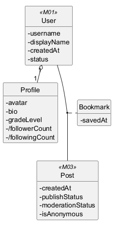

# Phân tích lớp thực thể — M02 User Profile

<!-- [Vietnamese Doc] Tài liệu tiếng Việt; tên lớp và thuộc tính viết tiếng Anh (input/CONVENTIONS.md mục 3). -->

| Mã tài liệu | EC-M02 |
|---|---|
| Dự án | iShare |
| Module | M02 — User Profile |
| Đầu vào | FR-M02 phiên bản 1.6 |
| Trạng thái | Đã chốt |
| Phiên bản | 1.0 |
| Ngày | 2026-11-18 |
| Tác giả | Phạm Văn Đức |

<!-- Quy ước chung cho mọi bảng dưới đây:
     - Không đổi tên cột, không xóa cột, không đổi số mục: tool đọc bảng theo số mục và tên cột.
     - Ô không có nội dung ghi "—".
     - Mục chưa tới bước làm thì để dòng "(Chưa làm — bước N)".
     - Cột Nguồn ghi mã trong FR: FR-Mxx-nn, FR-Mxx-nn.mm, BR-Mxx-nn, hoặc TN:<thuật ngữ> (mục 2.1 của FR).
     - Mục 4 chỉ chứa ảnh sơ đồ. gen_puml.py ghi mã PlantUML vào tệp riêng diagrams/EC-M02.puml, render
       diagrams/EC-M02.png và đặt ảnh vào mục 4. Không chép mã PlantUML vào tài liệu, không sửa tay tệp .puml hay ảnh. -->

## 1. Mô tả chức năng

### 1.1 Đoạn mô tả

Hệ thống quản lý hồ sơ của người dùng và các bookmark mà người dùng lưu trên bài viết; mỗi tài khoản có một hồ sơ gồm
avatar, bio và Lớp/Khối.

Hệ thống cho phép Guest, User, Mod và Admin xem trang hồ sơ của một người dùng tại địa chỉ theo username của tài
khoản, ở ngữ cảnh chủ hồ sơ khi người đang đăng nhập là chính người dùng đó và ở ngữ cảnh người xem trong mọi trường
hợp còn lại. Trang hồ sơ hiển thị avatar, bio và Lớp/Khối của hồ sơ, username, display_name và ngày tham gia của tài
khoản, tổng điểm, các badge đã đạt và danh hiệu "Ngôi sao tuần" của tuần vừa chốt do M12 tính và trao, cùng số người
theo dõi và số đang theo dõi. Khi hồ sơ chưa có avatar, trang hồ sơ hiển thị avatar mặc định. Trang hồ sơ hiển thị
theo trạng thái tài khoản do M01 quản lý: tài khoản DEACTIVATED hoặc DELETED, cũng như địa chỉ có username không
thuộc tài khoản nào, hiện "người dùng không tồn tại", còn tài khoản BANNED vẫn hiện hồ sơ kèm nhãn "Tài khoản đã bị
khóa". Chủ hồ sơ thấy ba tab nội dung Bài viết, Bookmark và Đã xóa, còn người xem chỉ thấy tab Bài viết. Tab Bài viết
liệt kê bài viết của chủ hồ sơ theo thời điểm tạo bài, mới nhất trước; người xem chỉ thấy bài viết đã đăng, không bị
ẩn, không đăng ẩn danh, và chỉ thấy bài viết thuộc nhóm Private khi người xem là thành viên nhóm đó, còn chủ hồ sơ
thấy thêm bài viết nháp, chờ duyệt, bị từ chối, tự ẩn và bài viết đăng ẩn danh của mình. Tab Đã xóa liệt kê các bài
viết chủ hồ sơ đã xóa còn trong thời hạn khôi phục của M03 để chủ hồ sơ khôi phục.

Hệ thống cho phép User, Mod và Admin xem danh sách người theo dõi và danh sách đang theo dõi của mọi người dùng, dựng
từ các lượt theo dõi giữa người dùng do M07 ghi lại, xếp theo thời điểm bắt đầu theo dõi, mới nhất trước. Danh sách
đang theo dõi chỉ gồm người dùng, không gồm Topic hay bài viết mà chủ hồ sơ theo dõi. Tài khoản DEACTIVATED hoặc
BANNED không hiện và không được đếm trong danh sách người theo dõi, danh sách đang theo dõi của người khác cho tới khi
trở lại ACTIVE, còn hồ sơ của tài khoản DEACTIVATED hoặc DELETED không hiện danh sách người theo dõi và danh sách đang
theo dõi.

Hệ thống cho phép chủ hồ sơ có tài khoản ACTIVE sửa bio và Lớp/Khối trên hồ sơ của mình; bio có thể trống, Lớp/Khối
có thể bỏ chọn, và Lớp/Khối chỉ đổi khi chủ hồ sơ tự sửa. Trang sửa hồ sơ cũng là nơi chủ hồ sơ đổi username và
display_name của tài khoản theo quy tắc của M01. Lớp/Khối trên hồ sơ được M12 dùng để lọc bảng xếp hạng và được M15
dùng cho phân bố người dùng theo Lớp/Khối. Hệ thống cho phép chủ hồ sơ có tài khoản ACTIVE tải lên một ảnh làm avatar
mới; hệ thống lưu ảnh gốc của avatar mới và xóa avatar cũ khỏi nơi lưu ảnh.

Hệ thống cho phép User, Mod và Admin lưu một bài viết thành một bookmark và bỏ lưu bài viết đó, kể cả bài viết ở mức
Khóa toàn bộ; mỗi bookmark ghi người dùng đã lưu, bài viết được lưu và thời điểm lưu. Mỗi người dùng có nhiều nhất một
bookmark cho một bài viết, và bỏ lưu thì xóa bookmark đó. Hệ thống cho phép chủ hồ sơ xem các bài viết mình đang lưu
trong tab Bookmark, xếp theo thời điểm lưu, mới nhất trước; trong khi bài viết được lưu không xem được với chủ hồ sơ,
tab Bookmark hiện dòng "Nội dung không tồn tại" ở vị trí của bookmark đó, và chủ hồ sơ vẫn bỏ lưu được bookmark đó.
Khi bài viết được lưu bị xóa hẳn hoặc tác giả của bài viết chuyển sang DELETED, hệ thống xóa các bookmark của bài viết
đó. Khi tài khoản chuyển sang DELETED, M01 xóa avatar, bio, Lớp/Khối của hồ sơ và mọi bookmark của tài khoản. Bookmark
cùng thời điểm lưu được M05 dùng để tính Trending Topic, Trending Tag và được M14 đếm vào điểm Trending Post.

<!-- Văn xuôi bình thường, có thể chia vài đoạn. KHÔNG ghi mã câu (S1), (S2)… trong đoạn văn: người đọc không hiểu
     các mã đó. Số câu chỉ nằm ở bảng 1.2. Xem steps/01-describe-functions.md. -->

### 1.2 Truy vết câu

<!-- Mỗi câu của đoạn mô tả một dòng, theo đúng thứ tự. Câu: 1, 2, 3…
     Nội dung câu: chép NGUYÊN VĂN câu đó từ mục 1.1 (tool so khớp từng câu với đoạn văn).
     Nguồn: mã chức năng hoặc yêu cầu của FR mà câu dựa vào. -->

| Câu | Nội dung câu | Nguồn |
|---|---|---|
| 1 | Hệ thống quản lý hồ sơ của người dùng và các bookmark mà người dùng lưu trên bài viết; mỗi tài khoản có một hồ sơ gồm avatar, bio và Lớp/Khối. | FR-M02-01.02, FR-M02-03.02, FR-M02-05.01 |
| 2 | Hệ thống cho phép Guest, User, Mod và Admin xem trang hồ sơ của một người dùng tại địa chỉ theo username của tài khoản, ở ngữ cảnh chủ hồ sơ khi người đang đăng nhập là chính người dùng đó và ở ngữ cảnh người xem trong mọi trường hợp còn lại. | FR-M02-01, FR-M02-01.01, FR-M02-01.16, FR-M02-01.20, BR-M02-01 |
| 3 | Trang hồ sơ hiển thị avatar, bio và Lớp/Khối của hồ sơ, username, display_name và ngày tham gia của tài khoản, tổng điểm, các badge đã đạt và danh hiệu "Ngôi sao tuần" của tuần vừa chốt do M12 tính và trao, cùng số người theo dõi và số đang theo dõi. | FR-M02-01.02, FR-M02-01.09, FR-M02-01.10, FR-M02-01.24 |
| 4 | Khi hồ sơ chưa có avatar, trang hồ sơ hiển thị avatar mặc định. | FR-M02-01.18 |
| 5 | Trang hồ sơ hiển thị theo trạng thái tài khoản do M01 quản lý: tài khoản DEACTIVATED hoặc DELETED, cũng như địa chỉ có username không thuộc tài khoản nào, hiện "người dùng không tồn tại", còn tài khoản BANNED vẫn hiện hồ sơ kèm nhãn "Tài khoản đã bị khóa". | FR-M02-01.11, FR-M02-01.12, FR-M02-01.21 |
| 6 | Chủ hồ sơ thấy ba tab nội dung Bài viết, Bookmark và Đã xóa, còn người xem chỉ thấy tab Bài viết. | FR-M02-01.05, FR-M02-01.06 |
| 7 | Tab Bài viết liệt kê bài viết của chủ hồ sơ theo thời điểm tạo bài, mới nhất trước; người xem chỉ thấy bài viết đã đăng, không bị ẩn, không đăng ẩn danh, và chỉ thấy bài viết thuộc nhóm Private khi người xem là thành viên nhóm đó, còn chủ hồ sơ thấy thêm bài viết nháp, chờ duyệt, bị từ chối, tự ẩn và bài viết đăng ẩn danh của mình. | FR-M02-01.07, FR-M02-01.17, FR-M02-01.19 |
| 8 | Tab Đã xóa liệt kê các bài viết chủ hồ sơ đã xóa còn trong thời hạn khôi phục của M03 để chủ hồ sơ khôi phục. | FR-M02-01.08 |
| 9 | Hệ thống cho phép User, Mod và Admin xem danh sách người theo dõi và danh sách đang theo dõi của mọi người dùng, dựng từ các lượt theo dõi giữa người dùng do M07 ghi lại, xếp theo thời điểm bắt đầu theo dõi, mới nhất trước. | FR-M02-02, FR-M02-02.01, FR-M02-02.02, FR-M02-02.03, FR-M02-02.09 |
| 10 | Danh sách đang theo dõi chỉ gồm người dùng, không gồm Topic hay bài viết mà chủ hồ sơ theo dõi. | FR-M02-02.06 |
| 11 | Tài khoản DEACTIVATED hoặc BANNED không hiện và không được đếm trong danh sách người theo dõi, danh sách đang theo dõi của người khác cho tới khi trở lại ACTIVE, còn hồ sơ của tài khoản DEACTIVATED hoặc DELETED không hiện danh sách người theo dõi và danh sách đang theo dõi. | FR-M02-02.04, FR-M02-02.07, FR-M02-02.08 |
| 12 | Hệ thống cho phép chủ hồ sơ có tài khoản ACTIVE sửa bio và Lớp/Khối trên hồ sơ của mình; bio có thể trống, Lớp/Khối có thể bỏ chọn, và Lớp/Khối chỉ đổi khi chủ hồ sơ tự sửa. | FR-M02-03, FR-M02-03.02, FR-M02-03.05, FR-M02-03.07, FR-M02-03.08, FR-M02-03.09, FR-M02-03.14 |
| 13 | Trang sửa hồ sơ cũng là nơi chủ hồ sơ đổi username và display_name của tài khoản theo quy tắc của M01. | FR-M02-03.01 |
| 14 | Lớp/Khối trên hồ sơ được M12 dùng để lọc bảng xếp hạng và được M15 dùng cho phân bố người dùng theo Lớp/Khối. | FR-M02-03.02, FR-M02-03.07 |
| 15 | Hệ thống cho phép chủ hồ sơ có tài khoản ACTIVE tải lên một ảnh làm avatar mới; hệ thống lưu ảnh gốc của avatar mới và xóa avatar cũ khỏi nơi lưu ảnh. | FR-M02-04, FR-M02-04.01, FR-M02-04.02, FR-M02-04.05, FR-M02-04.06 |
| 16 | Hệ thống cho phép User, Mod và Admin lưu một bài viết thành một bookmark và bỏ lưu bài viết đó, kể cả bài viết ở mức Khóa toàn bộ; mỗi bookmark ghi người dùng đã lưu, bài viết được lưu và thời điểm lưu. | FR-M02-05, FR-M02-05.01, FR-M02-05.04, FR-M02-06, FR-M02-06.02, FR-M02-07.07 |
| 17 | Mỗi người dùng có nhiều nhất một bookmark cho một bài viết, và bỏ lưu thì xóa bookmark đó. | FR-M02-05.03, FR-M02-06.01 |
| 18 | Hệ thống cho phép chủ hồ sơ xem các bài viết mình đang lưu trong tab Bookmark, xếp theo thời điểm lưu, mới nhất trước; trong khi bài viết được lưu không xem được với chủ hồ sơ, tab Bookmark hiện dòng "Nội dung không tồn tại" ở vị trí của bookmark đó, và chủ hồ sơ vẫn bỏ lưu được bookmark đó. | FR-M02-07, FR-M02-07.01, FR-M02-07.03, FR-M02-07.04, FR-M02-07.05, FR-M02-07.07 |
| 19 | Khi bài viết được lưu bị xóa hẳn hoặc tác giả của bài viết chuyển sang DELETED, hệ thống xóa các bookmark của bài viết đó. | FR-M02-07.06 |
| 20 | Khi tài khoản chuyển sang DELETED, M01 xóa avatar, bio, Lớp/Khối của hồ sơ và mọi bookmark của tài khoản. | FR-M02-01.11, FR-M02-07.06 |
| 21 | Bookmark cùng thời điểm lưu được M05 dùng để tính Trending Topic, Trending Tag và được M14 đếm vào điểm Trending Post. | FR-M02-05.01, FR-M02-06.01 |

## 2. Danh từ và phân loại

### 2.1 Sổ danh từ

<!-- Phân loại: Lớp | Thuộc tính | Loại bỏ.
     Kết quả: tên lớp; hoặc Lớp.thuộcTính; hoặc "—" khi loại bỏ.
     Xuất hiện ở: "Câu n" (số câu ở bảng 1.2) hoặc "Quét: <mã FR>" (lượt quét bổ sung). -->

| # | Danh từ | Xuất hiện ở | Phân loại | Kết quả | Lý do |
|---|---|---|---|---|---|
| 1 | hệ thống | Câu 1 | Loại bỏ | — | Trừu tượng: chỉ chính phần mềm |
| 2 | hồ sơ | Câu 1 | Lớp | Profile | Mỗi tài khoản có một hồ sơ, được chủ hồ sơ sửa riêng và bị xóa nội dung khi tài khoản DELETED; có ba thông tin riêng (TN:Hồ sơ, BR-M02-04, BR-M02-06, BR-M02-09). Dùng tên Profile mà EC-M01 đã tham chiếu |
| 3 | người dùng / tài khoản | Câu 1 | Lớp | User | Lớp ngoài (M01): hồ sơ thuộc một tài khoản, bookmark do người dùng tạo. "Người dùng" và "tài khoản" chỉ cùng một đối tượng; dùng tên User của EC-M01 |
| 4 | bookmark / lưu bài | Câu 1 | Lớp | Bookmark | Mỗi lần lưu tạo một bookmark riêng, bỏ lưu thì xóa; ghi thời điểm lưu và được M05, M14 đếm (TN:Bookmark, lưu bài; BR-M02-22). Gắn một người dùng với một bài viết: xét lớp liên kết ở bước 3 |
| 5 | bài viết | Câu 1 | Lớp | Post | Lớp ngoài (M03): đối tượng được lưu và được liệt kê ở tab Bài viết; dùng tên Post của EC-M01, EC-M05 |
| 6 | avatar / ảnh / ảnh gốc / avatar mới | Câu 1 | Thuộc tính | Profile.avatar | Mô tả hồ sơ; hồ sơ lưu ảnh gốc (BR-M02-08) và chỉ giữ avatar hiện tại (BR-M02-07) |
| 7 | bio | Câu 1 | Thuộc tính | Profile.bio | Mô tả hồ sơ (BR-M02-04) |
| 8 | Lớp-Khối | Câu 1 | Thuộc tính | Profile.gradeLevel | Mô tả hồ sơ (BR-M02-09); tên gradeLevel như EC-M01 |
| 9 | Guest | Câu 2 | Loại bỏ | — | Không lưu: tác nhân không có dữ liệu (chưa đăng nhập) |
| 10 | User, Mod, Admin (vai trò) | Câu 2 | Lớp | User | Vai trò có tài khoản; trong module này ba vai trò có cùng quyền (mục 4.2 của FR) nên M02 không đọc vai trò |
| 11 | trang hồ sơ | Câu 2 | Loại bỏ | — | Giao diện: trang hiển thị dữ liệu của hồ sơ và tài khoản (TN:Trang hồ sơ) |
| 12 | địa chỉ theo username | Câu 2 | Loại bỏ | — | Giao diện: địa chỉ /u/{username} dựng từ User.username, không phân biệt chữ hoa, chữ thường (BR-M02-34) |
| 13 | username | Câu 2 | Thuộc tính | User.username | Thông tin của tài khoản (M01) mà M02 đọc để tìm hồ sơ theo địa chỉ và hiển thị |
| 14 | ngữ cảnh chủ hồ sơ, ngữ cảnh người xem | Câu 2 | Loại bỏ | — | Giao diện: cách hiển thị chọn theo người đang đăng nhập lúc mở trang, không lưu (BR-M02-01) |
| 15 | người đang đăng nhập | Câu 2 | Loại bỏ | — | Không lưu: tác nhân không có dữ liệu riêng trong M02; là người dùng của phiên hiện tại, chỉ dùng để chọn ngữ cảnh |
| 16 | chủ hồ sơ | Câu 2 | Lớp | User | Vai trò theo ngữ cảnh: người dùng sở hữu hồ sơ đang xem (TN:Chủ hồ sơ) |
| 17 | người xem | Câu 2 | Loại bỏ | — | Không lưu: tác nhân không có dữ liệu; vai trò theo ngữ cảnh lúc xem, có thể là Guest, M02 không ghi gì về người xem (TN:Người xem) |
| 18 | trường hợp | Câu 2 | Loại bỏ | — | Chung chung |
| 19 | display_name | Câu 3 | Thuộc tính | User.displayName | Thông tin của tài khoản (M01) mà M02 hiển thị |
| 20 | ngày tham gia | Câu 3 | Thuộc tính | User.createdAt | Ngày tài khoản được tạo (TN:Ngày tham gia, M01); M02 đọc để hiển thị |
| 21 | tổng điểm | Câu 3 | Loại bỏ | — | Ngoài phạm vi module (M12): M12 tính, M02 chỉ hiển thị (BR-M02-11, BR-M02-12) |
| 22 | badge | Câu 3 | Loại bỏ | — | Ngoài phạm vi module (M12): M12 trao, M02 chỉ hiển thị badge đã đạt (BR-M02-11, BR-M02-13) |
| 23 | danh hiệu "Ngôi sao tuần" | Câu 3 | Loại bỏ | — | Ngoài phạm vi module (M12): M12 trao theo tuần, M02 chỉ hiển thị danh hiệu của tuần vừa chốt (BR-M02-37) |
| 24 | tuần vừa chốt | Câu 3 | Loại bỏ | — | Ngoài phạm vi module (M12): chu kỳ chốt tuần của M12 |
| 25 | M01, M03, M05, M07, M12, M14, M15 (tên module) | Câu 3 | Loại bỏ | — | Trừu tượng: tên các phần của hệ thống |
| 26 | số người theo dõi | Câu 3 | Thuộc tính | Profile.followerCount | Số liệu tính ra gắn với một hồ sơ (T7): đếm lượt theo dõi tới người dùng của hồ sơ theo BR-M02-27 |
| 27 | số đang theo dõi | Câu 3 | Thuộc tính | Profile.followingCount | Số liệu tính ra gắn với một hồ sơ (T7): đếm lượt theo dõi người dùng của chủ hồ sơ theo BR-M02-27 |
| 28 | avatar mặc định | Câu 4 | Loại bỏ | — | Giao diện: ảnh hệ thống hiện khi Profile.avatar trống, hình thức chốt ở giai đoạn thiết kế (TN:Avatar mặc định) |
| 29 | trạng thái tài khoản | Câu 5 | Thuộc tính | User.status | Thông tin của tài khoản (M01) mà M02 đọc |
| 30 | ACTIVE, DEACTIVATED, DELETED, BANNED | Câu 5 | Loại bỏ | — | Giá trị của User.status |
| 31 | "người dùng không tồn tại" | Câu 5 | Loại bỏ | — | Giao diện: câu hiện thay cho nội dung hồ sơ |
| 32 | nhãn "Tài khoản đã bị khóa" | Câu 5 | Loại bỏ | — | Giao diện: hiện khi User.status là BANNED (TN:Nhãn "Tài khoản đã bị khóa") |
| 33 | tab nội dung (Bài viết, Bookmark, Đã xóa) | Câu 6 | Loại bỏ | — | Giao diện: các danh sách lấy từ bài viết và bookmark (TN:Tab nội dung) |
| 34 | thời điểm tạo bài | Câu 7 | Thuộc tính | Post.createdAt | Thông tin của bài viết (M03) mà M02 đọc để xếp tab Bài viết (TN:Thời điểm tạo bài) |
| 35 | đã đăng, nháp, chờ duyệt, bị từ chối, tự ẩn, đã xóa | Câu 7 | Loại bỏ | — | Giá trị của Post.publishStatus |
| 36 | bị ẩn | Câu 7 | Loại bỏ | — | Giá trị của Post.moderationStatus (Bị Mod ẩn, TN:Trạng thái bài) |
| 37 | bài viết đăng ẩn danh | Câu 7 | Thuộc tính | Post.isAnonymous | Thông tin của bài viết mà M02 đọc để ẩn bài với người xem và gắn dấu "ẩn danh" cho chủ hồ sơ (TN:Bài đăng ẩn danh) |
| 38 | nhóm Private | Câu 7 | Loại bỏ | — | Ngoài phạm vi module (M11): M02 không có dữ liệu nối với nhóm; bài nhóm Private xem được với ai theo quy tắc của M11 (TN:Bài xem được) |
| 39 | thành viên nhóm | Câu 7 | Loại bỏ | — | Ngoài phạm vi module (M11): như nhóm Private |
| 40 | thời hạn khôi phục | Câu 8 | Loại bỏ | — | Ngoài phạm vi module (M03): hằng số của M03; tab Đã xóa theo FR-M03-15.03 |
| 41 | danh sách người theo dõi, danh sách đang theo dõi | Câu 9 | Loại bỏ | — | Giao diện: danh sách dựng từ lượt theo dõi (M07), không lưu riêng |
| 42 | lượt theo dõi / quan hệ theo dõi | Câu 9 | Loại bỏ | — | Ngoài phạm vi module (M07): M07 tạo, sửa, xóa; lượt theo dõi nối hai tài khoản, không nối với Profile hay Bookmark; quan hệ User – Follow đã ghi ở EC-M01 (Q-01) |
| 43 | thời điểm bắt đầu theo dõi | Câu 9 | Loại bỏ | — | Ngoài phạm vi module (M07): thông tin của lượt theo dõi mà M02 đọc để xếp danh sách theo dõi (Q-01) |
| 44 | Topic | Câu 10 | Loại bỏ | — | Ngoài phạm vi module (M05): danh sách đang theo dõi không gồm Topic (BR-M02-27) |
| 45 | người khác | Câu 11 | Loại bỏ | — | Chung chung |
| 46 | trang sửa hồ sơ | Câu 13 | Loại bỏ | — | Giao diện |
| 47 | quy tắc của M01 | Câu 13 | Loại bỏ | — | Ngoài phạm vi module (M01): quy tắc username, display_name |
| 48 | bảng xếp hạng | Câu 14 | Loại bỏ | — | Ngoài phạm vi module (M12): M12 đọc Profile.gradeLevel lúc chốt bảng |
| 49 | phân bố người dùng theo Lớp-Khối | Câu 14 | Loại bỏ | — | Ngoài phạm vi module (M15): M15 đọc Profile.gradeLevel |
| 50 | avatar cũ | Câu 15 | Loại bỏ | — | Hành động không lưu dấu vết: avatar trước bị xóa khỏi nơi lưu ảnh khi avatar mới được đặt (BR-M02-07), không giữ lịch sử |
| 51 | nơi lưu ảnh | Câu 15 | Loại bỏ | — | Trừu tượng: hạ tầng lưu tệp, không phải dữ liệu nghiệp vụ |
| 52 | mức Khóa toàn bộ | Câu 16 | Loại bỏ | — | Ngoài phạm vi module (M03): mức khóa không chặn lưu, bỏ lưu (BR-M02-25) nên M02 không đọc |
| 53 | người dùng đã lưu / người lưu | Câu 16 | Lớp | User | Vai trò theo ngữ cảnh: người tạo bookmark |
| 54 | bài viết được lưu / bài đã lưu | Câu 16 | Lớp | Post | Vai trò của bài viết trong bookmark (TN:Bài đã lưu) |
| 55 | thời điểm lưu | Câu 16 | Thuộc tính | Bookmark.savedAt | Mô tả bookmark (TN:Thời điểm lưu); dùng để xếp tab Bookmark (BR-M02-31) và cho M05, M14 tính Trending |
| 56 | dòng "Nội dung không tồn tại" | Câu 18 | Loại bỏ | — | Giao diện: hiện khi bài viết được lưu không xem được; bookmark vẫn được giữ (BR-M02-29) |
| 57 | vị trí (trong tab Bookmark) | Câu 18 | Loại bỏ | — | Giao diện: vị trí suy ra từ Bookmark.savedAt |
| 58 | tác giả | Câu 19 | Lớp | User | Vai trò theo ngữ cảnh: người viết bài viết; quan hệ User – Post (tác giả) nối hai lớp ngoài, đã có ở EC-M01 |
| 59 | bị xóa hẳn | Câu 19 | Loại bỏ | — | Ngoài phạm vi module (M03): bài bị xóa hẳn không còn tồn tại; việc bookmark bị xóa theo được xét ở bước 3 (BR-M02-30) |
| 60 | Trending Topic, Trending Tag | Câu 21 | Loại bỏ | — | Ngoài phạm vi module (M05) |
| 61 | điểm Trending Post | Câu 21 | Loại bỏ | — | Ngoài phạm vi module (M14) |
| 62 | trạng thái bài | Quét: TN:Trạng thái bài | Thuộc tính | Post.publishStatus | Thông tin của bài viết (M03) mà M02 đọc; tên publishStatus như EC-M05 |
| 63 | trạng thái kiểm duyệt | Quét: TN:Trạng thái bài | Thuộc tính | Post.moderationStatus | Thông tin của bài viết (M03) mà M02 đọc; tên moderationStatus như EC-M05 |
| 64 | loại tệp và dung lượng ảnh (JPEG, PNG, WebP, 5 MB, GIF động) | Quét: FR-M02-04.03 | Loại bỏ | — | Hằng số của BR-M02-06: chỉ kiểm khi tải ảnh lên, không lưu |
| 65 | độ dài tối đa của bio (155 ký tự) | Quét: FR-M02-03.04 | Loại bỏ | — | Hằng số của BR-M02-04 |
| 66 | số ký tự đã dùng | Quét: FR-M02-03.03 | Loại bỏ | — | Giao diện: đếm khi nhập theo BR-M02-33, không lưu |
| 67 | Lớp-Khối trên bài viết | Quét: BR-M02-09 | Loại bỏ | — | Ngoài phạm vi module (M03): độc lập với Profile.gradeLevel |
| 68 | mức cảnh báo | Quét: FR-M02-01.13 | Loại bỏ | — | Ngoài phạm vi module (M08): không bao giờ hiện trên hồ sơ (BR-M02-17) |
| 69 | lịch sử đổi username, liên kết mạng xã hội, số stars nhận, số stars cho | Quét: FR-M02-01.14 | Loại bỏ | — | Ngoài phạm vi hệ thống: FR quyết không làm hoặc không hiện (FR-M02-01.14, FR-M02-01.15, FR-M02-01.23) |
| 70 | trò chuyện 1-1 | Quét: FR-M02-01.26 | Loại bỏ | — | Ngoài phạm vi module (M16): M02 chỉ đặt lối vào trên trang hồ sơ |

### 2.2 Lớp

<!-- Nhóm: Thực thể | Liên kết | Thống kê. Sở hữu: mã module sở hữu lớp (Mxx của tài liệu này, hoặc Myy với lớp ngoài).
     Thuộc tính: tên mọi thuộc tính của lớp ở mục 2.3, ngăn bởi dấu phẩy, thuộc tính dẫn xuất có "/" phía trước;
     để người đọc thấy lớp và thuộc tính trên cùng một dòng. Lớp chưa có thuộc tính ghi "—". -->

| Lớp | Tên tiếng Việt | Nhóm | Sở hữu | Mô tả | Thuộc tính | Nguồn |
|---|---|---|---|---|---|---|
| Profile | Hồ sơ | Thực thể | M02 | Thông tin công khai của một người dùng mà chính người dùng đó sửa: avatar, bio, Lớp/Khối | avatar, bio, gradeLevel, /followerCount, /followingCount | FR-M02-01.02, FR-M02-03, FR-M02-04 |
| Bookmark | Bookmark | Liên kết | M02 | Một lần người dùng lưu một bài viết để đọc lại; mỗi cặp người dùng – bài viết có nhiều nhất một bookmark | savedAt | FR-M02-05, FR-M02-06, FR-M02-07 |
| User | Người dùng (tài khoản) | Thực thể | M01 | Tài khoản sở hữu hồ sơ và tạo bookmark; M02 đọc username, display_name, ngày tham gia, trạng thái tài khoản | username, displayName, createdAt, status | FR-M02-01.01, FR-M02-01.02, FR-M02-01.11 |
| Post | Bài viết | Thực thể | M03 | Bài viết được lưu và được liệt kê ở tab Bài viết; M02 đọc trạng thái, thời điểm tạo, việc đăng ẩn danh (tên tạm, chờ EC-M03) | createdAt, publishStatus, moderationStatus, isAnonymous | FR-M02-01.07, FR-M02-05.01 |

### 2.3 Thuộc tính

<!-- Mỗi lớp có ĐỦ thuộc tính để người đọc hình dung được nó; xếp các dòng theo lớp.
     Tính chất: Lưu | Dẫn xuất. Chưa có id, chưa có kiểu, chưa có khóa ngoại.
     Căn cứ: Nguồn nêu (FR nói tới) | Đề xuất (FR không nói, nhưng chức năng hoặc quy tắc ở cột Nguồn cần nó) |
             Tham chiếu (thuộc tính của lớp ngoài mà module này đọc hoặc ghi; module sở hữu lớp đó định nghĩa).
     Ràng buộc nguồn nêu: độ dài tối đa, duy nhất, bắt buộc/tùy chọn, tập giá trị, mặc định, công thức (với Dẫn xuất)
             — chép từ FR kèm mã. Đề xuất mà FR không nêu ràng buộc thì ghi "—".
     Nguồn: mã FR/BR nêu thuộc tính; với Đề xuất là mã chức năng hoặc quy tắc cần nó.
     Ghi chú: bắt buộc với Đề xuất (vì sao cần) và Tham chiếu (module này dùng nó làm gì). -->

| Lớp | Thuộc tính | Tên tiếng Việt | Tính chất | Căn cứ | Ràng buộc nguồn nêu | Nguồn | Ghi chú |
|---|---|---|---|---|---|---|---|
| Profile | avatar | Avatar | Lưu | Nguồn nêu | Tùy chọn, trống thì hiện avatar mặc định (BR-M02-32); ảnh JPEG, PNG hoặc WebP, tối đa 5 MB, không nhận GIF động (BR-M02-06); lưu ảnh gốc, hiển thị cắt tròn (BR-M02-08); đặt avatar mới thì ảnh cũ bị xóa khỏi nơi lưu ảnh (BR-M02-07); chỉ chủ hồ sơ có tài khoản ACTIVE đổi được (BR-M02-18) | FR-M02-04.01, FR-M02-04.02, FR-M02-04.05, FR-M02-01.18 | M01 ghi ở bước 3 đăng ký và xóa khi tài khoản DELETED; M03, M04, M16, M01 đọc để hiển thị |
| Profile | bio | Bio | Lưu | Nguồn nêu | Tùy chọn; tối đa 155 ký tự đếm sau khi cắt khoảng trắng đầu và cuối, mỗi emoji, mỗi lần xuống dòng là một ký tự; chỉ gồm khoảng trắng thì lưu là trống (BR-M02-04, BR-M02-33); chỉ chủ hồ sơ có tài khoản ACTIVE sửa được (BR-M02-18) | FR-M02-03.02, FR-M02-03.04, FR-M02-03.11, FR-M02-03.12 | M01 ghi ở bước 3 đăng ký và xóa khi tài khoản DELETED |
| Profile | gradeLevel | Lớp/Khối | Lưu | Nguồn nêu | Tùy chọn; một trong 10, 11, 12, bỏ chọn được; chỉ đổi khi chủ hồ sơ tự sửa, không tự tăng theo năm học; độc lập với Lớp/Khối trên bài viết (BR-M02-09, BR-M02-10) | FR-M02-03.02, FR-M02-03.06, FR-M02-03.08, FR-M02-03.14 | M12 đọc lúc chốt bảng xếp hạng; M15 đọc cho phân bố theo Lớp/Khối |
| Profile | followerCount | Số người theo dõi | Dẫn xuất | Nguồn nêu | Số lượt theo dõi (M07) tới người dùng của hồ sơ, không đếm người theo dõi có tài khoản DEACTIVATED hoặc BANNED (BR-M02-27) | FR-M02-01.02, FR-M02-02.07, FR-M02-02.08 | Guest cũng thấy con số (BR-M02-14) |
| Profile | followingCount | Số đang theo dõi | Dẫn xuất | Nguồn nêu | Số lượt theo dõi (M07) của người dùng của hồ sơ tới người dùng khác, không gồm Topic, bài viết, không đếm tài khoản DEACTIVATED hoặc BANNED (BR-M02-27) | FR-M02-01.02, FR-M02-02.06, FR-M02-02.07 | — |
| Bookmark | savedAt | Thời điểm lưu | Lưu | Nguồn nêu | Mỗi người dùng lưu một bài viết nhiều nhất một lần (BR-M02-22); tab Bookmark xếp mới nhất trước (BR-M02-31) | FR-M02-07.07 | M05 dùng để tính Trending Topic/Tag; M14 đếm cho điểm Trending Post |
| User | username | Username | Lưu | Tham chiếu | — | FR-M02-01.01, FR-M02-01.20 | M02 tìm hồ sơ theo địa chỉ /u/{username} không phân biệt chữ hoa, chữ thường (BR-M02-34) và hiển thị; quy tắc thuộc M01 |
| User | displayName | Display_name | Lưu | Tham chiếu | — | FR-M02-01.02 | M02 hiển thị trên trang hồ sơ; đổi ở trang sửa hồ sơ theo quy tắc của M01 |
| User | createdAt | Ngày tham gia | Lưu | Tham chiếu | — | FR-M02-01.02 | M02 hiển thị ngày tham gia (TN:Ngày tham gia); EC-M01 đã có thuộc tính này |
| User | status | Trạng thái tài khoản | Lưu | Tham chiếu | — | FR-M02-01.11, FR-M02-01.12, FR-M02-02.07, FR-M02-03.09 | M02 đọc để chọn cách hiện hồ sơ, lọc và đếm danh sách theo dõi, từ chối sửa hồ sơ, đổi avatar khi không ACTIVE |
| Post | createdAt | Thời điểm tạo bài | Lưu | Tham chiếu | — | FR-M02-01.19 | M02 xếp tab Bài viết (TN:Thời điểm tạo bài); tên tạm, chờ EC-M03 |
| Post | publishStatus | Trạng thái đăng | Lưu | Tham chiếu | — | FR-M02-01.07, FR-M02-01.17, FR-M02-07.03 | M02 chọn bài hiện ở tab Bài viết theo ngữ cảnh và nhận ra bài đã lưu không xem được |
| Post | moderationStatus | Trạng thái kiểm duyệt | Lưu | Tham chiếu | — | FR-M02-01.07, FR-M02-07.03 | M02 ẩn bài bị Mod ẩn với người xem và hiện dòng "Nội dung không tồn tại" ở tab Bookmark |
| Post | isAnonymous | Đăng ẩn danh | Lưu | Tham chiếu | — | FR-M02-01.07, FR-M02-01.17 | M02 ẩn bài ẩn danh với người xem, gắn dấu "ẩn danh" cho chủ hồ sơ; khái niệm của M11 (TN:Bài đăng ẩn danh), tên tạm, chờ EC-M03, EC-M11 |

### 2.4 Đối chiếu với mục Dữ liệu nghiệp vụ của FR

<!-- Mỗi thực thể ở bảng "Dữ liệu nghiệp vụ" của FR một dòng; chép đúng tên ở cột Thực thể của FR.
     Xử lý: Khớp | Đã thêm qua sổ danh từ | Mô hình có thêm: … | Lệch: … (kèm Q-nn). -->

| Thực thể trong FR | Trong mô hình | Xử lý |
|---|---|---|
| Hồ sơ | Profile | Khớp: avatar, bio, gradeLevel; tài khoản là quan hệ, xét ở bước 3; ngày tham gia (FR ghi theo draft) là thông tin của tài khoản nên thành User.createdAt (TN:Ngày tham gia). Mô hình có thêm: /followerCount, /followingCount (FR-M02-01.02, BR-M02-27). Ma trận CRUD ghi M01 tạo hồ sơ khi tạo tài khoản; Profile vẫn do M02 sở hữu vì FR-M02 định nghĩa thực thể và mọi quy tắc của nó, EC-M01 cũng ghi Profile thuộc M02 |
| Bookmark | Bookmark | Khớp: savedAt; người lưu và bài viết được lưu là quan hệ, xét ở bước 3 |
| Quan hệ theo dõi | — | Lệch, đã xử lý theo Q-01 (thuộc M07, mô hình hóa ở EC-M07): FR ghi là thực thể M02 đọc; mô hình loại (sổ danh từ dòng 42) vì M07 sở hữu và lượt theo dõi không nối với lớp nào của M02; số người theo dõi, số đang theo dõi thành thuộc tính dẫn xuất của Profile (Q-01) |

## 3. Quan hệ giữa các lớp

### 3.1 Ma trận cặp lớp

<!-- T = quan hệ trực tiếp; G(X) = chỉ gián tiếp qua lớp X; trống = không liên quan. Chỉ điền nửa trên. -->

Không có dòng cho User, Post vì không xét cặp hai lớp ngoài. Riêng quan hệ lưu bài giữa User và Post do FR-M02 định
nghĩa (mục Dữ liệu nghiệp vụ: bookmark "thuộc một người dùng và một bài viết") nên được xét ở mục 3.2 và tách qua
Bookmark; trong ma trận nó hiện thành hai ô Bookmark – User, Bookmark – Post. Module không có lớp thống kê.

| | Bookmark | User | Post |
|---|---|---|---|
| Profile | G(User) | T |  |
| Bookmark |  | T | T |

### 3.2 Quan hệ số lượng

<!-- Mỗi ô T của ma trận một dòng. Dạng đọc theo thứ tự A–B: 1-1 | 1-n | n-1 | n-n.
     Xử lý: Giữ nguyên | Gộp vào <Lớp>: … | Giữ: … | Tách: thêm lớp <X>. -->

| Cặp | Câu A → B | Câu B → A | Dạng | Xử lý |
|---|---|---|---|---|
| User – Profile | Một tài khoản có đúng một hồ sơ. | Một hồ sơ thuộc đúng một tài khoản. | 1-1 | Giữ: khác module sở hữu (User của M01, Profile của M02) và khác vòng đời: khi tài khoản DELETED, tài khoản được giữ còn nội dung hồ sơ bị xóa |
| User – Post (lưu bài) | Một tài khoản có thể lưu nhiều bài viết. | Một bài viết có thể được nhiều tài khoản lưu. | n-n | Tách: thêm lớp Bookmark (đã có từ bước 2, đổi Nhóm sang Liên kết); mỗi cặp tài khoản – bài viết có nhiều nhất một bookmark (BR-M02-22) |
| User – Bookmark | Một tài khoản có thể có nhiều bookmark. | Một bookmark thuộc đúng một tài khoản (người lưu). | 1-n | Giữ nguyên |
| Post – Bookmark | Một bài viết có thể có nhiều bookmark của các người dùng khác nhau. | Một bookmark ứng với đúng một bài viết (bài viết được lưu). | 1-n | Giữ nguyên |

### 3.3 Lớp liên kết

<!-- Mỗi lớp có Nhóm = Liên kết một dòng. "Tách từ quan hệ n-n" viết dạng "LớpA – LớpB".
     "Thuộc tính riêng của liên kết": tên các thuộc tính (đã ghi ở mục 2.3); không có thì ghi rõ vì sao. -->

| Lớp liên kết | Tách từ quan hệ n-n | Thuộc tính riêng của liên kết | Nguồn |
|---|---|---|---|
| Bookmark | User – Post | savedAt | FR-M02-05.01, FR-M02-07.07, BR-M02-22 |

### 3.4 Quan hệ

<!-- Bội số A = số đối tượng A ứng với một đối tượng B (ghi ở đầu A trên sơ đồ). Cú pháp: 1, 0..1, 0..*, 1..*, 1..3.
     Loại: Kế thừa | Hợp thành | Kết tập | Liên kết | Phụ thuộc.
     Bên chính: lớp cha (Kế thừa), lớp toàn thể (Hợp thành, Kết tập), lớp được dùng (Phụ thuộc); "—" với Liên kết.
     Kế thừa và Phụ thuộc ghi "—" ở Bội số A, Bội số B, Dạng. Không được còn dạng n-n. -->

| ID | Lớp A | Bội số A | Lớp B | Bội số B | Dạng | Loại | Bên chính | Căn cứ | Nguồn |
|---|---|---|---|---|---|---|---|---|---|
| R-M02-01 | User | 1 | Profile | 1 | 1-1 | Kết tập | User | Tài khoản có một hồ sơ; không ghi hợp thành vì tài khoản không bao giờ bị xóa hẳn: khi DELETED chỉ avatar, bio, Lớp/Khối của hồ sơ bị xóa (mục Giao tiếp với module khác, dòng Dùng M01). Cùng loại và chiều với R-M01-09 | BR-M02-01, FR-M02-01.11, FR-M02-03.02 |
| R-M02-02 | User | 1 | Bookmark | 0..* | 1-n | Liên kết | — | Nửa thứ nhất của quan hệ n-n User – Post (lưu bài) đã tách qua lớp liên kết Bookmark; người lưu | FR-M02-05.01, BR-M02-22 |
| R-M02-03 | Post | 1 | Bookmark | 0..* | 1-n | Liên kết | — | Nửa thứ hai của quan hệ n-n User – Post (lưu bài); bài viết được lưu. Bookmark bị xóa khi bài bị xóa hẳn (BR-M02-30) | FR-M02-05.01, FR-M02-07.06, BR-M02-30 |

## 4. Sơ đồ lớp phân tích

<!-- BEGIN:DIAGRAM -->

Mã nguồn sơ đồ: [diagrams/EC-M02.puml](diagrams/EC-M02.puml). Ảnh và tệp .puml do `gen_puml.py` sinh từ các bảng của tài liệu này; muốn đổi sơ đồ thì sửa bảng rồi chạy lại tool, không sửa tay.
<!-- END:DIAGRAM -->

## 5. Liên module

<!-- Mỗi lớp có Sở hữu khác module này một dòng. -->

| Lớp | Module sở hữu | Module này dùng thế nào | Thuộc tính module này bổ sung |
|---|---|---|---|
| User | M01 | Tài khoản có một hồ sơ (R-M02-01) và là người lưu của bookmark (R-M02-02); đọc username, displayName, createdAt, status để tìm và hiển thị hồ sơ, lọc và đếm danh sách theo dõi, chặn sửa hồ sơ khi không ACTIVE | — |
| Post | M03 | Bài viết được lưu (R-M02-03), bookmark bị xóa khi bài bị xóa hẳn; đọc createdAt, publishStatus, moderationStatus, isAnonymous để chọn bài ở tab Bài viết và nhận ra bài đã lưu không xem được | — |

## 6. Câu hỏi và điểm chưa chốt

<!-- Loại: Thiếu | Mơ hồ | Mâu thuẫn | Lệch. Ghi vào: mục của tài liệu này đã sửa theo câu trả lời, hoặc "Chờ cập nhật FR-Mxx". -->

| Mã | Loại | Câu hỏi | Trả lời | Ghi vào |
|---|---|---|---|---|
| Q-01 | Lệch | Mục Dữ liệu nghiệp vụ của FR-M02 ghi "Quan hệ theo dõi" (M07 tạo, M02 đọc). Lượt theo dõi chỉ nối hai tài khoản (User – User), không nối với Profile hay Bookmark, nên nếu giữ làm lớp ngoài thì nó không có quan hệ nào với lớp của M02 (quy tắc liên module không cho ghi quan hệ giữa hai lớp ngoài). Đề xuất: loại khỏi EC-M02; giữ số người theo dõi, số đang theo dõi là thuộc tính dẫn xuất của Profile; quan hệ User – Follow đã có ở EC-M01 (R-M01-13, R-M01-14) và sẽ có ở EC-M07 | Follow thuộc phạm vi M07 nên được mô hình hóa ở EC-M07 (phương án A); EC-M02 không giữ lớp này, số người theo dõi, số đang theo dõi là thuộc tính dẫn xuất của Profile | Mục 2.1 dòng 42, 43; mục 2.4 |

## 7. Lịch sử sửa đổi

| Phiên bản | Ngày | Nội dung | Người sửa |
|---|---|---|---|
| 0.1 | 2026-11-18 | Tạo mới | Phạm Văn Đức |
| 1.0 | 2026-11-18 | Chốt sau 3 bước; Q-01: quan hệ theo dõi thuộc M07, mô hình hóa ở EC-M07 | Phạm Văn Đức |
