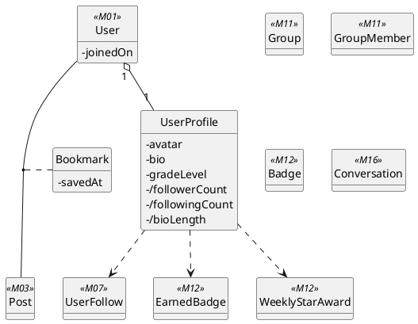

# Phân tích lớp thực thể — M02 User Profile

<!-- [Vietnamese Doc] Tài liệu tiếng Việt; tên lớp và thuộc tính viết tiếng Anh (input/CONVENTIONS.md mục 3). -->

| Mã tài liệu | EC-M02 |
|---|---|
| Dự án | iShare |
| Module | M02 — User Profile |
| Đầu vào | FR-M02 phiên bản 1.6 |
| Trạng thái | Bản nháp |
| Phiên bản | 0.3 |
| Ngày | 2026-11-16 |
| Tác giả | Phạm Văn Đức |

<!-- Quy ước chung cho mọi bảng dưới đây:
     - Không đổi tên cột, không xóa cột, không đổi số mục: tool đọc bảng theo số mục và tên cột.
     - Ô không có nội dung ghi "—".
     - Mục chưa tới bước làm thì để dòng "(Chưa làm — bước N)".
     - Cột Nguồn ghi mã trong FR: FR-M02-nn, FR-M02-nn.mm, BR-M02-nn, hoặc TN:<thuật ngữ> (mục 2.1 của FR).
     - Sơ đồ ở mục 4 do gen_puml.py sinh; không sửa tay. -->

## 1. Mô tả chức năng

### 1.1 Đoạn mô tả

(S1) Module User Profile quản lý hồ sơ công khai và bookmark bài viết của người dùng, đồng thời hiển thị thông tin tài khoản, bài viết, quan hệ theo dõi và kết quả điểm, huy hiệu của người dùng. (S2) Hệ thống cho phép Guest, User, Mod và Admin xem hồ sơ theo username với avatar, display_name, username, bio, Lớp/Khối khi đã đặt, ngày tham gia, tổng điểm hiện thời, badge đã đạt, danh hiệu “Ngôi sao tuần” của tuần vừa chốt, số người theo dõi và số đang theo dõi. (S3) Hệ thống hiển thị các bài viết trên hồ sơ theo tài khoản người xem, trạng thái bài viết của M03, tính ẩn danh và tư cách thành viên nhóm Private của M11, cho chủ hồ sơ xem thêm các bài nháp, chờ duyệt, bị từ chối, tự ẩn, bài ẩn danh và bài đã xóa của chính chủ hồ sơ, đồng thời sắp xếp danh sách bài viết theo thời điểm tạo bài. (S4) Hệ thống dùng trạng thái tài khoản của M01 để xác định khả năng xem hồ sơ, hiển thị tình trạng bị khóa của tài khoản BANNED và ngừng hiển thị nội dung hồ sơ khi tài khoản DEACTIVATED hoặc DELETED. (S5) Hệ thống cho phép User, Mod và Admin đã đăng nhập xem danh sách người theo dõi và danh sách người dùng đang được chủ hồ sơ theo dõi từ quan hệ theo dõi của M07, sắp xếp theo thời điểm bắt đầu theo dõi, đồng thời điều chỉnh danh sách và số lượng theo trạng thái tài khoản. (S6) Hệ thống cho phép chủ hồ sơ có tài khoản ACTIVE cập nhật hoặc để trống bio, tự đặt, thay đổi hoặc bỏ chọn Lớp/Khối, xem số ký tự bio đã dùng và đổi username, display_name theo quy tắc của M01. (S7) Hệ thống cho phép chủ hồ sơ có tài khoản ACTIVE thay avatar bằng ảnh tải lên, lưu ảnh gốc của avatar, xóa avatar cũ khi thay thành công và sử dụng avatar mặc định khi người dùng chưa đặt avatar. (S8) Hệ thống cho phép User, Mod và Admin đã đăng nhập lưu bài viết thành bookmark gắn với người lưu, bài viết được lưu và thời điểm lưu, đồng thời bảo đảm bài đã lưu được giữ một lần trong danh sách của người dùng. (S9) Hệ thống cho phép User, Mod và Admin đã đăng nhập bỏ lưu bài viết bằng cách xóa bookmark tương ứng, kể cả khi bài viết đang ở mức Khóa toàn bộ. (S10) Hệ thống cho chủ hồ sơ xem riêng danh sách bookmark của chủ hồ sơ theo thời điểm lưu mới nhất trước, giữ vị trí của bài tạm thời không xem được để hiển thị lại khi bài xem được trở lại và cho phép chủ hồ sơ bỏ lưu bài tạm thời không xem được. (S11) Hệ thống tự xóa bookmark khi bài viết được lưu bị xóa hẳn hoặc tài khoản tác giả của bài viết chuyển sang DELETED. (S12) Hệ thống cung cấp bookmark cùng thời điểm lưu và việc bỏ lưu cho M05 tính Trending Topic/Tag, số bookmark cho M14 tính Trending Post, và Lớp/Khối trên hồ sơ cho M12 lọc bảng xếp hạng cùng M15 thống kê phân bố người dùng. (S13) Hệ thống cho phép User, Mod và Admin đã đăng nhập mở trò chuyện riêng với người dùng khác từ hồ sơ của người dùng đó qua M16.

### 1.2 Truy vết câu

| Câu | Nội dung tóm tắt | Nguồn |
|---|---|---|
| S1 | Phạm vi hồ sơ, bookmark và dữ liệu hiển thị liên module | FR-M02-01, FR-M02-02, FR-M02-03, FR-M02-04, FR-M02-05, FR-M02-06, FR-M02-07 |
| S2 | Thông tin hồ sơ, điểm, badge, danh hiệu và số theo dõi | FR-M02-01.01, FR-M02-01.02, FR-M02-01.09, FR-M02-01.10, FR-M02-01.16, FR-M02-01.24, FR-M02-01.25 |
| S3 | Bài viết theo ngữ cảnh người xem, trạng thái, nhóm và thời điểm tạo | FR-M02-01.05, FR-M02-01.06, FR-M02-01.07, FR-M02-01.08, FR-M02-01.17, FR-M02-01.19 |
| S4 | Hiển thị hồ sơ theo trạng thái tài khoản của M01 | FR-M02-01.01, FR-M02-01.11, FR-M02-01.12 |
| S5 | Danh sách theo dõi, thời điểm bắt đầu và trạng thái tài khoản | FR-M02-02, FR-M02-02.01, FR-M02-02.02, FR-M02-02.03, FR-M02-02.06, FR-M02-02.07, FR-M02-02.08, FR-M02-02.09 |
| S6 | Sửa bio, Lớp/Khối, đếm ký tự và định danh theo M01 | FR-M02-03, FR-M02-03.01, FR-M02-03.02, FR-M02-03.03, FR-M02-03.05, FR-M02-03.07, FR-M02-03.08, FR-M02-03.09, FR-M02-03.14 |
| S7 | Đổi avatar, giữ ảnh gốc, xóa ảnh cũ và dùng ảnh mặc định | FR-M02-04, FR-M02-04.01, FR-M02-04.02, FR-M02-04.05, FR-M02-04.06, FR-M02-01.18 |
| S8 | Tạo bookmark và ghi nhận thời điểm lưu | FR-M02-05, FR-M02-05.01, FR-M02-05.02, FR-M02-05.03, FR-M02-07.07 |
| S9 | Bỏ lưu và áp dụng khi bài Khóa toàn bộ | FR-M02-06, FR-M02-06.01, FR-M02-06.02, FR-M02-05.02 |
| S10 | Danh sách bookmark riêng, thứ tự và bài tạm thời không xem được | FR-M02-07, FR-M02-07.01, FR-M02-07.02, FR-M02-07.03, FR-M02-07.04, FR-M02-07.05, FR-M02-07.07 |
| S11 | Xóa bookmark khi bài bị xóa hẳn hoặc tác giả DELETED | FR-M02-07.06 |
| S12 | Cung cấp dữ liệu bookmark và Lớp/Khối cho các module sử dụng | FR-M02-05.01, FR-M02-06.01, FR-M02-03.02, FR-M02-03.07 |
| S13 | Lối vào trò chuyện riêng của M16 từ hồ sơ người khác | FR-M02-01.26, FR-M02-01.27 |

S12 dựa thêm vào các dòng giao tiếp M05, M14, M12 và M15 trong FR-M02 mục 5.11. Thời điểm lưu ở S8 được xác định từ yêu cầu sắp xếp theo thời điểm lưu tại FR-M02-07.07.

**Nội dung để ở bước sau theo phạm vi bước 1**

- Bố cục, nút, tab, cách cắt ảnh và câu thông báo giao diện được lược khỏi đoạn mô tả chức năng.
- Giới hạn ký tự bio, loại và dung lượng ảnh, tập giá trị Lớp/Khối được đưa vào ràng buộc ở bước phân loại.
- M01 cung cấp thông tin tài khoản và quy tắc username/display_name. M03 quản lý nội dung, trạng thái và khôi phục bài viết. M07 quản lý thao tác theo dõi. M12 cung cấp điểm, badge và danh hiệu. M11 cung cấp điều kiện nhóm Private. M16 thực hiện trò chuyện.
- Các mục FR đã loại khỏi phạm vi gồm lịch sử đổi username, liên kết mạng xã hội, GIF động, tự tăng Lớp/Khối, nhắc cập nhật Lớp/Khối, thống kê stars trên hồ sơ, thông báo do bookmark và quyền Mod/Admin gỡ avatar hoặc bio người khác.
- Phụ lục B.2 của FR-M02 có bảng TBD trống.

QU-01 và QU-03 dùng quy ước đã chốt trong skill. Tệp quy ước chung chưa có. QU-10/QU-11 đang chờ xác nhận từ lượt M01, tiếp tục ghi nhận trạng thái đó khi tới bước sơ đồ và quan hệ.

Bước 1 đã được người dùng duyệt khi yêu cầu thực hiện bước 2 ngày 2026-11-16.

## 2. Danh từ và phân loại

Bước 1 được người dùng duyệt bằng yêu cầu thực hiện bước 2 ngày 2026-11-16. Bước 2 đã được người dùng duyệt khi yêu cầu thực hiện bước 3.

Có 60 dòng danh từ sau khi gộp cách gọi cùng nghĩa, gồm 56 dòng từ S1–S13 và 4 dòng quét bổ sung. Kết quả gồm 22 dòng thành Lớp, 8 dòng thành Thuộc tính và 30 dòng Loại bỏ. Các danh từ có thể quy về cùng một lớp. Mô hình có 11 lớp gồm 2 lớp M02 và 9 lớp ngoài, có 7 thuộc tính M02 và 1 thuộc tính đề nghị bổ sung cho lớp ngoài.

Đã chạy merge_ec.py --list --exclude M02 và dùng lại các tên User, UserProfile, Bookmark, Post, UserFollow, Group, GroupMember từ EC-M01. EC-M01 còn là bản nháp 0.3 nên các tên đó sẽ được đối chiếu lại khi chốt và gộp hệ thống.

Đã phân loại từ đoạn mô tả, quét thuật ngữ, yêu cầu cấp dưới và BR, rồi mới đối chiếu mục Dữ liệu nghiệp vụ. FR mục 5.10 xác nhận dữ liệu M02 có vòng đời tạo/bỏ lưu và quy tắc hiển thị theo trạng thái tài khoản. Bước 2 tập trung danh từ và thuộc tính theo phạm vi skill.

### 2.1 Sổ danh từ

Các dòng Loại bỏ ghi rõ lý do. Dữ liệu thuộc module khác được giữ ở phần mô tả sử dụng và đối chiếu để bảo toàn yêu cầu hiển thị hoặc cung cấp dữ liệu.

| # | Danh từ | Xuất hiện ở | Phân loại | Kết quả | Lý do |
|---|---|---|---|---|---|
| 1 | module User Profile / hệ thống | S1 | Loại bỏ | — | Trừu tượng, tên phần mềm và tác nhân tự động. |
| 2 | hồ sơ công khai / hồ sơ | S1 | Lớp | UserProfile | T8, thông tin hồ sơ được cập nhật riêng, có avatar, bio và Lớp/Khối. |
| 3 | bookmark / bài đã lưu | S1 | Lớp | Bookmark | T8, từng bản ghi lưu bài được tạo và bỏ lưu riêng, có thời điểm lưu. |
| 4 | người dùng / tài khoản | S1 | Lớp | User | T3/T4, tài khoản thuộc M01, dùng lại tên User đã có trong EC-M01. |
| 5 | thông tin tài khoản | S1 | Loại bỏ | — | Chung chung, các dữ liệu cụ thể như tên và trạng thái được xét ở dòng riêng. |
| 6 | bài viết / bài viết được lưu | S1 | Lớp | Post | T4, dữ liệu bài viết thuộc M03, tên đã tham chiếu ở EC-M01 và glossary. |
| 7 | quan hệ theo dõi | S1 | Lớp | UserFollow | T4, M02 dùng quan hệ theo dõi người dùng do M07 quản lý, dùng lại tên ở EC-M01. |
| 8 | kết quả điểm / tổng điểm hiện thời / điểm | S1 | Loại bỏ | — | Ngoài phạm vi module (M12), FR-M02-01.09 yêu cầu hiển thị tổng điểm do M12 cung cấp. Giữ yêu cầu giao tiếp và thời điểm cập nhật ở mục 2.4. |
| 9 | huy hiệu / badge | S1 | Lớp | Badge | T4, dữ liệu huy hiệu do M12 định nghĩa và trao, tên theo glossary. |
| 10 | Guest | S2 | Loại bỏ | — | Không lưu, tác nhân chưa đăng nhập có quyền đọc hồ sơ. |
| 11 | User | S2 | Lớp | User | T3, vai trò người dùng có tài khoản M01. |
| 12 | Mod | S2 | Lớp | User | T3, vai trò MOD của cùng tài khoản, có quyền sửa hồ sơ chính mình. |
| 13 | Admin | S2 | Lớp | User | T3, vai trò ADMIN của cùng tài khoản, có quyền sửa hồ sơ chính mình. |
| 14 | username | S2 | Loại bỏ | — | Ngoài phạm vi module (M01), thuộc tính User.username đã có trong EC-M01, M02 dùng và cho đổi theo quy tắc M01. |
| 15 | avatar / ảnh tải lên / ảnh gốc của avatar / ảnh avatar mới | S2 | Thuộc tính | UserProfile.avatar | T9, giá trị ảnh đại diện của hồ sơ. FR yêu cầu giữ ảnh gốc và xóa ảnh cũ khi thay thành công. |
| 16 | display_name | S2 | Loại bỏ | — | Ngoài phạm vi module (M01), thuộc tính User.displayName đã có, M02 lấy để hiển thị và đổi theo quy tắc M01. |
| 17 | bio | S2 | Thuộc tính | UserProfile.bio | T9, đoạn giới thiệu mô tả hồ sơ. |
| 18 | Lớp/Khối | S2 | Thuộc tính | UserProfile.gradeLevel | T9, giá trị cấp học tùy chọn trên hồ sơ. |
| 19 | ngày tham gia | S2 | Thuộc tính | User.joinedOn | T9, TN:Ngày tham gia xác định ngày tạo tài khoản M01. Đề nghị bổ sung dữ liệu của lớp ngoài theo quy ước liên module, đã duyệt cùng bước 2. |
| 20 | badge đã đạt | S2 | Lớp | EarnedBadge | T4, dữ liệu M12 ghi nhận việc người dùng đạt huy hiệu, tên tạm chờ EC-M12. |
| 21 | danh hiệu Ngôi sao tuần | S2 | Lớp | WeeklyStarAward | T4, kết quả đạt danh hiệu của M12 được hiển thị trong tuần sau khi chốt. Đây là tham chiếu kết quả đã trao, tên tạm chờ EC-M12. |
| 22 | tuần vừa chốt | S2 | Loại bỏ | — | Ngoài phạm vi module (M12), kỳ xét kết quả danh hiệu, M02 áp dụng điều kiện hiển thị theo BR-M02-37. |
| 23 | số người theo dõi | S2 | Thuộc tính | UserProfile.followerCount | T7, số đếm tính từ quan hệ theo dõi người dùng sau khi lọc trạng thái theo BR-M02-27. |
| 24 | số đang theo dõi | S2 | Thuộc tính | UserProfile.followingCount | T7, số tài khoản đang theo dõi được tính theo quy tắc lọc BR-M02-27. |
| 25 | số lượng (danh sách theo dõi) | S5 | Loại bỏ | — | Chung chung, hai số đếm cụ thể đã được phân loại thành followerCount và followingCount. |
| 26 | người xem / tài khoản người xem | S3 | Lớp | User | T3, vai trò tài khoản đang xem hồ sơ. Trường hợp Guest đã xét riêng. |
| 27 | trạng thái bài viết | S3 | Loại bỏ | — | Ngoài phạm vi module (M03), dữ liệu của Post dùng để chọn bài hiện trên hồ sơ. |
| 28 | tính ẩn danh / bài ẩn danh | S3 | Lớp | Post | T4, vẫn là Post, M11 quy định ẩn danh và quyền xem danh tính. M02 lọc bài theo FR-M02-01.07 và FR-M02-01.17. |
| 29 | tư cách thành viên | S3 | Lớp | GroupMember | T4, dữ liệu thành viên M11 dùng để kiểm tra khả năng xem bài nhóm Private. |
| 30 | nhóm Private / nhóm | S3 | Lớp | Group | T4, dữ liệu M11, dùng cùng GroupMember khi quyết định bài được xem. |
| 31 | chủ hồ sơ | S3 | Lớp | User | T3, tài khoản sở hữu hồ sơ đang được thao tác. |
| 32 | bài nháp / bài chờ duyệt / bài bị từ chối / bài tự ẩn / bài đã xóa | S3 | Lớp | Post | T4, các bài viết cùng lớp Post ở những trạng thái do M03 quản lý. |
| 33 | thời điểm tạo bài | S3 | Loại bỏ | — | Ngoài phạm vi module (M03), dữ liệu Post được dùng sắp xếp danh sách bài viết. |
| 34 | trạng thái tài khoản | S4 | Loại bỏ | — | Ngoài phạm vi module (M01), thuộc tính User.accountState đã có, dùng để lọc hồ sơ và danh sách. |
| 35 | khả năng xem hồ sơ / tình trạng bị khóa | S4 | Loại bỏ | — | Giao diện, kết quả hiển thị theo User.accountState và quy tắc FR-M02-01.11/01.12. |
| 36 | BANNED / DEACTIVATED / DELETED / ACTIVE | S4 | Loại bỏ | — | Giá trị của User.accountState, thuộc tính đã có ở EC-M01. |
| 37 | nội dung hồ sơ | S4 | Loại bỏ | — | Chung chung, bao gồm những thông tin hồ sơ đã được xét từng danh từ. |
| 38 | danh sách người theo dõi / danh sách người dùng đang được theo dõi | S5 | Loại bỏ | — | Giao diện, kết quả truy xuất UserFollow và User theo BR-M02-27. Các đối tượng và số đếm đã được xét riêng. |
| 39 | người theo dõi / người dùng được theo dõi | S5 | Lớp | User | T3, hai vai trò của tài khoản trong UserFollow, để xét quan hệ ở bước 3. |
| 40 | thời điểm bắt đầu theo dõi | S5 | Loại bỏ | — | Ngoài phạm vi module (M07), thuộc tính của UserFollow dùng để sắp xếp danh sách. |
| 41 | số ký tự bio đã dùng | S6 | Thuộc tính | UserProfile.bioLength | T7, độ dài bio tính sau khi cắt khoảng trắng đầu và cuối theo BR-M02-33. |
| 42 | quy tắc / mã module (M01, M03, M05, M07, M11, M12, M14, M15, M16) | S6 | Loại bỏ | — | Trừu tượng, quy định nghiệp vụ và ký hiệu phân chia phạm vi tài liệu. |
| 43 | avatar cũ | S7 | Loại bỏ | — | Hành động không lưu dấu vết, ảnh bị xóa khi thay avatar thành công theo FR-M02-04.05, FR không yêu cầu giữ lịch sử ảnh. |
| 44 | avatar mặc định | S7 | Loại bỏ | — | Giao diện, giá trị thay thế khi chưa đặt ảnh theo BR-M02-32, hình thức chờ giai đoạn thiết kế theo thuật ngữ Avatar mặc định. |
| 45 | người lưu | S8 | Lớp | User | T3, tài khoản thực hiện lưu bài, thuộc M01. |
| 46 | thời điểm lưu | S8 | Thuộc tính | Bookmark.savedAt | T9, mốc tạo bookmark, dùng sắp xếp và cung cấp dữ liệu Trending. |
| 47 | danh sách bài đã lưu / danh sách bookmark | S8 | Loại bỏ | — | Giao diện, danh sách các Bookmark của chủ tài khoản, có thứ tự tính từ savedAt. |
| 48 | Khóa toàn bộ | S9 | Loại bỏ | — | Ngoài phạm vi module (M03), một giá trị mức khóa bài, M02 vẫn cho lưu và bỏ lưu theo BR-M02-25. |
| 49 | bài tạm thời không xem được | S10 | Lớp | Post | T4, bài viết hiện có mà người lưu tạm thiếu quyền xem, được hiển thị theo BR-M02-29. |
| 50 | vị trí (trong danh sách bookmark) | S10 | Loại bỏ | — | Giao diện, vị trí suy ra thứ tự savedAt theo BR-M02-31, chưa có yêu cầu lưu số thứ tự riêng. |
| 51 | tác giả bài viết | S11 | Lớp | User | T3, tài khoản tác giả do M03 tham chiếu. |
| 52 | Trending Topic/Tag / Trending Post | S12 | Loại bỏ | — | Ngoài phạm vi module (M05, M14), kết quả tính tại module sử dụng dữ liệu bookmark. M02 cung cấp dữ liệu đầu vào. |
| 53 | số bookmark | S12 | Loại bỏ | — | Ngoài phạm vi module (M14), giá trị đếm trên bài dùng tính Trending Post. M02 cung cấp các Bookmark cho M14 tính, giữ yêu cầu ở mục 2.4. |
| 54 | bảng xếp hạng | S12 | Loại bỏ | — | Ngoài phạm vi module (M12), M02 cung cấp gradeLevel phục vụ lọc. |
| 55 | thống kê phân bố người dùng | S12 | Loại bỏ | — | Ngoài phạm vi module (M15), M02 cung cấp gradeLevel phục vụ thống kê. |
| 56 | trò chuyện riêng | S13 | Lớp | Conversation | T4, M16 sở hữu và thực hiện trò chuyện 1-1, tên tạm chờ EC-M16. |
| 57 | định dạng JPEG, PNG, WebP / dung lượng tối đa / giới hạn ký tự / giá trị 10, 11, 12 | Quét: BR-M02-04, BR-M02-06, BR-M02-09 | Loại bỏ | — | Hằng số của BR-M02-04, BR-M02-06, BR-M02-09, ghi vào ràng buộc avatar, bio và gradeLevel. |
| 58 | Nội dung không tồn tại / nhãn Tài khoản đã bị khóa | Quét: TN:Nội dung không tồn tại, FR-M02-01.12, FR-M02-07.03 | Loại bỏ | — | Giao diện, nhãn hiển thị theo trạng thái hoặc khả năng xem nội dung. |
| 59 | mức cảnh báo / lịch sử đổi username / liên kết mạng xã hội / số stars nhận, số stars cho | Quét: FR-M02-01.13, FR-M02-01.14, FR-M02-01.15, FR-M02-01.23 | Loại bỏ | — | Ngoài phạm vi module, FR quyết định loại khỏi nội dung hồ sơ. |
| 60 | thông báo về bài đã lưu / nhắc cập nhật cấp học | Quét: FR-M02-05.05, FR-M02-03.15 | Loại bỏ | — | Ngoài phạm vi module, FR quyết định bỏ các hành vi gửi thông báo này. |

### 2.2 Lớp

Ở bước 3, Bookmark có nhóm Liên kết, các lớp còn lại giữ nhóm Thực thể. Điểm, huy hiệu và danh hiệu do M12 cung cấp. Các thuộc tính số đếm của hồ sơ được phân loại theo phép thử T7. Lớp ngoài chờ xác nhận tên tại EC module sở hữu.

| Lớp | Tên tiếng Việt | Nhóm | Sở hữu | Mô tả | Nguồn |
|---|---|---|---|---|---|
| UserProfile | Hồ sơ | Thực thể | M02 | Thông tin hồ sơ do M02 quản lý, dùng lại tên tham chiếu của EC-M01. | FR-M02-03.02, FR-M02-04.01, TN:Hồ sơ |
| Bookmark | Bookmark | Liên kết | M02 | Một bản ghi người dùng lưu bài để đọc lại, có thời điểm lưu. Dùng lại tên trong EC-M01. | FR-M02-05.01, FR-M02-06.01, FR-M02-07.07 |
| User | Tài khoản | Thực thể | M01 | Tài khoản, tên, trạng thái và vai trò người xem, chủ hồ sơ, người lưu. Có đề nghị bổ sung joinedOn tại mục 2.3, đã duyệt cùng bước 2. | FR-M02-01.02, FR-M02-03.01, TN:Ngày tham gia |
| Post | Bài viết | Thực thể | M03 | Bài của chủ hồ sơ hoặc được lưu. Dùng lại tên trong EC-M01 và glossary. | FR-M02-01.07, FR-M02-01.17, FR-M02-05.01 |
| UserFollow | Lượt theo dõi người dùng | Thực thể | M07 | Quan hệ theo dõi do M07 tạo, M02 đọc số lượng, danh sách và mốc bắt đầu. Tên đã tham chiếu trong EC-M01. | FR-M02-02.01, FR-M02-02.02, FR-M02-02.09 |
| Group | Nhóm | Thực thể | M11 | Nhóm Private dùng kiểm tra quyền xem bài. Tên theo glossary và EC-M01. | FR-M02-01.07 |
| GroupMember | Thành viên nhóm | Thực thể | M11 | Tư cách thành viên nhóm dùng khi lọc bài. Tên theo glossary và EC-M01. | FR-M02-01.07 |
| Badge | Huy hiệu | Thực thể | M12 | Huy hiệu theo mốc điểm do M12 trao. Tên theo glossary, chờ EC-M12 xác nhận. | FR-M02-01.10, BR-M02-11, BR-M02-13 |
| EarnedBadge | Huy hiệu đã đạt | Thực thể | M12 | Kết quả người dùng đạt huy hiệu do M12 cung cấp. Tên tạm, chờ EC-M12 xác nhận. | FR-M02-01.10, BR-M02-13, BR-M02-37 |
| WeeklyStarAward | Danh hiệu Ngôi sao tuần đã đạt | Thực thể | M12 | Kết quả đạt danh hiệu của tuần vừa chốt do M12 cung cấp. Tên tạm, chờ EC-M12 xác nhận. | FR-M02-01.24, FR-M02-01.25, BR-M02-37 |
| Conversation | Cuộc trò chuyện | Thực thể | M16 | Trò chuyện riêng được mở từ hồ sơ người khác. Tên tạm, chờ EC-M16 xác nhận. | FR-M02-01.26, FR-M02-01.27 |

EarnedBadge và WeeklyStarAward tham chiếu kết quả đã được M12 trao, theo FR-M02-01.10/01.24 và BR-M02-37. Các kết quả được hiển thị theo thời điểm và điều kiện mà FR nêu. Nhóm và tên của những lớp ngoài này sẽ được EC-M12 xác nhận.

### 2.3 Thuộc tính

Tên thuộc tính dùng camelCase theo QU-03. Các cột Tính chất và Ràng buộc nguồn nêu phân biệt dữ liệu phải giữ với dữ liệu tính được từ dữ liệu hiện có.

| Lớp | Thuộc tính | Tên tiếng Việt | Tính chất | Ràng buộc nguồn nêu | Nguồn |
|---|---|---|---|---|---|
| UserProfile | avatar | Ảnh đại diện | Lưu | Ảnh gốc, JPEG/PNG/WebP tối đa 5 MB theo BR-M02-06/08. Thay thành công thì xóa ảnh cũ theo BR-M02-07. Khi chưa đặt ảnh dùng avatar mặc định. Chỉ chủ tài khoản ACTIVE được thay theo BR-M02-18/36. | FR-M02-04.01, FR-M02-04.02, FR-M02-04.05, FR-M02-04.06, FR-M02-04.07, FR-M02-01.18, BR-M02-06, BR-M02-07, BR-M02-08 |
| UserProfile | bio | Giới thiệu | Lưu | Tùy chọn, tối đa 155 ký tự theo BR-M02-04. Cắt khoảng trắng đầu/cuối trước khi đếm, toàn khoảng trắng thành trống, mỗi emoji hoặc xuống dòng là một ký tự theo BR-M02-33. Chủ tài khoản ACTIVE tự sửa. | FR-M02-03.02, FR-M02-03.04, FR-M02-03.05, FR-M02-03.09, FR-M02-03.10, FR-M02-03.11, FR-M02-03.12, FR-M02-03.13, BR-M02-04, BR-M02-33 |
| UserProfile | gradeLevel | Lớp/Khối | Lưu | Tùy chọn, giá trị 10, 11, 12, có thể bỏ chọn theo BR-M02-09. Chỉ đổi khi người dùng tự sửa theo BR-M02-10. Độc lập với Lớp/Khối của Post. Cung cấp cho M12 và M15 theo FR mục 5.11. | FR-M02-03.02, FR-M02-03.06, FR-M02-03.07, FR-M02-03.08, FR-M02-03.14, BR-M02-09, BR-M02-10 |
| UserProfile | followerCount | Số người theo dõi | Dẫn xuất | Đếm các quan hệ UserFollow mà tài khoản là người được theo dõi sau khi lọc tài khoản theo BR-M02-27. Tài khoản DEACTIVATED/BANNED bị loại khỏi số đếm, ACTIVE được đếm lại. | FR-M02-01.02, FR-M02-02.07, FR-M02-02.08, BR-M02-27 |
| UserProfile | followingCount | Số người dùng đang theo dõi | Dẫn xuất | Đếm các quan hệ UserFollow mà tài khoản là người theo dõi sau khi lọc BR-M02-27. Chỉ đếm tài khoản, các đối tượng Topic/bài viết được loại theo FR-M02-02.06. | FR-M02-01.02, FR-M02-02.06, FR-M02-02.07, FR-M02-02.08, BR-M02-27 |
| UserProfile | bioLength | Số ký tự bio | Dẫn xuất | Độ dài bio sau khi cắt khoảng trắng đầu/cuối. Mỗi emoji và xuống dòng tính một ký tự theo BR-M02-33. Áp dụng cả lúc soạn bio theo FR-M02-03.03. | FR-M02-03.03, FR-M02-03.11, FR-M02-03.12, FR-M02-03.13, BR-M02-33 |
| Bookmark | savedAt | Thời điểm lưu | Lưu | Mốc người dùng tạo bookmark, dùng sắp xếp mới nhất trước theo BR-M02-31 và cung cấp cho M05. Mỗi người dùng lưu một bài nhiều nhất một lần theo BR-M02-22, sẽ xét thành ràng buộc quan hệ ở bước 3. | FR-M02-05.01, FR-M02-05.03, FR-M02-07.07, BR-M02-22, BR-M02-31, TN:Thời điểm lưu |
| User | joinedOn | Ngày tham gia | Lưu | Đề nghị phần M02 bổ sung vào lớp ngoài M01. Ngày tài khoản được tạo theo TN:Ngày tham gia, dùng hiển thị tại FR-M02-01.02. EC-M01 v0.3 chưa khai dữ liệu này, đã duyệt cùng bước 2. Nguồn chỉ yêu cầu ngày tham gia nên giữ độ chi tiết ngày. | FR-M02-01.02, BR-M02-02, TN:Ngày tham gia |

User.joinedOn là phần M02 đề nghị bổ sung cho lớp ngoài theo input/CONVENTIONS.md mục 5. Đây là dữ liệu đã được FR-M02 yêu cầu và định nghĩa, EC-M01 v0.3 còn thiếu. Đề nghị được duyệt cùng bước 2, để đưa về module sở hữu khi gộp hệ thống.

### 2.4 Đối chiếu với mục Dữ liệu nghiệp vụ của FR

Ba dòng đầu giữ đúng tên thực thể của bảng FR-M02 mục 5.9. Các dòng sau ghi phần có thêm từ yêu cầu và giao tiếp.

| Thực thể trong FR | Trong mô hình | Xử lý |
|---|---|---|
| Hồ sơ | UserProfile và phần User.joinedOn đề nghị bổ sung | Khớp avatar, bio và gradeLevel. Ngày tham gia được TN:Ngày tham gia định nghĩa là ngày tạo tài khoản M01 nên đề nghị User.joinedOn, đã duyệt cùng bước 2. Mô hình có thêm followerCount, followingCount và bioLength dẫn xuất từ FR-M02-01.02, FR-M02-02.07/02.08 và FR-M02-03.03, BR-M02-27/33. |
| Bookmark | Bookmark | Khớp savedAt và ý nghĩa người lưu, bài được lưu. Người lưu và bài là lớp User/Post, sẽ xét quan hệ ở bước 3. FR-M02-05.03, BR-M02-22 quy định mỗi người lưu một bài nhiều nhất một lần. |
| Quan hệ theo dõi | UserFollow (M07) | Khớp ở phần M02 sử dụng để hiển thị người theo dõi và đang theo dõi. Bảng 5.9 ghi phạm vi chung có người dùng/Topic/bài viết, FR-M02-02.06 và BR-M02-27 xác định danh sách M02 chỉ gồm tài khoản. Dùng lớp UserFollow đã tham chiếu ở EC-M01, các dạng theo dõi khác thuộc M07. |
| Bổ sung từ các yêu cầu và giao tiếp | User, Post, Group, GroupMember, Badge, EarnedBadge, WeeklyStarAward, Conversation | Mô hình có thêm lớp ngoài được các yêu cầu FR-M02-01.07, FR-M02-01.10, FR-M02-01.24, FR-M02-01.26 nêu. Mỗi lớp có nguồn trong mục 2.2. Các tên lớp mới của M12/M16 là tên tạm cần EC module sở hữu xác nhận. |
| Dữ liệu hiển thị từ M12 và cung cấp cho M14 | Tổng điểm và số bookmark của bài | Tổng điểm hiện thời được M12 cung cấp theo FR-M02-01.09 và BR-M02-11/12. M02 cung cấp dữ liệu Bookmark cho M14 tính số bookmark theo mục 5.11. Giữ yêu cầu giao tiếp này để xét trong phần liên module. |

Các thuộc tính dẫn xuất của UserProfile và phần đề nghị User.joinedOn cần được người dùng nhìn tại cổng bước 2. Những dữ liệu tài khoản đã có như username, displayName, accountState được dùng từ User của M01 theo FR-M02 mục 5.11.

## 3. Quan hệ giữa các lớp

Người dùng duyệt bước 2 và yêu cầu thực hiện bước 3 ngày 2026-11-16. Bước 3 đang chờ chốt. Nguồn vẫn là FR-M02 v1.6 đã chốt.

### 3.1 Ma trận cặp lớp

T là quan hệ trực tiếp. G(X) là đường gián tiếp qua lớp X. Chỉ xét nửa trên, các ô tự liên hệ được xét và để trống khi FR chưa nêu tự liên hệ. M02 xét các cặp có UserProfile hoặc Bookmark. Cặp hai lớp ngoài được để module sở hữu ghi.

| Lớp | UserProfile | Bookmark | User | Post | UserFollow | Group | GroupMember | Badge | EarnedBadge | WeeklyStarAward | Conversation |
|---|---|---|---|---|---|---|---|---|---|---|---|
| UserProfile |  | G(User) | T | G(User) | T |  |  | G(EarnedBadge) | T | T |  |
| Bookmark |  |  | T | T |  |  |  |  |  |  |  |
| User |  |  |  |  |  |  |  |  |  |  |  |
| Post |  |  |  |  |  |  |  |  |  |  |  |
| UserFollow |  |  |  |  |  |  |  |  |  |  |  |
| Group |  |  |  |  |  |  |  |  |  |  |  |
| GroupMember |  |  |  |  |  |  |  |  |  |  |  |
| Badge |  |  |  |  |  |  |  |  |  |  |  |
| EarnedBadge |  |  |  |  |  |  |  |  |  |  |  |
| WeeklyStarAward |  |  |  |  |  |  |  |  |  |  |  |
| Conversation |  |  |  |  |  |  |  |  |  |  |  |

UserProfile tới Bookmark và Post qua tài khoản chủ hồ sơ. Badge được sử dụng qua kết quả EarnedBadge. Group và GroupMember là ngữ cảnh quyền xem bài do M11 cung cấp. Conversation là điểm tới của lối vào trò chuyện do M16 thực hiện theo FR-M02-01.26. Những yêu cầu giao tiếp này được giữ ở mục 5. Các quan hệ cụ thể giữa tài khoản, bài viết, nhóm, huy hiệu và cuộc trò chuyện được EC module sở hữu trình.

Ba ô T của UserProfile với UserFollow, EarnedBadge và WeeklyStarAward là Phụ thuộc. Theo quy tắc loại quan hệ của skill, những cặp này được đọc theo chiều sử dụng dữ liệu, bội số ghi dấu gạch ngang.

### 3.2 Quan hệ số lượng

| Cặp | Câu A → B | Câu B → A | Dạng | Xử lý |
|---|---|---|---|---|
| User – Post (khái niệm lưu bài) | Một người dùng có thể lưu nhiều bài viết. | Một bài viết có thể được nhiều người dùng lưu. | n-n | Tách bằng lớp Bookmark đã có từ bước 2. Đổi Nhóm thành Liên kết, giữ savedAt của cặp. Đây là quan hệ khái niệm trước khi tách, bảng 3.4 chỉ giữ hai nửa qua lớp M02. |
| User – UserProfile | Một tài khoản có đúng một hồ sơ theo TN:Hồ sơ. | Một hồ sơ thuộc đúng một tài khoản. | 1-1 | Giữ hai lớp do khác module sở hữu. R-M02-01. |
| User – Bookmark | Một tài khoản có thể có nhiều bookmark. | Một bookmark thuộc đúng một người lưu. | 1-n | Giữ nguyên nửa thứ nhất của n-n, R-M02-02. |
| Post – Bookmark | Một bài viết có thể có nhiều bookmark do nhiều người lưu. | Một bookmark lưu đúng một bài viết. | 1-n | Giữ nguyên nửa thứ hai của n-n, R-M02-03. |

Dòng User–Post mô tả thao tác lưu bài trước khi tách. Sau khi tách, M02 ghi các quan hệ chạm tới lớp Bookmark do M02 sở hữu.

Ràng buộc BR-M02-22 và FR-M02-05.03 xác định một cặp người lưu–bài viết có tối đa một Bookmark đang tồn tại. Bỏ lưu làm bản ghi Bookmark bị xóa theo FR-M02-06.01. Lưu lại tạo bản ghi với thời điểm lưu của lần lưu lại. Phân tích vòng đời này dựa trên CRUD tạo/xóa và thứ tự theo thời điểm lưu tại BR-M02-31.

Quan hệ 1-1 User–UserProfile giữ hai lớp do khác module sở hữu, đồng thời hồ sơ có dữ liệu riêng avatar, bio và gradeLevel.

**Đọc hai chiều các Phụ thuộc**

| ID | Chiều sử dụng | Chiều cung cấp |
|---|---|---|
| R-M02-04 | UserProfile dùng UserFollow để tính số theo dõi. | UserFollow do M07 tạo và quản lý, hồ sơ truy xuất để tính số đếm. |
| R-M02-05 | UserProfile dùng EarnedBadge để hiển thị huy hiệu đã đạt. | EarnedBadge được M12 cung cấp, việc hiển thị trên hồ sơ sử dụng kết quả này. |
| R-M02-06 | UserProfile dùng WeeklyStarAward để hiển thị danh hiệu tuần vừa chốt. | WeeklyStarAward được M12 cung cấp, hồ sơ kiểm tra kỳ hiển thị theo BR-M02-37. |

### 3.3 Lớp liên kết

| Lớp liên kết | Tách từ quan hệ n-n | Thuộc tính riêng của liên kết | Nguồn |
|---|---|---|---|
| Bookmark | User – Post | savedAt | FR-M02-05.01, FR-M02-05.03, FR-M02-07.07, BR-M02-22, BR-M02-31 |

Bookmark đã được trích từ đoạn mô tả và phân loại thành lớp ở bước 2. Bước 3 xác định thêm nhóm Liên kết vì cặp User–Post xác định duy nhất một bản ghi đang tồn tại. savedAt thuộc lần lưu của cặp đó và đã nằm trên Bookmark từ bước 2.

### 3.4 Quan hệ

| ID | Lớp A | Bội số A | Lớp B | Bội số B | Dạng | Loại | Bên chính | Căn cứ | Nguồn |
|---|---|---|---|---|---|---|---|---|---|
| R-M02-01 | User | 1 | UserProfile | 1 | 1-1 | Kết tập | User | Tài khoản có một hồ sơ theo TN:Hồ sơ. M01 sở hữu tài khoản, M02 sở hữu dữ liệu hồ sơ, nên giữ hai lớp theo tiêu chí 1-1 khác module. FR nói xóa các trường cá nhân khi DELETED qua giao tiếp M01, chưa nêu xóa bản thân đối tượng hồ sơ. | FR-M02-01.02, FR-M02-03.02, FR-M02-04.01, TN:Hồ sơ |
| R-M02-02 | User | 1 | Bookmark | 0..* | 1-n | Liên kết | — | Nửa quan hệ User–Post n-n đã tách qua Bookmark. Mỗi bookmark ghi một người lưu cố định. Quy tắc c của skill ưu tiên Liên kết cho quan hệ tới lớp Liên kết. FR mục 5.11 yêu cầu xóa bookmark khi tài khoản người lưu DELETED. Khác loại với R-M01-22 của EC-M01 v0.3, xem Q-02. | FR-M02-05.01, FR-M02-05.03, FR-M02-06.01, BR-M02-22 |
| R-M02-03 | Post | 1 | Bookmark | 0..* | 1-n | Liên kết | — | Nửa còn lại của quan hệ n-n. Mỗi Bookmark gắn một Post, nhiều người có thể lưu cùng bài. FR-M02-07.06 yêu cầu xóa Bookmark khi bài bị xóa hẳn hoặc tác giả DELETED. Giữ Liên kết theo bước 3 của skill. | FR-M02-05.01, FR-M02-07.06, BR-M02-22, BR-M02-30 |
| R-M02-04 | UserProfile | — | UserFollow | — | — | Phụ thuộc | UserFollow | Hồ sơ dùng UserFollow để tính followerCount và followingCount, lọc theo trạng thái tài khoản. Các quan hệ theo dõi do M07 quản lý, hồ sơ lấy dữ liệu để tính các số đếm. | FR-M02-01.02, FR-M02-02.01, FR-M02-02.02, FR-M02-02.07, FR-M02-02.08, BR-M02-27 |
| R-M02-05 | UserProfile | — | EarnedBadge | — | — | Phụ thuộc | EarnedBadge | Hồ sơ dùng kết quả huy hiệu đã đạt do M12 cung cấp để hiển thị. Những kết quả này thuộc vòng đời trao huy hiệu của M12, tên lớp đang chờ EC-M12 xác nhận. | FR-M02-01.10, BR-M02-11, BR-M02-13 |
| R-M02-06 | UserProfile | — | WeeklyStarAward | — | — | Phụ thuộc | WeeklyStarAward | Hồ sơ dùng kết quả đạt Ngôi sao tuần do M12 cung cấp, đối chiếu tuần vừa chốt để hiển thị trong thời gian BR-M02-37 quy định. Kết quả đã trao thuộc M12. | FR-M02-01.24, FR-M02-01.25, BR-M02-37 |

**Câu đọc kiểm chiều**

| ID | Câu đọc |
|---|---|
| R-M02-01 | User có một UserProfile. Bên toàn thể là User theo nghĩa tài khoản có hồ sơ. |
| R-M02-02 | Bookmark ghi đúng một User là người lưu. Đây là nửa User–Bookmark của lớp liên kết. |
| R-M02-03 | Bookmark ghi đúng một Post được lưu. Đây là nửa Post–Bookmark của lớp liên kết. |
| R-M02-04 | UserProfile dùng UserFollow để tính followerCount và followingCount. |
| R-M02-05 | UserProfile dùng EarnedBadge để hiển thị huy hiệu đã đạt. |
| R-M02-06 | UserProfile dùng WeeklyStarAward để xác định việc hiển thị Ngôi sao tuần. |

R-M02-01 chọn Kết tập với User là bên toàn thể theo nghĩa tài khoản có hồ sơ, đồng thời giữ ranh giới sở hữu M01/M02. Với hai dòng Bookmark, thứ tự phân loại của skill đặt Liên kết sinh từ n-n trước điều kiện Hợp thành. Quy tắc xóa theo bài/người lưu vẫn được giữ tại mục 5.

Có 6 quan hệ gồm 1 quan hệ 1-1, 2 quan hệ 1-n và 3 Phụ thuộc. Các lớp M02 đều có quan hệ. Nhóm Bookmark là Liên kết. Các quan hệ sau tách ở bảng 3.4 đều có bội số tối đa một ở ít nhất một đầu.

## 4. Sơ đồ lớp phân tích

Mã PlantUML được gen_puml.py sinh từ các bảng.

<!-- BEGIN:PUML -->

<!-- END:PUML -->

UserProfile sử dụng các dữ liệu hiển thị và kết quả bên ngoài theo phạm vi mục 5. Các lớp ngoài chỉ làm ngữ cảnh có thể xuất hiện riêng trong sơ đồ phạm vi M02.

## 5. Liên module

| Lớp | Module sở hữu | Module này dùng thế nào | Thuộc tính module này bổ sung |
|---|---|---|---|
| User | M01 | R-M02-01/02. Tài khoản chủ hồ sơ và người lưu. Lấy username, displayName, accountState. Ngày tham gia theo FR-M02-01.02, TN:Ngày tham gia. | joinedOn, đề nghị đã được duyệt cùng bước 2. Đưa về EC-M01 khi gộp hệ thống. |
| Post | M03 | R-M02-03. Bài được Bookmark lưu. Hiển thị bài của chủ hồ sơ qua User và dùng trạng thái, thời điểm tạo để lọc/sắp xếp. FR-M02-07.06 yêu cầu xóa Bookmark khi bài bị xóa hẳn hoặc tác giả DELETED. | — |
| UserFollow | M07 | R-M02-04. Cấp dữ liệu số đếm, danh sách và thời điểm bắt đầu theo dõi theo FR-M02-02.01/02.02/02.09. Tài khoản DEACTIVATED/BANNED bị loại khỏi số đếm theo BR-M02-27. | — |
| Group | M11 | Ngữ cảnh nhóm Private và bài ẩn danh để quyết định bài xem được theo FR-M02-01.07/01.17 và mục 5.11. | — |
| GroupMember | M11 | Cung cấp tư cách thành viên để lọc bài nhóm Private. Bài tạm thời thiếu quyền xem vẫn giữ Bookmark theo FR-M02-07.03/07.04. | — |
| Badge | M12 | Danh mục huy hiệu được dùng qua kết quả EarnedBadge theo FR-M02-01.10, BR-M02-11/13. | — |
| EarnedBadge | M12 | R-M02-05. Kết quả huy hiệu đã đạt được M12 cung cấp. Tên tạm chờ EC-M12 xác nhận. | — |
| WeeklyStarAward | M12 | R-M02-06. Kết quả Ngôi sao tuần được hiển thị theo tuần vừa chốt và BR-M02-37. Tên tạm chờ EC-M12 xác nhận. | — |
| Conversation | M16 | Lối vào trò chuyện riêng từ hồ sơ người khác theo FR-M02-01.26/01.27. Quyền và vòng đời cuộc trò chuyện do M16 định nghĩa. Tên tạm chờ EC-M16 xác nhận. | — |

M02 cung cấp Bookmark, savedAt và việc bỏ lưu cho M05, cung cấp dữ liệu số Bookmark của bài cho M14 theo FR mục 5.11. UserProfile.gradeLevel phục vụ M12 lọc bảng xếp hạng và M15 thống kê. Tổng điểm hiện thời do M12 cung cấp theo FR-M02-01.09, BR-M02-11/12.

Xóa nghiệp vụ tài khoản người lưu theo giao tiếp M01 sẽ xóa Bookmark của người lưu. FR-M02-07.06 và BR-M02-30 yêu cầu xóa Bookmark khi bài bị xóa hẳn hoặc tác giả DELETED. Với trường hợp tạm thiếu quyền xem, Bookmark và savedAt vẫn giữ để bài hiện lại ở vị trí cũ theo FR-M02-07.03/07.04.

EC-M01 v0.3 có R-M01-22 phân loại User–Bookmark là Hợp thành. Bước 3 M02 xác định Bookmark là lớp Liên kết và R-M02-02 là Liên kết theo quy tắc c của skill. Điểm lệch loại quan hệ này cần được đồng bộ ở lượt gộp, xem Q-02. Các quy tắc xóa theo tài khoản vẫn được bảo toàn trong cả hai cách biểu diễn.

## 6. Câu hỏi và điểm chưa chốt

| Mã | Loại | Câu hỏi | Trả lời | Ghi vào |
|---|---|---|---|---|
| Q-01 | Lệch | Đề nghị User.joinedOn do M01 sở hữu để biểu diễn ngày tài khoản được tạo mà FR-M02-01.02 và TN:Ngày tham gia yêu cầu. | Người dùng duyệt bước 2 và yêu cầu sang bước 3 ngày 2026-11-16. Ghi nhận duyệt đề nghị trong bản bước 2 đang trình. | Mục 2.3 và 5 của EC-M02. Đưa phần bổ sung về EC-M01 ở lượt gộp hệ thống. |
| Q-02 | Lệch | R-M01-22 của EC-M01 v0.3 là Hợp thành, còn R-M02-02 là Liên kết sau khi Bookmark được xác định là lớp Liên kết. Đề nghị giữ R-M02-02 theo quy tắc c của bước 3 và đồng bộ loại tại lượt gộp. Bạn đồng ý cách xử lý này? | Chờ duyệt ở cổng bước 3. Bản nháp dùng Liên kết và giữ đầy đủ quy tắc xóa của FR-M02-07.06 cùng giao tiếp M01. | Mục 3.3, 3.4 và 5. EC-M01 là tài liệu module khác, điểm lệch sẽ được đưa vào quyết định gộp. |

QU-10 và QU-11 đang được áp dụng theo mặc định đã trình của skill trong bản nháp, gồm PlantUML do tool sinh và bội số 1, 0..1, 0..*, 1..* hoặc khoảng FR nêu. Trình xác nhận chung tại cổng chốt EC-M02, sau đó ghi vào tệp conventions.md khi người dùng đồng ý.

## 7. Lịch sử sửa đổi

| Phiên bản | Ngày | Nội dung | Người sửa |
|---|---|---|---|
| 0.1 | 2026-11-16 | Tạo bản nháp từ FR-M02 v1.6, soạn 13 câu mô tả và truy vết 7 chức năng, chờ duyệt bước 1 | Phạm Văn Đức |
| 0.2 | 2026-11-16 | Người dùng duyệt bước 1, thực hiện bước 2 với 60 dòng danh từ, 11 lớp và 8 thuộc tính, đề nghị bổ sung ngày tham gia cho User ở Q-01, chờ duyệt bước 2 | Phạm Văn Đức |
| 0.3 | 2026-11-16 | Người dùng duyệt bước 2 và yêu cầu bước 3, xác định Bookmark là lớp Liên kết với savedAt, lập ma trận và 6 quan hệ, đề nghị đồng bộ R-M01-22 tại Q-02, sinh PlantUML, chờ chốt EC-M02 | Phạm Văn Đức |

