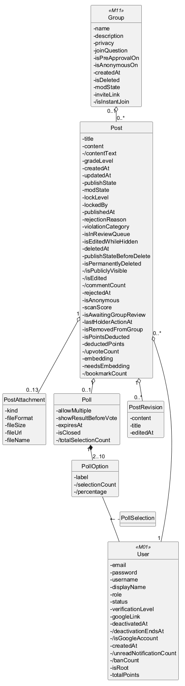

# Phân tích lớp thực thể — M03 Post & Content

<!-- [Vietnamese Doc] Tài liệu tiếng Việt; tên lớp và thuộc tính viết tiếng Anh (input/CONVENTIONS.md mục 3). -->

| Mã tài liệu | EC-M03 |
|---|---|
| Dự án | iShare |
| Module | M03 — Post & Content |
| Đầu vào | FR-M03 phiên bản 1.10 |
| Trạng thái | Bản nháp |
| Phiên bản | 0.1 |
| Ngày | 2026-11-20 |
| Tác giả | Phạm Văn Đức |

<!-- Quy ước chung cho mọi bảng dưới đây:
     - Không đổi tên cột, không xóa cột, không đổi số mục: tool đọc bảng theo số mục và tên cột.
     - Ô không có nội dung ghi "—".
     - Mục chưa tới bước làm thì để dòng "(Chưa làm — bước N)".
     - Cột Nguồn ghi mã trong FR: FR-Mxx-nn, FR-Mxx-nn.mm, BR-Mxx-nn, hoặc TN:<thuật ngữ> (mục 2.1 của FR).
     - Mục 4 chỉ chứa ảnh sơ đồ. gen_puml.py ghi mã PlantUML vào tệp riêng diagrams/EC-M03.puml, render
       diagrams/EC-M03.png và đặt ảnh vào mục 4. Không chép mã PlantUML vào tài liệu, không sửa tay tệp .puml hay ảnh. -->

## 1. Mô tả chức năng

### 1.1 Đoạn mô tả

Hệ thống quản lý bài viết của người dùng cùng các tệp đính kèm, poll, phiếu bình chọn và lịch sử sửa của bài viết.
Mỗi bài viết có tác giả bài viết, tiêu đề, nội dung giàu định dạng có thể chứa công thức LaTeX, Lớp/Khối tùy chọn,
thời điểm tạo và thời điểm cập nhật, cùng trạng thái đăng, trạng thái kiểm duyệt và mức khóa. Khi soạn và sửa bài
viết, tác giả bài viết chọn Topic và gắn Tag theo quy tắc của M05, và nội dung bài viết có thể chứa lượt nhắc tên do
M01 quản lý.

Hệ thống cho phép tác giả bài viết soạn bài viết mới và lưu bài viết chưa gửi thành bài nháp. Hệ thống cho phép tác
giả bài viết thêm và bỏ tệp đính kèm, gồm ảnh và tài liệu, khi soạn hoặc sửa bài viết của mình. Hệ thống cho phép tác
giả bài viết thêm vào bài nháp một poll gồm các lựa chọn do tác giả bài viết đặt, kiểu chọn một hoặc chọn nhiều, tùy
chọn hiện kết quả trước khi bình chọn và hạn kết thúc poll. Hệ thống cho phép tác giả bài viết gửi bài nháp, hoặc gửi
lại bài viết bị từ chối sau khi sửa, để bài viết được quét và đăng. Tác giả bài viết đang ở mức cảnh cáo MEDIUM hoặc
HEAVY do M08 quản lý thì không được lưu bài nháp mới, gửi bài nháp hay gửi lại bài viết bị từ chối. Bài viết thuộc
nhóm đi theo luồng duyệt của nhóm do M11 quản lý.

Khi một bài viết được gửi trong lúc công tắc AI tổng và công tắc Moderation của M10 đều bật và tác giả bài viết không
phải Admin, hệ thống quét nội dung bài viết và nhận về một điểm quét. Theo điểm quét, bài viết được đăng, được đưa vào
hàng chờ duyệt của Mod do M08 quản lý, hoặc bị tự từ chối kèm nhóm vi phạm mà AI phát hiện; bài viết quét thất bại
cũng được đưa vào hàng chờ duyệt. Khi công tắc AI tổng hoặc công tắc Moderation đang tắt, hoặc khi tác giả bài viết
là Admin, bài viết được đăng ngay mà không quét. Hệ thống cho phép Mod và Admin duyệt bài viết trong hàng chờ duyệt:
chấp nhận để đăng, hoặc từ chối kèm lý do từ chối mà tác giả bài viết xem được. Mỗi khi bài viết được đăng, hệ thống
ghi lại thời điểm đăng.

Hệ thống cho phép mọi người, kể cả Guest, xem bài viết đang hiển thị công khai, tức bài viết đã đăng có trạng thái
kiểm duyệt bình thường, và cho tác giả bài viết xem bài viết của mình ở mọi trạng thái đăng. Hệ thống cho phép Mod và
Admin xem bài viết tự ẩn, đã xóa hoặc đã xóa hẳn của người khác chỉ trong báo cáo, lịch sử báo cáo và khiếu nại liên
quan tới chính bài viết đó. Hệ thống cho phép User, Mod và Admin bình chọn trong poll đang mở; mỗi người có một phiếu
bình chọn gồm một hoặc nhiều lượt chọn, đổi được hoặc bỏ được khi poll còn mở. Hệ thống hiển thị kết quả poll theo
phần trăm lượt chọn của từng lựa chọn. Hệ thống cho phép tác giả bài viết đổi hạn kết thúc poll, kết thúc ngay poll
và thêm lựa chọn cho poll đang mở. Hệ thống tự đóng poll khi đến hạn kết thúc poll và gửi sự kiện poll kết thúc cho
M07.

Hệ thống cho phép tác giả bài viết sửa tiêu đề, nội dung, Lớp/Khối và tệp đính kèm của bài viết đã gửi. Mỗi lần tác
giả bài viết lưu bản sửa, hệ thống ghi vào lịch sử sửa một phiên bản gồm nội dung trước lần sửa, người sửa và thời
điểm sửa. Bài viết đã đăng được sửa sẽ được quét lại, và điểm quét cao làm bài viết chuyển sang trạng thái kiểm duyệt
bị gắn cờ để Mod xét. Hệ thống cho phép mọi người xem được bài viết, kể cả Guest, xem lịch sử sửa của bài viết, gồm
các phiên bản kèm người sửa và thời điểm sửa. Hệ thống cho phép tác giả bài viết tự ẩn bài viết đã đăng và hiện lại
bài viết tự ẩn. Hệ thống cho phép tác giả bài viết khóa và mở khóa bình luận của bài viết, cho phép Mod và Admin khóa
bình luận, khóa toàn bộ, mở khóa hoặc hạ mức khóa của bài viết, và ghi lại người khóa. Mức khóa của bài viết chặn
bình luận mới của M04, và mức khóa toàn bộ còn chặn upvote của M12 và bình chọn trong poll. Hệ thống cho phép tác giả
bài viết xóa mềm bài viết, ghi lại thời điểm xóa và trạng thái đăng trước khi xóa. Hệ thống cho phép tác giả bài viết
khôi phục bài viết đã xóa trong thời hạn khôi phục từ tab Đã xóa trên hồ sơ của M02, đưa bài viết về trạng thái đăng
trước khi xóa. Khi bài viết đã xóa hết thời hạn khôi phục, hệ thống gắn cờ đã xóa hẳn cho bài viết và giữ nguyên mọi
dữ liệu của bài viết.

### 1.2 Truy vết câu

| Câu | Nội dung câu | Nguồn |
|---|---|---|
| 1 | Hệ thống quản lý bài viết của người dùng cùng các tệp đính kèm, poll, phiếu bình chọn và lịch sử sửa của bài viết. | FR-M03-01, FR-M03-02, FR-M03-03, FR-M03-08, FR-M03-11 |
| 2 | Mỗi bài viết có tác giả bài viết, tiêu đề, nội dung giàu định dạng có thể chứa công thức LaTeX, Lớp/Khối tùy chọn, thời điểm tạo và thời điểm cập nhật, cùng trạng thái đăng, trạng thái kiểm duyệt và mức khóa. | FR-M03-01.03, FR-M03-01.05, FR-M03-01.08, FR-M03-01.09, FR-M03-01.12 |
| 3 | Khi soạn và sửa bài viết, tác giả bài viết chọn Topic và gắn Tag theo quy tắc của M05, và nội dung bài viết có thể chứa lượt nhắc tên do M01 quản lý. | FR-M03-01.01, FR-M03-11.01 |
| 4 | Hệ thống cho phép tác giả bài viết soạn bài viết mới và lưu bài viết chưa gửi thành bài nháp. | FR-M03-01 |
| 5 | Hệ thống cho phép tác giả bài viết thêm và bỏ tệp đính kèm, gồm ảnh và tài liệu, khi soạn hoặc sửa bài viết của mình. | FR-M03-02 |
| 6 | Hệ thống cho phép tác giả bài viết thêm vào bài nháp một poll gồm các lựa chọn do tác giả bài viết đặt, kiểu chọn một hoặc chọn nhiều, tùy chọn hiện kết quả trước khi bình chọn và hạn kết thúc poll. | FR-M03-03 |
| 7 | Hệ thống cho phép tác giả bài viết gửi bài nháp, hoặc gửi lại bài viết bị từ chối sau khi sửa, để bài viết được quét và đăng. | FR-M03-04 |
| 8 | Tác giả bài viết đang ở mức cảnh cáo MEDIUM hoặc HEAVY do M08 quản lý thì không được lưu bài nháp mới, gửi bài nháp hay gửi lại bài viết bị từ chối. | FR-M03-01.10, FR-M03-04.10 |
| 9 | Bài viết thuộc nhóm đi theo luồng duyệt của nhóm do M11 quản lý. | FR-M03-04.05 |
| 10 | Khi một bài viết được gửi trong lúc công tắc AI tổng và công tắc Moderation của M10 đều bật và tác giả bài viết không phải Admin, hệ thống quét nội dung bài viết và nhận về một điểm quét. | FR-M03-04.01, FR-M03-05 |
| 11 | Theo điểm quét, bài viết được đăng, được đưa vào hàng chờ duyệt của Mod do M08 quản lý, hoặc bị tự từ chối kèm nhóm vi phạm mà AI phát hiện; bài viết quét thất bại cũng được đưa vào hàng chờ duyệt. | FR-M03-05.01, FR-M03-05.02, FR-M03-05.03, FR-M03-05.04, FR-M03-05.12 |
| 12 | Khi công tắc AI tổng hoặc công tắc Moderation đang tắt, hoặc khi tác giả bài viết là Admin, bài viết được đăng ngay mà không quét. | FR-M03-04.03, FR-M03-04.11 |
| 13 | Hệ thống cho phép Mod và Admin duyệt bài viết trong hàng chờ duyệt: chấp nhận để đăng, hoặc từ chối kèm lý do từ chối mà tác giả bài viết xem được. | FR-M03-06 |
| 14 | Mỗi khi bài viết được đăng, hệ thống ghi lại thời điểm đăng. | FR-M03-04.03, FR-M03-05.01, FR-M03-06.02 |
| 15 | Hệ thống cho phép mọi người, kể cả Guest, xem bài viết đang hiển thị công khai, tức bài viết đã đăng có trạng thái kiểm duyệt bình thường, và cho tác giả bài viết xem bài viết của mình ở mọi trạng thái đăng. | FR-M03-07 |
| 16 | Hệ thống cho phép Mod và Admin xem bài viết tự ẩn, đã xóa hoặc đã xóa hẳn của người khác chỉ trong báo cáo, lịch sử báo cáo và khiếu nại liên quan tới chính bài viết đó. | FR-M03-07.11, FR-M03-17.04 |
| 17 | Hệ thống cho phép User, Mod và Admin bình chọn trong poll đang mở; mỗi người có một phiếu bình chọn gồm một hoặc nhiều lượt chọn, đổi được hoặc bỏ được khi poll còn mở. | FR-M03-08 |
| 18 | Hệ thống hiển thị kết quả poll theo phần trăm lượt chọn của từng lựa chọn. | FR-M03-08.10, FR-M03-08.12 |
| 19 | Hệ thống cho phép tác giả bài viết đổi hạn kết thúc poll, kết thúc ngay poll và thêm lựa chọn cho poll đang mở. | FR-M03-09 |
| 20 | Hệ thống tự đóng poll khi đến hạn kết thúc poll và gửi sự kiện poll kết thúc cho M07. | FR-M03-10 |
| 21 | Hệ thống cho phép tác giả bài viết sửa tiêu đề, nội dung, Lớp/Khối và tệp đính kèm của bài viết đã gửi. | FR-M03-11.01 |
| 22 | Mỗi lần tác giả bài viết lưu bản sửa, hệ thống ghi vào lịch sử sửa một phiên bản gồm nội dung trước lần sửa, người sửa và thời điểm sửa. | FR-M03-11.02 |
| 23 | Bài viết đã đăng được sửa sẽ được quét lại, và điểm quét cao làm bài viết chuyển sang trạng thái kiểm duyệt bị gắn cờ để Mod xét. | FR-M03-05.05, FR-M03-05.07, FR-M03-11.03 |
| 24 | Hệ thống cho phép mọi người xem được bài viết, kể cả Guest, xem lịch sử sửa của bài viết, gồm các phiên bản kèm người sửa và thời điểm sửa. | FR-M03-12 |
| 25 | Hệ thống cho phép tác giả bài viết tự ẩn bài viết đã đăng và hiện lại bài viết tự ẩn. | FR-M03-13 |
| 26 | Hệ thống cho phép tác giả bài viết khóa và mở khóa bình luận của bài viết, cho phép Mod và Admin khóa bình luận, khóa toàn bộ, mở khóa hoặc hạ mức khóa của bài viết, và ghi lại người khóa. | FR-M03-14 |
| 27 | Mức khóa của bài viết chặn bình luận mới của M04, và mức khóa toàn bộ còn chặn upvote của M12 và bình chọn trong poll. | FR-M03-14.04, FR-M03-14.06, FR-M03-08.13 |
| 28 | Hệ thống cho phép tác giả bài viết xóa mềm bài viết, ghi lại thời điểm xóa và trạng thái đăng trước khi xóa. | FR-M03-15 |
| 29 | Hệ thống cho phép tác giả bài viết khôi phục bài viết đã xóa trong thời hạn khôi phục từ tab Đã xóa trên hồ sơ của M02, đưa bài viết về trạng thái đăng trước khi xóa. | FR-M03-16 |
| 30 | Khi bài viết đã xóa hết thời hạn khôi phục, hệ thống gắn cờ đã xóa hẳn cho bài viết và giữ nguyên mọi dữ liệu của bài viết. | FR-M03-17 |

## 2. Danh từ và phân loại

### 2.1 Sổ danh từ

<!-- Phân loại: Lớp | Thuộc tính | Loại bỏ.
     Kết quả: tên lớp; hoặc Lớp.thuộcTính; hoặc "—" khi loại bỏ.
     Xuất hiện ở: "Câu n" (số câu ở bảng 1.2) hoặc "Quét: <mã FR>" (lượt quét bổ sung). -->

| # | Danh từ | Xuất hiện ở | Phân loại | Kết quả | Lý do |
|---|---|---|---|---|---|
| 1 | hệ thống | Câu 1 | Loại bỏ | — | Trừu tượng: chỉ chính phần mềm |
| 2 | bài viết | Câu 1 | Lớp | Post | Đối tượng trung tâm của module: được tạo, sửa, xóa riêng, có nhiều thông tin riêng và ba trạng thái riêng (TN:Bài viết, BR-M03-17); dùng tên Post của EC-M01, EC-M02, EC-M05 |
| 3 | người dùng | Câu 1 | Lớp | User | Lớp ngoài (M01): tài khoản; dùng tên User của EC-M01 |
| 4 | tệp đính kèm | Câu 1 | Lớp | PostAttachment | Được thêm, bỏ riêng từng tệp; mỗi tệp có loại, định dạng, dung lượng riêng (TN:Tệp đính kèm, BR-M03-07, BR-M03-08) |
| 5 | poll | Câu 1 | Lớp | Poll | Có cấu hình, hạn kết thúc và trạng thái mở, đóng riêng (TN:Poll, BR-M03-11, BR-M03-13) |
| 6 | phiếu bình chọn | Câu 1 | Loại bỏ | — | Chung chung: phiếu của một người là tập các lượt chọn của người đó trong một poll (dòng 57); ngoài người bình chọn và các lựa chọn đã chọn, phiếu không có thông tin hay trạng thái riêng. Xem Q-01 |
| 7 | lịch sử sửa | Câu 1 | Loại bỏ | — | Chung chung: tập các phiên bản sửa của một bài viết (TN:Lịch sử sửa); xét ở dòng 62 |
| 8 | tác giả bài viết | Câu 2 | Lớp | User | Vai trò theo ngữ cảnh của người dùng có tài khoản (TN:Tác giả bài viết); việc bài viết có tác giả là quan hệ, xét ở bước 3 |
| 9 | tiêu đề | Câu 2 | Thuộc tính | Post.title | Một giá trị chữ mô tả bài viết (BR-M03-02) |
| 10 | nội dung giàu định dạng / nội dung | Câu 2 | Thuộc tính | Post.content | Một giá trị mô tả bài viết (BR-M03-02) |
| 11 | công thức LaTeX | Câu 2 | Loại bỏ | — | Chung chung: một kiểu định dạng nằm trong Post.content (BR-M03-05), không lưu riêng |
| 12 | Lớp/Khối | Câu 2 | Thuộc tính | Post.gradeLevel | Một giá trị tùy chọn của bài viết (TN:Lớp/Khối, BR-M03-06) |
| 13 | thời điểm tạo | Câu 2 | Thuộc tính | Post.createdAt | FR-M03-01.08 yêu cầu lưu |
| 14 | thời điểm cập nhật | Câu 2 | Thuộc tính | Post.updatedAt | FR-M03-01.08 yêu cầu lưu |
| 15 | trạng thái đăng | Câu 2 | Thuộc tính | Post.publishState | Một trong sáu giá trị cố định (TN:Trạng thái đăng); tên theo publish_state của register |
| 16 | trạng thái kiểm duyệt | Câu 2 | Thuộc tính | Post.modState | Một trong ba giá trị cố định (TN:Trạng thái kiểm duyệt); tên theo mod_state của register |
| 17 | mức khóa | Câu 2 | Thuộc tính | Post.lockLevel | Một trong ba giá trị cố định (TN:Mức khóa); tên theo lock_level của register |
| 18 | Topic | Câu 3 | Loại bỏ | — | Ngoài phạm vi module (M05): bài viết được gán Topic qua PostTopic của M05 (R-M05-02); M03 không đọc hay ghi thông tin nào của Topic |
| 19 | Tag | Câu 3 | Loại bỏ | — | Ngoài phạm vi module (M05): bài viết được gắn Tag qua PostTag của M05 (R-M05-04); M03 không đọc hay ghi thông tin nào của Tag |
| 20 | quy tắc | Câu 3 | Loại bỏ | — | Trừu tượng: chỉ các quy tắc của M05, không phải dữ liệu |
| 21 | lượt nhắc tên | Câu 3 | Loại bỏ | — | Ngoài phạm vi module (M01): lượt nhắc tên do M01 quản lý; quan hệ với bài viết đã ghi ở R-M01-07 |
| 22 | bài nháp | Câu 4 | Loại bỏ | — | Giá trị của Post.publishState (Nháp) |
| 23 | ảnh | Câu 5 | Loại bỏ | — | Giá trị của PostAttachment.kind |
| 24 | tài liệu | Câu 5 | Loại bỏ | — | Giá trị của PostAttachment.kind |
| 25 | lựa chọn | Câu 6 | Lớp | PollOption | Tác giả đặt và thêm riêng từng lựa chọn; mỗi lựa chọn có chữ riêng, được chọn riêng và đếm lượt chọn riêng (BR-M03-09, BR-M03-15, BR-M03-44) |
| 26 | kiểu chọn một / chọn nhiều | Câu 6 | Thuộc tính | Poll.allowMultiple | Một tùy chọn cấu hình của poll (BR-M03-11); tên theo allow_multiple của register |
| 27 | tùy chọn hiện kết quả trước khi bình chọn | Câu 6 | Thuộc tính | Poll.showResultBeforeVote | Một tùy chọn cấu hình của poll (BR-M03-11) |
| 28 | hạn kết thúc poll | Câu 6 | Thuộc tính | Poll.expiresAt | Một thời điểm của poll (TN:Hạn kết thúc poll); tên theo expires_at của register |
| 29 | bị từ chối | Câu 7 | Loại bỏ | — | Giá trị của Post.publishState (Bị từ chối) |
| 30 | mức cảnh cáo | Câu 8 | Loại bỏ | — | Ngoài phạm vi module (M08): M03 chỉ hỏi M08 mức cảnh cáo của tác giả để chặn thao tác (BR-M03-38); mức cảnh cáo gắn với tài khoản, không có quan hệ với lớp nào của M03 |
| 31 | nhóm | Câu 9 | Lớp | Group | Lớp ngoài (M11): bài viết có thể thuộc một nhóm, việc này quyết định luồng gửi bài (FR-M03-04.05) và việc hiển thị (FR-M03-07.01); tên tạm, chờ EC-M11 |
| 32 | luồng duyệt của nhóm | Câu 9 | Loại bỏ | — | Ngoài phạm vi module (M11): cổng duyệt bài nhóm do M11 quản lý |
| 33 | công tắc AI tổng | Câu 10 | Loại bỏ | — | Ngoài phạm vi module (M10): M03 chỉ đọc lúc gửi, sửa để quyết định có quét không; không có quan hệ với lớp nào của M03 |
| 34 | công tắc Moderation | Câu 10 | Loại bỏ | — | Ngoài phạm vi module (M10): như dòng 33 |
| 35 | Admin | Câu 10 | Lớp | User | Vai trò của người dùng có tài khoản; phân biệt bằng User.role |
| 36 | điểm quét | Câu 10 | Loại bỏ | — | Hành động không lưu dấu vết: điểm chỉ dùng lúc quét xong để chọn trạng thái bài (BR-M03-20, BR-M03-26); FR-M03 không yêu cầu lưu. Kết quả quét thô thuộc M13; điểm quét của bài nhóm do M11 bổ sung |
| 37 | hàng chờ duyệt | Câu 11 | Thuộc tính | Post.isInReviewQueue | Hàng chờ chỉ là tập các bài Chờ duyệt đã được đưa vào (FR-M03-06.01), không có thông tin riêng; điều cần lưu là bài đã vào hàng chờ hay chưa, vì bài Chờ duyệt có thể còn đang được quét |
| 38 | Mod | Câu 11 | Lớp | User | Vai trò của người dùng có tài khoản; phân biệt bằng User.role |
| 39 | nhóm vi phạm | Câu 11 | Thuộc tính | Post.violationCategory | Tác giả xem được sau khi bài bị AI tự từ chối (FR-M03-05.12), nên phải lưu cùng bài |
| 40 | AI | Câu 11 | Loại bỏ | — | Ngoài phạm vi module (M13): cách gọi AI, kết quả quét thô thuộc M08, M13 |
| 41 | lý do từ chối | Câu 13 | Thuộc tính | Post.rejectionReason | FR-M03-06.03 yêu cầu lưu |
| 42 | thời điểm đăng | Câu 14 | Thuộc tính | Post.publishedAt | Mốc "đăng" của bài (TN:Đã đăng); M14, M15, M13 dùng (mục Giao tiếp của FR) |
| 43 | mọi người | Câu 15 | Loại bỏ | — | Chung chung: chỉ mọi vai trò kể cả Guest |
| 44 | Guest | Câu 15 | Loại bỏ | — | Không lưu: tác nhân không có dữ liệu |
| 45 | bài viết đang hiển thị công khai | Câu 15 | Thuộc tính | Post.isPubliclyVisible | Điều kiện tính từ trạng thái đăng và trạng thái kiểm duyệt (TN:Bài hiển thị công khai, BR-M03-18) |
| 46 | đã đăng | Câu 15 | Loại bỏ | — | Giá trị của Post.publishState (Đã đăng) |
| 47 | bình thường | Câu 15 | Loại bỏ | — | Giá trị của Post.modState (Bình thường) |
| 48 | tự ẩn | Câu 16 | Loại bỏ | — | Giá trị của Post.publishState (Tự ẩn) |
| 49 | đã xóa | Câu 16 | Loại bỏ | — | Giá trị của Post.publishState (Đã xóa) |
| 50 | đã xóa hẳn / cờ đã xóa hẳn | Câu 16 | Thuộc tính | Post.isPermanentlyDeleted | Cờ gắn thêm cho bài Đã xóa, không phải một giá trị của trạng thái đăng (TN:Trạng thái đăng, TN:Đã xóa hẳn (xóa hẳn)) |
| 51 | người khác | Câu 16 | Loại bỏ | — | Chung chung: người dùng không phải tác giả |
| 52 | báo cáo | Câu 16 | Loại bỏ | — | Ngoài phạm vi module (M08): Mod, Admin xem bài qua báo cáo; quan hệ báo cáo – bài viết do M08 ghi |
| 53 | lịch sử báo cáo | Câu 16 | Loại bỏ | — | Ngoài phạm vi module (M08) |
| 54 | khiếu nại | Câu 16 | Loại bỏ | — | Ngoài phạm vi module (M09) |
| 55 | User | Câu 17 | Lớp | User | Vai trò của người dùng có tài khoản; phân biệt bằng User.role |
| 56 | poll đang mở | Câu 17 | Loại bỏ | — | Giá trị của Poll.isClosed (chưa đóng) |
| 57 | lượt chọn | Câu 17 | Lớp | PollSelection | Một lựa chọn một người đã chọn (TN:Lượt chọn): được tạo, bỏ riêng khi bình chọn, đổi phiếu, bỏ chọn (FR-M03-08.04, FR-M03-08.05) và được đếm để tính kết quả (BR-M03-15); nối một người dùng với một lựa chọn, xét lớp liên kết ở bước 3. Xem Q-01 |
| 58 | kết quả poll | Câu 18 | Loại bỏ | — | Chung chung: tập phần trăm của các lựa chọn (dòng 59) |
| 59 | phần trăm | Câu 18 | Thuộc tính | PollOption.percentage | Số tính ra cho từng lựa chọn (BR-M03-15) |
| 60 | sự kiện poll kết thúc | Câu 20 | Loại bỏ | — | Hành động không lưu dấu vết: gửi cho M07 lúc poll đóng (FR-M03-10.02); M03 không lưu |
| 61 | bản sửa | Câu 22 | Loại bỏ | — | Chung chung: mỗi lần lưu bản sửa được ghi thành một phiên bản (dòng 62) |
| 62 | phiên bản | Câu 22 | Lớp | PostRevision | Mỗi lần lưu bản sửa tạo một phiên bản riêng, có nội dung trước lần sửa và thời điểm sửa, được hiển thị trong lịch sử sửa (FR-M03-11.02, FR-M03-12.02, BR-M03-27) |
| 63 | nội dung trước lần sửa | Câu 22 | Thuộc tính | PostRevision.content | FR-M03-11.02 yêu cầu ghi |
| 64 | người sửa | Câu 22 | Lớp | User | Vai trò của người dùng có tài khoản; phiên bản ghi người sửa là quan hệ, xét ở bước 3 |
| 65 | thời điểm sửa | Câu 22 | Thuộc tính | PostRevision.editedAt | FR-M03-11.02 yêu cầu ghi |
| 66 | bị gắn cờ | Câu 23 | Loại bỏ | — | Giá trị của Post.modState (Bị gắn cờ) |
| 67 | bình luận | Câu 26 | Loại bỏ | — | Ngoài phạm vi module (M04): mức khóa của bài chặn bình luận mới, M04 đọc Post.lockLevel; quan hệ bình luận – bài viết do M04 ghi |
| 68 | khóa bình luận | Câu 26 | Loại bỏ | — | Giá trị của Post.lockLevel (Khóa bình luận) |
| 69 | khóa toàn bộ | Câu 26 | Loại bỏ | — | Giá trị của Post.lockLevel (Khóa toàn bộ) |
| 70 | người khóa | Câu 26 | Thuộc tính | Post.lockedBy | FR chỉ ghi vai trò của người khóa (tác giả hoặc Mod), không ghi người dùng cụ thể (TN:Mức khóa, FR-M03-14.02), nên là một giá trị, không phải quan hệ; tên theo locked_by của register |
| 71 | upvote | Câu 27 | Loại bỏ | — | Ngoài phạm vi module (M12): M12 đọc Post.lockLevel để chặn upvote |
| 72 | thời điểm xóa | Câu 28 | Thuộc tính | Post.deletedAt | FR-M03-15.01 yêu cầu ghi; tên theo deleted_at của register |
| 73 | trạng thái đăng trước khi xóa | Câu 28 | Thuộc tính | Post.publishStateBeforeDelete | FR-M03-15.01 yêu cầu ghi để khôi phục (FR-M03-16.01) |
| 74 | thời hạn khôi phục | Câu 29 | Loại bỏ | — | Hằng số của BR-M03-35: 7 × 24 giờ kể từ Post.deletedAt |
| 75 | tab Đã xóa | Câu 29 | Loại bỏ | — | Giao diện: tab trên hồ sơ của M02, liệt kê bài theo Post.publishState |
| 76 | hồ sơ | Câu 29 | Loại bỏ | — | Ngoài phạm vi module (M02) |
| 77 | dữ liệu | Câu 30 | Loại bỏ | — | Chung chung: mọi thông tin của bài viết |
| 78 | nội dung chữ / nội dung dạng chữ thuần | Quét: FR-M03-07.01 | Thuộc tính | Post.contentText | Mục Giao tiếp của FR cung cấp nội dung chữ của bài cho M06, M14; tính từ Post.content |
| 79 | từ (khi đếm độ dài nội dung) | Quét: BR-M03-42 | Loại bỏ | — | Hằng số của BR-M03-42: cách đếm giới hạn 6.000 từ của Post.content, không lưu |
| 80 | bài trống | Quét: TN:Bài trống | Loại bỏ | — | Chung chung: điều kiện kiểm khi lưu nháp (BR-M03-41), tính từ các phần của bài |
| 81 | chờ duyệt | Quét: TN:Chờ duyệt | Loại bỏ | — | Giá trị của Post.publishState (Chờ duyệt) |
| 82 | bị Mod ẩn | Quét: TN:Trạng thái kiểm duyệt | Loại bỏ | — | Giá trị của Post.modState (Bị Mod ẩn) |
| 83 | không khóa | Quét: TN:Mức khóa | Loại bỏ | — | Giá trị của Post.lockLevel (Không khóa) |
| 84 | poll đã đóng | Quét: TN:Poll đã đóng | Thuộc tính | Poll.isClosed | Poll đóng khi đến hạn hoặc khi tác giả kết thúc ngay và không mở lại được (BR-M03-13, BR-M03-14); tên theo is_closed của register |
| 85 | loại tệp đính kèm | Quét: FR-M03-02.10 | Thuộc tính | PostAttachment.kind | Giới hạn số ảnh và số tài liệu tính riêng, nên mỗi tệp phải biết mình là ảnh hay tài liệu |
| 86 | định dạng tệp | Quét: FR-M03-02.04 | Thuộc tính | PostAttachment.fileFormat | Ràng buộc của BR-M03-07, BR-M03-08 |
| 87 | dung lượng | Quét: FR-M03-02.05 | Thuộc tính | PostAttachment.fileSize | Ràng buộc của BR-M03-07, BR-M03-08 |
| 88 | số lượt chọn của lựa chọn | Quét: FR-M03-08.12 | Thuộc tính | PollOption.selectionCount | Số tính ra (BR-M03-15) |
| 89 | tổng lượt chọn của poll | Quét: FR-M03-08.12 | Thuộc tính | Poll.totalSelectionCount | Số tính ra (BR-M03-15) |
| 90 | bản sửa được lưu trong lúc ẩn | Quét: FR-M03-13.06 | Thuộc tính | Post.isEditedWhileHidden | Phải lưu để khi hiện lại biết bài có cần quét không (FR-M03-05.05, FR-M03-05.14) |
| 91 | nhãn "(đã chỉnh sửa)" | Quét: FR-M03-12.01 | Thuộc tính | Post.isEdited | Nhãn là giao diện; điều kiện hiện nhãn (bài có ít nhất một phiên bản sửa) là thuộc tính tính ra |
| 92 | trạng thái tài khoản | Quét: FR-M03-07.01 | Thuộc tính | User.status | Thông tin của tài khoản (M01) mà M03 đọc để ẩn bài của tài khoản DEACTIVATED, DELETED |
| 93 | vai trò | Quét: FR-M03-04.11 | Thuộc tính | User.role | Thông tin của tài khoản (M01) mà M03 đọc để phân quyền và bỏ quét bài của Admin |
| 94 | chế độ nhóm (Public, Private) | Quét: FR-M03-07.01 | Thuộc tính | Group.privacy | Thông tin của nhóm (M11) mà M03 đọc để hiển thị bài nhóm (BR-M03-39); tên tạm, chờ EC-M11 |
| 95 | Owner nhóm | Quét: FR-M03-04.05 | Loại bỏ | — | Ngoài phạm vi module (M11): vai trò trong nhóm do M11 quản lý; M11 quyết định bài của Owner vào hàng chờ của Mod |
| 96 | quét nội dung | Quét: TN:Quét nội dung | Loại bỏ | — | Hành động không lưu dấu vết: kết quả chỉ làm đổi trạng thái bài (BR-M03-20, BR-M03-26); FR-M03 không yêu cầu lưu từng lần quét |
| 97 | sự kiện bài được đăng, bị từ chối | Quét: FR-M03-05.01 | Loại bỏ | — | Hành động không lưu dấu vết: gửi cho M07 (mục Giao tiếp của FR); M03 không lưu |
| 98 | đăng ẩn danh | Quét: FR-M03-05.01 | Loại bỏ | — | Ngoài phạm vi module (M11): FR-M03 xếp đăng ẩn danh vào M11 (mục 1.2) và chỉ chuyển giá trị này theo sự kiện bài được đăng; thuộc tính trên Post do M11 bổ sung, EC-M11 ghi |
| 99 | dấu "bị gỡ khỏi nhóm" | Quét: Dữ liệu nghiệp vụ | Loại bỏ | — | Ngoài phạm vi module (M11): mục Dữ liệu nghiệp vụ ghi "M11 đặt"; M03 không đọc hay ghi; thuộc tính trên Post do M11 bổ sung, EC-M11 ghi |

### 2.2 Lớp

<!-- Nhóm: Thực thể | Liên kết | Thống kê. Sở hữu: mã module sở hữu lớp (Mxx của tài liệu này, hoặc Myy với lớp ngoài).
     Thuộc tính: tên mọi thuộc tính của lớp ở mục 2.3, ngăn bởi dấu phẩy, thuộc tính dẫn xuất có "/" phía trước;
     để người đọc thấy lớp và thuộc tính trên cùng một dòng. Lớp chưa có thuộc tính ghi "—". -->

| Lớp | Tên tiếng Việt | Nhóm | Sở hữu | Mô tả | Thuộc tính | Nguồn |
|---|---|---|---|---|---|---|
| Post | Bài viết | Thực thể | M03 | Đơn vị nội dung trung tâm, một loại duy nhất, có ba trạng thái độc lập: trạng thái đăng, trạng thái kiểm duyệt, mức khóa | title, content, /contentText, gradeLevel, createdAt, updatedAt, publishState, modState, lockLevel, lockedBy, publishedAt, rejectionReason, violationCategory, isInReviewQueue, isEditedWhileHidden, deletedAt, publishStateBeforeDelete, isPermanentlyDeleted, /isPubliclyVisible, /isEdited, /commentCount, rejectedAt, isAnonymous, scanScore, isAwaitingGroupReview, lastHolderActionAt, isRemovedFromGroup, isPointsDeducted, deductedPoints, /upvoteCount, embedding, needsEmbedding, /bookmarkCount | FR-M03-01, FR-M03-04, FR-M03-15, BR-M03-17 |
| PostAttachment | Tệp đính kèm | Thực thể | M03 | Một ảnh hoặc tài liệu đính kèm ở phần dưới nội dung bài viết | kind, fileFormat, fileSize, fileUrl, fileName | FR-M03-02, BR-M03-07, BR-M03-08 |
| Poll | Poll | Thực thể | M03 | Bình chọn đóng tùy chọn trong bài viết, tối đa một poll mỗi bài | allowMultiple, showResultBeforeVote, expiresAt, isClosed, /totalSelectionCount | FR-M03-03, FR-M03-09, FR-M03-10, BR-M03-09 |
| PollOption | Lựa chọn | Thực thể | M03 | Một lựa chọn do tác giả đặt trong poll | label, /selectionCount, /percentage | FR-M03-03.02, FR-M03-09.06, BR-M03-44 |
| PollSelection | Lượt chọn | Liên kết | M03 | Một lựa chọn một người dùng đã chọn trong poll; phiếu của một người là các lượt chọn của người đó trong poll (Q-01) | — | FR-M03-08.01, FR-M03-08.04, FR-M03-08.05, BR-M03-15 |
| PostRevision | Phiên bản sửa | Thực thể | M03 | Một phiên bản trong lịch sử sửa, ghi mỗi lần tác giả lưu bản sửa của bài đã gửi | content, title, editedAt | FR-M03-11.02, FR-M03-12.02, BR-M03-27 |
| User | Người dùng (tài khoản) | Thực thể | M01 | Tác giả bài viết, người sửa, người bình chọn; Mod, Admin duyệt và khóa bài | email, password, username, displayName, role, status, verificationLevel, googleLink, deactivatedAt, /deactivationEndsAt, /isGoogleAccount, createdAt, /unreadNotificationCount, /banCount, isRoot, totalPoints | FR-M03-01.08, FR-M03-08.01, FR-M03-11.02 |
| Group | Nhóm | Thực thể | M11 | Nhóm mà bài viết có thể thuộc về | name, description, privacy, joinQuestion, isPreApprovalOn, isAnonymousOn, createdAt, isDeleted, modState, inviteLink, /isInstantJoin | FR-M03-04.05, FR-M03-07.01 |

### 2.3 Thuộc tính

<!-- Mỗi lớp có ĐỦ thuộc tính để người đọc hình dung được nó; xếp các dòng theo lớp.
     Tính chất: Lưu | Dẫn xuất. Chưa có id, chưa có kiểu, chưa có khóa ngoại.
     Căn cứ: Nguồn nêu (FR nói tới) | Đề xuất (FR không nói, nhưng chức năng hoặc quy tắc ở cột Nguồn cần nó) |
             Tham chiếu (thuộc tính của lớp ngoài; module sở hữu lớp đó định nghĩa. Sau lượt gộp hệ thống,
             lớp ngoài ghi đủ thuộc tính như EC-SYS, MD-05).
     Ràng buộc nguồn nêu: độ dài tối đa, duy nhất, bắt buộc/tùy chọn, tập giá trị, mặc định, công thức (với Dẫn xuất)
             — chép từ FR kèm mã. Đề xuất mà FR không nêu ràng buộc thì ghi "—".
     Nguồn: mã FR/BR nêu thuộc tính; với Đề xuất là mã chức năng hoặc quy tắc cần nó.
     Ghi chú: bắt buộc với Đề xuất (vì sao cần) và Tham chiếu (module này dùng nó làm gì). -->

| Lớp | Thuộc tính | Tên tiếng Việt | Tính chất | Căn cứ | Ràng buộc nguồn nêu | Nguồn | Ghi chú |
|---|---|---|---|---|---|---|---|
| Post | title | Tiêu đề | Lưu | Nguồn nêu | Tối đa 150 ký tự (BR-M03-42); bắt buộc khi gửi (BR-M03-40); bài nháp được thiếu nếu có phần khác (BR-M03-41) | FR-M03-01.14, FR-M03-04.08, FR-M03-07.04 | — |
| Post | content | Nội dung | Lưu | Nguồn nêu | Giàu định dạng theo BR-M03-03, công thức LaTeX dạng mã thô (BR-M03-05), không chứa ảnh (BR-M03-04); tối đa 6.000 từ đếm trên phần chữ người đọc thấy (BR-M03-42); khi gửi phải có nội dung hoặc poll (BR-M03-40) | FR-M03-01.02, FR-M03-01.03, FR-M03-01.15, FR-M03-04.09 | Register gọi content_json, tức dạng lưu; dạng lưu là việc của bước thiết kế nên ở đây gọi content |
| Post | contentText | Nội dung chữ | Dẫn xuất | Nguồn nêu | Phần chữ người đọc thấy của content, không kèm định dạng | FR-M03-07.01 | M06 tìm kiếm, M14, M13, M05 đọc (mục Giao tiếp của FR); register gọi content_text |
| Post | gradeLevel | Lớp/Khối | Lưu | Nguồn nêu | Tùy chọn; 10, 11 hoặc 12 (BR-M03-06); độc lập với Profile.gradeLevel của M02 | FR-M03-01.05, FR-M03-01.06, FR-M03-01.07 | — |
| Post | createdAt | Thời điểm tạo | Lưu | Nguồn nêu | — | FR-M03-01.08 | M02 xếp tab Bài viết, M15 thống kê |
| Post | updatedAt | Thời điểm cập nhật | Lưu | Nguồn nêu | — | FR-M03-01.08 | — |
| Post | publishState | Trạng thái đăng | Lưu | Nguồn nêu | Nháp, Chờ duyệt, Đã đăng, Tự ẩn, Bị từ chối, Đã xóa (TN:Trạng thái đăng); bài mới là Nháp; chuyển theo mục Chuyển trạng thái của FR | FR-M03-01.01, FR-M03-04.01, FR-M03-13.01, FR-M03-15.01 | Register gọi publish_state; EC-M02, EC-M05 từng gọi tạm publishStatus, đã đổi theo MD-03 |
| Post | modState | Trạng thái kiểm duyệt | Lưu | Nguồn nêu | Bình thường, Bị gắn cờ, Bị Mod ẩn; bài mới là Bình thường (BR-M03-48); sang Bị gắn cờ khi quét lại sau khi sửa cho điểm từ 0.5 (BR-M03-26); M08, M09 đổi các bước còn lại | FR-M03-01.12, FR-M03-05.07 | Register gọi mod_state; EC-M02, EC-M05 từng gọi tạm moderationStatus, đã đổi theo MD-03 |
| Post | lockLevel | Mức khóa | Lưu | Nguồn nêu | Không khóa, Khóa bình luận, Khóa toàn bộ; bài mới là Không khóa (FR-M03-01.09); chỉ Mod, Admin đặt Khóa toàn bộ (BR-M03-31) | FR-M03-01.09, FR-M03-14.01, FR-M03-14.03 | M04 đọc để chặn bình luận mới, M12 để chặn upvote |
| Post | lockedBy | Người khóa | Lưu | Nguồn nêu | Tác giả hoặc Mod (TN:Mức khóa); Admin khóa cũng ghi Mod (FR-M03-14.02); chỉ có khi lockLevel khác Không khóa; người khóa là Mod thì tác giả không mở hay đổi mức khóa (BR-M03-32) | FR-M03-14.01, FR-M03-14.02, FR-M03-14.09 | Ghi vai trò của người khóa, không ghi người dùng cụ thể |
| Post | publishedAt | Thời điểm đăng | Lưu | Nguồn nêu | Lúc bài chuyển sang Đã đăng lần đầu (TN:Đã đăng); không đổi khi hiện lại sau Tự ẩn hay khôi phục (Q-02) | FR-M03-04.03, FR-M03-05.01, FR-M03-06.02 | M14 xếp feed và tính tuổi bài, M15 thống kê, M13 tạo embedding, M05 tính Trending (mục Giao tiếp của FR) |
| Post | rejectionReason | Lý do từ chối | Lưu | Nguồn nêu | Bắt buộc khi Mod, Admin từ chối (FR-M03-06.04); tác giả xem được (FR-M03-06.05) | FR-M03-06.03, FR-M03-06.05 | — |
| Post | violationCategory | Nhóm vi phạm | Lưu | Nguồn nêu | Chỉ có khi AI tự từ chối bài vừa gửi (FR-M03-05.03); tác giả xem được (BR-M03-46) | FR-M03-05.12 | Danh mục nhóm vi phạm thuộc M08, M13 |
| Post | isInReviewQueue | Đang trong hàng chờ duyệt | Lưu | Đề xuất | — | FR-M03-06.01, FR-M03-05.02, FR-M03-05.04, FR-M03-15.06 | Bài Chờ duyệt có thể còn đang được quét hoặc đã vào hàng chờ của Mod; FR-M03-06.01 chỉ hiện bài đã vào hàng chờ, FR-M03-15.06 đưa bài ra khỏi hàng chờ khi tác giả xóa |
| Post | isEditedWhileHidden | Có bản sửa lưu trong lúc Tự ẩn chưa quét | Lưu | Nguồn nêu | Đặt khi tác giả lưu bản sửa của bài Tự ẩn, không quét lúc lưu (FR-M03-05.14); khi hiện lại thì quét (FR-M03-05.05) | FR-M03-13.06, FR-M03-05.14 | — |
| Post | deletedAt | Thời điểm xóa | Lưu | Nguồn nêu | Chỉ có khi bài Đã xóa; thời hạn khôi phục là 7 × 24 giờ kể từ thời điểm này (BR-M03-35) | FR-M03-15.01, FR-M03-16.02 | — |
| Post | publishStateBeforeDelete | Trạng thái trước khi xóa | Lưu | Nguồn nêu | Một trạng thái đăng khác Đã xóa; khôi phục về trạng thái này, riêng Chờ duyệt thì về Nháp (BR-M03-35) | FR-M03-15.01, FR-M03-16.01, FR-M03-16.06 | — |
| Post | isPermanentlyDeleted | Đã xóa hẳn | Lưu | Nguồn nêu | Gắn khi bài Đã xóa hết thời hạn khôi phục (BR-M03-37); chỉ là cờ, mọi dữ liệu của bài được giữ (FR-M03-17.02); không gỡ được | FR-M03-17.01, FR-M03-17.02 | M12 trừ điểm, M02 bỏ bookmark tại lúc gắn cờ (mục Giao tiếp của FR) |
| Post | isPubliclyVisible | Hiển thị công khai | Dẫn xuất | Nguồn nêu | publishState là Đã đăng và modState là Bình thường; không phụ thuộc mức khóa (BR-M03-18) | FR-M03-07.01, BR-M03-18 | — |
| Post | isEdited | Đã chỉnh sửa | Dẫn xuất | Nguồn nêu | Bài có ít nhất một PostRevision (BR-M03-27); Mod, Admin đổi Topic, Tag không tính (BR-M03-28) | FR-M03-12.01 | Điều kiện hiện nhãn "(đã chỉnh sửa)" và nút "Xem lịch sử" |
| Post | commentCount | Số bình luận của bài | Dẫn xuất | Nguồn nêu | Số bình luận gốc và trả lời của bài có isVisible; không tính dấu "[Bình luận đã bị xóa]" và bình luận bị ẩn; mọi người xem thấy cùng một số (BR-M04-18) | FR-M04-01.10, BR-M04-18 | Bổ sung từ EC-M04 (MD-05). M04 bổ sung trên lớp của M03 (mục 5); hiện trên bài viết; M05, M06, M14 dùng số bình luận cho Trending và xếp hạng |
| Post | rejectedAt | Thời điểm bị từ chối | Lưu | Đề xuất | Hạn khiếu nại bài bị AI tự từ chối bằng hạn của cảnh cáo AI ra cùng lần; không có cảnh cáo đi kèm thì 3 × 24 giờ kể từ thời điểm này, theo giờ Việt Nam (BR-M09-04) | BR-M09-04, FR-M09-01.14, FR-M09-06.02, FR-M09-08.14 | Bổ sung từ EC-M09 (MD-05). BR-M09-04 tính hạn 3 ngày từ lúc bài bị AI tự từ chối khi không có cảnh cáo đi kèm (tác giả đang HEAVY), và FR-M09-06.02 hiển thị thời điểm của xử lý. Bài được sửa, gửi lại và bị từ chối nhiều lần (BR-M09-24), nên cần thời điểm lần từ chối gần nhất để biết khiếu nại thuộc lần nào (FR-M09-01.14) và bài đã được gửi lại trước lúc kết luận chưa (FR-M09-08.14). EC-M03 chưa có; M09 bổ sung trên lớp ngoài Post (mục 5) |
| Post | isAnonymous | Đăng ẩn danh | Lưu | Nguồn nêu | Có, Không; chỉ chọn được khi bài thuộc nhóm có công tắc ẩn danh bật (BR-M11-16); giữ nguyên khi công tắc tắt sau đó; danh tính thật luôn được giữ (BR-M11-17) | FR-M11-12.07, FR-M11-12.08, FR-M11-12.09, FR-M11-12.10 | Bổ sung từ EC-M11 (MD-05). M11 bổ sung trên lớp ngoài Post (mục 5); M02, M14 đọc (mục Giao tiếp) |
| Post | scanScore | Điểm quét | Lưu | Nguồn nêu | 0 đến 1, do M13 trả về (TN:Điểm quét); cổng duyệt của nhóm dùng ngưỡng 0.9 và 0.5 (BR-M11-18); không có khi AI tắt, quét thất bại hoặc tác giả là Admin | FR-M11-12.02, FR-M11-12.03, FR-M11-12.04, FR-M11-12.05 | Bổ sung từ EC-M11 (MD-05). Mục Dữ liệu nghiệp vụ ghi trên phần M11 của bài viết; EC-M03 dòng 36 để M11 bổ sung (mục 5) |
| Post | isAwaitingGroupReview | Đang chờ nhóm duyệt | Lưu | Nguồn nêu | Đúng khi bài ở giai đoạn Chờ duyệt (chờ nhóm duyệt), sai khi Chờ duyệt (đang quét) hoặc bài đã ra khỏi hàng chờ của nhóm (TN:Chờ duyệt (đang quét), Chờ duyệt (chờ nhóm duyệt)) | FR-M11-12.03, FR-M11-12.04, FR-M11-13.01, FR-M11-02.15 | Bổ sung từ EC-M11 (MD-05). Hàng chờ duyệt của nhóm là các bài nhóm có giá trị này đúng (cùng cách Post.isInReviewQueue của EC-M03 cho hàng chờ của Mod); M11 bổ sung (mục 5) |
| Post | lastHolderActionAt | Thời điểm thao tác cuối | Lưu | Nguồn nêu | Đặt lúc nhận bài và mỗi lần người giữ mở xem, chấp nhận, từ chối; 30 phút không thao tác thì bài tự được nhả về hàng chờ (TN:Thời điểm thao tác cuối, BR-M11-20) | FR-M11-13.02, FR-M11-13.04, BR-M11-20 | Bổ sung từ EC-M11 (MD-05). Cùng tên và cơ chế với ReportCase.lastHolderActionAt (EC-M08), Appeal.lastHolderActionAt (EC-M09); M11 bổ sung (mục 5) |
| Post | isRemovedFromGroup | Bị gỡ khỏi nhóm | Lưu | Nguồn nêu | Đặt khi Owner, Group Mod gỡ khỏi nhóm (xóa mềm); không phải trạng thái đăng; tác giả không tự bỏ được (TN:Bị gỡ khỏi nhóm, BR-M11-30) | FR-M11-14.01, FR-M11-14.05 | Bổ sung từ EC-M11 (MD-05). Nội dung chỉ còn hiện với tác giả, Owner, Group Mod của nhóm, Mod, Admin (FR-M11-14.01); M11 bổ sung (mục 5) |
| Post | isPointsDeducted | Đã trừ điểm | Lưu | Nguồn nêu | Đang tính điểm (sai), Đã trừ điểm (đúng) (TN:Đang tính điểm, Đã trừ điểm); về Đang tính điểm khi khiếu nại bài bị gỡ được chấp nhận; upvote trên bài đã trừ điểm không được cộng, bài không bị trừ lại (FR-M12-02.18) | FR-M12-02.08, FR-M12-02.10, FR-M12-02.12, FR-M12-02.18 | Bổ sung từ EC-M12 (MD-05). M12 bổ sung trên lớp ngoài Post (mục 5) |
| Post | deductedPoints | Số điểm đã trừ | Lưu | Nguồn nêu | Điểm từ các upvote có hiệu lực trên bài tại thời điểm trừ (BR-M12-09); dùng để hoàn đúng số đó (BR-M12-10) | FR-M12-02.08, FR-M12-02.10, FR-M12-02.12 | Bổ sung từ EC-M12 (MD-05). Thực thể "Điểm đã trừ của nội dung" của FR (Q-02); chỉ bài viết cần, vì điểm bình luận không được hoàn (FR-M12-02.13); M12 bổ sung (mục 5) |
| Post | upvoteCount | Số upvote | Dẫn xuất | Nguồn nêu | Số upvote đang có hiệu lực trên bài viết (mục Giao tiếp, dòng Cung cấp M03, M04; BR-M12-02) | FR-M12-01.01, FR-M12-01.02 | Bổ sung từ EC-M12 (MD-05). M12 cung cấp cho M03 hiển thị và cho M05, M06, M14 tính Trending, xếp hạng (mục Giao tiếp); EC-M06 đã tham chiếu tên upvoteCount chờ EC-M12; bình luận đã có Comment./upvoteCount ở EC-M04. M12 bổ sung trên lớp ngoài Post (mục 5) |
| Post | embedding | Embedding | Lưu | Nguồn nêu | Mỗi bài Đã đăng đúng một embedding, biểu diễn tiêu đề và nội dung chữ; tạo lại khi tiêu đề hoặc nội dung chữ đổi và thay embedding cũ; không tạo lại khi chỉ đổi Tag, Topic, ảnh, tài liệu; không có ở bài chưa Đã đăng (BR-M13-17, BR-M13-18) | FR-M13-03.01, FR-M13-03.02, FR-M13-03.03, FR-M13-03.07 | Bổ sung từ EC-M13 (MD-05). Thực thể "Embedding bài viết" của FR (Q-01); M06 so với embedding của truy vấn (EC-M06). EC-M03 chưa có; M13 bổ sung trên lớp ngoài Post (mục 5) |
| Post | needsEmbedding | Đang chờ tạo bù embedding | Lưu | Nguồn nêu | Đúng khi bài Đã đăng chưa có embedding theo nội dung hiện tại vì công tắc AI tổng hoặc Search tắt, hoặc vì lời gọi thất bại; về sai khi đã tạo embedding theo nội dung hiện tại (BR-M13-26) | FR-M13-03.08, FR-M13-03.09, FR-M13-03.10, BR-M13-26 | Bổ sung từ EC-M13 (MD-05). Thực thể "Hàng chờ tạo bù embedding" của FR (Q-01). EC-M03 chưa có; M13 bổ sung trên lớp ngoài Post (mục 5) |
| Post | bookmarkCount | Số bookmark | Dẫn xuất | Nguồn nêu | Số bookmark bài đang có; bookmark đã bỏ không tính (BR-M14-10) | FR-M14-03.02, FR-M14-03.10 | Bổ sung từ EC-M14 (MD-05). Mục Dữ liệu nghiệp vụ ghi "số bookmark" trên Bài viết (M03); tính từ Bookmark của EC-M02; chưa EC nào có, M14 bổ sung trên lớp ngoài Post (mục 5) |
| PostAttachment | kind | Loại tệp | Lưu | Nguồn nêu | Ảnh hoặc tài liệu; mỗi bài tối đa 10 ảnh và 3 tài liệu, tính riêng (BR-M03-07, BR-M03-08) | FR-M03-02.06, FR-M03-02.09, FR-M03-02.10 | — |
| PostAttachment | fileFormat | Định dạng tệp | Lưu | Nguồn nêu | Ảnh: JPEG, PNG, WebP (BR-M03-07); tài liệu: PDF, DOCX, XLSX, PPTX (BR-M03-08) | FR-M03-02.04, FR-M03-02.07 | — |
| PostAttachment | fileSize | Dung lượng | Lưu | Nguồn nêu | Ảnh tối đa 5 MB, tài liệu tối đa 20 MB (BR-M03-07, BR-M03-08) | FR-M03-02.05, FR-M03-02.08 | — |
| PostAttachment | fileUrl | Địa chỉ tệp | Lưu | Đề xuất | — | FR-M03-02.03 | FR-M03-02.03 hiển thị tệp ở dưới nội dung bài: cần biết tệp đã tải lên nằm ở đâu |
| PostAttachment | fileName | Tên tệp | Lưu | Đề xuất | — | FR-M03-02.03 | FR-M03-02.03 hiển thị tệp ở dưới nội dung bài: người xem cần tên để nhận ra tài liệu đính kèm |
| Poll | allowMultiple | Cho chọn nhiều | Lưu | Nguồn nêu | Chọn một hoặc chọn nhiều, mặc định chọn nhiều; không đổi được sau khi bài được gửi (BR-M03-11) | FR-M03-03.05, FR-M03-03.06, FR-M03-03.11 | Register gọi allow_multiple |
| Poll | showResultBeforeVote | Hiện kết quả trước khi bình chọn | Lưu | Nguồn nêu | Mặc định tắt; không đổi được sau khi bài được gửi (BR-M03-11) | FR-M03-03.05, FR-M03-03.06, FR-M03-08.07 | — |
| Poll | expiresAt | Hạn kết thúc | Lưu | Nguồn nêu | Bắt buộc; không trước thời điểm hiện tại khi đặt hoặc đổi (BR-M03-12); kết thúc ngay là đặt bằng thời điểm hiện tại (BR-M03-14); tính theo giờ Việt Nam (TN:Hạn kết thúc poll) | FR-M03-03.07, FR-M03-03.09, FR-M03-09.01, FR-M03-09.02 | — |
| Poll | isClosed | Đã đóng | Lưu | Nguồn nêu | Đóng khi đến hạn hoặc khi tác giả kết thúc ngay; không mở lại được (BR-M03-13, BR-M03-14) | FR-M03-09.02, FR-M03-09.03, FR-M03-10.01 | Register gọi is_closed |
| Poll | totalSelectionCount | Tổng lượt chọn | Dẫn xuất | Nguồn nêu | Số PollSelection của mọi lựa chọn trong poll (BR-M03-15) | FR-M03-08.12 | Mẫu số khi tính phần trăm |
| PollOption | label | Chữ của lựa chọn | Lưu | Nguồn nêu | Do tác giả đặt; không sửa được sau khi bài được gửi (BR-M03-44) | FR-M03-03.02, FR-M03-09.06, BR-M03-44 | — |
| PollOption | selectionCount | Số lượt chọn | Dẫn xuất | Nguồn nêu | Số PollSelection của lựa chọn (BR-M03-15) | FR-M03-08.12 | — |
| PollOption | percentage | Phần trăm | Dẫn xuất | Nguồn nêu | selectionCount ÷ Poll.totalSelectionCount, làm tròn tới số nguyên (BR-M03-15) | FR-M03-08.10, FR-M03-08.12 | — |
| PostRevision | content | Nội dung trước lần sửa | Lưu | Nguồn nêu | Nội dung bài ngay trước lần lưu bản sửa (BR-M03-27); không sửa được | FR-M03-11.02, FR-M03-12.02 | Phiên bản lưu tiêu đề và nội dung, không lưu Lớp/Khối và tệp đính kèm (Q-03) |
| PostRevision | title | Tiêu đề trước lần sửa | Lưu | Đề xuất | — | FR-M03-11.01, FR-M03-12.02 | FR-M03-11.01 cho sửa cả tiêu đề, FR-M03-12.02 hiển thị các phiên bản của bài: phiên bản cần tiêu đề cũ (Q-03) |
| PostRevision | editedAt | Thời điểm sửa | Lưu | Nguồn nêu | — | FR-M03-11.02, FR-M03-12.02 | — |
| User | email | Email | Lưu | Tham chiếu | — | FR-M01-01.01, FR-M01-01.06, FR-M01-12.06 | Ghi đủ lớp sau gộp (MD-05); EC-M01 định nghĩa |
| User | password | Mật khẩu | Lưu | Tham chiếu | — | FR-M01-01.10, FR-M01-08.01, FR-M01-09.02 | Ghi đủ lớp sau gộp (MD-05); EC-M01 định nghĩa |
| User | username | Tên định danh | Lưu | Tham chiếu | — | FR-M01-03.01, FR-M01-03.05, FR-M01-03.06, FR-M01-12.07 | Ghi đủ lớp sau gộp (MD-05); EC-M01 định nghĩa |
| User | displayName | Tên hiển thị | Lưu | Tham chiếu | — | FR-M01-03.01, FR-M01-03.12, FR-M01-03.13, FR-M01-03.14, FR-M01-04.02 | Ghi đủ lớp sau gộp (MD-05); EC-M01 định nghĩa |
| User | role | Vai trò | Lưu | Tham chiếu | — | FR-M03-04.11, FR-M03-06.06, FR-M03-14.10 | M03 đọc để cho Mod, Admin duyệt bài và khóa toàn bộ, và không quét bài của Admin (BR-M03-51) |
| User | status | Trạng thái tài khoản | Lưu | Tham chiếu | — | FR-M03-07.01 | M03 không hiển thị bài của tài khoản DEACTIVATED, DELETED |
| User | verificationLevel | Mức xác minh | Lưu | Tham chiếu | — | FR-M01-01.01, FR-M01-02.01, FR-M01-03.01, FR-M01-04.01 | Ghi đủ lớp sau gộp (MD-05); EC-M01 định nghĩa |
| User | googleLink | Liên kết Google | Lưu | Tham chiếu | — | FR-M01-04.04, FR-M01-12.08 | Ghi đủ lớp sau gộp (MD-05); EC-M01 định nghĩa |
| User | deactivatedAt | Thời điểm vô hiệu hóa | Lưu | Tham chiếu | — | FR-M01-10.07 | Ghi đủ lớp sau gộp (MD-05); EC-M01 định nghĩa |
| User | deactivationEndsAt | Thời điểm hết thời hạn vô hiệu hóa | Dẫn xuất | Tham chiếu | — | FR-M01-10.07, FR-M01-11.05, FR-M01-12.01, FR-M01-12.05 | Ghi đủ lớp sau gộp (MD-05); EC-M01 định nghĩa |
| User | isGoogleAccount | Là tài khoản Google | Dẫn xuất | Tham chiếu | — | FR-M01-05.13, FR-M01-08.06, FR-M01-09.07 | Ghi đủ lớp sau gộp (MD-05); EC-M01 định nghĩa |
| User | createdAt | Thời điểm tạo tài khoản | Lưu | Tham chiếu | — | FR-M01-01.01, FR-M01-04.01 | Ghi đủ lớp sau gộp (MD-05); EC-M01 định nghĩa |
| User | unreadNotificationCount | Số thông báo chưa đọc | Dẫn xuất | Tham chiếu | — | FR-M07-05.10, BR-M07-12 | Ghi đủ lớp sau gộp (MD-05); EC-M01 định nghĩa |
| User | banCount | Số lần đã bị ban | Dẫn xuất | Tham chiếu | — | FR-M08-14.12, BR-M08-34 | Ghi đủ lớp sau gộp (MD-05); EC-M01 định nghĩa |
| User | isRoot | Là tài khoản ADMIN gốc | Lưu | Tham chiếu | — | FR-M10-07.04, FR-M10-01.05, BR-M10-10, BR-M10-11 | Ghi đủ lớp sau gộp (MD-05); EC-M01 định nghĩa |
| User | totalPoints | Tổng điểm | Lưu | Tham chiếu | — | FR-M12-02.01, FR-M12-02.02, FR-M12-02.03, FR-M12-02.12 | Ghi đủ lớp sau gộp (MD-05); EC-M01 định nghĩa |
| Group | name | Tên nhóm | Lưu | Tham chiếu | — | FR-M11-01.01, FR-M11-01.08, FR-M11-02.01, BR-M11-31 | Ghi đủ lớp sau gộp (MD-05); EC-M11 định nghĩa |
| Group | description | Mô tả nhóm | Lưu | Tham chiếu | — | FR-M11-01.01, FR-M11-01.09, FR-M11-02.01 | Ghi đủ lớp sau gộp (MD-05); EC-M11 định nghĩa |
| Group | privacy | Chế độ | Lưu | Tham chiếu | — | FR-M03-07.01, BR-M03-39 | M03 cho mọi người xem bài nhóm Public, chỉ thành viên xem bài nhóm Private; tên tạm, chờ EC-M11 (FR-M11 gọi "chế độ") |
| Group | joinQuestion | Câu hỏi tham gia | Lưu | Tham chiếu | — | FR-M11-01.11, FR-M11-02.07, FR-M11-02.08, BR-M11-08 | Ghi đủ lớp sau gộp (MD-05); EC-M11 định nghĩa |
| Group | isPreApprovalOn | Công tắc duyệt trước | Lưu | Tham chiếu | — | FR-M11-01.12, FR-M11-02.05, FR-M11-02.15, BR-M11-18 | Ghi đủ lớp sau gộp (MD-05); EC-M11 định nghĩa |
| Group | isAnonymousOn | Công tắc ẩn danh | Lưu | Tham chiếu | — | FR-M11-01.12, FR-M11-02.06, BR-M11-16 | Ghi đủ lớp sau gộp (MD-05); EC-M11 định nghĩa |
| Group | createdAt | Thời điểm tạo | Lưu | Tham chiếu | — | FR-M11-01.03, FR-M11-03.17, BR-M11-03, BR-M11-35 | Ghi đủ lớp sau gộp (MD-05); EC-M11 định nghĩa |
| Group | isDeleted | Đã xóa | Lưu | Tham chiếu | — | FR-M11-01.01, FR-M11-15.01, FR-M11-10.06, FR-M11-11.03 | Ghi đủ lớp sau gộp (MD-05); EC-M11 định nghĩa |
| Group | modState | Trạng thái kiểm duyệt của nhóm | Lưu | Tham chiếu | — | FR-M11-01.01, FR-M11-16.01, FR-M11-16.04, FR-M11-16.06, FR-M08-18.01, FR-M08-18.04, FR-M08-18.07 | Ghi đủ lớp sau gộp (MD-05); EC-M11 định nghĩa |
| Group | inviteLink | Link mời | Lưu | Tham chiếu | — | FR-M11-05.01, FR-M11-05.06, FR-M11-05.07 | Ghi đủ lớp sau gộp (MD-05); EC-M11 định nghĩa |
| Group | isInstantJoin | Nhóm vào ngay | Dẫn xuất | Tham chiếu | — | FR-M11-04.01, FR-M11-02.14, BR-M11-32 | Ghi đủ lớp sau gộp (MD-05); EC-M11 định nghĩa |

### 2.4 Đối chiếu với mục Dữ liệu nghiệp vụ của FR

<!-- Mỗi thực thể ở bảng "Dữ liệu nghiệp vụ" của FR một dòng; chép đúng tên ở cột Thực thể của FR.
     Xử lý: Khớp | Đã thêm qua sổ danh từ | Mô hình có thêm: … | Lệch: … (kèm Q-nn). -->

| Thực thể trong FR | Trong mô hình | Xử lý |
|---|---|---|
| Bài viết | Post | Mô hình có thêm: publishedAt (TN:Đã đăng, mục Giao tiếp), violationCategory (FR-M03-05.12), isInReviewQueue (đề xuất, FR-M03-06.01), /isPubliclyVisible (BR-M03-18), /isEdited (FR-M03-12.01). Dấu "bị gỡ khỏi nhóm" do M11 đặt nên để EC-M11 ghi (sổ danh từ dòng 99). Tác giả, nhóm, Topic, Tag, bình luận là quan hệ (bước 3 hoặc module sở hữu) |
| Tệp đính kèm | PostAttachment | Mô hình có thêm: fileUrl, fileName (đề xuất, FR-M03-02.03) |
| Poll | Poll, PollOption | Mô hình có thêm: lớp PollOption cho "các lựa chọn", vì mỗi lựa chọn có chữ riêng, được thêm, chọn và đếm riêng (BR-M03-15, BR-M03-44); /totalSelectionCount (BR-M03-15) |
| Phiếu bình chọn | PollSelection | Lệch: FR ghi Phiếu bình chọn là thực thể (người bình chọn, các lựa chọn đã chọn); mô hình dùng lượt chọn, mỗi lượt nối một người dùng với một lựa chọn (Q-01) |
| Phiên bản sửa | PostRevision | Mô hình có thêm: title (đề xuất, Q-03); người sửa lấy qua tác giả của bài (mục 3.1) |

## 3. Quan hệ giữa các lớp

### 3.1 Ma trận cặp lớp

<!-- T = quan hệ trực tiếp; G(X) = chỉ gián tiếp qua lớp X; trống = không liên quan. Chỉ điền nửa trên. -->

Chỉ ghi các hàng của lớp thuộc M03; cặp hai lớp ngoài (User – Group) không xét. PollSelection là lớp liên kết tách
từ cặp PollOption – User ở mục 3.3 nên không có trong ma trận.

| | PostAttachment | Poll | PollOption | PostRevision | User | Group |
|---|---|---|---|---|---|---|
| Post | T | T | G(Poll) | T | T | T |
| PostAttachment | | | | | | |
| Poll | | | T | | G(PollOption) | |
| PollOption | | | | | T | |
| PostRevision | | | | | G(Post) | |

PostRevision – User ghi G(Post): FR ghi "người sửa" của phiên bản, nhưng chỉ tác giả được sửa bài của mình (yêu cầu
cấp trên của FR-M03-11; Mod, Admin đổi Topic, Tag không ghi lịch sử theo FR-M03-11.05), nên người sửa luôn là tác giả
của bài và lấy được qua Post – User.

### 3.2 Quan hệ số lượng

<!-- Mỗi ô T của ma trận một dòng. Dạng đọc theo thứ tự A–B: 1-1 | 1-n | n-1 | n-n.
     Xử lý: Giữ nguyên | Gộp vào <Lớp>: … | Giữ: … | Tách: thêm lớp <X>. -->

| Cặp | Câu A → B | Câu B → A | Dạng | Xử lý |
|---|---|---|---|---|
| Post – PostAttachment | Một bài viết có thể có từ 0 đến 13 tệp đính kèm (tối đa 10 ảnh và 3 tài liệu, tính riêng). | Một tệp đính kèm thuộc đúng một bài viết. | 1-n | Giữ nguyên |
| Post – Poll | Một bài viết có thể có nhiều nhất một poll. | Một poll thuộc đúng một bài viết. | 1-1 | Giữ: đầu poll là tùy chọn (0..1) và vòng đời khác nhau (poll được thêm, bỏ khi bài còn nháp, đóng theo hạn riêng) |
| Post – PostRevision | Một bài viết có thể có nhiều phiên bản sửa ở các thời điểm khác nhau (mỗi lần tác giả lưu bản sửa của bài đã gửi). | Một phiên bản sửa thuộc đúng một bài viết. | 1-n | Giữ nguyên |
| User – Post | Một người dùng có thể viết nhiều bài viết. | Một bài viết do đúng một tác giả viết. | 1-n | Giữ nguyên |
| Group – Post | Một nhóm có thể có nhiều bài viết. | Một bài viết thuộc nhiều nhất một nhóm. | 1-n | Giữ nguyên |
| Poll – PollOption | Một poll phải có từ 2 đến 10 lựa chọn. | Một lựa chọn thuộc đúng một poll. | 1-n | Giữ nguyên |
| PollOption – User | Một lựa chọn có thể được nhiều người dùng chọn. | Một người dùng có thể chọn nhiều lựa chọn: ở các poll khác nhau, và nhiều lựa chọn trong cùng một poll khi poll cho chọn nhiều. | n-n | Tách: thêm lớp PollSelection (FR gọi "Phiếu bình chọn"; lớp đã có từ bước 2, Q-01) |
| PollOption – PollSelection | Một lựa chọn có thể có nhiều lượt chọn. | Một lượt chọn ứng với đúng một lựa chọn. | 1-n | Giữ nguyên |
| User – PollSelection | Một người dùng có thể có nhiều lượt chọn; trong một poll là đúng 1 khi poll không cho chọn nhiều, từ 1 tới mọi lựa chọn khi cho chọn nhiều. | Một lượt chọn do đúng một người dùng. | 1-n | Giữ nguyên |

### 3.3 Lớp liên kết

<!-- Mỗi lớp có Nhóm = Liên kết một dòng. "Tách từ quan hệ n-n" viết dạng "LớpA – LớpB".
     "Thuộc tính riêng của liên kết": tên các thuộc tính (đã ghi ở mục 2.3); không có thì ghi rõ vì sao. -->

| Lớp liên kết | Tách từ quan hệ n-n | Thuộc tính riêng của liên kết | Nguồn |
|---|---|---|---|
| PollSelection | PollOption – User | Không có: FR chỉ nêu người bình chọn và các lựa chọn đã chọn; đổi phiếu là thay các lượt chọn, bỏ chọn là xóa chúng; không chức năng nào cần thời điểm chọn | FR-M03-08.01, FR-M03-08.04, FR-M03-08.05, BR-M03-15 |

### 3.4 Quan hệ

<!-- Bội số A = số đối tượng A ứng với một đối tượng B (ghi ở đầu A trên sơ đồ). Cú pháp: 1, 0..1, 0..*, 1..*, 1..3.
     Loại: Kế thừa | Hợp thành | Kết tập | Liên kết | Phụ thuộc.
     Bên chính: lớp cha (Kế thừa), lớp toàn thể (Hợp thành, Kết tập), lớp được dùng (Phụ thuộc); "—" với Liên kết.
     Kế thừa và Phụ thuộc ghi "—" ở Bội số A, Bội số B, Dạng. Không được còn dạng n-n. -->

| ID | Lớp A | Bội số A | Lớp B | Bội số B | Dạng | Loại | Bên chính | Căn cứ | Nguồn |
|---|---|---|---|---|---|---|---|---|---|
| R-M03-01 | Post | 1 | PostAttachment | 0..13 | 1-n | Kết tập | Post | Bài viết gồm các tệp đính kèm ở dưới nội dung; không ghi hợp thành vì thiếu điều (iii): bài không bao giờ bị xóa dữ liệu (BR-M03-37), bài Đã xóa hẳn giữ nguyên tệp | FR-M03-02.01, BR-M03-07, BR-M03-08, FR-M03-17.02 |
| R-M03-02 | Post | 1 | Poll | 0..1 | 1-1 | Kết tập | Post | Bài viết có một poll tùy chọn; không ghi hợp thành vì bài không bao giờ bị xóa dữ liệu, bài Đã xóa hẳn giữ nguyên poll | FR-M03-03.01, BR-M03-09, FR-M03-17.02 |
| R-M03-03 | Poll | 1 | PollOption | 2..10 | 1-n | Hợp thành | Poll | (i) lựa chọn do tác giả đặt trong poll, không có ngoài poll; (ii) mỗi lựa chọn thuộc đúng một poll, không chuyển, không sửa hay xóa riêng sau khi gửi; (iii) bỏ poll khi bài còn nháp thì bỏ cả các lựa chọn: mục Dữ liệu nghiệp vụ ghi lựa chọn là thành phần của Poll ("Các lựa chọn (2–10)") | FR-M03-03.02, FR-M03-03.10, BR-M03-09, BR-M03-44 |
| R-M03-04 | Post | 1 | PostRevision | 0..* | 1-n | Kết tập | Post | Bài viết giữ lịch sử sửa gồm các phiên bản; không ghi hợp thành vì bài không bao giờ bị xóa dữ liệu, bài Đã xóa hẳn giữ nguyên lịch sử sửa | FR-M03-11.02, BR-M03-27, FR-M03-17.02 |
| R-M03-05 | User | 1 | Post | 0..* | 1-n | Kết tập | Post | Bài viết ghi lại tác giả; tài khoản tồn tại độc lập. Cùng loại và chiều với R-M01-11 | FR-M03-01.08, FR-M03-11.02 |
| R-M03-06 | Group | 0..1 | Post | 0..* | 1-n | Kết tập | Group | Nhóm chứa các bài đăng trong nhóm; bài tồn tại độc lập: bị gỡ khỏi nhóm vẫn giữ trạng thái đăng (mục Giao tiếp, dòng Dùng M11) | FR-M03-04.05, FR-M03-07.01 |
| R-M03-07 | PollOption | 1 | PollSelection | 0..* | 1-n | Liên kết | — | Nửa thứ nhất của quan hệ n-n PollOption – User đã tách qua lớp liên kết PollSelection; số lượt chọn của lựa chọn là kết quả poll | FR-M03-08.01, BR-M03-15 |
| R-M03-08 | User | 1 | PollSelection | 0..* | 1-n | Liên kết | — | Nửa thứ hai của quan hệ n-n PollOption – User; trong một poll, đúng 1 lượt chọn khi poll không cho chọn nhiều, từ 1 tới mọi lựa chọn khi cho chọn nhiều | FR-M03-08.01, FR-M03-08.02, FR-M03-08.03 |

## 4. Sơ đồ lớp phân tích

<!-- BEGIN:DIAGRAM -->

Mã nguồn sơ đồ: [diagrams/EC-M03.puml](diagrams/EC-M03.puml). Ảnh và tệp .puml do `gen_puml.py` sinh từ các bảng của tài liệu này; muốn đổi sơ đồ thì sửa bảng rồi chạy lại tool, không sửa tay.
<!-- END:DIAGRAM -->

## 5. Liên module

<!-- Mỗi lớp có Sở hữu khác module này một dòng. -->

| Lớp | Module sở hữu | Module này dùng thế nào | Thuộc tính module này bổ sung |
|---|---|---|---|
| User | M01 | Ghi tác giả của bài viết (R-M03-05, cùng R-M01-11) và người bình chọn của lượt chọn (R-M03-08); người sửa của phiên bản sửa lấy qua tác giả của bài. Đọc role để cho Mod, Admin duyệt và khóa bài, không quét bài của Admin; đọc status để không hiển thị bài của tài khoản DEACTIVATED, DELETED | — |
| Group | M11 | Bài viết có thể thuộc một nhóm (R-M03-06): bài nhóm theo luồng duyệt của nhóm, bài trong nhóm Private chỉ thành viên xem. Đọc privacy. Tên lớp và thuộc tính tạm, chờ EC-M11. Dấu "bị gỡ khỏi nhóm" và cờ đăng ẩn danh trên Post do EC-M11 bổ sung (FR-M03 xếp hai việc này vào M11) | — |

## 6. Câu hỏi và điểm chưa chốt

<!-- Loại: Thiếu | Mơ hồ | Mâu thuẫn | Lệch. Ghi vào: mục của tài liệu này đã sửa theo câu trả lời, hoặc "Chờ cập nhật FR-M03". -->

| Mã | Loại | Câu hỏi | Trả lời | Ghi vào |
|---|---|---|---|---|
| Q-01 | Lệch | Mục Dữ liệu nghiệp vụ của FR ghi "Phiếu bình chọn" là thực thể (người bình chọn; các lựa chọn đã chọn), thuộc một Poll và một người dùng. Phiếu không có thông tin hay trạng thái riêng nào ngoài hai thứ đó, còn FR-M03-08.12 và BR-M03-15 đếm theo lượt chọn. A) Mô hình bằng lượt chọn (PollSelection: một người dùng – một lựa chọn); phiếu của một người là các lượt chọn của người đó trong poll; đổi phiếu là thay các lượt chọn, bỏ chọn là xóa chúng. B) Giữ lớp phiếu (PollVote: một người dùng – một poll) và thêm lớp liên kết phiếu – lựa chọn. Đề xuất A | A: dùng PollSelection, mỗi lượt chọn nối một người dùng với một lựa chọn | Mục 2.1 dòng 6, 57; mục 2.2; mục 2.4 |
| Q-02 | Mơ hồ | Thời điểm đăng (TN:Đã đăng: lúc bài chuyển sang Đã đăng) là lần đầu bài được đăng, hay lần gần nhất bài chuyển sang Đã đăng (hiện lại sau Tự ẩn, khôi phục bài đã xóa)? Ví dụ: bài đăng 01/10, tự ẩn 05/10, hiện lại 10/10: lấy lần đầu thì thời điểm đăng vẫn là 01/10; lấy lần gần nhất thì thành 10/10 và bài nhảy lên đầu feed Newest của M14. Đề xuất: lần đầu, không đổi khi hiện lại hay khôi phục | Lần đầu: không đổi khi bài hiện lại sau Tự ẩn hay được khôi phục | Mục 2.3 (Post.publishedAt) |
| Q-03 | Mơ hồ | Phiên bản sửa ghi "nội dung bài trước lần sửa" (FR-M03-11.02). Tác giả sửa được tiêu đề, nội dung, Lớp/Khối và tệp đính kèm (FR-M03-11.01). Phiên bản lưu những phần nào? Đề xuất: tiêu đề và nội dung; không lưu Lớp/Khối và tệp đính kèm | A: lưu tiêu đề và nội dung; không lưu Lớp/Khối và tệp đính kèm | Mục 2.3 (PostRevision.content, PostRevision.title) |

## 7. Lịch sử sửa đổi

| Phiên bản | Ngày | Nội dung | Người sửa |
|---|---|---|---|
| 0.1 | 2026-11-18 | Tạo mới | Phạm Văn Đức |
| 1.0 | 2026-11-18 | Chốt: 3 bước; Q-01 đến Q-03 đã trả lời (phiếu bình chọn mô hình bằng lớp liên kết PollSelection; thời điểm đăng là lần đầu; phiên bản sửa lưu tiêu đề và nội dung) | Phạm Văn Đức |
| 1.1 | 2026-11-20 | Áp dụng quyết định gộp hệ thống (EC-SYS): MD-03: ghi chú của Post.publishState, Post.modState ghi tên cũ đã đổi; MD-05: thêm Post.commentCount, thêm Post.rejectedAt, thêm Post.isAnonymous, thêm Post.scanScore, thêm Post.isAwaitingGroupReview, thêm Post.lastHolderActionAt, thêm Post.isRemovedFromGroup, thêm Post.isPointsDeducted, thêm Post.deductedPoints, thêm Post.upvoteCount, thêm Post.embedding, thêm Post.needsEmbedding, thêm Post.bookmarkCount, ghi đủ thuộc tính của lớp ngoài theo EC-SYS: thêm 24 dòng Tham chiếu, tên tiếng Việt của thuộc tính lớp ngoài theo module sở hữu: Group.privacy: Chế độ nhóm → Chế độ; bỏ các ghi chú "tên tạm, chờ EC-…" đã hết hiệu lực ở mô tả lớp và mục Liên module | Phạm Văn Đức |
