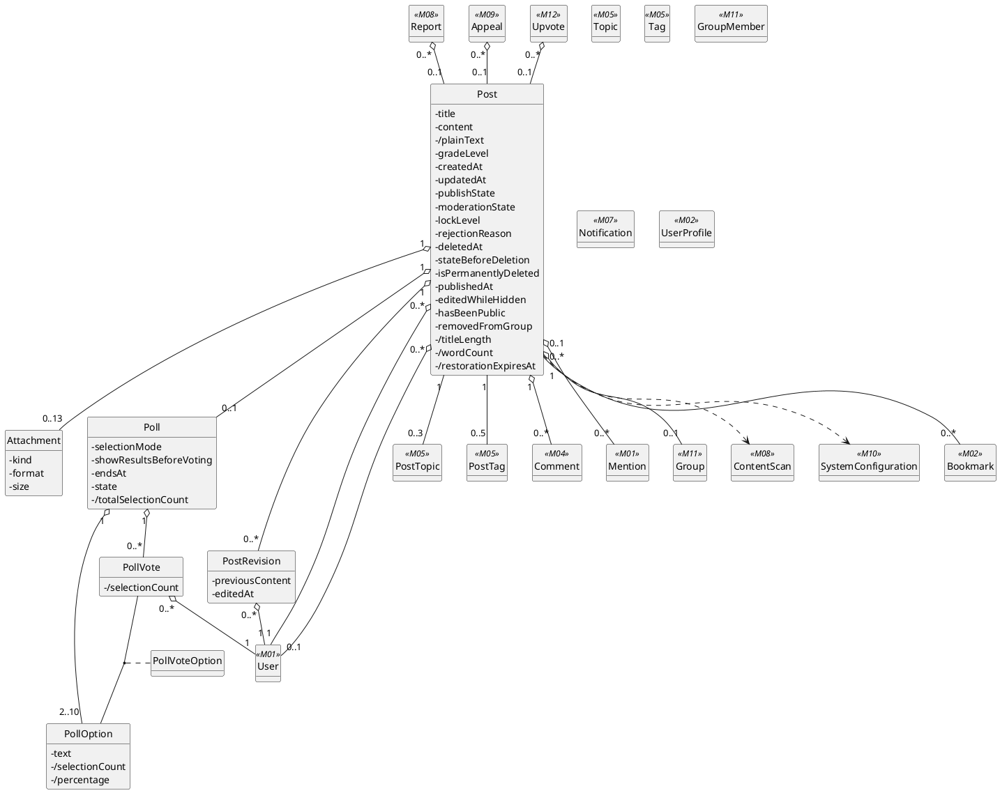

# Phân tích lớp thực thể — M03 Post & Content

<!-- [Vietnamese Doc] Tài liệu tiếng Việt; tên lớp và thuộc tính viết tiếng Anh (input/CONVENTIONS.md mục 3). -->

| Mã tài liệu | EC-M03 |
|---|---|
| Dự án | iShare |
| Module | M03 — Post & Content |
| Đầu vào | FR-M03 phiên bản 1.10 |
| Trạng thái | Bản nháp |
| Phiên bản | 0.3 |
| Ngày | 2026-11-17 |
| Tác giả | Phạm Văn Đức |

<!-- Quy ước chung cho mọi bảng dưới đây:
     - Không đổi tên cột, không xóa cột, không đổi số mục: tool đọc bảng theo số mục và tên cột.
     - Ô không có nội dung ghi "—".
     - Mục chưa tới bước làm thì để dòng "(Chưa làm — bước N)".
     - Cột Nguồn ghi mã trong FR: FR-M03-nn, FR-M03-nn.mm, BR-M03-nn, hoặc TN:<thuật ngữ> (mục 2.1 của FR).
     - Sơ đồ ở mục 4 do gen_puml.py sinh; không sửa tay. -->

## 1. Mô tả chức năng

### 1.1 Đoạn mô tả

(S1) Module Post & Content quản lý bài viết, tệp đính kèm, poll, lựa chọn của poll, phiếu bình chọn và lịch sử sửa, đồng thời quản lý trạng thái đăng, trạng thái kiểm duyệt và mức khóa của bài viết. (S2) Hệ thống cho phép User, Mod và Admin đã đăng nhập soạn và lưu nháp bài viết gồm tiêu đề, nội dung giàu định dạng với công thức LaTeX và Lớp/Khối tùy chọn, lưu tác giả, thời điểm tạo, thời điểm cập nhật, đồng thời hiển thị số ký tự tiêu đề và số từ nội dung khi vượt giới hạn. (S3) Hệ thống cho phép tác giả thêm và bỏ tệp đính kèm dạng ảnh hoặc tài liệu khi soạn và sửa bài viết của tác giả. (S4) Hệ thống cho phép tác giả thêm poll vào bài chưa gửi, đặt lựa chọn, kiểu chọn một hoặc chọn nhiều, tùy chọn hiện kết quả trước khi bình chọn và hạn kết thúc, đồng thời thay đổi hoặc bỏ poll khi bài còn là bản nháp. (S5) Hệ thống cho phép tác giả gửi bài nháp hoặc gửi lại bài bị từ chối sau khi sửa, xử lý trạng thái bài theo công tắc AI tổng, công tắc Moderation của M10 và vai trò Admin, đồng thời áp dụng luồng duyệt của M11 cho bài thuộc nhóm. (S6) Hệ thống dùng kết quả quét từ M08 và M13 để quyết định đăng bài, giữ bài trong hàng chờ Mod duyệt hoặc từ chối bài kèm nhóm vi phạm, đồng thời quét lại các bài thuộc diện quét sau khi sửa hoặc khi hiện lại bài đã sửa trong lúc tự ẩn để cập nhật trạng thái kiểm duyệt. (S7) Hệ thống cho phép Mod và Admin chấp nhận bài trong hàng chờ để đăng hoặc từ chối bài kèm lý do được lưu và hiển thị cho tác giả. (S8) Hệ thống cho phép Guest, User, Mod và Admin xem bài viết theo trạng thái đăng, trạng thái kiểm duyệt, trạng thái tài khoản tác giả của M01 và quyền xem nhóm của M11, đồng thời cho tác giả xem bài của tác giả theo điều kiện tương ứng. (S9) Hệ thống cho phép User, Mod và Admin đã đăng nhập ghi phiếu bình chọn trong poll đang mở theo các lựa chọn và cấu hình của poll, thay phiếu cũ bằng phiếu mới hoặc bỏ phiếu, đồng thời áp dụng mức khóa của bài khi nhận các thao tác bình chọn. (S10) Hệ thống tính số lượt chọn của mỗi lựa chọn, tổng lượt chọn và tỷ lệ phần trăm của các lựa chọn, hiển thị kết quả poll theo cấu hình, việc người xem đã bình chọn và trạng thái đóng của poll. (S11) Hệ thống cho phép tác giả đổi hạn kết thúc, kết thúc ngay và thêm lựa chọn cho poll đang mở của bài đã gửi, lưu hạn kết thúc hoặc lựa chọn mới và cập nhật trạng thái poll tương ứng. (S12) Hệ thống tự đóng poll khi đến hạn kết thúc và gửi sự kiện poll kết thúc cho M07. (S13) Hệ thống cho phép tác giả sửa tiêu đề, nội dung, Lớp/Khối và tệp đính kèm của bài đã gửi khi trạng thái cho phép, đồng thời ghi mỗi lần lưu bản sửa thành phiên bản lịch sử gồm nội dung trước lần sửa, người sửa và thời điểm sửa. (S14) Hệ thống cho phép mọi người xem được bài, kể cả Guest, xem các phiên bản trong lịch sử sửa cùng người sửa và thời điểm sửa. (S15) Hệ thống cho phép tác giả tự ẩn bài đã đăng và hiện lại bài tự ẩn, cập nhật trạng thái đăng và thực hiện quét lại khi hiện bài thuộc diện quét có bản sửa được lưu trong lúc ẩn. (S16) Hệ thống cho phép tác giả khóa bình luận của bài mình và mở khóa do tác giả đặt, cho Mod và Admin khóa bình luận, khóa toàn bộ hoặc điều chỉnh mức khóa, đồng thời ghi người khóa và dùng mức khóa để kiểm soát bình luận, upvote và poll. (S17) Hệ thống cho phép tác giả xóa mềm bài của tác giả bằng cách chuyển bài sang Đã xóa, ghi thời điểm xóa và trạng thái trước khi xóa, đưa bài ra khỏi hàng chờ duyệt khi cần và cung cấp danh sách bài đã xóa cho hồ sơ M02. (S18) Hệ thống cho phép tác giả khôi phục bài trong thời hạn tính từ thời điểm xóa, đưa bài về trạng thái trước khi xóa hoặc về Nháp nếu bài vốn Chờ duyệt, theo điều kiện trạng thái kiểm duyệt. (S19) Hệ thống tự gắn cờ Đã xóa hẳn khi hết thời hạn khôi phục, giữ nguyên nội dung bài, tệp đính kèm, poll, phiếu bình chọn, lịch sử sửa, liên kết Topic, Tag và bình luận, đồng thời cho Mod, Admin và tác giả xem lại bài trong các ngữ cảnh báo cáo, lịch sử báo cáo, thông báo xử lý hoặc khiếu nại được FR cho phép. (S20) Hệ thống phối hợp với M05 để chọn Topic, Tag khi soạn và sửa bài, lưu lượt nhắc tên của M01 cùng nội dung bài, đồng thời cung cấp sự kiện bài được đăng hoặc bị từ chối cho M07 với thông tin tác giả, tính ẩn danh và việc bài lần đầu hiển thị công khai. (S21) Hệ thống cung cấp nội dung chữ và bài đang công khai cho M06, M14, cung cấp thời điểm đăng cùng thay đổi tiêu đề, nội dung cho M13 tạo hoặc cập nhật embedding, cung cấp trạng thái và mốc thời gian bài cho M15 thống kê, và cung cấp thời điểm gắn cờ Đã xóa hẳn cho M02 xử lý bookmark cùng M12 xử lý điểm.

### 1.2 Truy vết câu

| Câu | Nội dung tóm tắt | Nguồn |
|---|---|---|
| S1 | Phạm vi đối tượng và trạng thái của module | FR-M03-01, FR-M03-02, FR-M03-03, FR-M03-08, FR-M03-11, FR-M03-14 |
| S2 | Soạn/lưu nháp, thông tin bài, tác giả, thời điểm và số đếm độ dài | FR-M03-01, FR-M03-01.01, FR-M03-01.02, FR-M03-01.03, FR-M03-01.05, FR-M03-01.07, FR-M03-01.08, FR-M03-01.16 |
| S3 | Thêm và bỏ tệp đính kèm | FR-M03-02, FR-M03-02.01, FR-M03-02.02 |
| S4 | Tạo poll, lựa chọn, cấu hình và hạn kết thúc | FR-M03-03, FR-M03-03.01, FR-M03-03.02, FR-M03-03.05, FR-M03-03.07, FR-M03-03.10 |
| S5 | Gửi/gửi lại bài, vai trò Admin, cấu hình AI và luồng nhóm | FR-M03-04, FR-M03-04.01, FR-M03-04.03, FR-M03-04.04, FR-M03-04.05, FR-M03-04.11 |
| S6 | Kết quả quét, hàng chờ, nhóm vi phạm và quét lại | FR-M03-05, FR-M03-05.01, FR-M03-05.02, FR-M03-05.03, FR-M03-05.04, FR-M03-05.05, FR-M03-05.07, FR-M03-05.12, FR-M03-05.14, FR-M03-05.15 |
| S7 | Duyệt bài chờ đăng và lưu lý do từ chối | FR-M03-06, FR-M03-06.01, FR-M03-06.02, FR-M03-06.03, FR-M03-06.05 |
| S8 | Xem bài theo trạng thái và quyền, kể cả Guest | FR-M03-07, FR-M03-07.01, FR-M03-07.02, FR-M03-07.03, FR-M03-07.04, FR-M03-07.06 |
| S9 | Ghi, đổi và bỏ phiếu bình chọn | FR-M03-08, FR-M03-08.01, FR-M03-08.02, FR-M03-08.03, FR-M03-08.04, FR-M03-08.05, FR-M03-08.13 |
| S10 | Các số liệu kết quả poll và điều kiện hiển thị | FR-M03-08.07, FR-M03-08.08, FR-M03-08.09, FR-M03-08.10, FR-M03-08.12 |
| S11 | Đổi hạn, kết thúc ngay và thêm lựa chọn poll | FR-M03-09, FR-M03-09.01, FR-M03-09.02, FR-M03-09.06, FR-M03-09.08 |
| S12 | Tự đóng poll và sự kiện kết thúc | FR-M03-10, FR-M03-10.01, FR-M03-10.02 |
| S13 | Sửa bài và ghi phiên bản nội dung trước sửa, người sửa, thời điểm | FR-M03-11, FR-M03-11.01, FR-M03-11.02, FR-M03-11.03, FR-M03-11.04, FR-M03-11.07 |
| S14 | Xem lịch sử sửa theo quyền xem bài | FR-M03-12, FR-M03-12.02, FR-M03-12.03, FR-M03-12.04 |
| S15 | Tự ẩn, hiện lại và quét bản sửa khi hiện lại | FR-M03-13, FR-M03-13.01, FR-M03-13.02, FR-M03-13.05, FR-M03-13.06 |
| S16 | Mức khóa, người khóa và điều kiện tương tác | FR-M03-14, FR-M03-14.01, FR-M03-14.02, FR-M03-14.03, FR-M03-14.04, FR-M03-14.06, FR-M03-14.07, FR-M03-14.08, FR-M03-14.09, FR-M03-08.13 |
| S17 | Xóa mềm, mốc xóa, trạng thái trước xóa và bài đã xóa trên hồ sơ | FR-M03-15, FR-M03-15.01, FR-M03-15.03, FR-M03-15.06 |
| S18 | Khôi phục theo thời hạn, trạng thái cũ và ngoại lệ bài Chờ duyệt | FR-M03-16, FR-M03-16.01, FR-M03-16.02, FR-M03-16.04, FR-M03-16.06 |
| S19 | Gắn cờ hết hạn, giữ dữ liệu và quyền xem lại theo ngữ cảnh | FR-M03-17, FR-M03-17.01, FR-M03-17.02, FR-M03-17.03, FR-M03-17.04, FR-M03-07.08, FR-M03-07.09, FR-M03-07.10, FR-M03-07.11 |
| S20 | Giao tiếp Topic/Tag, nhắc tên và sự kiện gửi thông báo | FR-M03-01.01, FR-M03-11.01, FR-M03-11.05, FR-M03-11.06, FR-M03-17.02, FR-M03-05.01, FR-M03-05.03, FR-M03-06.02, FR-M03-06.03 |
| S21 | Dữ liệu phục vụ Search, Feed, embedding, thống kê, bookmark và điểm | FR-M03-07.01, FR-M03-04.03, FR-M03-04.11, FR-M03-05.01, FR-M03-06.02, FR-M03-11.01, FR-M03-17.01 |

S20 và S21 bám thêm các dòng giao tiếp trong FR-M03 mục 5.21. Mốc đăng bài là lúc chuyển sang Đã đăng theo các đường đăng bài mà FR nêu. Ngữ cảnh và quyền xem lại bài ở S19 theo FR-M03-07.08–07.11 và FR-M03-17.04.

**Phạm vi bước 1**

- Các giới hạn tiêu đề, số từ, định dạng/dung lượng/số tệp, số lựa chọn poll, thời hạn khôi phục và ngưỡng điểm quét sẽ được ghi ở phần ràng buộc của bước phân loại.
- Bố cục, nút, nhãn và nội dung thông báo giao diện được lược khỏi đoạn mô tả.
- Những nội dung FR đã loại gồm nhiều loại bài, ảnh trong nội dung, trình soạn LaTeX trực quan, mở lại poll đã đóng, AI tự viết bài, Accepted Answer và ảnh bìa.
- TBD-M03-01 hoãn đếm lượt xem bài ở MS1. TBD-M03-02 hoãn tối ưu trang công khai cho công cụ tìm kiếm và xem trước khi chia sẻ.
- Quy tắc Topic/Tag thuộc M05, bình luận thuộc M04, thông báo thuộc M07, kiểm duyệt và quét AI thuộc M08/M13, khiếu nại thuộc M09, cấu hình thuộc M10, bài nhóm thuộc M11, upvote/điểm thuộc M12. Đoạn mô tả gọi tên các dữ liệu và sự kiện M03 sử dụng hoặc cung cấp theo FR.
- Đã xóa hẳn là cờ nghiệp vụ. FR-M03-17.02 yêu cầu giữ mọi dữ liệu bài để phục vụ báo cáo và khiếu nại.

QU-01 và QU-03 dùng quy ước đã chốt của skill. Tệp conventions.md hiện chưa có, QU-10/QU-11 tiếp tục chờ xác nhận chung khi tới phần quan hệ và sơ đồ.

Bước 1 đã được người dùng duyệt khi yêu cầu thực hiện bước 2 ngày 2026-11-16.

## 2. Danh từ và phân loại

Người dùng duyệt bước 1 và yêu cầu thực hiện bước 2 ngày 2026-11-16. Bước 2 đã được người dùng duyệt khi yêu cầu triển khai bước 3 ngày 2026-11-17. Q-01/Q-02 đã được trả lời ngày 2026-11-17, đang chờ duyệt bản nháp register và cập nhật FR.

Có 97 dòng danh từ sau khi gộp cách gọi cùng nghĩa, gồm 79 dòng từ S1–S21 và 18 dòng quét bổ sung. Kết quả có 32 dòng thành Lớp, 34 dòng thành Thuộc tính và 31 dòng Loại bỏ. Bước 2 đã trình 23 lớp gồm 6 lớp M03 và 17 lớp ngoài. Bước 3 bổ sung PollVoteOption, mô hình hiện có 24 lớp gồm 7 lớp M03 và 17 lớp ngoài, cùng 34 thuộc tính M03 gồm 26 Lưu và 8 Dẫn xuất.

Đã chạy merge_ec.py --list --exclude M03, dùng lại tên lớp đã xuất hiện trong EC-M01/02 và thuật ngữ glossary. Hai EC này đang là bản nháp, các tên lớp liên module tiếp tục cần đối chiếu khi chốt/gộp.

Đã phân loại từ đoạn mô tả, quét thuật ngữ, yêu cầu cấp dưới, BR, chuyển trạng thái và giao tiếp, sau đó mới đọc mục 5.19 Dữ liệu nghiệp vụ. Lượt đối chiếu bổ sung plainText, removedFromGroup và Attachment.kind qua sổ danh từ.

### 2.1 Sổ danh từ

Các dòng Loại bỏ ghi lý do và phần dữ liệu tương ứng đã được xem xét. Các cách gọi vai trò hoặc trạng thái có thể quy về cùng một lớp.

| # | Danh từ | Xuất hiện ở | Phân loại | Kết quả | Lý do |
|---|---|---|---|---|---|
| 1 | bài viết / bài nháp / bài bị từ chối / bài đã đăng / bài tự ẩn / bài đã xóa / bài chưa gửi / bản nháp | S1 | Lớp | Post | T8, cùng đối tượng bài viết ở các trạng thái khác nhau, có dữ liệu và vòng đời riêng. |
| 2 | tệp đính kèm / ảnh đính kèm / tài liệu đính kèm | S1 | Lớp | Attachment | T8, được thêm hoặc bỏ riêng, có định dạng và dung lượng. |
| 3 | poll / bình chọn (đối tượng) | S1 | Lớp | Poll | T8, có cấu hình, hạn kết thúc và trạng thái riêng. |
| 4 | lựa chọn của poll | S1 | Lớp | PollOption | T8, từng lựa chọn được đặt, chọn và tính lượt chọn riêng. |
| 5 | phiếu bình chọn | S1 | Lớp | PollVote | T8, được ghi, thay hoặc bỏ riêng theo FR-M03-08, các lựa chọn và tài khoản để xét ở bước 3. |
| 6 | phiên bản lịch sử / phiên bản sửa / bản sửa được lưu trong lúc tự ẩn | S13 | Lớp | PostRevision | T8, từng bản ghi lưu nội dung trước sửa và thời điểm, người sửa. |
| 7 | User / người dùng | S2 | Lớp | User | T3/T4, tài khoản M01, tên đã có trong EC-M01. |
| 8 | Mod | S2 | Lớp | User | T3, vai trò MOD của tài khoản, dùng cùng lớp User. |
| 9 | Admin | S2 | Lớp | User | T3, vai trò ADMIN của tài khoản. |
| 10 | tác giả | S2 | Lớp | User | T3, tài khoản tạo và sở hữu nghiệp vụ bài viết. |
| 11 | người xem | S10 | Lớp | User | T3, tài khoản trong vai trò xem bài, trường hợp Guest xét riêng. |
| 12 | người bình chọn | Quét: FR-M03-08.03 | Lớp | User | T3, tài khoản ghi phiếu, bao gồm tác giả bình chọn bài mình. |
| 13 | người sửa | S13 | Lớp | User | T3, tài khoản sửa bài được phiên bản ghi nhận. |
| 14 | người khóa | S16 | Lớp | User | T3, tài khoản thực hiện khóa, bước 3 xét vai trò đối với Post. |
| 15 | người duyệt | Quét: FR-M03-06.06 | Lớp | User | T3, Mod/Admin xử lý bài chờ đăng. |
| 16 | nhóm | S5 | Lớp | Group | T4, M11 quản lý ngữ cảnh và cổng duyệt, tên đã có trong EC-M01/02. |
| 17 | kết quả quét | S6 | Lớp | ContentScan | T4, dữ liệu kết quả M08 cung cấp, M13 thực hiện lời gọi AI. Tên tạm. |
| 18 | công tắc AI tổng | S5 | Lớp | SystemConfiguration | T4, cấu hình M10 mà M03 đọc, tên đã tham chiếu trong EC-M01. |
| 19 | công tắc Moderation | S5 | Lớp | SystemConfiguration | T4, cấu hình M10, một mục cấu hình khác với công tắc AI tổng trong cùng lớp ngoài. |
| 20 | bình luận | S16 | Lớp | Comment | T4, M04 quản lý, chịu mức khóa và được giữ cùng bài theo FR-M03-17.02. |
| 21 | hồ sơ | S17 | Lớp | UserProfile | T4, M02 cung cấp nơi hiển thị bài đã xóa, tên đã có trong EC-M02. |
| 22 | Topic | S19 | Lớp | Topic | T4, phân loại thuộc M05, tên glossary và EC-M01. |
| 23 | Tag | S19 | Lớp | Tag | T4, thẻ thuộc M05, tên glossary. |
| 24 | liên kết bài–Topic | S19 | Lớp | PostTopic | T4, M05 quản lý dữ liệu gắn Topic với bài, giữ khi gắn cờ xóa hẳn. Tên tạm theo quy ước. |
| 25 | liên kết bài–Tag | S19 | Lớp | PostTag | T4, M05 quản lý dữ liệu gắn Tag với bài, tên tạm. |
| 26 | báo cáo | S19 | Lớp | Report | T4, dữ liệu M08 tạo ngữ cảnh xem lại bài, tên tạm. |
| 27 | thông báo xử lý / thông báo | S19 | Lớp | Notification | T4, dữ liệu M07, có thể dẫn tác giả tới nội dung liên quan. Tên đã tham chiếu ở EC-M01. |
| 28 | khiếu nại | S19 | Lớp | Appeal | T4, dữ liệu M09 và ngữ cảnh xem lại bài, tên glossary và EC-M01. |
| 29 | lượt nhắc tên | S20 | Lớp | Mention | T4, M01 định nghĩa, M03 lưu cùng nội dung, tên EC-M01. |
| 30 | bookmark | S21 | Lớp | Bookmark | T4, M02 xử lý khi nhận mốc bài gắn cờ xóa hẳn, tên EC-M02. |
| 31 | upvote / rút upvote | S16 | Lớp | Upvote | T4, dữ liệu và thao tác M12 chịu ràng buộc mức khóa, tên EC-M01. |
| 32 | thành viên nhóm / Owner nhóm | Quét: FR-M03-07.01, FR-M03-04.05 | Lớp | GroupMember | T4, tư cách thành viên và vai trò nhóm thuộc M11, tên glossary và EC-M01/02. |
| 33 | Tiêu đề | S2 | Thuộc tính | Post.title | T9, dữ liệu mô tả đối tượng theo FR-M03-01.14, FR-M03-04.08, BR-M03-40, BR-M03-41, BR-M03-42. |
| 34 | Nội dung giàu định dạng | S2 | Thuộc tính | Post.content | T9, dữ liệu mô tả đối tượng theo FR-M03-01.02, FR-M03-01.03, FR-M03-01.15, FR-M03-04.09, BR-M03-03, BR-M03-05, BR-M03-40, BR-M03-42. |
| 35 | Nội dung chữ thuần | Quét: Dữ liệu nghiệp vụ, mục 5.19 (đã gọi tên ở S21) | Thuộc tính | Post.plainText | T7, dữ liệu tính được từ nguồn theo FR-M03-07.01, BR-M03-42. |
| 36 | Lớp/Khối | S2 | Thuộc tính | Post.gradeLevel | T9, dữ liệu mô tả đối tượng theo FR-M03-01.05, FR-M03-01.06, FR-M03-01.07, BR-M03-06. |
| 37 | Thời điểm tạo | S2 | Thuộc tính | Post.createdAt | T9, dữ liệu mô tả đối tượng theo FR-M03-01.08. |
| 38 | Thời điểm cập nhật | S2 | Thuộc tính | Post.updatedAt | T9, dữ liệu mô tả đối tượng theo FR-M03-01.08. |
| 39 | Trạng thái đăng | S1 | Thuộc tính | Post.publishState | T9, dữ liệu mô tả đối tượng theo FR-M03-01.01, FR-M03-04.01, FR-M03-05.01, FR-M03-13.01, FR-M03-15.01, BR-M03-17, TN:Trạng thái đăng. |
| 40 | Trạng thái kiểm duyệt | S1 | Thuộc tính | Post.moderationState | T9, dữ liệu mô tả đối tượng theo FR-M03-01.12, FR-M03-05.07, BR-M03-17, BR-M03-48, TN:Trạng thái kiểm duyệt. |
| 41 | Mức khóa | S1 | Thuộc tính | Post.lockLevel | T9, dữ liệu mô tả đối tượng theo FR-M03-01.09, FR-M03-14.01, FR-M03-14.03, FR-M03-14.08, BR-M03-30, BR-M03-31, BR-M03-32. |
| 42 | Lý do Mod từ chối | S7 | Thuộc tính | Post.rejectionReason | T9, dữ liệu mô tả đối tượng theo FR-M03-06.03, FR-M03-06.04, FR-M03-06.05, BR-M03-23. |
| 43 | Thời điểm xóa mềm | S17 | Thuộc tính | Post.deletedAt | T9, dữ liệu mô tả đối tượng theo FR-M03-15.01, FR-M03-16.02, BR-M03-34, BR-M03-35. |
| 44 | Trạng thái trước khi xóa | S17 | Thuộc tính | Post.stateBeforeDeletion | T9, dữ liệu mô tả đối tượng theo FR-M03-15.01, FR-M03-16.01, FR-M03-16.06, BR-M03-35. |
| 45 | Cờ Đã xóa hẳn | S19 | Thuộc tính | Post.isPermanentlyDeleted | T9, dữ liệu mô tả đối tượng theo FR-M03-17.01, FR-M03-17.02, BR-M03-37. |
| 46 | Thời điểm đăng | S21 | Thuộc tính | Post.publishedAt | T9, dữ liệu mô tả đối tượng theo FR-M03-04.03, FR-M03-04.11, FR-M03-05.01, FR-M03-06.02. |
| 47 | Có bản sửa khi Tự ẩn chưa được quét | Quét: FR-M03-05.14, FR-M03-13.06 | Thuộc tính | Post.editedWhileHidden | T9, dữ liệu mô tả đối tượng theo FR-M03-05.05, FR-M03-05.14, FR-M03-13.06, BR-M03-26. |
| 48 | Đã từng hiển thị công khai | S20 | Thuộc tính | Post.hasBeenPublic | T9, dữ liệu mô tả đối tượng theo FR-M03-05.01, FR-M03-06.02. |
| 49 | Dấu bị gỡ khỏi nhóm | Quét: Dữ liệu nghiệp vụ, mục 5.19 | Thuộc tính | Post.removedFromGroup | T9, dữ liệu mô tả đối tượng theo FR-M03-04.05. |
| 50 | Số ký tự tiêu đề | S2 | Thuộc tính | Post.titleLength | T7, dữ liệu tính được từ nguồn theo FR-M03-01.16, BR-M03-42, BR-M03-43. |
| 51 | Số từ nội dung | S2 | Thuộc tính | Post.wordCount | T7, dữ liệu tính được từ nguồn theo FR-M03-01.16, BR-M03-42. |
| 52 | Mốc hết thời hạn khôi phục | Quét: FR-M03-16.02, BR-M03-35 | Thuộc tính | Post.restorationExpiresAt | T7, dữ liệu tính được từ nguồn theo FR-M03-16.02, FR-M03-17.01, BR-M03-35. |
| 53 | Loại tệp | Quét: Dữ liệu nghiệp vụ, mục 5.19 | Thuộc tính | Attachment.kind | T9, dữ liệu mô tả đối tượng theo FR-M03-02.10, BR-M03-07, BR-M03-08. |
| 54 | Định dạng tệp | Quét: FR-M03-02.04, FR-M03-02.07 | Thuộc tính | Attachment.format | T9, dữ liệu mô tả đối tượng theo FR-M03-02.04, FR-M03-02.07, BR-M03-07, BR-M03-08. |
| 55 | Dung lượng | Quét: FR-M03-02.05, FR-M03-02.08 | Thuộc tính | Attachment.size | T9, dữ liệu mô tả đối tượng theo FR-M03-02.05, FR-M03-02.08, BR-M03-07, BR-M03-08. |
| 56 | Kiểu chọn | S4 | Thuộc tính | Poll.selectionMode | T9, dữ liệu mô tả đối tượng theo FR-M03-03.05, FR-M03-03.06, FR-M03-03.11, BR-M03-11, BR-M03-44. |
| 57 | Hiện kết quả trước bình chọn | S4 | Thuộc tính | Poll.showResultsBeforeVoting | T9, dữ liệu mô tả đối tượng theo FR-M03-03.05, FR-M03-03.06, FR-M03-08.07, FR-M03-08.08, FR-M03-08.10, BR-M03-11. |
| 58 | Hạn kết thúc | S4 | Thuộc tính | Poll.endsAt | T9, dữ liệu mô tả đối tượng theo FR-M03-03.07, FR-M03-03.09, FR-M03-09.01, FR-M03-09.02, BR-M03-12, BR-M03-13, BR-M03-14. |
| 59 | Trạng thái poll | S10 | Thuộc tính | Poll.state | T9, dữ liệu mô tả đối tượng theo FR-M03-09.02, FR-M03-10.01, BR-M03-13, BR-M03-14. |
| 60 | Tổng lượt chọn | S10 | Thuộc tính | Poll.totalSelectionCount | T7, dữ liệu tính được từ nguồn theo FR-M03-08.12, BR-M03-15. |
| 61 | Nội dung lựa chọn | Quét: FR-M03-03.02, FR-M03-09.06 | Thuộc tính | PollOption.text | T9, dữ liệu mô tả đối tượng theo FR-M03-03.02, FR-M03-03.03, FR-M03-03.11, FR-M03-09.06, BR-M03-09, BR-M03-44. |
| 62 | Số lượt chọn lựa chọn | S10 | Thuộc tính | PollOption.selectionCount | T7, dữ liệu tính được từ nguồn theo FR-M03-08.01, FR-M03-08.04, FR-M03-08.05, FR-M03-08.12, BR-M03-15, TN:Lượt chọn. |
| 63 | Phần trăm lựa chọn | S10 | Thuộc tính | PollOption.percentage | T7, dữ liệu tính được từ nguồn theo FR-M03-08.12, BR-M03-15. |
| 64 | Số lựa chọn trong phiếu | Quét: FR-M03-08.02, FR-M03-08.03, BR-M03-11 | Thuộc tính | PollVote.selectionCount | T7, dữ liệu tính được từ nguồn theo FR-M03-08.02, FR-M03-08.03, BR-M03-11. |
| 65 | Nội dung trước lần sửa | S13 | Thuộc tính | PostRevision.previousContent | T9, dữ liệu mô tả đối tượng theo FR-M03-11.02, BR-M03-27. |
| 66 | Thời điểm sửa | S13 | Thuộc tính | PostRevision.editedAt | T9, dữ liệu mô tả đối tượng theo FR-M03-11.02, FR-M03-12.02, BR-M03-27. |
| 67 | module Post & Content / hệ thống | S1 | Loại bỏ | — | Trừu tượng, tên phần mềm và tác nhân tự động. |
| 68 | lịch sử sửa | S1 | Loại bỏ | — | Giao diện, tập hợp các PostRevision đã được phân loại riêng. |
| 69 | nội dung giàu định dạng (định dạng chữ, công thức LaTeX) | S2 | Loại bỏ | — | Giá trị của Post.content, các thành phần định dạng được ràng buộc theo BR-M03-03/05. |
| 70 | ảnh / tài liệu | S3 | Loại bỏ | — | Giá trị của Attachment.kind, các tệp cụ thể đã được xét thành Attachment. |
| 71 | chọn một / chọn nhiều | S4 | Loại bỏ | — | Giá trị của Poll.selectionMode theo BR-M03-11. |
| 72 | vai trò Admin | S5 | Loại bỏ | — | Giá trị phân quyền của tài khoản User, M01/M10 quản lý và M03 dùng áp dụng BR-M03-51. |
| 73 | luồng duyệt của nhóm | S5 | Loại bỏ | — | Ngoài phạm vi module (M11), giao tiếp xử lý bài nhóm, Group/GroupMember đã tham chiếu. |
| 74 | hàng chờ Mod duyệt / bài trong hàng chờ | S6 | Loại bỏ | — | Ngoài phạm vi module (M08), M03 cung cấp bài chờ duyệt. FR-M03 nêu danh sách xử lý, chưa nêu dữ liệu riêng của mục hàng chờ. |
| 75 | nhóm vi phạm | S6 | Loại bỏ | — | Ngoài phạm vi module (M08), dữ liệu ContentScan cung cấp theo FR-M03-05.12, khác lý do Mod từ chối của Post. |
| 76 | Guest | S8 | Loại bỏ | — | Không lưu, tác nhân chưa đăng nhập được xem bài và lịch sử sửa. |
| 77 | trạng thái tài khoản tác giả | S8 | Loại bỏ | — | Ngoài phạm vi module (M01), User.accountState đã khai ở EC-M01. |
| 78 | quyền xem nhóm | S8 | Loại bỏ | — | Ngoài phạm vi module (M11), kiểm tra bằng ngữ cảnh Group và GroupMember. |
| 79 | thao tác bình chọn / đổi phiếu / bỏ phiếu | S9 | Loại bỏ | — | Hành động không lưu dấu vết riêng, CRUD của PollVote đã nêu. |
| 80 | kết quả poll | S10 | Loại bỏ | — | Chung chung, các số liệu cụ thể được phân loại thành thuộc tính dẫn xuất của Poll và PollOption. |
| 81 | kết thúc ngay | S11 | Loại bỏ | — | Hành động không lưu dấu vết riêng, đặt Poll.endsAt bằng hiện tại và chuyển Poll.state theo FR-M03-09.02. |
| 82 | sự kiện poll kết thúc / sự kiện bài đăng / sự kiện bài bị từ chối | S12 | Loại bỏ | — | Hành động không lưu dấu vết riêng trong M03, dữ liệu sự kiện được cung cấp M07 theo FR mục 5.21. |
| 83 | khóa bình luận / khóa toàn bộ / Không khóa | S16 | Loại bỏ | — | Giá trị của Post.lockLevel theo BR-M03-30/31/32. |
| 84 | xóa mềm / khôi phục | S17 | Loại bỏ | — | Hành động không lưu dấu vết riêng, cập nhật Post.publishState và các mốc xóa đã được phân loại. |
| 85 | Đã xóa / Nháp / Chờ duyệt / Đã đăng / Tự ẩn / Bị từ chối | S17 | Loại bỏ | — | Giá trị của Post.publishState theo TN:Trạng thái đăng và bảng chuyển trạng thái. |
| 86 | thời hạn khôi phục | S18 | Loại bỏ | — | Hằng số của BR-M03-35, 7 × 24 giờ. Mốc bắt đầu/kết thúc được xét thành thuộc tính. |
| 87 | lịch sử báo cáo | S19 | Loại bỏ | — | Ngoài phạm vi module (M08), dữ liệu báo cáo liên quan tới bài đã có Report làm tham chiếu. Phân loại cấu trúc lịch sử thuộc EC-M08. |
| 88 | ngữ cảnh báo cáo, khiếu nại | S19 | Loại bỏ | — | Ngoài phạm vi module (M08/M09), quy tắc quyền xem theo các đối tượng Report và Appeal đã tham chiếu. |
| 89 | tính ẩn danh | S20 | Loại bỏ | — | Ngoài phạm vi module (M11), dữ liệu bài nhóm và thông tin sự kiện gửi M07 theo FR mục 5.21. |
| 90 | embedding | S21 | Loại bỏ | — | Ngoài phạm vi module (M13), M03 cung cấp nội dung và sự kiện cho M13 tạo/cập nhật embedding. |
| 91 | thống kê bài / điểm | S21 | Loại bỏ | — | Ngoài phạm vi module (M15/M12), M03 cung cấp trạng thái và mốc thời gian. |
| 92 | số ảnh, tài liệu tối đa / dung lượng tối đa / ngưỡng điểm quét | Quét: BR-M03-07, BR-M03-08, BR-M03-20 | Loại bỏ | — | Hằng số của BR-M03-07/08/20, ghi vào ràng buộc dữ liệu liên quan. |
| 93 | Bình thường / Bị gắn cờ / Bị Mod ẩn | Quét: TN:Trạng thái kiểm duyệt | Loại bỏ | — | Giá trị của Post.moderationState. |
| 94 | Đang mở / Đã đóng | Quét: FR-M03-10.01, BR-M03-13 | Loại bỏ | — | Giá trị của Poll.state. |
| 95 | điểm quét | Quét: FR-M03-05.01, FR-M03-05.07 | Loại bỏ | — | Ngoài phạm vi module (M08), thuộc ContentScan, M03 dùng điểm để xét ngưỡng trạng thái. |
| 96 | lượt xem bài / ảnh bìa / Accepted Answer | Quét: TBD-M03-01, BR-M03-50 | Loại bỏ | — | Ngoài phạm vi module, lượt xem đang hoãn, ảnh bìa và Accepted Answer bị loại ở MS1. |
| 97 | trình soạn / nút / nhãn | Quét: FR-M03-01.02, FR-M03-12.01 | Loại bỏ | — | Giao diện, các đối tượng và dữ liệu dùng hiển thị đã xét riêng. |

### 2.2 Lớp

Bước 3 bổ sung PollVoteOption nhóm Liên kết và đồng bộ nhóm Liên kết của Bookmark từ EC-M02. Các lớp còn lại giữ nhóm Thực thể. Các kết quả poll được phân loại thành thuộc tính dẫn xuất của Poll/PollOption vì là từng giá trị gắn với đối tượng có sẵn.

| Lớp | Tên tiếng Việt | Nhóm | Sở hữu | Mô tả | Nguồn |
|---|---|---|---|---|---|
| Post | Bài viết | Thực thể | M03 | Bài viết do M03 quản lý, dùng tên Post đã tham chiếu ở EC-M01/02 và glossary. | FR-M03-01.01, FR-M03-11.01 |
| Attachment | Tệp đính kèm | Thực thể | M03 | Ảnh hoặc tài liệu được thêm, bỏ riêng và giữ cùng bài khi gắn cờ xóa hẳn. | FR-M03-02.01, FR-M03-02.02, FR-M03-17.02 |
| Poll | Bình chọn | Thực thể | M03 | Poll tùy chọn có cấu hình, hạn và vòng đời đóng riêng. | FR-M03-03.01, FR-M03-09.01, FR-M03-10.01 |
| PollOption | Lựa chọn poll | Thực thể | M03 | Lựa chọn tác giả đặt, người bình chọn tham chiếu riêng và được tính lượt chọn. | FR-M03-03.02, FR-M03-09.06, FR-M03-08.12 |
| PollVote | Phiếu bình chọn | Thực thể | M03 | Phiếu của người dùng trong poll, có thể thay hoặc bỏ. Số lựa chọn được tính để xét ràng buộc chọn một/chọn nhiều. | FR-M03-08.01, FR-M03-08.02, FR-M03-08.03, FR-M03-08.04, FR-M03-08.05 |
| PollVoteOption | Lượt chọn trong phiếu | Liên kết | M03 | Một cặp phiếu và lựa chọn, sinh khi tách n-n ở bước 3. | FR-M03-08.02, FR-M03-08.03, FR-M03-08.12, BR-M03-11 |
| PostRevision | Phiên bản sửa | Thực thể | M03 | Bản ghi nội dung trước lần sửa, người sửa và thời điểm sửa. | FR-M03-11.02, FR-M03-12.02 |
| User | Tài khoản | Thực thể | M01 | Tác giả, người sửa, người bình chọn, người duyệt và người khóa. Dùng tên EC-M01. | FR-M03-01.08, FR-M03-11.02, FR-M03-08.01, FR-M03-14.01 |
| Topic | Topic | Thực thể | M05 | Phân loại bài do M05 quản lý. Tên glossary và EC-M01. | FR-M03-17.02, BR-M03-02 |
| Tag | Tag | Thực thể | M05 | Thẻ bài do M05 quản lý. Tên glossary, chờ EC-M05 xác nhận. | FR-M03-11.05, FR-M03-17.02 |
| PostTopic | Liên kết bài–Topic | Thực thể | M05 | Liên kết được giữ khi bài bị gắn cờ xóa hẳn. Tên tạm theo QU-01, chờ EC-M05. | FR-M03-17.02 |
| PostTag | Liên kết bài–Tag | Thực thể | M05 | Liên kết được giữ cùng bài. Tên tạm theo QU-01, chờ EC-M05. | FR-M03-17.02 |
| Comment | Bình luận | Thực thể | M04 | Bình luận thuộc bài, chịu mức khóa và được giữ khi xóa hẳn. Tên EC-M01. | FR-M03-14.04, FR-M03-14.05, FR-M03-17.02 |
| Mention | Lượt nhắc tên | Thực thể | M01 | Lượt nhắc tên do M01 định nghĩa được lưu cùng nội dung bài theo giao tiếp mục 5.21. Tên EC-M01. | FR-M03-01.01, FR-M03-11.01, FR-M03-17.02 |
| Group | Nhóm | Thực thể | M11 | Ngữ cảnh bài nhóm và cổng duyệt, quyền xem nhóm Private. Tên glossary và EC-M01/02. | FR-M03-04.05, FR-M03-07.01 |
| GroupMember | Thành viên nhóm | Thực thể | M11 | Tư cách thành viên, vai trò Owner dùng trong quyền xem và luồng duyệt nhóm. Tên glossary và EC-M01/02. | FR-M03-04.05, FR-M03-07.01 |
| ContentScan | Kết quả quét nội dung | Thực thể | M08 | Kết quả kiểm duyệt cấp điểm quét, nhóm vi phạm. M08 điều phối, M13 thực hiện lời gọi AI. Tên tạm, chờ EC-M08. | FR-M03-05.01, FR-M03-05.07, FR-M03-05.12 |
| SystemConfiguration | Cấu hình hệ thống | Thực thể | M10 | Các công tắc AI tổng và Moderation. Tên EC-M01. | FR-M03-04.03, FR-M03-05.08 |
| Notification | Thông báo | Thực thể | M07 | M03 cung cấp sự kiện đăng bài, từ chối và kết thúc poll. Tên EC-M01. | FR-M03-05.01, FR-M03-06.03, FR-M03-10.02 |
| Report | Báo cáo | Thực thể | M08 | Ngữ cảnh xem lại bài bị ẩn/xóa. Tên tạm, chờ EC-M08. | FR-M03-07.11, FR-M03-17.04 |
| Appeal | Khiếu nại | Thực thể | M09 | Khiếu nại bài bị gỡ hoặc AI từ chối, ngữ cảnh xem lại bài. Tên glossary và EC-M01. | FR-M03-07.08, FR-M03-13.05, BR-M03-46 |
| Bookmark | Bookmark | Liên kết | M02 | M03 cung cấp thời điểm gắn cờ xóa hẳn để M02 bỏ bookmark theo mục 5.21. Tên EC-M02. | FR-M03-17.01 |
| Upvote | Upvote | Thực thể | M12 | Thao tác upvote/rút bị chặn theo mức khóa bài. Tên EC-M01. | FR-M03-14.06 |
| UserProfile | Hồ sơ | Thực thể | M02 | M03 dùng danh sách bài đã xóa trên hồ sơ tác giả. Tên EC-M02. | FR-M03-15.03 |

Các lớp ngoài dùng lại tên EC-M01/02 hoặc glossary được ghi rõ trong mô tả. Attachment, Poll, PollOption, PollVote và PostRevision là tên đề xuất của M03. ContentScan, PostTopic, PostTag và Report là tên tạm cần EC module sở hữu xác nhận.

### 2.3 Thuộc tính

Tên theo camelCase. Lưu mô tả dữ liệu nghiệp vụ phải giữ, Dẫn xuất chỉ ra công thức hoặc dữ liệu nguồn. Kiểu dữ liệu và cách lưu trữ sẽ được xét ở các skill thiết kế.

| Lớp | Thuộc tính | Tên tiếng Việt | Tính chất | Ràng buộc nguồn nêu | Nguồn |
|---|---|---|---|---|---|
| Post | title | Tiêu đề | Lưu | Tối đa 150 ký tự. Bắt buộc khi gửi. Nháp có thể chỉ có một trong tiêu đề, nội dung, poll, tệp theo BR-M03-40/41/42. | FR-M03-01.14, FR-M03-04.08, BR-M03-40, BR-M03-41, BR-M03-42 |
| Post | content | Nội dung giàu định dạng | Lưu | Định dạng theo BR-M03-03, mã LaTeX theo BR-M03-05, tối đa 6.000 từ. Gửi cần nội dung hoặc poll theo BR-M03-40. | FR-M03-01.02, FR-M03-01.03, FR-M03-01.15, FR-M03-04.09, BR-M03-03, BR-M03-05, BR-M03-40, BR-M03-42 |
| Post | plainText | Nội dung chữ thuần | Dẫn xuất | Lấy phần chữ của content mà người đọc thấy, dùng cho tìm kiếm/Feed theo mục 5.21 và bảng dữ liệu 5.19. | FR-M03-07.01, BR-M03-42 |
| Post | gradeLevel | Lớp/Khối | Lưu | Tùy chọn, 10/11/12, độc lập với hồ sơ và Topic theo BR-M03-06. | FR-M03-01.05, FR-M03-01.06, FR-M03-01.07, BR-M03-06 |
| Post | createdAt | Thời điểm tạo | Lưu | FR nêu lưu thời điểm tạo, cung cấp cho M15. | FR-M03-01.08 |
| Post | updatedAt | Thời điểm cập nhật | Lưu | FR nêu lưu thời điểm cập nhật của bài. | FR-M03-01.08 |
| Post | publishState | Trạng thái đăng | Lưu | Nháp, Chờ duyệt, Đã đăng, Tự ẩn, Bị từ chối, Đã xóa. Cờ xóa hẳn xét riêng theo BR-M03-17/37 và TN:Trạng thái đăng. | FR-M03-01.01, FR-M03-04.01, FR-M03-05.01, FR-M03-13.01, FR-M03-15.01, BR-M03-17, TN:Trạng thái đăng |
| Post | moderationState | Trạng thái kiểm duyệt | Lưu | Bình thường, Bị gắn cờ, Bị Mod ẩn. Bài mới Bình thường theo BR-M03-48. Các thay đổi của M08/M09 theo bảng chuyển trạng thái. | FR-M03-01.12, FR-M03-05.07, BR-M03-17, BR-M03-48, TN:Trạng thái kiểm duyệt |
| Post | lockLevel | Mức khóa | Lưu | Không khóa, Khóa bình luận, Khóa toàn bộ, mới tạo Không khóa. Quyền thay mức theo BR-M03-30/31/32. | FR-M03-01.09, FR-M03-14.01, FR-M03-14.03, FR-M03-14.08, BR-M03-30, BR-M03-31, BR-M03-32 |
| Post | rejectionReason | Lý do Mod từ chối | Lưu | Bắt buộc khi Mod/Admin từ chối bài, hiển thị cho tác giả theo BR-M03-23. | FR-M03-06.03, FR-M03-06.04, FR-M03-06.05, BR-M03-23 |
| Post | deletedAt | Thời điểm xóa mềm | Lưu | Ghi khi tác giả chuyển bài sang Đã xóa, là mốc tính thời hạn khôi phục theo BR-M03-34/35. | FR-M03-15.01, FR-M03-16.02, BR-M03-34, BR-M03-35 |
| Post | stateBeforeDeletion | Trạng thái trước khi xóa | Lưu | Ghi trạng thái đăng trước xóa. Khôi phục trả trạng thái cũ, riêng Chờ duyệt về Nháp theo BR-M03-35. | FR-M03-15.01, FR-M03-16.01, FR-M03-16.06, BR-M03-35 |
| Post | isPermanentlyDeleted | Cờ Đã xóa hẳn | Lưu | Gắn khi hết thời hạn khôi phục. Dữ liệu bài và các đối tượng liên quan được giữ theo BR-M03-37. | FR-M03-17.01, FR-M03-17.02, BR-M03-37 |
| Post | publishedAt | Thời điểm đăng | Lưu | Mốc chuyển sang Đã đăng, cung cấp M14/M13/M15 theo mục 5.21. Người dùng chọn lần gần nhất tại Q-02, chờ cập nhật FR-M03 trước khi áp dụng vào mô hình. | FR-M03-04.03, FR-M03-04.11, FR-M03-05.01, FR-M03-06.02 |
| Post | editedWhileHidden | Có bản sửa khi Tự ẩn chưa được quét | Lưu | Dấu vết có bản sửa được lưu trong lúc Tự ẩn để xét quét khi hiện lại, theo bảng dữ liệu 5.19 và BR-M03-26. | FR-M03-05.05, FR-M03-05.14, FR-M03-13.06, BR-M03-26 |
| Post | hasBeenPublic | Đã từng hiển thị công khai | Lưu | Dấu vết phục vụ cung cấp thông tin bài có phải lần đầu công khai cho M07, FR mục 5.21. Đề xuất biểu diễn dữ liệu đã được yêu cầu ở giao tiếp bằng cờ. | FR-M03-05.01, FR-M03-06.02 |
| Post | removedFromGroup | Dấu bị gỡ khỏi nhóm | Lưu | M11 đặt dấu, bài giữ trạng thái đăng. Trích bổ sung từ bảng dữ liệu 5.19 và giao tiếp M11 mục 5.21, chờ EC-M11 xác nhận phần M11 quản lý trên Post. | FR-M03-04.05 |
| Post | titleLength | Số ký tự tiêu đề | Dẫn xuất | Đếm ký tự title để báo số hiện tại khi vượt 150 theo BR-M03-43. | FR-M03-01.16, BR-M03-42, BR-M03-43 |
| Post | wordCount | Số từ nội dung | Dẫn xuất | Đếm phần chữ người đọc thấy, mỗi cụm ngăn bởi khoảng trắng là một từ, giới hạn 6.000 theo BR-M03-42. | FR-M03-01.16, BR-M03-42 |
| Post | restorationExpiresAt | Mốc hết thời hạn khôi phục | Dẫn xuất | deletedAt cộng 7 × 24 giờ, theo BR-M03-35. Đến mốc này gắn cờ Đã xóa hẳn. | FR-M03-16.02, FR-M03-17.01, BR-M03-35 |
| Attachment | kind | Loại tệp | Lưu | Ảnh hoặc tài liệu, tính giới hạn riêng theo FR-M03-02.10 và bảng dữ liệu 5.19. | FR-M03-02.10, BR-M03-07, BR-M03-08 |
| Attachment | format | Định dạng tệp | Lưu | Ảnh JPEG/PNG/WebP, tài liệu PDF/DOCX/XLSX/PPTX theo BR-M03-07/08. | FR-M03-02.04, FR-M03-02.07, BR-M03-07, BR-M03-08 |
| Attachment | size | Dung lượng | Lưu | Mỗi ảnh tối đa 5 MB, mỗi tài liệu tối đa 20 MB theo BR-M03-07/08. Đơn vị biểu diễn khi thiết kế phải so được với các mức giới hạn này. | FR-M03-02.05, FR-M03-02.08, BR-M03-07, BR-M03-08 |
| Poll | selectionMode | Kiểu chọn | Lưu | Chọn một hoặc chọn nhiều, mặc định chọn nhiều, cấu hình khóa sau khi gửi theo BR-M03-11/44. | FR-M03-03.05, FR-M03-03.06, FR-M03-03.11, BR-M03-11, BR-M03-44 |
| Poll | showResultsBeforeVoting | Hiện kết quả trước bình chọn | Lưu | Mặc định tắt, đổi được khi bài là nháp theo BR-M03-11, kết quả khi đóng hiện cho mọi người xem bài. | FR-M03-03.05, FR-M03-03.06, FR-M03-08.07, FR-M03-08.08, FR-M03-08.10, BR-M03-11 |
| Poll | endsAt | Hạn kết thúc | Lưu | Bắt buộc, khi đặt/đổi phải từ hiện tại trở đi. Kết thúc ngay đặt bằng hiện tại. Poll đóng là trạng thái cuối theo BR-M03-12/13/14. | FR-M03-03.07, FR-M03-03.09, FR-M03-09.01, FR-M03-09.02, BR-M03-12, BR-M03-13, BR-M03-14 |
| Poll | state | Trạng thái poll | Lưu | Đang mở hoặc Đã đóng theo bảng chuyển trạng thái, đóng khi đến hạn hoặc tác giả kết thúc ngay. | FR-M03-09.02, FR-M03-10.01, BR-M03-13, BR-M03-14 |
| Poll | totalSelectionCount | Tổng lượt chọn | Dẫn xuất | Tổng lượt chọn của mọi PollOption trong poll theo FR-M03-08.12 và BR-M03-15, mẫu số tính phần trăm. | FR-M03-08.12, BR-M03-15 |
| PollOption | text | Nội dung lựa chọn | Lưu | Tác giả đặt các lựa chọn, 2–10 lựa chọn khi tạo. Sau khi gửi chỉ thêm lựa chọn, các lựa chọn cũ giữ nội dung theo BR-M03-44. | FR-M03-03.02, FR-M03-03.03, FR-M03-03.11, FR-M03-09.06, BR-M03-09, BR-M03-44 |
| PollOption | selectionCount | Số lượt chọn lựa chọn | Dẫn xuất | Đếm số phiếu hiện còn chọn lựa chọn này theo định nghĩa Lượt chọn và BR-M03-15. | FR-M03-08.01, FR-M03-08.04, FR-M03-08.05, FR-M03-08.12, BR-M03-15, TN:Lượt chọn |
| PollOption | percentage | Phần trăm lựa chọn | Dẫn xuất | Khi totalSelectionCount lớn hơn 0, tính selectionCount chia totalSelectionCount nhân 100, làm tròn số nguyên. Người dùng chọn 0% khi mẫu số 0 tại Q-01, chờ cập nhật FR-M03 trước khi áp dụng vào mô hình. | FR-M03-08.12, BR-M03-15 |
| PollVote | selectionCount | Số lựa chọn trong phiếu | Dẫn xuất | Đếm các PollOption mà phiếu đang chọn để kiểm tra số lượng theo FR-M03-08.02/08.03 và BR-M03-11. Chọn một có đúng 1, chọn nhiều từ 1 tới toàn bộ lựa chọn. Trình riêng ở cổng vì bảng FR chỉ ghi các đối tượng được chọn. | FR-M03-08.02, FR-M03-08.03, BR-M03-11 |
| PostRevision | previousContent | Nội dung trước lần sửa | Lưu | Bản nội dung trước mỗi lần lưu sửa bài đã gửi, theo BR-M03-27. Phạm vi dữ liệu snapshot bám câu FR-M03-11.02. | FR-M03-11.02, BR-M03-27 |
| PostRevision | editedAt | Thời điểm sửa | Lưu | Ghi cho mỗi phiên bản lịch sử sửa theo BR-M03-27, cùng người sửa sẽ xét ở bước 3. | FR-M03-11.02, FR-M03-12.02, BR-M03-27 |

Người tạo bài, người sửa, người khóa, người bình chọn và người duyệt được phân loại về User, để xét quan hệ ở bước 3. Các lựa chọn của phiếu là đối tượng PollOption.

PollVote.selectionCount là số lượng tính từ các lựa chọn của phiếu nhằm biểu diễn ràng buộc chọn một/chọn nhiều của FR-M03-08.02/08.03. Bảng dữ liệu FR chỉ nêu các đối tượng liên quan của phiếu, nên thuộc tính dẫn xuất này cần được người dùng nhìn riêng tại cổng.

Post.hasBeenPublic là đề xuất cách biểu diễn dấu vết lần đầu công khai mà giao tiếp M07 yêu cầu. Post.removedFromGroup thuộc dữ liệu Post do M11 đặt theo bảng 5.19, được nêu riêng để EC-M11 dùng cùng tên và ý nghĩa. Số lượt xem, ảnh bìa, Accepted Answer, số sao và số bình luận được xử lý theo ghi chú loại trừ của bảng FR và phạm vi module.

### 2.4 Đối chiếu với mục Dữ liệu nghiệp vụ của FR

Năm dòng đầu giữ đúng tên thực thể FR-M03 mục 5.19. Các dòng sau trình phần mô hình có thêm.

| Thực thể trong FR | Trong mô hình | Xử lý |
|---|---|---|
| Bài viết | Post | Khớp các dữ liệu FR liệt kê. plainText và removedFromGroup được bổ sung qua sổ sau đối chiếu. Các mốc, cờ điều kiện và số đếm có nguồn ở yêu cầu/BR/giao tiếp. Tác giả và người khóa là User để xét quan hệ ở bước 3. |
| Tệp đính kèm | Attachment | Khớp kind, format, size. kind được bổ sung qua sổ từ dữ liệu nghiệp vụ, giữ hai giới hạn ảnh/tài liệu riêng theo BR-M03-07/08. |
| Poll | Poll và PollOption | Lệch cách biểu diễn, tách lựa chọn thành lớp vì từng lựa chọn được thêm, tham chiếu khi ghi phiếu và tính kết quả riêng theo FR-M03-03.02, FR-M03-09.06, FR-M03-08.12. Cấu hình, hạn và trạng thái nằm trên Poll. totalSelectionCount là dẫn xuất có nguồn. |
| Phiếu bình chọn | PollVote | Khớp đối tượng. Người dùng, poll và các lựa chọn đã chọn là đối tượng để bước 3. Mô hình có thêm selectionCount dẫn xuất để biểu diễn số lựa chọn theo FR-M03-08.02/08.03, BR-M03-11. Đây là thuộc tính duy nhất được đề xuất cho PollVote ở bước 2, trình riêng để duyệt. |
| Phiên bản sửa | PostRevision | Khớp previousContent và editedAt theo FR-M03-11.02. Người sửa là User để bước 3, các phiên bản giữ cùng bài theo FR-M03-17.02. |
| Bổ sung có nguồn từ quét FR | Post.titleLength, wordCount, restorationExpiresAt, publishedAt, editedWhileHidden, hasBeenPublic | Mô hình có thêm từ FR-M03-01.16, FR-M03-16.02, FR-M03-05.14/13.06 và giao tiếp mục 5.21. hasBeenPublic là đề xuất cờ cho dữ liệu lần đầu công khai cần cung cấp M07. publishedAt chờ cập nhật FR theo Q-02 chọn lần chuyển Đã đăng gần nhất. |
| Bổ sung có nguồn từ kết quả poll | Poll.totalSelectionCount, PollOption.selectionCount, percentage | Mô hình có thêm các giá trị dẫn xuất theo FR-M03-08.12 và BR-M03-15. Phần trăm khi mẫu số 0 chờ cập nhật FR theo Q-01 chọn 0%. |
| Tham chiếu module khác | 17 lớp ngoài ở mục 2.2 | Mô hình có thêm lớp ngoài từ các chức năng và giao tiếp đã nêu. Nội dung, thuộc tính và quyền sở hữu của lớp ngoài được ghi trong mô tả. Các tên mới cần EC module sở hữu xác nhận. |

Bước 2 đã được duyệt. Q-01 chọn A và Q-02 chọn B đã được ghi nhận ở mục 6. Phần kết quả phần trăm khi mẫu số 0 và quy tắc chọn mốc đăng chờ cập nhật FR trước khi áp dụng vào mô hình.

## 3. Quan hệ giữa các lớp

Người dùng yêu cầu bước 3 ngày 2026-11-17, ghi nhận bước 2 được duyệt. Q-01 và Q-02 đã có lựa chọn A và B ngày 2026-11-17. Hai điểm này chờ duyệt bản nháp register và cập nhật FR. Phân tích quan hệ dùng phần yêu cầu đã xác định của FR-M03 v1.10.

### 3.1 Ma trận cặp lớp

Mã cột tương ứng lớp cùng số ở hàng. T là quan hệ trực tiếp, G(X) là đường qua X. Chỉ điền nửa trên, các ô tự liên hệ được để trống theo phạm vi FR. Cặp hai lớp ngoài để module sở hữu trình.

| Lớp / mã cột | 01 | 02 | 03 | 04 | 05 | 06 | 07 | 08 | 09 | 10 | 11 | 12 | 13 | 14 | 15 | 16 | 17 | 18 | 19 | 20 | 21 | 22 | 23 | 24 |
|---|---|---|---|---|---|---|---|---|---|---|---|---|---|---|---|---|---|---|---|---|---|---|---|---|
| 01 Post |  | T | T | G(Poll) | G(Poll) | G(Poll/PollVote) | T | T | G(PostTopic) | G(PostTag) | T | T | T | T | T | G(Group) | T | T |  | T | T | T | T | G(User) |
| 02 Attachment |  |  |  |  |  |  |  |  |  |  |  |  |  |  |  |  |  |  |  |  |  |  |  |  |
| 03 Poll |  |  |  | T | T |  |  | G(PollVote) |  |  |  |  |  |  |  |  |  |  |  |  |  |  |  |  |
| 04 PollOption |  |  |  |  | G(PollVoteOption) | T |  |  |  |  |  |  |  |  |  |  |  |  |  |  |  |  |  |  |
| 05 PollVote |  |  |  |  |  | T |  | T |  |  |  |  |  |  |  |  |  |  |  |  |  |  |  |  |
| 06 PollVoteOption |  |  |  |  |  |  |  |  |  |  |  |  |  |  |  |  |  |  |  |  |  |  |  |  |
| 07 PostRevision |  |  |  |  |  |  |  | T |  |  |  |  |  |  |  |  |  |  |  |  |  |  |  |  |
| 08 User |  |  |  |  |  |  |  |  |  |  |  |  |  |  |  |  |  |  |  |  |  |  |  |  |
| 09 Topic |  |  |  |  |  |  |  |  |  |  |  |  |  |  |  |  |  |  |  |  |  |  |  |  |
| 10 Tag |  |  |  |  |  |  |  |  |  |  |  |  |  |  |  |  |  |  |  |  |  |  |  |  |
| 11 PostTopic |  |  |  |  |  |  |  |  |  |  |  |  |  |  |  |  |  |  |  |  |  |  |  |  |
| 12 PostTag |  |  |  |  |  |  |  |  |  |  |  |  |  |  |  |  |  |  |  |  |  |  |  |  |
| 13 Comment |  |  |  |  |  |  |  |  |  |  |  |  |  |  |  |  |  |  |  |  |  |  |  |  |
| 14 Mention |  |  |  |  |  |  |  |  |  |  |  |  |  |  |  |  |  |  |  |  |  |  |  |  |
| 15 Group |  |  |  |  |  |  |  |  |  |  |  |  |  |  |  |  |  |  |  |  |  |  |  |  |
| 16 GroupMember |  |  |  |  |  |  |  |  |  |  |  |  |  |  |  |  |  |  |  |  |  |  |  |  |
| 17 ContentScan |  |  |  |  |  |  |  |  |  |  |  |  |  |  |  |  |  |  |  |  |  |  |  |  |
| 18 SystemConfiguration |  |  |  |  |  |  |  |  |  |  |  |  |  |  |  |  |  |  |  |  |  |  |  |  |
| 19 Notification |  |  |  |  |  |  |  |  |  |  |  |  |  |  |  |  |  |  |  |  |  |  |  |  |
| 20 Report |  |  |  |  |  |  |  |  |  |  |  |  |  |  |  |  |  |  |  |  |  |  |  |  |
| 21 Appeal |  |  |  |  |  |  |  |  |  |  |  |  |  |  |  |  |  |  |  |  |  |  |  |  |
| 22 Bookmark |  |  |  |  |  |  |  |  |  |  |  |  |  |  |  |  |  |  |  |  |  |  |  |  |
| 23 Upvote |  |  |  |  |  |  |  |  |  |  |  |  |  |  |  |  |  |  |  |  |  |  |  |  |
| 24 UserProfile |  |  |  |  |  |  |  |  |  |  |  |  |  |  |  |  |  |  |  |  |  |  |  |  |

User–Post có hai vai trò tác giả/người khóa. Vai trò duyệt được FR-M03-06 mô tả trong quyền thao tác, dữ liệu lý do từ chối được Post.rejectionReason ghi nhận. Người sửa được PostRevision ghi nhận theo FR-M03-11.02.

Notification và UserProfile làm ngữ cảnh giao tiếp. GroupMember dùng qua Group, Topic qua PostTopic, Tag qua PostTag, UserProfile qua tài khoản tác giả. Nội dung giao tiếp được ghi ở mục 5.

### 3.2 Quan hệ số lượng

| Cặp | Câu A → B | Câu B → A | Dạng | Xử lý |
|---|---|---|---|---|
| User – Post (R-M03-01) | Một tài khoản có thể là tác giả nhiều bài viết. | Một bài viết có đúng một tài khoản tác giả. | 1-n | Giữ nguyên theo căn cứ ở bảng quan hệ. |
| User – Post (R-M03-02) | Một tài khoản có thể là người khóa nhiều bài viết. | Một bài viết ghi tối đa một tài khoản ở vai trò người khóa hiện tại. | 1-n | Giữ nguyên theo căn cứ ở bảng quan hệ. |
| Post – Attachment (R-M03-03) | Một bài có thể có tối đa 13 tệp đang đính kèm, gồm tối đa 10 ảnh và 3 tài liệu. | Một tệp đính kèm thuộc đúng một bài viết. | 1-n | Giữ nguyên theo căn cứ ở bảng quan hệ. |
| Post – Poll (R-M03-04) | Một bài viết có thể có tối đa một poll đang gắn với bài. | Một poll thuộc đúng một bài viết. | 1-1 | Giữ 1-1 tùy chọn vì Poll có thể được thêm/bỏ, có vòng đời và quan hệ riêng. |
| Poll – PollOption (R-M03-05) | Một poll có từ 2 đến 10 lựa chọn hợp lệ. | Một lựa chọn thuộc đúng một poll. | 1-n | Giữ nguyên theo căn cứ ở bảng quan hệ. |
| Poll – PollVote (R-M03-06) | Một poll có thể có nhiều phiếu đang tồn tại. | Một phiếu thuộc đúng một poll. | 1-n | Giữ nguyên theo căn cứ ở bảng quan hệ. |
| User – PollVote (R-M03-07) | Một tài khoản có thể có nhiều phiếu trong các poll khác nhau. | Một phiếu ghi đúng một tài khoản người bình chọn. | 1-n | Giữ nguyên theo căn cứ ở bảng quan hệ. |
| PollVote – PollVoteOption (R-M03-08) | Một phiếu có từ 1 đến 10 bản ghi lựa chọn, đúng 1 nếu poll chọn một. | Một bản ghi lựa chọn thuộc đúng một phiếu. | 1-n | Giữ nửa quan hệ n-n đã tách. |
| PollOption – PollVoteOption (R-M03-09) | Một lựa chọn có thể được chọn trong nhiều phiếu. | Một bản ghi lượt chọn trỏ tới đúng một lựa chọn. | 1-n | Giữ nửa quan hệ n-n đã tách. |
| Post – PostRevision (R-M03-10) | Một bài có thể có nhiều phiên bản lịch sử sửa. | Một phiên bản sửa thuộc đúng một bài. | 1-n | Giữ nguyên theo căn cứ ở bảng quan hệ. |
| User – PostRevision (R-M03-11) | Một tài khoản có thể sửa nhiều lần và tạo nhiều phiên bản. | Một phiên bản ghi đúng một tài khoản người sửa. | 1-n | Giữ nguyên theo căn cứ ở bảng quan hệ. |
| Post – PostTopic (R-M03-12) | Một bài có từ 0 đến 3 liên kết Topic khi xét cả nháp, bài gửi hợp lệ có từ 1 đến 3. | Một liên kết bài–Topic thuộc đúng một bài. | 1-n | Giữ nửa quan hệ n-n đã tách. |
| Post – PostTag (R-M03-13) | Một bài có từ 0 đến 5 liên kết Tag. | Một liên kết bài–Tag thuộc đúng một bài. | 1-n | Giữ nửa quan hệ n-n đã tách. |
| Group – Post (R-M03-14) | Một nhóm có thể có nhiều bài viết. | Một bài viết thuộc tối đa một nhóm. | 1-n | Giữ nguyên theo căn cứ ở bảng quan hệ. |
| Post – Comment (R-M03-15) | Một bài viết có thể có nhiều bình luận. | Một bình luận thuộc đúng một bài viết. | 1-n | Giữ nguyên theo căn cứ ở bảng quan hệ. |
| Post – Mention (R-M03-16) | Một bài viết có thể chứa nhiều lượt nhắc tên. | Một lượt nhắc thuộc tối đa một bài, hoặc thuộc bình luận ở M04. | 1-n | Giữ nguyên theo căn cứ ở bảng quan hệ. |
| Post – Bookmark (R-M03-17) | Một bài có thể được nhiều người lưu qua các bookmark. | Một bookmark trỏ tới đúng một bài. | 1-n | Giữ nửa quan hệ n-n đã tách. |
| Post – Upvote (R-M03-18) | Một bài viết có thể nhận nhiều upvote. | Một upvote gắn tối đa một bài, nếu upvote bình luận thì đầu Post trực tiếp để trống. | 1-n | Giữ nguyên theo căn cứ ở bảng quan hệ. |
| Post – Report (R-M03-19) | Một bài có thể liên quan nhiều báo cáo về bài. | Một báo cáo ghi tối đa một bài làm đối tượng trực tiếp. | 1-n | Giữ nguyên theo căn cứ ở bảng quan hệ. |
| Post – Appeal (R-M03-20) | Một bài có thể có các khiếu nại qua những lần xử lý khác nhau. | Một khiếu nại có tối đa một bài liên quan trực tiếp trong phạm vi khiếu nại bài. | 1-n | Giữ nguyên theo căn cứ ở bảng quan hệ. |

**Các cặp n-n và cách tách**

| Cặp | Câu A → B | Câu B → A | Dạng | Xử lý |
|---|---|---|---|---|
| User – Poll | Một người dùng có thể bình chọn trong nhiều poll. | Một poll có thể có nhiều người bình chọn. | n-n | Đã qua PollVote, giữ nhóm Thực thể vì phiếu có vòng đời thay/bỏ và quan hệ riêng với lựa chọn. Một người có tối đa một phiếu hiện hành trên mỗi poll theo FR-M03-08.04/08.05. |
| PollVote – PollOption | Một phiếu chọn nhiều có thể chứa nhiều lựa chọn. | Một lựa chọn có thể được chọn bởi nhiều phiếu. | n-n | Tách bằng PollVoteOption, R-M03-08/09. Một cặp phiếu–lựa chọn xác định một lượt chọn. |
| Post – Topic | Một bài có thể gắn nhiều Topic theo quy tắc M05. | Một Topic có thể gắn với nhiều bài. | n-n | Đã qua PostTopic. M03 ghi R-M03-12, cặp PostTopic–Topic để M05 ghi. |
| Post – Tag | Một bài có thể gắn nhiều Tag. | Một Tag có thể được nhiều bài sử dụng. | n-n | Đã qua PostTag. M03 ghi R-M03-13, cặp PostTag–Tag để M05 ghi. |

**Các Phụ thuộc**

| ID | Chiều A → B | Chiều B → A |
|---|---|---|
| R-M03-21 | Bài cần kết quả quét để xét trạng thái theo các trường hợp FR nêu. | Kết quả quét được M08/M13 cung cấp cho xử lý bài. |
| R-M03-22 | Luồng xử lý bài dùng cấu hình AI và Moderation. | Cấu hình chung M10 được đọc khi xử lý bài. |

**Ràng buộc đi kèm**

- Các giới hạn 0..13 tệp và 0..1 poll mô tả dữ liệu đang gắn với bài theo bảng FR 5.19. Tệp được thêm/bỏ theo FR-M03-02.01, poll được thêm/bỏ khi nháp theo FR-M03-03.10. Dữ liệu lịch sử được giữ theo phạm vi FR-M03-11.02 và FR-M03-17.02.
- Tổng tệp tối đa 13, kiểm riêng tối đa 10 ảnh và 3 tài liệu bằng Attachment.kind.
- Poll có 2–10 lựa chọn. Phiếu chọn đúng 1 lựa chọn ở chế độ chọn một, hoặc từ 1 tới số lựa chọn của poll ở chế độ chọn nhiều.
- Mọi PollOption được một PollVote chọn phải thuộc cùng Poll với phiếu. Mỗi cặp phiếu–lựa chọn có tối đa một PollVoteOption đang tồn tại.
- PollVote.selectionCount tính từ các PollVoteOption của phiếu. PollOption.selectionCount đếm PollVoteOption trỏ tới lựa chọn, Poll.totalSelectionCount là tổng các lượt chọn trong poll.
- Mention có đúng một chủ chứa trực tiếp là Post hoặc Comment. Đầu Post 0..1 của R-M03-16 đi cùng ràng buộc XOR này, khớp mô hình M01.
- BR-M03-02 dẫn tới quy tắc M05. Đã đối chiếu FR-M05 v1.7 đã chốt, FR-M05-01.02/01.14 cho 0–3 Topic ở nháp và 1–3 khi gửi, FR-M05-03.01/03.04 cho 0–5 Tag.
- Q-01 chọn A và Q-02 chọn B đã được trả lời. Cần duyệt bản nháp register, cập nhật và chốt FR-M03 trước khi áp dụng hai quy tắc vào EC-M03.

### 3.3 Lớp liên kết

| Lớp liên kết | Tách từ quan hệ n-n | Thuộc tính riêng của liên kết | Nguồn |
|---|---|---|---|
| PollVoteOption | PollVote – PollOption | — | FR-M03-08.02, FR-M03-08.03, FR-M03-08.12, BR-M03-11 |

PollVoteOption sinh ở bước 3 để biểu diễn một lựa chọn trong phiếu. Lớp này có 0 thuộc tính riêng được FR yêu cầu, nên giữ cảnh báo tương ứng với lý do dữ liệu cần biểu diễn chính là sự tồn tại của cặp phiếu–lựa chọn.

PollVote giữ nhóm Thực thể vì có vòng đời thay/bỏ và quan hệ riêng với lựa chọn. selectionCount đã có ở bước 2 được tính qua PollVoteOption.

Bookmark giữ nhóm Liên kết đã được EC-M02 xác định. M03 trình nửa Post–Bookmark. Bộ kiểm tra được chỉnh để lớp liên kết ngoài dùng định nghĩa của module sở hữu, phù hợp quy tắc liên module.

### 3.4 Quan hệ

Bội số A là số A ứng với một B. Bên chính của Kết tập là lớp chứa hoặc ghi lại thông tin. Liên kết dùng cho nửa n-n đã tách theo quy tắc c của skill.

| ID | Lớp A | Bội số A | Lớp B | Bội số B | Dạng | Loại | Bên chính | Căn cứ | Nguồn |
|---|---|---|---|---|---|---|---|---|---|
| R-M03-01 | User | 1 | Post | 0..* | 1-n | Kết tập | Post | Post ghi tài khoản tác giả, tài khoản và bài có vòng đời riêng. Bài được giữ khi gắn cờ xóa hẳn. | FR-M03-01.08, FR-M03-17.02 |
| R-M03-02 | User | 0..1 | Post | 0..* | 1-n | Kết tập | Post | Post ghi người khóa theo vai trò riêng, có thể chưa có người khóa khi mức Không khóa. Lưu người thực hiện theo bảng chuyển mức khóa. | FR-M03-01.09, FR-M03-14.01, FR-M03-14.02, FR-M03-14.03, BR-M03-32 |
| R-M03-03 | Post | 1 | Attachment | 0..13 | 1-n | Kết tập | Post | Bài gồm tệp đính kèm, tối đa 10 ảnh và 3 tài liệu tính riêng. FR-M03-17.02 giữ tệp theo bài gắn cờ xóa hẳn nên chọn Kết tập. | FR-M03-02.01, FR-M03-02.06, FR-M03-02.09, FR-M03-02.10, FR-M03-17.02 |
| R-M03-04 | Post | 1 | Poll | 0..1 | 1-1 | Kết tập | Post | Bài có tối đa một poll theo BR-M03-09. Poll được thêm/bỏ khi nháp và được giữ khi bài gắn cờ xóa hẳn, nên giữ lớp riêng. | FR-M03-03.01, FR-M03-03.04, FR-M03-03.10, FR-M03-17.02, BR-M03-09 |
| R-M03-05 | Poll | 1 | PollOption | 2..10 | 1-n | Kết tập | Poll | Poll gồm các lựa chọn. Nguồn cho thêm lựa chọn và giữ dữ liệu poll khi bài gắn cờ, chưa nêu xóa lựa chọn theo thao tác bỏ poll ở nháp để kết luận Hợp thành. | FR-M03-03.02, FR-M03-03.03, FR-M03-03.10, FR-M03-09.06, FR-M03-17.02 |
| R-M03-06 | Poll | 1 | PollVote | 0..* | 1-n | Kết tập | Poll | Poll có các phiếu của người dùng. Phiếu có thể thay/bỏ riêng và vẫn được giữ khi bài gắn cờ xóa hẳn. | FR-M03-08.01, FR-M03-08.04, FR-M03-08.05, FR-M03-17.02 |
| R-M03-07 | User | 1 | PollVote | 0..* | 1-n | Kết tập | PollVote | Phiếu ghi người bình chọn. Mỗi người có tối đa một phiếu hiện hành cho mỗi poll, thay hoặc bỏ phiếu theo BR-M03-16. | FR-M03-08.01, FR-M03-08.04, FR-M03-08.05, BR-M03-16 |
| R-M03-08 | PollVote | 1 | PollVoteOption | 1..10 | 1-n | Liên kết | — | Nửa thứ nhất của n-n giữa phiếu và lựa chọn. Mỗi cặp phiếu–lựa chọn xác định một lượt chọn, số lượng theo selectionMode và số lựa chọn của poll. | FR-M03-08.02, FR-M03-08.03, FR-M03-08.12, BR-M03-11 |
| R-M03-09 | PollOption | 1 | PollVoteOption | 0..* | 1-n | Liên kết | — | Nửa thứ hai của n-n đã tách, dùng để tính lượt chọn mỗi lựa chọn. Các lựa chọn trong phiếu phải cùng poll với phiếu. | FR-M03-08.01, FR-M03-08.03, FR-M03-08.12, BR-M03-15 |
| R-M03-10 | Post | 1 | PostRevision | 0..* | 1-n | Kết tập | Post | Post có các phiên bản trước sửa. FR yêu cầu giữ lịch sử khi gắn cờ xóa hẳn. | FR-M03-11.02, FR-M03-12.02, FR-M03-17.02 |
| R-M03-11 | User | 1 | PostRevision | 0..* | 1-n | Kết tập | PostRevision | Phiên bản ghi tài khoản người sửa theo FR-M03-11.02. Giữ vai trò sự kiện sửa cùng phiên bản. | FR-M03-11.02, FR-M03-12.02 |
| R-M03-12 | Post | 1 | PostTopic | 0..3 | 1-n | Liên kết | — | Nửa quan hệ bài–Topic qua lớp ngoài M05. BR-M03-02 dẫn quy tắc M05, đối chiếu FR-M05-01.02/01.14 cho nháp 0–3, bài gửi 1–3. Liên kết được giữ theo bài khi gắn cờ. | BR-M03-02, FR-M03-17.02 |
| R-M03-13 | Post | 1 | PostTag | 0..5 | 1-n | Liên kết | — | Nửa quan hệ bài–Tag qua lớp ngoài M05. BR-M03-02 dẫn quy tắc M05, đối chiếu FR-M05-03.01/03.04 giới hạn 5 Tag. Dữ liệu liên kết được giữ cùng bài. | BR-M03-02, FR-M03-17.02 |
| R-M03-14 | Group | 0..1 | Post | 0..* | 1-n | Kết tập | Post | Post có thể ghi nhóm chứa bài, theo bảng dữ liệu 5.19 và luồng bài nhóm. Một bài có thể ngoài nhóm, quyền nhóm do M11 cung cấp. | FR-M03-04.05, FR-M03-07.01 |
| R-M03-15 | Post | 1 | Comment | 0..* | 1-n | Kết tập | Post | Bài có bình luận và giữ bình luận khi bài gắn cờ xóa hẳn. M04 sở hữu bình luận. | FR-M03-14.04, FR-M03-14.05, FR-M03-17.02 |
| R-M03-16 | Post | 0..1 | Mention | 0..* | 1-n | Kết tập | Post | Lượt nhắc thuộc Post hoặc Comment theo mô hình M01. Khi nhắc trong bài, Post là chủ chứa trực tiếp, liên kết giữ cùng nội dung. Kèm XOR, khớp R-M01-12. | FR-M03-01.01, FR-M03-11.01, FR-M03-17.02 |
| R-M03-17 | Post | 1 | Bookmark | 0..* | 1-n | Liên kết | — | Nửa Post–Bookmark của lớp liên kết do M02 sở hữu, khớp R-M02-03. M03 cung cấp mốc xóa hẳn để M02 xóa bookmark. | FR-M03-17.01 |
| R-M03-18 | Post | 0..1 | Upvote | 0..* | 1-n | Kết tập | Upvote | Upvote ghi nội dung được upvote là bài hoặc bình luận. M03 dùng mức khóa để chặn thao tác, kiểu dữ liệu nội dung do M12 sở hữu. | FR-M03-14.06 |
| R-M03-19 | Post | 0..1 | Report | 0..* | 1-n | Kết tập | Report | Báo cáo có thể ghi bài làm đối tượng, M03 cung cấp bài liên quan để xem trong kiểm duyệt. Báo cáo về loại đối tượng khác do M08 mô hình. | FR-M03-07.11, FR-M03-17.04 |
| R-M03-20 | Post | 0..1 | Appeal | 0..* | 1-n | Kết tập | Appeal | Khiếu nại bài gắn một bài liên quan, M09 cũng có khiếu nại loại khác. Bài được giữ để xem lại theo ngữ cảnh khiếu nại. | FR-M03-07.08, FR-M03-13.05, FR-M03-17.04, BR-M03-46 |
| R-M03-21 | Post | — | ContentScan | — | — | Phụ thuộc | ContentScan | Bài dùng kết quả điểm quét và nhóm vi phạm để quyết định trạng thái. Kết quả quét do M08/M13 cung cấp, dữ liệu Post ở bước 2 giữ trạng thái cần dùng. | FR-M03-05.01, FR-M03-05.07, FR-M03-05.12 |
| R-M03-22 | Post | — | SystemConfiguration | — | — | Phụ thuộc | SystemConfiguration | Luồng gửi và quét của bài cần các công tắc AI tổng/Moderation để quyết định cách xử lý, do M10 cung cấp cấu hình. | FR-M03-04.03, FR-M03-05.08 |

**Câu đọc kiểm chiều**

| ID | Câu đọc |
|---|---|
| R-M03-01 | Post có hoặc ghi lại User theo vai trò nêu trong căn cứ. |
| R-M03-02 | Post ghi User ở vai trò người khóa. |
| R-M03-03 | Post có hoặc ghi lại Attachment theo vai trò nêu trong căn cứ. |
| R-M03-04 | Post có hoặc ghi lại Poll theo vai trò nêu trong căn cứ. |
| R-M03-05 | Poll có hoặc ghi lại PollOption theo vai trò nêu trong căn cứ. |
| R-M03-06 | Poll có hoặc ghi lại PollVote theo vai trò nêu trong căn cứ. |
| R-M03-07 | PollVote có hoặc ghi lại User theo vai trò nêu trong căn cứ. |
| R-M03-08 | PollVoteOption ghi PollVote ở một đầu của quan hệ đã tách. |
| R-M03-09 | PollVoteOption ghi PollOption ở một đầu của quan hệ đã tách. |
| R-M03-10 | Post có hoặc ghi lại PostRevision theo vai trò nêu trong căn cứ. |
| R-M03-11 | PostRevision có hoặc ghi lại User theo vai trò nêu trong căn cứ. |
| R-M03-12 | PostTopic ghi Post ở một đầu của quan hệ đã tách. |
| R-M03-13 | PostTag ghi Post ở một đầu của quan hệ đã tách. |
| R-M03-14 | Post có thể ghi một Group chứa bài. |
| R-M03-15 | Post có hoặc ghi lại Comment theo vai trò nêu trong căn cứ. |
| R-M03-16 | Post chứa Mention khi chủ chứa trực tiếp là bài viết. |
| R-M03-17 | Bookmark ghi Post ở một đầu của quan hệ đã tách. |
| R-M03-18 | Upvote có hoặc ghi lại Post theo vai trò nêu trong căn cứ. |
| R-M03-19 | Report có hoặc ghi lại Post theo vai trò nêu trong căn cứ. |
| R-M03-20 | Appeal có hoặc ghi lại Post theo vai trò nêu trong căn cứ. |
| R-M03-21 | Post dùng ContentScan để xử lý nghiệp vụ. |
| R-M03-22 | Post dùng SystemConfiguration để xử lý nghiệp vụ. |

Post–Attachment/Poll/PostRevision/Comment dùng Kết tập vì FR-M03-17.02 giữ dữ liệu khi bài gắn cờ Đã xóa hẳn. Poll–PollOption dùng Kết tập vì FR chưa nêu xóa lựa chọn theo việc bỏ poll ở nháp để kết luận Hợp thành.

Có 22 quan hệ, gồm 15 Kết tập, 5 Liên kết và 2 Phụ thuộc. Quan hệ Post–Poll là 1-1 tùy chọn, giữ hai lớp vì Poll có thể được thêm/bỏ và có cấu hình, lựa chọn, phiếu, hạn cùng vòng đời đóng riêng. Cả 7 lớp M03 đều có quan hệ.

## 4. Sơ đồ lớp phân tích

Mã PlantUML do gen_puml.py sinh từ bảng 2.2, 2.3, 3.3 và 3.4.

<!-- BEGIN:PUML -->

<!-- END:PUML -->

Đọc sơ đồ cùng các ràng buộc ở mục 3.2, đặc biệt giới hạn riêng ảnh/tài liệu, chọn một/chọn nhiều, các lựa chọn cùng poll và XOR chủ chứa Mention. Hai đường User–Post có vai trò tác giả và người khóa được ghi rõ ở bảng 3.4.

## 5. Liên module

| Lớp | Module sở hữu | Module này dùng thế nào | Thuộc tính module này bổ sung |
|---|---|---|---|
| User | M01 | R-M03-01/02/07/11, tác giả, người khóa, người bình chọn và người sửa. Đối chiếu vai trò với M01 khi gộp. R-M03-01 khớp R-M01-10. | — |
| Topic | M05 | Qua PostTopic, quy tắc số lượng do BR-M03-02 dẫn tới M05. M03 giữ liên kết khi bài gắn cờ theo FR-M03-17.02. | — |
| Tag | M05 | Qua PostTag, quy tắc gắn Tag do M05 cung cấp. Liên kết giữ cùng bài theo FR-M03-17.02. | — |
| PostTopic | M05 | R-M03-12, nửa chạm Post. FR-M05 v1.7 xác nhận giới hạn và tính duy nhất cặp tại FR-M05-01.02/01.05/01.14. Tên tạm chờ EC-M05. | — |
| PostTag | M05 | R-M03-13, nửa chạm Post. FR-M05 v1.7 xác nhận giới hạn 5 và một Tag một lần tại FR-M05-03.01/03.04/03.08. Tên tạm chờ EC-M05. | — |
| Comment | M04 | R-M03-15, mức khóa của bài kiểm soát tạo bình luận, các bình luận được giữ khi gắn cờ Đã xóa hẳn theo FR-M03-14.04/14.05/17.02. | — |
| Mention | M01 | R-M03-16 khớp R-M01-12, chủ chứa trực tiếp Post hoặc Comment theo XOR. Lượt nhắc đi cùng bài và thông báo theo thời điểm công khai ở giao tiếp 5.21. | — |
| Group | M11 | R-M03-14, nhóm chứa bài. M11 cấp cổng duyệt, trạng thái nhóm, bài ẩn danh, dấu gỡ khỏi nhóm và quyền xem theo FR-M03-04.05/07.01. | Post.removedFromGroup do M11 đặt theo bảng FR 5.19 và mục 5.21. |
| GroupMember | M11 | Ngữ cảnh quyền xem và vai trò Owner qua Group theo FR-M03-04.05/07.01. Quan hệ Group–GroupMember do M11 ghi. | — |
| ContentScan | M08 | R-M03-21, điểm quét và nhóm vi phạm từ M08/M13. Tên tạm chờ EC-M08, dữ liệu gọi AI và nhật ký do M13 quản lý. | — |
| SystemConfiguration | M10 | R-M03-22, công tắc AI tổng và Moderation theo FR-M03-04.03/05.08. | — |
| Notification | M07 | M03 cấp sự kiện đăng, từ chối và đóng poll theo FR-M03-05.01/06.03/10.02. M07 quản lý thông báo. Dữ liệu lần đầu công khai được Post.hasBeenPublic đề xuất biểu diễn. | — |
| Report | M08 | R-M03-19, ngữ cảnh báo cáo về bài để Mod/Admin xem lại theo FR-M03-07.11/17.04. Tên tạm chờ EC-M08. | — |
| Appeal | M09 | R-M03-20, khiếu nại bài bị gỡ/AI từ chối và quyền xem lại theo FR-M03-07.08/13.05, BR-M03-46. | — |
| Bookmark | M02 | R-M03-17 khớp R-M02-03. Giữ nhóm Liên kết của EC-M02. M03 cung cấp mốc gắn cờ xóa hẳn cho M02 bỏ bookmark theo giao tiếp 5.21. Định nghĩa đầy đủ cặp User–Post ở EC-M02. | — |
| Upvote | M12 | R-M03-18, nội dung trực tiếp có thể Post hoặc Comment. M03 cấp mức khóa để M12 chặn cả upvote/rút upvote trên bài và bình luận theo FR-M03-14.06. | — |
| UserProfile | M02 | Ngữ cảnh danh sách bài Đã xóa theo FR-M03-15.03, đi qua tài khoản tác giả. M02 sở hữu dữ liệu hồ sơ. | — |

M03 cung cấp nội dung chữ cho M06/M14, thời điểm đăng và thay đổi nội dung cho M13 tạo embedding, trạng thái và mốc thời gian cho M15 theo FR mục 5.21. Mốc bài gắn cờ Đã xóa hẳn được gửi M02 xử lý bookmark và M12 xử lý điểm.

FR-M03-17.02 yêu cầu giữ nội dung, tệp, poll, phiếu, lịch sử, liên kết Topic/Tag và bình luận khi gắn cờ. Bài đã xóa có quyền xem lại theo đúng ngữ cảnh báo cáo, lịch sử báo cáo, thông báo xử lý và khiếu nại của FR-M03-07.08–07.11/17.04.

Nhóm Bookmark ở bản bước 2 được hiệu chỉnh theo EC-M02 thành Liên kết. Các nửa quan hệ Post–Bookmark, Post–Mention và User–Post đã đối chiếu với EC-M01/02. Các quan hệ giữa hai lớp ngoài thuộc tài liệu module sở hữu.

## 6. Câu hỏi và điểm chưa chốt

| Mã | Loại | Câu hỏi | Trả lời | Ghi vào |
|---|---|---|---|---|
| Q-01 | Thiếu | FR-M03-08.12 và BR-M03-15 tính phần trăm bằng số lượt chọn chia tổng lượt chọn. Khi poll có tổng lượt chọn bằng 0, kết quả hiển thị thế nào? A, hiển thị 0% cho các lựa chọn. B, chỉ hiển thị số lượt bằng 0 và chờ có phiếu để hiển thị phần trăm. Đề xuất A để mọi lựa chọn có giá trị phần trăm khi được phép xem kết quả. | Người dùng trả lời “Q01: A” ngày 2026-11-17. Khi tổng lượt chọn bằng 0, hiển thị 0% cho mọi lựa chọn khi được phép xem kết quả. Dự thảo ISS-416, QA-478, DEC-272 chờ duyệt trước khi ghi register. | Chờ cập nhật FR-M03. Dự thảo ở fr/.work/FR-M03-v1.11-register-draft.md. PollOption.percentage chờ FR xác nhận nhánh tổng lượt bằng 0. |
| Q-02 | Mơ hồ | FR mục 5.21 định nghĩa thời điểm đăng là lúc chuyển Đã đăng và cung cấp cho M14 tính tuổi bài, M13 tạo embedding, M15 thống kê. Với bài Tự ẩn rồi hiện lại hoặc khôi phục về Đã đăng, publishedAt giữ lần đăng đầu hay đổi sang lần gần nhất? A, giữ lần đầu. B, dùng lần gần nhất. Đề xuất A cho mốc tuổi bài, còn sự kiện chuyển trạng thái vẫn được phát theo các luồng FR đã nêu. | Người dùng trả lời “Q02: B” ngày 2026-11-17. Dùng lần chuyển sang Đã đăng gần nhất, gồm hiện lại và khôi phục về Đã đăng. Dự thảo ISS-417, QA-479, DEC-273 chờ duyệt trước khi ghi register. | Chờ cập nhật FR-M03. Dự thảo ở fr/.work/FR-M03-v1.11-register-draft.md. Post.publishedAt chờ FR xác nhận quy tắc mốc gần nhất. |

QU-10/QU-11 tiếp tục chờ xác nhận chung khi tới bước quan hệ và sơ đồ.

Bước 3 đã triển khai ngày 2026-11-17. Người dùng đã trả lời Q-01 chọn A và Q-02 chọn B. Bản nháp register cùng nội dung FR-M03 v1.11 dự kiến được lập theo skill analyzing-functional-requirements bước 6, mục 4–5. Hai thuộc tính chờ cập nhật FR. Nguồn của EC hiện là FR-M03 v1.10. Kết quả kiểm tra cơ học được đối chiếu với phiên bản nguồn này.

QU-10/QU-11 đang được dùng theo mặc định trong bản nháp bước 3. Cổng chốt sẽ xác nhận PlantUML do tool sinh và ký pháp bội số của skill trước khi ghi xác nhận chung vào conventions.md.

## 7. Lịch sử sửa đổi

| Phiên bản | Ngày | Nội dung | Người sửa |
|---|---|---|---|
| 0.1 | 2026-11-16 | Tạo bản nháp từ FR-M03 v1.10, soạn 21 câu mô tả và truy vết đủ 17 chức năng, chờ duyệt bước 1 | Phạm Văn Đức |
| 0.2 | 2026-11-16 | Người dùng duyệt bước 1, soạn bước 2 với 97 dòng danh từ, 23 lớp và 34 thuộc tính, trình Q-01/Q-02 và các lựa chọn mô hình, chờ duyệt bước 2 | Phạm Văn Đức |
| 0.3 | 2026-11-17 | Người dùng duyệt bước 2 và triển khai bước 3, thêm PollVoteOption, đồng bộ nhóm Bookmark, lập ma trận và 22 quan hệ, sinh PlantUML, Q-01/Q-02 tiếp tục mở, chờ chốt | Phạm Văn Đức |
| 0.4 | 2026-11-17 | Ghi nhận Q-01 chọn A, Q-02 chọn B. Lập dự thảo register và cập nhật FR-M03 v1.11, hai quy tắc chờ cập nhật FR trước khi áp dụng vào mô hình | Codex |
