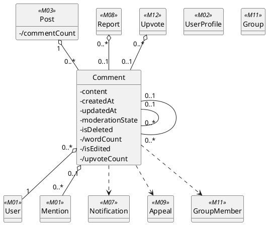

# Phân tích lớp thực thể — M04 Comment

<!-- [Vietnamese Doc] Tài liệu tiếng Việt; tên lớp và thuộc tính viết tiếng Anh (input/CONVENTIONS.md mục 3). -->

| Mã tài liệu | EC-M04 |
|---|---|
| Dự án | iShare |
| Module | M04 — Comment |
| Đầu vào | FR-M04 phiên bản 1.4 |
| Trạng thái | Bản nháp |
| Phiên bản | 0.3 |
| Ngày | 2026-11-17 |
| Tác giả | Phạm Văn Đức |

<!-- Quy ước chung cho mọi bảng dưới đây:
     - Không đổi tên cột, không xóa cột, không đổi số mục: tool đọc bảng theo số mục và tên cột.
     - Ô không có nội dung ghi "—".
     - Mục chưa tới bước làm thì để dòng "(Chưa làm — bước N)".
     - Cột Nguồn ghi mã trong FR: FR-M04-nn, FR-M04-nn.mm, BR-M04-nn, hoặc TN:<thuật ngữ> (mục 2.1 của FR).
     - Sơ đồ ở mục 4 do gen_puml.py sinh; không sửa tay. -->

## 1. Mô tả chức năng

### 1.1 Đoạn mô tả

(S1) Hệ thống quản lý bình luận gốc và trả lời trong các luồng bình luận của bài viết, gắn mỗi bình luận với tác giả bình luận và bài viết chứa bình luận. (S2) Hệ thống cho Guest, User, Mod và Admin xem bình luận của bài viết đang hiển thị với người xem, sắp xếp bình luận gốc theo Top, Mới nhất hoặc Cũ nhất dựa vào số upvote của bình luận và thời điểm đăng, xếp trả lời theo thời điểm đăng, đồng thời tính số bình luận của bài từ bình luận gốc và trả lời đang hiển thị bình thường. (S3) Hệ thống cho User, Mod và Admin đã đăng nhập gửi bình luận gốc với nội dung bình luận có định dạng, công thức LaTeX, liên kết, nhắc tên và trích dẫn, kiểm tra số từ và nội dung trống, lưu tác giả bình luận cùng thời điểm đăng, rồi hiển thị bình luận ngay ở trạng thái kiểm duyệt Bình thường. (S4) Hệ thống cho User, Mod và Admin trả lời bình luận gốc hoặc trả lời đang hiển thị bình thường, lưu trả lời vào luồng của bình luận gốc, ghi nhận bình luận được trả lời và dựng trích dẫn khi trả lời từ tên tác giả cùng nội dung hiện tại của bình luận được trả lời. (S5) Hệ thống cho tác giả bình luận sửa nội dung bình luận của mình theo điều kiện của bài viết và trạng thái kiểm duyệt, ghi thời điểm sửa gần nhất và dấu hiệu đã chỉnh sửa, đồng thời giữ thời điểm đăng, vị trí trong luồng và trạng thái kiểm duyệt. (S6) Hệ thống cho tác giả bình luận xóa bình luận của mình theo các điều kiện cho phép bằng cách gắn cờ đã xóa và giữ nội dung, giữ các trả lời của bình luận gốc, đồng thời giữ bình luận cùng bài viết khi bài viết bị xóa. (S7) Hệ thống xác định cách hiển thị luồng và trích dẫn khi trả lời theo cờ đã xóa, trạng thái kiểm duyệt của bình luận gốc, bình luận được trả lời và các trả lời còn hiển thị bình thường. (S8) Hệ thống cho tác giả bình luận xem lại nội dung bình luận của mình đã bị ẩn hoặc đã bị xử lý sau báo cáo ở chế độ chỉ đọc khi mở thông báo xử lý hoặc khiếu nại của tác giả bình luận liên quan tới bình luận. (S9) Hệ thống dùng mức khóa của bài viết và mức cảnh cáo của người dùng để kiểm tra quyền tạo, sửa, xóa bình luận, đồng thời dùng quyền bình luận trong nhóm do M11 cung cấp cho bài viết trong nhóm. (S10) Hệ thống dùng trạng thái tài khoản từ M01 cùng avatar và tên hiển thị từ M02 để trình bày tác giả bình luận, cung cấp bình luận chứa lượt nhắc tên cho M01 và sự kiện bình luận gốc mới, trả lời mới cho M07 gửi thông báo. (S11) Hệ thống cung cấp bình luận và luồng bình luận cho M08 báo cáo, quét AI sau khi đăng và xử lý trạng thái kiểm duyệt, đồng thời giữ nội dung bình luận đã xóa phục vụ báo cáo, lịch sử báo cáo và khiếu nại liên quan tại M08, M09. (S12) Hệ thống dùng số upvote của bình luận do M12 cung cấp cho sắp xếp Top và cung cấp sự kiện tác giả xóa bình luận cho M12 xử lý điểm. (S13) Hệ thống cung cấp bình luận gốc và trả lời cùng thời điểm đăng và việc bị xóa cho M05, M06, M14 tính Trending và xếp hạng, đồng thời cung cấp bình luận mới theo thời gian cho M15 thống kê.

<!-- Một đoạn văn, mỗi câu đánh số (S1) (S2) … Xem steps/01-describe-functions.md. -->

### 1.2 Truy vết câu

| Câu | Nội dung tóm tắt | Nguồn |
|---|---|---|
| S1 | Phạm vi quản lý bình luận và luồng bình luận | FR-M04-01, FR-M04-02.01, FR-M04-03.02, FR-M04-03.03 |
| S2 | Xem, sắp xếp và đếm bình luận | FR-M04-01.01, FR-M04-01.02, FR-M04-01.03, FR-M04-01.04, FR-M04-01.05, FR-M04-01.10, FR-M04-01.14 |
| S3 | Gửi bình luận và ghi nhận dữ liệu khi đăng | FR-M04-02, FR-M04-02.01, FR-M04-02.02, FR-M04-02.03, FR-M04-02.09, FR-M04-02.10, FR-M04-02.11 |
| S4 | Trả lời trong luồng và xác định bình luận được trả lời | FR-M04-03, FR-M04-03.01, FR-M04-03.02, FR-M04-03.03, FR-M04-03.04, FR-M04-01.16, FR-M04-01.17 |
| S5 | Sửa nội dung và ghi thời điểm sửa gần nhất | FR-M04-04, FR-M04-04.01, FR-M04-04.02, FR-M04-04.03, FR-M04-04.09, FR-M04-04.10, FR-M04-01.06 |
| S6 | Xóa bằng cờ và giữ bình luận cùng bài viết | FR-M04-05, FR-M04-05.01, FR-M04-05.02, FR-M04-05.03, FR-M04-05.07, FR-M04-05.08, FR-M04-05.09, FR-M04-05.10, FR-M04-05.11 |
| S7 | Hiển thị luồng khi bình luận đã xóa hoặc bị ẩn | FR-M04-01.07, FR-M04-01.08, FR-M04-01.09, FR-M04-01.15 |
| S8 | Xem lại bình luận đã bị xử lý theo quyền tác giả | FR-M04-06, FR-M04-06.01, FR-M04-06.02, FR-M04-06.03, FR-M04-06.05 |
| S9 | Điều kiện thao tác theo khóa bài, cảnh cáo và quyền nhóm | FR-M04-02.06, FR-M04-02.07, FR-M04-03.07, FR-M04-03.08, FR-M04-04.09, FR-M04-04.11, FR-M04-05.08, FR-M04-05.09 |
| S10 | Dữ liệu tác giả, lượt nhắc tên và sự kiện thông báo | FR-M04-02.01, FR-M04-02.02, FR-M04-03.02, FR-M04-03.03, FR-M04-04.01 |
| S11 | Dữ liệu phục vụ kiểm duyệt, báo cáo và khiếu nại liên quan | FR-M04-02.02, FR-M04-03.04, FR-M04-01.09, FR-M04-05.07, FR-M04-06.03 |
| S12 | Upvote và sự kiện xóa cho xử lý điểm | FR-M04-01.03, FR-M04-01.04, FR-M04-01.14, FR-M04-05.01, FR-M04-05.02, FR-M04-05.03 |
| S13 | Dữ liệu cung cấp cho Trending, xếp hạng và thống kê | FR-M04-02.01, FR-M04-03.02, FR-M04-05.02 |

## 2. Danh từ và phân loại

### 2.1 Sổ danh từ

| # | Danh từ | Xuất hiện ở | Phân loại | Kết quả | Lý do |
|---|---|---|---|---|---|
| 1 | Hệ thống | S1 | Loại bỏ | — | Trừu tượng, tác nhân xử lý. |
| 2 | Bình luận / bình luận gốc / trả lời / bình luận được trả lời | S1 | Lớp | Comment | T8, cùng đối tượng bình luận, phân biệt theo ngữ cảnh luồng và đích trả lời, BR-M04-03. |
| 3 | Luồng bình luận | S1 | Loại bỏ | — | Chung chung, tập hợp bình luận gốc cùng trả lời theo BR-M04-03, dữ liệu thành phần nằm ở Comment. |
| 4 | Bài viết / bài viết chứa bình luận | S1 | Lớp | Post | T4, M03 sở hữu bài chứa bình luận theo FR-M04-02.01. |
| 5 | Tác giả bình luận / User / Mod / Admin / người dùng / tài khoản / người gửi | S1 | Lớp | User | T3, tài khoản M01, các vai trò và tác giả theo ngữ cảnh. |
| 6 | Guest / người xem | S2 | Loại bỏ | — | Không lưu: tác nhân không có dữ liệu riêng trong module, quyền xem theo FR-M04-01.02. |
| 7 | Top / Mới nhất / Cũ nhất / cách sắp xếp | S2 | Loại bỏ | — | Giao diện, tiêu chí truy vấn theo BR-M04-05, FR chỉ yêu cầu sắp xếp khi xem. |
| 8 | Số upvote của bình luận | S2 | Thuộc tính | Comment.upvoteCount | T7, đếm upvote còn hiệu lực từ M12 theo BR-M04-05. |
| 9 | Thời điểm đăng | S2 | Thuộc tính | Comment.createdAt | T9, thời điểm ghi nhận lúc gửi theo FR-M04-02.01 và TN:Thời điểm đăng. |
| 10 | Số bình luận của bài | S2 | Thuộc tính | Post.commentCount | T7, giá trị đếm trên bài theo BR-M04-18, M04 bổ sung cho lớp ngoài. |
| 11 | Bình thường / Bị ẩn | S2 | Loại bỏ | — | Giá trị của Comment.moderationState theo FR-M04-02.02 và FR-M04-01.09. |
| 12 | Nội dung bình luận / nội dung hiện tại / nội dung sửa | S3 | Thuộc tính | Comment.content | T9, nội dung có định dạng, được thay bằng bản sửa theo FR-M04-04.01. |
| 13 | Định dạng / công thức LaTeX / liên kết / trích dẫn | S3 | Loại bỏ | — | Giá trị cấu trúc của Comment.content theo BR-M04-01. |
| 14 | Nhắc tên / lượt nhắc tên | S3 | Lớp | Mention | T4, lượt nhắc trong nội dung do M01 sở hữu, giao tiếp mục 5.10. |
| 15 | Số từ / độ dài nội dung | S3 | Thuộc tính | Comment.wordCount | T7, đếm phần chữ người đọc thấy theo TN:Từ và BR-M04-19. |
| 16 | Trạng thái kiểm duyệt | S3 | Thuộc tính | Comment.moderationState | T9, trạng thái của bình luận theo FR-M04-02.02 và FR-M04-01.09. |
| 17 | Tên tác giả / tên hiển thị | S4 | Loại bỏ | — | Ngoài phạm vi module (M01), User.displayName đã có trong EC-M01, dữ liệu để dựng trích dẫn theo BR-M04-04. |
| 18 | Trích dẫn khi trả lời / phần đầu nội dung / dòng trích dẫn | S4 | Loại bỏ | — | Giao diện, dựng từ bình luận được trả lời và tác giả theo BR-M04-04. |
| 19 | Thời điểm sửa gần nhất | S5 | Thuộc tính | Comment.updatedAt | T9, ghi lần sửa gần nhất theo FR-M04-04.02. |
| 20 | Dấu hiệu đã chỉnh sửa | S5 | Thuộc tính | Comment.isEdited | T7, dẫn xuất từ việc đã có thời điểm sửa theo FR-M04-01.06 và FR-M04-04.02. |
| 21 | Điều kiện / quyền thao tác | S5 | Loại bỏ | — | Trừu tượng, quy tắc cho phép hành động, BR-M04-20. |
| 22 | Vị trí trong luồng | S5 | Loại bỏ | — | Chung chung, được xác định từ bình luận gốc của luồng và thời điểm đăng, FR-M04-04.03, BR-M04-03/06. |
| 23 | Cờ đã xóa / việc bị xóa | S6 | Thuộc tính | Comment.isDeleted | T9, dấu xóa được lưu theo FR-M04-05.01–05.03. |
| 24 | Thông báo xử lý / thông báo / sự kiện thông báo | S8 | Lớp | Notification | T4, M07 sở hữu thông báo mở nội dung bình luận theo FR-M04-06.01/06.02. Sự kiện mới là đầu vào tạo thông báo. |
| 25 | Khiếu nại | S8 | Lớp | Appeal | T4, khiếu nại cảnh cáo hoặc ban liên quan tại M09, FR-M04-06.03. |
| 26 | Báo cáo | S8 | Lớp | Report | T4, M08 sở hữu báo cáo về bình luận, FR-M04-06.02 và BR-M04-21. |
| 27 | Chế độ chỉ đọc | S8 | Loại bỏ | — | Giao diện, quyền xem lại theo FR-M04-06.01–06.03. |
| 28 | Mức khóa / Khóa bình luận / Khóa toàn bộ | S9 | Loại bỏ | — | Ngoài phạm vi module (M03), Post.lockLevel đã có ở EC-M03, BR-M04-14/20. |
| 29 | Mức cảnh cáo / HEAVY | S9 | Loại bỏ | — | Ngoài phạm vi module (M08), dữ liệu quyết định hạn chế thao tác theo BR-M04-15/20. |
| 30 | Nhóm | S9 | Lớp | Group | T4, M11 cung cấp ngữ cảnh quyền bình luận trong nhóm tại mục 5.10. |
| 31 | Quyền bình luận trong nhóm | S9 | Loại bỏ | — | Ngoài phạm vi module (M11), quy tắc dựa trên nhóm và tư cách thành viên. |
| 32 | Trạng thái tài khoản | S10 | Loại bỏ | — | Ngoài phạm vi module (M01), User.accountState đã có ở EC-M01. |
| 33 | Avatar | S10 | Loại bỏ | — | Ngoài phạm vi module (M02), UserProfile.avatar đã có ở EC-M02. |
| 34 | Sự kiện bình luận gốc mới / sự kiện trả lời mới | S10 | Loại bỏ | — | Hành động không lưu dấu vết riêng tại M04, cung cấp M07 theo mục 5.10, bình luận đã lưu chứa dữ liệu sự kiện. |
| 35 | Quét AI / xử lý kiểm duyệt | S11 | Loại bỏ | — | Ngoài phạm vi module (M08), M04 dùng trạng thái kiểm duyệt để hiển thị, FR-M04-01.09. |
| 36 | Lịch sử báo cáo | S11 | Loại bỏ | — | Ngoài phạm vi module (M08), ngữ cảnh đọc Report và Comment theo BR-M04-21. |
| 37 | Upvote | S12 | Lớp | Upvote | T4, M12 sở hữu thao tác và bản ghi upvote theo BR-M04-09, tên dùng lại EC-M01/03. |
| 38 | Sự kiện tác giả xóa bình luận | S12 | Loại bỏ | — | Hành động không lưu dấu vết riêng tại M04, cờ xóa nằm trên Comment, giao tiếp M12 ở mục 5.10. |
| 39 | Điểm | S12 | Loại bỏ | — | Ngoài phạm vi module (M12), M12 xử lý điểm khi tác giả xóa bình luận. |
| 40 | Trending / xếp hạng | S13 | Loại bỏ | — | Ngoài phạm vi module (M05, M06, M14), M04 cung cấp dữ liệu bình luận. |
| 41 | Thống kê bình luận mới theo thời gian | S13 | Loại bỏ | — | Ngoài phạm vi module (M15), M04 cung cấp thời điểm đăng của bình luận. |
| 42 | Hồ sơ tác giả | Quét: FR-M04-01.16 | Lớp | UserProfile | T4, dùng avatar từ M02 theo mục 5.10, lớp đã có EC-M02. |
| 43 | Thành viên nhóm / Owner / Group Mod / người ngoài nhóm | Quét: BR-M04-20 | Lớp | GroupMember | T4, tư cách và vai trò thành viên nhóm từ M11 theo mục 5.10, dùng lại tên EC-M01/03. |
| 44 | Từ / khoảng trắng | Quét: BR-M04-19 | Loại bỏ | — | Chung chung, đơn vị và quy tắc đếm Comment.wordCount. |
| 45 | Nhãn đã chỉnh sửa | Quét: FR-M04-01.06 | Loại bỏ | — | Giao diện, biểu diễn Comment.isEdited. |
| 46 | Dấu bình luận đã bị xóa | Quét: FR-M04-01.07 | Loại bỏ | — | Giao diện, dựng từ cờ xóa, trạng thái kiểm duyệt và trả lời còn hiển thị. |
| 47 | Nội dung trước khi sửa / lịch sử sửa | Quét: FR-M04-04.04 | Loại bỏ | — | Ngoài phạm vi hệ thống, FR-M04-04.04 xác định phạm vi lưu bản sửa. |
| 48 | Danh tính người báo cáo / lý do đã chọn / mô tả / bằng chứng | Quét: FR-M04-06.04 | Loại bỏ | — | Ngoài phạm vi module (M08), dữ liệu báo cáo do M08 quản lý, quyền xem lại được giới hạn. |
| 49 | Thời điểm tác giả xóa bình luận | Quét: FR-M04-05.01 | Loại bỏ | — | Hành động không lưu dấu vết riêng tại M04, mục 5.10 cung cấp thời điểm sự kiện cho M12, FR chỉ yêu cầu lưu cờ xóa tại M04. |
| 50 | Công tắc AI tổng / công tắc Moderation / ngưỡng điểm quét / lỗi AI | Quét: FR-M04-02.02 | Loại bỏ | — | Ngoài phạm vi module (M08, M10, M13), việc hiển thị ngay và trạng thái kiểm duyệt là giao tiếp của M04. |
| 51 | Nhóm Public / nhóm Private / nhóm Bị khóa | Quét: BR-M04-17 | Loại bỏ | — | Ngoài phạm vi module (M11), giá trị trạng thái và quyền nhóm dùng khi quyết định hiển thị. |
| 52 | Gỡ bình luận khỏi nhóm | Quét: FR-M04-05 | Loại bỏ | — | Ngoài phạm vi module (M11), hành động xóa mềm ở mục 5.10, Q-01 đã chọn dấu riêng, cách lưu chờ cập nhật FR-M04. |
| 53 | 1000 từ / hai cấp | Quét: BR-M04-19, BR-M04-03 | Loại bỏ | — | Hằng số của BR-M04-19 và BR-M04-03, ràng buộc nội dung và luồng. |

Tổng 53 dòng danh từ, 11 dòng thành lớp, 9 dòng thành thuộc tính, 33 dòng bị loại. Lượt quét FR bổ sung 12 dòng.

### 2.2 Lớp

| Lớp | Tên tiếng Việt | Nhóm | Sở hữu | Mô tả | Nguồn |
|---|---|---|---|---|---|
| Comment | Bình luận | Thực thể | M04 | Bình luận gốc và trả lời, dữ liệu nội dung cùng trạng thái và thời điểm. | FR-M04-02.01, FR-M04-03.02, FR-M04-04.02, FR-M04-05.01 |
| User | Tài khoản | Thực thể | M01 | Tác giả bình luận và người được nhắc, dùng lại EC-M01. | FR-M04-02.01, FR-M04-01.16 |
| Post | Bài viết | Thực thể | M03 | Bài chứa bình luận, cung cấp mức khóa, M04 bổ sung số bình luận. | FR-M04-01.10, FR-M04-02.01, FR-M04-02.06 |
| UserProfile | Hồ sơ | Thực thể | M02 | Avatar của tác giả từ M02 theo mục 5.10, dùng lại EC-M02. | FR-M04-01 |
| Mention | Lượt nhắc tên | Thực thể | M01 | Lượt nhắc trong nội dung, dùng lại EC-M01. | FR-M04-02.03, FR-M04-04.01 |
| Notification | Thông báo | Thực thể | M07 | Ngữ cảnh mở bình luận đã xử lý, tên tạm từ EC-M01/03, chờ EC-M07. | FR-M04-06.01, FR-M04-06.02 |
| Report | Báo cáo | Thực thể | M08 | Báo cáo về bình luận và ngữ cảnh kiểm duyệt, tên tạm từ EC-M03, chờ EC-M08. | FR-M04-06.02, BR-M04-21 |
| Appeal | Khiếu nại | Thực thể | M09 | Khiếu nại cảnh cáo, ban có bình luận liên quan, tên tạm từ EC-M01/03, chờ EC-M09. | FR-M04-06.03 |
| Upvote | Upvote | Thực thể | M12 | Bản ghi upvote bình luận để đếm Top, tên tạm từ EC-M01/03, chờ EC-M12. | BR-M04-09, BR-M04-05 |
| Group | Nhóm | Thực thể | M11 | Ngữ cảnh quyền nhóm theo mục 5.10, tên tạm từ EC-M01/03, chờ EC-M11. | BR-M04-17, FR-M04-02.08 |
| GroupMember | Thành viên nhóm | Thực thể | M11 | Tư cách thành viên và vai trò nhóm theo mục 5.10, tên tạm từ EC-M01/03, chờ EC-M11. | BR-M04-20, FR-M04-02.08 |

Comment được dùng cho bình luận gốc và trả lời theo BR-M04-03. Luồng được biểu diễn qua các bình luận thành phần. Quan hệ được xét ở bước 3.

### 2.3 Thuộc tính

| Lớp | Thuộc tính | Tên tiếng Việt | Tính chất | Ràng buộc nguồn nêu | Nguồn |
|---|---|---|---|---|---|
| Comment | content | Nội dung bình luận | Lưu | Định dạng theo BR-M04-01, tối đa 1.000 từ, nội dung có ký tự ngoài khoảng trắng theo BR-M04-19. Nội dung sửa thay bản cũ, FR-M04-04.01. | BR-M04-01, BR-M04-19, FR-M04-04.01 |
| Comment | createdAt | Thời điểm đăng | Lưu | Lúc gửi bình luận, sửa giữ mốc đăng, FR-M04-02.01, FR-M04-04.03. | FR-M04-02.01, FR-M04-03.04, FR-M04-04.03 |
| Comment | updatedAt | Thời điểm sửa gần nhất | Lưu | Có khi tác giả lưu bản sửa, lần sửa sau thay mốc trước, FR-M04-04.02, BR-M04-07. | FR-M04-04.02, BR-M04-07 |
| Comment | moderationState | Trạng thái kiểm duyệt | Lưu | Bình thường khi gửi, tập giá trị Bình thường và Bị ẩn, M08 quyết định chuyển trạng thái. | FR-M04-02.02, FR-M04-01.09 |
| Comment | isDeleted | Cờ đã xóa | Lưu | Được gắn khi tác giả xóa, giữ nội dung theo FR-M04-05.07. Q-01 đã chọn dấu riêng, chờ cập nhật FR-M04 trước khi bổ sung thuộc tính dấu gỡ khỏi nhóm. | FR-M04-05.01, FR-M04-05.02, FR-M04-05.03, FR-M04-05.07 |
| Comment | wordCount | Số từ | Dẫn xuất | Đếm cụm chữ ngăn bởi khoảng trắng trên chữ người đọc thấy của content. Tính khối trích dẫn tác giả viết, tách dòng trích dẫn khi trả lời theo BR-M04-19. | TN:Từ, BR-M04-19 |
| Comment | isEdited | Đã chỉnh sửa | Dẫn xuất | Đúng khi updatedAt đã ghi nhận một lần sửa, dùng cho nhãn theo FR-M04-01.06, BR-M04-07. | FR-M04-01.06, FR-M04-04.02, BR-M04-07 |
| Comment | upvoteCount | Số upvote | Dẫn xuất | Đếm người dùng đang upvote từ M12, chỉ tính upvote còn hiệu lực, TN:Số upvote của bình luận, dùng cho Top. | TN:Số upvote của bình luận, BR-M04-05 |
| Post | commentCount | Số bình luận của bài | Dẫn xuất | Đếm bình luận gốc và trả lời đang hiển thị bình thường, loại bình luận có cờ xóa hoặc Bị ẩn theo BR-M04-18. Phần M04 bổ sung cho lớp ngoài M03. | FR-M04-01.10, BR-M04-18 |

M04 có 8 thuộc tính của Comment, gồm 5 thuộc tính lưu và 3 thuộc tính dẫn xuất, cùng 1 thuộc tính dẫn xuất bổ sung cho Post. isEdited là cách biểu diễn được đề xuất từ thời điểm sửa gần nhất. Dòng trích dẫn khi trả lời được dựng khi xem theo BR-M04-04. Mốc xóa cung cấp M12 là dữ liệu sự kiện theo mục 5.10, FR hiện yêu cầu lưu cờ xóa trên Comment.

### 2.4 Đối chiếu với mục Dữ liệu nghiệp vụ của FR

| Thực thể trong FR | Trong mô hình | Xử lý |
|---|---|---|
| Bình luận | Comment | Khớp nội dung, thời điểm đăng, thời điểm sửa, trạng thái kiểm duyệt và cờ xóa. Tác giả, bài chứa, bình luận gốc và bình luận được trả lời được giữ ở sổ dưới đối tượng tương ứng để xét quan hệ bước 3. |
| Bổ sung từ yêu cầu và thuật ngữ | Comment.wordCount, isEdited, upvoteCount | Mô hình có thêm các giá trị dẫn xuất từ BR-M04-19, FR-M04-01.06, BR-M04-05 và thuật ngữ số upvote. |
| Bổ sung trên lớp ngoài | Post.commentCount | Mô hình có thêm giá trị đếm theo FR-M04-01.10, BR-M04-18. Ghi nhận phần M04 bổ sung để đối chiếu tại bước 3 và lượt gộp. |
| Tham chiếu liên module | User, Post, UserProfile, Mention, Notification, Report, Appeal, Upvote, Group, GroupMember | Mô hình có thêm đối tượng ngoài từ yêu cầu và giao tiếp mục 5.10. Group/GroupMember dựa vào giao tiếp quyền nhóm, các mã dẫn kèm là yêu cầu bao quát quyền hiển thị và thao tác. |

## 3. Quan hệ giữa các lớp

### 3.1 Ma trận cặp lớp

| Lớp | Comment | User | Post | UserProfile | Mention | Notification | Report | Appeal | Upvote | Group | GroupMember |
|---|---|---|---|---|---|---|---|---|---|---|---|
| Comment | T | T | T | G(User) | T | T | T | T | T | G(Post) | T |
| User |  |  |  |  |  |  |  |  |  |  |  |
| Post |  |  |  |  |  |  |  |  |  |  |  |
| UserProfile |  |  |  |  |  |  |  |  |  |  |  |
| Mention |  |  |  |  |  |  |  |  |  |  |  |
| Notification |  |  |  |  |  |  |  |  |  |  |  |
| Report |  |  |  |  |  |  |  |  |  |  |  |
| Appeal |  |  |  |  |  |  |  |  |  |  |  |
| Upvote |  |  |  |  |  |  |  |  |  |  |  |
| Group |  |  |  |  |  |  |  |  |  |  |  |
| GroupMember |  |  |  |  |  |  |  |  |  |  |  |

Ma trận xét các cặp có Comment, gồm ô tự liên hệ Comment–Comment. Các cặp hai lớp ngoài để trống theo phạm vi skill. Ô Comment–Comment có hai vai trò riêng ở R-M04-01 và R-M04-02. UserProfile được dùng qua User tác giả, Group được dùng qua Post của nhóm. Quan hệ User–UserProfile và Post–Group thuộc module sở hữu.

### 3.2 Quan hệ số lượng

| Cặp | Câu A → B | Câu B → A | Dạng | Xử lý |
|---|---|---|---|---|
| Comment – Comment (R-M04-01) | Một Comment ở vai trò bình luận gốc có thể có nhiều Comment trả lời trong luồng. | Một Comment trả lời thuộc đúng một Comment gốc, Comment gốc có thể đứng đầu luồng. | 1-n | Giữ nguyên |
| Comment – Comment (R-M04-02) | Một Comment được trả lời có thể là đích của nhiều Comment trả lời. | Một Comment trả lời ghi đúng một Comment được trả lời, Comment gốc có thể đứng độc lập. | 1-n | Giữ nguyên |
| User – Comment (R-M04-03) | Một User có thể là tác giả của nhiều Comment. | Một Comment do đúng một User gửi. | 1-n | Giữ nguyên |
| Post – Comment (R-M04-04) | Một Post có thể chứa nhiều Comment, gồm bình luận gốc và trả lời. | Một Comment thuộc đúng một Post. | 1-n | Giữ nguyên |
| Comment – Mention (R-M04-05) | Một Comment có thể chứa nhiều Mention. | Một Mention thuộc tối đa một Comment, chủ chứa còn lại có thể là Post theo M01. | 1-n | Giữ nguyên |
| Comment – Report (R-M04-06) | Một Comment có thể là đối tượng của nhiều Report. | Một Report về bình luận ghi lại một Comment, Report về loại đối tượng khác có thể đứng ngoài phạm vi Comment. | 1-n | Giữ nguyên |
| Comment – Upvote (R-M04-07) | Một Comment có thể nhận nhiều Upvote. | Một Upvote cho bình luận ghi lại một Comment, Upvote cho bài viết có thể đứng ngoài phạm vi Comment. | 1-n | Giữ nguyên |

Các Phụ thuộc được xét riêng theo bước 3.4 của skill.

| ID | Chiều A → B | Chiều B → A |
|---|---|---|
| R-M04-08 | Comment dùng Notification trong luồng xem lại và cung cấp sự kiện cho M07. | Notification được M07 quản lý, bội số tham chiếu nội dung thuộc phạm vi M07. |
| R-M04-09 | Comment dùng Appeal để cho tác giả xem lại bình luận liên quan. | Appeal do M09 quản lý, M04 dùng quyền truy cập của ngữ cảnh khiếu nại. |
| R-M04-10 | Comment dùng GroupMember để kiểm tra quyền bình luận trong nhóm. | GroupMember do M11 cung cấp theo người dùng và nhóm của bài. |

Hai quan hệ tự liên hệ dùng cùng lớp Comment với các vai trò khác nhau. Đối với một trả lời, bình luận gốc của luồng và bình luận được trả lời đều bắt buộc. Đối với bình luận gốc, cả hai đầu tham chiếu này đều vắng. Bình luận được trả lời phải thuộc cùng bài và cùng luồng. Một bình luận gốc có thể có nhiều trả lời, một bình luận có thể được nhiều trả lời trỏ tới, theo BR-M04-03 và FR-M04-03.01–03.03.

Mỗi Mention có đúng một chủ chứa là Post hoặc Comment, kế thừa ràng buộc XOR của EC-M01. Những Mention có chủ chứa Comment dùng R-M04-05. Với Report và Upvote, bội số Comment 0..1 bao quát lớp ngoài dùng chung cho nhiều loại đối tượng, từng Report hoặc Upvote về bình luận có đúng một đích Comment. Những nửa quan hệ giữa hai lớp ngoài thuộc module sở hữu.

### 3.3 Lớp liên kết

| Lớp liên kết | Tách từ quan hệ n-n | Thuộc tính riêng của liên kết | Nguồn |
|---|---|---|---|
| — | — | — | — |

Các cặp trực tiếp ở mô hình này có dạng 1-n hoặc Phụ thuộc. Upvote đã được FR gọi tên như đối tượng ngoài của M12, M04 tham chiếu Upvote để đếm số upvote. Bảng lớp giữ nguyên 11 lớp đã được duyệt ở bước 2.

### 3.4 Quan hệ

| ID | Lớp A | Bội số A | Lớp B | Bội số B | Dạng | Loại | Bên chính | Căn cứ | Nguồn |
|---|---|---|---|---|---|---|---|---|---|
| R-M04-01 | Comment | 0..1 | Comment | 0..* | 1-n | Liên kết | — | Vai trò bình luận gốc–trả lời. Mỗi trả lời thuộc đúng một bình luận gốc, bình luận gốc có thể có nhiều trả lời. Đầu 0..1 bao quát bình luận gốc khi lớp Comment dùng chung. Quan hệ giữ khi tác giả xóa bình luận gốc. | BR-M04-03, FR-M04-03.02, FR-M04-03.03, FR-M04-05.01 |
| R-M04-02 | Comment | 0..1 | Comment | 0..* | 1-n | Liên kết | — | Vai trò bình luận được trả lời–trả lời. Mỗi trả lời ghi đúng một đích là bình luận gốc hoặc một trả lời. Bình luận gốc có đầu đích tùy chọn trong mô hình chung. | FR-M04-03.01, FR-M04-03.02, FR-M04-03.03, BR-M04-04 |
| R-M04-03 | User | 1 | Comment | 0..* | 1-n | Kết tập | Comment | Comment ghi lại một tài khoản tác giả. Chọn Comment là bên ghi lại theo phương pháp của skill, khớp R-M01-11. Tác giả có thể có nhiều bình luận. | FR-M04-02.01, FR-M04-03.04 |
| R-M04-04 | Post | 1 | Comment | 0..* | 1-n | Kết tập | Post | Post chứa bình luận. FR-M04-05.11 giữ bình luận cùng bài khi bài bị xóa, căn cứ chọn Kết tập. Khớp R-M03-15. | FR-M04-02.01, FR-M04-05.11 |
| R-M04-05 | Comment | 0..1 | Mention | 0..* | 1-n | Kết tập | Comment | Comment chứa lượt nhắc tên. M01 định nghĩa chủ chứa Mention là Post hoặc Comment, dùng XOR đúng một chủ. Khớp R-M01-13. | FR-M04-02.03, FR-M04-04.01 |
| R-M04-06 | Comment | 0..1 | Report | 0..* | 1-n | Kết tập | Report | Report ghi lại đối tượng bị báo cáo. M08 sở hữu báo cáo, bình luận đã xóa được giữ để đọc báo cáo. Đầu Comment tùy chọn vì Report là lớp ngoài dùng chung cho các loại đối tượng. | FR-M04-06.02, BR-M04-21 |
| R-M04-07 | Comment | 0..1 | Upvote | 0..* | 1-n | Kết tập | Upvote | Upvote ghi lại đối tượng nhận upvote. Upvote là lớp ngoài M12 dùng chung cho bài viết và bình luận theo mô hình các module trước, Comment là một loại đích. | BR-M04-09, TN:Số upvote của bình luận |
| R-M04-08 | Comment | — | Notification | — | — | Phụ thuộc | Notification | Luồng xem lại Comment dùng Notification làm ngữ cảnh truy cập và M04 cung cấp sự kiện cho M07. M04 sử dụng ngữ cảnh thông báo để hoạt động, các đối tượng thông báo được M07 quản lý. | FR-M04-06.01, FR-M04-06.02 |
| R-M04-09 | Comment | — | Appeal | — | — | Phụ thuộc | Appeal | Luồng xem lại Comment cần ngữ cảnh Appeal của tác giả. M09 quản lý khiếu nại cảnh cáo hoặc ban liên quan. Quan hệ mô tả việc dùng ngữ cảnh khiếu nại. | FR-M04-06.03, FR-M04-06.05 |
| R-M04-10 | Comment | — | GroupMember | — | — | Phụ thuộc | GroupMember | Comment dùng tư cách thành viên và vai trò nhóm để kiểm tra quyền thao tác theo giao tiếp mục 5.10. GroupMember thuộc M11, là dữ liệu đầu vào kiểm tra quyền. | FR-M04-02.08, BR-M04-20 |

Các quan hệ được đọc theo câu ở mục 3.2. Việc chọn bên ghi lại của Kết tập là phán đoán theo phương pháp của skill ở R-M04-03, R-M04-06, R-M04-07. R-M04-04 lấy Post làm bên chứa bình luận, R-M04-05 lấy Comment làm bên chứa lượt nhắc tên.

## 4. Sơ đồ lớp phân tích

<!-- BEGIN:PUML -->

<!-- END:PUML -->

Mã sơ đồ được sinh bằng tool. Hai đường Comment–Comment cần đọc cùng vai trò ở R-M04-01/02, tool thể hiện bội số và loại quan hệ. Các ràng buộc theo loại bình luận và XOR Mention được ghi ở mục 3.2.

## 5. Liên module

| Lớp | Module sở hữu | Module này dùng thế nào | Thuộc tính module này bổ sung |
|---|---|---|---|
| User | M01 | Tác giả của Comment tại R-M04-03, khớp R-M01-11. Tác giả có trạng thái tài khoản và tên hiển thị theo M01. | — |
| Post | M03 | Bài chứa Comment tại R-M04-04, khớp R-M03-15. M04 dùng mức khóa và khả năng hiển thị của bài. | commentCount dẫn xuất theo FR-M04-01.10, BR-M04-18. |
| UserProfile | M02 | Avatar tác giả theo mục 5.10, liên hệ gián tiếp qua User. M02 sở hữu hồ sơ. | — |
| Mention | M01 | Chủ chứa Comment tại R-M04-05, khớp R-M01-13. Ràng buộc XOR Post/Comment do M01 xác định. | — |
| Notification | M07 | Ngữ cảnh xem lại tại R-M04-08, sự kiện bình luận gốc mới và trả lời mới cho M07. Chờ EC-M07 đối chiếu. | — |
| Report | M08 | Báo cáo về Comment tại R-M04-06, giữ nội dung đã xóa phục vụ báo cáo và lịch sử báo cáo. Chờ EC-M08 đối chiếu. | — |
| Appeal | M09 | Ngữ cảnh xem lại theo R-M04-09, khiếu nại cảnh cáo hoặc ban liên quan tới Comment. Chờ EC-M09 đối chiếu. | — |
| Upvote | M12 | Đích Comment tại R-M04-07 và nguồn đếm upvoteCount. M04 cung cấp mốc sự kiện tác giả xóa để M12 xử lý điểm. Chờ EC-M12 đối chiếu. | — |
| Group | M11 | Ngữ cảnh nhóm được xác định qua Post. M11 cung cấp quyền, trạng thái nhóm và thao tác gỡ bình luận khỏi nhóm. Q-01 đã chọn dấu riêng, chờ cập nhật FR. | — |
| GroupMember | M11 | Đầu vào kiểm tra quyền nhóm tại R-M04-10, vai trò Owner/Group Mod/Member do M11 quản lý. Chờ EC-M11 đối chiếu. | — |

Phần dữ liệu mới theo Q-01 đang chờ cập nhật FR-M04. Bản bước 3 hiện dùng FR-M04 v1.4 đã chốt. UserProfile và Group là lớp ngoài chỉ liên hệ gián tiếp trong phạm vi M04.

## 6. Câu hỏi và điểm chưa chốt

| Mã | Loại | Câu hỏi | Trả lời | Ghi vào |
|---|---|---|---|---|
| Q-01 | Mơ hồ | FR-M04 mục 5.10 giao M11 gỡ bình luận khỏi nhóm bằng xóa mềm, còn FR-M04-05.01–05.03 dùng cờ đã xóa cho tác giả xóa. Dấu gỡ khỏi nhóm dùng A, dấu riêng để phân biệt với tác giả xóa, hay B, dùng chung cờ đã xóa và phân biệt nguyên nhân trong dữ liệu xử lý của M11? Đề xuất A để phân biệt thao tác của hai vai trò và xử lý điểm đã nêu trong giao tiếp. | Người dùng trả lời “Q01 A, duyệt bước 2” ngày 2026-11-17. Chọn dấu gỡ khỏi nhóm riêng. | Chờ cập nhật FR-M04. Dự thảo DEC-274, QA-480, ISS-418 ở fr/.work/FR-M04-v1.5-register-draft.md, chờ duyệt trước khi ghi register. Comment.isDeleted tiếp tục mô tả tác giả xóa. |

Người dùng duyệt bước 1 và yêu cầu bước 2 ngày 2026-11-17. Người dùng đã chọn Q-01 A và duyệt bước 2. Bước 3 lập 10 quan hệ, gồm 5 Kết tập, 2 Liên kết tự liên hệ và 3 Phụ thuộc, cùng sơ đồ tool sinh. Dấu gỡ khỏi nhóm riêng chờ cập nhật FR-M04 bằng skill analyzing-functional-requirements. QU-10/QU-11 tiếp tục chờ xác nhận chung, sơ đồ bản nháp dùng PlantUML do tool sinh cùng bội số theo skill. EC-M04 đang chờ hoàn tất cập nhật FR và cổng chốt.

## 7. Lịch sử sửa đổi

| Phiên bản | Ngày | Nội dung | Người sửa |
|---|---|---|---|
| 0.1 | 2026-11-17 | Tạo bản nháp bước 1 từ FR-M04 v1.4 đã chốt, 13 câu mô tả truy vết đủ 6 chức năng, chờ duyệt bước 1 | Codex |
| 0.2 | 2026-11-17 | Người dùng duyệt bước 1, lập sổ danh từ, bảng lớp và thuộc tính, đối chiếu FR, trình Q-01 về dấu gỡ khỏi nhóm, chờ duyệt bước 2 | Codex |
| 0.3 | 2026-11-17 | Người dùng duyệt bước 2 và chọn Q-01 A, lập ma trận, 10 quan hệ và liên module, soạn dự thảo register cho dấu gỡ khỏi nhóm, sinh sơ đồ và kiểm tra bước 3, chờ duyệt cập nhật FR và chốt EC | Codex |
