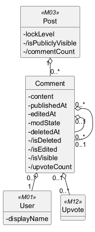

# Phân tích lớp thực thể — M04 Comment

<!-- [Vietnamese Doc] Tài liệu tiếng Việt; tên lớp và thuộc tính viết tiếng Anh (input/CONVENTIONS.md mục 3). -->

| Mã tài liệu | EC-M04 |
|---|---|
| Dự án | iShare |
| Module | M04 — Comment |
| Đầu vào | FR-M04 phiên bản 1.4 |
| Trạng thái | Đã chốt |
| Phiên bản | 1.0 |
| Ngày | 2026-11-18 |
| Tác giả | Phạm Văn Đức |

<!-- Quy ước chung cho mọi bảng dưới đây:
     - Không đổi tên cột, không xóa cột, không đổi số mục: tool đọc bảng theo số mục và tên cột.
     - Ô không có nội dung ghi "—".
     - Mục chưa tới bước làm thì để dòng "(Chưa làm — bước N)".
     - Cột Nguồn ghi mã trong FR: FR-Mxx-nn, FR-Mxx-nn.mm, BR-Mxx-nn, hoặc TN:<thuật ngữ> (mục 2.1 của FR).
     - Mục 4 chỉ chứa ảnh sơ đồ. gen_puml.py ghi mã PlantUML vào tệp riêng diagrams/EC-Mxx.puml, render
       diagrams/EC-Mxx.png và đặt ảnh vào mục 4. Không chép mã PlantUML vào tài liệu, không sửa tay tệp .puml hay ảnh. -->

## 1. Mô tả chức năng

### 1.1 Đoạn mô tả

Hệ thống quản lý bình luận của người dùng trên bài viết, gồm bình luận gốc và trả lời, được tổ chức thành các luồng
bình luận hai cấp. Mỗi bình luận có tác giả bình luận, bài viết chứa bình luận, nội dung bình luận, thời điểm đăng,
thời điểm sửa, trạng thái kiểm duyệt và cờ đã xóa. Nội dung bình luận được soạn bằng trình soạn tối giản và có thể
chứa công thức LaTeX, liên kết, trích dẫn và lượt nhắc tên do M01 quản lý. Bình luận gốc gắn trực tiếp vào bài viết và
mở đầu một luồng bình luận; mỗi trả lời thuộc luồng bình luận của một bình luận gốc và có một bình luận được trả lời,
là bình luận gốc đó hoặc một trả lời khác trong cùng luồng bình luận.

Hệ thống cho phép mọi người xem được bài viết, kể cả Guest, xem các luồng bình luận của bài viết; người xem không xem
được bài viết thì cũng không xem được bình luận của bài viết. Bình luận gốc được sắp xếp theo cách sắp xếp do người
xem chọn: Top theo số upvote của bình luận do M12 quản lý, Mới nhất hoặc Cũ nhất theo thời điểm đăng; trả lời trong
mỗi luồng bình luận luôn xếp theo thời điểm đăng. Phía trên mỗi trả lời, hệ thống hiển thị một dòng trích dẫn gồm tên
tác giả và phần đầu nội dung hiện tại của bình luận được trả lời. Bình luận đã được tác giả bình luận sửa ít nhất một
lần mang nhãn "(đã chỉnh sửa)". Bình luận đang bị ẩn không hiển thị nội dung trong luồng bình luận cho bất kỳ ai, kể
cả tác giả bình luận. Bình luận gốc đã xóa hoặc đang bị ẩn mà còn trả lời hiển thị bình thường được thay bằng dấu
"[Bình luận đã bị xóa]" để giữ luồng bình luận. Hệ thống hiển thị trên bài viết số bình luận của bài, đếm các bình
luận gốc và trả lời đang hiển thị bình thường.

Hệ thống cho phép User, Mod và Admin viết bình luận gốc vào bài viết đang hiển thị và trả lời một bình luận gốc hoặc
một trả lời đang hiển thị bình thường. Mỗi khi người dùng gửi một bình luận, hệ thống ghi lại người dùng đó làm tác
giả bình luận, bài viết chứa bình luận và thời điểm đăng; với trả lời, hệ thống ghi thêm bình luận gốc của luồng bình
luận và bình luận được trả lời. Bình luận mới hiển thị ngay ở trạng thái kiểm duyệt Bình thường, không qua bước quét
trước khi hiển thị. Hệ thống từ chối bình luận gốc và trả lời mới trên bài viết đang ở mức Khóa bình luận hoặc Khóa
toàn bộ do M03 quản lý, và từ chối bình luận gốc và trả lời mới của người dùng đang ở mức cảnh cáo HEAVY do M08 quản
lý.

Hệ thống cho phép tác giả bình luận sửa nội dung bình luận của mình không giới hạn thời gian và số lần. Mỗi lần tác
giả bình luận lưu bản sửa, hệ thống thay nội dung bình luận bằng nội dung mới và ghi thời điểm sửa gần nhất, giữ
nguyên thời điểm đăng và trạng thái kiểm duyệt. Hệ thống cho phép tác giả bình luận xóa bình luận của mình; hệ thống
gắn cờ đã xóa cho bình luận và giữ nội dung bình luận để Mod và Admin xem trong báo cáo, lịch sử báo cáo và khiếu nại
liên quan tới chính bình luận đó do M08 và M09 quản lý. Tác giả bình luận không sửa được bình luận trên bài viết đang
ở mức Khóa bình luận hoặc Khóa toàn bộ, và không sửa, không xóa được bình luận đã xóa hoặc đang bị ẩn. Khi bài viết
chứa bình luận bị xóa, các bình luận của bài viết được giữ cùng bài viết.

Trạng thái kiểm duyệt của bình luận chuyển giữa Bình thường và Bị ẩn theo việc quét AI sau khi đăng và việc Mod, Admin
ẩn bình luận khi xử lý báo cáo, đều do M08 quản lý. Hệ thống cho phép tác giả bình luận xem lại ở chế độ chỉ đọc bình
luận của mình đang bị ẩn hoặc đã bị xử lý sau báo cáo, khi mở từ thông báo xử lý do M07 và M08 gửi hoặc từ khiếu nại
của mình do M09 quản lý. Hệ thống cung cấp cho M12 bình luận làm đối tượng của upvote bình luận và thời điểm tác giả
bình luận xóa bình luận làm mốc trừ điểm. Hệ thống cung cấp bình luận cùng thời điểm đăng và việc bị xóa cho Trending
và xếp hạng của M05, M06 và M14, và cung cấp bình luận mới theo thời gian cho thống kê của M15.

<!-- Văn xuôi bình thường, có thể chia vài đoạn. KHÔNG ghi mã câu (S1), (S2)… trong đoạn văn: người đọc không hiểu
     các mã đó. Số câu chỉ nằm ở bảng 1.2. Xem steps/01-describe-functions.md. -->

### 1.2 Truy vết câu

<!-- Mỗi câu của đoạn mô tả một dòng, theo đúng thứ tự. Câu: 1, 2, 3…
     Nội dung câu: chép NGUYÊN VĂN câu đó từ mục 1.1 (tool so khớp từng câu với đoạn văn).
     Nguồn: mã chức năng hoặc yêu cầu của FR mà câu dựa vào. -->

| Câu | Nội dung câu | Nguồn |
|---|---|---|
| 1 | Hệ thống quản lý bình luận của người dùng trên bài viết, gồm bình luận gốc và trả lời, được tổ chức thành các luồng bình luận hai cấp. | FR-M04-01, FR-M04-02, FR-M04-03 |
| 2 | Mỗi bình luận có tác giả bình luận, bài viết chứa bình luận, nội dung bình luận, thời điểm đăng, thời điểm sửa, trạng thái kiểm duyệt và cờ đã xóa. | FR-M04-02.01, FR-M04-02.02, FR-M04-04.02, FR-M04-05.01 |
| 3 | Nội dung bình luận được soạn bằng trình soạn tối giản và có thể chứa công thức LaTeX, liên kết, trích dẫn và lượt nhắc tên do M01 quản lý. | FR-M04-02.03, FR-M04-03.05, FR-M04-04.06 |
| 4 | Bình luận gốc gắn trực tiếp vào bài viết và mở đầu một luồng bình luận; mỗi trả lời thuộc luồng bình luận của một bình luận gốc và có một bình luận được trả lời, là bình luận gốc đó hoặc một trả lời khác trong cùng luồng bình luận. | FR-M04-03.02, FR-M04-03.03 |
| 5 | Hệ thống cho phép mọi người xem được bài viết, kể cả Guest, xem các luồng bình luận của bài viết; người xem không xem được bài viết thì cũng không xem được bình luận của bài viết. | FR-M04-01.01, FR-M04-01.02, FR-M04-01.11, FR-M04-01.12 |
| 6 | Bình luận gốc được sắp xếp theo cách sắp xếp do người xem chọn: Top theo số upvote của bình luận do M12 quản lý, Mới nhất hoặc Cũ nhất theo thời điểm đăng; trả lời trong mỗi luồng bình luận luôn xếp theo thời điểm đăng. | FR-M04-01.03, FR-M04-01.04, FR-M04-01.05, FR-M04-01.14 |
| 7 | Phía trên mỗi trả lời, hệ thống hiển thị một dòng trích dẫn gồm tên tác giả và phần đầu nội dung hiện tại của bình luận được trả lời. | FR-M04-01.16, FR-M04-01.17 |
| 8 | Bình luận đã được tác giả bình luận sửa ít nhất một lần mang nhãn "(đã chỉnh sửa)". | FR-M04-01.06 |
| 9 | Bình luận đang bị ẩn không hiển thị nội dung trong luồng bình luận cho bất kỳ ai, kể cả tác giả bình luận. | FR-M04-01.09 |
| 10 | Bình luận gốc đã xóa hoặc đang bị ẩn mà còn trả lời hiển thị bình thường được thay bằng dấu "[Bình luận đã bị xóa]" để giữ luồng bình luận. | FR-M04-01.07, FR-M04-01.08, FR-M04-01.15 |
| 11 | Hệ thống hiển thị trên bài viết số bình luận của bài, đếm các bình luận gốc và trả lời đang hiển thị bình thường. | FR-M04-01.10 |
| 12 | Hệ thống cho phép User, Mod và Admin viết bình luận gốc vào bài viết đang hiển thị và trả lời một bình luận gốc hoặc một trả lời đang hiển thị bình thường. | FR-M04-02, FR-M04-03, FR-M04-03.01 |
| 13 | Mỗi khi người dùng gửi một bình luận, hệ thống ghi lại người dùng đó làm tác giả bình luận, bài viết chứa bình luận và thời điểm đăng; với trả lời, hệ thống ghi thêm bình luận gốc của luồng bình luận và bình luận được trả lời. | FR-M04-02.01, FR-M04-03.02, FR-M04-03.03 |
| 14 | Bình luận mới hiển thị ngay ở trạng thái kiểm duyệt Bình thường, không qua bước quét trước khi hiển thị. | FR-M04-02.02, FR-M04-03.04 |
| 15 | Hệ thống từ chối bình luận gốc và trả lời mới trên bài viết đang ở mức Khóa bình luận hoặc Khóa toàn bộ do M03 quản lý, và từ chối bình luận gốc và trả lời mới của người dùng đang ở mức cảnh cáo HEAVY do M08 quản lý. | FR-M04-02.06, FR-M04-02.07, FR-M04-03.07, FR-M04-03.08 |
| 16 | Hệ thống cho phép tác giả bình luận sửa nội dung bình luận của mình không giới hạn thời gian và số lần. | FR-M04-04.01, FR-M04-04.05 |
| 17 | Mỗi lần tác giả bình luận lưu bản sửa, hệ thống thay nội dung bình luận bằng nội dung mới và ghi thời điểm sửa gần nhất, giữ nguyên thời điểm đăng và trạng thái kiểm duyệt. | FR-M04-04.01, FR-M04-04.02, FR-M04-04.03 |
| 18 | Hệ thống cho phép tác giả bình luận xóa bình luận của mình; hệ thống gắn cờ đã xóa cho bình luận và giữ nội dung bình luận để Mod và Admin xem trong báo cáo, lịch sử báo cáo và khiếu nại liên quan tới chính bình luận đó do M08 và M09 quản lý. | FR-M04-05.01, FR-M04-05.02, FR-M04-05.03, FR-M04-05.07 |
| 19 | Tác giả bình luận không sửa được bình luận trên bài viết đang ở mức Khóa bình luận hoặc Khóa toàn bộ, và không sửa, không xóa được bình luận đã xóa hoặc đang bị ẩn. | FR-M04-04.08, FR-M04-04.09, FR-M04-04.10, FR-M04-05.06, FR-M04-05.10 |
| 20 | Khi bài viết chứa bình luận bị xóa, các bình luận của bài viết được giữ cùng bài viết. | FR-M04-05.11 |
| 21 | Trạng thái kiểm duyệt của bình luận chuyển giữa Bình thường và Bị ẩn theo việc quét AI sau khi đăng và việc Mod, Admin ẩn bình luận khi xử lý báo cáo, đều do M08 quản lý. | FR-M04-01.09 |
| 22 | Hệ thống cho phép tác giả bình luận xem lại ở chế độ chỉ đọc bình luận của mình đang bị ẩn hoặc đã bị xử lý sau báo cáo, khi mở từ thông báo xử lý do M07 và M08 gửi hoặc từ khiếu nại của mình do M09 quản lý. | FR-M04-06.01, FR-M04-06.02, FR-M04-06.03, FR-M04-06.05 |
| 23 | Hệ thống cung cấp cho M12 bình luận làm đối tượng của upvote bình luận và thời điểm tác giả bình luận xóa bình luận làm mốc trừ điểm. | FR-M04-05.01, FR-M04-05.02, FR-M04-05.03 |
| 24 | Hệ thống cung cấp bình luận cùng thời điểm đăng và việc bị xóa cho Trending và xếp hạng của M05, M06 và M14, và cung cấp bình luận mới theo thời gian cho thống kê của M15. | FR-M04-02.01, FR-M04-03.02, FR-M04-05.02 |

## 2. Danh từ và phân loại

### 2.1 Sổ danh từ

<!-- Phân loại: Lớp | Thuộc tính | Loại bỏ.
     Kết quả: tên lớp; hoặc Lớp.thuộcTính; hoặc "—" khi loại bỏ.
     Xuất hiện ở: "Câu n" (số câu ở bảng 1.2) hoặc "Quét: <mã FR>" (lượt quét bổ sung). -->

| # | Danh từ | Xuất hiện ở | Phân loại | Kết quả | Lý do |
|---|---|---|---|---|---|
| 1 | hệ thống | Câu 1 | Loại bỏ | — | Trừu tượng: chỉ chính phần mềm |
| 2 | bình luận / bình luận mới | Câu 1 | Lớp | Comment | Đối tượng trung tâm của module: được tạo, sửa, xóa riêng, có nhiều bình luận phân biệt được, có nội dung, thời điểm và trạng thái kiểm duyệt riêng (TN:Bình luận, mục Chuyển trạng thái của FR); dùng tên Comment của glossary và EC-M01 |
| 3 | người dùng / người dùng đó | Câu 1 | Lớp | User | Lớp ngoài (M01): tài khoản; dùng tên User của EC-M01 |
| 4 | bài viết / bài / bài viết chứa bình luận | Câu 1 | Lớp | Post | Lớp ngoài (M03): bình luận gắn với một bài viết; dùng tên Post của EC-M03 |
| 5 | bình luận gốc / bình luận gốc của luồng bình luận | Câu 1 | Lớp | Comment | Một loại bình luận (TN:Bình luận gốc): cùng thông tin, cùng vòng đời và cùng bảng trạng thái với trả lời; chỉ khác ở chỗ gắn trực tiếp vào bài viết và không thuộc luồng của bình luận khác, tức khác ở quan hệ, xét ở bước 3 |
| 6 | trả lời / trả lời mới | Câu 1 | Lớp | Comment | Một loại bình luận (TN:Trả lời): cùng thông tin, cùng vòng đời với bình luận gốc; khác ở chỗ thuộc luồng của một bình luận gốc và trỏ tới một bình luận được trả lời, tức khác ở quan hệ giữa các bình luận, xét ở bước 3 |
| 7 | luồng bình luận | Câu 1 | Loại bỏ | — | Trừu tượng: một bình luận gốc cùng mọi trả lời thuộc nó (TN:Luồng bình luận), không có thông tin riêng ngoài bình luận gốc; thể hiện bằng quan hệ trả lời – bình luận gốc ở bước 3 |
| 8 | hai cấp | Câu 1 | Loại bỏ | — | Hằng số của BR-M04-03: luồng chỉ có bình luận gốc và trả lời; là ràng buộc của quan hệ trả lời – bình luận gốc ở bước 3 |
| 9 | tác giả bình luận / chủ bình luận | Câu 2 | Lớp | User | Vai trò theo ngữ cảnh của người dùng có tài khoản (TN:Tác giả bình luận); việc bình luận có tác giả là quan hệ, xét ở bước 3 |
| 10 | nội dung bình luận / nội dung mới | Câu 2 | Thuộc tính | Comment.content | Phần chữ tác giả tự viết (TN:Nội dung bình luận); được thay khi sửa (FR-M04-04.01), được giữ khi xóa (FR-M04-05.07) |
| 11 | thời điểm đăng | Câu 2 | Thuộc tính | Comment.publishedAt | Lúc hệ thống ghi nhận bình luận được gửi (TN:Thời điểm đăng); dùng để sắp xếp (BR-M04-05, BR-M04-06) |
| 12 | thời điểm sửa / thời điểm sửa gần nhất | Câu 2 | Thuộc tính | Comment.editedAt | Chỉ ghi lần sửa gần nhất (TN:Thời điểm sửa, FR-M04-04.02, BR-M04-07) |
| 13 | trạng thái kiểm duyệt | Câu 2 | Thuộc tính | Comment.modState | Một trong hai giá trị Bình thường, Bị ẩn (TN:Trạng thái kiểm duyệt của bình luận) |
| 14 | cờ đã xóa | Câu 2 | Thuộc tính | Comment.isDeleted | Bình luận đã bị tác giả xóa hay chưa (FR-M04-05.01, TN:Bình luận đã xóa); tính từ Comment.deletedAt (dòng 58) |
| 15 | trình soạn tối giản / trình soạn | Câu 3 | Loại bỏ | — | Giao diện: công cụ soạn nội dung; các định dạng được phép là ràng buộc của Comment.content (BR-M04-01) |
| 16 | công thức LaTeX | Câu 3 | Loại bỏ | — | Giá trị của Comment.content: một định dạng được phép trong nội dung (BR-M04-01), không lưu riêng |
| 17 | liên kết | Câu 3 | Loại bỏ | — | Giá trị của Comment.content: một định dạng được phép trong nội dung (BR-M04-01), không lưu riêng |
| 18 | trích dẫn | Câu 3 | Loại bỏ | — | Giá trị của Comment.content: khối trích dẫn tác giả tự gõ là một định dạng trong nội dung (BR-M04-01) và có tính vào độ dài (BR-M04-19); khác dòng trích dẫn khi trả lời (dòng 28) |
| 19 | lượt nhắc tên | Câu 3 | Loại bỏ | — | Ngoài phạm vi module (M01): lượt nhắc tên do M01 ghi nhận từ nội dung bình luận, M04 không đọc hay ghi thông tin nào của nó; quan hệ bình luận – lượt nhắc tên đã ghi ở R-M01-08 (EC-M01) |
| 20 | bình luận được trả lời | Câu 4 | Lớp | Comment | Vai trò của một bình luận (gốc hoặc trả lời) khi được trả lời (TN:Bình luận được trả lời); trả lời trỏ tới bình luận được trả lời là quan hệ giữa các bình luận, xét ở bước 3 |
| 21 | mọi người | Câu 5 | Loại bỏ | — | Chung chung: chỉ mọi vai trò, kể cả Guest |
| 22 | Guest | Câu 5 | Loại bỏ | — | Không lưu: tác nhân không có dữ liệu |
| 23 | người xem | Câu 5 | Loại bỏ | — | Không lưu: tác nhân không có dữ liệu; người xem có thể là Guest, M04 không ghi lại ai xem bình luận |
| 24 | cách sắp xếp (Top, Mới nhất, Cũ nhất) | Câu 6 | Loại bỏ | — | Giao diện: lựa chọn của người xem lúc xem, không lưu; mỗi lần mở bài mặc định là Top (FR-M04-01.03); quy tắc xếp ở BR-M04-05, BR-M04-06 |
| 25 | số upvote của bình luận | Câu 6 | Thuộc tính | Comment.upvoteCount | Số đếm tính ra trên một bình luận (TN:Số upvote của bình luận), dùng để xếp Top (BR-M04-05) |
| 26 | upvote / upvote bình luận | Câu 6 | Lớp | Upvote | Lớp ngoài (M12): bình luận nhận nhiều upvote (mục Dữ liệu nghiệp vụ của FR) và M04 đếm upvote để xếp Top; tên tạm, chờ EC-M12, cùng tên với EC-M01 |
| 27 | tên tác giả | Câu 7 | Thuộc tính | User.displayName | Thông tin của tài khoản mà M04 đọc để hiện trong dòng trích dẫn (FR-M04-01.16) |
| 28 | dòng trích dẫn / trích dẫn khi trả lời | Câu 7 | Loại bỏ | — | Giao diện: chỉ để hiển thị, dựng lúc hiển thị từ tác giả và nội dung hiện tại của bình luận được trả lời, không thuộc nội dung trả lời (TN:Trích dẫn khi trả lời, BR-M04-04, FR-M04-03.13) |
| 29 | phần đầu nội dung hiện tại | Câu 7 | Loại bỏ | — | Giao diện: phần đầu vừa một dòng của Comment.content, cắt lúc hiển thị (FR-M04-01.17) |
| 30 | nhãn "(đã chỉnh sửa)" | Câu 8 | Thuộc tính | Comment.isEdited | Nhãn hiện khi bình luận đã được sửa ít nhất một lần (TN:Nhãn "(đã chỉnh sửa)"); điều cần biết là bình luận đã sửa chưa, tính từ Comment.editedAt (BR-M04-07) |
| 31 | bình luận bị ẩn / Bị ẩn | Câu 9 | Loại bỏ | — | Giá trị của Comment.modState (TN:Bình luận bị ẩn) |
| 32 | bất kỳ ai | Câu 9 | Loại bỏ | — | Chung chung: chỉ mọi người xem |
| 33 | bình luận đã xóa / việc bị xóa / Đã xóa | Câu 10 | Loại bỏ | — | Giá trị của Comment.isDeleted: bình luận có cờ đã xóa (TN:Bình luận đã xóa); "Đã xóa" ở mục Chuyển trạng thái của FR là trạng thái cuối, không khôi phục (FR-M04-05.04) |
| 34 | trả lời hiển thị bình thường / bình luận hiển thị bình thường | Câu 10 | Thuộc tính | Comment.isVisible | Điều kiện tính từ cờ đã xóa và trạng thái kiểm duyệt (TN:Bình luận hiển thị bình thường); dùng ở nhiều quy tắc (BR-M04-08, BR-M04-13, BR-M04-18) |
| 35 | dấu "[Bình luận đã bị xóa]" | Câu 10 | Loại bỏ | — | Giao diện: cách hiển thị, không phải trạng thái (chú thích ở mục Chuyển trạng thái của FR); suy ra từ Comment.isVisible của bình luận gốc và của các trả lời |
| 36 | số bình luận của bài | Câu 11 | Thuộc tính | Post.commentCount | Số đếm tính ra trên một bài viết (TN:Số bình luận của bài, BR-M04-18); FR định nghĩa nên M04 bổ sung trên lớp của M03 |
| 37 | User | Câu 12 | Lớp | User | Vai trò của người dùng có tài khoản; trong M04, User, Mod và Admin có cùng quyền với bình luận (mục 4.3 của FR) nên M04 không đọc vai trò |
| 38 | Mod | Câu 12 | Lớp | User | Vai trò của người dùng có tài khoản; xem dòng 37 |
| 39 | Admin | Câu 12 | Lớp | User | Vai trò của người dùng có tài khoản; xem dòng 37 |
| 40 | bài viết đang hiển thị | Câu 12 | Thuộc tính | Post.isPubliclyVisible | Thông tin của bài viết (M03) mà M04 đọc để chỉ hiển thị và nhận bình luận trên bài người xem xem được (BR-M04-17) |
| 41 | Bình thường | Câu 14 | Loại bỏ | — | Giá trị của Comment.modState; là giá trị của bình luận mới (FR-M04-02.02, FR-M04-03.04) |
| 42 | bước quét / việc quét AI | Câu 14 | Loại bỏ | — | Ngoài phạm vi module (M08): M04 không quét trước khi hiển thị (BR-M04-12); quét sau khi đăng do M08 làm, kết quả chỉ đổi Comment.modState |
| 43 | mức khóa (Khóa bình luận, Khóa toàn bộ) | Câu 15 | Thuộc tính | Post.lockLevel | Thông tin của bài viết (M03) mà M04 đọc để từ chối bình luận mới và việc sửa bình luận (BR-M04-14, BR-M04-20); Khóa bình luận, Khóa toàn bộ là giá trị của thuộc tính này |
| 44 | mức cảnh cáo HEAVY | Câu 15 | Loại bỏ | — | Ngoài phạm vi module (M08): M04 chỉ hỏi M08 mức cảnh cáo của người dùng để chặn tạo bình luận mới (BR-M04-15); mức cảnh cáo gắn với tài khoản, không có quan hệ với lớp nào của M04 (như EC-M03) |
| 45 | thời gian | Câu 16 | Loại bỏ | — | Chung chung: "không giới hạn thời gian" (FR-M04-04.05) và "theo thời gian" (câu 24) không chỉ một mốc nào cần lưu; mốc thời gian của bình luận là publishedAt, editedAt, deletedAt |
| 46 | số lần | Câu 16 | Loại bỏ | — | Hành động không lưu dấu vết: FR không giới hạn số lần sửa (FR-M04-04.05) và không lưu từng lần sửa (FR-M04-04.04), nên không cần đếm |
| 47 | bản sửa | Câu 17 | Loại bỏ | — | Hành động không lưu dấu vết: lưu bản sửa chỉ thay Comment.content và ghi Comment.editedAt; FR-M04-04.04 không lưu nội dung trước khi sửa |
| 48 | báo cáo | Câu 18 | Loại bỏ | — | Ngoài phạm vi module (M08): Mod, Admin xem nội dung bình luận đã xóa qua báo cáo; quan hệ "có thể bị báo cáo (M08)" ở mục Dữ liệu nghiệp vụ của FR do M08 ghi (như EC-M03 với bài viết) |
| 49 | lịch sử báo cáo | Câu 18 | Loại bỏ | — | Ngoài phạm vi module (M08) |
| 50 | khiếu nại | Câu 18 | Loại bỏ | — | Ngoài phạm vi module (M09): khiếu nại cảnh cáo, ban; bình luận không có khiếu nại riêng (BR-M04-23) |
| 51 | bài viết bị xóa | Câu 20 | Loại bỏ | — | Ngoài phạm vi module (M03): xóa bài và thời hạn khôi phục thuộc M03; bình luận giữ cùng bài (FR-M04-05.11) nên M04 không đọc trạng thái xóa của bài |
| 52 | việc Mod, Admin ẩn bình luận khi xử lý báo cáo | Câu 21 | Loại bỏ | — | Ngoài phạm vi module (M08): thao tác của M08, chỉ làm đổi Comment.modState; dấu vết xử lý do M08 ghi |
| 53 | chế độ chỉ đọc | Câu 22 | Loại bỏ | — | Giao diện |
| 54 | bình luận đã bị xử lý | Câu 22 | Loại bỏ | — | Ngoài phạm vi module (M08): kết quả xử lý báo cáo do M08 ghi; trên bình luận chỉ thể hiện qua Comment.modState hoặc Comment.isDeleted (FR-M04-06.02) |
| 55 | thông báo xử lý | Câu 22 | Loại bỏ | — | Ngoài phạm vi module (M07, M08): M04 chỉ là nơi mở bình luận từ thông báo (TN:Thông báo xử lý) |
| 56 | đối tượng | Câu 23 | Loại bỏ | — | Chung chung: "bình luận làm đối tượng của upvote" chỉ quan hệ bình luận – upvote (dòng 26) |
| 57 | mốc trừ điểm / điểm | Câu 23 | Loại bỏ | — | Ngoài phạm vi module (M12): điểm Comment Star và việc trừ điểm do M12 tính; M04 cung cấp Comment.deletedAt |
| 58 | thời điểm xóa / thời điểm tác giả bình luận xóa bình luận | Câu 23 | Thuộc tính | Comment.deletedAt | M04 cung cấp cho M12 làm mốc trừ điểm (mục Giao tiếp của FR, dòng Cung cấp M12) |
| 59 | Trending / xếp hạng | Câu 24 | Loại bỏ | — | Ngoài phạm vi module (M05, M06, M14): các module đó đọc Comment.publishedAt và Comment.isDeleted |
| 60 | thống kê | Câu 24 | Loại bỏ | — | Ngoài phạm vi module (M15) |
| 61 | từ | Quét: TN:Từ | Loại bỏ | — | Hằng số của BR-M04-19: đơn vị đếm độ dài nội dung; ghi vào ràng buộc của Comment.content |
| 62 | giới hạn 1.000 từ | Quét: BR-M04-19 | Loại bỏ | — | Hằng số của BR-M04-19; ghi vào ràng buộc của Comment.content |
| 63 | tệp đính kèm | Quét: FR-M04-02.04 | Loại bỏ | — | Ngoài phạm vi hệ thống: bình luận không có tệp đính kèm (BR-M04-02) |
| 64 | lịch sử sửa / nội dung trước khi sửa | Quét: FR-M04-04.04 | Loại bỏ | — | Ngoài phạm vi hệ thống: bình luận không lưu nội dung trước khi sửa và không có lịch sử sửa (FR-M04-04.04), khác bài viết có PostRevision |
| 65 | downvote | Quét: BR-M04-09 | Loại bỏ | — | Ngoài phạm vi hệ thống: phản ứng duy nhất trên bình luận là upvote (BR-M04-09) |
| 66 | Topic, Tag của bình luận | Quét: BR-M04-10 | Loại bỏ | — | Ngoài phạm vi module (M05): bình luận không có Topic, Tag riêng, thuộc ngữ cảnh của bài chứa nó (BR-M04-10) |
| 67 | Accepted Answer | Quét: BR-M04-11 | Loại bỏ | — | Ngoài phạm vi hệ thống: MS1 không có (BR-M04-11) |
| 68 | hàng chờ Mod / điểm quét | Quét: Chuyển trạng thái | Loại bỏ | — | Ngoài phạm vi module (M08): hàng chờ và điểm quét do M08 quản lý; bình luận ở hàng chờ có Comment.modState là Bị ẩn (mục Chuyển trạng thái của FR) |
| 69 | avatar | Quét: Giao tiếp với module khác | Loại bỏ | — | Ngoài phạm vi module (M02): avatar của tác giả bình luận do M02 cung cấp (mục 1.2 của FR); không có yêu cầu nào của M04 đọc nó |
| 70 | trạng thái tài khoản (vô hiệu hóa, đã xóa) | Quét: Giao tiếp với module khác | Loại bỏ | — | Ngoài phạm vi module (M01): cách hiển thị tác giả bình luận theo trạng thái tài khoản do M01 quyết (mục 1.2 của FR; EC-M01 đã ghi) |
| 71 | nhãn "Tài khoản đã bị khóa" | Quét: Giao tiếp với module khác | Loại bỏ | — | Ngoài phạm vi module (M12) |
| 72 | nhóm | Quét: Giao tiếp với module khác | Loại bỏ | — | Ngoài phạm vi module (M11): quyền bình luận trong nhóm và việc Owner, Group Mod gỡ bình luận khỏi nhóm do M11 quản lý; dấu gỡ khỏi nhóm trên bình luận (nếu cần) do EC-M11 ghi |
| 73 | sự kiện có bình luận gốc mới, có trả lời | Quét: Giao tiếp với module khác | Loại bỏ | — | Hành động không lưu dấu vết: gửi cho M07 (mục Giao tiếp của FR); M04 không lưu |
| 74 | công tắc AI tổng, công tắc Moderation | Quét: Giao tiếp với module khác | Loại bỏ | — | Ngoài phạm vi module (M10) |
| 75 | danh tính, lý do đã chọn, mô tả, bằng chứng của người báo cáo | Quét: FR-M04-06.04 | Loại bỏ | — | Ngoài phạm vi module (M08): dữ liệu của báo cáo; M04 chỉ không hiển thị chúng cho tác giả bình luận |
| 76 | nhãn bình luận đang bị ẩn | Quét: FR-M04-06.01 | Loại bỏ | — | Giao diện: hiện theo Comment.modState; câu chữ chốt ở giai đoạn thiết kế (mục Yêu cầu HMI của FR) |

### 2.2 Lớp

<!-- Nhóm: Thực thể | Liên kết | Thống kê. Sở hữu: mã module sở hữu lớp (Mxx của tài liệu này, hoặc Myy với lớp ngoài).
     Thuộc tính: tên mọi thuộc tính của lớp ở mục 2.3, ngăn bởi dấu phẩy, thuộc tính dẫn xuất có "/" phía trước;
     để người đọc thấy lớp và thuộc tính trên cùng một dòng. Lớp chưa có thuộc tính ghi "—". -->

| Lớp | Tên tiếng Việt | Nhóm | Sở hữu | Mô tả | Thuộc tính | Nguồn |
|---|---|---|---|---|---|---|
| Comment | Bình luận | Thực thể | M04 | Phản hồi do người dùng đã đăng nhập viết dưới một bài viết; gồm bình luận gốc và trả lời, tổ chức thành luồng hai cấp | content, publishedAt, editedAt, modState, deletedAt, /isDeleted, /isEdited, /isVisible, /upvoteCount | FR-M04-02, FR-M04-03, FR-M04-04, FR-M04-05, BR-M04-03 |
| Post | Bài viết | Thực thể | M03 | Bài viết chứa bình luận; mức khóa và việc hiển thị của bài quyết định bình luận được tạo, sửa, xem | lockLevel, /isPubliclyVisible, /commentCount | FR-M04-01.10, FR-M04-01.11, FR-M04-02.06 |
| User | Người dùng (tài khoản) | Thực thể | M01 | Tác giả bình luận | displayName | FR-M04-02.01, FR-M04-01.16 |
| Upvote | Upvote | Thực thể | M12 | Một upvote cho bình luận; M04 đếm số upvote đang có của bình luận để xếp Top (tên tạm, chờ EC-M12; cùng tên ở EC-M01) | — | FR-M04-01.03, BR-M04-05 |

### 2.3 Thuộc tính

<!-- Mỗi lớp có ĐỦ thuộc tính để người đọc hình dung được nó; xếp các dòng theo lớp.
     Tính chất: Lưu | Dẫn xuất. Chưa có id, chưa có kiểu, chưa có khóa ngoại.
     Căn cứ: Nguồn nêu (FR nói tới) | Đề xuất (FR không nói, nhưng chức năng hoặc quy tắc ở cột Nguồn cần nó) |
             Tham chiếu (thuộc tính của lớp ngoài mà module này đọc hoặc ghi; module sở hữu lớp đó định nghĩa).
     Ràng buộc nguồn nêu: độ dài tối đa, duy nhất, bắt buộc/tùy chọn, tập giá trị, mặc định, công thức (với Dẫn xuất)
             — chép từ FR kèm mã. Đề xuất mà FR không nêu ràng buộc thì ghi "—".
     Nguồn: mã FR/BR nêu thuộc tính; với Đề xuất là mã chức năng hoặc quy tắc cần nó.
     Ghi chú: bắt buộc với Đề xuất (vì sao cần) và Tham chiếu (module này dùng nó làm gì). -->

| Lớp | Thuộc tính | Tên tiếng Việt | Tính chất | Căn cứ | Ràng buộc nguồn nêu | Nguồn | Ghi chú |
|---|---|---|---|---|---|---|---|
| Comment | content | Nội dung bình luận | Lưu | Nguồn nêu | Bắt buộc, không được trống hoặc chỉ có khoảng trắng; tối đa 1.000 từ, đếm trên phần chữ người đọc thấy; khối trích dẫn tác giả tự gõ có tính, dòng trích dẫn khi trả lời không tính (BR-M04-19, TN:Từ, FR-M04-03.13); chỉ các định dạng in đậm, in nghiêng, code trong dòng, công thức LaTeX, liên kết, nhắc tên, trích dẫn (BR-M04-01); không có tệp đính kèm (BR-M04-02); áp khi gửi và khi lưu bản sửa (BR-M04-19) | FR-M04-04.01, FR-M04-05.07, BR-M04-01, BR-M04-19 | Thay bằng nội dung mới khi tác giả lưu bản sửa; được giữ khi bình luận bị xóa để M08, M09 xem (BR-M04-21) |
| Comment | publishedAt | Thời điểm đăng | Lưu | Nguồn nêu | Lúc hệ thống ghi nhận bình luận được gửi (TN:Thời điểm đăng); không đổi khi sửa (FR-M04-04.03) | FR-M04-02.01, FR-M04-04.03 | Xếp bình luận gốc theo Mới nhất, Cũ nhất, tách hòa ở Top, xếp trả lời (BR-M04-05, BR-M04-06); M05, M06, M14, M15 đọc (mục Giao tiếp của FR). Đặt tên như Post.publishedAt vì cùng thuật ngữ "thời điểm đăng" |
| Comment | editedAt | Thời điểm sửa | Lưu | Nguồn nêu | Thời điểm lần sửa gần nhất, thay cho lần trước (FR-M04-04.02); không lưu nội dung trước khi sửa (FR-M04-04.04) | FR-M04-04.02, BR-M04-07 | Chưa sửa lần nào thì chưa có giá trị; register gọi edited_at |
| Comment | modState | Trạng thái kiểm duyệt | Lưu | Nguồn nêu | Bình thường, Bị ẩn (TN:Trạng thái kiểm duyệt của bình luận); bình luận mới là Bình thường (FR-M04-02.02, FR-M04-03.04); không đổi khi sửa (FR-M04-04.03); M08 đổi theo mục Chuyển trạng thái của FR | FR-M04-01.09, FR-M04-02.02, FR-M04-03.04 | M08 ghi; M04 đọc để không hiện nội dung trong luồng và chặn sửa, xóa (BR-M04-13, BR-M04-20). Cùng tên với Post.modState |
| Comment | deletedAt | Thời điểm xóa | Lưu | Nguồn nêu | Chỉ có khi tác giả đã xóa bình luận; không xóa lại, không khôi phục (FR-M04-05.04, FR-M04-05.06) | FR-M04-05.01, FR-M04-05.02, FR-M04-05.03 | Mục Giao tiếp của FR, dòng Cung cấp M12 (dẫn các mã ở cột Nguồn): "thời điểm tác giả xóa bình luận (mốc trừ điểm)" |
| Comment | isDeleted | Đã xóa | Dẫn xuất | Nguồn nêu | deletedAt có giá trị; FR gọi là cờ đã xóa, nội dung vẫn giữ (FR-M04-05.01, FR-M04-05.07) | FR-M04-05.01, FR-M04-05.07 | Bỏ bình luận khỏi luồng hoặc hiện dấu "[Bình luận đã bị xóa]" (BR-M04-08); từ chối sửa, xóa lại, trả lời (FR-M04-04.08, FR-M04-05.06, FR-M04-03.10) |
| Comment | isEdited | Đã chỉnh sửa | Dẫn xuất | Nguồn nêu | editedAt có giá trị, tức bình luận đã được tác giả sửa ít nhất một lần (BR-M04-07) | FR-M04-01.06 | Điều kiện hiện nhãn "(đã chỉnh sửa)" |
| Comment | isVisible | Hiển thị bình thường | Dẫn xuất | Nguồn nêu | Chưa bị xóa và modState là Bình thường (TN:Bình luận hiển thị bình thường) | FR-M04-01.07, FR-M04-03.01, BR-M04-18 | Đếm số bình luận của bài; quyết định bình luận gốc hiện dấu hay bị bỏ khỏi luồng (FR-M04-01.15); chỉ trả lời được bình luận đang hiển thị bình thường |
| Comment | upvoteCount | Số upvote | Dẫn xuất | Nguồn nêu | Số người dùng đang upvote bình luận tại thời điểm xem, upvote đã rút lại không tính (TN:Số upvote của bình luận); đếm từ Upvote (M12) | FR-M04-01.03, FR-M04-01.14, BR-M04-05 | Xếp bình luận gốc theo Top |
| Post | lockLevel | Mức khóa | Lưu | Tham chiếu | — | FR-M04-02.06, FR-M04-03.07, FR-M04-04.09, FR-M04-05.08 | M04 đọc để từ chối bình luận gốc, trả lời mới và việc sửa bình luận khi bài ở mức Khóa bình luận hoặc Khóa toàn bộ; việc xóa vẫn được (BR-M04-14, BR-M04-20) |
| Post | isPubliclyVisible | Hiển thị công khai | Dẫn xuất | Tham chiếu | — | FR-M04-01.01, FR-M04-01.11, FR-M04-02.08 | M04 đọc để chỉ hiển thị và nhận bình luận trên bài người xem xem được (BR-M04-17); tác giả bài xem bài của mình theo quy tắc của M03 |
| Post | commentCount | Số bình luận của bài | Dẫn xuất | Nguồn nêu | Số bình luận gốc và trả lời của bài có isVisible; không tính dấu "[Bình luận đã bị xóa]" và bình luận bị ẩn; mọi người xem thấy cùng một số (BR-M04-18) | FR-M04-01.10, BR-M04-18 | M04 bổ sung trên lớp của M03 (mục 5); hiện trên bài viết; M05, M06, M14 dùng số bình luận cho Trending và xếp hạng |
| User | displayName | Tên hiển thị | Lưu | Tham chiếu | — | FR-M04-01.16 | M04 hiện tên tác giả của bình luận được trả lời trong dòng trích dẫn (BR-M04-04) |

### 2.4 Đối chiếu với mục Dữ liệu nghiệp vụ của FR

<!-- Mỗi thực thể ở bảng "Dữ liệu nghiệp vụ" của FR một dòng; chép đúng tên ở cột Thực thể của FR.
     Xử lý: Khớp | Đã thêm qua sổ danh từ | Mô hình có thêm: … | Lệch: … (kèm Q-nn). -->

| Thực thể trong FR | Trong mô hình | Xử lý |
|---|---|---|
| Bình luận | Comment | Mô hình có thêm: deletedAt (mục Giao tiếp, dòng Cung cấp M12: thời điểm tác giả xóa bình luận), nên cờ đã xóa của FR thành /isDeleted tính từ deletedAt; /isEdited (FR-M04-01.06), /isVisible (TN:Bình luận hiển thị bình thường), /upvoteCount (TN:Số upvote của bình luận). Số bình luận của bài ghi trên Post (/commentCount, BR-M04-18), đúng chú thích của FR. Tác giả, bài chứa bình luận, bình luận gốc của luồng, bình luận được trả lời và việc nhận upvote (M12) là quan hệ (bước 3). Quan hệ chứa lượt nhắc tên (M01) đã ghi ở R-M01-08; quan hệ có thể bị báo cáo (M08) để EC-M08 ghi (sổ danh từ dòng 19, 48) |

## 3. Quan hệ giữa các lớp

### 3.1 Ma trận cặp lớp

<!-- T = quan hệ trực tiếp; G(X) = chỉ gián tiếp qua lớp X; trống = không liên quan. Chỉ điền nửa trên. -->

M04 chỉ có một lớp là Comment nên ma trận có một hàng; cặp hai lớp ngoài (Post – User, User – Upvote) không xét.

| | Comment | Post | User | Upvote |
|---|---|---|---|---|
| Comment | T | T | T | T |

Comment – Comment có hai quan hệ trực tiếp khác nhau: trả lời thuộc luồng của một bình luận gốc (BR-M04-03), và trả
lời trỏ tới bình luận được trả lời (FR-M04-03.01). Ô Comment – User là quan hệ tác giả; việc người dùng upvote bình
luận chỉ là gián tiếp qua Upvote, và quan hệ User – Upvote là của hai lớp ngoài nên do EC-M12 ghi.

### 3.2 Quan hệ số lượng

<!-- Mỗi ô T của ma trận một dòng. Dạng đọc theo thứ tự A–B: 1-1 | 1-n | n-1 | n-n.
     Xử lý: Giữ nguyên | Gộp vào <Lớp>: … | Giữ: … | Tách: thêm lớp <X>. -->

| Cặp | Câu A → B | Câu B → A | Dạng | Xử lý |
|---|---|---|---|---|
| Post – Comment | Một bài viết có thể có nhiều bình luận, gồm bình luận gốc và trả lời, ở các thời điểm khác nhau. | Một bình luận thuộc đúng một bài viết; một trả lời thuộc cùng bài viết với bình luận gốc của luồng. | 1-n | Giữ nguyên |
| User – Comment | Một người dùng có thể viết nhiều bình luận. | Một bình luận do đúng một tác giả bình luận viết. | 1-n | Giữ nguyên |
| Comment – Comment (bình luận gốc – trả lời) | Một bình luận gốc có thể có nhiều trả lời trong luồng của nó; một trả lời không có trả lời nào trong luồng riêng, vì luồng chỉ có hai cấp. | Một trả lời thuộc luồng của đúng một bình luận gốc; một bình luận gốc không thuộc luồng của bình luận nào. | 1-n | Giữ nguyên |
| Comment – Comment (trả lời – bình luận được trả lời) | Một bình luận (gốc hoặc trả lời) có thể được nhiều trả lời trả lời tới. | Một trả lời có đúng một bình luận được trả lời; một bình luận gốc không có bình luận được trả lời. | n-1 | Giữ nguyên |
| Comment – Upvote | Một bình luận có thể nhận nhiều upvote ở các thời điểm khác nhau. | Một upvote ứng với tối đa một bình luận, vì upvote của M12 dùng cho cả bài viết và bình luận (EC-M01). | 1-n | Giữ nguyên |

### 3.3 Lớp liên kết

<!-- Mỗi lớp có Nhóm = Liên kết một dòng. "Tách từ quan hệ n-n" viết dạng "LớpA – LớpB".
     "Thuộc tính riêng của liên kết": tên các thuộc tính (đã ghi ở mục 2.3); không có thì ghi rõ vì sao. -->

Không có lớp liên kết: không cặp nào ở mục 3.2 có dạng n-n.

| Lớp liên kết | Tách từ quan hệ n-n | Thuộc tính riêng của liên kết | Nguồn |
|---|---|---|---|
| — | — | — | — |

### 3.4 Quan hệ

<!-- Bội số A = số đối tượng A ứng với một đối tượng B (ghi ở đầu A trên sơ đồ). Cú pháp: 1, 0..1, 0..*, 1..*, 1..3.
     Loại: Kế thừa | Hợp thành | Kết tập | Liên kết | Phụ thuộc.
     Bên chính: lớp cha (Kế thừa), lớp toàn thể (Hợp thành, Kết tập), lớp được dùng (Phụ thuộc); "—" với Liên kết.
     Kế thừa và Phụ thuộc ghi "—" ở Bội số A, Bội số B, Dạng. Không được còn dạng n-n. -->

| ID | Lớp A | Bội số A | Lớp B | Bội số B | Dạng | Loại | Bên chính | Căn cứ | Nguồn |
|---|---|---|---|---|---|---|---|---|---|
| R-M04-01 | Post | 1 | Comment | 0..* | 1-n | Kết tập | Post | Bài viết chứa các bình luận của bài. Không ghi hợp thành vì thiếu điều (iii): khi bài bị xóa, kể cả hết thời hạn khôi phục, bình luận được giữ cùng bài và không bao giờ bị xóa hẳn. Một trả lời thuộc cùng bài với bình luận gốc của luồng | FR-M04-02.01, FR-M04-05.11, BR-M04-21 |
| R-M04-02 | User | 1 | Comment | 0..* | 1-n | Kết tập | Comment | Bình luận ghi lại tác giả bình luận; tài khoản tồn tại độc lập. Cùng loại và chiều với R-M01-12 | FR-M04-02.01, FR-M04-04.07, FR-M04-05.05 |
| R-M04-03 | Comment | 0..1 | Comment | 0..* | 1-n | Kết tập | Comment | Luồng bình luận: bình luận gốc (đầu A) chứa các trả lời (đầu B). Đầu A là 0..1 vì bình luận gốc không thuộc luồng nào; bình luận ở đầu A luôn là bình luận gốc, vì luồng chỉ có hai cấp. Không ghi hợp thành vì thiếu điều (iii): xóa bình luận gốc thì các trả lời giữ nguyên. Quan hệ này suy ra được bằng cách lần theo chuỗi R-M04-04 (BR-M04-03), nhưng được giữ vì: FR gọi tên "bình luận gốc của luồng" là dữ liệu của bình luận (mục Dữ liệu nghiệp vụ); luồng là đơn vị mà BR-M04-03, BR-M04-06, BR-M04-08, BR-M04-13 và việc quét theo luồng của M08 dùng trực tiếp; quan hệ được gán một lần lúc tạo trả lời và không đổi về sau (FR-M04-04.03). Ràng buộc với R-M04-04: bình luận được trả lời của một trả lời phải là bình luận gốc của luồng đó hoặc một trả lời khác trong cùng luồng | FR-M04-03.02, FR-M04-03.03, BR-M04-03, FR-M04-05.01 |
| R-M04-04 | Comment | 0..* | Comment | 0..1 | n-1 | Kết tập | Comment | Trả lời (đầu A) ghi lại bình luận được trả lời (đầu B), là bình luận gốc của luồng hoặc một trả lời khác trong cùng luồng. Đầu B là 0..1 vì bình luận gốc không có bình luận được trả lời. Bình luận được trả lời tồn tại độc lập: khi nó bị xóa hoặc bị ẩn, trả lời vẫn còn và hiện "trả lời [bình luận đã bị xóa]" | FR-M04-03.01, FR-M04-03.02, FR-M04-03.03, BR-M04-04, BR-M04-08 |
| R-M04-05 | Comment | 0..1 | Upvote | 0..* | 1-n | Kết tập | Comment | Bình luận nhận các upvote; số upvote của bình luận đếm trên các upvote này. Đầu Comment là 0..1 vì upvote của M12 dùng cho cả bài viết. Không ghi hợp thành vì upvote do M12 tạo và rút, và bình luận không bao giờ bị xóa hẳn. Tên lớp Upvote là tên tạm, chờ EC-M12 | FR-M04-01.03, BR-M04-05, BR-M04-09 |

## 4. Sơ đồ lớp phân tích

<!-- BEGIN:DIAGRAM -->

Mã nguồn sơ đồ: [diagrams/EC-M04.puml](diagrams/EC-M04.puml). Ảnh và tệp .puml do `gen_puml.py` sinh từ các bảng của tài liệu này; muốn đổi sơ đồ thì sửa bảng rồi chạy lại tool, không sửa tay.
<!-- END:DIAGRAM -->

## 5. Liên module

<!-- Mỗi lớp có Sở hữu khác module này một dòng. -->

| Lớp | Module sở hữu | Module này dùng thế nào | Thuộc tính module này bổ sung |
|---|---|---|---|
| Post | M03 | Bình luận thuộc bài viết (R-M04-01). Đọc lockLevel để từ chối bình luận gốc, trả lời mới và việc sửa bình luận khi bài bị khóa; đọc isPubliclyVisible để chỉ hiển thị và nhận bình luận trên bài người xem xem được. Bổ sung commentCount, tức số bình luận gốc và trả lời đang hiển thị bình thường, hiện trên bài viết (BR-M04-18) | /commentCount |
| User | M01 | Ghi tác giả bình luận (R-M04-02, cùng R-M01-12). Đọc displayName để hiện tên tác giả của bình luận được trả lời trong dòng trích dẫn | — |
| Upvote | M12 | Bình luận nhận upvote (R-M04-05); M04 đếm upvote đang có của bình luận để xếp Top (Comment./upvoteCount). Tên lớp và bội số đầu Comment là tạm, chờ EC-M12 | — |

## 6. Câu hỏi và điểm chưa chốt

<!-- Loại: Thiếu | Mơ hồ | Mâu thuẫn | Lệch. Ghi vào: mục của tài liệu này đã sửa theo câu trả lời, hoặc "Chờ cập nhật FR-Mxx". -->

| Mã | Loại | Câu hỏi | Trả lời | Ghi vào |
|---|---|---|---|---|
| — | — | — | — | — |

## 7. Lịch sử sửa đổi

| Phiên bản | Ngày | Nội dung | Người sửa |
|---|---|---|---|
| 0.1 | 2026-11-18 | Tạo mới | Phạm Văn Đức |
| 1.0 | 2026-11-18 | Chốt. Giữ cả hai quan hệ tự thân của Comment (R-M04-03 luồng, R-M04-04 bình luận được trả lời) sau khi so sánh với phương án chỉ giữ R-M04-04; ghi lý do và ràng buộc ở R-M04-03 | Phạm Văn Đức |
