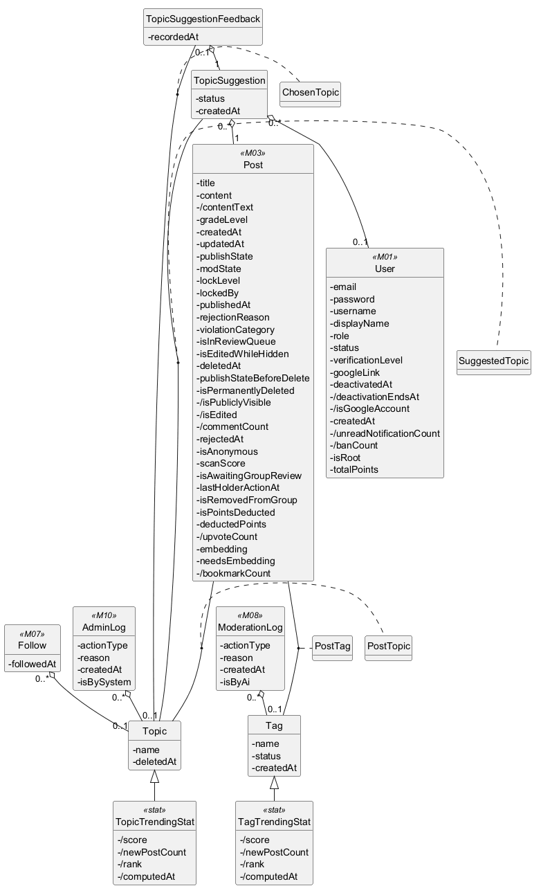

# Phân tích lớp thực thể — M05 Topic & Tag

<!-- [Vietnamese Doc] Tài liệu tiếng Việt; tên lớp và thuộc tính viết tiếng Anh (input/CONVENTIONS.md mục 3). -->

| Mã tài liệu | EC-M05 |
|---|---|
| Dự án | iShare |
| Module | M05 — Topic & Tag |
| Đầu vào | FR-M05 phiên bản 1.7 |
| Trạng thái | Đã chốt |
| Phiên bản | 1.1 |
| Ngày | 2026-11-20 |
| Tác giả | Phạm Văn Đức |

<!-- Quy ước chung cho mọi bảng dưới đây:
     - Không đổi tên cột, không xóa cột, không đổi số mục: tool đọc bảng theo số mục và tên cột.
     - Ô không có nội dung ghi "—".
     - Mục chưa tới bước làm thì để dòng "(Chưa làm — bước N)".
     - Cột Nguồn ghi mã trong FR: FR-Mxx-nn, FR-Mxx-nn.mm, BR-Mxx-nn, hoặc TN:<thuật ngữ> (mục 2.1 của FR).
     - Mục 4 chỉ chứa ảnh sơ đồ. gen_puml.py ghi mã PlantUML vào tệp riêng diagrams/EC-Mxx.puml, render
       diagrams/EC-Mxx.png và đặt ảnh vào mục 4. Không chép mã PlantUML vào tài liệu, không sửa tay tệp .puml hay ảnh. -->

## 1. Mô tả chức năng

### 1.1 Đoạn mô tả

Hệ thống quản lý danh mục Topic, các Tag và việc phân loại bài viết bằng Topic và Tag, các lượt gợi ý Topic bằng AI,
các phản hồi gợi ý và điểm Trending của Topic và Tag. Hệ thống cho phép mọi người, kể cả Guest, xem danh sách Topic
trong danh mục Topic, danh sách Tag đang hoạt động, và các Topic và các Tag đang hoạt động của từng bài viết. Danh mục
Topic có sẵn các Topic ban đầu và có cấu trúc phẳng, không Topic nào là Topic con của Topic khác.

Hệ thống cho phép tác giả bài viết gán Topic thuộc danh mục Topic cho bài viết của mình khi lưu bài nháp, khi gửi bài
viết và khi sửa bài viết đã gửi. Hệ thống cho phép tác giả bài viết gắn Tag cho bài viết của mình khi gửi bài viết và
khi sửa bài viết đã gửi. Khi tác giả bài viết gắn một Tag chưa tồn tại, hệ thống tạo Tag đó ở trạng thái hoạt động
với tên Tag chuẩn hóa; Tag có cùng tên Tag chuẩn hóa với một Tag đã có thì dùng Tag đã có.

Hệ thống cho phép tác giả bài viết yêu cầu AI gợi ý Topic cho bài viết đang soạn hoặc đang sửa khi công tắc AI tổng
và công tắc gợi ý Topic đang bật. Mỗi lượt gợi ý Topic dựa trên tiêu đề và nội dung chữ của bài viết và cho ra các
Topic được gợi ý thuộc danh mục Topic, hoặc thất bại khi không có Topic hợp lệ nào. Lượt gợi ý Topic trở thành gợi ý
lỗi thời khi tiêu đề hoặc nội dung chữ của bài viết thay đổi sau lượt gợi ý Topic đó. Hệ thống giới hạn số lượt gợi ý
Topic mà mỗi người dùng được yêu cầu trong một khoảng thời gian ngắn. Khi tác giả bài viết gửi bài viết hoặc lưu bản
sửa mà lượt gợi ý Topic gần nhất chưa lỗi thời, hệ thống ghi một phản hồi gợi ý gồm các Topic đã được gợi ý và các
Topic tác giả bài viết chọn cuối cùng. Phản hồi gợi ý được giữ lại để đánh giá AI khi tài khoản tác giả bài viết bị
xóa, nhưng không còn gắn với danh tính tác giả bài viết.

Hệ thống cho phép Admin thêm Topic vào danh mục Topic, gộp một Topic nguồn vào một Topic đích, và xóa Topic không có
bài viết nào ngoài bài nháp. Khi Admin gộp Topic, các bài viết và các lượt theo dõi Topic của Topic nguồn chuyển sang
Topic đích, rồi Topic nguồn bị xóa khỏi danh mục Topic. Khi Admin xóa Topic, Topic bị xóa được bỏ khỏi các bài nháp
và mọi lượt theo dõi Topic của Topic bị xóa bị bỏ. Mỗi lần thêm, gộp hay xóa Topic được ghi vào nhật ký thao tác của
Admin.

Hệ thống cho phép Mod và Admin vô hiệu hóa Tag đang hoạt động trong tình huống khủng hoảng và kích hoạt lại Tag bị vô
hiệu hóa; Tag bị vô hiệu hóa vẫn giữ liên kết với các bài viết đã gắn Tag đó. Hệ thống cho phép Mod và Admin đổi
Topic và Tag trên bài viết của người khác. Mỗi lần vô hiệu hóa Tag, kích hoạt lại Tag hay đổi Topic, Tag trên bài viết
của người khác được ghi vào nhật ký kiểm duyệt gồm người thực hiện, loại thao tác, Tag hoặc bài viết bị tác động, lý
do nếu có và thời điểm.

Hệ thống định kỳ tính điểm Trending cho mỗi Topic và mỗi Tag đang hoạt động từ các tương tác trong cửa sổ 7 ngày trên
các bài viết có Topic hoặc Tag đó: bài viết được đăng, upvote cho bài viết, comment và bookmark. Từ điểm Trending và
số bài mới, hệ thống lập danh sách Trending Topic và danh sách Trending Tag, và cung cấp kết quả của lần tính gần nhất
cho Feed.

<!-- Văn xuôi bình thường, có thể chia vài đoạn. KHÔNG ghi mã câu (S1), (S2)… trong đoạn văn: người đọc không hiểu
     các mã đó. Số câu chỉ nằm ở bảng 1.2. Xem steps/01-describe-functions.md. -->

### 1.2 Truy vết câu

<!-- Mỗi câu của đoạn mô tả một dòng, theo đúng thứ tự. Câu: 1, 2, 3…
     Nội dung câu: chép NGUYÊN VĂN câu đó từ mục 1.1 (tool so khớp từng câu với đoạn văn).
     Nguồn: mã chức năng hoặc yêu cầu của FR mà câu dựa vào. -->

| Câu | Nội dung câu | Nguồn |
|---|---|---|
| 1 | Hệ thống quản lý danh mục Topic, các Tag và việc phân loại bài viết bằng Topic và Tag, các lượt gợi ý Topic bằng AI, các phản hồi gợi ý và điểm Trending của Topic và Tag. | FR-M05-01, FR-M05-02, FR-M05-03, FR-M05-05 |
| 2 | Hệ thống cho phép mọi người, kể cả Guest, xem danh sách Topic trong danh mục Topic, danh sách Tag đang hoạt động, và các Topic và các Tag đang hoạt động của từng bài viết. | FR-M05-04.01, FR-M05-04.02, FR-M05-04.04 |
| 3 | Danh mục Topic có sẵn các Topic ban đầu và có cấu trúc phẳng, không Topic nào là Topic con của Topic khác. | FR-M05-04.06, FR-M05-06.07 |
| 4 | Hệ thống cho phép tác giả bài viết gán Topic thuộc danh mục Topic cho bài viết của mình khi lưu bài nháp, khi gửi bài viết và khi sửa bài viết đã gửi. | FR-M05-01.01, FR-M05-01.02, FR-M05-01.06, FR-M05-01.10 |
| 5 | Hệ thống cho phép tác giả bài viết gắn Tag cho bài viết của mình khi gửi bài viết và khi sửa bài viết đã gửi. | FR-M05-03.01, FR-M05-03.10 |
| 6 | Khi tác giả bài viết gắn một Tag chưa tồn tại, hệ thống tạo Tag đó ở trạng thái hoạt động với tên Tag chuẩn hóa; Tag có cùng tên Tag chuẩn hóa với một Tag đã có thì dùng Tag đã có. | FR-M05-03.02, FR-M05-03.03 |
| 7 | Hệ thống cho phép tác giả bài viết yêu cầu AI gợi ý Topic cho bài viết đang soạn hoặc đang sửa khi công tắc AI tổng và công tắc gợi ý Topic đang bật. | FR-M05-02.01, FR-M05-02.16, FR-M05-02.20 |
| 8 | Mỗi lượt gợi ý Topic dựa trên tiêu đề và nội dung chữ của bài viết và cho ra các Topic được gợi ý thuộc danh mục Topic, hoặc thất bại khi không có Topic hợp lệ nào. | FR-M05-02.01, FR-M05-02.03, FR-M05-02.06, FR-M05-02.19 |
| 9 | Lượt gợi ý Topic trở thành gợi ý lỗi thời khi tiêu đề hoặc nội dung chữ của bài viết thay đổi sau lượt gợi ý Topic đó. | FR-M05-02.09 |
| 10 | Hệ thống giới hạn số lượt gợi ý Topic mà mỗi người dùng được yêu cầu trong một khoảng thời gian ngắn. | FR-M05-02.15 |
| 11 | Khi tác giả bài viết gửi bài viết hoặc lưu bản sửa mà lượt gợi ý Topic gần nhất chưa lỗi thời, hệ thống ghi một phản hồi gợi ý gồm các Topic đã được gợi ý và các Topic tác giả bài viết chọn cuối cùng. | FR-M05-02.12 |
| 12 | Phản hồi gợi ý được giữ lại để đánh giá AI khi tài khoản tác giả bài viết bị xóa, nhưng không còn gắn với danh tính tác giả bài viết. | FR-M05-02.22 |
| 13 | Hệ thống cho phép Admin thêm Topic vào danh mục Topic, gộp một Topic nguồn vào một Topic đích, và xóa Topic không có bài viết nào ngoài bài nháp. | FR-M05-06.01, FR-M05-07.01, FR-M05-08.01 |
| 14 | Khi Admin gộp Topic, các bài viết và các lượt theo dõi Topic của Topic nguồn chuyển sang Topic đích, rồi Topic nguồn bị xóa khỏi danh mục Topic. | FR-M05-07.01, FR-M05-07.05, FR-M05-07.06 |
| 15 | Khi Admin xóa Topic, Topic bị xóa được bỏ khỏi các bài nháp và mọi lượt theo dõi Topic của Topic bị xóa bị bỏ. | FR-M05-08.05, FR-M05-08.06 |
| 16 | Mỗi lần thêm, gộp hay xóa Topic được ghi vào nhật ký thao tác của Admin. | FR-M05-06, FR-M05-07, FR-M05-08 |
| 17 | Hệ thống cho phép Mod và Admin vô hiệu hóa Tag đang hoạt động trong tình huống khủng hoảng và kích hoạt lại Tag bị vô hiệu hóa; Tag bị vô hiệu hóa vẫn giữ liên kết với các bài viết đã gắn Tag đó. | FR-M05-09.01, FR-M05-09.03, FR-M05-10.01 |
| 18 | Hệ thống cho phép Mod và Admin đổi Topic và Tag trên bài viết của người khác. | FR-M05-11.01, FR-M05-11.02 |
| 19 | Mỗi lần vô hiệu hóa Tag, kích hoạt lại Tag hay đổi Topic, Tag trên bài viết của người khác được ghi vào nhật ký kiểm duyệt gồm người thực hiện, loại thao tác, Tag hoặc bài viết bị tác động, lý do nếu có và thời điểm. | FR-M05-09.07, FR-M05-10.06, FR-M05-11.07 |
| 20 | Hệ thống định kỳ tính điểm Trending cho mỗi Topic và mỗi Tag đang hoạt động từ các tương tác trong cửa sổ 7 ngày trên các bài viết có Topic hoặc Tag đó: bài viết được đăng, upvote cho bài viết, comment và bookmark. | FR-M05-05.01, FR-M05-05.03, FR-M05-05.06 |
| 21 | Từ điểm Trending và số bài mới, hệ thống lập danh sách Trending Topic và danh sách Trending Tag, và cung cấp kết quả của lần tính gần nhất cho Feed. | FR-M05-05.09, FR-M05-05.10 |

## 2. Danh từ và phân loại

### 2.1 Sổ danh từ

<!-- Phân loại: Lớp | Thuộc tính | Loại bỏ.
     Kết quả: tên lớp; hoặc Lớp.thuộcTính; hoặc "—" khi loại bỏ.
     Xuất hiện ở: "Câu n" (số câu ở bảng 1.2) hoặc "Quét: <mã FR>" (lượt quét bổ sung). -->

| # | Danh từ | Xuất hiện ở | Phân loại | Kết quả | Lý do |
|---|---|---|---|---|---|
| 1 | hệ thống | Câu 1 | Loại bỏ | — | Trừu tượng: chỉ chính phần mềm iShare |
| 2 | danh mục Topic | Câu 1 | Loại bỏ | — | Chung chung: tập hợp mọi Topic đang có; mỗi phần tử là một Topic (dòng 6), danh mục không có thông tin riêng |
| 3 | Tag | Câu 1 | Lớp | Tag | Được tạo riêng khi gắn lần đầu, có tên chuẩn hóa duy nhất và trạng thái riêng đổi được (FR-M05-03.02, FR-M05-09.01, FR-M05-10.01) |
| 4 | việc phân loại bài viết | Câu 1 | Loại bỏ | — | Hành động không lưu dấu vết: kết quả là các Topic, Tag gắn với bài viết, xét như quan hệ ở bước 3 |
| 5 | bài viết / bài viết đang soạn | Câu 1 | Lớp | Post | Đối tượng được gán Topic, Tag; thực thể của M03 (lớp ngoài) |
| 6 | Topic | Câu 1 | Lớp | Topic | Admin thêm, gộp, xóa riêng từng Topic; có tên không trùng (BR-M05-05) |
| 7 | lượt gợi ý Topic | Câu 1 | Lớp | TopicSuggestion | FR yêu cầu nhớ từng lượt: các Topic được gợi ý và trạng thái lỗi thời, để quyết định có ghi phản hồi gợi ý (FR-M05-02.09, FR-M05-02.12) |
| 8 | AI | Câu 1 | Loại bỏ | — | Ngoài phạm vi module (M13): lời gọi AI, thời gian chờ, log kết quả thô do M13 làm |
| 9 | phản hồi gợi ý | Câu 1 | Lớp | TopicSuggestionFeedback | FR yêu cầu ghi và giữ từng phản hồi, kể cả khi tài khoản tác giả bị xóa (FR-M05-02.12, FR-M05-02.22) |
| 10 | điểm Trending / kết quả của lần tính | Câu 1 | Loại bỏ | — | Chung chung: điểm Trending của Topic và của Tag là hai nhóm số liệu theo hai loại đối tượng, xét ở dòng 60, 61; mỗi nhóm có thuộc tính score (Q-02) |
| 11 | mọi người | Câu 2 | Loại bỏ | — | Chung chung: chỉ mọi vai trò, kể cả Guest |
| 12 | Guest | Câu 2 | Loại bỏ | — | Không lưu: tác nhân không có dữ liệu (không có tài khoản) |
| 13 | danh sách Topic | Câu 2 | Loại bỏ | — | Giao diện: cách hiển thị các Topic của danh mục |
| 14 | danh sách Tag | Câu 2 | Loại bỏ | — | Giao diện: cách hiển thị các Tag đang hoạt động |
| 15 | Tag đang hoạt động / Tag bị vô hiệu hóa | Câu 2 | Loại bỏ | — | Giá trị của Tag.status |
| 16 | Topic ban đầu | Câu 3 | Loại bỏ | — | Hằng số của BR-M05-02: 11 Topic khởi tạo là dữ liệu ban đầu của lớp Topic, không phải lớp riêng |
| 17 | cấu trúc phẳng | Câu 3 | Loại bỏ | — | Hằng số của BR-M05-01: quy tắc của danh mục; hệ quả là Topic không có quan hệ cha–con |
| 18 | Topic con | Câu 3 | Loại bỏ | — | Ngoài phạm vi hệ thống: FR không có Topic lồng nhau (BR-M05-01; mục 1.2 ghi hoãn) |
| 19 | tác giả bài viết / người dùng / tài khoản tác giả bài viết / danh tính tác giả bài viết | Câu 4 | Lớp | User | Vai trò có tài khoản → lớp người dùng của M01 (lớp ngoài); các cụm cùng chỉ một tài khoản |
| 20 | bài nháp | Câu 4 | Loại bỏ | — | Giá trị của Post.publishState |
| 21 | bài viết đã gửi | Câu 4 | Loại bỏ | — | Giá trị của Post.publishState (các trạng thái sau nháp) |
| 22 | tên Tag chuẩn hóa | Câu 6 | Thuộc tính | Tag.name | Giá trị mô tả Tag, dùng để phân biệt hai Tag (BR-M05-24) |
| 23 | trạng thái của Tag | Câu 6 | Thuộc tính | Tag.status | Tag có hai trạng thái và bảng chuyển trạng thái riêng (mục 5.14 của FR) |
| 24 | công tắc AI tổng | Câu 7 | Loại bỏ | — | Ngoài phạm vi module (M10): M05 chỉ đọc công tắc để bật, tắt gợi ý; không có dữ liệu của M05 gắn với công tắc |
| 25 | công tắc gợi ý Topic | Câu 7 | Loại bỏ | — | Ngoài phạm vi module (M10): như dòng 24 |
| 26 | tiêu đề | Câu 8 | Thuộc tính | Post.title | Thông tin của bài viết (M03) mà M05 đọc để gợi ý Topic |
| 27 | nội dung chữ | Câu 8 | Thuộc tính | Post.contentText | Thông tin của bài viết (M03) mà M05 đọc để gợi ý Topic |
| 28 | Topic được gợi ý / Topic đã được gợi ý | Câu 8 | Lớp | Topic | Là Topic của danh mục; việc một lượt gợi ý có các Topic là quan hệ, xét ở bước 3 |
| 29 | Topic hợp lệ | Câu 8 | Loại bỏ | — | Chung chung: "hợp lệ" là điều kiện thuộc danh mục Topic hiện tại, không phải dữ liệu riêng |
| 30 | gợi ý lỗi thời | Câu 9 | Loại bỏ | — | Giá trị của TopicSuggestion.status |
| 31 | số lượt gợi ý Topic của mỗi người dùng | Câu 10 | Loại bỏ | — | Hành động không lưu dấu vết: bộ đếm giới hạn tần suất (BR-M05-17) là bộ đếm tạm, không phải dữ liệu nghiệp vụ; xem Q-01 |
| 32 | khoảng thời gian ngắn | Câu 10 | Loại bỏ | — | Hằng số của BR-M05-17 (10 lần trong 60 giây) |
| 33 | bản sửa | Câu 11 | Loại bỏ | — | Ngoài phạm vi module (M03): lưu bản sửa và phiên bản sửa là của M03; M05 chỉ dùng thời điểm lưu để ghi phản hồi |
| 34 | lượt gợi ý Topic gần nhất | Câu 11 | Thuộc tính | TopicSuggestion.createdAt | "Gần nhất" cần thời điểm của từng lượt gợi ý để chọn lượt mới nhất của bài viết |
| 35 | Topic tác giả bài viết chọn cuối cùng | Câu 11 | Lớp | Topic | Là Topic; quan hệ giữa phản hồi gợi ý và các Topic được chọn xét ở bước 3 |
| 36 | đánh giá AI | Câu 12 | Loại bỏ | — | Ngoài phạm vi module (M13): M13 tính tỷ lệ Topic gợi ý được giữ lại |
| 37 | Admin | Câu 13 | Lớp | User | Vai trò có tài khoản; phân biệt bằng User.role |
| 38 | Topic nguồn | Câu 13 | Lớp | Topic | Một Topic trong thao tác gộp; thao tác gộp không lưu dấu vết ở M05 (chỉ ghi nhật ký thao tác Admin) |
| 39 | Topic đích | Câu 13 | Lớp | Topic | Như dòng 38 |
| 40 | lượt theo dõi Topic | Câu 14 | Lớp | Follow | Thực thể "Quan hệ theo dõi" của M07; M05 chuyển và bỏ lượt theo dõi khi gộp, xóa Topic (FR-M05-07.06, FR-M05-08.06) |
| 41 | Topic bị xóa | Câu 15 | Thuộc tính | Topic.deletedAt | Topic bị xóa hoặc bị gộp chỉ được đánh dấu rời danh mục, để lượt gợi ý, phản hồi gợi ý và nhật ký cũ vẫn trỏ tới được (Q-03) |
| 42 | nhật ký thao tác của Admin | Câu 16 | Lớp | AdminLog | Thực thể "Mục nhật ký thao tác Admin" của M10; M05 ghi một mục cho mỗi lần thêm, gộp, xóa Topic |
| 43 | Mod | Câu 17 | Lớp | User | Vai trò có tài khoản; phân biệt bằng User.role |
| 44 | tình huống khủng hoảng | Câu 17 | Loại bỏ | — | Chung chung: FR không nêu tiêu chí; việc đánh giá thuộc về Mod, Admin, không lưu |
| 45 | liên kết giữa Tag và bài viết | Câu 17 | Loại bỏ | — | Chung chung: là quan hệ Tag – bài viết, xét ở bước 3 |
| 46 | người khác | Câu 18 | Lớp | User | Tác giả khác của bài viết, cũng là người dùng |
| 47 | nhật ký kiểm duyệt | Câu 19 | Lớp | ModerationLog | Thực thể "Dòng nhật ký kiểm duyệt" của M08; M05 ghi một dòng cho mỗi thao tác (FR-M05-09.07, FR-M05-10.06, FR-M05-11.07) |
| 48 | người thực hiện | Câu 19 | Lớp | User | Là người dùng (Mod, Admin); quan hệ với dòng nhật ký xét ở bước 3 |
| 49 | loại thao tác | Câu 19 | Thuộc tính | ModerationLog.actionType | Thông tin của dòng nhật ký kiểm duyệt mà M05 ghi |
| 50 | Tag hoặc bài viết bị tác động | Câu 19 | Loại bỏ | — | Chung chung: là Tag hoặc bài viết đã có ở dòng 3, dòng 5; quan hệ với dòng nhật ký xét ở bước 3 |
| 51 | lý do | Câu 19 | Thuộc tính | ModerationLog.reason | Thông tin của dòng nhật ký kiểm duyệt mà M05 ghi |
| 52 | thời điểm | Câu 19 | Thuộc tính | ModerationLog.createdAt | Thông tin của dòng nhật ký kiểm duyệt mà M05 ghi |
| 53 | tương tác | Câu 20 | Loại bỏ | — | Chung chung: từng loại tương tác xét ở dòng 55–58 |
| 54 | cửa sổ 7 ngày | Câu 20 | Loại bỏ | — | Hằng số của BR-M05-29 |
| 55 | bài viết được đăng | Câu 20 | Thuộc tính | Post.publishedAt | Sự kiện đăng bài được tính khi thời điểm đăng nằm trong cửa sổ 7 ngày |
| 56 | upvote | Câu 20 | Loại bỏ | — | Ngoài phạm vi module (M12): M05 chỉ đếm upvote của bài viết để tính điểm Trending, lấy qua Post; không đưa vào mô hình M05 |
| 57 | comment / reply | Câu 20 | Loại bỏ | — | Ngoài phạm vi module (M04): như dòng 56; reply cũng là comment (FR-M05-05.13) |
| 58 | bookmark | Câu 20 | Loại bỏ | — | Ngoài phạm vi module (M02): như dòng 56 |
| 59 | số bài mới | Câu 21 | Thuộc tính | TopicTrendingStat.newPostCount | Số liệu tính ra, tiêu chí xếp thứ hai của danh sách Trending; TagTrendingStat có thuộc tính cùng tên |
| 60 | danh sách Trending Topic | Câu 21 | Lớp | TopicTrendingStat | Một nhóm số liệu tính ra theo từng Topic (điểm, số bài mới, thứ hạng) → lớp thống kê (Q-02) |
| 61 | danh sách Trending Tag | Câu 21 | Lớp | TagTrendingStat | Một nhóm số liệu tính ra theo từng Tag đang hoạt động → lớp thống kê (Q-02) |
| 62 | lần tính gần nhất | Câu 21 | Thuộc tính | TopicTrendingStat.computedAt | Thời điểm tạo ra kết quả, làm mốc cửa sổ 7 ngày; TagTrendingStat có thuộc tính cùng tên |
| 63 | Feed / feed chính | Câu 21 | Loại bỏ | — | Ngoài phạm vi module (M14) |
| 64 | tên Topic | Quét: BR-M05-05 | Thuộc tính | Topic.name | Giá trị mô tả Topic, có quy tắc không trùng |
| 65 | thứ hạng | Quét: BR-M05-31 | Thuộc tính | TopicTrendingStat.rank | Số liệu tính ra từ thứ tự xếp; TagTrendingStat có thuộc tính cùng tên |
| 66 | trọng số tương tác | Quét: BR-M05-29 | Loại bỏ | — | Hằng số của BR-M05-29 (đăng 1, upvote 2, comment 1, bookmark 1) |
| 67 | chu kỳ tính lại | Quét: BR-M05-30 | Loại bỏ | — | Hằng số của BR-M05-30 (15–30 phút) |
| 68 | trạng thái của lượt gợi ý Topic | Quét: FR-M05-02.09 | Thuộc tính | TopicSuggestion.status | Lượt gợi ý có bảng chuyển trạng thái riêng (mục 5.14 của FR) |
| 69 | còn hiệu lực | Quét: FR-M05-02.09 | Loại bỏ | — | Giá trị của TopicSuggestion.status |
| 70 | thời điểm ghi phản hồi gợi ý | Quét: FR-M05-02.12 | Thuộc tính | TopicSuggestionFeedback.recordedAt | M13 lọc phản hồi theo khoảng thời gian ghi (FR-M13, BR-M13-29) |
| 71 | thời điểm tạo của Tag | Quét: Dữ liệu nghiệp vụ | Thuộc tính | Tag.createdAt | FR nêu ở mục Dữ liệu nghiệp vụ |
| 72 | trạng thái đăng | Quét: FR-M05-05.11 | Thuộc tính | Post.publishState | Thông tin của bài viết (M03) mà M05 đọc |
| 73 | trạng thái kiểm duyệt | Quét: FR-M05-05.11 | Thuộc tính | Post.modState | Thông tin của bài viết (M03) mà M05 đọc |
| 74 | trạng thái tài khoản | Quét: FR-M05-05.11 | Thuộc tính | User.status | Thông tin của tài khoản (M01) mà M05 đọc |
| 75 | vai trò | Quét: FR-M05-06.03 | Thuộc tính | User.role | Thông tin của tài khoản (M01) mà M05 đọc để kiểm quyền |
| 76 | nhóm Public / nhóm Private | Quét: FR-M05-05.11 | Loại bỏ | — | Ngoài phạm vi module (M11): M05 chỉ dùng điều kiện "bài đang hiển thị trên feed chính" do M11, M14 xác định |
| 77 | thời điểm upvote | Quét: FR-M05-05.03 | Loại bỏ | — | Ngoài phạm vi module (M12): như dòng 56 |
| 78 | thời điểm comment | Quét: FR-M05-05.03 | Loại bỏ | — | Ngoài phạm vi module (M04): như dòng 57 |
| 79 | thời điểm bookmark | Quét: FR-M05-05.03 | Loại bỏ | — | Ngoài phạm vi module (M02): như dòng 58 |
| 80 | tương tác bị rút lại | Quét: FR-M05-05.05 | Loại bỏ | — | Chung chung: bỏ upvote, xóa comment, bỏ lưu bookmark là việc của module sở hữu tương tác; M05 chỉ tính tương tác còn hiệu lực |
| 81 | lượt xem | Quét: FR-M05-05.08 | Loại bỏ | — | Ngoài phạm vi hệ thống: FR quyết không tính lượt xem vào Trending (hoãn ở MS1) |
| 82 | upvote cho comment | Quét: FR-M05-05.12 | Loại bỏ | — | Ngoài phạm vi module (M12): không tính vào Trending |
| 83 | lịch sử sửa bài viết | Quét: FR-M05-11.06 | Loại bỏ | — | Ngoài phạm vi module (M03) |
| 84 | thông báo | Quét: FR-M05-11.05 | Loại bỏ | — | Ngoài phạm vi module (M07) |
| 85 | thời gian khôi phục | Quét: FR-M05-08.02 | Loại bỏ | — | Ngoài phạm vi module (M03): M05 chỉ đọc Post.publishState |
| 86 | từ / số từ | Quét: TN:Từ | Loại bỏ | — | Hằng số của BR-M05-12: đếm lúc yêu cầu gợi ý, không lưu |
| 87 | ký tự | Quét: TN:Ký tự | Loại bỏ | — | Hằng số của BR-M05-23: đơn vị đo độ dài Tag.name |
| 88 | giờ hệ thống | Quét: TN:Giờ hệ thống | Loại bỏ | — | Giao diện: cách hiển thị thời điểm |
| 89 | thao tác của Admin trên Topic | Quét: FR-M05-06 | Thuộc tính | AdminLog.actionType | Thông tin của mục nhật ký thao tác Admin mà M05 ghi (mục 5.15, dòng Dùng M10) |
| 90 | tệp đính kèm | Quét: FR-M05-02.01 | Loại bỏ | — | Ngoài phạm vi module (M03): không được xét khi gợi ý |
| 91 | số Topic tối đa mỗi bài viết | Quét: BR-M05-03 | Loại bỏ | — | Hằng số của BR-M05-03 (1–3 khi gửi, 0–3 khi nháp); ghi ở bội số bước 3 |
| 92 | số Tag tối đa mỗi bài viết | Quét: BR-M05-22 | Loại bỏ | — | Hằng số của BR-M05-22 (0–5); ghi ở bội số bước 3 |
| 93 | độ dài tối đa của tên Tag | Quét: BR-M05-23 | Loại bỏ | — | Hằng số của BR-M05-23; ghi ở ràng buộc của Tag.name |
| 94 | phần chữ đã nhập | Quét: FR-M05-10.03 | Loại bỏ | — | Ngoài phạm vi module (M03): là nội dung bài viết, không phải Tag |

### 2.2 Lớp

<!-- Nhóm: Thực thể | Liên kết | Thống kê. Sở hữu: mã module sở hữu lớp (Mxx của tài liệu này, hoặc Myy với lớp ngoài).
     Thuộc tính: tên mọi thuộc tính của lớp ở mục 2.3, ngăn bởi dấu phẩy, thuộc tính dẫn xuất có "/" phía trước;
     để người đọc thấy lớp và thuộc tính trên cùng một dòng. Lớp chưa có thuộc tính ghi "—". -->

| Lớp | Tên tiếng Việt | Nhóm | Sở hữu | Mô tả | Thuộc tính | Nguồn |
|---|---|---|---|---|---|---|
| Topic | Topic | Thực thể | M05 | Lĩnh vực nội dung trong danh mục Topic phẳng, do Admin quản lý; Topic bị xóa hoặc gộp chỉ được đánh dấu rời danh mục | name, deletedAt | FR-M05-01, FR-M05-04.01, FR-M05-06, FR-M05-07, FR-M05-08 |
| Tag | Tag | Thực thể | M05 | Từ khóa tự do gắn cho bài viết, tự tạo khi gắn lần đầu; không bị xóa, chỉ vô hiệu hóa và kích hoạt lại | name, status, createdAt | FR-M05-03, FR-M05-09, FR-M05-10 |
| TopicSuggestion | Lượt gợi ý Topic | Thực thể | M05 | Một lần AI gợi ý Topic thành công cho bài viết đang soạn hoặc đang sửa | status, createdAt | FR-M05-02 |
| TopicSuggestionFeedback | Phản hồi gợi ý | Thực thể | M05 | So sánh Topic AI gợi ý với Topic tác giả chọn cuối, ghi khi gửi bài hoặc lưu bản sửa mà gợi ý chưa lỗi thời | recordedAt | FR-M05-02.12, FR-M05-02.22 |
| TopicTrendingStat | Thống kê Trending Topic | Thống kê | M05 | Điểm Trending, số bài mới và thứ hạng của một Topic trong cửa sổ 7 ngày, tính lại định kỳ; là danh sách Trending Topic cung cấp cho M14 | /score, /newPostCount, /rank, /computedAt | FR-M05-05 |
| TagTrendingStat | Thống kê Trending Tag | Thống kê | M05 | Điểm Trending, số bài mới và thứ hạng của một Tag đang hoạt động trong cửa sổ 7 ngày, tính lại định kỳ; là danh sách Trending Tag cung cấp cho M14 | /score, /newPostCount, /rank, /computedAt | FR-M05-05 |
| PostTopic | Liên kết bài viết–Topic | Liên kết | M05 | Một Topic được gán cho một bài viết | — | FR-M05-01.02, FR-M05-01.10 |
| PostTag | Liên kết bài viết–Tag | Liên kết | M05 | Một Tag được gắn cho một bài viết; giữ cả khi Tag bị vô hiệu hóa | — | FR-M05-03.01, FR-M05-09.03 |
| SuggestedTopic | Topic được gợi ý | Liên kết | M05 | Một Topic nằm trong kết quả của một lượt gợi ý Topic | — | FR-M05-02.03, BR-M05-13 |
| ChosenTopic | Topic chọn cuối | Liên kết | M05 | Một Topic tác giả chọn cuối cùng, ghi trong một phản hồi gợi ý | — | FR-M05-02.12 |
| Post | Bài viết | Thực thể | M03 | Bài viết được gán Topic, gắn Tag và được gợi ý Topic | title, content, /contentText, gradeLevel, createdAt, updatedAt, publishState, modState, lockLevel, lockedBy, publishedAt, rejectionReason, violationCategory, isInReviewQueue, isEditedWhileHidden, deletedAt, publishStateBeforeDelete, isPermanentlyDeleted, /isPubliclyVisible, /isEdited, /commentCount, rejectedAt, isAnonymous, scanScore, isAwaitingGroupReview, lastHolderActionAt, isRemovedFromGroup, isPointsDeducted, deductedPoints, /upvoteCount, embedding, needsEmbedding, /bookmarkCount | FR-M05-01, FR-M05-03 |
| User | Người dùng (tài khoản) | Thực thể | M01 | Tài khoản của tác giả, Mod, Admin | email, password, username, displayName, role, status, verificationLevel, googleLink, deactivatedAt, /deactivationEndsAt, /isGoogleAccount, createdAt, /unreadNotificationCount, /banCount, isRoot, totalPoints | FR-M05-01.08, FR-M05-06.03, FR-M05-09.04 |
| Follow | Lượt theo dõi | Thực thể | M07 | Quan hệ theo dõi Topic mà M05 chuyển hoặc bỏ khi gộp, xóa Topic | followedAt | FR-M05-07.06, FR-M05-08.06 |
| ModerationLog | Dòng nhật ký kiểm duyệt | Thực thể | M08 | Dòng nhật ký M05 ghi khi Mod, Admin thao tác với Tag hoặc Topic, Tag của bài người khác | actionType, reason, createdAt, isByAi | FR-M05-09.07, FR-M05-10.06, FR-M05-11.07 |
| AdminLog | Mục nhật ký thao tác Admin | Thực thể | M10 | Mục nhật ký M05 ghi khi Admin thêm, gộp, xóa Topic | actionType, reason, createdAt, isBySystem | FR-M05-06, FR-M05-07, FR-M05-08 |

### 2.3 Thuộc tính

<!-- Mỗi lớp có ĐỦ thuộc tính để người đọc hình dung được nó; xếp các dòng theo lớp.
     Tính chất: Lưu | Dẫn xuất. Chưa có id, chưa có kiểu, chưa có khóa ngoại.
     Căn cứ: Nguồn nêu (FR nói tới) | Đề xuất (FR không nói, nhưng chức năng hoặc quy tắc ở cột Nguồn cần nó) |
             Tham chiếu (thuộc tính của lớp ngoài; module sở hữu lớp đó định nghĩa. Sau lượt gộp hệ thống,
             lớp ngoài ghi đủ thuộc tính như EC-SYS, MD-05).
     Ràng buộc nguồn nêu: độ dài tối đa, duy nhất, bắt buộc/tùy chọn, tập giá trị, mặc định, công thức (với Dẫn xuất)
             — chép từ FR kèm mã. Đề xuất mà FR không nêu ràng buộc thì ghi "—".
     Nguồn: mã FR/BR nêu thuộc tính; với Đề xuất là mã chức năng hoặc quy tắc cần nó.
     Ghi chú: bắt buộc với Đề xuất (vì sao cần) và Tham chiếu (module này dùng nó làm gì). -->

| Lớp | Thuộc tính | Tên tiếng Việt | Tính chất | Căn cứ | Ràng buộc nguồn nêu | Nguồn | Ghi chú |
|---|---|---|---|---|---|---|---|
| Topic | name | Tên Topic | Lưu | Nguồn nêu | Bắt buộc; không trùng trong danh mục: so trùng không phân biệt hoa thường, bỏ khoảng trắng thừa ở đầu, cuối, giữa, phân biệt dấu (BR-M05-05, FR-M05-06.08); không đổi sau khi tạo (mục 1.2: không đổi tên Topic) | FR-M05-06.01, BR-M05-05 | Danh mục chỉ gồm Topic chưa có deletedAt (Q-03) |
| Topic | deletedAt | Thời điểm xóa | Lưu | Đề xuất | — | FR-M05-07.05, FR-M05-08.01, FR-M05-02.22 | Q-03: xóa hoặc gộp Topic chỉ ghi thời điểm rời danh mục; SuggestedTopic, ChosenTopic, AdminLog cũ giữ nguyên tham chiếu để tỷ lệ của M13 không đổi theo thời gian; xem, chọn, gợi ý và Trending chỉ dùng Topic chưa có giá trị này |
| Tag | name | Tên Tag chuẩn hóa | Lưu | Nguồn nêu | Bắt buộc; duy nhất; chữ thường, không bỏ dấu (BR-M05-24); chỉ chữ cái, chữ số, "_", ít nhất một chữ cái (BR-M05-20); tối đa 30 ký tự, không tính "#" (BR-M05-23); không sửa (BR-M05-25) | BR-M05-20, BR-M05-23, BR-M05-24 | Hiển thị với "#" phía trước (FR-M05-03.14); dấu "#" không thuộc tên |
| Tag | status | Trạng thái | Lưu | Nguồn nêu | Giá trị: Hoạt động, Bị vô hiệu hóa; Hoạt động khi được tạo (FR-M05-03.02); chỉ đổi bằng FR-M05-09.01, FR-M05-10.01 | FR-M05-03.02, FR-M05-09.01, FR-M05-10.01 | — |
| Tag | createdAt | Thời điểm tạo | Lưu | Nguồn nêu | — | FR-M05-03.02 | FR chỉ nêu ở mục Dữ liệu nghiệp vụ; FR ghi rõ không lưu người tạo |
| TopicSuggestion | status | Trạng thái | Lưu | Nguồn nêu | Giá trị: Còn hiệu lực, Lỗi thời; Còn hiệu lực khi AI trả về Topic hợp lệ (mục Chuyển trạng thái của FR) | FR-M05-02.09, BR-M05-15 | — |
| TopicSuggestion | createdAt | Thời điểm gợi ý | Lưu | Đề xuất | — | FR-M05-02.12, BR-M05-16 | FR-M05-02.12 xét "gợi ý gần nhất" của bài viết khi gửi hoặc lưu bản sửa → cần thời điểm của từng lượt để biết lượt nào mới nhất |
| TopicSuggestionFeedback | recordedAt | Thời điểm ghi | Lưu | Đề xuất | — | FR-M05-02.12 | Phản hồi được ghi khi gửi bài hoặc lưu bản sửa (FR-M05-02.12); FR-M13 đọc phản hồi theo khoảng thời gian ghi (BR-M13-29) và liệt kê "thời điểm ghi" cho thực thể này, FR-M05 chưa gọi tên |
| TopicTrendingStat | score | Điểm Trending | Dẫn xuất | Nguồn nêu | Tổng điểm tương tác trong cửa sổ 7 ngày trên các bài có Topic đó, chỉ bài đang hiển thị trên feed chính: đăng bài 1, upvote 2, comment (kể cả reply) 1, bookmark 1; tương tác đã rút lại không tính (BR-M05-29); chỉ vào danh sách khi lớn hơn 0 (FR-M05-05.14) | BR-M05-29, FR-M05-05.01 | Tính lại định kỳ, chu kỳ 15–30 phút (BR-M05-30); upvote, comment, bookmark của bài lấy qua Post từ M12, M04, M02, không mô hình hóa ở M05 |
| TopicTrendingStat | newPostCount | Số bài mới | Dẫn xuất | Nguồn nêu | Số bài có Topic đó được đăng trong cửa sổ 7 ngày (TN:Bài mới) | FR-M05-05.09, BR-M05-31 | — |
| TopicTrendingStat | rank | Thứ hạng | Dẫn xuất | Nguồn nêu | Xếp theo score giảm dần, rồi newPostCount giảm dần, rồi tên Topic từ A đến Z; mỗi mục một hạng riêng (BR-M05-31) | BR-M05-31, FR-M05-05.09 | — |
| TopicTrendingStat | computedAt | Thời điểm tính | Dẫn xuất | Nguồn nêu | Thời điểm tạo ra kết quả; cửa sổ 7 ngày tính ngược từ thời điểm này (FR-M05-05.03) | FR-M05-05.03, FR-M05-05.10 | — |
| TagTrendingStat | score | Điểm Trending | Dẫn xuất | Nguồn nêu | Như TopicTrendingStat.score, trên các bài có Tag đó; chỉ tính Tag đang hoạt động (FR-M05-05.07) | BR-M05-29, FR-M05-05.01, FR-M05-05.07 | Tính lại định kỳ, chu kỳ 15–30 phút (BR-M05-30) |
| TagTrendingStat | newPostCount | Số bài mới | Dẫn xuất | Nguồn nêu | Số bài có Tag đó được đăng trong cửa sổ 7 ngày (TN:Bài mới) | FR-M05-05.09, BR-M05-31 | — |
| TagTrendingStat | rank | Thứ hạng | Dẫn xuất | Nguồn nêu | Xếp theo score giảm dần, rồi newPostCount giảm dần, rồi tên Tag từ A đến Z; mỗi mục một hạng riêng (BR-M05-31) | BR-M05-31, FR-M05-05.09 | — |
| TagTrendingStat | computedAt | Thời điểm tính | Dẫn xuất | Nguồn nêu | Thời điểm tạo ra kết quả; cửa sổ 7 ngày tính ngược từ thời điểm này (FR-M05-05.03) | FR-M05-05.03, FR-M05-05.10 | — |
| Post | title | Tiêu đề | Lưu | Tham chiếu | — | FR-M05-02.01 | M05 đọc để gửi AI gợi ý Topic, đếm từ (BR-M05-12) và phát hiện gợi ý lỗi thời (FR-M05-02.09) |
| Post | content | Nội dung | Lưu | Tham chiếu | — | FR-M03-01.02, FR-M03-01.03, FR-M03-01.15, FR-M03-04.09 | Ghi đủ lớp sau gộp (MD-05); EC-M03 định nghĩa |
| Post | contentText | Nội dung chữ | Dẫn xuất | Tham chiếu | — | FR-M05-02.01 | Như title; FR-M03 gọi là "nội dung dạng chữ thuần" |
| Post | gradeLevel | Lớp/Khối | Lưu | Tham chiếu | — | FR-M03-01.05, FR-M03-01.06, FR-M03-01.07 | Ghi đủ lớp sau gộp (MD-05); EC-M03 định nghĩa |
| Post | createdAt | Thời điểm tạo | Lưu | Tham chiếu | — | FR-M03-01.08 | Ghi đủ lớp sau gộp (MD-05); EC-M03 định nghĩa |
| Post | updatedAt | Thời điểm cập nhật | Lưu | Tham chiếu | — | FR-M03-01.08 | Ghi đủ lớp sau gộp (MD-05); EC-M03 định nghĩa |
| Post | publishState | Trạng thái đăng | Lưu | Tham chiếu | — | FR-M05-01.10, FR-M05-08.02, FR-M05-05.11 | M05 đọc để áp giới hạn Topic cho bài nháp (0–3) hay bài đã gửi (1–3), chặn xóa Topic có bài ngoài bài nháp, và chỉ tính Trending bài đã đăng |
| Post | modState | Trạng thái kiểm duyệt | Lưu | Tham chiếu | — | FR-M05-05.11 | M05 đọc để bỏ bài bị ẩn bởi kiểm duyệt khỏi Trending |
| Post | lockLevel | Mức khóa | Lưu | Tham chiếu | — | FR-M03-01.09, FR-M03-14.01, FR-M03-14.03 | Ghi đủ lớp sau gộp (MD-05); EC-M03 định nghĩa |
| Post | lockedBy | Người khóa | Lưu | Tham chiếu | — | FR-M03-14.01, FR-M03-14.02, FR-M03-14.09 | Ghi đủ lớp sau gộp (MD-05); EC-M03 định nghĩa |
| Post | publishedAt | Thời điểm đăng | Lưu | Tham chiếu | — | BR-M05-29, FR-M05-05.09 | M05 đọc để tính điểm đăng bài trong cửa sổ và đếm số bài mới; FR-M03 chưa nêu riêng thời điểm đăng (FR-M14 có) |
| Post | rejectionReason | Lý do từ chối | Lưu | Tham chiếu | — | FR-M03-06.03, FR-M03-06.05 | Ghi đủ lớp sau gộp (MD-05); EC-M03 định nghĩa |
| Post | violationCategory | Nhóm vi phạm | Lưu | Tham chiếu | — | FR-M03-05.12 | Ghi đủ lớp sau gộp (MD-05); EC-M03 định nghĩa |
| Post | isInReviewQueue | Đang trong hàng chờ duyệt | Lưu | Tham chiếu | — | FR-M03-06.01, FR-M03-05.02, FR-M03-05.04, FR-M03-15.06 | Ghi đủ lớp sau gộp (MD-05); EC-M03 định nghĩa |
| Post | isEditedWhileHidden | Có bản sửa lưu trong lúc Tự ẩn chưa quét | Lưu | Tham chiếu | — | FR-M03-13.06, FR-M03-05.14 | Ghi đủ lớp sau gộp (MD-05); EC-M03 định nghĩa |
| Post | deletedAt | Thời điểm xóa | Lưu | Tham chiếu | — | FR-M03-15.01, FR-M03-16.02 | Ghi đủ lớp sau gộp (MD-05); EC-M03 định nghĩa |
| Post | publishStateBeforeDelete | Trạng thái trước khi xóa | Lưu | Tham chiếu | — | FR-M03-15.01, FR-M03-16.01, FR-M03-16.06 | Ghi đủ lớp sau gộp (MD-05); EC-M03 định nghĩa |
| Post | isPermanentlyDeleted | Đã xóa hẳn | Lưu | Tham chiếu | — | FR-M03-17.01, FR-M03-17.02 | Ghi đủ lớp sau gộp (MD-05); EC-M03 định nghĩa |
| Post | isPubliclyVisible | Hiển thị công khai | Dẫn xuất | Tham chiếu | — | FR-M03-07.01, BR-M03-18 | Ghi đủ lớp sau gộp (MD-05); EC-M03 định nghĩa |
| Post | isEdited | Đã chỉnh sửa | Dẫn xuất | Tham chiếu | — | FR-M03-12.01 | Ghi đủ lớp sau gộp (MD-05); EC-M03 định nghĩa |
| Post | commentCount | Số bình luận của bài | Dẫn xuất | Tham chiếu | — | FR-M04-01.10, BR-M04-18 | Ghi đủ lớp sau gộp (MD-05); EC-M03 định nghĩa |
| Post | rejectedAt | Thời điểm bị từ chối | Lưu | Tham chiếu | — | BR-M09-04, FR-M09-01.14, FR-M09-06.02, FR-M09-08.14 | Ghi đủ lớp sau gộp (MD-05); EC-M03 định nghĩa |
| Post | isAnonymous | Đăng ẩn danh | Lưu | Tham chiếu | — | FR-M11-12.07, FR-M11-12.08, FR-M11-12.09, FR-M11-12.10 | Ghi đủ lớp sau gộp (MD-05); EC-M03 định nghĩa |
| Post | scanScore | Điểm quét | Lưu | Tham chiếu | — | FR-M11-12.02, FR-M11-12.03, FR-M11-12.04, FR-M11-12.05 | Ghi đủ lớp sau gộp (MD-05); EC-M03 định nghĩa |
| Post | isAwaitingGroupReview | Đang chờ nhóm duyệt | Lưu | Tham chiếu | — | FR-M11-12.03, FR-M11-12.04, FR-M11-13.01, FR-M11-02.15 | Ghi đủ lớp sau gộp (MD-05); EC-M03 định nghĩa |
| Post | lastHolderActionAt | Thời điểm thao tác cuối | Lưu | Tham chiếu | — | FR-M11-13.02, FR-M11-13.04, BR-M11-20 | Ghi đủ lớp sau gộp (MD-05); EC-M03 định nghĩa |
| Post | isRemovedFromGroup | Bị gỡ khỏi nhóm | Lưu | Tham chiếu | — | FR-M11-14.01, FR-M11-14.05 | Ghi đủ lớp sau gộp (MD-05); EC-M03 định nghĩa |
| Post | isPointsDeducted | Đã trừ điểm | Lưu | Tham chiếu | — | FR-M12-02.08, FR-M12-02.10, FR-M12-02.12, FR-M12-02.18 | Ghi đủ lớp sau gộp (MD-05); EC-M03 định nghĩa |
| Post | deductedPoints | Số điểm đã trừ | Lưu | Tham chiếu | — | FR-M12-02.08, FR-M12-02.10, FR-M12-02.12 | Ghi đủ lớp sau gộp (MD-05); EC-M03 định nghĩa |
| Post | upvoteCount | Số upvote | Dẫn xuất | Tham chiếu | — | FR-M12-01.01, FR-M12-01.02 | Ghi đủ lớp sau gộp (MD-05); EC-M03 định nghĩa |
| Post | embedding | Embedding | Lưu | Tham chiếu | — | FR-M13-03.01, FR-M13-03.02, FR-M13-03.03, FR-M13-03.07 | Ghi đủ lớp sau gộp (MD-05); EC-M03 định nghĩa |
| Post | needsEmbedding | Đang chờ tạo bù embedding | Lưu | Tham chiếu | — | FR-M13-03.08, FR-M13-03.09, FR-M13-03.10, BR-M13-26 | Ghi đủ lớp sau gộp (MD-05); EC-M03 định nghĩa |
| Post | bookmarkCount | Số bookmark | Dẫn xuất | Tham chiếu | — | FR-M14-03.02, FR-M14-03.10 | Ghi đủ lớp sau gộp (MD-05); EC-M03 định nghĩa |
| User | email | Email | Lưu | Tham chiếu | — | FR-M01-01.01, FR-M01-01.06, FR-M01-12.06 | Ghi đủ lớp sau gộp (MD-05); EC-M01 định nghĩa |
| User | password | Mật khẩu | Lưu | Tham chiếu | — | FR-M01-01.10, FR-M01-08.01, FR-M01-09.02 | Ghi đủ lớp sau gộp (MD-05); EC-M01 định nghĩa |
| User | username | Tên định danh | Lưu | Tham chiếu | — | FR-M01-03.01, FR-M01-03.05, FR-M01-03.06, FR-M01-12.07 | Ghi đủ lớp sau gộp (MD-05); EC-M01 định nghĩa |
| User | displayName | Tên hiển thị | Lưu | Tham chiếu | — | FR-M01-03.01, FR-M01-03.12, FR-M01-03.13, FR-M01-03.14, FR-M01-04.02 | Ghi đủ lớp sau gộp (MD-05); EC-M01 định nghĩa |
| User | role | Vai trò | Lưu | Tham chiếu | — | FR-M05-06.03, FR-M05-09.04, FR-M05-11.04 | M05 đọc để kiểm quyền Admin (Topic) và Mod, Admin (Tag, bài người khác) |
| User | status | Trạng thái tài khoản | Lưu | Tham chiếu | — | FR-M05-05.11, FR-M05-02.22 | M05 đọc để bỏ bài của tài khoản vô hiệu hóa hoặc đã xóa khỏi Trending; tài khoản DELETED thì phản hồi gợi ý không còn gắn danh tính |
| User | verificationLevel | Mức xác minh | Lưu | Tham chiếu | — | FR-M01-01.01, FR-M01-02.01, FR-M01-03.01, FR-M01-04.01 | Ghi đủ lớp sau gộp (MD-05); EC-M01 định nghĩa |
| User | googleLink | Liên kết Google | Lưu | Tham chiếu | — | FR-M01-04.04, FR-M01-12.08 | Ghi đủ lớp sau gộp (MD-05); EC-M01 định nghĩa |
| User | deactivatedAt | Thời điểm vô hiệu hóa | Lưu | Tham chiếu | — | FR-M01-10.07 | Ghi đủ lớp sau gộp (MD-05); EC-M01 định nghĩa |
| User | deactivationEndsAt | Thời điểm hết thời hạn vô hiệu hóa | Dẫn xuất | Tham chiếu | — | FR-M01-10.07, FR-M01-11.05, FR-M01-12.01, FR-M01-12.05 | Ghi đủ lớp sau gộp (MD-05); EC-M01 định nghĩa |
| User | isGoogleAccount | Là tài khoản Google | Dẫn xuất | Tham chiếu | — | FR-M01-05.13, FR-M01-08.06, FR-M01-09.07 | Ghi đủ lớp sau gộp (MD-05); EC-M01 định nghĩa |
| User | createdAt | Thời điểm tạo tài khoản | Lưu | Tham chiếu | — | FR-M01-01.01, FR-M01-04.01 | Ghi đủ lớp sau gộp (MD-05); EC-M01 định nghĩa |
| User | unreadNotificationCount | Số thông báo chưa đọc | Dẫn xuất | Tham chiếu | — | FR-M07-05.10, BR-M07-12 | Ghi đủ lớp sau gộp (MD-05); EC-M01 định nghĩa |
| User | banCount | Số lần đã bị ban | Dẫn xuất | Tham chiếu | — | FR-M08-14.12, BR-M08-34 | Ghi đủ lớp sau gộp (MD-05); EC-M01 định nghĩa |
| User | isRoot | Là tài khoản ADMIN gốc | Lưu | Tham chiếu | — | FR-M10-07.04, FR-M10-01.05, BR-M10-10, BR-M10-11 | Ghi đủ lớp sau gộp (MD-05); EC-M01 định nghĩa |
| User | totalPoints | Tổng điểm | Lưu | Tham chiếu | — | FR-M12-02.01, FR-M12-02.02, FR-M12-02.03, FR-M12-02.12 | Ghi đủ lớp sau gộp (MD-05); EC-M01 định nghĩa |
| Follow | followedAt | Thời điểm bắt đầu theo dõi | Lưu | Tham chiếu | — | FR-M07-01.01 | Ghi đủ lớp sau gộp (MD-05); EC-M07 định nghĩa |
| ModerationLog | actionType | Loại thao tác | Lưu | Tham chiếu | — | FR-M05-09.07, FR-M05-10.06, FR-M05-11.07 | M05 ghi: vô hiệu hóa Tag, kích hoạt lại Tag, đổi Topic, Tag trên bài người khác |
| ModerationLog | reason | Lý do | Lưu | Tham chiếu | Tùy chọn ("lý do nếu có") | FR-M05-09.07, FR-M05-10.06, FR-M05-11.07 | M05 ghi lý do Mod, Admin nhập |
| ModerationLog | createdAt | Thời điểm | Lưu | Tham chiếu | — | FR-M05-09.07, FR-M05-10.06, FR-M05-11.07 | M05 ghi thời điểm thao tác |
| ModerationLog | isByAi | Người làm là AI | Lưu | Tham chiếu | — | FR-M08-16.01, BR-M08-39 | Ghi đủ lớp sau gộp (MD-05); EC-M08 định nghĩa |
| AdminLog | actionType | Thao tác | Lưu | Tham chiếu | — | FR-M05-06, FR-M05-07, FR-M05-08 | M05 ghi thao tác thêm, gộp, xóa Topic (mục Giao tiếp, dòng Dùng M10) |
| AdminLog | reason | Lý do | Lưu | Tham chiếu | — | FR-M10-14.01, FR-M10-14.09 | Ghi đủ lớp sau gộp (MD-05); EC-M10 định nghĩa |
| AdminLog | createdAt | Thời điểm | Lưu | Tham chiếu | — | FR-M10-14.01, FR-M10-15.01, FR-M10-15.04 | Ghi đủ lớp sau gộp (MD-05); EC-M10 định nghĩa |
| AdminLog | isBySystem | Người làm là Hệ thống | Lưu | Tham chiếu | — | FR-M10-14.07, BR-M10-21 | Ghi đủ lớp sau gộp (MD-05); EC-M10 định nghĩa |

### 2.4 Đối chiếu với mục Dữ liệu nghiệp vụ của FR

<!-- Mỗi thực thể ở bảng "Dữ liệu nghiệp vụ" của FR một dòng; chép đúng tên ở cột Thực thể của FR.
     Xử lý: Khớp | Đã thêm qua sổ danh từ | Mô hình có thêm: … | Lệch: … (kèm Q-nn). -->

| Thực thể trong FR | Trong mô hình | Xử lý |
|---|---|---|
| Topic | Topic | Mô hình có thêm: deletedAt (Q-03) |
| Liên kết bài viết–Topic | Chưa có ở bước 2 | Khớp: là quan hệ n-n Post – Topic, sẽ tách thành lớp liên kết ở bước 3 |
| Tag | Tag | Khớp (tên chuẩn hóa, thời điểm tạo, trạng thái; không lưu người tạo) |
| Liên kết bài viết–Tag | Chưa có ở bước 2 | Khớp: là quan hệ n-n Post – Tag, sẽ tách thành lớp liên kết ở bước 3 |
| Lượt gợi ý Topic | TopicSuggestion | Mô hình có thêm: createdAt (FR-M05-02.12 "gợi ý gần nhất"). "Bài viết", "các Topic được gợi ý" là quan hệ, xét ở bước 3 |
| Phản hồi gợi ý | TopicSuggestionFeedback | Mô hình có thêm: recordedAt (FR-M13 lọc theo thời điểm ghi). Hai nhóm Topic là quan hệ, xét ở bước 3 |
| Điểm Trending | TopicTrendingStat, TagTrendingStat | Lệch: FR ghi là thực thể có điểm và thời điểm tính; mô hình tách thành hai lớp thống kê (theo Topic, theo Tag), mọi thuộc tính là Dẫn xuất, có thêm newPostCount, /rank (FR-M05-05.09, BR-M05-31) (Q-02) |

## 3. Quan hệ giữa các lớp

### 3.1 Ma trận cặp lớp

<!-- T = quan hệ trực tiếp; G(X) = chỉ gián tiếp qua lớp X; trống = không liên quan. Chỉ điền nửa trên. -->

Chỉ ghi các hàng của lớp thuộc M05; cặp hai lớp ngoài không xét (CONVENTIONS mục 5). Hai lớp thống kê xét riêng ở
cuối mục 3.2. Lớp liên kết sinh ở mục 3.3 không có trong ma trận.

| | Tag | TopicSuggestion | TopicSuggestionFeedback | Post | User | Follow | ModerationLog | AdminLog |
|---|---|---|---|---|---|---|---|---|
| Topic | | T | T | T | G(Follow) | T | | T |
| Tag | | | | T | | | T | |
| TopicSuggestion | | | T | T | T | | | |
| TopicSuggestionFeedback | | | | G(TopicSuggestion) | G(TopicSuggestion) | | | |

### 3.2 Quan hệ số lượng

<!-- Mỗi ô T của ma trận một dòng. Dạng đọc theo thứ tự A–B: 1-1 | 1-n | n-1 | n-n.
     Xử lý: Giữ nguyên | Gộp vào <Lớp>: … | Giữ: … | Tách: thêm lớp <X>. -->

| Cặp | Câu A → B | Câu B → A | Dạng | Xử lý |
|---|---|---|---|---|
| Topic – Post | Một Topic có thể được gán cho nhiều bài viết. | Một bài viết có từ 1 đến 3 Topic khi đã gửi, từ 0 đến 3 Topic khi là bài nháp. | n-n | Tách: thêm lớp PostTopic (FR gọi "Liên kết bài viết–Topic") |
| Topic – PostTopic | Một Topic có thể có nhiều liên kết bài viết–Topic. | Một liên kết bài viết–Topic ứng với đúng một Topic. | 1-n | Giữ nguyên |
| Post – PostTopic | Một bài viết có từ 0 đến 3 liên kết bài viết–Topic. | Một liên kết bài viết–Topic thuộc đúng một bài viết. | 1-n | Giữ nguyên |
| Tag – Post | Một Tag có thể được gắn cho nhiều bài viết. | Một bài viết có từ 0 đến 5 Tag. | n-n | Tách: thêm lớp PostTag (FR gọi "Liên kết bài viết–Tag") |
| Tag – PostTag | Một Tag có thể có nhiều liên kết bài viết–Tag, kể cả khi Tag bị vô hiệu hóa. | Một liên kết bài viết–Tag ứng với đúng một Tag. | 1-n | Giữ nguyên |
| Post – PostTag | Một bài viết có từ 0 đến 5 liên kết bài viết–Tag. | Một liên kết bài viết–Tag thuộc đúng một bài viết. | 1-n | Giữ nguyên |
| Topic – TopicSuggestion | Một Topic có thể được gợi ý trong nhiều lượt gợi ý Topic. | Một lượt gợi ý Topic gợi ý từ 1 đến 3 Topic. | n-n | Tách: thêm lớp SuggestedTopic |
| TopicSuggestion – SuggestedTopic | Một lượt gợi ý Topic có từ 1 đến 3 Topic được gợi ý. | Một Topic được gợi ý thuộc đúng một lượt gợi ý Topic. | 1-n | Giữ nguyên |
| Topic – SuggestedTopic | Một Topic có thể ứng với nhiều Topic được gợi ý ở các lượt khác nhau. | Một Topic được gợi ý ứng với đúng một Topic. | 1-n | Giữ nguyên |
| Topic – TopicSuggestionFeedback | Một Topic có thể nằm trong lựa chọn cuối của nhiều phản hồi gợi ý. | Một phản hồi gợi ý ghi từ 1 đến 3 Topic tác giả chọn cuối cùng. | n-n | Tách: thêm lớp ChosenTopic. Các Topic đã gợi ý của phản hồi lấy qua lượt gợi ý Topic của nó, không ghi lại |
| TopicSuggestionFeedback – ChosenTopic | Một phản hồi gợi ý có từ 1 đến 3 Topic chọn cuối. | Một Topic chọn cuối thuộc đúng một phản hồi gợi ý. | 1-n | Giữ nguyên |
| Topic – ChosenTopic | Một Topic có thể ứng với nhiều Topic chọn cuối ở các phản hồi khác nhau. | Một Topic chọn cuối ứng với đúng một Topic. | 1-n | Giữ nguyên |
| TopicSuggestion – TopicSuggestionFeedback | Một lượt gợi ý Topic sinh ra nhiều nhất một phản hồi gợi ý (không sinh khi đã lỗi thời). | Một phản hồi gợi ý thuộc đúng một lượt gợi ý Topic. | 1-1 | Giữ: đầu phản hồi là tùy chọn (0..1) và vòng đời khác nhau (phản hồi chỉ có khi gửi bài hoặc lưu bản sửa) |
| Post – TopicSuggestion | Một bài viết có thể có nhiều lượt gợi ý Topic ở các thời điểm khác nhau. | Một lượt gợi ý Topic thuộc đúng một bài viết. | 1-n | Giữ nguyên |
| User – TopicSuggestion | Một người dùng có thể yêu cầu nhiều lượt gợi ý Topic. | Một lượt gợi ý Topic do một tác giả yêu cầu; không còn gắn với người dùng khi tài khoản chuyển sang DELETED. | 1-n | Giữ nguyên |
| Topic – Follow | Một Topic có thể có nhiều lượt theo dõi. | Một lượt theo dõi ứng với nhiều nhất một Topic (đối tượng theo dõi là người dùng hoặc Topic). | 1-n | Giữ nguyên |
| Topic – AdminLog | Một Topic có thể được ghi trong nhiều mục nhật ký thao tác Admin (thêm, gộp, xóa). | Một mục nhật ký thao tác Admin ghi nhiều nhất một Topic là đối tượng (mục khác có đối tượng khác). | 1-n | Giữ nguyên |
| Tag – ModerationLog | Một Tag có thể được ghi trong nhiều dòng nhật ký kiểm duyệt (vô hiệu hóa, kích hoạt lại). | Một dòng nhật ký kiểm duyệt ghi nhiều nhất một Tag là đối tượng. | 1-n | Giữ nguyên |

Lớp thống kê không có quan hệ số lượng: TopicTrendingStat dùng lại thuộc tính của Topic (tên, để xếp A–Z) và thêm số
liệu Trending → kế thừa Topic; TagTrendingStat tương tự với Tag. Upvote, comment, bookmark dùng để tính điểm được
lấy qua bài viết (Topic, Tag đã có quan hệ với Post), nên không đưa ba lớp đó của M12, M04, M02 vào mô hình M05.

### 3.3 Lớp liên kết

<!-- Mỗi lớp có Nhóm = Liên kết một dòng. "Tách từ quan hệ n-n" viết dạng "LớpA – LớpB".
     "Thuộc tính riêng của liên kết": tên các thuộc tính (đã ghi ở mục 2.3); không có thì ghi rõ vì sao. -->

| Lớp liên kết | Tách từ quan hệ n-n | Thuộc tính riêng của liên kết | Nguồn |
|---|---|---|---|
| PostTopic | Post – Topic | Không có: FR chỉ nêu bài viết và Topic; không chức năng nào cần thời điểm gán hay thứ tự Topic | FR-M05-01.02, FR-M05-01.10 |
| PostTag | Post – Tag | Không có: FR chỉ nêu bài viết và Tag; liên kết được giữ khi Tag bị vô hiệu hóa mà không cần cờ riêng (trạng thái nằm ở Tag) | FR-M05-03.01, FR-M05-09.03 |
| SuggestedTopic | TopicSuggestion – Topic | Không có: FR chỉ nêu các Topic được gợi ý (tối đa 3), không nêu thứ tự hay độ tin cậy | FR-M05-02.03, BR-M05-13 |
| ChosenTopic | TopicSuggestionFeedback – Topic | Không có: FR chỉ nêu các Topic tác giả chọn cuối cùng | FR-M05-02.12 |

### 3.4 Quan hệ

<!-- Bội số A = số đối tượng A ứng với một đối tượng B (ghi ở đầu A trên sơ đồ). Cú pháp: 1, 0..1, 0..*, 1..*, 1..3.
     Loại: Kế thừa | Hợp thành | Kết tập | Liên kết | Phụ thuộc.
     Bên chính: lớp cha (Kế thừa), lớp toàn thể (Hợp thành, Kết tập), lớp được dùng (Phụ thuộc); "—" với Liên kết.
     Kế thừa và Phụ thuộc ghi "—" ở Bội số A, Bội số B, Dạng. Không được còn dạng n-n. -->

| ID | Lớp A | Bội số A | Lớp B | Bội số B | Dạng | Loại | Bên chính | Căn cứ | Nguồn |
|---|---|---|---|---|---|---|---|---|---|
| R-M05-01 | Topic | 1 | PostTopic | 0..* | 1-n | Liên kết | — | Nửa thứ nhất của quan hệ n-n Post – Topic đã tách qua lớp liên kết PostTopic | FR-M05-01.02 |
| R-M05-02 | Post | 1 | PostTopic | 0..3 | 1-n | Liên kết | — | Nửa thứ hai của quan hệ n-n Post – Topic; 1–3 khi đã gửi, 0–3 khi nháp | BR-M05-03, FR-M05-01.10 |
| R-M05-03 | Tag | 1 | PostTag | 0..* | 1-n | Liên kết | — | Nửa thứ nhất của quan hệ n-n Post – Tag đã tách qua lớp liên kết PostTag | FR-M05-03.01, FR-M05-09.03 |
| R-M05-04 | Post | 1 | PostTag | 0..5 | 1-n | Liên kết | — | Nửa thứ hai của quan hệ n-n Post – Tag | BR-M05-22 |
| R-M05-05 | TopicSuggestion | 1 | SuggestedTopic | 1..3 | 1-n | Liên kết | — | Nửa thứ nhất của quan hệ n-n TopicSuggestion – Topic đã tách qua lớp liên kết SuggestedTopic | FR-M05-02.03, BR-M05-13 |
| R-M05-06 | Topic | 1 | SuggestedTopic | 0..* | 1-n | Liên kết | — | Nửa thứ hai của quan hệ n-n TopicSuggestion – Topic | FR-M05-02.03 |
| R-M05-07 | TopicSuggestionFeedback | 1 | ChosenTopic | 1..3 | 1-n | Liên kết | — | Nửa thứ nhất của quan hệ n-n TopicSuggestionFeedback – Topic đã tách qua lớp liên kết ChosenTopic; bài gửi có 1–3 Topic | FR-M05-02.12, BR-M05-03 |
| R-M05-08 | Topic | 1 | ChosenTopic | 0..* | 1-n | Liên kết | — | Nửa thứ hai của quan hệ n-n TopicSuggestionFeedback – Topic | FR-M05-02.12 |
| R-M05-09 | TopicSuggestion | 1 | TopicSuggestionFeedback | 0..1 | 1-1 | Kết tập | TopicSuggestionFeedback | Phản hồi gợi ý ghi lại lượt gợi ý Topic của nó (các Topic đã gợi ý); không đủ căn cứ hợp thành vì FR không nói xóa lượt gợi ý thì xóa phản hồi (phản hồi không bao giờ bị xóa) | FR-M05-02.12, FR-M05-02.22 |
| R-M05-10 | Post | 1 | TopicSuggestion | 0..* | 1-n | Kết tập | TopicSuggestion | Lượt gợi ý Topic ghi lại bài viết được gợi ý; bài viết tồn tại độc lập | FR-M05-02.01 |
| R-M05-11 | User | 0..1 | TopicSuggestion | 0..* | 1-n | Kết tập | TopicSuggestion | Lượt gợi ý Topic ghi lại tác giả yêu cầu; liên kết với người dùng bị bỏ khi tài khoản chuyển sang DELETED để phản hồi không gắn danh tính | FR-M05-02.01, FR-M05-02.22 |
| R-M05-12 | Topic | 0..1 | Follow | 0..* | 1-n | Kết tập | Follow | Lượt theo dõi ghi lại Topic được theo dõi; không hợp thành vì lượt theo dõi chuyển sang Topic đích khi gộp (FR-M05-07.06), dù bị bỏ khi xóa Topic (FR-M05-08.06). Trùng R-M07-17 (MD-08) | FR-M05-07.06, FR-M05-08.06 |
| R-M05-13 | Topic | 0..1 | AdminLog | 0..* | 1-n | Kết tập | AdminLog | Mục nhật ký thao tác Admin ghi lại Topic bị thêm, gộp, xóa; nhật ký tồn tại độc lập với Topic. Trùng R-M10-12 (MD-08) | FR-M05-06, FR-M05-07, FR-M05-08 |
| R-M05-14 | Tag | 0..1 | ModerationLog | 0..* | 1-n | Kết tập | ModerationLog | Dòng nhật ký kiểm duyệt ghi lại Tag bị vô hiệu hóa, kích hoạt lại; Tag không bị xóa. Trùng R-M08-24 (MD-08) | FR-M05-09.07, FR-M05-10.06 |
| R-M05-15 | Topic | — | TopicTrendingStat | — | — | Kế thừa | Topic | TopicTrendingStat dùng lại thuộc tính của Topic (tên, tiêu chí xếp cuối) và thêm số liệu Trending | FR-M05-05.01, BR-M05-31 |
| R-M05-16 | Tag | — | TagTrendingStat | — | — | Kế thừa | Tag | TagTrendingStat dùng lại thuộc tính của Tag (tên, trạng thái hoạt động) và thêm số liệu Trending | FR-M05-05.01, FR-M05-05.07, BR-M05-31 |

## 4. Sơ đồ lớp phân tích

<!-- BEGIN:DIAGRAM -->

Mã nguồn sơ đồ: [diagrams/EC-M05.puml](diagrams/EC-M05.puml). Ảnh và tệp .puml do `gen_puml.py` sinh từ các bảng của tài liệu này; muốn đổi sơ đồ thì sửa bảng rồi chạy lại tool, không sửa tay.
<!-- END:DIAGRAM -->

## 5. Liên module

<!-- Mỗi lớp có Sở hữu khác module này một dòng. -->

| Lớp | Module sở hữu | Module này dùng thế nào | Thuộc tính module này bổ sung |
|---|---|---|---|
| Post | M03 | Gán Topic, Tag qua PostTopic, PostTag (R-M05-01–04); gợi ý Topic cho bài (R-M05-10); đọc title, contentText, publishState, modState, publishedAt | — |
| User | M01 | Ghi tác giả yêu cầu gợi ý (R-M05-11), bỏ liên kết khi DELETED; đọc role để kiểm quyền, status để lọc Trending | — |
| Follow | M07 | Chuyển lượt theo dõi sang Topic đích khi gộp, bỏ lượt theo dõi khi xóa Topic (R-M05-12) | — |
| ModerationLog | M08 | Ghi dòng nhật ký khi vô hiệu hóa, kích hoạt lại Tag (R-M05-14) và khi đổi Topic, Tag trên bài người khác (quan hệ với bài viết và người thực hiện là giữa hai lớp ngoài, do M08 ghi) | — |
| AdminLog | M10 | Ghi mục nhật ký khi thêm, gộp, xóa Topic (R-M05-13) | — |

## 6. Câu hỏi và điểm chưa chốt

<!-- Loại: Thiếu | Mơ hồ | Mâu thuẫn | Lệch. Ghi vào: mục của tài liệu này đã sửa theo câu trả lời, hoặc "Chờ cập nhật FR-Mxx". -->

| Mã | Loại | Câu hỏi | Trả lời | Ghi vào |
|---|---|---|---|---|
| Q-01 | Thiếu | FR-M05-02.15 (BR-M05-17) giới hạn mỗi người dùng 10 lần yêu cầu gợi ý Topic trong 60 giây gần nhất. Muốn đếm thì phải biết thời điểm từng lần yêu cầu, kể cả lần thất bại, nhưng mục Chuyển trạng thái chỉ tạo lượt gợi ý Topic khi AI trả về Topic hợp lệ. Lần yêu cầu có phải là dữ liệu nghiệp vụ cần lưu không? Đề xuất: không. Bộ đếm giới hạn tần suất là bộ đếm tạm theo người dùng ở tầng kỹ thuật, hết hạn sau 60 giây, không đưa vào mô hình; TopicSuggestion chỉ gồm lượt thành công, đúng như mục Chuyển trạng thái | Đồng ý đề xuất: bộ đếm giới hạn tần suất không vào mô hình | EC-M05 mục 2.1 dòng 31 |
| Q-02 | Lệch | Mục Dữ liệu nghiệp vụ của FR ghi "Điểm Trending" là thực thể (Topic hoặc Tag, điểm, thời điểm tính), và FR-M05-05.10 cho xem kết quả của lần tính gần nhất. Mô hình nó là thực thể lưu hay lớp thống kê? | Lớp thống kê. Mọi số liệu tính lại được từ bài viết, upvote, comment, bookmark; FR chỉ yêu cầu kết quả có tương tác chậm nhất 30 phút, tính lại theo chu kỳ 15–30 phút (BR-M05-30), không yêu cầu giữ lịch sử. Tách theo Topic và theo Tag để mỗi lớp thống kê gắn với một lớp gốc. Cách lưu ở CSDL (view, materialized view làm mới theo chu kỳ BR-M05-30, hay bảng) quyết ở bước 5 của DB-M05 | EC-M05 mục 2.1 dòng 10, 59–62, 65; mục 2.2, 2.3, 2.4 |
| Q-03 | Thiếu | Khi Admin xóa Topic (FR-M05-08.01) hoặc gộp Topic, Topic nguồn bị xóa (FR-M05-07.05), các SuggestedTopic, ChosenTopic của lượt gợi ý, phản hồi gợi ý cũ và các mục AdminLog vẫn trỏ tới Topic đó. FR giữ phản hồi gợi ý để M13 đánh giá AI (FR-M05-02.22, FR-M13-10.01) nhưng không nói tham chiếu tới Topic đã xóa xử lý thế nào. Đề xuất A: Topic bị xóa chỉ được đánh dấu là đã rời danh mục (thêm Topic.deletedAt, Đề xuất); mọi chức năng xem, chọn, gợi ý chỉ dùng Topic chưa bị xóa, người dùng không thấy khác gì; dữ liệu cũ giữ nguyên tham chiếu nên tỷ lệ của M13 không đổi theo thời gian. Cách B: khi gộp thì chuyển tham chiếu sang Topic đích, khi xóa thì bỏ các dòng tham chiếu; tỷ lệ của các khoảng thời gian cũ sẽ đổi | Chọn A: Topic bị xóa hoặc bị gộp chỉ được đánh dấu bằng Topic.deletedAt; tham chiếu cũ giữ nguyên | EC-M05 mục 2.1 dòng 41; mục 2.2, 2.3, 2.4 |

## 7. Lịch sử sửa đổi

| Phiên bản | Ngày | Nội dung | Người sửa |
|---|---|---|---|
| 0.1 | 2026-11-17 | Tạo mới | Phạm Văn Đức |
| 1.0 | 2026-11-18 | Chốt: 3 bước; Q-01 đến Q-03 đã trả lời (thêm Topic.deletedAt; điểm Trending là hai lớp thống kê; upvote, comment, bookmark lấy qua Post, không vào mô hình) | Phạm Văn Đức |
| 1.1 | 2026-11-20 | Áp dụng quyết định gộp hệ thống (EC-SYS): MD-03: publishStatus → publishState, moderationStatus → modState, plainText → contentText; MD-05: ghi đủ thuộc tính của lớp ngoài theo EC-SYS: thêm 47 dòng Tham chiếu; MD-08: R-M05-12 ghi là trùng R-M07-17, R-M05-13 ghi là trùng R-M10-12, R-M05-14 ghi là trùng R-M08-24; MD-09: tên tiếng Việt của User: Người dùng → Người dùng (tài khoản); MD-11: Tính chất theo module sở hữu: Post.contentText Lưu → Dẫn xuất; bỏ các ghi chú "tên tạm, chờ EC-…" đã hết hiệu lực ở mô tả lớp và mục Liên module | Phạm Văn Đức |
