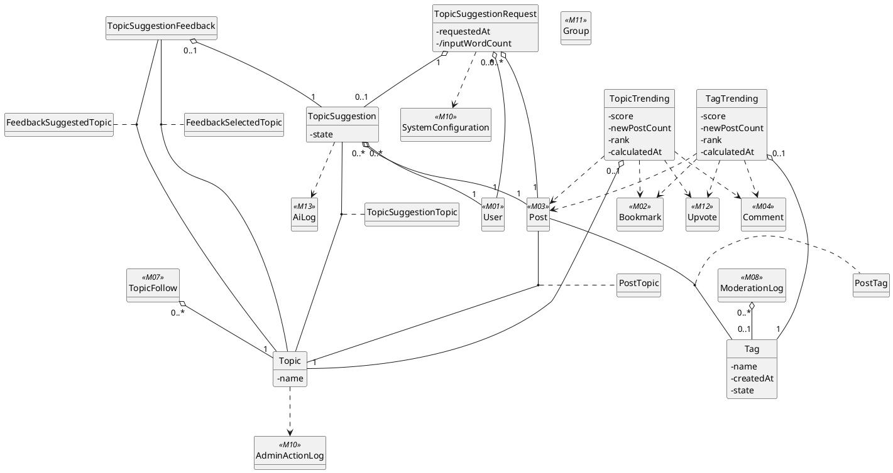

# Phân tích lớp thực thể — M05 Topic & Tag

<!-- [Vietnamese Doc] Tài liệu tiếng Việt; tên lớp và thuộc tính viết tiếng Anh (input/CONVENTIONS.md mục 3). -->

| Mã tài liệu | EC-M05 |
|---|---|
| Dự án | iShare |
| Module | M05 — Topic & Tag |
| Đầu vào | FR-M05 phiên bản 1.7 |
| Trạng thái | Bản nháp |
| Phiên bản | 0.3 |
| Ngày | 2026-11-17 |
| Tác giả | Phạm Văn Đức |

<!-- Quy ước chung cho mọi bảng dưới đây:
     - Không đổi tên cột, không xóa cột, không đổi số mục: tool đọc bảng theo số mục và tên cột.
     - Ô không có nội dung ghi "—".
     - Mục chưa tới bước làm thì để dòng "(Chưa làm — bước N)".
     - Cột Nguồn ghi mã trong FR: FR-M05-nn, FR-M05-nn.mm, BR-M05-nn, hoặc TN:<thuật ngữ> (mục 2.1 của FR).
     - Sơ đồ ở mục 4 do gen_puml.py sinh; không sửa tay. -->

## 1. Mô tả chức năng

### 1.1 Đoạn mô tả

(S1) Hệ thống quản lý Topic trong danh mục Topic, Tag và việc gán Topic, gắn Tag cho bài viết, đồng thời xử lý gợi ý Topic, phản hồi gợi ý và kết quả Trending Topic, Trending Tag. (S2) Hệ thống cho tác giả bài viết là User, Mod hoặc Admin chọn Topic từ danh mục Topic, ghi nhận Topic của bài viết khi gửi bài, thêm hoặc bỏ Topic khi sửa bài đã gửi và lưu lựa chọn Topic của bài nháp. (S3) Hệ thống cho tác giả gắn hoặc bỏ Tag trên bài viết của mình, chuẩn hóa tên Tag về chữ thường, dùng lại Tag có cùng tên chuẩn hóa và tự tạo Tag mới ở trạng thái hoạt động khi Tag được gắn lần đầu. (S4) Hệ thống cho tác giả yêu cầu AI gợi ý Topic khi soạn hoặc sửa bài viết, dùng tiêu đề và nội dung chữ của bài viết làm đầu vào, kiểm tra độ dài và tần suất yêu cầu của người dùng, dùng công tắc AI tổng và công tắc gợi ý Topic do M10 cung cấp để quyết định khả năng gợi ý. (S5) Hệ thống nhận các Topic AI gợi ý hợp lệ từ M13 để tác giả quyết định lựa chọn cuối cùng, đánh dấu gợi ý lỗi thời khi tiêu đề hoặc nội dung chữ thay đổi và cho tác giả tiếp tục chọn Topic thủ công khi gợi ý thất bại hoặc tính năng gợi ý đang tắt. (S6) Hệ thống ghi phản hồi gợi ý khi tác giả gửi bài viết hoặc lưu bản sửa với gợi ý gần nhất còn hợp lệ, gồm các Topic đã gợi ý và các Topic tác giả chọn cuối cùng, cung cấp phản hồi gợi ý cho M13 đánh giá chất lượng AI và giữ phản hồi gợi ý sau khi tài khoản tác giả chuyển sang DELETED với danh tính tác giả được gỡ bỏ. (S7) Hệ thống cho Guest, User, Mod và Admin xem danh mục Topic, danh sách Tag đang hoạt động cùng Topic và Tag đang hoạt động của từng bài viết. (S8) Hệ thống cho Admin thêm Topic có tên hợp lệ và duy nhất vào danh mục Topic cấu trúc phẳng, làm Topic mới có thể được tác giả chọn và được AI gợi ý, đồng thời dùng nhật ký thao tác của Admin thuộc M10 cho việc thêm Topic. (S9) Hệ thống cho Admin gộp Topic nguồn vào Topic đích, chuyển Topic của các bài viết và lượt theo dõi Topic sang Topic đích, xử lý phần trùng rồi xóa Topic nguồn khỏi danh mục Topic, đồng thời dùng nhật ký thao tác của Admin thuộc M10 cho việc gộp Topic. (S10) Hệ thống cho Admin xóa Topic khi Topic chỉ còn gắn với bài nháp hoặc chưa gắn với bài viết, bỏ Topic đã xóa khỏi bài nháp và bỏ các lượt theo dõi Topic tương ứng, đồng thời dùng nhật ký thao tác của Admin thuộc M10 cho việc xóa Topic. (S11) Hệ thống cho Mod và Admin vô hiệu hóa Tag trong tình huống khủng hoảng và kích hoạt lại Tag, lưu trạng thái Tag, giữ liên kết giữa Tag bị vô hiệu hóa với bài viết, đồng thời ghi nhật ký kiểm duyệt tại M08 với người thực hiện, loại thao tác, Tag, lý do nếu có và thời điểm. (S12) Hệ thống cho Mod và Admin đổi Topic, Tag trên bài viết của người khác theo giới hạn của tác giả, lưu các Topic và Tag được chọn, đồng thời ghi nhật ký kiểm duyệt tại M08 với người thực hiện, loại thao tác, bài viết, lý do nếu có và thời điểm. (S13) Hệ thống định kỳ tính điểm Trending và số bài mới của mỗi Topic và mỗi Tag đang hoạt động trong cửa sổ thời gian từ bài viết được đăng, upvote bài viết, bình luận gồm cả trả lời và bookmark, dùng thời điểm tương tác cùng việc rút lại do M03, M04, M12 và M02 cung cấp. (S14) Hệ thống dùng trạng thái hiển thị của bài viết trên feed chính, trạng thái tài khoản tác giả và ngữ cảnh nhóm Public, Private hoặc bài viết bị gỡ khỏi nhóm để xác định các tương tác được tính vào Trending, rồi cộng điểm của bài viết cho từng Topic và Tag của bài viết. (S15) Hệ thống cung cấp kết quả Trending của lần tính gần nhất cho M14, gồm điểm Trending và thứ tự xếp hạng theo điểm Trending, số bài mới và tên Topic hoặc Tag. (S16) Hệ thống cung cấp danh sách Topic và Tag đang hoạt động cho M06 tìm kiếm và lọc bài viết, danh mục Topic cùng thay đổi lượt theo dõi Topic cho M07, và liên kết bài viết–Topic cho M15 thống kê phân bố bài viết theo Topic.

<!-- Một đoạn văn, mỗi câu đánh số (S1) (S2) … Xem steps/01-describe-functions.md. -->

### 1.2 Truy vết câu

| Câu | Nội dung tóm tắt | Nguồn |
|---|---|---|
| S1 | Phạm vi quản lý Topic, Tag và dữ liệu hỗ trợ | FR-M05-01, FR-M05-02, FR-M05-03, FR-M05-05 |
| S2 | Tác giả gán và thay đổi Topic | FR-M05-01, FR-M05-01.02, FR-M05-01.06, FR-M05-01.10 |
| S3 | Gắn Tag, chuẩn hóa và tạo Tag | FR-M05-03, FR-M05-03.01, FR-M05-03.02, FR-M05-03.03, FR-M05-03.10, FR-M05-03.14 |
| S4 | Đầu vào gợi ý Topic và điều kiện thực hiện | FR-M05-02, FR-M05-02.01, FR-M05-02.05, FR-M05-02.15, FR-M05-02.16, FR-M05-02.20 |
| S5 | Kết quả gợi ý, dấu lỗi thời và lựa chọn thủ công | FR-M05-02.03, FR-M05-02.04, FR-M05-02.06, FR-M05-02.07, FR-M05-02.09, FR-M05-02.17, FR-M05-02.19 |
| S6 | Ghi và giữ phản hồi gợi ý để đánh giá AI | FR-M05-02.12, FR-M05-02.13, FR-M05-02.14, FR-M05-02.22 |
| S7 | Xem danh sách Topic và Tag | FR-M05-04, FR-M05-04.01, FR-M05-04.02, FR-M05-04.04 |
| S8 | Admin thêm Topic | FR-M05-06, FR-M05-06.01, FR-M05-06.04, FR-M05-06.07, FR-M05-06.08 |
| S9 | Admin gộp Topic và chuyển dữ liệu liên quan | FR-M05-07, FR-M05-07.01, FR-M05-07.02, FR-M05-07.05, FR-M05-07.06 |
| S10 | Admin xóa Topic theo điều kiện và xử lý dữ liệu liên quan | FR-M05-08, FR-M05-08.01, FR-M05-08.02, FR-M05-08.05, FR-M05-08.06 |
| S11 | Vô hiệu hóa, kích hoạt lại Tag và nhật ký kiểm duyệt | FR-M05-09, FR-M05-10, FR-M05-09.01, FR-M05-09.03, FR-M05-09.07, FR-M05-10.01, FR-M05-10.06 |
| S12 | Đổi Topic, Tag trên bài của người khác và ghi nhật ký | FR-M05-11, FR-M05-11.01, FR-M05-11.02, FR-M05-11.07 |
| S13 | Đầu vào và các đại lượng tính cho Trending | FR-M05-05, FR-M05-05.01, FR-M05-05.03, FR-M05-05.04, FR-M05-05.05, FR-M05-05.09, FR-M05-05.13 |
| S14 | Điều kiện chọn tương tác và phân bổ điểm Trending | FR-M05-05.06, FR-M05-05.11 |
| S15 | Kết quả Trending gần nhất và thứ tự xếp hạng | FR-M05-05.09, FR-M05-05.10, FR-M05-05.14 |
| S16 | Dữ liệu cung cấp cho tìm kiếm, theo dõi và thống kê | FR-M05-04.01, FR-M05-04.02, FR-M05-07.06, FR-M05-08.06, FR-M05-01.02 |

## 2. Danh từ và phân loại

### 2.1 Sổ danh từ

| # | Danh từ | Xuất hiện ở | Phân loại | Kết quả | Lý do |
|---|---|---|---|---|---|
| 1 | Hệ thống | S1 | Loại bỏ | — | Trừu tượng, tác nhân xử lý. |
| 2 | Topic / Topic nguồn / Topic đích / Topic đã gợi ý / Topic được chọn cuối cùng | S1 | Lớp | Topic | T8, đối tượng danh mục được thêm, gộp, xóa, FR-M05-06/07/08. Các cụm sau chỉ vai trò. |
| 3 | Danh mục Topic | S1 | Loại bỏ | — | Chung chung, tập hợp Topic cấu trúc phẳng, BR-M05-01. |
| 4 | Tag | S1 | Lớp | Tag | T8, từ khóa được tạo và đổi trạng thái theo FR-M05-03.02/09/10. |
| 5 | Việc gán Topic / liên kết bài viết–Topic | S1 | Lớp | PostTopic | T8, bản ghi gán bài với Topic theo FR-M05-01.02, vòng đời thêm/bỏ. Nhóm Liên kết đã được xác định ở bước 3 theo Q-01 đã duyệt. |
| 6 | Việc gắn Tag / liên kết bài viết–Tag | S1 | Lớp | PostTag | T8, bản ghi gắn bài với Tag theo FR-M05-03.01/03.10. Nhóm Liên kết đã được xác định ở bước 3 theo Q-01 đã duyệt. |
| 7 | Bài viết / bài nháp / bản sửa | S1 | Lớp | Post | T4, M03 sở hữu, dùng lại tên EC-M03. |
| 8 | Gợi ý Topic / lượt gợi ý Topic | S1 | Lớp | TopicSuggestion | T8, kết quả gợi ý có trạng thái Còn hiệu lực/Lỗi thời theo FR-M05-02.03/02.09. |
| 9 | Phản hồi gợi ý | S1 | Lớp | TopicSuggestionFeedback | T8, bản ghi giữ các Topic đề xuất và được chọn theo FR-M05-02.12/02.22, dùng lại tên EC-M01. Q-01. |
| 10 | Kết quả Trending Topic | S1 | Lớp | TopicTrending | T8, kết quả tính được lưu theo FR-M05-05.10 và BR-M05-30. |
| 11 | Kết quả Trending Tag | S1 | Lớp | TagTrending | T8, kết quả tính được lưu theo FR-M05-05.10 và BR-M05-30. |
| 12 | Tác giả bài viết / User / Mod / Admin / người dùng / tài khoản / người thực hiện | S2 | Lớp | User | T3, vai trò dùng tài khoản thuộc M01. |
| 13 | Lựa chọn Topic / lựa chọn cuối cùng | S2 | Loại bỏ | — | Chung chung, Topic ở vai trò lựa chọn được ghi qua bản gán hoặc phản hồi gợi ý. |
| 14 | Tên Tag / tên Tag chuẩn hóa | S3 | Thuộc tính | Tag.name | T9, dữ liệu của Tag theo BR-M05-20/23/24. |
| 15 | Chữ thường | S3 | Loại bỏ | — | Giá trị chuẩn hóa của Tag.name theo BR-M05-24. |
| 16 | Hoạt động / bị vô hiệu hóa | S3 | Loại bỏ | — | Giá trị của Tag.state theo FR-M05-03.02/09.01/10.01. |
| 17 | Yêu cầu gợi ý / lần yêu cầu gợi ý | S4 | Lớp | TopicSuggestionRequest | T8, lượt yêu cầu theo người dùng và thời điểm để kiểm tra cửa sổ tần suất FR-M05-02.15, đề xuất biểu diễn nghiệp vụ ở cổng. |
| 18 | AI / nhà cung cấp AI | S4 | Loại bỏ | — | Ngoài phạm vi module (M13), tác nhân thực hiện gợi ý. |
| 19 | Tiêu đề | S4 | Loại bỏ | — | Ngoài phạm vi module (M03), Post.title đã có. |
| 20 | Nội dung chữ | S4 | Loại bỏ | — | Ngoài phạm vi module (M03), Post.plainText đã có. |
| 21 | Độ dài đầu vào / số từ đầu vào | S4 | Thuộc tính | TopicSuggestionRequest.inputWordCount | T7, đếm cụm cách bởi khoảng trắng trên tiêu đề cộng nội dung chữ, BR-M05-12. |
| 22 | Tần suất yêu cầu | S4 | Loại bỏ | — | Chung chung, số lượt của User trong cửa sổ trượt được kiểm từ thời điểm các TopicSuggestionRequest theo BR-M05-17. |
| 23 | Công tắc AI tổng / công tắc gợi ý Topic | S4 | Lớp | SystemConfiguration | T4, dữ liệu cấu hình M10, dùng lại tên EC-M01/03. |
| 24 | Tình trạng lỗi thời / gợi ý lỗi thời | S5 | Thuộc tính | TopicSuggestion.state | T9, tập trạng thái theo FR-M05-02.03/02.09 và mục 5.14. |
| 25 | Gợi ý thất bại | S5 | Loại bỏ | — | Ngoài phạm vi module (M13) với kết quả thô, M05 kiểm Topic thuộc danh mục theo BR-M05-14/19. |
| 26 | Chọn Topic thủ công | S5 | Loại bỏ | — | Hành động không lưu dấu vết riêng, các Topic được chọn đã có trong dữ liệu gán bài. |
| 27 | Chất lượng AI / đánh giá chất lượng AI | S6 | Loại bỏ | — | Ngoài phạm vi module (M13), M05 cung cấp phản hồi gợi ý. |
| 28 | Danh tính tác giả / trạng thái tài khoản / DELETED | S6 | Loại bỏ | — | Ngoài phạm vi module (M01), User và trạng thái tài khoản được M01 quản lý, FR-M05-02.22 gỡ tham chiếu danh tính. |
| 29 | Guest | S7 | Loại bỏ | — | Không lưu: tác nhân không có dữ liệu tài khoản. |
| 30 | Danh sách Tag / danh sách Topic | S7 | Loại bỏ | — | Chung chung, tập kết quả truy vấn Tag/Topic. |
| 31 | Tên Topic / tên Topic nguồn / tên Topic đích | S8 | Thuộc tính | Topic.name | T9, tên của Topic, so trùng theo BR-M05-05. |
| 32 | Cấu trúc phẳng / Topic con | S8 | Loại bỏ | — | Hằng số của BR-M05-01, quy tắc danh mục. |
| 33 | Nhật ký thao tác của Admin | S8 | Lớp | AdminActionLog | T4, M10 sở hữu theo mục 5.15, tên tạm chờ EC-M10. |
| 34 | Lượt theo dõi Topic | S9 | Lớp | TopicFollow | T4, M07 sở hữu, dùng lại tên EC-M01, chuyển hoặc bỏ theo FR-M05-07.06/08.06. |
| 35 | Phần trùng / gộp Topic / xóa Topic | S9 | Loại bỏ | — | Hành động không lưu dấu vết riêng tại M05, kết quả nằm trên Topic, PostTopic và TopicFollow, nhật ký thuộc M10. |
| 36 | Trạng thái Tag | S11 | Thuộc tính | Tag.state | T9, trạng thái được lưu theo FR-M05-09.01/10.01. |
| 37 | Tình huống khủng hoảng | S11 | Loại bỏ | — | Chung chung, đánh giá của Mod/Admin, FR chỉ dùng làm ngữ cảnh vô hiệu hóa. |
| 38 | Nhật ký kiểm duyệt | S11 | Lớp | ModerationLog | T4, M08 sở hữu, dùng lại tên EC-M01. |
| 39 | Loại thao tác / lý do / thời điểm thao tác | S11 | Loại bỏ | — | Ngoài phạm vi module (M08), dữ liệu của ModerationLog theo FR-M05-09.07/10.06/11.07. |
| 40 | Giới hạn của tác giả | S12 | Loại bỏ | — | Hằng số của BR-M05-04, ràng buộc số Topic và Tag của bài. |
| 41 | Điểm Trending của Topic | S13 | Thuộc tính | TopicTrending.score | T8, kết quả tính được lưu theo FR-M05-05.10, công thức BR-M05-29. |
| 42 | Điểm Trending của Tag | S13 | Thuộc tính | TagTrending.score | T8, kết quả tính được lưu theo FR-M05-05.10, công thức BR-M05-29. |
| 43 | Số bài mới của Topic | S13 | Thuộc tính | TopicTrending.newPostCount | T8, số bài trong cửa sổ tính được giữ cho thứ tự kết quả gần nhất theo FR-M05-05.09/05.10. |
| 44 | Số bài mới của Tag | S13 | Thuộc tính | TagTrending.newPostCount | T8, số bài trong cửa sổ tính được giữ cho thứ tự kết quả gần nhất theo FR-M05-05.09/05.10. |
| 45 | Cửa sổ thời gian / cửa sổ 7 ngày | S13 | Loại bỏ | — | Hằng số của BR-M05-29, quy tắc 7 × 24 giờ. |
| 46 | Upvote bài viết | S13 | Lớp | Upvote | T4, dữ liệu tương tác M12, dùng lại EC-M01/03. |
| 47 | Bình luận / trả lời | S13 | Lớp | Comment | T4, dữ liệu tương tác M04, dùng lại EC-M04. |
| 48 | Bookmark | S13 | Lớp | Bookmark | T4, dữ liệu tương tác M02, dùng lại EC-M02, nhóm Liên kết thuộc định nghĩa M02 sẽ ghi khi xét bước 3. |
| 49 | Tương tác | S13 | Loại bỏ | — | Chung chung, tên gộp đăng bài, Upvote, Comment, Bookmark theo BR-M05-29. |
| 50 | Thời điểm tương tác / việc rút lại | S13 | Loại bỏ | — | Ngoài phạm vi module (M03, M04, M12, M02), dữ liệu nguồn để tính Trending. |
| 51 | Feed chính / trạng thái hiển thị bài viết | S14 | Loại bỏ | — | Ngoài phạm vi module (M03, M14), điều kiện chọn Post để tính theo FR-M05-05.11. |
| 52 | Nhóm / nhóm Public / nhóm Private | S14 | Lớp | Group | T4, M11 cung cấp quyền riêng tư và ngữ cảnh hiển thị, dùng lại tên các EC trước. |
| 53 | Bài viết bị gỡ khỏi nhóm | S14 | Loại bỏ | — | Ngoài phạm vi module (M03, M11), Post.removedFromGroup đã có ở EC-M03. |
| 54 | Thứ tự xếp hạng Topic | S15 | Thuộc tính | TopicTrending.rank | T8, thứ tự kết quả tính được giữ theo FR-M05-05.09/05.10, BR-M05-31. |
| 55 | Thứ tự xếp hạng Tag | S15 | Thuộc tính | TagTrending.rank | T8, thứ tự kết quả tính được giữ theo FR-M05-05.09/05.10, BR-M05-31. |
| 56 | Tìm kiếm / lọc bài viết | S16 | Loại bỏ | — | Ngoài phạm vi module (M06), sử dụng Topic/Tag do M05 cung cấp. |
| 57 | Thống kê phân bố bài viết theo Topic | S16 | Loại bỏ | — | Ngoài phạm vi module (M15), dùng PostTopic. |
| 58 | Chu kỳ tính / 15–30 phút / 30 phút | Quét: BR-M05-30 | Loại bỏ | — | Hằng số của BR-M05-30, khoảng chu kỳ và hạn cập nhật. |
| 59 | Số lượng Topic / số lượng Tag / tối đa 3 Topic / tối đa 5 Tag / 11 Topic ban đầu | Quét: BR-M05-02, BR-M05-03, BR-M05-22 | Loại bỏ | — | Hằng số của BR-M05-02/03/22, ràng buộc gán bài và dữ liệu khởi tạo. |
| 60 | Độ dài tên Tag / 30 ký tự / chữ cái / chữ số / gạch dưới / dấu # | Quét: BR-M05-20, BR-M05-23 | Loại bỏ | — | Hằng số của BR-M05-20/23 và biểu diễn Tag.name, dấu # dùng khi hiển thị. |
| 61 | 20 từ / 10 lần / 60 giây | Quét: BR-M05-12, BR-M05-17 | Loại bỏ | — | Hằng số của BR-M05-12/17, ràng buộc đầu vào và tần suất gợi ý. |
| 62 | Còn hiệu lực / Lỗi thời | Quét: FR-M05-02.03, FR-M05-02.09 | Loại bỏ | — | Giá trị của TopicSuggestion.state. |
| 63 | Kết quả thô AI / nhật ký AI | Quét: FR-M05-02.01 | Lớp | AiLog | T4, M13 ghi kết quả thô theo giao tiếp mục 5.15, dùng lại tên EC-M01. |
| 64 | Thời điểm yêu cầu gợi ý | Quét: FR-M05-02.15 | Thuộc tính | TopicSuggestionRequest.requestedAt | T9, mốc của lượt yêu cầu để kiểm tra 60 giây gần nhất, BR-M05-17. |
| 65 | Thời điểm tạo Tag | Quét: Dữ liệu nghiệp vụ | Thuộc tính | Tag.createdAt | T9, dữ liệu Tag mục 5.13 nêu trực tiếp, nguồn tạo là FR-M05-03.02. |
| 66 | Thời điểm tính Trending Topic | Quét: Dữ liệu nghiệp vụ | Thuộc tính | TopicTrending.calculatedAt | T9, dữ liệu Điểm Trending mục 5.13 nêu trực tiếp. |
| 67 | Thời điểm tính Trending Tag | Quét: Dữ liệu nghiệp vụ | Thuộc tính | TagTrending.calculatedAt | T9, dữ liệu Điểm Trending mục 5.13 nêu trực tiếp. |
| 68 | Topic hợp lệ trong lượt gợi ý | Quét: FR-M05-02.03, FR-M05-02.19 (bước 3) | Lớp | TopicSuggestionTopic | Tách quan hệ n-n theo hai đầu và vai trò của lớp liên kết. |
| 69 | Vai trò Topic AI đã gợi ý trong phản hồi | Quét: FR-M05-02.12 (bước 3) | Lớp | FeedbackSuggestedTopic | Tách quan hệ n-n theo hai đầu và vai trò của lớp liên kết. |
| 70 | Vai trò Topic tác giả chọn cuối cùng trong phản hồi | Quét: FR-M05-02.12, FR-M05-01.02 (bước 3) | Lớp | FeedbackSelectedTopic | Tách quan hệ n-n theo hai đầu và vai trò của lớp liên kết. |

Tổng 70 dòng danh từ, gồm 23 dòng thành lớp, 15 dòng thành thuộc tính, 32 dòng bị loại. Lượt quét bổ sung có 13 dòng, trong đó 3 dòng lớp liên kết được thêm ở bước 3. Danh từ đa vai trò được gộp vào một dòng, các đại lượng Trending được tách theo Topic và Tag vì thuộc các kết quả khác nhau.

### 2.2 Lớp

| Lớp | Tên tiếng Việt | Nhóm | Sở hữu | Mô tả | Nguồn |
|---|---|---|---|---|---|
| Topic | Topic | Thực thể | M05 | Mục danh mục được Admin quản lý. | FR-M05-06.01, FR-M05-07, FR-M05-08 |
| Tag | Tag | Thực thể | M05 | Từ khóa chuẩn hóa và trạng thái. | FR-M05-03.02, FR-M05-09.01, FR-M05-10.01 |
| PostTopic | Liên kết bài viết–Topic | Liên kết | M05 | Bản gán bài với Topic, nhóm Liên kết được xác định ở bước 3 theo Q-01 đã duyệt. | FR-M05-01.02, FR-M05-01.06 |
| PostTag | Liên kết bài viết–Tag | Liên kết | M05 | Bản gắn bài với Tag, nhóm Liên kết được xác định ở bước 3 theo Q-01 đã duyệt. | FR-M05-03.01, FR-M05-03.10 |
| TopicSuggestion | Lượt gợi ý Topic | Thực thể | M05 | Kết quả gợi ý có trạng thái còn hiệu lực hoặc lỗi thời. | FR-M05-02.03, FR-M05-02.09 |
| TopicSuggestionRequest | Lượt yêu cầu gợi ý Topic | Thực thể | M05 | Đề xuất biểu diễn lượt yêu cầu có mốc thời gian để kiểm tra tần suất. | FR-M05-02.15, BR-M05-17 |
| TopicSuggestionFeedback | Phản hồi gợi ý | Thực thể | M05 | Bản ghi các Topic AI gợi ý và tác giả chọn, tên dùng lại EC-M01, Q-01. | FR-M05-02.12, FR-M05-02.22 |
| TopicTrending | Kết quả Trending Topic | Thực thể | M05 | Kết quả tính được lưu theo FR-M05-05.10, thay khi tính tiếp. | FR-M05-05.01, FR-M05-05.09, FR-M05-05.10 |
| TagTrending | Kết quả Trending Tag | Thực thể | M05 | Kết quả tính được lưu theo FR-M05-05.10, thay khi tính tiếp. | FR-M05-05.01, FR-M05-05.09, FR-M05-05.10 |
| Post | Bài viết | Thực thể | M03 | Đầu vào gán Topic, Tag, gợi ý và Trending, dùng EC-M03. | FR-M05-01.02, FR-M05-02.01 |
| User | Tài khoản | Thực thể | M01 | Tác giả, Mod, Admin và người yêu cầu gợi ý, dùng EC-M01. | FR-M05-02.15, FR-M05-11.04 |
| SystemConfiguration | Cấu hình hệ thống | Thực thể | M10 | Công tắc AI, tên dùng lại EC-M01/03, chờ EC-M10. | FR-M05-02.16 |
| AiLog | Nhật ký AI | Thực thể | M13 | Kết quả AI thô theo mục 5.15, tên dùng lại EC-M01, chờ EC-M13. | FR-M05-02.01 |
| AdminActionLog | Nhật ký thao tác Admin | Thực thể | M10 | Nhật ký thêm, gộp, xóa Topic theo mục 5.15, tên tạm chờ EC-M10. | FR-M05-06, FR-M05-07, FR-M05-08 |
| ModerationLog | Nhật ký kiểm duyệt | Thực thể | M08 | Nhật ký thao tác Tag và sửa phân loại bài, dùng lại EC-M01, chờ EC-M08. | FR-M05-09.07, FR-M05-10.06, FR-M05-11.07 |
| TopicFollow | Lượt theo dõi Topic | Thực thể | M07 | Chuyển khi gộp, bỏ khi xóa Topic, dùng lại EC-M01, chờ EC-M07. | FR-M05-07.06, FR-M05-08.06 |
| Upvote | Upvote | Thực thể | M12 | Tương tác upvote bài để tính Trending, dùng tên các EC trước, chờ EC-M12. | BR-M05-29 |
| Comment | Bình luận | Thực thể | M04 | Bình luận gồm trả lời trong điểm Trending, dùng EC-M04. | FR-M05-05.13, BR-M05-29 |
| Bookmark | Bookmark | Liên kết | M02 | Tương tác lưu bài để tính Trending, dùng EC-M02. Nhóm đã đối chiếu với EC-M02. | BR-M05-29 |
| Group | Nhóm | Thực thể | M11 | Quyền riêng tư nhóm dùng khi lọc tương tác, dùng tên các EC trước, chờ EC-M11. | FR-M05-05.11 |
| TopicSuggestionTopic | Topic hợp lệ trong lượt gợi ý | Liên kết | M05 | Lớp liên kết được xác định bởi cặp hai đầu trong vai trò đã nêu. | FR-M05-02.03, FR-M05-02.19 |
| FeedbackSuggestedTopic | Vai trò Topic AI đã gợi ý trong phản hồi | Liên kết | M05 | Lớp liên kết được xác định bởi cặp hai đầu trong vai trò đã nêu. | FR-M05-02.12 |
| FeedbackSelectedTopic | Vai trò Topic tác giả chọn cuối cùng trong phản hồi | Liên kết | M05 | Lớp liên kết được xác định bởi cặp hai đầu trong vai trò đã nêu. | FR-M05-02.12, FR-M05-01.02 |

Có 12 lớp M05 và 11 lớp ngoài. PostTopic/PostTag đã chuyển nhóm Liên kết ở bước 3. Bookmark dùng nhóm Liên kết của EC-M02.

TopicTrending và TagTrending biểu diễn kết quả lần tính gần nhất theo FR-M05-05.10, BR-M05-30. Đây là kết quả tính được lưu theo yêu cầu. Tên hai lớp là đề xuất của M05. TopicSuggestionRequest là đề xuất biểu diễn lượt yêu cầu để thực hiện cửa sổ tần suất BR-M05-17, tách với kết quả gợi ý TopicSuggestion. Gợi ý thất bại vẫn là một yêu cầu, kết quả gợi ý có trạng thái riêng theo FR mục 5.14. Thời hạn lưu lượt yêu cầu và lượt gợi ý được để cho bước thiết kế khi có căn cứ, mục CRUD FR đã ghi thời hạn lưu lượt gợi ý chưa được quy định.

### 2.3 Thuộc tính

| Lớp | Thuộc tính | Tên tiếng Việt | Tính chất | Ràng buộc nguồn nêu | Nguồn |
|---|---|---|---|---|---|
| Topic | name | Tên Topic | Lưu | Duy nhất theo so trùng bỏ hoa/thường, bỏ khoảng trắng thừa, phân biệt dấu. BR-M05-05. | FR-M05-06.01, FR-M05-06.08, BR-M05-05 |
| Tag | name | Tên Tag chuẩn hóa | Lưu | Chữ thường, duy nhất, giữ dấu, tối đa 30 ký tự, chữ cái/chữ số/_, ít nhất một chữ cái. Dấu # dùng khi hiển thị. | BR-M05-20, BR-M05-23, BR-M05-24 |
| Tag | createdAt | Thời điểm tạo Tag | Lưu | Mục 5.13 nêu thời điểm tạo, Tag được tạo khi gắn lần đầu. | FR-M05-03.02 |
| Tag | state | Trạng thái Tag | Lưu | Hoạt động khi tạo, có thể chuyển Bị vô hiệu hóa và kích hoạt lại. | FR-M05-03.02, FR-M05-09.01, FR-M05-10.01 |
| TopicSuggestion | state | Tình trạng gợi ý | Lưu | Còn hiệu lực hoặc Lỗi thời theo mục 5.14, tiêu đề/nội dung đổi làm lỗi thời. | FR-M05-02.03, FR-M05-02.09 |
| TopicSuggestionRequest | requestedAt | Thời điểm yêu cầu | Lưu | Đề xuất lưu mốc lượt yêu cầu để đếm số yêu cầu của người dùng trong 60 giây gần nhất, tối đa 10 lần. | FR-M05-02.15, BR-M05-17 |
| TopicSuggestionRequest | inputWordCount | Số từ đầu vào | Dẫn xuất | Đếm cụm cách nhau bằng khoảng trắng của tiêu đề cộng nội dung chữ tại lúc yêu cầu, ngưỡng 20 từ. Chỉ dùng khi kiểm tra yêu cầu. | FR-M05-02.05, BR-M05-12 |
| TopicTrending | score | Điểm Trending | Lưu | Kết quả tính được lưu theo FR-M05-05.10. Trên bài đủ điều kiện trong 7 × 24 giờ, điểm = bài mới + 2 × upvote bài + bình luận gồm trả lời + bookmark, theo BR-M05-29. | FR-M05-05.01, FR-M05-05.10, BR-M05-29 |
| TopicTrending | newPostCount | Số bài mới | Lưu | Số bài được đăng trong cửa sổ 7 ngày của lần tính, giữ để xếp kết quả gần nhất khi bằng điểm. | FR-M05-05.09, FR-M05-05.10, TN:Bài mới (trong Trending) |
| TopicTrending | rank | Thứ tự xếp hạng | Lưu | Kết quả thứ tự theo điểm giảm dần, số bài mới giảm dần, tên A–Z, mỗi mục một hạng, chỉ hiện điểm > 0. | FR-M05-05.09, FR-M05-05.10, FR-M05-05.14, BR-M05-31 |
| TopicTrending | calculatedAt | Thời điểm tính | Lưu | Dữ liệu Điểm Trending mục 5.13 nêu thời điểm tính, giữ cùng kết quả gần nhất, thay ở lần tính kế tiếp. | FR-M05-05.01, FR-M05-05.10, BR-M05-30 |
| TagTrending | score | Điểm Trending | Lưu | Kết quả tính được lưu theo FR-M05-05.10. Trên bài đủ điều kiện trong 7 × 24 giờ, điểm = bài mới + 2 × upvote bài + bình luận gồm trả lời + bookmark, theo BR-M05-29. | FR-M05-05.01, FR-M05-05.10, BR-M05-29 |
| TagTrending | newPostCount | Số bài mới | Lưu | Số bài được đăng trong cửa sổ 7 ngày của lần tính, giữ để xếp kết quả gần nhất khi bằng điểm. | FR-M05-05.09, FR-M05-05.10, TN:Bài mới (trong Trending) |
| TagTrending | rank | Thứ tự xếp hạng | Lưu | Kết quả thứ tự theo điểm giảm dần, số bài mới giảm dần, tên A–Z, mỗi mục một hạng, chỉ hiện điểm > 0. | FR-M05-05.09, FR-M05-05.10, FR-M05-05.14, BR-M05-31 |
| TagTrending | calculatedAt | Thời điểm tính | Lưu | Dữ liệu Điểm Trending mục 5.13 nêu thời điểm tính, giữ cùng kết quả gần nhất, thay ở lần tính kế tiếp. | FR-M05-05.01, FR-M05-05.10, BR-M05-30 |

Có 15 thuộc tính, gồm 14 thuộc tính lưu và 1 thuộc tính dẫn xuất. inputWordCount được tính trên dữ liệu đầu vào tại lúc kiểm tra yêu cầu. Những thuộc tính score/newPostCount/rank là kết quả được giữ của lần tính gần nhất theo FR-M05-05.10.

PostTopic, PostTag và TopicSuggestionFeedback hiện có dữ liệu tham chiếu đối tượng. Hai tập Topic của phản hồi đã được xét ở bước 3 qua FeedbackSuggestedTopic và FeedbackSelectedTopic, Q-01 đã được đồng ý. Mục 5.13 của FR nêu thời điểm tạo Tag và thời điểm tính Điểm Trending, các thuộc tính này đã được bổ sung qua lượt quét đối chiếu.

### 2.4 Đối chiếu với mục Dữ liệu nghiệp vụ của FR

| Thực thể trong FR | Trong mô hình | Xử lý |
|---|---|---|
| Topic | Topic | Khớp tên và quy tắc duy nhất theo BR-M05-05. |
| Liên kết bài viết–Topic | PostTopic | Khớp bản ghi gán bài với Topic. Đã xác định nhóm Liên kết ở bước 3 theo Q-01 đã duyệt. |
| Tag | Tag | Đã thêm qua sổ danh từ: Tag.createdAt từ đối chiếu mục 5.13, nguồn FR-M05-03.02. Tên chuẩn hóa và trạng thái đã có. |
| Liên kết bài viết–Tag | PostTag | Khớp bản ghi gắn bài với Tag, giữ khi Tag vô hiệu hóa. Đã xác định nhóm Liên kết ở bước 3 theo Q-01 đã duyệt. |
| Lượt gợi ý Topic | TopicSuggestion | Khớp trạng thái. Bài, tác giả và Topic gợi ý được gọi tên trong sổ, việc biểu diễn tham chiếu thuộc bước 3. |
| Phản hồi gợi ý | TopicSuggestionFeedback | Khớp các tập Topic và liên hệ lượt gợi ý, giữ sau khi tài khoản xóa. Q-01 về thực thể hiện chỉ có tham chiếu. |
| Điểm Trending | TopicTrending, TagTrending | Đã thêm qua sổ danh từ: calculatedAt từ mục 5.13. Tách kết quả theo loại Topic/Tag, giữ kết quả lần tính gần nhất theo FR-M05-05.10. Mô hình có thêm newPostCount/rank từ FR-M05-05.09 và BR-M05-31. |
| Bổ sung từ yêu cầu | TopicSuggestionRequest | Mô hình có thêm lượt yêu cầu và requestedAt để kiểm tra tần suất FR-M05-02.15, BR-M05-17, inputWordCount từ FR-M05-02.05. Đây là đề xuất biểu diễn để người dùng duyệt. |
| Tham chiếu ngoài | Post, User, SystemConfiguration, AiLog, AdminActionLog, ModerationLog, TopicFollow, Upvote, Comment, Bookmark, Group | Mô hình có thêm đối tượng ngoài theo yêu cầu và giao tiếp mục 5.15, dùng tên đã có. AdminActionLog là tên tạm mới, các module M07/08/10/11/12/13 chờ EC sở hữu để đối chiếu. |

## 3. Quan hệ giữa các lớp

### 3.1 Ma trận cặp lớp

| Lớp / mã | 01 | 02 | 03 | 04 | 05 | 06 | 07 | 08 | 09 | 10 | 11 | 12 | 13 | 14 | 15 | 16 | 17 | 18 | 19 | 20 | 21 | 22 | 23 |
|---|---|---|---|---|---|---|---|---|---|---|---|---|---|---|---|---|---|---|---|---|---|---|---|
| 01 Topic |  |  | T |  | G(TopicSuggestionTopic) |  | G(FeedbackSuggestedTopic/FeedbackSelectedTopic) | T |  | G(PostTopic) |  |  |  | T |  | T |  |  |  |  | T | T | T |
| 02 Tag |  |  |  | T |  |  |  |  | T | G(PostTag) |  |  |  |  | T |  |  |  |  |  |  |  |  |
| 03 PostTopic |  |  |  |  |  |  |  |  |  | T |  |  |  |  |  |  |  |  |  |  |  |  |  |
| 04 PostTag |  |  |  |  |  |  |  |  |  | T |  |  |  |  |  |  |  |  |  |  |  |  |  |
| 05 TopicSuggestion |  |  |  |  |  | T | T |  |  | T | T |  | T |  |  |  |  |  |  |  | T |  |  |
| 06 TopicSuggestionRequest |  |  |  |  |  |  | G(TopicSuggestion) |  |  | T | T | T |  |  |  |  |  |  |  |  |  |  |  |
| 07 TopicSuggestionFeedback |  |  |  |  |  |  |  |  |  | G(TopicSuggestion) | G(TopicSuggestion) |  |  |  |  |  |  |  |  |  |  | T | T |
| 08 TopicTrending |  |  |  |  |  |  |  |  |  | T | G(Post) |  |  |  |  |  | T | T | T | G(Post) |  |  |  |
| 09 TagTrending |  |  |  |  |  |  |  |  |  | T | G(Post) |  |  |  |  |  | T | T | T | G(Post) |  |  |  |
| 10 Post |  |  |  |  |  |  |  |  |  |  |  |  |  |  |  |  |  |  |  |  |  |  |  |
| 11 User |  |  |  |  |  |  |  |  |  |  |  |  |  |  |  |  |  |  |  |  |  |  |  |
| 12 SystemConfiguration |  |  |  |  |  |  |  |  |  |  |  |  |  |  |  |  |  |  |  |  |  |  |  |
| 13 AiLog |  |  |  |  |  |  |  |  |  |  |  |  |  |  |  |  |  |  |  |  |  |  |  |
| 14 AdminActionLog |  |  |  |  |  |  |  |  |  |  |  |  |  |  |  |  |  |  |  |  |  |  |  |
| 15 ModerationLog |  |  |  |  |  |  |  |  |  |  |  |  |  |  |  |  |  |  |  |  |  |  |  |
| 16 TopicFollow |  |  |  |  |  |  |  |  |  |  |  |  |  |  |  |  |  |  |  |  |  |  |  |
| 17 Upvote |  |  |  |  |  |  |  |  |  |  |  |  |  |  |  |  |  |  |  |  |  |  |  |
| 18 Comment |  |  |  |  |  |  |  |  |  |  |  |  |  |  |  |  |  |  |  |  |  |  |  |
| 19 Bookmark |  |  |  |  |  |  |  |  |  |  |  |  |  |  |  |  |  |  |  |  |  |  |  |
| 20 Group |  |  |  |  |  |  |  |  |  |  |  |  |  |  |  |  |  |  |  |  |  |  |  |
| 21 TopicSuggestionTopic |  |  |  |  |  |  |  |  |  |  |  |  |  |  |  |  |  |  |  |  |  |  |  |
| 22 FeedbackSuggestedTopic |  |  |  |  |  |  |  |  |  |  |  |  |  |  |  |  |  |  |  |  |  |  |  |
| 23 FeedbackSelectedTopic |  |  |  |  |  |  |  |  |  |  |  |  |  |  |  |  |  |  |  |  |  |  |  |

Ma trận sau khi tách các quan hệ n-n có 23 lớp. T chỉ quan hệ trực tiếp, G(X) chỉ đường gián tiếp qua X, hàng/cột dùng chung mã lớp. Các cặp hai lớp ngoài thuộc module sở hữu. Các ô tự liên hệ để trống. Gộp Topic được thể hiện bằng việc thay Topic trên PostTopic, chuyển TopicFollow và ghi nhật ký thao tác của Admin theo FR-M05-07.

### 3.2 Quan hệ số lượng

| Cặp | Câu A → B | Câu B → A | Dạng | Xử lý |
|---|---|---|---|---|
| Post – PostTopic (R-M05-01) | Một Post có thể có 0..3 PostTopic theo ràng buộc của cặp. | Một PostTopic ghi đúng một Post. | 1-n | Giữ nguyên |
| Topic – PostTopic (R-M05-02) | Một Topic có thể có 0..* PostTopic theo ràng buộc của cặp. | Một PostTopic ghi đúng một Topic. | 1-n | Giữ nguyên |
| Post – PostTag (R-M05-03) | Một Post có thể có 0..5 PostTag theo ràng buộc của cặp. | Một PostTag ghi đúng một Post. | 1-n | Giữ nguyên |
| Tag – PostTag (R-M05-04) | Một Tag có thể có 0..* PostTag theo ràng buộc của cặp. | Một PostTag ghi đúng một Tag. | 1-n | Giữ nguyên |
| TopicSuggestion – TopicSuggestionTopic (R-M05-05) | Một TopicSuggestion có thể có 1..3 TopicSuggestionTopic theo ràng buộc của cặp. | Một TopicSuggestionTopic ghi đúng một TopicSuggestion. | 1-n | Giữ nguyên |
| Topic – TopicSuggestionTopic (R-M05-06) | Một Topic có thể có 0..* TopicSuggestionTopic theo ràng buộc của cặp. | Một TopicSuggestionTopic ghi đúng một Topic. | 1-n | Giữ nguyên |
| TopicSuggestionFeedback – FeedbackSuggestedTopic (R-M05-07) | Một TopicSuggestionFeedback có thể có 1..3 FeedbackSuggestedTopic theo ràng buộc của cặp. | Một FeedbackSuggestedTopic ghi đúng một TopicSuggestionFeedback. | 1-n | Giữ nguyên |
| Topic – FeedbackSuggestedTopic (R-M05-08) | Một Topic có thể có 0..* FeedbackSuggestedTopic theo ràng buộc của cặp. | Một FeedbackSuggestedTopic ghi đúng một Topic. | 1-n | Giữ nguyên |
| TopicSuggestionFeedback – FeedbackSelectedTopic (R-M05-09) | Một TopicSuggestionFeedback có thể có 1..3 FeedbackSelectedTopic theo ràng buộc của cặp. | Một FeedbackSelectedTopic ghi đúng một TopicSuggestionFeedback. | 1-n | Giữ nguyên |
| Topic – FeedbackSelectedTopic (R-M05-10) | Một Topic có thể có 0..* FeedbackSelectedTopic theo ràng buộc của cặp. | Một FeedbackSelectedTopic ghi đúng một Topic. | 1-n | Giữ nguyên |
| TopicSuggestion – TopicSuggestionFeedback (R-M05-11) | Một TopicSuggestion có thể sinh một TopicSuggestionFeedback khi kết thúc hợp lệ theo mục 5.14. | Một TopicSuggestionFeedback ghi lại một TopicSuggestion theo mô tả mục 5.13, trường hợp DELETED chờ cập nhật FR theo Q-02 chọn B. | 1-1 | Giữ: một đầu tùy chọn, dữ liệu và vòng đời được FR phân biệt. |
| TopicSuggestionRequest – TopicSuggestion (R-M05-12) | Một TopicSuggestionRequest có thể tạo một TopicSuggestion hợp lệ. | Một TopicSuggestion xuất phát từ một TopicSuggestionRequest. | 1-1 | Giữ: một đầu tùy chọn, dữ liệu và vòng đời được FR phân biệt. |
| User – TopicSuggestionRequest (R-M05-13) | Một User có thể có nhiều TopicSuggestionRequest. | Một TopicSuggestionRequest ghi lại một User trong luồng tạo gợi ý. | 1-n | Giữ nguyên |
| Post – TopicSuggestionRequest (R-M05-14) | Một Post có thể có nhiều TopicSuggestionRequest qua các lần tác giả dùng gợi ý. | Một TopicSuggestionRequest dùng tiêu đề và nội dung chữ của một Post. | 1-n | Giữ nguyên |
| User – TopicSuggestion (R-M05-15) | Một User có thể có nhiều TopicSuggestion. | Một TopicSuggestion ghi lại một User trong luồng tạo gợi ý. | 1-n | Giữ nguyên |
| Post – TopicSuggestion (R-M05-16) | Một Post có thể có nhiều TopicSuggestion qua các lần tác giả dùng gợi ý. | Một TopicSuggestion dùng tiêu đề và nội dung chữ của một Post. | 1-n | Giữ nguyên |
| Topic – TopicTrending (R-M05-17) | Một Topic có thể có một TopicTrending hiện hành sau lần tính gần nhất. | Một TopicTrending ghi điểm, số bài mới và hạng của một Topic. | 1-1 | Giữ: một đầu tùy chọn, dữ liệu và vòng đời được FR phân biệt. |
| Tag – TagTrending (R-M05-18) | Một Tag có thể có một TagTrending hiện hành sau lần tính gần nhất. | Một TagTrending ghi điểm, số bài mới và hạng của một Tag. | 1-1 | Giữ: một đầu tùy chọn, dữ liệu và vòng đời được FR phân biệt. |
| Topic – TopicFollow (R-M05-19) | Một Topic có thể có nhiều TopicFollow. | Một TopicFollow ghi đúng một Topic được theo dõi. | 1-n | Giữ nguyên |
| Tag – ModerationLog (R-M05-20) | Một Tag có thể được ghi trong nhiều ModerationLog qua các lần đổi trạng thái. | Một ModerationLog về Tag ghi một Tag, nhật ký đối tượng khác có thể đứng ngoài phạm vi Tag. | 1-n | Giữ nguyên |

Các quan hệ n-n trước khi tách được đối chiếu như sau.

| Cặp | Câu A → B | Câu B → A | Dạng | Xử lý |
|---|---|---|---|---|
| Post – Topic | Một Post có thể có nhiều Topic. | Một Topic có thể gắn với nhiều Post. | n-n | Tách qua PostTopic, R-M05-01/02. |
| Post – Tag | Một Post có thể có nhiều Tag. | Một Tag có thể gắn với nhiều Post. | n-n | Tách qua PostTag, R-M05-03/04. |
| TopicSuggestion – Topic | Một lượt gợi ý có các Topic hợp lệ. | Một Topic có thể xuất hiện trong nhiều lượt gợi ý. | n-n | Tách qua TopicSuggestionTopic, R-M05-05/06. |
| TopicSuggestionFeedback – Topic, vai trò đã gợi ý | Một phản hồi ghi các Topic AI đã gợi ý. | Một Topic có thể được gợi ý trong nhiều phản hồi. | n-n | Tách qua FeedbackSuggestedTopic, R-M05-07/08. |
| TopicSuggestionFeedback – Topic, vai trò đã chọn | Một phản hồi ghi các Topic tác giả chọn cuối cùng. | Một Topic có thể được chọn trong nhiều phản hồi. | n-n | Tách qua FeedbackSelectedTopic, R-M05-09/10. |

Các Phụ thuộc có hai chiều đọc và bội số được ghi bằng dấu — tại mục 3.4.

| ID | Chiều A → B | Chiều B → A |
|---|---|---|
| R-M05-21 | Topic dùng AdminActionLog để xử lý hoặc tính kết quả. | AdminActionLog cung cấp dữ liệu đầu vào cho Topic. |
| R-M05-22 | TopicSuggestionRequest dùng SystemConfiguration để xử lý hoặc tính kết quả. | SystemConfiguration cung cấp dữ liệu đầu vào cho TopicSuggestionRequest. |
| R-M05-23 | TopicSuggestion dùng AiLog để xử lý hoặc tính kết quả. | AiLog cung cấp dữ liệu đầu vào cho TopicSuggestion. |
| R-M05-24 | TopicTrending dùng Post để xử lý hoặc tính kết quả. | Post cung cấp dữ liệu đầu vào cho TopicTrending. |
| R-M05-25 | TopicTrending dùng Upvote để xử lý hoặc tính kết quả. | Upvote cung cấp dữ liệu đầu vào cho TopicTrending. |
| R-M05-26 | TopicTrending dùng Comment để xử lý hoặc tính kết quả. | Comment cung cấp dữ liệu đầu vào cho TopicTrending. |
| R-M05-27 | TopicTrending dùng Bookmark để xử lý hoặc tính kết quả. | Bookmark cung cấp dữ liệu đầu vào cho TopicTrending. |
| R-M05-28 | TagTrending dùng Post để xử lý hoặc tính kết quả. | Post cung cấp dữ liệu đầu vào cho TagTrending. |
| R-M05-29 | TagTrending dùng Upvote để xử lý hoặc tính kết quả. | Upvote cung cấp dữ liệu đầu vào cho TagTrending. |
| R-M05-30 | TagTrending dùng Comment để xử lý hoặc tính kết quả. | Comment cung cấp dữ liệu đầu vào cho TagTrending. |
| R-M05-31 | TagTrending dùng Bookmark để xử lý hoặc tính kết quả. | Bookmark cung cấp dữ liệu đầu vào cho TagTrending. |

**Ràng buộc nghiệp vụ**

- Một bài đã gửi có 1–3 PostTopic, bài nháp có 0–3, mỗi cặp bài–Topic có một bản gán. Một bài có 0–5 PostTag, mỗi cặp bài–Tag có một bản gắn.
- Một lượt gợi ý thành công có 1–3 Topic hợp lệ. TopicSuggestionRequest biểu diễn lần yêu cầu, TopicSuggestion biểu diễn kết quả thành công với trạng thái riêng. Lần yêu cầu thất bại có đầu kết quả tùy chọn.
- Hai vai trò Topic trên phản hồi được xét độc lập. Cùng một Topic có thể đồng thời xuất hiện trong tập đã gợi ý và tập đã chọn. Mỗi cặp phản hồi–Topic có một bản ghi trong từng vai trò.
- Mục 5.14 kết thúc lượt gợi ý khi gửi hoặc lưu sửa. Lượt gợi ý còn hiệu lực có thể sinh một phản hồi, gợi ý lỗi thời kết thúc với đầu phản hồi tùy chọn. Việc giữ phản hồi sau DELETED và đường dẫn về danh tính chờ cập nhật FR theo Q-02 chọn B.
- TopicTrending/TagTrending biểu diễn kết quả hiện hành của lần tính gần nhất, dùng 0..1 ở phía kết quả. Mỗi lần tính cập nhật/thay kết quả theo CRUD FR mục 5.13. Bảng kết quả gắn Topic/Tag được giữ riêng vì có chu kỳ cập nhật riêng.
- Mỗi TopicFollow ghi một Topic và có thể chuyển sang Topic đích khi gộp. Tag bị vô hiệu hóa giữ PostTag, việc kích hoạt lại hiển thị theo liên kết còn tồn tại.
- Kết quả Trending đọc dữ liệu tương tác và các điều kiện hiển thị ở thời điểm tính. Group và trạng thái User được xét gián tiếp qua Post.

### 3.3 Lớp liên kết

| Lớp liên kết | Tách từ quan hệ n-n | Thuộc tính riêng của liên kết | Nguồn |
|---|---|---|---|
| PostTopic | Post – Topic | — | FR-M05-01.02, FR-M05-01.05 |
| PostTag | Post – Tag | — | FR-M05-03.01, FR-M05-03.08 |
| TopicSuggestionTopic | TopicSuggestion – Topic | — | FR-M05-02.03, FR-M05-02.19 |
| FeedbackSuggestedTopic | TopicSuggestionFeedback – Topic | — | FR-M05-02.12 |
| FeedbackSelectedTopic | TopicSuggestionFeedback – Topic | — | FR-M05-02.12, FR-M05-01.02 |

Có 5 lớp liên kết M05. Ba lớp mới được bổ sung ở bước 3. Các bản ghi của lớp liên kết được xác định bởi cặp hai đầu trong vai trò tương ứng. Bookmark giữ nhóm Liên kết và định nghĩa cặp User–Post từ EC-M02. Cặp này gồm hai lớp ngoài trong phạm vi M05.

TopicSuggestionFeedback giữ nhóm Thực thể theo Q-01 đã được người dùng duyệt. Phản hồi có đời sống lưu giữ riêng và liên hệ với lượt gợi ý cùng các Topic của hai vai trò.

### 3.4 Quan hệ

| ID | Lớp A | Bội số A | Lớp B | Bội số B | Dạng | Loại | Bên chính | Căn cứ | Nguồn |
|---|---|---|---|---|---|---|---|---|---|
| R-M05-01 | Post | 1 | PostTopic | 0..3 | 1-n | Liên kết | — | Nửa quan hệ bài–Topic, khớp R-M03-12. Bài đã gửi phải có 1–3, nháp có 0–3. | FR-M05-01.02, FR-M05-01.10 |
| R-M05-02 | Topic | 1 | PostTopic | 0..* | 1-n | Liên kết | — | Nửa quan hệ bài–Topic. Một cặp Post–Topic chỉ có một bản gán. | FR-M05-01.02, FR-M05-07.01 |
| R-M05-03 | Post | 1 | PostTag | 0..5 | 1-n | Liên kết | — | Nửa quan hệ bài–Tag, khớp R-M03-13. Cặp bài–Tag duy nhất. | FR-M05-03.01, FR-M05-03.10 |
| R-M05-04 | Tag | 1 | PostTag | 0..* | 1-n | Liên kết | — | Nửa quan hệ bài–Tag, liên kết giữ khi Tag bị vô hiệu hóa. | FR-M05-03.01, FR-M05-09.03 |
| R-M05-05 | TopicSuggestion | 1 | TopicSuggestionTopic | 1..3 | 1-n | Liên kết | — | Nửa quan hệ các Topic hợp lệ của một lượt gợi ý thành công. | FR-M05-02.03, FR-M05-02.19 |
| R-M05-06 | Topic | 1 | TopicSuggestionTopic | 0..* | 1-n | Liên kết | — | Nửa quan hệ Topic được đề xuất trong các lượt gợi ý khác nhau. | FR-M05-02.03 |
| R-M05-07 | TopicSuggestionFeedback | 1 | FeedbackSuggestedTopic | 1..3 | 1-n | Liên kết | — | Vai trò Topic AI đã gợi ý trong phản hồi. Cặp phản hồi–Topic duy nhất trong vai trò này. | FR-M05-02.12, BR-M05-13 |
| R-M05-08 | Topic | 1 | FeedbackSuggestedTopic | 0..* | 1-n | Liên kết | — | Nửa quan hệ Topic đã gợi ý, một Topic có thể được lưu trong nhiều phản hồi. | FR-M05-02.12 |
| R-M05-09 | TopicSuggestionFeedback | 1 | FeedbackSelectedTopic | 1..3 | 1-n | Liên kết | — | Vai trò Topic được tác giả chọn cuối cùng khi gửi hoặc lưu sửa. Cặp phản hồi–Topic duy nhất trong vai trò này. | FR-M05-02.12, FR-M05-01.02, FR-M05-01.07 |
| R-M05-10 | Topic | 1 | FeedbackSelectedTopic | 0..* | 1-n | Liên kết | — | Nửa quan hệ Topic tác giả đã chọn, độc lập vai trò AI gợi ý. | FR-M05-02.12 |
| R-M05-11 | TopicSuggestion | 1 | TopicSuggestionFeedback | 0..1 | 1-1 | Kết tập | TopicSuggestionFeedback | Phản hồi ghi lại lượt gợi ý làm căn cứ. Giữ hai lớp vì phản hồi chỉ sinh khi đủ điều kiện và được giữ để đánh giá AI. Đường dẫn danh tính sau DELETED chờ cập nhật FR theo Q-02 chọn B. | FR-M05-02.12, FR-M05-02.13, FR-M05-02.22 |
| R-M05-12 | TopicSuggestionRequest | 1 | TopicSuggestion | 0..1 | 1-1 | Kết tập | TopicSuggestionRequest | Lượt yêu cầu có thể trả về một lượt gợi ý thành công. Giữ hai lớp vì yêu cầu bị từ chối/thất bại vẫn là một lần yêu cầu, kết quả gợi ý có trạng thái riêng. | FR-M05-02.03, FR-M05-02.06, FR-M05-02.15 |
| R-M05-13 | User | 1 | TopicSuggestionRequest | 0..* | 1-n | Kết tập | TopicSuggestionRequest | TopicSuggestionRequest ghi lại người yêu cầu gợi ý. Trường hợp danh tính đường dẫn phản hồi khi tài khoản DELETED chờ cập nhật FR theo Q-02 chọn B. | FR-M05-02.01, FR-M05-02.15, FR-M05-02.18 |
| R-M05-14 | Post | 1 | TopicSuggestionRequest | 0..* | 1-n | Kết tập | TopicSuggestionRequest | TopicSuggestionRequest ghi lại bài đang soạn hoặc sửa. Dữ liệu danh tính gián tiếp sau DELETED chờ cập nhật FR theo Q-02 chọn B. | FR-M05-02.01, FR-M05-02.20 |
| R-M05-15 | User | 1 | TopicSuggestion | 0..* | 1-n | Kết tập | TopicSuggestion | TopicSuggestion ghi lại người yêu cầu gợi ý. Trường hợp danh tính đường dẫn phản hồi khi tài khoản DELETED chờ cập nhật FR theo Q-02 chọn B. | FR-M05-02.01, FR-M05-02.03 |
| R-M05-16 | Post | 1 | TopicSuggestion | 0..* | 1-n | Kết tập | TopicSuggestion | TopicSuggestion ghi lại bài đang soạn hoặc sửa. Dữ liệu danh tính gián tiếp sau DELETED chờ cập nhật FR theo Q-02 chọn B. | FR-M05-02.01, FR-M05-02.20 |
| R-M05-17 | Topic | 1 | TopicTrending | 0..1 | 1-1 | Kết tập | TopicTrending | TopicTrending ghi kết quả gần nhất cho một Topic. Giữ riêng vì kết quả được tạo theo chu kỳ và được thay ở lần tính tiếp theo. 0..1 mô tả kết quả hiện hành. | FR-M05-05.01, FR-M05-05.10, BR-M05-30 |
| R-M05-18 | Tag | 1 | TagTrending | 0..1 | 1-1 | Kết tập | TagTrending | TagTrending ghi kết quả gần nhất cho một Tag. Giữ riêng vì kết quả được tạo theo chu kỳ và được thay ở lần tính tiếp theo. 0..1 mô tả kết quả hiện hành. | FR-M05-05.01, FR-M05-05.10, BR-M05-30 |
| R-M05-19 | Topic | 1 | TopicFollow | 0..* | 1-n | Kết tập | TopicFollow | Lượt theo dõi ghi Topic và chuyển sang Topic đích khi gộp. Chọn TopicFollow là bên ghi lại, M07 sở hữu lượt theo dõi. | FR-M05-07.06, FR-M05-08.06 |
| R-M05-20 | Tag | 0..1 | ModerationLog | 0..* | 1-n | Kết tập | ModerationLog | Nhật ký ghi Tag bị vô hiệu hóa/kích hoạt lại. ModerationLog dùng chung cho các loại đối tượng khác tại M08. | FR-M05-09.07, FR-M05-10.06 |
| R-M05-21 | Topic | — | AdminActionLog | — | — | Phụ thuộc | AdminActionLog | Thêm/gộp/xóa Topic dùng nhật ký thao tác Admin M10 theo mục 5.15, cách tổ chức đối tượng nhật ký do M10 định nghĩa. | FR-M05-06, FR-M05-07, FR-M05-08 |
| R-M05-22 | TopicSuggestionRequest | — | SystemConfiguration | — | — | Phụ thuộc | SystemConfiguration | Kiểm tra khả năng gợi ý dùng công tắc AI tổng và gợi ý Topic M10. | FR-M05-02.16 |
| R-M05-23 | TopicSuggestion | — | AiLog | — | — | Phụ thuộc | AiLog | M13 thực hiện gợi ý và ghi kết quả thô theo mục 5.15. Lượt gợi ý dùng kết quả AI, nhật ký thô thuộc M13. | FR-M05-02.01, FR-M05-02.19 |
| R-M05-24 | TopicTrending | — | Post | — | — | Phụ thuộc | Post | Dùng thời điểm đăng, Topic/Tag hiện hành và khả năng hiển thị của bài để chọn tương tác đủ điều kiện. | FR-M05-05.01, FR-M05-05.03, FR-M05-05.11 |
| R-M05-25 | TopicTrending | — | Upvote | — | — | Phụ thuộc | Upvote | Dùng upvote bài viết còn hiệu lực trong cửa sổ tính, nguồn M12. | FR-M05-05.01, FR-M05-05.05, FR-M05-05.12 |
| R-M05-26 | TopicTrending | — | Comment | — | — | Phụ thuộc | Comment | Dùng bình luận và trả lời đủ điều kiện trong cửa sổ tính, nguồn M04. | FR-M05-05.01, FR-M05-05.05, FR-M05-05.13 |
| R-M05-27 | TopicTrending | — | Bookmark | — | — | Phụ thuộc | Bookmark | Dùng lượt lưu bài còn hiệu lực trong cửa sổ tính, nguồn M02. | FR-M05-05.01, FR-M05-05.05 |
| R-M05-28 | TagTrending | — | Post | — | — | Phụ thuộc | Post | Dùng thời điểm đăng, Topic/Tag hiện hành và khả năng hiển thị của bài để chọn tương tác đủ điều kiện. | FR-M05-05.01, FR-M05-05.03, FR-M05-05.11 |
| R-M05-29 | TagTrending | — | Upvote | — | — | Phụ thuộc | Upvote | Dùng upvote bài viết còn hiệu lực trong cửa sổ tính, nguồn M12. | FR-M05-05.01, FR-M05-05.05, FR-M05-05.12 |
| R-M05-30 | TagTrending | — | Comment | — | — | Phụ thuộc | Comment | Dùng bình luận và trả lời đủ điều kiện trong cửa sổ tính, nguồn M04. | FR-M05-05.01, FR-M05-05.05, FR-M05-05.13 |
| R-M05-31 | TagTrending | — | Bookmark | — | — | Phụ thuộc | Bookmark | Dùng lượt lưu bài còn hiệu lực trong cửa sổ tính, nguồn M02. | FR-M05-05.01, FR-M05-05.05 |

Có 31 quan hệ gồm 10 Liên kết, 10 Kết tập và 11 Phụ thuộc. Các cặp n-n được thể hiện qua 5 lớp liên kết. Câu đọc từng quan hệ nằm ở mục 3.2.

Các bên ghi lại của Kết tập được chọn theo phương pháp của skill ở R-M05-11, R-M05-13–20. R-M05-12 lấy lượt yêu cầu làm bên chứa kết quả gợi ý. Các quan hệ dùng căn cứ về việc ghi lại hoặc chứa dữ liệu, cùng phạm vi vòng đời mà FR nêu.

Q-02 đã được trả lời và chờ cập nhật nguồn, liên quan R-M05-11 và các đường dẫn qua User/Post/TopicSuggestionRequest. Các bội số ở những đường này mô tả luồng tạo gợi ý hiện hành. Cơ chế gỡ danh tính đã được người dùng chọn B, bản nháp FR-M05 v1.8 trình cập nhật bội số R-M05-12/15/16 trước khi đồng bộ và chốt mô hình.

## 4. Sơ đồ lớp phân tích

<!-- BEGIN:PUML -->

<!-- END:PUML -->

Sơ đồ đọc cùng bảng 3.4 và các ràng buộc vai trò ở 3.2. Hai lớp FeedbackSuggestedTopic và FeedbackSelectedTopic dùng cùng cặp đầu nhưng khác vai trò, cần phân biệt theo bảng lớp liên kết. PlantUML được sinh bởi tool từ bảng, QU-10/QU-11 tiếp tục trình xác nhận chung ở cổng chốt.

## 5. Liên module

| Lớp | Module sở hữu | Module này dùng thế nào | Thuộc tính module này bổ sung |
|---|---|---|---|
| Post | M03 | R-M05-01/03 khớp R-M03-12/13 về bội số PostTopic/PostTag. Gợi ý dùng tiêu đề/nội dung chữ. Trending dùng thời điểm đăng, khả năng hiển thị, ngữ cảnh nhóm. | — |
| User | M01 | Tác giả và người yêu cầu tại R-M05-13/15. Danh tính đường dẫn phản hồi sau DELETED chờ cập nhật FR theo Q-02 chọn B. | — |
| SystemConfiguration | M10 | R-M05-22 dùng công tắc AI tổng và công tắc gợi ý Topic. Tên từ EC-M01/03, chờ EC-M10. | — |
| AiLog | M13 | R-M05-23 mô tả việc dùng luồng gợi ý và ghi kết quả AI thô tại M13 theo mục 5.15. Chờ EC-M13. | — |
| AdminActionLog | M10 | R-M05-21 dùng nhật ký thêm/gộp/xóa Topic. Tên tạm chờ EC-M10 xác nhận. | — |
| ModerationLog | M08 | R-M05-20 là nhật ký thao tác lên Tag. Nhật ký đổi Topic/Tag trên Post của người khác thuộc cặp hai lớp ngoài do M08/M03 xử lý. Chờ EC-M08. | — |
| TopicFollow | M07 | R-M05-19, chuyển Topic khi gộp và bỏ khi xóa Topic. User–TopicFollow đã có ở EC-M01, M07 sở hữu lượt theo dõi. | — |
| Upvote | M12 | Nguồn dữ liệu tương tác bài viết cho TopicTrending và TagTrending, cần mốc và việc rút lại. Chờ EC-M12. | — |
| Comment | M04 | Nguồn bình luận gồm trả lời cho kết quả Trending, dùng EC-M04. Trạng thái gỡ khỏi nhóm tại M04 còn chờ cập nhật FR, điều kiện M05 dùng theo FR-M05-05.11. | — |
| Bookmark | M02 | Nguồn lượt lưu bài còn tồn tại cho kết quả Trending. Dùng đúng lớp Liên kết và dữ liệu EC-M02. | — |
| Group | M11 | Điều kiện Public/Private và gỡ bài khỏi nhóm được dùng qua Post. Quan hệ Post–Group thuộc cặp lớp ngoài, chờ đối chiếu EC-M11. | — |

Các tên và bội số của PostTopic/PostTag đã đối chiếu với EC-M03. TopicSuggestionFeedback dùng lại tên EC-M01. M05 ghi toàn bộ hai đầu của các lớp liên kết M05, M03 đang tham chiếu các nửa quan hệ chạm tới Post. Các thuộc tính của lớp ngoài được quản lý trong module sở hữu.

## 6. Câu hỏi và điểm chưa chốt

| Mã | Loại | Câu hỏi | Trả lời | Ghi vào |
|---|---|---|---|---|
| Q-01 | Thiếu | FR-M05-01.02/03.01/02.12 cùng mục 5.13 định nghĩa PostTopic, PostTag và TopicSuggestionFeedback bằng các đối tượng được tham chiếu. Đề xuất giữ ba lớp nghiệp vụ hiện chỉ có tham chiếu, xét PostTopic/PostTag thành lớp liên kết và xét hai vai trò Topic của phản hồi ở bước 3. Bạn có duyệt cách biểu diễn này cùng bước 2 không? | Người dùng trả lời “Đồng ý Q01, duyệt bước 2, tiếp tục thực hiện bước 3” ngày 2026-11-17. | Đã chuyển PostTopic/PostTag sang nhóm Liên kết và giữ TopicSuggestionFeedback nhóm Thực thể. Các tham chiếu được xét ở mục 3. |

| Q-02 | Mơ hồ | FR-M05-02.22 yêu cầu giữ phản hồi và gỡ danh tính sau DELETED, trong khi phản hồi thuộc lượt gợi ý, lượt gợi ý gắn bài và tác giả ở mục 5.13. A, giữ hai tập Topic của phản hồi và bỏ liên hệ về lượt gợi ý khi tài khoản bị xóa. B, giữ liên hệ phản hồi–lượt gợi ý và gỡ các đường dẫn về tác giả/bài viết/yêu cầu gợi ý. Đề xuất A. | Người dùng chọn “B — Ẩn danh hóa lượt gợi ý liên quan” ngày 2026-11-17. Giữ liên hệ phản hồi–lượt gợi ý, gỡ các đường dẫn về tác giả/bài viết/yêu cầu gợi ý khi tài khoản DELETED. | Chờ cập nhật FR-M05. Dự thảo DEC-275, QA-481, ISS-419 ở fr/.work/FR-M05-v1.8-register-draft.md chờ duyệt trước khi ghi register. R-M05-11 giữ liên hệ phản hồi, R-M05-12/15/16 chờ đồng bộ bội số theo FR mới. |

Người dùng đã duyệt bước 2 và Q-01 ngày 2026-11-17. Bước 3 có 23 lớp, 31 quan hệ, 15 thuộc tính. Q-02 đã chọn B, chờ duyệt bản nháp register và cập nhật FR-M05 cho cơ chế ẩn danh hóa lượt gợi ý sau DELETED. QU-10/QU-11 tiếp tục trình xác nhận chung ở cổng chốt, bản nháp dùng PlantUML do tool sinh và bội số theo skill. EC-M05 vẫn là Bản nháp, bước 3 đang chờ chốt.

Kết quả kiểm tra bước 3 đạt 0 ERROR, 6 WARN, 7 INFO. Sáu cảnh báo là năm lớp liên kết và TopicSuggestionFeedback có dữ liệu tham chiếu, phần thuộc tính riêng hiện để trống theo nguồn và Q-01 đã duyệt. Bảy thông tin là các lớp ngoài chờ EC module sở hữu để đối chiếu. Ma trận và 31 quan hệ đã đối chiếu, mã PlantUML khớp bảng, bội số PostTopic/PostTag khớp EC-M03. Cơ chế ẩn danh hóa Q-02 đang chờ cập nhật FR-M05 theo bản nháp register trước khi áp dụng bội số mới vào mô hình.

## 7. Lịch sử sửa đổi

| Phiên bản | Ngày | Nội dung | Người sửa |
|---|---|---|---|
| 0.1 | 2026-11-17 | Tạo bản nháp bước 1 từ FR-M05 v1.7 đã chốt, 16 câu mô tả và truy vết đủ 11 chức năng, chờ duyệt bước 1 | Codex |
| 0.2 | 2026-11-17 | Người dùng duyệt bước 1, lập 67 dòng danh từ, 20 lớp và 15 thuộc tính, đối chiếu FR và trình Q-01 về các lớp chỉ có tham chiếu, chờ duyệt bước 2 | Codex |
| 0.3 | 2026-11-17 | Người dùng duyệt bước 2 và Q-01, lập ma trận, tách 5 quan hệ n-n, thêm 3 lớp liên kết, lập 31 quan hệ và liên module, sinh PlantUML, ghi nhận Q-02 chọn B và lập dự thảo register/FR v1.8 về ẩn danh lượt gợi ý, chờ cập nhật nguồn và chốt bước 3 | Codex |
