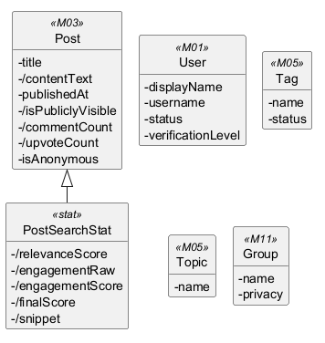

# Phân tích lớp thực thể — M06 Search

<!-- [Vietnamese Doc] Tài liệu tiếng Việt; tên lớp và thuộc tính viết tiếng Anh (input/CONVENTIONS.md mục 3). -->

| Mã tài liệu | EC-M06 |
|---|---|
| Dự án | iShare |
| Module | M06 — Search |
| Đầu vào | FR-M06 phiên bản 1.5 |
| Trạng thái | Đã chốt |
| Phiên bản | 1.0 |
| Ngày | 2026-11-18 |
| Tác giả | Phạm Văn Đức |

<!-- Quy ước chung cho mọi bảng dưới đây:
     - Không đổi tên cột, không xóa cột, không đổi số mục: tool đọc bảng theo số mục và tên cột.
     - Ô không có nội dung ghi "—".
     - Mục chưa tới bước làm thì để dòng "(Chưa làm — bước N)".
     - Cột Nguồn ghi mã trong FR: FR-Mxx-nn, FR-Mxx-nn.mm, BR-Mxx-nn, hoặc TN:<thuật ngữ> (mục 2.1 của FR).
     - Mục 4 chỉ chứa ảnh sơ đồ. gen_puml.py ghi mã PlantUML vào tệp riêng diagrams/EC-Mxx.puml, render
       diagrams/EC-Mxx.png và đặt ảnh vào mục 4. Không chép mã PlantUML vào tài liệu, không sửa tay tệp .puml hay ảnh. -->

## 1. Mô tả chức năng

### 1.1 Đoạn mô tả

Hệ thống hỗ trợ tìm kiếm bài viết, người dùng, Tag, Topic và Group trên một trang kết quả chung, trong đó kết quả
bài viết là kết quả chính và người dùng, Tag, Topic, Group là kết quả phụ. Mỗi lần tìm kiếm dựa trên một truy vấn do
người tìm gửi, gồm chuỗi tìm kiếm, bộ lọc và cách sắp xếp đang chọn; truy vấn có chuỗi tìm kiếm rỗng là truy vấn
rỗng.

Hệ thống cho phép người tìm, kể cả Guest, nhận gợi ý khi gõ gồm người dùng, Tag, Topic và Group khớp với chuỗi tìm
kiếm đang gõ, trước khi gửi truy vấn; gợi ý khi gõ không gồm bài viết. Khi người tìm gửi truy vấn có chữ, hệ thống
tìm người dùng, Tag, Topic và Group khớp với chuỗi tìm kiếm làm kết quả phụ. Người dùng được khớp theo display_name
và username, Tag theo tên Tag, Topic theo tên Topic và Group theo tên Group; trong mỗi loại, mục giống chuỗi tìm kiếm
hơn đứng trước. Gợi ý khi gõ và kết quả phụ chỉ gồm người dùng có trạng thái tài khoản ACTIVE đã xong Bước 3 đăng ký
do M01 quản lý, Tag không bị vô hiệu hóa do M05 quản lý, và Group loại Private chỉ khi người tìm là thành viên Group
đó do M11 quản lý.

Hệ thống cho phép người tìm gửi truy vấn để tìm bài viết; bài viết chỉ được tìm khi người tìm gửi truy vấn, không được
tìm khi người tìm đang gõ. Khi người tìm đã đăng nhập và công tắc AI tổng và công tắc Search do M10 quản lý đều bật,
hệ thống tìm bài viết theo ngữ nghĩa, so embedding của truy vấn với embedding của bài viết, cả hai do M13 tạo, để tìm
theo ý nghĩa của tiêu đề và nội dung chữ của bài viết. Khi người tìm là Guest, khi một trong hai công tắc tắt, hoặc
khi M13 báo việc tạo embedding của truy vấn thất bại, hệ thống tìm bài viết bằng full-text, so các từ của chuỗi tìm
kiếm với tiêu đề và nội dung chữ của bài viết sau khi bỏ dấu tiếng Việt. Kết quả bài viết chỉ gồm bài viết đang hiển
thị công khai với người tìm theo quy tắc của M03; bài viết thuộc Group loại Private chỉ có trong kết quả bài viết của
thành viên Group đó, kể cả sau khi Group đổi loại từ Public sang Private. Với truy vấn có chữ, hệ thống tính Điểm liên
quan của bài viết với truy vấn và lấy Tập ứng viên gồm các bài viết có Điểm liên quan cao nhất. Với mỗi bài viết
trong Tập ứng viên, hệ thống tính Điểm tương tác từ số upvote do M12 quản lý và số bình luận do M04 quản lý, rồi tính
Điểm cuối từ Điểm liên quan và Điểm tương tác. Khi sắp xếp theo Liên quan, kết quả bài viết được xếp theo Điểm cuối;
Điểm cuối của bài viết có tác giả đang ở mức cảnh cáo HEAVY do M08 quản lý bị giảm, và người tìm không thấy dấu hiệu
nào cho biết bài viết bị giảm hạng. Bài viết của tác giả có trạng thái tài khoản BANNED vẫn có trong kết quả bài viết
như bài viết khác, không bị loại và không bị giảm hạng. Mỗi kết quả bài viết có một đoạn trích lấy từ phần đầu nội
dung chữ của bài viết; bài viết không có nội dung chữ thì không có đoạn trích. Kết quả bài viết được tải dần khi người
tìm cuộn, không lặp lại và không bỏ sót giữa các lần tải, và với truy vấn có chữ thì có giới hạn tổng số kết quả.

Hệ thống cho phép người tìm lọc kết quả bài viết theo một Topic, một Tag và một khoảng thời gian tính trên thời điểm
đăng của bài viết; khi dùng nhiều bộ lọc, bài viết phải thỏa mọi bộ lọc, và bộ lọc không áp cho kết quả phụ. Hệ thống
cho phép người tìm đã đăng nhập bật bộ lọc chỉ nội dung đang theo dõi, chỉ giữ bài viết của người dùng và bài viết
thuộc Topic mà người tìm đang theo dõi theo quan hệ theo dõi do M07 quản lý; bài viết ẩn danh chỉ được giữ nhờ Topic
đang theo dõi. Hệ thống cho phép người tìm sắp xếp kết quả bài viết theo Liên quan, theo Mới nhất dựa trên thời điểm
đăng, hoặc theo Nhiều upvote nhất dựa trên số upvote; với truy vấn có chữ, cách sắp xếp Mới nhất và Nhiều upvote nhất
xếp lại chính Tập ứng viên và không giảm hạng bài viết nào. Hệ thống cho phép người tìm xem các bài viết của một Topic
hoặc một Tag qua kết quả bài viết của một truy vấn rỗng có bộ lọc Topic hoặc Tag đó. Với truy vấn rỗng có ít nhất một
bộ lọc, hệ thống liệt kê mọi bài viết khớp bộ lọc, mặc định theo Mới nhất, không có cách sắp xếp Liên quan, không giới
hạn tổng số kết quả và không gọi AI; truy vấn rỗng không có bộ lọc thì không được tìm.

Hệ thống cho phép người tìm, kể cả Guest, dùng lịch sử tìm kiếm gồm các truy vấn có chữ đã gửi gần nhất: xem lịch sử
tìm kiếm với truy vấn gần nhất đứng trước, chọn lại một truy vấn để gửi ngay, và xóa toàn bộ lịch sử tìm kiếm. Mỗi
khi người tìm gửi một truy vấn có chữ, hệ thống ghi truy vấn đó vào lịch sử tìm kiếm trên trình duyệt của thiết bị
đang dùng, đưa truy vấn lên đầu nếu đã có và bỏ truy vấn cũ nhất khi lịch sử tìm kiếm đã đầy. Lịch sử tìm kiếm không
được lưu trên hệ thống, không gắn với người dùng, và bị xóa toàn bộ khi người tìm đăng xuất.

Hệ thống đếm lượt gợi ý và lượt gửi của mỗi người tìm trong một khoảng thời gian gần nhất, theo địa chỉ IP với Guest
và theo người dùng với người tìm đã đăng nhập, và chỉ từ chối lượt vượt giới hạn tần suất, không khóa quyền tìm kiếm
của người tìm. Mỗi lần gửi truy vấn, đổi bộ lọc, đổi cách sắp xếp, mở xem các bài viết của một Topic hoặc một Tag,
hoặc chọn một truy vấn trong lịch sử tìm kiếm là một lượt gửi; tải thêm kết quả khi cuộn không là lượt gửi. Hệ thống
cung cấp truy vấn tìm bài viết của người tìm đã đăng nhập cho M13 để tạo embedding của truy vấn, và cung cấp cách
khớp tên người dùng cho việc tìm người dùng ở M10.

<!-- Văn xuôi bình thường, có thể chia vài đoạn. KHÔNG ghi mã câu (S1), (S2)… trong đoạn văn: người đọc không hiểu
     các mã đó. Số câu chỉ nằm ở bảng 1.2. Xem steps/01-describe-functions.md. -->

### 1.2 Truy vết câu

<!-- Mỗi câu của đoạn mô tả một dòng, theo đúng thứ tự. Câu: 1, 2, 3…
     Nội dung câu: chép NGUYÊN VĂN câu đó từ mục 1.1 (tool so khớp từng câu với đoạn văn).
     Nguồn: mã chức năng hoặc yêu cầu của FR mà câu dựa vào. -->

| Câu | Nội dung câu | Nguồn |
|---|---|---|
| 1 | Hệ thống hỗ trợ tìm kiếm bài viết, người dùng, Tag, Topic và Group trên một trang kết quả chung, trong đó kết quả bài viết là kết quả chính và người dùng, Tag, Topic, Group là kết quả phụ. | FR-M06-02.16, FR-M06-03.02, BR-M06-01, BR-M06-17 |
| 2 | Mỗi lần tìm kiếm dựa trên một truy vấn do người tìm gửi, gồm chuỗi tìm kiếm, bộ lọc và cách sắp xếp đang chọn; truy vấn có chuỗi tìm kiếm rỗng là truy vấn rỗng. | TN:Truy vấn, TN:Truy vấn rỗng, FR-M06-02.01 |
| 3 | Hệ thống cho phép người tìm, kể cả Guest, nhận gợi ý khi gõ gồm người dùng, Tag, Topic và Group khớp với chuỗi tìm kiếm đang gõ, trước khi gửi truy vấn; gợi ý khi gõ không gồm bài viết. | FR-M06-01, FR-M06-01.01, FR-M06-01.03, FR-M06-01.06 |
| 4 | Khi người tìm gửi truy vấn có chữ, hệ thống tìm người dùng, Tag, Topic và Group khớp với chuỗi tìm kiếm làm kết quả phụ. | FR-M06-03, FR-M06-03.01, FR-M06-03.02 |
| 5 | Người dùng được khớp theo display_name và username, Tag theo tên Tag, Topic theo tên Topic và Group theo tên Group; trong mỗi loại, mục giống chuỗi tìm kiếm hơn đứng trước. | FR-M06-01.05, FR-M06-01.11, FR-M06-03.03, FR-M06-03.06, BR-M06-09 |
| 6 | Gợi ý khi gõ và kết quả phụ chỉ gồm người dùng có trạng thái tài khoản ACTIVE đã xong Bước 3 đăng ký do M01 quản lý, Tag không bị vô hiệu hóa do M05 quản lý, và Group loại Private chỉ khi người tìm là thành viên Group đó do M11 quản lý. | FR-M06-01.04, FR-M06-01.12, FR-M06-01.13, FR-M06-03.04, FR-M06-03.07, FR-M06-03.08, FR-M06-03.09 |
| 7 | Hệ thống cho phép người tìm gửi truy vấn để tìm bài viết; bài viết chỉ được tìm khi người tìm gửi truy vấn, không được tìm khi người tìm đang gõ. | FR-M06-02, FR-M06-02.01, FR-M06-02.02 |
| 8 | Khi người tìm đã đăng nhập và công tắc AI tổng và công tắc Search do M10 quản lý đều bật, hệ thống tìm bài viết theo ngữ nghĩa, so embedding của truy vấn với embedding của bài viết, cả hai do M13 tạo, để tìm theo ý nghĩa của tiêu đề và nội dung chữ của bài viết. | FR-M06-02.03, BR-M06-05 |
| 9 | Khi người tìm là Guest, khi một trong hai công tắc tắt, hoặc khi M13 báo việc tạo embedding của truy vấn thất bại, hệ thống tìm bài viết bằng full-text, so các từ của chuỗi tìm kiếm với tiêu đề và nội dung chữ của bài viết sau khi bỏ dấu tiếng Việt. | FR-M06-02.04, FR-M06-02.05, FR-M06-02.06, FR-M06-02.23, FR-M06-02.26 |
| 10 | Kết quả bài viết chỉ gồm bài viết đang hiển thị công khai với người tìm theo quy tắc của M03; bài viết thuộc Group loại Private chỉ có trong kết quả bài viết của thành viên Group đó, kể cả sau khi Group đổi loại từ Public sang Private. | FR-M06-02.07, FR-M06-02.08, FR-M06-02.09 |
| 11 | Với truy vấn có chữ, hệ thống tính Điểm liên quan của bài viết với truy vấn và lấy Tập ứng viên gồm các bài viết có Điểm liên quan cao nhất. | FR-M06-02.27, FR-M06-02.28, BR-M06-13 |
| 12 | Với mỗi bài viết trong Tập ứng viên, hệ thống tính Điểm tương tác từ số upvote do M12 quản lý và số bình luận do M04 quản lý, rồi tính Điểm cuối từ Điểm liên quan và Điểm tương tác. | FR-M06-02.10, BR-M06-13 |
| 13 | Khi sắp xếp theo Liên quan, kết quả bài viết được xếp theo Điểm cuối; Điểm cuối của bài viết có tác giả đang ở mức cảnh cáo HEAVY do M08 quản lý bị giảm, và người tìm không thấy dấu hiệu nào cho biết bài viết bị giảm hạng. | FR-M06-02.10, FR-M06-02.11, FR-M06-02.12, FR-M06-02.29, BR-M06-14 |
| 14 | Bài viết của tác giả có trạng thái tài khoản BANNED vẫn có trong kết quả bài viết như bài viết khác, không bị loại và không bị giảm hạng. | FR-M06-02.13, BR-M06-12 |
| 15 | Mỗi kết quả bài viết có một đoạn trích lấy từ phần đầu nội dung chữ của bài viết; bài viết không có nội dung chữ thì không có đoạn trích. | FR-M06-02.15, FR-M06-02.32 |
| 16 | Kết quả bài viết được tải dần khi người tìm cuộn, không lặp lại và không bỏ sót giữa các lần tải, và với truy vấn có chữ thì có giới hạn tổng số kết quả. | FR-M06-02.17, FR-M06-02.18, FR-M06-02.19 |
| 17 | Hệ thống cho phép người tìm lọc kết quả bài viết theo một Topic, một Tag và một khoảng thời gian tính trên thời điểm đăng của bài viết; khi dùng nhiều bộ lọc, bài viết phải thỏa mọi bộ lọc, và bộ lọc không áp cho kết quả phụ. | FR-M06-04, FR-M06-04.01, FR-M06-04.02, FR-M06-04.03, FR-M06-04.10, FR-M06-04.11, FR-M06-04.12 |
| 18 | Hệ thống cho phép người tìm đã đăng nhập bật bộ lọc chỉ nội dung đang theo dõi, chỉ giữ bài viết của người dùng và bài viết thuộc Topic mà người tìm đang theo dõi theo quan hệ theo dõi do M07 quản lý; bài viết ẩn danh chỉ được giữ nhờ Topic đang theo dõi. | FR-M06-04.04, FR-M06-04.13 |
| 19 | Hệ thống cho phép người tìm sắp xếp kết quả bài viết theo Liên quan, theo Mới nhất dựa trên thời điểm đăng, hoặc theo Nhiều upvote nhất dựa trên số upvote; với truy vấn có chữ, cách sắp xếp Mới nhất và Nhiều upvote nhất xếp lại chính Tập ứng viên và không giảm hạng bài viết nào. | FR-M06-04.05, FR-M06-04.06, FR-M06-04.07, FR-M06-04.14, FR-M06-04.15, FR-M06-04.16 |
| 20 | Hệ thống cho phép người tìm xem các bài viết của một Topic hoặc một Tag qua kết quả bài viết của một truy vấn rỗng có bộ lọc Topic hoặc Tag đó. | FR-M06-04.08, BR-M06-16 |
| 21 | Với truy vấn rỗng có ít nhất một bộ lọc, hệ thống liệt kê mọi bài viết khớp bộ lọc, mặc định theo Mới nhất, không có cách sắp xếp Liên quan, không giới hạn tổng số kết quả và không gọi AI; truy vấn rỗng không có bộ lọc thì không được tìm. | FR-M06-04.17, FR-M06-04.18, FR-M06-04.19, FR-M06-02.31 |
| 22 | Hệ thống cho phép người tìm, kể cả Guest, dùng lịch sử tìm kiếm gồm các truy vấn có chữ đã gửi gần nhất: xem lịch sử tìm kiếm với truy vấn gần nhất đứng trước, chọn lại một truy vấn để gửi ngay, và xóa toàn bộ lịch sử tìm kiếm. | FR-M06-05, FR-M06-05.04, FR-M06-05.05, FR-M06-05.08, FR-M06-05.09 |
| 23 | Mỗi khi người tìm gửi một truy vấn có chữ, hệ thống ghi truy vấn đó vào lịch sử tìm kiếm trên trình duyệt của thiết bị đang dùng, đưa truy vấn lên đầu nếu đã có và bỏ truy vấn cũ nhất khi lịch sử tìm kiếm đã đầy. | FR-M06-05.01, FR-M06-05.03, FR-M06-05.07 |
| 24 | Lịch sử tìm kiếm không được lưu trên hệ thống, không gắn với người dùng, và bị xóa toàn bộ khi người tìm đăng xuất. | FR-M06-05.02, FR-M06-05.10, BR-M06-20 |
| 25 | Hệ thống đếm lượt gợi ý và lượt gửi của mỗi người tìm trong một khoảng thời gian gần nhất, theo địa chỉ IP với Guest và theo người dùng với người tìm đã đăng nhập, và chỉ từ chối lượt vượt giới hạn tần suất, không khóa quyền tìm kiếm của người tìm. | FR-M06-01.07, FR-M06-02.20, FR-M06-02.21, BR-M06-21 |
| 26 | Mỗi lần gửi truy vấn, đổi bộ lọc, đổi cách sắp xếp, mở xem các bài viết của một Topic hoặc một Tag, hoặc chọn một truy vấn trong lịch sử tìm kiếm là một lượt gửi; tải thêm kết quả khi cuộn không là lượt gửi. | FR-M06-02.30, FR-M06-04.20, BR-M06-21 |
| 27 | Hệ thống cung cấp truy vấn tìm bài viết của người tìm đã đăng nhập cho M13 để tạo embedding của truy vấn, và cung cấp cách khớp tên người dùng cho việc tìm người dùng ở M10. | FR-M06-02.03, BR-M06-09 |

## 2. Danh từ và phân loại

### 2.1 Sổ danh từ

<!-- Phân loại: Lớp | Thuộc tính | Loại bỏ.
     Kết quả: tên lớp; hoặc Lớp.thuộcTính; hoặc "—" khi loại bỏ.
     Xuất hiện ở: "Câu n" (số câu ở bảng 1.2) hoặc "Quét: <mã FR>" (lượt quét bổ sung). -->

| # | Danh từ | Xuất hiện ở | Phân loại | Kết quả | Lý do |
|---|---|---|---|---|---|
| 1 | hệ thống | Câu 1 | Loại bỏ | — | Trừu tượng: chỉ chính phần mềm iShare |
| 2 | tìm kiếm / lần tìm kiếm | Câu 1 | Loại bỏ | — | Hành động không lưu dấu vết: FR không lưu từng lần tìm (mục Dữ liệu nghiệp vụ: không lưu trên hệ thống); kết quả được tính lại mỗi lần (dòng 9) |
| 3 | bài viết | Câu 1 | Lớp | Post | Lớp ngoài (M03): đối tượng được tìm, lọc và xếp hạng; M06 đọc tiêu đề, nội dung chữ, thời điểm đăng, việc hiển thị công khai |
| 4 | người dùng | Câu 1 | Lớp | User | Lớp ngoài (M01): được tìm theo tên làm kết quả phụ và gợi ý khi gõ |
| 5 | Tag | Câu 1 | Lớp | Tag | Lớp ngoài (M05): được tìm theo tên và dùng làm bộ lọc kết quả bài viết |
| 6 | Topic | Câu 1 | Lớp | Topic | Lớp ngoài (M05): như dòng 5 |
| 7 | Group | Câu 1 | Lớp | Group | Lớp ngoài (M11): được tìm theo tên; Group loại Private chỉ hiện với thành viên; tên tạm, chờ EC-M11 (cùng tên ở EC-M03) |
| 8 | trang kết quả chung | Câu 1 | Loại bỏ | — | Giao diện: một trang cuộn, không chia tab (BR-M06-17) |
| 9 | kết quả bài viết / kết quả chính | Câu 1 | Lớp | PostSearchStat | Mỗi kết quả bài viết là một bài viết kèm nhóm số liệu M06 tính lúc tìm: Điểm liên quan, Điểm tương tác, Điểm cuối, đoạn trích → lớp thống kê theo bài viết; tính lại mỗi lần tìm, không lưu (Q-01) |
| 10 | kết quả phụ | Câu 1 | Loại bỏ | — | Chung chung: là chính người dùng, Tag, Topic, Group khớp truy vấn (dòng 4–7); FR không nêu số liệu nào M06 tính cho kết quả phụ (Q-01) |
| 11 | truy vấn / truy vấn có chữ / truy vấn tìm kiếm | Câu 2 | Loại bỏ | — | Hành động không lưu dấu vết: tham số của một lần tìm; mục Dữ liệu nghiệp vụ của FR ghi "không lưu trên hệ thống" (Q-01) |
| 12 | người tìm | Câu 2 | Lớp | User | Vai trò có tài khoản khi đã đăng nhập (User, Mod, Admin) → người dùng (M01); Guest xét ở dòng 17 |
| 13 | chuỗi tìm kiếm / chuỗi tìm kiếm đang gõ | Câu 2 | Loại bỏ | — | Hành động không lưu dấu vết: phần của truy vấn (dòng 11), không lưu |
| 14 | bộ lọc / bộ lọc Topic / bộ lọc Tag | Câu 2 | Loại bỏ | — | Hành động không lưu dấu vết: phần của truy vấn (dòng 11); giá trị là một Topic, một Tag đã có (dòng 5, 6), chọn lúc tìm |
| 15 | cách sắp xếp | Câu 2 | Loại bỏ | — | Hành động không lưu dấu vết: phần của truy vấn (dòng 11), không lưu |
| 16 | truy vấn rỗng | Câu 2 | Loại bỏ | — | Hành động không lưu dấu vết: truy vấn không có chuỗi tìm kiếm (TN:Truy vấn rỗng), như dòng 11 |
| 17 | Guest | Câu 3 | Loại bỏ | — | Không lưu: tác nhân không có dữ liệu (không có tài khoản) |
| 18 | gợi ý khi gõ / danh sách gợi ý | Câu 3 | Loại bỏ | — | Hành động không lưu dấu vết: danh sách tính lúc gõ; mục Dữ liệu nghiệp vụ của FR ghi không lưu trên hệ thống (Q-02) |
| 19 | display_name | Câu 5 | Thuộc tính | User.displayName | Thông tin của người dùng (M01) mà M06 so khớp khi gợi ý và tìm người dùng |
| 20 | username | Câu 5 | Thuộc tính | User.username | Như dòng 19 |
| 21 | tên Tag | Câu 5 | Thuộc tính | Tag.name | Thông tin của Tag (M05) mà M06 so khớp |
| 22 | tên Topic | Câu 5 | Thuộc tính | Topic.name | Thông tin của Topic (M05) mà M06 so khớp |
| 23 | tên Group | Câu 5 | Thuộc tính | Group.name | Thông tin của Group (M11) mà M06 so khớp; tên tạm, chờ EC-M11 |
| 24 | loại (người dùng, Tag, Topic, Group) | Câu 5 | Loại bỏ | — | Chung chung: chỉ bốn nhóm đối tượng của kết quả phụ (dòng 4–7) |
| 25 | mục giống chuỗi tìm kiếm hơn | Câu 5 | Loại bỏ | — | Hành động không lưu dấu vết: mức giống chỉ dùng để xếp gợi ý khi gõ và kết quả phụ lúc tìm; FR không gọi tên hay định nghĩa số đo này (BR-M06-09) |
| 26 | trạng thái tài khoản | Câu 6 | Thuộc tính | User.status | Thông tin của người dùng (M01) mà M06 đọc |
| 27 | ACTIVE | Câu 6 | Loại bỏ | — | Giá trị của User.status |
| 28 | Bước 3 đăng ký | Câu 6 | Thuộc tính | User.verificationLevel | "Đã xong Bước 3" là mức xác minh SETUP_COMPLETED của M01 (TN:Tài khoản tìm được) |
| 29 | Tag bị vô hiệu hóa | Câu 6 | Loại bỏ | — | Giá trị của Tag.status |
| 30 | Group loại Private / Group loại Public | Câu 6 | Loại bỏ | — | Giá trị của Group.privacy |
| 31 | loại Group | Câu 6 | Thuộc tính | Group.privacy | Thông tin của Group (M11) mà M06 đọc; FR-M11 gọi "chế độ"; tên tạm theo EC-M03, chờ EC-M11 |
| 32 | thành viên Group | Câu 6 | Loại bỏ | — | Ngoài phạm vi module (M11): M06 chỉ kiểm người tìm có là thành viên Group hay không để ẩn Group loại Private và bài viết của Group đó; quan hệ người dùng – Group thuộc M11, không nối với lớp nào của M06 (như EC-M01 dòng 89) |
| 33 | công tắc AI tổng | Câu 8 | Loại bỏ | — | Ngoài phạm vi module (M10): M06 chỉ đọc để chọn cách tìm bài viết; không có dữ liệu của M06 gắn với công tắc (như EC-M05 dòng 24) |
| 34 | công tắc Search | Câu 8 | Loại bỏ | — | Ngoài phạm vi module (M10): như dòng 33 |
| 35 | tìm kiếm ngữ nghĩa | Câu 8 | Loại bỏ | — | Hành động không lưu dấu vết: cách tìm được chọn lúc tìm theo người tìm và công tắc (BR-M06-05, BR-M06-23), không lưu; quyết định cách tính PostSearchStat.relevanceScore |
| 36 | embedding của truy vấn | Câu 8 | Loại bỏ | — | Ngoài phạm vi module (M13): M13 tạo cho từng truy vấn; M06 chỉ dùng trong lần tìm đó, không lưu |
| 37 | embedding của bài viết | Câu 8 | Loại bỏ | — | Ngoài phạm vi module (M13): thực thể "Embedding bài viết" của M13; M06 chỉ đọc để tính PostSearchStat.relevanceScore, không có dữ liệu của M06 gắn với nó |
| 38 | ý nghĩa | Câu 8 | Loại bỏ | — | Trừu tượng: điều mà embedding biểu diễn |
| 39 | tiêu đề | Câu 8 | Thuộc tính | Post.title | Thông tin của bài viết (M03) mà M06 so khớp |
| 40 | nội dung chữ | Câu 8 | Thuộc tính | Post.contentText | Thông tin của bài viết (M03) mà M06 so khớp và cắt đoạn trích |
| 41 | công tắc | Câu 9 | Loại bỏ | — | Chung chung: chỉ công tắc AI tổng hoặc công tắc Search (dòng 33, 34) |
| 42 | việc tạo embedding của truy vấn thất bại | Câu 9 | Loại bỏ | — | Ngoài phạm vi module (M13): M13 báo lỗi; M06 chỉ đổi sang full-text cho riêng truy vấn đó (BR-M06-07), không lưu |
| 43 | full-text | Câu 9 | Loại bỏ | — | Hành động không lưu dấu vết: như dòng 35 |
| 44 | từ | Câu 9 | Loại bỏ | — | Hằng số của BR-M06-08: đơn vị so khớp full-text và tính Điểm liên quan (TN:Từ), tách lúc tìm, không lưu |
| 45 | dấu tiếng Việt | Câu 9 | Loại bỏ | — | Hằng số của BR-M06-08: quy tắc bỏ dấu khi so, không phải dữ liệu |
| 46 | bài viết đang hiển thị công khai | Câu 10 | Thuộc tính | Post.isPubliclyVisible | Thông tin của bài viết (M03) mà M06 đọc để lọc kết quả |
| 47 | quy tắc của M03 | Câu 10 | Loại bỏ | — | Chung chung: là điều kiện tính Post.isPubliclyVisible (dòng 46) |
| 48 | việc Group đổi loại | Câu 10 | Loại bỏ | — | Hành động không lưu dấu vết: chỉ đổi Group.privacy (M11); M06 đọc giá trị hiện tại mỗi lần tìm (FR-M06-02.09) |
| 49 | Điểm liên quan | Câu 11 | Thuộc tính | PostSearchStat.relevanceScore | Số liệu tính ra cho một bài viết với một truy vấn (TN:Điểm liên quan) |
| 50 | Tập ứng viên | Câu 11 | Loại bỏ | — | Chung chung: tập các kết quả bài viết có Điểm liên quan cao nhất của một truy vấn có chữ; mỗi phần tử là một PostSearchStat (dòng 9); cỡ 120 ghi ở ràng buộc của relevanceScore |
| 51 | Điểm tương tác | Câu 12 | Thuộc tính | PostSearchStat.engagementScore | Số liệu tính ra, chuẩn hóa trong Tập ứng viên (TN:Điểm tương tác) |
| 52 | số upvote | Câu 12 | Thuộc tính | Post.upvoteCount | Số đếm trên bài viết do M12 cung cấp (mục Giao tiếp, dòng Dùng M12), M06 đọc |
| 53 | số bình luận | Câu 12 | Thuộc tính | Post.commentCount | Số đếm trên bài viết do M04 định nghĩa (EC-M04), M06 đọc |
| 54 | Điểm cuối | Câu 12 | Thuộc tính | PostSearchStat.finalScore | Số liệu tính ra từ Điểm liên quan và Điểm tương tác (TN:Điểm cuối) |
| 55 | Liên quan / Mới nhất / Nhiều upvote nhất | Câu 13 | Loại bỏ | — | Hành động không lưu dấu vết: giá trị của cách sắp xếp trong truy vấn (dòng 15), không lưu |
| 56 | tác giả | Câu 13 | Lớp | User | Vai trò có tài khoản → người dùng (M01); quan hệ bài viết – tác giả thuộc M03 |
| 57 | mức cảnh cáo / mức cảnh cáo HEAVY | Câu 13 | Loại bỏ | — | Ngoài phạm vi module (M08): M06 chỉ hỏi M08 mức cảnh cáo của tác giả để nhân hệ số vào PostSearchStat.finalScore; mức cảnh cáo gắn với tài khoản, không có quan hệ với lớp nào của M06 (như EC-M03 dòng 30, EC-M04 dòng 44) |
| 58 | dấu hiệu | Câu 13 | Loại bỏ | — | Giao diện: FR-M06-02.12 không hiện dấu hiệu bài viết bị giảm hạng |
| 59 | việc giảm hạng | Câu 13 | Loại bỏ | — | Hành động không lưu dấu vết: là hệ số 0,5 trong công thức PostSearchStat.finalScore (BR-M06-14), không lưu |
| 60 | BANNED | Câu 14 | Loại bỏ | — | Giá trị của User.status |
| 61 | đoạn trích | Câu 15 | Thuộc tính | PostSearchStat.snippet | Giá trị tính ra từ nội dung chữ, hiện dưới mỗi kết quả bài viết (TN:Đoạn trích) |
| 62 | phần đầu nội dung chữ | Câu 15 | Loại bỏ | — | Hằng số của BR-M06-18 (150 ký tự); ghi ở ràng buộc của PostSearchStat.snippet |
| 63 | lần tải | Câu 16 | Loại bỏ | — | Giao diện: tải dần khi cuộn (BR-M06-19) |
| 64 | giới hạn tổng số kết quả | Câu 16 | Loại bỏ | — | Hằng số của BR-M06-19 (120 kết quả với truy vấn có chữ) |
| 65 | khoảng thời gian | Câu 17 | Loại bỏ | — | Hành động không lưu dấu vết: một bộ lọc của truy vấn, giá trị Hôm nay, Tuần này, Tháng này, Tất cả (BR-M06-15), so trên Post.publishedAt |
| 66 | thời điểm đăng | Câu 17 | Thuộc tính | Post.publishedAt | Thông tin của bài viết (M03) mà M06 đọc để lọc và xếp |
| 67 | bộ lọc chỉ nội dung đang theo dõi / nội dung đang theo dõi | Câu 18 | Loại bỏ | — | Hành động không lưu dấu vết: một bộ lọc của truy vấn, tính lúc tìm từ quan hệ theo dõi (dòng 68) |
| 68 | quan hệ theo dõi | Câu 18 | Loại bỏ | — | Ngoài phạm vi module (M07): M06 chỉ đọc lượt theo dõi người dùng, Topic của người tìm để lọc; lượt theo dõi không nối với lớp nào của M06 (như Q-01 của EC-M02) |
| 69 | bài viết ẩn danh | Câu 18 | Thuộc tính | Post.isAnonymous | Thông tin của bài viết mà M06 đọc để áp bộ lọc đang theo dõi (BR-M06-15); khái niệm của M11 |
| 70 | AI | Câu 21 | Loại bỏ | — | Ngoài phạm vi module (M13): lời gọi AI do M13 làm |
| 71 | lịch sử tìm kiếm / mục lịch sử tìm kiếm | Câu 22 | Loại bỏ | — | Ngoài phạm vi hệ thống: lưu trên trình duyệt của thiết bị, không lưu trên hệ thống, không gắn với người dùng (FR-M06-05.02, BR-M06-20) (Q-02) |
| 72 | truy vấn gần nhất / truy vấn cũ nhất | Câu 22 | Loại bỏ | — | Ngoài phạm vi hệ thống: thứ tự của lịch sử tìm kiếm trên trình duyệt (dòng 71) |
| 73 | trình duyệt / thiết bị | Câu 23 | Loại bỏ | — | Ngoài phạm vi hệ thống: nơi lưu lịch sử tìm kiếm phía người dùng |
| 74 | việc đăng xuất | Câu 24 | Loại bỏ | — | Ngoài phạm vi module (M01): sự kiện của M01; M06 chỉ xóa lịch sử tìm kiếm trên trình duyệt |
| 75 | lượt gợi ý / lượt gửi / lượt tìm kiếm | Câu 25 | Loại bỏ | — | Hành động không lưu dấu vết: bộ đếm tạm của giới hạn tần suất, chỉ dùng trong cửa sổ đếm (BR-M06-21), như quyết định Q-01 của EC-M05 (Q-02) |
| 76 | khoảng thời gian gần nhất | Câu 25 | Loại bỏ | — | Hằng số của BR-M06-21 (60 giây) |
| 77 | địa chỉ IP | Câu 25 | Loại bỏ | — | Hành động không lưu dấu vết: khóa đếm của bộ đếm tạm với Guest (dòng 75) |
| 78 | giới hạn tần suất | Câu 25 | Loại bỏ | — | Hằng số của BR-M06-21 (Guest 30 lượt gợi ý, 10 lượt gửi; người đã đăng nhập 45 lượt gợi ý, 20 lượt gửi) |
| 79 | quyền tìm kiếm | Câu 25 | Loại bỏ | — | Trừu tượng: không bị khóa khi vượt giới hạn (FR-M06-02.21), không có dữ liệu |
| 80 | cách khớp tên người dùng | Câu 27 | Loại bỏ | — | Hằng số của BR-M06-09: quy tắc so khớp, không phải dữ liệu |
| 81 | trạng thái hoạt động của Tag | Quét: FR-M06-01.04 | Thuộc tính | Tag.status | Thông tin của Tag (M05) mà M06 đọc |
| 82 | Điểm tương tác thô | Quét: BR-M06-13 | Thuộc tính | PostSearchStat.engagementRaw | Số liệu tính ra cho một bài viết, làm đầu vào của Điểm tương tác |
| 83 | độ tương đồng cosine | Quét: BR-M06-13 | Loại bỏ | — | Hằng số của BR-M06-13: bước của công thức relevanceScore khi tìm ngữ nghĩa |
| 84 | trọng số xếp hạng | Quét: BR-M06-13 | Loại bỏ | — | Hằng số của BR-M06-13 (0,8 và 0,2; upvote ×2, bình luận ×1) |
| 85 | thời gian chờ khi ngừng gõ | Quét: BR-M06-03 | Loại bỏ | — | Hằng số của BR-M06-03 (300 mili giây) |
| 86 | số mục tối đa mỗi loại | Quét: BR-M06-04 | Loại bỏ | — | Hằng số của BR-M06-04, BR-M06-17 (3 mục) |
| 87 | số kết quả mỗi lần tải | Quét: BR-M06-19 | Loại bỏ | — | Hằng số của BR-M06-19 (15 kết quả) |
| 88 | múi giờ Asia/Ho_Chi_Minh | Quét: TN:Hôm nay, Tuần này, Tháng này | Loại bỏ | — | Hằng số của BR-M06-15: cách tính khoảng thời gian |
| 89 | DEACTIVATED / DELETED | Quét: BR-M06-24 | Loại bỏ | — | Giá trị của User.status |
| 90 | tài khoản tìm được | Quét: TN:Tài khoản tìm được | Loại bỏ | — | Chung chung: điều kiện trên User.status và User.verificationLevel (BR-M06-24) |
| 91 | LIGHT / MEDIUM | Quét: TN:Mức HEAVY | Loại bỏ | — | Ngoài phạm vi module (M08): mức cảnh cáo thấp hơn HEAVY không ảnh hưởng xếp hạng (BR-M06-14); như dòng 57 |
| 92 | thời gian thử thách | Quét: TN:Mức HEAVY | Loại bỏ | — | Ngoài phạm vi module (M08): M08 quyết mức cảnh cáo hiện tại của người dùng |
| 93 | upvote | Quét: TN:Upvote | Loại bỏ | — | Ngoài phạm vi module (M12): M06 chỉ dùng số upvote của bài viết qua Post.upvoteCount (như EC-M05 dòng 56) |
| 94 | bình luận | Quét: BR-M06-01 | Loại bỏ | — | Ngoài phạm vi module (M04): bình luận không được tìm (BR-M06-01); M06 chỉ dùng số bình luận qua Post.commentCount |
| 95 | trạng thái đăng / trạng thái kiểm duyệt | Quét: TN:Bài đang hiển thị công khai | Loại bỏ | — | Ngoài phạm vi module (M03): M06 chỉ đọc Post.isPubliclyVisible, tính từ hai trạng thái này |
| 96 | mô tả của Group | Quét: FR-M06-03.10 | Loại bỏ | — | Ngoài phạm vi module (M11): không được so khớp (BR-M06-09) |
| 97 | cờ Group | Quét: Giao tiếp với module khác | Loại bỏ | — | Ngoài phạm vi module (M11): khi cờ tắt, Group và bài viết của Group vẫn hiện trong kết quả (dòng Dùng M11) |
| 98 | nhãn "Tài khoản đã bị khóa" | Quét: FR-M06-02.14 | Loại bỏ | — | Giao diện: hiện khi User.status là BANNED |
| 99 | lựa chọn "Tìm kiếm thông minh" | Quét: FR-M06-02.24 | Loại bỏ | — | Giao diện: chỉ Guest thấy, bấm thì nhắc đăng nhập |
| 100 | thông báo | Quét: FR-M06-02.19 | Loại bỏ | — | Giao diện: thông báo thu hẹp tìm kiếm, quá nhiều yêu cầu, yêu cầu đăng nhập |
| 101 | cách tìm bài | Quét: Dữ liệu nghiệp vụ | Loại bỏ | — | Hành động không lưu dấu vết: là tìm kiếm ngữ nghĩa hoặc full-text (dòng 35, 43), chọn lúc tìm |
| 102 | kết quả tìm kiếm | Quét: Dữ liệu nghiệp vụ | Loại bỏ | — | Chung chung: gồm kết quả bài viết (dòng 9) và kết quả phụ (dòng 10) (Q-01) |

### 2.2 Lớp

<!-- Nhóm: Thực thể | Liên kết | Thống kê. Sở hữu: mã module sở hữu lớp (Mxx của tài liệu này, hoặc Myy với lớp ngoài).
     Thuộc tính: tên mọi thuộc tính của lớp ở mục 2.3, ngăn bởi dấu phẩy, thuộc tính dẫn xuất có "/" phía trước;
     để người đọc thấy lớp và thuộc tính trên cùng một dòng. Lớp chưa có thuộc tính ghi "—". -->

| Lớp | Tên tiếng Việt | Nhóm | Sở hữu | Mô tả | Thuộc tính | Nguồn |
|---|---|---|---|---|---|---|
| PostSearchStat | Kết quả tìm bài viết | Thống kê | M06 | Một bài viết trong kết quả tìm bài viết, kèm số liệu M06 tính lúc tìm: Điểm tương tác thô, và với truy vấn có chữ thêm Điểm liên quan, Điểm tương tác, Điểm cuối; cùng đoạn trích. Tính lại mỗi lần tìm, không lưu (Q-01) | /relevanceScore, /engagementRaw, /engagementScore, /finalScore, /snippet | FR-M06-02, BR-M06-13, BR-M06-18 |
| Post | Bài viết | Thực thể | M03 | Bài viết được tìm, lọc và xếp hạng | title, /contentText, publishedAt, /isPubliclyVisible, /commentCount, /upvoteCount, isAnonymous | FR-M06-02, FR-M06-04 |
| User | Người dùng (tài khoản) | Thực thể | M01 | Người dùng được tìm theo tên làm kết quả phụ và gợi ý khi gõ; tác giả của bài viết trong kết quả | displayName, username, status, verificationLevel | FR-M06-01, FR-M06-03, FR-M06-02.13 |
| Tag | Tag | Thực thể | M05 | Tag được tìm theo tên và dùng làm bộ lọc kết quả bài viết | name, status | FR-M06-01, FR-M06-03, FR-M06-04.02 |
| Topic | Topic | Thực thể | M05 | Topic được tìm theo tên và dùng làm bộ lọc kết quả bài viết | name | FR-M06-01, FR-M06-03, FR-M06-04.01 |
| Group | Nhóm | Thực thể | M11 | Group được tìm theo tên; Group loại Private và bài viết của Group đó chỉ hiện với thành viên (tên tạm, chờ EC-M11) | name, privacy | FR-M06-01.13, FR-M06-02.08, FR-M06-03 |

### 2.3 Thuộc tính

<!-- Mỗi lớp có ĐỦ thuộc tính để người đọc hình dung được nó; xếp các dòng theo lớp.
     Tính chất: Lưu | Dẫn xuất. Chưa có id, chưa có kiểu, chưa có khóa ngoại.
     Căn cứ: Nguồn nêu (FR nói tới) | Đề xuất (FR không nói, nhưng chức năng hoặc quy tắc ở cột Nguồn cần nó) |
             Tham chiếu (thuộc tính của lớp ngoài mà module này đọc hoặc ghi; module sở hữu lớp đó định nghĩa).
     Ràng buộc nguồn nêu: độ dài tối đa, duy nhất, bắt buộc/tùy chọn, tập giá trị, mặc định, công thức (với Dẫn xuất)
             — chép từ FR kèm mã. Đề xuất mà FR không nêu ràng buộc thì ghi "—".
     Nguồn: mã FR/BR nêu thuộc tính; với Đề xuất là mã chức năng hoặc quy tắc cần nó.
     Ghi chú: bắt buộc với Đề xuất (vì sao cần) và Tham chiếu (module này dùng nó làm gì). -->

| Lớp | Thuộc tính | Tên tiếng Việt | Tính chất | Căn cứ | Ràng buộc nguồn nêu | Nguồn | Ghi chú |
|---|---|---|---|---|---|---|---|
| PostSearchStat | relevanceScore | Điểm liên quan | Dẫn xuất | Nguồn nêu | Khoảng 0–1; chỉ có với truy vấn có chữ. Tìm ngữ nghĩa: (độ tương đồng cosine giữa embedding truy vấn và embedding bài viết + 1) ÷ 2; tìm full-text: số từ của truy vấn có trong tiêu đề hoặc nội dung chữ ÷ số từ của truy vấn (BR-M06-13, BR-M06-08). Tập ứng viên là 120 bài viết có relevanceScore cao nhất (FR-M06-02.28) | BR-M06-13, FR-M06-02.27, FR-M06-02.28 | Embedding của bài viết và của truy vấn do M13 tạo, không mô hình hóa ở M06 (sổ danh từ dòng 36, 37) |
| PostSearchStat | engagementRaw | Điểm tương tác thô | Dẫn xuất | Nguồn nêu | log(1 + Post.upvoteCount) × 2 + log(1 + Post.commentCount) × 1 (BR-M06-13) | BR-M06-13 | Upvote có trọng số gấp đôi bình luận, như công thức Trending (lý do của FR-M06-02) |
| PostSearchStat | engagementScore | Điểm tương tác | Dẫn xuất | Nguồn nêu | Khoảng 0–1, tính trong Tập ứng viên: (engagementRaw − engagementRaw nhỏ nhất) ÷ (engagementRaw lớn nhất − engagementRaw nhỏ nhất); mọi ứng viên cùng engagementRaw thì bằng 0 (BR-M06-13) | BR-M06-13, FR-M06-02.10 | Phụ thuộc cả Tập ứng viên, nên chỉ có nghĩa trong một lần tìm |
| PostSearchStat | finalScore | Điểm cuối | Dẫn xuất | Nguồn nêu | relevanceScore × 0,8 + engagementScore × 0,2; nhân 0,5 khi tác giả bài viết đang ở mức cảnh cáo HEAVY do M08 cung cấp, chỉ khi sắp xếp theo Liên quan (BR-M06-13, BR-M06-14). Xếp giảm dần; bằng nhau thì relevanceScore cao hơn trước, rồi Post.publishedAt muộn hơn trước (FR-M06-02.29) | BR-M06-13, BR-M06-14, FR-M06-02.10, FR-M06-02.11 | Không hiện cho người tìm (FR-M06-02.12) |
| PostSearchStat | snippet | Đoạn trích | Dẫn xuất | Nguồn nêu | 150 ký tự đầu của Post.contentText; ký tự thứ 150 nằm giữa một từ thì cắt trước từ đó và thêm "…"; không quá 150 ký tự thì lấy nguyên; bài viết không có nội dung chữ thì không có đoạn trích (BR-M06-18); không tô sáng từ khóa (FR-M06-02.15) | FR-M06-02.15, FR-M06-02.32, BR-M06-18 | Có cả khi truy vấn rỗng (FR-M06-04.09) |
| Post | title | Tiêu đề | Lưu | Tham chiếu | — | FR-M06-02.03, FR-M06-02.04, FR-M06-02.26 | M06 so khớp full-text và tìm ngữ nghĩa trên tiêu đề |
| Post | contentText | Nội dung chữ | Dẫn xuất | Tham chiếu | — | FR-M06-02.03, FR-M06-02.04, FR-M06-02.15 | M06 so khớp full-text, tìm ngữ nghĩa và cắt đoạn trích |
| Post | publishedAt | Thời điểm đăng | Lưu | Tham chiếu | — | FR-M06-04.03, FR-M06-04.06, FR-M06-02.29 | M06 lọc theo khoảng thời gian, xếp Mới nhất và phân xử khi bằng điểm |
| Post | isPubliclyVisible | Hiển thị công khai | Dẫn xuất | Tham chiếu | — | FR-M06-02.07, FR-M06-04.17 | M06 chỉ đưa bài viết đang hiển thị công khai vào kết quả (BR-M06-11) |
| Post | commentCount | Số bình luận | Dẫn xuất | Tham chiếu | — | FR-M06-02.10, BR-M06-13 | M06 tính engagementRaw; M04 bổ sung thuộc tính này trên Post (EC-M04) |
| Post | upvoteCount | Số upvote | Dẫn xuất | Tham chiếu | — | FR-M06-02.10, FR-M06-04.07, BR-M06-13 | M06 tính engagementRaw và xếp Nhiều upvote nhất; M12 cung cấp (mục Giao tiếp, dòng Dùng M12); chưa có ở EC-M03, tên tạm, chờ EC-M12 |
| Post | isAnonymous | Đăng ẩn danh | Lưu | Tham chiếu | — | FR-M06-04.04, BR-M06-15 | Bộ lọc đang theo dõi không giữ bài viết ẩn danh nhờ theo dõi tác giả; khái niệm của M11, tên tạm như EC-M02, chờ EC-M11 |
| User | displayName | Tên hiển thị | Lưu | Tham chiếu | — | FR-M06-01.05, FR-M06-03.03, BR-M06-09 | M06 so khớp khi gợi ý và tìm người dùng; hiện tên tác giả trong kết quả bài viết (FR-M06-02.14) |
| User | username | Tên định danh | Lưu | Tham chiếu | — | FR-M06-01.05, FR-M06-03.03, BR-M06-09 | M06 so khớp khi gợi ý và tìm người dùng |
| User | status | Trạng thái tài khoản | Lưu | Tham chiếu | — | FR-M06-01.12, FR-M06-03.07, FR-M06-02.13, BR-M06-24 | M06 chỉ đưa tài khoản ACTIVE vào gợi ý và kết quả phụ; giữ bài viết của tác giả BANNED, kèm nhãn (FR-M06-02.14) |
| User | verificationLevel | Mức xác minh | Lưu | Tham chiếu | — | FR-M06-01.12, FR-M06-03.07, BR-M06-24 | M06 chỉ đưa tài khoản đã xong Bước 3 (SETUP_COMPLETED) vào gợi ý và kết quả phụ |
| Tag | name | Tên Tag chuẩn hóa | Lưu | Tham chiếu | — | FR-M06-01.11, FR-M06-03.06, BR-M06-09 | M06 so khớp khi gợi ý và tìm Tag |
| Tag | status | Trạng thái | Lưu | Tham chiếu | — | FR-M06-01.04, FR-M06-03.04, BR-M06-10 | M06 bỏ Tag bị vô hiệu hóa khỏi gợi ý và kết quả tìm Tag |
| Topic | name | Tên Topic | Lưu | Tham chiếu | — | FR-M06-01.11, FR-M06-03.06, BR-M06-09 | M06 so khớp khi gợi ý và tìm Topic |
| Group | name | Tên nhóm | Lưu | Tham chiếu | — | FR-M06-01.11, FR-M06-03.06, FR-M06-03.10, BR-M06-09 | M06 so khớp theo tên, không theo mô tả; tên tạm, chờ EC-M11 |
| Group | privacy | Chế độ nhóm | Lưu | Tham chiếu | — | FR-M06-01.13, FR-M06-02.08, FR-M06-02.09, FR-M06-03.08, BR-M06-25 | M06 ẩn Group loại Private và bài viết của Group đó với người không là thành viên; tên tạm như EC-M03, chờ EC-M11 (FR-M11 gọi "chế độ") |

### 2.4 Đối chiếu với mục Dữ liệu nghiệp vụ của FR

<!-- Mỗi thực thể ở bảng "Dữ liệu nghiệp vụ" của FR một dòng; chép đúng tên ở cột Thực thể của FR.
     Xử lý: Khớp | Đã thêm qua sổ danh từ | Mô hình có thêm: … | Lệch: … (kèm Q-nn). -->

| Thực thể trong FR | Trong mô hình | Xử lý |
|---|---|---|
| Truy vấn tìm kiếm | — (sổ danh từ dòng 11) | Lệch, đã xử lý theo Q-01: FR ghi là thực thể nhưng cũng ghi "không lưu trên hệ thống"; phép thử T1 loại: chuỗi truy vấn, bộ lọc, cách sắp xếp, người tìm, cách tìm bài là tham số của một lần tìm (Q-01) |
| Kết quả tìm kiếm | PostSearchStat (phần kết quả bài) | Lệch, đã xử lý theo Q-01: FR ghi một thực thể gồm kết quả bài và kết quả phụ, thuộc một Truy vấn tìm kiếm, không lưu. Mô hình giữ kết quả bài thành lớp thống kê PostSearchStat (Điểm liên quan, Điểm tương tác, Điểm cuối, đoạn trích; có thêm engagementRaw theo BR-M06-13); kết quả phụ là chính User, Tag, Topic, Group, không có số liệu riêng (Q-01) |
| Danh sách gợi ý | — (sổ danh từ dòng 18) | Lệch, đã xử lý theo Q-02: FR ghi là thực thể, không lưu trên hệ thống; mô hình loại theo phép thử T1 (Q-02) |
| Mục lịch sử tìm kiếm | — (sổ danh từ dòng 71) | Lệch, đã xử lý theo Q-02: FR ghi lưu trên trình duyệt của thiết bị, không lưu trên hệ thống (FR-M06-05.02); mô hình loại vì ngoài phạm vi hệ thống (Q-02) |
| Lượt tìm kiếm (để tính giới hạn) | — (sổ danh từ dòng 75) | Lệch, đã xử lý theo Q-02: bộ đếm tạm của giới hạn tần suất, chỉ dùng trong cửa sổ 60 giây (BR-M06-21); mô hình loại như quyết định Q-01 của EC-M05 (Q-02) |

## 3. Quan hệ giữa các lớp

### 3.1 Ma trận cặp lớp

<!-- T = quan hệ trực tiếp; G(X) = chỉ gián tiếp qua lớp X; trống = không liên quan. Chỉ điền nửa trên. -->

M06 chỉ sở hữu một lớp là lớp thống kê PostSearchStat; lớp thống kê không xét ở ma trận mà xét riêng ở mục 3.4
(R-M06-01). Năm lớp còn lại (Post, User, Tag, Topic, Group) đều là lớp ngoài, nên mọi cặp giữa chúng không xét
(CONVENTIONS mục 5). Các quan hệ đó do module sở hữu ghi: bài viết – tác giả (R-M03-05), bài viết – Group (R-M03-06),
bài viết – Topic và bài viết – Tag qua PostTopic, PostTag (R-M05-01 đến R-M05-04); M06 chỉ đọc chúng khi lọc kết quả.
Vì vậy ma trận không có hàng nào.

### 3.2 Quan hệ số lượng

<!-- Mỗi ô T của ma trận một dòng. Dạng đọc theo thứ tự A–B: 1-1 | 1-n | n-1 | n-n.
     Xử lý: Giữ nguyên | Gộp vào <Lớp>: … | Giữ: … | Tách: thêm lớp <X>. -->

| Cặp | Câu A → B | Câu B → A | Dạng | Xử lý |
|---|---|---|---|---|
| — | — | — | — | — |

Ma trận không có ô T nên không có quan hệ số lượng. Lớp thống kê PostSearchStat dùng lại thuộc tính của Post (tên tác
giả hiện trong kết quả, nội dung chữ để cắt đoạn trích, thời điểm đăng và số upvote để xếp) và thêm số liệu tìm kiếm →
kế thừa Post. Embedding bài viết (M13), mức cảnh cáo (M08), upvote (M12) và bình luận (M04) dùng để tính điểm được lấy
qua bài viết hoặc hỏi module sở hữu lúc tìm, nên không đưa vào mô hình M06 (sổ danh từ dòng 37, 57, 93, 94).

### 3.3 Lớp liên kết

<!-- Mỗi lớp có Nhóm = Liên kết một dòng. "Tách từ quan hệ n-n" viết dạng "LớpA – LớpB".
     "Thuộc tính riêng của liên kết": tên các thuộc tính (đã ghi ở mục 2.3); không có thì ghi rõ vì sao. -->

| Lớp liên kết | Tách từ quan hệ n-n | Thuộc tính riêng của liên kết | Nguồn |
|---|---|---|---|
| — | — | — | — |

Không có quan hệ n-n nên không có lớp liên kết.

### 3.4 Quan hệ

<!-- Bội số A = số đối tượng A ứng với một đối tượng B (ghi ở đầu A trên sơ đồ). Cú pháp: 1, 0..1, 0..*, 1..*, 1..3.
     Loại: Kế thừa | Hợp thành | Kết tập | Liên kết | Phụ thuộc.
     Bên chính: lớp cha (Kế thừa), lớp toàn thể (Hợp thành, Kết tập), lớp được dùng (Phụ thuộc); "—" với Liên kết.
     Kế thừa và Phụ thuộc ghi "—" ở Bội số A, Bội số B, Dạng. Không được còn dạng n-n. -->

| ID | Lớp A | Bội số A | Lớp B | Bội số B | Dạng | Loại | Bên chính | Căn cứ | Nguồn |
|---|---|---|---|---|---|---|---|---|---|
| R-M06-01 | Post | — | PostSearchStat | — | — | Kế thừa | Post | Mỗi kết quả bài viết là một bài viết: PostSearchStat dùng lại thuộc tính của Post (tên tác giả, nội dung chữ, thời điểm đăng, số upvote) và thêm Điểm liên quan, Điểm tương tác thô, Điểm tương tác, Điểm cuối, đoạn trích → lớp thống kê kế thừa lớp gốc (Q-01) | FR-M06-02.14, FR-M06-02.15, FR-M06-04.06, FR-M06-04.07, BR-M06-13 |

## 4. Sơ đồ lớp phân tích

<!-- BEGIN:DIAGRAM -->

Mã nguồn sơ đồ: [diagrams/EC-M06.puml](diagrams/EC-M06.puml). Ảnh và tệp .puml do `gen_puml.py` sinh từ các bảng của tài liệu này; muốn đổi sơ đồ thì sửa bảng rồi chạy lại tool, không sửa tay.
<!-- END:DIAGRAM -->

## 5. Liên module

<!-- Mỗi lớp có Sở hữu khác module này một dòng. -->

| Lớp | Module sở hữu | Module này dùng thế nào | Thuộc tính module này bổ sung |
|---|---|---|---|
| Post | M03 | Lớp cha của PostSearchStat (R-M06-01): mỗi kết quả bài viết là một bài viết. Đọc title, contentText để so khớp và cắt đoạn trích; publishedAt để lọc khoảng thời gian, xếp Mới nhất; isPubliclyVisible để chỉ giữ bài đang hiển thị công khai; commentCount (M04 bổ sung) và upvoteCount để tính engagementRaw, xếp Nhiều upvote nhất; isAnonymous cho bộ lọc đang theo dõi. upvoteCount và isAnonymous chưa có ở EC-M03: tên tạm, chờ EC-M12 và EC-M11 | — |
| User | M01 | Được tìm theo displayName, username làm gợi ý khi gõ và kết quả phụ, chỉ tài khoản có status ACTIVE và verificationLevel SETUP_COMPLETED; đọc status của tác giả bài viết (BANNED vẫn giữ trong kết quả). Không có quan hệ với lớp của M06 | — |
| Tag | M05 | Được tìm theo name, bỏ Tag có status Bị vô hiệu hóa; dùng làm bộ lọc kết quả bài viết qua PostTag của M05. Không có quan hệ với lớp của M06 | — |
| Topic | M05 | Được tìm theo name; dùng làm bộ lọc kết quả bài viết qua PostTopic của M05. Không có quan hệ với lớp của M06 | — |
| Group | M11 | Được tìm theo name, không theo mô tả; Group có privacy Private và bài viết của Group đó (R-M03-06) chỉ hiện với thành viên. Không có quan hệ với lớp của M06. Tên lớp và thuộc tính tạm, chờ EC-M11 | — |

## 6. Câu hỏi và điểm chưa chốt

<!-- Loại: Thiếu | Mơ hồ | Mâu thuẫn | Lệch. Ghi vào: mục của tài liệu này đã sửa theo câu trả lời, hoặc "Chờ cập nhật FR-Mxx". -->

| Mã | Loại | Câu hỏi | Trả lời | Ghi vào |
|---|---|---|---|---|
| Q-01 | Lệch | Mục Dữ liệu nghiệp vụ của FR ghi hai thực thể "Truy vấn tìm kiếm" và "Kết quả tìm kiếm" (kết quả bài gồm bài viết, Điểm liên quan, Điểm tương tác, Điểm cuối, đoạn trích; kết quả phụ gồm người dùng, Tag, Topic, Group), cả hai không lưu trên hệ thống. Mô hình hóa thế nào? A) Đề xuất: loại truy vấn vì nó chỉ là tham số của một lần tìm; kết quả bài thành lớp thống kê PostSearchStat của M06 (/relevanceScore, /engagementRaw, /engagementScore, /finalScore, /snippet), tính lại mỗi lần tìm và như mọi lớp thống kê, không thành bảng ở bước CSDL; kết quả phụ không thành lớp. B) Theo đúng FR: hai lớp SearchQuery và SearchResult; vì FR ghi không lưu nên bước CSDL vẫn phải bỏ cả hai. C) M06 không sở hữu lớp nào; công thức điểm chỉ nằm ở quy tắc; EC-M06 chỉ còn lớp ngoài và không có quan hệ | A: loại truy vấn; kết quả bài là lớp thống kê PostSearchStat của M06 (/relevanceScore, /engagementRaw, /engagementScore, /finalScore, /snippet), tính lại mỗi lần tìm, không thành bảng ở bước CSDL; kết quả phụ không thành lớp | Mục 2.1 dòng 9–11, 102; mục 2.2, 2.3, 2.4; mục 3.4 (R-M06-01) |
| Q-02 | Lệch | Ba thực thể còn lại ở mục Dữ liệu nghiệp vụ của FR không vào mô hình: Danh sách gợi ý (FR ghi không lưu trên hệ thống), Mục lịch sử tìm kiếm (lưu trên trình duyệt, FR-M06-05.02), Lượt tìm kiếm (để tính giới hạn) (bộ đếm tạm, như quyết định Q-01 của EC-M05). Đồng ý loại cả ba? | Đồng ý: loại cả ba khỏi mô hình | Mục 2.1 dòng 18, 71, 75; mục 2.4 |

## 7. Lịch sử sửa đổi

| Phiên bản | Ngày | Nội dung | Người sửa |
|---|---|---|---|
| 0.1 | 2026-11-18 | Tạo mới | Phạm Văn Đức |
| 1.0 | 2026-11-18 | Chốt: 3 bước; Q-01 đã trả lời (kết quả bài là lớp thống kê PostSearchStat kế thừa Post, truy vấn không vào mô hình), Q-02 đã trả lời (loại danh sách gợi ý, lịch sử tìm kiếm, bộ đếm giới hạn tần suất) | Phạm Văn Đức |
