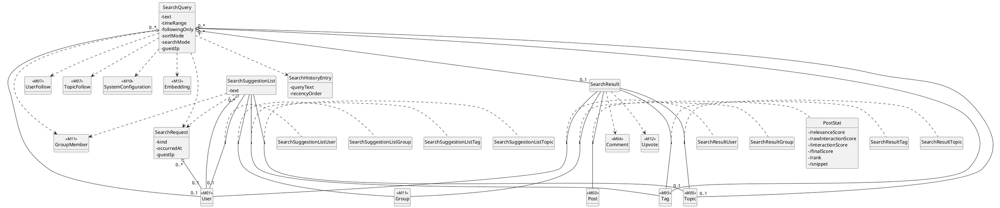

# Phân tích lớp thực thể — M06 Search

<!-- [Vietnamese Doc] Tài liệu tiếng Việt; tên lớp và thuộc tính viết tiếng Anh (input/CONVENTIONS.md mục 3). -->

| Mã tài liệu | EC-M06 |
|---|---|
| Dự án | iShare |
| Module | M06 — Search |
| Đầu vào | FR-M06 phiên bản 1.5 |
| Trạng thái | Bản nháp |
| Phiên bản | 0.3 |
| Ngày | 2026-11-18 |
| Tác giả | Phạm Văn Đức |

<!-- Quy ước chung cho mọi bảng dưới đây:
     - Không đổi tên cột, không xóa cột, không đổi số mục: tool đọc bảng theo số mục và tên cột.
     - Ô không có nội dung ghi "—".
     - Mục chưa tới bước làm thì để dòng "(Chưa làm — bước N)".
     - Cột Nguồn ghi mã trong FR: FR-M06-nn, FR-M06-nn.mm, BR-M06-nn, hoặc TN:<thuật ngữ> (mục 2.1 của FR).
     - Sơ đồ ở mục 4 do gen_puml.py sinh; không sửa tay. -->

## 1. Mô tả chức năng

### 1.1 Đoạn mô tả

(S1) Hệ thống xử lý truy vấn tìm kiếm, kết quả bài viết, kết quả người dùng, Tag, Topic, Group và lịch sử tìm kiếm trên trình duyệt của thiết bị người dùng. (S2) Hệ thống cho Guest, User, Mod và Admin nhận gợi ý người dùng, Tag, Topic, Group khớp với chuỗi đang gõ, dùng tên hiển thị và username của người dùng cùng tên Tag, Topic, Group để so khớp và xếp mức độ giống chuỗi gõ trong từng loại. (S3) Hệ thống cho người đã đăng nhập tìm bài viết theo ngữ nghĩa khi công tắc AI tổng và công tắc Search của M10 bật, dùng embedding truy vấn và embedding bài viết do M13 cung cấp để so ý nghĩa với tiêu đề và nội dung chữ, đồng thời dùng full-text bỏ dấu tiếng Việt cho Guest, khi AI tắt hoặc khi tạo embedding truy vấn thất bại. (S4) Hệ thống xác định tập ứng viên cho truy vấn có chữ, tính Điểm liên quan, Điểm tương tác và Điểm cuối của từng bài, dùng số upvote từ M12 và số bình luận từ M04 để tính điểm, điều chỉnh Điểm cuối theo mức cảnh cáo HEAVY của tác giả do M08 cung cấp khi sắp xếp Liên quan và phân định các bài bằng điểm theo Điểm liên quan cùng thời điểm đăng. (S5) Hệ thống chọn kết quả bài theo khả năng hiển thị của bài với người tìm, trạng thái tài khoản tác giả và tư cách thành viên nhóm Private, cập nhật điều kiện tìm theo thay đổi loại nhóm và trình bày nhãn tài khoản BANNED cạnh tên tác giả theo quy tắc tài khoản. (S6) Hệ thống cho Guest, User, Mod và Admin gửi truy vấn để tìm người dùng, Tag, Topic, Group theo tên, xét tên hiển thị và username của tài khoản ACTIVE đã hoàn tất đăng ký, trạng thái hoạt động của Tag và quyền thành viên nhóm Private, rồi xếp kết quả phụ theo độ giống truy vấn. (S7) Hệ thống cho người tìm chọn bộ lọc Topic, Tag và khoảng thời gian theo thời điểm đăng tính theo lịch giờ Việt Nam, kết hợp các bộ lọc và sắp xếp kết quả bài theo Liên quan, Mới nhất hoặc Nhiều upvote nhất, rồi tính lại kết quả khi bộ lọc hoặc cách sắp xếp thay đổi. (S8) Hệ thống cho người đã đăng nhập lọc nội dung đang theo dõi bằng quan hệ theo dõi người dùng và Topic của M07, xét bài viết ẩn danh trong nhóm theo Topic đang theo dõi và dùng quan hệ theo dõi tác giả cho các bài viết được phép áp dụng. (S9) Hệ thống cho người tìm xem các bài viết của một Topic hoặc Tag bằng truy vấn rỗng có bộ lọc tương ứng, lấy mọi bài đang hiển thị với người tìm thỏa bộ lọc và mặc định sắp xếp theo Mới nhất. (S10) Hệ thống trình bày kết quả bài viết cùng kết quả phụ, dựng đoạn trích từ phần đầu nội dung chữ của bài và tải dần kết quả khi người tìm cuộn, bảo đảm tính liên tục của tập kết quả giữa các lần tải và áp dụng giới hạn kết quả cho truy vấn có chữ. (S11) Hệ thống lưu truy vấn có chữ đã gửi vào lịch sử tìm kiếm trên trình duyệt của thiết bị đang dùng, giữ truy vấn gần nhất đứng trước, đưa truy vấn trùng lên đầu và bỏ truy vấn cũ nhất khi lịch sử đầy. (S12) Hệ thống cho Guest, User, Mod và Admin xem lịch sử tìm kiếm trên trình duyệt, chọn một truy vấn lịch sử để gửi lại và xóa toàn bộ lịch sử, đồng thời xóa lịch sử trên trình duyệt khi người dùng đăng xuất theo sự kiện của M01. (S13) Hệ thống kiểm tra giới hạn tần suất của lượt gợi ý và lượt gửi trong cửa sổ thời gian gần nhất, dùng địa chỉ IP cho Guest và tài khoản cho người đã đăng nhập, tính lượt gửi khi gửi truy vấn, đổi bộ lọc, đổi cách sắp xếp, mở trang bài của Topic hoặc Tag và chọn truy vấn từ lịch sử.

<!-- Một đoạn văn, mỗi câu đánh số (S1) (S2) … Xem steps/01-describe-functions.md. -->

### 1.2 Truy vết câu

| Câu | Nội dung tóm tắt | Nguồn |
|---|---|---|
| S1 | Phạm vi truy vấn, kết quả và lịch sử trên thiết bị | FR-M06-01, FR-M06-02, FR-M06-03, FR-M06-04, FR-M06-05 |
| S2 | Gợi ý khi gõ và dữ liệu so khớp tên | FR-M06-01, FR-M06-01.01, FR-M06-01.05, FR-M06-01.06, FR-M06-01.11 |
| S3 | Tìm bài theo ngữ nghĩa và full-text theo điều kiện AI | FR-M06-02, FR-M06-02.03, FR-M06-02.04, FR-M06-02.05, FR-M06-02.06, FR-M06-02.23, FR-M06-02.26 |
| S4 | Tập ứng viên và các điểm dùng để xếp hạng bài | FR-M06-02.10, FR-M06-02.11, FR-M06-02.27, FR-M06-02.28, FR-M06-02.29 |
| S5 | Quyền xem bài trong kết quả và trạng thái tác giả | FR-M06-02.07, FR-M06-02.08, FR-M06-02.09, FR-M06-02.13, FR-M06-02.14 |
| S6 | Tìm các đối tượng phụ theo tên và quyền hiển thị | FR-M06-03, FR-M06-03.01, FR-M06-03.03, FR-M06-03.04, FR-M06-03.06, FR-M06-03.07, FR-M06-03.08, FR-M06-03.09, FR-M06-01.12, FR-M06-01.13 |
| S7 | Bộ lọc, khoảng thời gian và cách sắp xếp kết quả bài | FR-M06-04, FR-M06-04.01, FR-M06-04.02, FR-M06-04.03, FR-M06-04.05, FR-M06-04.06, FR-M06-04.07, FR-M06-04.09, FR-M06-04.10, FR-M06-04.11 |
| S8 | Lọc theo đối tượng đang theo dõi và bài ẩn danh | FR-M06-04.04 |
| S9 | Xem bài theo Topic/Tag qua truy vấn rỗng có lọc | FR-M06-04.08, FR-M06-04.17, FR-M06-04.18 |
| S10 | Đoạn trích và các phần kết quả được tải dần | FR-M06-02.15, FR-M06-02.16, FR-M06-02.17, FR-M06-02.18, FR-M06-02.19, FR-M06-02.32, FR-M06-03.02 |
| S11 | Ghi và sắp thứ tự lịch sử tìm kiếm trên trình duyệt | FR-M06-05, FR-M06-05.01, FR-M06-05.03, FR-M06-05.04, FR-M06-05.07 |
| S12 | Dùng lại, xóa lịch sử và xử lý đăng xuất | FR-M06-05.04, FR-M06-05.05, FR-M06-05.08, FR-M06-05.10 |
| S13 | Đơn vị đếm và chủ thể của giới hạn tần suất | FR-M06-01.07, FR-M06-02.20, FR-M06-04.20, FR-M06-05.08 |

## 2. Danh từ và phân loại

### 2.1 Sổ danh từ

| # | Danh từ | Xuất hiện ở | Phân loại | Kết quả | Lý do |
|---|---|---|---|---|---|
| 1 | Hệ thống | S1 | Loại bỏ | — | Trừu tượng, tác nhân xử lý. |
| 2 | Truy vấn tìm kiếm / truy vấn / truy vấn rỗng | S1 | Lớp | SearchQuery | T8, ngữ cảnh xử lý có chuỗi, bộ lọc và cách sắp xếp theo TN:Truy vấn, FR-M06-02.01/04.09. |
| 3 | Kết quả bài viết / bộ điểm xếp hạng bài viết | S1 | Lớp | PostStat | T7 ở bước 2, bộ số liệu theo bài–truy vấn. Bước 3 xác định thuộc tính của cặp SearchResult–Post và chuyển nhóm Liên kết theo FR-M06-02.10/02.27/02.29. |
| 4 | Người dùng / User / Mod / Admin / tác giả / tài khoản / người tìm đã đăng nhập | S1 | Lớp | User | T3, tài khoản thuộc M01, dùng tên EC-M01. |
| 5 | Tag | S1 | Lớp | Tag | T4, đối tượng tìm và lọc thuộc M05, dùng tên EC-M05. |
| 6 | Topic | S1 | Lớp | Topic | T4, đối tượng tìm và lọc thuộc M05, dùng tên EC-M05. |
| 7 | Group / nhóm / nhóm Private / loại nhóm | S1 | Lớp | Group | T4, nhóm và quyền riêng tư thuộc M11, dùng tên các EC trước. |
| 8 | Lịch sử tìm kiếm | S1 | Loại bỏ | — | Chung chung, tập các SearchHistoryEntry được lưu trên trình duyệt theo BR-M06-20. |
| 9 | Trình duyệt / thiết bị | S1 | Loại bỏ | — | Ngoài phạm vi hệ thống, môi trường chứa lịch sử, FR-M06-05.01. |
| 10 | Guest | S2 | Loại bỏ | — | Không lưu: tác nhân không có tài khoản. |
| 11 | Gợi ý khi gõ / danh sách gợi ý | S2 | Lớp | SearchSuggestionList | T8, ngữ cảnh gợi ý có chuỗi đang gõ và các đối tượng khớp theo FR-M06-01.01. |
| 12 | Chuỗi đang gõ | S2 | Thuộc tính | SearchSuggestionList.text | T9, đầu vào của danh sách gợi ý, FR-M06-01.01. |
| 13 | Tên hiển thị / username | S2 | Loại bỏ | — | Ngoài phạm vi module (M01), User.displayName và User.username đã có. |
| 14 | Tên Tag / tên Topic / tên Group | S2 | Loại bỏ | — | Ngoài phạm vi module (M05, M11), thuộc các đối tượng được tìm. |
| 15 | Mức độ giống chuỗi gõ / độ giống truy vấn | S2 | Loại bỏ | — | Giao diện, tiêu chí thứ tự gợi ý và kết quả phụ theo BR-M06-09, nguồn chỉ quy định so khớp và thứ tự. |
| 16 | Cách tìm bài / tìm kiếm ngữ nghĩa / full-text | S3 | Thuộc tính | SearchQuery.searchMode | T9, cách xử lý của truy vấn theo FR-M06-02.03/02.04/02.05/02.23. |
| 17 | Bài viết | S3 | Lớp | Post | T4, đối tượng kết quả thuộc M03, dùng EC-M03. |
| 18 | Công tắc AI tổng / công tắc Search | S3 | Lớp | SystemConfiguration | T4, cấu hình M10, dùng tên EC-M01/03/05. |
| 19 | Embedding / embedding truy vấn / embedding bài viết | S3 | Lớp | Embedding | T4, dữ liệu do M13 cung cấp, tên tạm chờ EC-M13. |
| 20 | Ý nghĩa nội dung | S3 | Loại bỏ | — | Trừu tượng, ý nghĩa được biểu diễn bằng Embedding theo TN:Embedding. |
| 21 | Tiêu đề / nội dung chữ | S3 | Loại bỏ | — | Ngoài phạm vi module (M03), Post.title và Post.plainText đã có. |
| 22 | Dấu tiếng Việt / từ khóa | S3 | Loại bỏ | — | Chung chung, thành phần chuỗi và quy tắc so khớp theo BR-M06-08. |
| 23 | Tập ứng viên | S4 | Loại bỏ | — | Chung chung, tập các Post và PostStat được chọn theo BR-M06-13. |
| 24 | Điểm liên quan | S4 | Thuộc tính | PostStat.relevanceScore | T7, số liệu theo cặp bài–truy vấn, BR-M06-13. |
| 25 | Điểm tương tác | S4 | Thuộc tính | PostStat.interactionScore | T7, chuẩn hóa trong tập ứng viên theo BR-M06-13. |
| 26 | Điểm cuối | S4 | Thuộc tính | PostStat.finalScore | T7, tổng điểm liên quan và tương tác, điều chỉnh HEAVY theo BR-M06-13/14. |
| 27 | Upvote | S4 | Lớp | Upvote | T4, nguồn số lượng upvote bài từ M12 theo mục 5.9, dùng tên các EC trước, các thuộc tính nguồn thuộc M12. |
| 28 | Số upvote | S4 | Loại bỏ | — | Ngoài phạm vi module (M12), số liệu nguồn của bài dùng để tính PostStat, theo giao tiếp mục 5.9. |
| 29 | Bình luận / trả lời | S4 | Lớp | Comment | T4, nguồn đếm bình luận hiển thị gồm trả lời M04, dùng EC-M04. |
| 30 | Số bình luận | S4 | Loại bỏ | — | Ngoài phạm vi module (M04), giá trị Post.commentCount đã được EC-M04 bổ sung cho Post, dùng để tính PostStat. |
| 31 | Mức cảnh cáo / HEAVY | S4 | Loại bỏ | — | Ngoài phạm vi module (M08), dữ liệu điều kiện giảm điểm của tác giả. |
| 32 | Thời điểm đăng | S4 | Loại bỏ | — | Ngoài phạm vi module (M03), Post.publishedAt đã có. |
| 33 | Khả năng hiển thị / trạng thái tài khoản / BANNED / ACTIVE / hoàn tất đăng ký | S5 | Loại bỏ | — | Ngoài phạm vi module (M03, M01), dữ liệu quyền và trạng thái nguồn. |
| 34 | Tư cách thành viên nhóm | S5 | Lớp | GroupMember | T4, M11 cung cấp quyền xem nhóm Private, dùng tên các EC trước. |
| 35 | Nhãn tài khoản BANNED | S5 | Loại bỏ | — | Giao diện, biểu diễn trạng thái User theo FR-M06-02.14. |
| 36 | Kết quả tìm kiếm / kết quả chính và kết quả phụ | S6 | Lớp | SearchResult | T8, ngữ cảnh kết quả gồm bài và các đối tượng phụ theo FR-M06-02.16/03.02. Hiện chỉ có dữ liệu tham chiếu, Q-01. |
| 37 | Trạng thái hoạt động của Tag | S6 | Loại bỏ | — | Ngoài phạm vi module (M05), Tag.state đã có. |
| 38 | Bộ lọc | S7 | Loại bỏ | — | Chung chung, nhóm lựa chọn của SearchQuery, Topic/Tag là đối tượng, khoảng thời gian và cờ theo dõi là giá trị. |
| 39 | Khoảng thời gian | S7 | Thuộc tính | SearchQuery.timeRange | T9, lựa chọn khoảng lịch cho truy vấn theo BR-M06-15. |
| 40 | Cách sắp xếp / Liên quan / Mới nhất / Nhiều upvote nhất | S7 | Thuộc tính | SearchQuery.sortMode | T9, lựa chọn thứ tự theo BR-M06-15/16. |
| 41 | Lịch giờ Việt Nam | S7 | Loại bỏ | — | Hằng số của BR-M06-15, quy tắc Asia/Ho_Chi_Minh. |
| 42 | Chỉ nội dung đang theo dõi | S8 | Thuộc tính | SearchQuery.followingOnly | T9, lựa chọn lọc của người đã đăng nhập theo FR-M06-04.04. |
| 43 | Quan hệ theo dõi người dùng | S8 | Lớp | UserFollow | T4, M07 sở hữu, dùng tên EC-M01/02. |
| 44 | Quan hệ theo dõi Topic | S8 | Lớp | TopicFollow | T4, M07 sở hữu, dùng tên EC-M01/05. |
| 45 | Bài viết ẩn danh | S8 | Loại bỏ | — | Ngoài phạm vi module (M03, M11), ngữ cảnh danh tính tác giả do module nguồn xác định. |
| 46 | Đoạn trích | S10 | Thuộc tính | PostStat.snippet | T7, phần đầu nội dung chữ được tính theo BR-M06-18. |
| 47 | Trang kết quả / cuộn / phần kết quả được tải | S10 | Loại bỏ | — | Giao diện, cách trình bày và tải dữ liệu theo BR-M06-17/19. |
| 48 | Giới hạn tổng kết quả / kích thước lần tải | S10 | Loại bỏ | — | Hằng số của BR-M06-19, 120 bài cho truy vấn có chữ và 15 bài/lần. |
| 49 | Truy vấn lịch sử / mục lịch sử tìm kiếm | S11 | Lớp | SearchHistoryEntry | T8, mục có chuỗi và thứ tự gần đây theo FR-M06-05.01/05.07. |
| 50 | Chuỗi truy vấn lịch sử | S11 | Thuộc tính | SearchHistoryEntry.queryText | T9, nội dung mục lịch sử trên trình duyệt, FR-M06-05.01. |
| 51 | Thứ tự gần đây / truy vấn gần nhất | S11 | Thuộc tính | SearchHistoryEntry.recencyOrder | T9, vị trí trong lịch sử từ mới tới cũ, FR-M06-05.04/05.07. |
| 52 | Truy vấn trùng / truy vấn cũ nhất / lịch sử đầy | S11 | Loại bỏ | — | Chung chung, điều kiện thao tác trên tập SearchHistoryEntry theo BR-M06-20. |
| 53 | Đăng xuất / sự kiện đăng xuất | S12 | Loại bỏ | — | Hành động không lưu dấu vết riêng tại M06, sự kiện M01 kích hoạt xóa lịch sử. |
| 54 | Lượt gợi ý / lượt gửi / lượt tìm kiếm | S13 | Lớp | SearchRequest | T8, đơn vị đếm theo chủ thể và thời điểm để kiểm tra tần suất theo BR-M06-21. |
| 55 | Địa chỉ IP trong lượt tìm kiếm | S13 | Thuộc tính | SearchRequest.guestIp | T9, chủ thể đếm cho Guest theo BR-M06-21. |
| 56 | Giới hạn tần suất / cửa sổ thời gian gần nhất | S13 | Loại bỏ | — | Hằng số của BR-M06-21, cửa sổ 60 giây và hạn mức theo vai trò. |
| 57 | Chuỗi truy vấn | Quét: TN:Truy vấn | Thuộc tính | SearchQuery.text | T9, chuỗi của truy vấn được gửi theo FR-M06-02.01/03.01. |
| 58 | Điểm tương tác thô | Quét: BR-M06-13 | Thuộc tính | PostStat.rawInteractionScore | T7, giá trị trung gian từ số upvote và số bình luận. |
| 59 | Thứ tự kết quả bài | Quét: FR-M06-02.10, FR-M06-04.06 | Thuộc tính | PostStat.rank | T7, vị trí sau khi sắp xếp theo các khóa của truy vấn. |
| 60 | Loại lượt tìm kiếm | Quét: Dữ liệu nghiệp vụ | Thuộc tính | SearchRequest.kind | T9, lượt gợi ý hoặc lượt gửi theo BR-M06-21. |
| 61 | Thời điểm lượt tìm kiếm | Quét: Dữ liệu nghiệp vụ | Thuộc tính | SearchRequest.occurredAt | T9, mốc dùng để xét 60 giây gần nhất. |
| 62 | Địa chỉ IP trong truy vấn Guest | Quét: Dữ liệu nghiệp vụ | Thuộc tính | SearchQuery.guestIp | T9, dữ liệu người tìm của truy vấn Guest ở mục 5.7. |
| 63 | Từ của truy vấn / khoảng trắng | Quét: TN:Từ (của truy vấn) | Loại bỏ | — | Chung chung, đơn vị đếm dùng tính PostStat.relevanceScore. |
| 64 | Hôm nay / Tuần này / Tháng này / Tất cả | Quét: BR-M06-15 | Loại bỏ | — | Giá trị của SearchQuery.timeRange. |
| 65 | 300 mili giây / một ký tự / tối đa 3 mục | Quét: BR-M06-03, FR-M06-01.10 | Loại bỏ | — | Hằng số của BR-M06-03 và FR-M06-01.10, điều kiện và số lượng gợi ý. |
| 66 | 10 truy vấn lịch sử | Quét: BR-M06-20 | Loại bỏ | — | Hằng số của BR-M06-20, giới hạn tập SearchHistoryEntry. |
| 67 | 30/10 lượt cho Guest / 45/20 lượt cho người đăng nhập | Quét: BR-M06-21 | Loại bỏ | — | Hằng số của BR-M06-21, hạn mức của SearchRequest. |
| 68 | 150 ký tự / dấu ba chấm | Quét: BR-M06-18 | Loại bỏ | — | Hằng số của BR-M06-18, quy tắc dựng PostStat.snippet. |
| 69 | Trọng số 0,8 và 0,2 / hệ số 0,5 | Quét: BR-M06-13, BR-M06-14 | Loại bỏ | — | Hằng số của BR-M06-13/14, công thức tính PostStat.finalScore. |
| 70 | Mục User trong SearchResult | Quét: FR-M06-03.01, FR-M06-03.02, FR-M06-03.06 (bước 3) | Lớp | SearchResultUser | Tách quan hệ n-n giữa ngữ cảnh và đối tượng xuất hiện trong kết quả/gợi ý. |
| 71 | Mục Tag trong SearchResult | Quét: FR-M06-03.01, FR-M06-03.02, FR-M06-03.06 (bước 3) | Lớp | SearchResultTag | Tách quan hệ n-n giữa ngữ cảnh và đối tượng xuất hiện trong kết quả/gợi ý. |
| 72 | Mục Topic trong SearchResult | Quét: FR-M06-03.01, FR-M06-03.02, FR-M06-03.06 (bước 3) | Lớp | SearchResultTopic | Tách quan hệ n-n giữa ngữ cảnh và đối tượng xuất hiện trong kết quả/gợi ý. |
| 73 | Mục Group trong SearchResult | Quét: FR-M06-03.01, FR-M06-03.02, FR-M06-03.06 (bước 3) | Lớp | SearchResultGroup | Tách quan hệ n-n giữa ngữ cảnh và đối tượng xuất hiện trong kết quả/gợi ý. |
| 74 | Mục User trong SearchSuggestionList | Quét: FR-M06-01.01, FR-M06-01.10, FR-M06-01.11 (bước 3) | Lớp | SearchSuggestionListUser | Tách quan hệ n-n giữa ngữ cảnh và đối tượng xuất hiện trong kết quả/gợi ý. |
| 75 | Mục Tag trong SearchSuggestionList | Quét: FR-M06-01.01, FR-M06-01.10, FR-M06-01.11 (bước 3) | Lớp | SearchSuggestionListTag | Tách quan hệ n-n giữa ngữ cảnh và đối tượng xuất hiện trong kết quả/gợi ý. |
| 76 | Mục Topic trong SearchSuggestionList | Quét: FR-M06-01.01, FR-M06-01.10, FR-M06-01.11 (bước 3) | Lớp | SearchSuggestionListTopic | Tách quan hệ n-n giữa ngữ cảnh và đối tượng xuất hiện trong kết quả/gợi ý. |
| 77 | Mục Group trong SearchSuggestionList | Quét: FR-M06-01.01, FR-M06-01.10, FR-M06-01.11 (bước 3) | Lớp | SearchSuggestionListGroup | Tách quan hệ n-n giữa ngữ cảnh và đối tượng xuất hiện trong kết quả/gợi ý. |

Tổng 77 dòng danh từ, gồm 26 dòng thành lớp, 18 dòng thành thuộc tính và 33 dòng bị loại. Lượt quét FR bổ sung 21 dòng, trong đó 8 dòng lớp liên kết được thêm ở bước 3.

### 2.2 Lớp

| Lớp | Tên tiếng Việt | Nhóm | Sở hữu | Mô tả | Nguồn |
|---|---|---|---|---|---|
| SearchQuery | Truy vấn tìm kiếm | Thực thể | M06 | Ngữ cảnh truy vấn và lựa chọn bộ lọc/cách tìm trong lượt xử lý. | FR-M06-02.01, FR-M06-04.09 |
| SearchResult | Kết quả tìm kiếm | Thực thể | M06 | Ngữ cảnh kết quả gồm bộ điểm bài và các đối tượng phụ, chỉ có tham chiếu, Q-01. | FR-M06-02.16, FR-M06-03.02 |
| PostStat | Bộ điểm kết quả bài | Liên kết | M06 | Nhóm số liệu tính theo bài và truy vấn để xếp hạng, tên đề xuất theo QU-01. | FR-M06-02.10, FR-M06-02.27, FR-M06-02.29 |
| SearchSuggestionList | Danh sách gợi ý | Thực thể | M06 | Chuỗi đang gõ và các đối tượng khớp trong ngữ cảnh gợi ý. | FR-M06-01.01, FR-M06-01.10 |
| SearchHistoryEntry | Mục lịch sử tìm kiếm | Thực thể | M06 | Chuỗi và thứ tự gần đây lưu tại trình duyệt thiết bị. | FR-M06-05.01, FR-M06-05.04, FR-M06-05.07 |
| SearchRequest | Lượt tìm kiếm | Thực thể | M06 | Metadata loại, chủ thể và thời điểm dùng để kiểm tra giới hạn. | FR-M06-01.07, FR-M06-02.20, BR-M06-21 |
| User | Tài khoản | Thực thể | M01 | Người tìm hoặc tài khoản kết quả, dùng lại EC-M01. | FR-M06-01.05, FR-M06-03.03 |
| Post | Bài viết | Thực thể | M03 | Đối tượng kết quả và dữ liệu nguồn xếp hạng, dùng EC-M03. | FR-M06-02.03, FR-M06-02.07 |
| Tag | Tag | Thực thể | M05 | Đối tượng gợi ý, tìm và lọc, dùng EC-M05. | FR-M06-01.04, FR-M06-04.02 |
| Topic | Topic | Thực thể | M05 | Đối tượng gợi ý, tìm và lọc, dùng EC-M05. | FR-M06-01.01, FR-M06-04.01 |
| Group | Nhóm | Thực thể | M11 | Tên và quyền riêng tư nhóm trong kết quả, tên dùng lại, chờ EC-M11. | FR-M06-03.01, FR-M06-03.08 |
| GroupMember | Thành viên nhóm | Thực thể | M11 | Tư cách thành viên để xem nhóm và bài Private, tên dùng lại, chờ EC-M11. | FR-M06-02.08, FR-M06-03.09 |
| UserFollow | Lượt theo dõi người dùng | Thực thể | M07 | Đầu vào lọc đang theo dõi, tên từ EC-M01/02, chờ EC-M07. | FR-M06-04.04 |
| TopicFollow | Lượt theo dõi Topic | Thực thể | M07 | Đầu vào lọc đang theo dõi, tên từ EC-M01/05, chờ EC-M07. | FR-M06-04.04 |
| SystemConfiguration | Cấu hình hệ thống | Thực thể | M10 | Công tắc AI tổng và Search, tên dùng lại, chờ EC-M10. | FR-M06-02.03, FR-M06-02.04 |
| Embedding | Embedding | Thực thể | M13 | Biểu diễn ngữ nghĩa bài/truy vấn M13 cung cấp, tên tạm chờ EC-M13. | FR-M06-02.03, TN:Embedding |
| Upvote | Upvote | Thực thể | M12 | Nguồn số upvote bài cho xếp hạng, tên dùng lại, chờ EC-M12. | FR-M06-02.10, FR-M06-04.07 |
| Comment | Bình luận | Thực thể | M04 | Nguồn số bình luận hiển thị của bài, dùng EC-M04. | FR-M06-02.10, TN:Số bình luận |
| SearchResultUser | Mục User trong SearchResult | Liên kết | M06 | Một mục được xác định bởi cặp SearchResult và User trong ngữ cảnh lượt xử lý. | FR-M06-03.01, FR-M06-03.02, FR-M06-03.06 |
| SearchResultTag | Mục Tag trong SearchResult | Liên kết | M06 | Một mục được xác định bởi cặp SearchResult và Tag trong ngữ cảnh lượt xử lý. | FR-M06-03.01, FR-M06-03.02, FR-M06-03.06 |
| SearchResultTopic | Mục Topic trong SearchResult | Liên kết | M06 | Một mục được xác định bởi cặp SearchResult và Topic trong ngữ cảnh lượt xử lý. | FR-M06-03.01, FR-M06-03.02, FR-M06-03.06 |
| SearchResultGroup | Mục Group trong SearchResult | Liên kết | M06 | Một mục được xác định bởi cặp SearchResult và Group trong ngữ cảnh lượt xử lý. | FR-M06-03.01, FR-M06-03.02, FR-M06-03.06 |
| SearchSuggestionListUser | Mục User trong SearchSuggestionList | Liên kết | M06 | Một mục được xác định bởi cặp SearchSuggestionList và User trong ngữ cảnh lượt xử lý. | FR-M06-01.01, FR-M06-01.10, FR-M06-01.11 |
| SearchSuggestionListTag | Mục Tag trong SearchSuggestionList | Liên kết | M06 | Một mục được xác định bởi cặp SearchSuggestionList và Tag trong ngữ cảnh lượt xử lý. | FR-M06-01.01, FR-M06-01.10, FR-M06-01.11 |
| SearchSuggestionListTopic | Mục Topic trong SearchSuggestionList | Liên kết | M06 | Một mục được xác định bởi cặp SearchSuggestionList và Topic trong ngữ cảnh lượt xử lý. | FR-M06-01.01, FR-M06-01.10, FR-M06-01.11 |
| SearchSuggestionListGroup | Mục Group trong SearchSuggestionList | Liên kết | M06 | Một mục được xác định bởi cặp SearchSuggestionList và Group trong ngữ cảnh lượt xử lý. | FR-M06-01.01, FR-M06-01.10, FR-M06-01.11 |

Có 14 lớp M06 và 12 lớp ngoài. PostStat đã được phân loại lại thành lớp Liên kết ở bước 3 vì sáu thuộc tính phụ thuộc vào cặp SearchResult–Post. SearchResult giữ vai trò ngữ cảnh kết quả bài và kết quả phụ, cách biểu diễn lớp chỉ có tham chiếu đã được người dùng đồng ý tại Q-01.

SearchQuery, SearchResult và SearchSuggestionList có phạm vi lượt xử lý tìm kiếm theo FR mục 5.7. SearchHistoryEntry có vòng đời trên trình duyệt thiết bị theo BR-M06-20. SearchRequest là metadata tần suất theo loại, chủ thể và thời điểm theo BR-M06-21. Các nguồn Upvote và Comment ở bảng lớp được dùng để lấy số liệu tương tác theo giao tiếp mục 5.9.

### 2.3 Thuộc tính

| Lớp | Thuộc tính | Tên tiếng Việt | Tính chất | Ràng buộc nguồn nêu | Nguồn |
|---|---|---|---|---|---|
| SearchQuery | text | Chuỗi truy vấn | Lưu | Giá trị trong ngữ cảnh lượt tìm. Có thể rỗng khi có ít nhất một bộ lọc, FR-M06-02.31/04.17. | FR-M06-02.01, FR-M06-03.01, FR-M06-04.17 |
| SearchQuery | timeRange | Khoảng thời gian | Lưu | Hôm nay, Tuần này, Tháng này, Tất cả. Theo lịch Asia/Ho_Chi_Minh trên thời điểm đăng, tối đa một giá trị. | FR-M06-04.03, FR-M06-04.10, BR-M06-15 |
| SearchQuery | followingOnly | Chỉ nội dung đang theo dõi | Lưu | Lựa chọn trong ngữ cảnh truy vấn của người đã đăng nhập, dùng UserFollow/TopicFollow, bài ẩn danh theo Topic. | FR-M06-04.04, FR-M06-04.13 |
| SearchQuery | sortMode | Cách sắp xếp | Lưu | Liên quan, Mới nhất, Nhiều upvote nhất. Có chữ mặc định Liên quan, rỗng mặc định Mới nhất và dùng hai cách sau. | BR-M06-15, BR-M06-16 |
| SearchQuery | searchMode | Cách tìm bài | Lưu | Ngữ nghĩa cho người đã đăng nhập khi AI bật, full-text cho Guest/AI tắt/AI lỗi với truy vấn đó. Truy vấn rỗng chỉ lọc. | FR-M06-02.03, FR-M06-02.04, FR-M06-02.05, FR-M06-02.23, FR-M06-04.19 |
| SearchQuery | guestIp | IP người tìm Guest | Lưu | Mục 5.7 nêu IP của Guest trong ngữ cảnh truy vấn, tài khoản người tìm được xét như đối tượng ngoài. | BR-M06-21 |
| SearchSuggestionList | text | Chuỗi đang gõ | Lưu | Chuỗi đầu vào của danh sách gợi ý hiện tại, chạy sau 300 ms ngừng gõ, từ một ký tự. | FR-M06-01.01, FR-M06-01.09 |
| SearchHistoryEntry | queryText | Chuỗi truy vấn lịch sử | Lưu | Lưu trên trình duyệt thiết bị khi gửi truy vấn có chữ, tối đa 10 mục khác nhau. Đăng xuất hoặc chọn xóa lịch sử làm xóa toàn bộ. | FR-M06-05.01, FR-M06-05.03, FR-M06-05.05, FR-M06-05.07, FR-M06-05.10 |
| SearchHistoryEntry | recencyOrder | Thứ tự gần đây | Lưu | Thứ tự mới nhất đứng trước trong danh sách trên trình duyệt. Gửi lại truy vấn đã có đưa mục lên đầu, đầy thì bỏ mục cũ nhất. | FR-M06-05.03, FR-M06-05.04, FR-M06-05.07 |
| SearchRequest | kind | Loại lượt | Lưu | Lượt gợi ý hoặc lượt gửi. Loại lượt gửi gồm đổi lọc/sắp xếp, mở Topic/Tag, chọn mục lịch sử theo BR-M06-21. | FR-M06-01.07, FR-M06-02.20, FR-M06-04.20, BR-M06-21 |
| SearchRequest | occurredAt | Thời điểm lượt tìm | Lưu | Mốc dùng xét 60 giây gần nhất theo chủ thể. Mục 5.7 xác định metadata thời điểm. | FR-M06-01.07, FR-M06-02.20, BR-M06-21 |
| SearchRequest | guestIp | IP chủ thể Guest | Lưu | Guest đếm theo IP, tối đa 30 lượt gợi ý và 10 lượt gửi/60 giây. User/Mod/Admin đếm theo tài khoản, 45/20 lượt. | BR-M06-21 |
| PostStat | relevanceScore | Điểm liên quan | Dẫn xuất | Với truy vấn có chữ, ngữ nghĩa = (cosine + 1) / 2. Full-text = số từ truy vấn có trong bài / số từ truy vấn. Khoảng 0–1. | FR-M06-02.10, FR-M06-02.27, BR-M06-13 |
| PostStat | rawInteractionScore | Điểm tương tác thô | Dẫn xuất | log(1 + số upvote) × 2 + log(1 + số bình luận), số liệu nguồn M12/M04. | BR-M06-13 |
| PostStat | interactionScore | Điểm tương tác | Dẫn xuất | (thô − min thô) / (max thô − min thô) trong tập ứng viên. Mọi bài cùng điểm thô thì bằng 0. | BR-M06-13 |
| PostStat | finalScore | Điểm cuối | Dẫn xuất | 0,8 × Điểm liên quan + 0,2 × Điểm tương tác. Sắp Liên quan và tác giả HEAVY thì nhân 0,5. Áp cho truy vấn có chữ. | FR-M06-02.10, FR-M06-02.11, FR-M06-02.27, BR-M06-13, BR-M06-14 |
| PostStat | rank | Thứ tự kết quả | Dẫn xuất | Theo cách sắp xếp của truy vấn. Liên quan dùng điểm cuối, rồi điểm liên quan, rồi đăng sau. Mới nhất/Nhiều upvote theo BR-M06-15; truy vấn rỗng theo BR-M06-16. | FR-M06-02.29, FR-M06-04.06, FR-M06-04.07, BR-M06-15, BR-M06-16 |
| PostStat | snippet | Đoạn trích | Dẫn xuất | 150 ký tự đầu nội dung chữ. Nếu giữa từ thì cắt trước từ và thêm …, nội dung ngắn hiện nguyên. Bài chỉ có poll có thể vắng đoạn trích. | FR-M06-02.15, FR-M06-02.32, BR-M06-18 |

Có 18 thuộc tính, gồm 12 thuộc tính Lưu và 6 thuộc tính Dẫn xuất. Tính chất Lưu ở SearchQuery và SearchSuggestionList mô tả giá trị được giữ trong ngữ cảnh lượt xử lý. Tính chất Lưu ở SearchHistoryEntry mô tả dữ liệu trên trình duyệt, SearchRequest giữ metadata phục vụ cửa sổ đếm. Các giá trị Dẫn xuất của PostStat được tính theo truy vấn và tập ứng viên tại lúc tìm.

Topic/Tag trong bộ lọc, người tìm đã đăng nhập và đối tượng kết quả được gọi tên trong sổ danh từ để xét quan hệ ở bước 3. SearchQuery.guestIp là dữ liệu Guest trong ngữ cảnh truy vấn, SearchRequest.guestIp là dữ liệu chủ thể của lượt đếm, được phân biệt theo đối tượng sử dụng. Thời điểm lượt tìm kiếm và IP của truy vấn Guest đã được bổ sung từ dữ liệu nghiệp vụ sau lượt phân loại.

### 2.4 Đối chiếu với mục Dữ liệu nghiệp vụ của FR

| Thực thể trong FR | Trong mô hình | Xử lý |
|---|---|---|
| Truy vấn tìm kiếm | SearchQuery | Khớp chuỗi, lựa chọn bộ lọc, cách sắp xếp và cách tìm bài. Topic, Tag và tài khoản người tìm là đối tượng để xét quan hệ bước 3. Đã thêm qua sổ danh từ: guestIp từ mục 5.7. |
| Kết quả tìm kiếm | SearchResult, PostStat | Khớp ngữ cảnh kết quả bài và kết quả phụ. Bước 2 trích bộ điểm thành PostStat theo T7, bước 3 đặt sáu thuộc tính trên lớp liên kết PostStat của cặp SearchResult–Post. SearchResult có tham chiếu theo Q-01 đã duyệt. |
| Danh sách gợi ý | SearchSuggestionList | Khớp chuỗi đang gõ và các đối tượng người dùng/Tag/Topic/Group khớp. Các đối tượng ngoài được xét quan hệ bước 3. |
| Mục lịch sử tìm kiếm | SearchHistoryEntry | Khớp chuỗi và thứ tự gần đây, phạm vi trình duyệt thiết bị, theo FR-M06-05 và BR-M06-20. |
| Lượt tìm kiếm (để tính giới hạn) | SearchRequest | Khớp loại và chủ thể lượt đếm, đã thêm occurredAt qua sổ danh từ từ mục 5.7. Các ràng buộc theo BR-M06-21. |
| Phần mô hình có thêm từ quy tắc tính | PostStat.rawInteractionScore, rank | Mô hình có thêm điểm thô theo BR-M06-13, thứ tự theo FR-M06-02.10/02.29, FR-M06-04.06/04.07. Các giá trị tính theo truy vấn. |
| Tham chiếu ngoài | User, Post, Tag, Topic, Group, GroupMember, UserFollow, TopicFollow, SystemConfiguration, Embedding, Upvote, Comment | Mô hình có thêm các đối tượng ngoài theo FR mục 5.9 và các yêu cầu, dùng tên đã có. Embedding là tên tạm M13. Module M07/10/11/12/13 chờ EC sở hữu để đối chiếu. |

## 3. Quan hệ giữa các lớp

### 3.1 Ma trận cặp lớp

| Lớp / mã | 01 | 02 | 03 | 04 | 05 | 06 | 07 | 08 | 09 | 10 | 11 | 12 | 13 | 14 | 15 | 16 | 17 | 18 | 19 | 20 | 21 | 22 | 23 | 24 | 25 | 26 |
|---|---|---|---|---|---|---|---|---|---|---|---|---|---|---|---|---|---|---|---|---|---|---|---|---|---|---|
| 01 SearchQuery |  | T |  |  | T | T | T | G(SearchResult/PostStat) | T | T | G(GroupMember) | T | T | T | T | T |  |  |  |  |  |  |  |  |  |  |
| 02 SearchResult |  |  | T |  |  |  | G(SearchQuery/SearchResultUser) | G(PostStat) | G(SearchResultTag) | G(SearchResultTopic) | G(SearchResultGroup) | G(SearchQuery) |  |  |  | G(SearchQuery) | T | T | T | T | T | T |  |  |  |  |
| 03 PostStat |  |  |  |  |  |  |  | T |  |  |  |  |  |  |  |  |  |  |  |  |  |  |  |  |  |  |
| 04 SearchSuggestionList |  |  |  |  |  | T | T |  | G(SearchSuggestionListTag) | G(SearchSuggestionListTopic) | G(SearchSuggestionListGroup) | T |  |  |  |  |  |  |  |  |  |  | T | T | T | T |
| 05 SearchHistoryEntry |  |  |  |  |  |  |  |  |  |  |  |  |  |  |  |  |  |  |  |  |  |  |  |  |  |  |
| 06 SearchRequest |  |  |  |  |  |  | T |  |  |  |  |  |  |  |  |  |  |  |  |  |  |  |  |  |  |  |
| 07 User |  |  |  |  |  |  |  |  |  |  |  |  |  |  |  |  |  |  | T |  |  |  | T |  |  |  |
| 08 Post |  |  |  |  |  |  |  |  |  |  |  |  |  |  |  |  |  |  |  |  |  |  |  |  |  |  |
| 09 Tag |  |  |  |  |  |  |  |  |  |  |  |  |  |  |  |  |  |  |  | T |  |  |  | T |  |  |
| 10 Topic |  |  |  |  |  |  |  |  |  |  |  |  |  |  |  |  |  |  |  |  | T |  |  |  | T |  |
| 11 Group |  |  |  |  |  |  |  |  |  |  |  |  |  |  |  |  |  |  |  |  |  | T |  |  |  | T |
| 12 GroupMember |  |  |  |  |  |  |  |  |  |  |  |  |  |  |  |  |  |  |  |  |  |  |  |  |  |  |
| 13 UserFollow |  |  |  |  |  |  |  |  |  |  |  |  |  |  |  |  |  |  |  |  |  |  |  |  |  |  |
| 14 TopicFollow |  |  |  |  |  |  |  |  |  |  |  |  |  |  |  |  |  |  |  |  |  |  |  |  |  |  |
| 15 SystemConfiguration |  |  |  |  |  |  |  |  |  |  |  |  |  |  |  |  |  |  |  |  |  |  |  |  |  |  |
| 16 Embedding |  |  |  |  |  |  |  |  |  |  |  |  |  |  |  |  |  |  |  |  |  |  |  |  |  |  |
| 17 Upvote |  |  |  |  |  |  |  |  |  |  |  |  |  |  |  |  |  |  |  |  |  |  |  |  |  |  |
| 18 Comment |  |  |  |  |  |  |  |  |  |  |  |  |  |  |  |  |  |  |  |  |  |  |  |  |  |  |
| 19 SearchResultUser |  |  |  |  |  |  |  |  |  |  |  |  |  |  |  |  |  |  |  |  |  |  |  |  |  |  |
| 20 SearchResultTag |  |  |  |  |  |  |  |  |  |  |  |  |  |  |  |  |  |  |  |  |  |  |  |  |  |  |
| 21 SearchResultTopic |  |  |  |  |  |  |  |  |  |  |  |  |  |  |  |  |  |  |  |  |  |  |  |  |  |  |
| 22 SearchResultGroup |  |  |  |  |  |  |  |  |  |  |  |  |  |  |  |  |  |  |  |  |  |  |  |  |  |  |
| 23 SearchSuggestionListUser |  |  |  |  |  |  |  |  |  |  |  |  |  |  |  |  |  |  |  |  |  |  |  |  |  |  |
| 24 SearchSuggestionListTag |  |  |  |  |  |  |  |  |  |  |  |  |  |  |  |  |  |  |  |  |  |  |  |  |  |  |
| 25 SearchSuggestionListTopic |  |  |  |  |  |  |  |  |  |  |  |  |  |  |  |  |  |  |  |  |  |  |  |  |  |  |
| 26 SearchSuggestionListGroup |  |  |  |  |  |  |  |  |  |  |  |  |  |  |  |  |  |  |  |  |  |  |  |  |  |  |

Có 26 lớp sau khi thêm 8 lớp liên kết. Ma trận sau tách dùng T cho cặp trực tiếp và G(X) cho đường gián tiếp. Các cặp hai lớp ngoài thuộc module sở hữu. Ngữ cảnh FR của M06 xét các lượt xử lý tìm và gợi ý, các ô tự liên hệ được để trống.

Cặp User–SearchSuggestionList có quan hệ trực tiếp ở vai trò người nhận gợi ý và đường qua SearchSuggestionListUser ở vai trò tài khoản được gợi ý. Cặp User–SearchQuery là người tìm, User–SearchResult đi qua SearchResultUser là tài khoản tìm được.

### 3.2 Quan hệ số lượng

| Cặp | Câu A → B | Câu B → A | Dạng | Xử lý |
|---|---|---|---|---|
| SearchQuery – SearchResult (R-M06-01) | Một SearchQuery có thể có một SearchResult hiện hành khi thực hiện tìm hợp lệ. | Một SearchResult thuộc đúng một SearchQuery. | 1-1 | Giữ: một đầu tùy chọn, truy vấn và kết quả có dữ liệu và thao tác riêng. |
| Topic – SearchQuery (R-M06-02) | Một Topic có thể được chọn làm bộ lọc trong nhiều SearchQuery. | Một SearchQuery có thể chọn tối đa một Topic làm bộ lọc. | 1-n | Giữ nguyên |
| Tag – SearchQuery (R-M06-03) | Một Tag có thể được chọn làm bộ lọc trong nhiều SearchQuery. | Một SearchQuery có thể chọn tối đa một Tag làm bộ lọc. | 1-n | Giữ nguyên |
| User – SearchQuery (R-M06-04) | Một User có thể có nhiều SearchQuery qua các lần tìm kiếm. | Một SearchQuery ứng với tối đa một User trong vai trò người gửi truy vấn, Guest được xét theo ngữ cảnh riêng. | 1-n | Giữ nguyên |
| User – SearchSuggestionList (R-M06-05) | Một User có thể có nhiều SearchSuggestionList qua các lần tìm kiếm. | Một SearchSuggestionList ứng với tối đa một User trong vai trò người nhận gợi ý, Guest được xét theo ngữ cảnh riêng. | 1-n | Giữ nguyên |
| User – SearchRequest (R-M06-06) | Một User có thể có nhiều SearchRequest qua các lần tìm kiếm. | Một SearchRequest ứng với tối đa một User trong vai trò chủ thể đếm theo tài khoản, Guest được xét theo ngữ cảnh riêng. | 1-n | Giữ nguyên |
| SearchResult – PostStat (R-M06-07) | Một SearchResult có thể chứa 0..* PostStat theo điều kiện của loại kết quả. | Một PostStat thuộc đúng một SearchResult. | 1-n | Giữ nguyên |
| Post – PostStat (R-M06-08) | Một Post có thể xuất hiện trong nhiều PostStat. | Một PostStat trỏ tới đúng một Post. | 1-n | Giữ nguyên |
| SearchResult – SearchResultUser (R-M06-09) | Một SearchResult có thể chứa 0..3 SearchResultUser theo điều kiện của loại kết quả. | Một SearchResultUser thuộc đúng một SearchResult. | 1-n | Giữ nguyên |
| User – SearchResultUser (R-M06-10) | Một User có thể xuất hiện trong nhiều SearchResultUser. | Một SearchResultUser trỏ tới đúng một User. | 1-n | Giữ nguyên |
| SearchResult – SearchResultTag (R-M06-11) | Một SearchResult có thể chứa 0..3 SearchResultTag theo điều kiện của loại kết quả. | Một SearchResultTag thuộc đúng một SearchResult. | 1-n | Giữ nguyên |
| Tag – SearchResultTag (R-M06-12) | Một Tag có thể xuất hiện trong nhiều SearchResultTag. | Một SearchResultTag trỏ tới đúng một Tag. | 1-n | Giữ nguyên |
| SearchResult – SearchResultTopic (R-M06-13) | Một SearchResult có thể chứa 0..3 SearchResultTopic theo điều kiện của loại kết quả. | Một SearchResultTopic thuộc đúng một SearchResult. | 1-n | Giữ nguyên |
| Topic – SearchResultTopic (R-M06-14) | Một Topic có thể xuất hiện trong nhiều SearchResultTopic. | Một SearchResultTopic trỏ tới đúng một Topic. | 1-n | Giữ nguyên |
| SearchResult – SearchResultGroup (R-M06-15) | Một SearchResult có thể chứa 0..3 SearchResultGroup theo điều kiện của loại kết quả. | Một SearchResultGroup thuộc đúng một SearchResult. | 1-n | Giữ nguyên |
| Group – SearchResultGroup (R-M06-16) | Một Group có thể xuất hiện trong nhiều SearchResultGroup. | Một SearchResultGroup trỏ tới đúng một Group. | 1-n | Giữ nguyên |
| SearchSuggestionList – SearchSuggestionListUser (R-M06-17) | Một SearchSuggestionList có thể chứa 0..3 SearchSuggestionListUser theo điều kiện của loại kết quả. | Một SearchSuggestionListUser thuộc đúng một SearchSuggestionList. | 1-n | Giữ nguyên |
| User – SearchSuggestionListUser (R-M06-18) | Một User có thể xuất hiện trong nhiều SearchSuggestionListUser. | Một SearchSuggestionListUser trỏ tới đúng một User. | 1-n | Giữ nguyên |
| SearchSuggestionList – SearchSuggestionListTag (R-M06-19) | Một SearchSuggestionList có thể chứa 0..3 SearchSuggestionListTag theo điều kiện của loại kết quả. | Một SearchSuggestionListTag thuộc đúng một SearchSuggestionList. | 1-n | Giữ nguyên |
| Tag – SearchSuggestionListTag (R-M06-20) | Một Tag có thể xuất hiện trong nhiều SearchSuggestionListTag. | Một SearchSuggestionListTag trỏ tới đúng một Tag. | 1-n | Giữ nguyên |
| SearchSuggestionList – SearchSuggestionListTopic (R-M06-21) | Một SearchSuggestionList có thể chứa 0..3 SearchSuggestionListTopic theo điều kiện của loại kết quả. | Một SearchSuggestionListTopic thuộc đúng một SearchSuggestionList. | 1-n | Giữ nguyên |
| Topic – SearchSuggestionListTopic (R-M06-22) | Một Topic có thể xuất hiện trong nhiều SearchSuggestionListTopic. | Một SearchSuggestionListTopic trỏ tới đúng một Topic. | 1-n | Giữ nguyên |
| SearchSuggestionList – SearchSuggestionListGroup (R-M06-23) | Một SearchSuggestionList có thể chứa 0..3 SearchSuggestionListGroup theo điều kiện của loại kết quả. | Một SearchSuggestionListGroup thuộc đúng một SearchSuggestionList. | 1-n | Giữ nguyên |
| Group – SearchSuggestionListGroup (R-M06-24) | Một Group có thể xuất hiện trong nhiều SearchSuggestionListGroup. | Một SearchSuggestionListGroup trỏ tới đúng một Group. | 1-n | Giữ nguyên |

Các quan hệ n-n được xét trước khi tách như sau.

| Cặp | Câu A → B | Câu B → A | Dạng | Xử lý |
|---|---|---|---|---|
| SearchResult – Post | Một SearchResult có thể chứa nhiều Post trong kết quả. | Một Post có thể xuất hiện trong nhiều SearchResult qua các lượt xử lý. | n-n | Tách qua PostStat, hai nửa quan hệ đã ghi ở bảng trên. |
| SearchResult – User | Một SearchResult có thể chứa nhiều User trong kết quả. | Một User có thể xuất hiện trong nhiều SearchResult qua các lượt xử lý. | n-n | Tách qua SearchResultUser, hai nửa quan hệ đã ghi ở bảng trên. |
| SearchResult – Tag | Một SearchResult có thể chứa nhiều Tag trong kết quả. | Một Tag có thể xuất hiện trong nhiều SearchResult qua các lượt xử lý. | n-n | Tách qua SearchResultTag, hai nửa quan hệ đã ghi ở bảng trên. |
| SearchResult – Topic | Một SearchResult có thể chứa nhiều Topic trong kết quả. | Một Topic có thể xuất hiện trong nhiều SearchResult qua các lượt xử lý. | n-n | Tách qua SearchResultTopic, hai nửa quan hệ đã ghi ở bảng trên. |
| SearchResult – Group | Một SearchResult có thể chứa nhiều Group trong kết quả. | Một Group có thể xuất hiện trong nhiều SearchResult qua các lượt xử lý. | n-n | Tách qua SearchResultGroup, hai nửa quan hệ đã ghi ở bảng trên. |
| SearchSuggestionList – User | Một SearchSuggestionList có thể chứa nhiều User trong kết quả. | Một User có thể xuất hiện trong nhiều SearchSuggestionList qua các lượt xử lý. | n-n | Tách qua SearchSuggestionListUser, hai nửa quan hệ đã ghi ở bảng trên. |
| SearchSuggestionList – Tag | Một SearchSuggestionList có thể chứa nhiều Tag trong kết quả. | Một Tag có thể xuất hiện trong nhiều SearchSuggestionList qua các lượt xử lý. | n-n | Tách qua SearchSuggestionListTag, hai nửa quan hệ đã ghi ở bảng trên. |
| SearchSuggestionList – Topic | Một SearchSuggestionList có thể chứa nhiều Topic trong kết quả. | Một Topic có thể xuất hiện trong nhiều SearchSuggestionList qua các lượt xử lý. | n-n | Tách qua SearchSuggestionListTopic, hai nửa quan hệ đã ghi ở bảng trên. |
| SearchSuggestionList – Group | Một SearchSuggestionList có thể chứa nhiều Group trong kết quả. | Một Group có thể xuất hiện trong nhiều SearchSuggestionList qua các lượt xử lý. | n-n | Tách qua SearchSuggestionListGroup, hai nửa quan hệ đã ghi ở bảng trên. |

Các Phụ thuộc có hai chiều đọc như sau, bội số ở mục 3.4 được ghi bằng dấu —.

| ID | Chiều A → B | Chiều B → A |
|---|---|---|
| R-M06-25 | SearchQuery dùng SystemConfiguration trong xử lý nghiệp vụ. | SystemConfiguration cung cấp dữ liệu hoặc ngữ cảnh để SearchQuery xử lý. |
| R-M06-26 | SearchQuery dùng Embedding trong xử lý nghiệp vụ. | Embedding cung cấp dữ liệu hoặc ngữ cảnh để SearchQuery xử lý. |
| R-M06-27 | SearchQuery dùng UserFollow trong xử lý nghiệp vụ. | UserFollow cung cấp dữ liệu hoặc ngữ cảnh để SearchQuery xử lý. |
| R-M06-28 | SearchQuery dùng TopicFollow trong xử lý nghiệp vụ. | TopicFollow cung cấp dữ liệu hoặc ngữ cảnh để SearchQuery xử lý. |
| R-M06-29 | SearchQuery dùng GroupMember trong xử lý nghiệp vụ. | GroupMember cung cấp dữ liệu hoặc ngữ cảnh để SearchQuery xử lý. |
| R-M06-30 | SearchSuggestionList dùng GroupMember trong xử lý nghiệp vụ. | GroupMember cung cấp dữ liệu hoặc ngữ cảnh để SearchSuggestionList xử lý. |
| R-M06-31 | SearchQuery dùng SearchRequest trong xử lý nghiệp vụ. | SearchRequest cung cấp dữ liệu hoặc ngữ cảnh để SearchQuery xử lý. |
| R-M06-32 | SearchSuggestionList dùng SearchRequest trong xử lý nghiệp vụ. | SearchRequest cung cấp dữ liệu hoặc ngữ cảnh để SearchSuggestionList xử lý. |
| R-M06-33 | SearchQuery dùng chuỗi của SearchHistoryEntry khi gửi lại và cập nhật danh sách gần đây khi gửi truy vấn có chữ. | SearchHistoryEntry cung cấp chuỗi cục bộ cho lượt tìm, được xóa toàn bộ theo hành động xóa lịch sử hoặc sự kiện đăng xuất. |
| R-M06-34 | SearchResult dùng Upvote trong xử lý nghiệp vụ. | Upvote cung cấp dữ liệu hoặc ngữ cảnh để SearchResult xử lý. |
| R-M06-35 | SearchResult dùng Comment trong xử lý nghiệp vụ. | Comment cung cấp dữ liệu hoặc ngữ cảnh để SearchResult xử lý. |

**Ràng buộc theo ngữ cảnh**

- SearchQuery–SearchResult dùng 1–0..1 cho kết quả hiện hành. Truy vấn rỗng có ít nhất một bộ lọc được tìm, truy vấn rỗng và bộ lọc rỗng giữ trạng thái đầu vào theo FR-M06-02.31/04.17. Kết quả được tính lại khi đổi lựa chọn theo FR-M06-04.09.
- Một SearchQuery chọn tối đa một Topic và một Tag làm bộ lọc. Những bộ lọc đồng thời được kết hợp theo điều kiện tất cả, theo FR-M06-04.10/04.11. Các đối tượng kết quả phụ được xét theo chuỗi truy vấn theo FR-M06-04.12.
- SearchResult có 0..* PostStat. Khi truy vấn có chữ, tập ứng viên và kết quả có tối đa 120 bài. Khi truy vấn rỗng có bộ lọc, kết quả gồm mọi bài khớp theo FR-M06-04.17. Giới hạn 120 ở bảng dữ liệu FR mục 5.7 được đọc trong điều kiện truy vấn có chữ của FR-M06-02.19.
- Mỗi PostStat ứng với đúng một SearchResult và một Post. Đổi bài hoặc đổi ngữ cảnh truy vấn có thể làm thay đổi các điểm, thứ tự và đoạn trích. Tính chất Dẫn xuất của sáu thuộc tính được giữ khi chuyển nhóm sang Liên kết.
- Mỗi loại kết quả phụ và mỗi loại gợi ý có 0–3 mục. Một tài khoản, Tag, Topic hoặc Group có thể được tìm/gợi ý trong nhiều ngữ cảnh. Cặp ngữ cảnh–đối tượng xác định một mục của từng lớp liên kết.
- Bội số User ở vai trò người tìm/nhận gợi ý/chủ thể lượt đếm là 0..1. Người đã đăng nhập dùng User, Guest dùng IP theo BR-M06-21. User được trả về trong kết quả phụ là vai trò riêng, chịu điều kiện ACTIVE và hoàn tất đăng ký.
- SearchHistoryEntry thuộc phạm vi trình duyệt thiết bị, tối đa 10 mục khác nhau, thứ tự gần nhất trước. SearchQuery dùng chuỗi lịch sử qua Phụ thuộc khi chọn lại và cập nhật lịch sử khi gửi truy vấn có chữ. User là tác nhân lượt tìm, quyền sở hữu lịch sử được xác định bởi ngữ cảnh thiết bị theo FR-M06-05.02.
- SearchRequest phục vụ đếm lượt gợi ý/lượt gửi trong cửa sổ 60 giây theo IP hoặc tài khoản. Quan hệ từ SearchQuery/SearchSuggestionList tới SearchRequest mô tả việc dùng metadata để kiểm tra tần suất.
- PostStat được tính khi thực hiện truy vấn. Số liệu và các tham chiếu trong ngữ cảnh kết quả phản ánh dữ liệu của lượt xử lý. M06 đọc số upvote, số bình luận và điều kiện HEAVY từ các module nguồn như công thức FR đã nêu.

### 3.3 Lớp liên kết

| Lớp liên kết | Tách từ quan hệ n-n | Thuộc tính riêng của liên kết | Nguồn |
|---|---|---|---|
| PostStat | SearchResult – Post | relevanceScore, rawInteractionScore, interactionScore, finalScore, rank, snippet | FR-M06-02.10, FR-M06-02.15, FR-M06-02.19, FR-M06-04.17 |
| SearchResultUser | SearchResult – User | — | FR-M06-03.01, FR-M06-03.02, FR-M06-03.06 |
| SearchResultTag | SearchResult – Tag | — | FR-M06-03.01, FR-M06-03.02, FR-M06-03.06 |
| SearchResultTopic | SearchResult – Topic | — | FR-M06-03.01, FR-M06-03.02, FR-M06-03.06 |
| SearchResultGroup | SearchResult – Group | — | FR-M06-03.01, FR-M06-03.02, FR-M06-03.06 |
| SearchSuggestionListUser | SearchSuggestionList – User | — | FR-M06-01.01, FR-M06-01.10, FR-M06-01.11 |
| SearchSuggestionListTag | SearchSuggestionList – Tag | — | FR-M06-01.01, FR-M06-01.10, FR-M06-01.11 |
| SearchSuggestionListTopic | SearchSuggestionList – Topic | — | FR-M06-01.01, FR-M06-01.10, FR-M06-01.11 |
| SearchSuggestionListGroup | SearchSuggestionList – Group | — | FR-M06-01.01, FR-M06-01.10, FR-M06-01.11 |

Có 9 lớp liên kết M06, gồm PostStat đã có từ bước 2 và 8 lớp mới. PostStat chuyển từ nhóm Thống kê sang Liên kết theo phép thử thuộc tính cặp ở bước 3.3 của skill. Tên PostStat được giữ để truy vết bản bước 2 đã duyệt, sáu thuộc tính vẫn là Dẫn xuất. Các lớp liên kết còn lại biểu diễn mục đối tượng trong ngữ cảnh kết quả/gợi ý.

### 3.4 Quan hệ

| ID | Lớp A | Bội số A | Lớp B | Bội số B | Dạng | Loại | Bên chính | Căn cứ | Nguồn |
|---|---|---|---|---|---|---|---|---|---|
| R-M06-01 | SearchQuery | 1 | SearchResult | 0..1 | 1-1 | Kết tập | SearchQuery | Truy vấn có thể sinh một ngữ cảnh kết quả hiện hành. Giữ hai lớp vì một đầu tùy chọn, kết quả được tính lại và tải thêm, truy vấn giữ lựa chọn đầu vào. | FR-M06-02.01, FR-M06-02.31, FR-M06-04.09 |
| R-M06-02 | Topic | 0..1 | SearchQuery | 0..* | 1-n | Kết tập | SearchQuery | Truy vấn ghi lựa chọn bộ lọc Topic, mỗi loại tối đa một giá trị. Topic có thể được dùng trong nhiều truy vấn. | FR-M06-04.01, FR-M06-04.10 |
| R-M06-03 | Tag | 0..1 | SearchQuery | 0..* | 1-n | Kết tập | SearchQuery | Truy vấn ghi lựa chọn bộ lọc Tag, mỗi loại tối đa một giá trị. Tag có thể được dùng trong nhiều truy vấn. | FR-M06-04.02, FR-M06-04.10 |
| R-M06-04 | User | 0..1 | SearchQuery | 0..* | 1-n | Kết tập | SearchQuery | SearchQuery ghi ngữ cảnh người gửi truy vấn khi đã đăng nhập. Guest dùng ngữ cảnh IP theo BR-M06-21. Tài khoản có thể phát sinh nhiều ngữ cảnh. | FR-M06-02.01, FR-M06-02.23 |
| R-M06-05 | User | 0..1 | SearchSuggestionList | 0..* | 1-n | Kết tập | SearchSuggestionList | SearchSuggestionList ghi ngữ cảnh người nhận gợi ý khi đã đăng nhập. Guest dùng ngữ cảnh IP theo BR-M06-21. Tài khoản có thể phát sinh nhiều ngữ cảnh. | FR-M06-01.06, FR-M06-01.13 |
| R-M06-06 | User | 0..1 | SearchRequest | 0..* | 1-n | Kết tập | SearchRequest | SearchRequest ghi ngữ cảnh chủ thể đếm theo tài khoản khi đã đăng nhập. Guest dùng ngữ cảnh IP theo BR-M06-21. Tài khoản có thể phát sinh nhiều ngữ cảnh. | BR-M06-21 |
| R-M06-07 | SearchResult | 1 | PostStat | 0..* | 1-n | Liên kết | — | Nửa quan hệ n-n qua PostStat, mỗi cặp SearchResult–Post có một mục kết quả trong ngữ cảnh này. | FR-M06-02.10, FR-M06-02.15, FR-M06-02.19, FR-M06-04.17 |
| R-M06-08 | Post | 1 | PostStat | 0..* | 1-n | Liên kết | — | Nửa quan hệ n-n qua PostStat, một đối tượng Post có thể xuất hiện trong nhiều ngữ cảnh tìm/gợi ý khác nhau. | FR-M06-02.10, FR-M06-02.15, FR-M06-02.19, FR-M06-04.17 |
| R-M06-09 | SearchResult | 1 | SearchResultUser | 0..3 | 1-n | Liên kết | — | Nửa quan hệ n-n qua SearchResultUser, mỗi cặp SearchResult–User có một mục kết quả trong ngữ cảnh này. | FR-M06-03.01, FR-M06-03.02, FR-M06-03.06 |
| R-M06-10 | User | 1 | SearchResultUser | 0..* | 1-n | Liên kết | — | Nửa quan hệ n-n qua SearchResultUser, một đối tượng User có thể xuất hiện trong nhiều ngữ cảnh tìm/gợi ý khác nhau. | FR-M06-03.01, FR-M06-03.02, FR-M06-03.06 |
| R-M06-11 | SearchResult | 1 | SearchResultTag | 0..3 | 1-n | Liên kết | — | Nửa quan hệ n-n qua SearchResultTag, mỗi cặp SearchResult–Tag có một mục kết quả trong ngữ cảnh này. | FR-M06-03.01, FR-M06-03.02, FR-M06-03.06 |
| R-M06-12 | Tag | 1 | SearchResultTag | 0..* | 1-n | Liên kết | — | Nửa quan hệ n-n qua SearchResultTag, một đối tượng Tag có thể xuất hiện trong nhiều ngữ cảnh tìm/gợi ý khác nhau. | FR-M06-03.01, FR-M06-03.02, FR-M06-03.06 |
| R-M06-13 | SearchResult | 1 | SearchResultTopic | 0..3 | 1-n | Liên kết | — | Nửa quan hệ n-n qua SearchResultTopic, mỗi cặp SearchResult–Topic có một mục kết quả trong ngữ cảnh này. | FR-M06-03.01, FR-M06-03.02, FR-M06-03.06 |
| R-M06-14 | Topic | 1 | SearchResultTopic | 0..* | 1-n | Liên kết | — | Nửa quan hệ n-n qua SearchResultTopic, một đối tượng Topic có thể xuất hiện trong nhiều ngữ cảnh tìm/gợi ý khác nhau. | FR-M06-03.01, FR-M06-03.02, FR-M06-03.06 |
| R-M06-15 | SearchResult | 1 | SearchResultGroup | 0..3 | 1-n | Liên kết | — | Nửa quan hệ n-n qua SearchResultGroup, mỗi cặp SearchResult–Group có một mục kết quả trong ngữ cảnh này. | FR-M06-03.01, FR-M06-03.02, FR-M06-03.06 |
| R-M06-16 | Group | 1 | SearchResultGroup | 0..* | 1-n | Liên kết | — | Nửa quan hệ n-n qua SearchResultGroup, một đối tượng Group có thể xuất hiện trong nhiều ngữ cảnh tìm/gợi ý khác nhau. | FR-M06-03.01, FR-M06-03.02, FR-M06-03.06 |
| R-M06-17 | SearchSuggestionList | 1 | SearchSuggestionListUser | 0..3 | 1-n | Liên kết | — | Nửa quan hệ n-n qua SearchSuggestionListUser, mỗi cặp SearchSuggestionList–User có một mục kết quả trong ngữ cảnh này. | FR-M06-01.01, FR-M06-01.10, FR-M06-01.11 |
| R-M06-18 | User | 1 | SearchSuggestionListUser | 0..* | 1-n | Liên kết | — | Nửa quan hệ n-n qua SearchSuggestionListUser, một đối tượng User có thể xuất hiện trong nhiều ngữ cảnh tìm/gợi ý khác nhau. | FR-M06-01.01, FR-M06-01.10, FR-M06-01.11 |
| R-M06-19 | SearchSuggestionList | 1 | SearchSuggestionListTag | 0..3 | 1-n | Liên kết | — | Nửa quan hệ n-n qua SearchSuggestionListTag, mỗi cặp SearchSuggestionList–Tag có một mục kết quả trong ngữ cảnh này. | FR-M06-01.01, FR-M06-01.10, FR-M06-01.11 |
| R-M06-20 | Tag | 1 | SearchSuggestionListTag | 0..* | 1-n | Liên kết | — | Nửa quan hệ n-n qua SearchSuggestionListTag, một đối tượng Tag có thể xuất hiện trong nhiều ngữ cảnh tìm/gợi ý khác nhau. | FR-M06-01.01, FR-M06-01.10, FR-M06-01.11 |
| R-M06-21 | SearchSuggestionList | 1 | SearchSuggestionListTopic | 0..3 | 1-n | Liên kết | — | Nửa quan hệ n-n qua SearchSuggestionListTopic, mỗi cặp SearchSuggestionList–Topic có một mục kết quả trong ngữ cảnh này. | FR-M06-01.01, FR-M06-01.10, FR-M06-01.11 |
| R-M06-22 | Topic | 1 | SearchSuggestionListTopic | 0..* | 1-n | Liên kết | — | Nửa quan hệ n-n qua SearchSuggestionListTopic, một đối tượng Topic có thể xuất hiện trong nhiều ngữ cảnh tìm/gợi ý khác nhau. | FR-M06-01.01, FR-M06-01.10, FR-M06-01.11 |
| R-M06-23 | SearchSuggestionList | 1 | SearchSuggestionListGroup | 0..3 | 1-n | Liên kết | — | Nửa quan hệ n-n qua SearchSuggestionListGroup, mỗi cặp SearchSuggestionList–Group có một mục kết quả trong ngữ cảnh này. | FR-M06-01.01, FR-M06-01.10, FR-M06-01.11 |
| R-M06-24 | Group | 1 | SearchSuggestionListGroup | 0..* | 1-n | Liên kết | — | Nửa quan hệ n-n qua SearchSuggestionListGroup, một đối tượng Group có thể xuất hiện trong nhiều ngữ cảnh tìm/gợi ý khác nhau. | FR-M06-01.01, FR-M06-01.10, FR-M06-01.11 |
| R-M06-25 | SearchQuery | — | SystemConfiguration | — | — | Phụ thuộc | SystemConfiguration | Cách tìm bài cần công tắc AI tổng/Search của M10. | FR-M06-02.03, FR-M06-02.04 |
| R-M06-26 | SearchQuery | — | Embedding | — | — | Phụ thuộc | Embedding | Tìm ngữ nghĩa cần biểu diễn truy vấn/bài do M13 cung cấp, lỗi tạo embedding dẫn sang full-text cho truy vấn. | FR-M06-02.03, FR-M06-02.05 |
| R-M06-27 | SearchQuery | — | UserFollow | — | — | Phụ thuộc | UserFollow | Bộ lọc đang theo dõi dùng dữ liệu người được theo dõi M07. | FR-M06-04.04 |
| R-M06-28 | SearchQuery | — | TopicFollow | — | — | Phụ thuộc | TopicFollow | Bộ lọc đang theo dõi dùng Topic đang theo dõi M07, kể cả điều kiện bài ẩn danh. | FR-M06-04.04 |
| R-M06-29 | SearchQuery | — | GroupMember | — | — | Phụ thuộc | GroupMember | Quyền nhận bài/nhóm Private cần tư cách thành viên do M11 cung cấp. | FR-M06-02.08, FR-M06-03.08, FR-M06-03.09 |
| R-M06-30 | SearchSuggestionList | — | GroupMember | — | — | Phụ thuộc | GroupMember | Gợi ý nhóm Private cần tư cách thành viên của người đang gõ. | FR-M06-01.13 |
| R-M06-31 | SearchQuery | — | SearchRequest | — | — | Phụ thuộc | SearchRequest | Lượt gửi dùng metadata loại/chủ thể/thời điểm để kiểm tra tần suất. | FR-M06-02.20, FR-M06-04.20, BR-M06-21 |
| R-M06-32 | SearchSuggestionList | — | SearchRequest | — | — | Phụ thuộc | SearchRequest | Lượt gợi ý dùng metadata để kiểm tra hạn mức theo IP hoặc tài khoản. | FR-M06-01.07, BR-M06-21 |
| R-M06-33 | SearchQuery | — | SearchHistoryEntry | — | — | Phụ thuộc | SearchHistoryEntry | Gửi truy vấn có chữ cập nhật lịch sử tại trình duyệt, chọn mục lịch sử tạo truy vấn gửi lại. Quan hệ là dùng dữ liệu cục bộ trong luồng xử lý. | FR-M06-05.01, FR-M06-05.07, FR-M06-05.08, FR-M06-05.10 |
| R-M06-34 | SearchResult | — | Upvote | — | — | Phụ thuộc | Upvote | Kết quả dùng số upvote bài từ M12 để tính điểm các PostStat và sắp xếp. | FR-M06-02.10, FR-M06-04.07, BR-M06-13 |
| R-M06-35 | SearchResult | — | Comment | — | — | Phụ thuộc | Comment | Kết quả dùng số bình luận hiển thị gồm trả lời từ M04 để tính điểm các PostStat. | FR-M06-02.10, TN:Số bình luận, BR-M06-13 |

Có 35 quan hệ gồm 6 Kết tập, 18 Liên kết và 11 Phụ thuộc. Câu đọc từng quan hệ nằm ở mục 3.2. Bảng quan hệ cuối có các dạng 1-1, 1-n và Phụ thuộc sau khi tách 9 cặp n-n.

Các bên toàn thể của Kết tập được chọn theo nghĩa chứa kết quả ở R-M06-01 và nghĩa ghi lại lựa chọn/người thực hiện ở R-M06-02–06. Đây là phán đoán mô hình theo phương pháp của skill cần người dùng duyệt tại cổng bước 3.

## 4. Sơ đồ lớp phân tích

<!-- BEGIN:PUML -->

<!-- END:PUML -->

Mã PlantUML được sinh từ bảng. Các bội số có điều kiện, vai trò User và phạm vi thiết bị/lượt xử lý được đọc cùng mục 3.2. QU-10/QU-11 được trình xác nhận chung ở cổng chốt.

## 5. Liên module

| Lớp | Module sở hữu | Module này dùng thế nào | Thuộc tính module này bổ sung |
|---|---|---|---|
| User | M01 | Vai trò người tìm ở R-M06-04/05/06, vai trò tài khoản kết quả qua SearchResultUser/SearchSuggestionListUser. Dùng tên, username, trạng thái và hoàn tất đăng ký từ M01. | — |
| Post | M03 | Đối tượng bài trong PostStat. Tiêu đề, nội dung chữ, thời điểm đăng và khả năng hiển thị từ M03. Mục lọc dùng Topic/Tag theo dữ liệu M05. | — |
| Tag | M05 | Bộ lọc tại R-M06-03, đối tượng kết quả và gợi ý qua các lớp liên kết, dùng Tag.state từ EC-M05. | — |
| Topic | M05 | Bộ lọc tại R-M06-02, đối tượng kết quả và gợi ý qua các lớp liên kết. Dùng đúng tên Topic của EC-M05. | — |
| Group | M11 | Đối tượng kết quả/gợi ý qua các lớp liên kết. Quyền riêng tư và khả năng hiển thị thuộc M11, tên tạm từ các EC trước, chờ EC-M11. | — |
| GroupMember | M11 | Đầu vào kiểm tra quyền nhóm cho truy vấn và gợi ý. Quan hệ với User/Group là cặp lớp ngoài do M11 quản lý. | — |
| UserFollow | M07 | Đầu vào bộ lọc đang theo dõi, tên dùng lại EC-M01/02, chờ EC-M07. | — |
| TopicFollow | M07 | Đầu vào bộ lọc đang theo dõi, tên dùng lại EC-M01/05, chờ EC-M07. | — |
| SystemConfiguration | M10 | Công tắc AI tổng và Search, tên dùng lại các EC trước, chờ EC-M10. | — |
| Embedding | M13 | Đầu vào tìm ngữ nghĩa do M13 cung cấp cho bài/truy vấn. Tên tạm chờ EC-M13. | — |
| Upvote | M12 | Nguồn số upvote bài cho tính điểm và sắp xếp, M12 quản lý tương tác, chờ EC-M12. | — |
| Comment | M04 | Nguồn số bình luận hiển thị gồm trả lời. EC-M04 bổ sung Post.commentCount, M06 dùng giá trị nguồn này trong tính điểm. | — |

Các đối tượng ngoài được dùng đúng module sở hữu đã ghi ở các EC trước. M06 xác định các kết quả và quan hệ chạm tới lớp của M06, những cặp hai lớp ngoài được đối chiếu tại module sở hữu và lượt gộp. SearchHistoryEntry là dữ liệu cục bộ theo FR-M06-05, các ngữ cảnh truy vấn/kết quả/gợi ý có phạm vi lượt xử lý, SearchRequest chứa metadata giới hạn theo BR-M06-21.

## 6. Câu hỏi và điểm chưa chốt

| Mã | Loại | Câu hỏi | Trả lời | Ghi vào |
|---|---|---|---|---|
| Q-01 | Thiếu | FR-M06-02.16/03.02 và mục 5.7 định nghĩa SearchResult bằng các kết quả bài và đối tượng phụ, hiện chưa có thuộc tính riêng. Đề xuất giữ SearchResult là lớp ngữ cảnh chỉ có tham chiếu, giữ PostStat là bộ số liệu tính theo bài–truy vấn và xét các tham chiếu ở bước 3. Bạn có duyệt cách biểu diễn này cùng bước 2 không? | Người dùng trả lời “đồng ý Q01, duyệt bước 2, thực hiện tiếp bước 3” ngày 2026-11-18. | Đã giữ SearchResult là lớp ngữ cảnh có tham chiếu, xét bộ điểm PostStat theo cặp SearchResult–Post và các đối tượng phụ ở bước 3. |

| Q-02 | Lệch | PostStat được xếp nhóm Thống kê ở bước 2. Khi xét ở bước 3, sáu thuộc tính thay đổi theo cặp SearchResult–Post. Đề xuất chuyển PostStat sang nhóm Liên kết theo phép thử thuộc tính cặp của skill, giữ tên và sáu thuộc tính Dẫn xuất. | Đề xuất mô hình trình cùng cổng chốt bước 3. | Đã thể hiện ở mục 2.2, 3.3, 3.4 và sơ đồ. Người dùng xác nhận khi chốt EC-M06 hoặc yêu cầu sửa. |

Người dùng đã duyệt bước 2 và Q-01 ngày 2026-11-18. Bước 3 có 26 lớp, 35 quan hệ, 18 thuộc tính. Q-02 trình thay đổi phân loại PostStat theo kết quả xét quan hệ. QU-10/QU-11 tiếp tục trình xác nhận chung ở cổng chốt, bản nháp dùng PlantUML do tool sinh và bội số theo skill. EC-M06 đang chờ người dùng chốt.

Kết quả kiểm tra bước 3 đạt 0 ERROR, 9 WARN, 7 INFO. Một cảnh báo thuộc SearchResult chỉ có tham chiếu theo Q-01 đã duyệt, tám cảnh báo thuộc các lớp liên kết mục kết quả/gợi ý có dữ liệu ở hai đầu. Bảy thông tin là lớp ngoài chờ EC module sở hữu để đối chiếu. Đã kiểm số dòng sổ, quyền sở hữu lớp, đủ hai nửa của chín cặp n-n, phạm vi lịch sử trên thiết bị, bội số có điều kiện của kết quả bài, độ phủ 35 ô T và mã PlantUML khớp bảng. Q-02 cùng QU-10/QU-11 được trình ở cổng chốt.

## 7. Lịch sử sửa đổi

| Phiên bản | Ngày | Nội dung | Người sửa |
|---|---|---|---|
| 0.1 | 2026-11-17 | Tạo bản nháp bước 1 từ FR-M06 v1.5 đã chốt, 13 câu mô tả và truy vết đủ 5 chức năng, chờ duyệt bước 1 | Codex |
| 0.2 | 2026-11-17 | Người dùng duyệt bước 1, lập 69 dòng danh từ, 18 lớp và 18 thuộc tính, đối chiếu FR và trình Q-01 về SearchResult chỉ có tham chiếu, chờ duyệt bước 2 | Codex |
| 0.3 | 2026-11-18 | Người dùng duyệt bước 2 và Q-01, xét 9 cặp n-n, đổi nhóm PostStat và thêm 8 lớp liên kết, lập 35 quan hệ và liên module, sinh PlantUML, chờ chốt bước 3 cùng Q-02 và quy ước sơ đồ | Codex |
