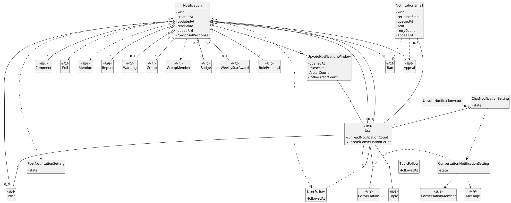

# Phân tích lớp thực thể — M07 Notification

<!-- [Vietnamese Doc] Tài liệu tiếng Việt; tên lớp và thuộc tính viết tiếng Anh (input/CONVENTIONS.md mục 3). -->

| Mã tài liệu | EC-M07 |
|---|---|
| Dự án | iShare |
| Module | M07 — Notification |
| Đầu vào | FR-M07 phiên bản 1.5 |
| Trạng thái | Bản nháp |
| Phiên bản | 0.3 |
| Ngày | 2026-11-18 |
| Tác giả | Phạm Văn Đức |

<!-- Quy ước chung cho mọi bảng dưới đây:
     - Không đổi tên cột, không xóa cột, không đổi số mục: tool đọc bảng theo số mục và tên cột.
     - Ô không có nội dung ghi "—".
     - Mục chưa tới bước làm thì để dòng "(Chưa làm — bước N)".
     - Cột Nguồn ghi mã trong FR: FR-M07-nn, FR-M07-nn.mm, BR-M07-nn, hoặc TN:<thuật ngữ> (mục 2.1 của FR).
     - Sơ đồ ở mục 4 do gen_puml.py sinh; không sửa tay. -->

## 1. Mô tả chức năng

### 1.1 Đoạn mô tả

(S1) Hệ thống quản lý thông báo cho người nhận, quan hệ theo dõi người dùng và Topic, email trong hàng đợi cùng các cài đặt tắt thông báo cho bài viết và Chat. (S2) Hệ thống cho User, Mod và Admin theo dõi hoặc bỏ theo dõi người dùng và Topic, ghi thời điểm bắt đầu theo dõi và cập nhật quan hệ theo dõi để các module khác sử dụng. (S3) Hệ thống phát sinh sự kiện người theo dõi mới khi người dùng theo dõi một người dùng khác lần đầu, dùng dấu vết thông báo đã có để kiểm tra việc theo dõi lại và giữ các quan hệ theo dõi hiện có khi tài khoản được theo dõi chuyển BANNED hoặc DEACTIVATED. (S4) Hệ thống tạo thông báo bài mới cho người đang theo dõi tác giả khi bài viết hiển thị công khai lần đầu, xét dấu lần đầu công khai và trạng thái đăng ẩn danh của bài do M03 cung cấp. (S5) Hệ thống tiếp nhận sự kiện từ các module nguồn về bảo mật tài khoản, bài viết, bình luận, poll, nhắc tên, báo cáo, cảnh cáo, ban, khiếu nại, hoạt động nhóm, badge, danh hiệu tuần và đề xuất vai trò, rồi tạo thông báo riêng ở trạng thái chưa đọc cho mỗi người nhận với nội dung liên quan và thời điểm sự kiện. (S6) Hệ thống kiểm tra người nhận, người gây sự kiện, trạng thái tài khoản người nhận, quyền xem nội dung nhóm Private và cài đặt tắt thông báo của người nhận khi xác định thông báo được tạo. (S7) Hệ thống gộp upvote riêng cho từng bài viết và bình luận theo cửa sổ gộp cố định, ghi nhận người upvote đã được đếm trong cửa sổ, cập nhật người upvote mới nhất và số người khác nhau trong thông báo, đồng thời chuyển thông báo được cập nhật về chưa đọc và thay đổi thứ tự gần nhất. (S8) Hệ thống cho người nhận phản hồi Chấp nhận hoặc Từ chối đối với thông báo đề xuất làm Mod hoặc Admin, chuyển lựa chọn cho M10 xử lý vai trò, thể hiện lựa chọn đã trả lời và kiểm tra trạng thái hết hạn hoặc bị đề xuất mới thay thế. (S9) Hệ thống lưu thông báo trước khi đẩy tới các thiết bị đang mở ứng dụng của người nhận và tải thông báo chưa đọc từ dữ liệu đã lưu khi người dùng mở ứng dụng để người nhận có thể xem đầy đủ thông báo. (S10) Hệ thống ghi email của các sự kiện bảo mật và ban thuộc nhóm có email vào hàng đợi theo người nhận, quét hàng đợi để gửi email bất đồng bộ, theo dõi các lần gửi lại cho email thất bại và đưa đường dẫn khiếu nại vào email về ban. (S11) Hệ thống cho User, Mod và Admin xem thông báo của chính mình theo lần cập nhật cuối, xem trạng thái đã đọc hoặc chưa đọc và thời điểm thông báo, tính số thông báo chưa đọc, giữ thông báo vô thời hạn và trình bày tên người gây sự kiện theo trạng thái tài khoản do M01 cung cấp. (S12) Hệ thống cho người dùng chuyển từng thông báo sang đã đọc khi mở hoặc đánh dấu toàn bộ thông báo chưa đọc của chính mình thành đã đọc, dẫn tới nội dung liên quan hoặc đường dẫn khiếu nại và dùng quyền xem hiện hành của nội dung để xử lý việc mở thông báo. (S13) Hệ thống báo tin nhắn mới cho thành viên cuộc trò chuyện đang mở ứng dụng theo cuộc trò chuyện đang xem và cài đặt tắt thông báo, đồng thời tính số cuộc trò chuyện có tin chưa đọc từ mốc đã đọc và các tin nhắn người dùng được thấy do M16 cung cấp. (S14) Hệ thống cho User, Mod và Admin ghi hoặc bỏ cài đặt tắt thông báo của chính mình trên một bài viết, dùng cài đặt này cho bình luận mới, trả lời và upvote, đồng thời giữ cách xử lý riêng của sự kiện nhắc tên và các sự kiện khác về bài. (S15) Hệ thống cho thành viên ghi hoặc bỏ cài đặt tắt thông báo trên từng cuộc trò chuyện, cho người dùng bật hoặc tắt cài đặt thông báo toàn bộ Chat, áp dụng cài đặt toàn bộ Chat cùng cài đặt từng cuộc và bỏ cài đặt của thành viên khi thành viên rời hoặc bị xóa khỏi nhóm chat. (S16) Hệ thống cung cấp quan hệ theo dõi và thời điểm bắt đầu theo dõi cho M01, M02, M06 và M14 dùng trong gợi ý nhắc tên, danh sách hồ sơ, bộ lọc tìm kiếm và feed, đồng thời dùng các sự kiện và quyền nội dung của module nguồn để tạo và mở thông báo.

<!-- Một đoạn văn, mỗi câu đánh số (S1) (S2) … Xem steps/01-describe-functions.md. -->

### 1.2 Truy vết câu

| Câu | Nội dung tóm tắt | Nguồn |
|---|---|---|
| S1 | Phạm vi thông báo, theo dõi, email và cài đặt tắt | FR-M07-01, FR-M07-02, FR-M07-04, FR-M07-08, FR-M07-09 |
| S2 | Tạo, bỏ và ghi thời điểm quan hệ theo dõi | FR-M07-01, FR-M07-01.01, FR-M07-01.08 |
| S3 | Sự kiện người theo dõi mới và dấu vết đã báo | FR-M07-01.04, FR-M07-01.10, FR-M07-01.13 |
| S4 | Thông báo bài mới của tác giả đang theo dõi | FR-M07-02.21, FR-M07-02.22, FR-M07-02.23 |
| S5 | Tạo thông báo riêng từ sự kiện liên module | FR-M07-02, FR-M07-02.01, FR-M07-02.02 |
| S6 | Điều kiện người nhận và quyền nhận thông báo | FR-M07-02.07, FR-M07-02.08, FR-M07-02.09, FR-M07-02.11, FR-M07-02.25, FR-M07-02.26, FR-M07-02.27 |
| S7 | Cửa sổ gộp upvote, người được đếm và cập nhật thông báo | FR-M07-02.03, FR-M07-02.04, FR-M07-02.18, FR-M07-02.19, FR-M07-02.20 |
| S8 | Phản hồi thông báo đề xuất vai trò và trạng thái đề xuất | FR-M07-02.14, FR-M07-02.15, FR-M07-02.16, FR-M07-02.28, FR-M07-02.30, FR-M07-02.31, FR-M07-02.32 |
| S9 | Lưu thông báo, đẩy tới thiết bị và tải dữ liệu đã lưu | FR-M07-03, FR-M07-03.01, FR-M07-03.02, FR-M07-03.04 |
| S10 | Hàng đợi email, gửi lại và đường dẫn khiếu nại ban | FR-M07-04, FR-M07-04.01, FR-M07-04.02, FR-M07-04.03, FR-M07-04.08, FR-M07-04.09, FR-M07-04.10 |
| S11 | Xem, sắp xếp, đếm chưa đọc và giữ thông báo | FR-M07-05, FR-M07-05.01, FR-M07-05.02, FR-M07-05.03, FR-M07-05.04, FR-M07-05.05, FR-M07-05.07, FR-M07-05.10, FR-M07-05.12 |
| S12 | Đánh dấu đã đọc và mở nội dung liên quan | FR-M07-06, FR-M07-06.01, FR-M07-06.02, FR-M07-06.03, FR-M07-02.13, FR-M07-05.13 |
| S13 | Báo tin nhắn mới và số cuộc trò chuyện có tin chưa đọc | FR-M07-07, FR-M07-07.02, FR-M07-07.05, FR-M07-07.06, FR-M07-07.07 |
| S14 | Cài đặt tắt thông báo theo người dùng và bài viết | FR-M07-08, FR-M07-08.02, FR-M07-08.03, FR-M07-08.04, FR-M07-02.07, FR-M07-02.08, FR-M07-02.09 |
| S15 | Cài đặt tắt thông báo cuộc trò chuyện và toàn bộ Chat | FR-M07-09, FR-M07-09.01, FR-M07-09.02, FR-M07-09.03, FR-M07-09.04, FR-M07-09.05, FR-M07-09.08 |
| S16 | Dữ liệu theo dõi cung cấp cho các module sử dụng | FR-M07-01.01, FR-M07-02.01, FR-M07-02.02, FR-M07-05.13 |

## 2. Danh từ và phân loại

### 2.1 Sổ danh từ

| # | Danh từ | Xuất hiện ở | Phân loại | Kết quả | Lý do |
|---|---|---|---|---|---|
| 1 | Hệ thống | S1 | Loại bỏ | — | Trừu tượng, tác nhân xử lý. |
| 2 | Thông báo / thông báo upvote / thông báo đề xuất / thông báo người theo dõi mới / thông báo bài mới | S1 | Lớp | Notification | T8, bản ghi theo người nhận có trạng thái và vòng đời lưu giữ theo FR-M07-02.01/05.07, dùng tên các EC trước. |
| 3 | Người nhận / người dùng / User / Mod / Admin / người gây sự kiện / người theo dõi / người được theo dõi / tác giả / người upvote / thành viên cuộc trò chuyện | S1 | Lớp | User | T3, các vai trò tài khoản M01, gồm các vai trò phát sinh và nhận thông báo. |
| 4 | Topic | S1 | Lớp | Topic | T4, đối tượng theo dõi thuộc M05, dùng EC-M05. |
| 5 | Quan hệ theo dõi người dùng | S1 | Lớp | UserFollow | T8, bản ghi theo dõi người dùng có thời điểm bắt đầu, M07 sở hữu theo FR-M07-01.01, dùng tên EC-M01/02. |
| 6 | Quan hệ theo dõi Topic | S1 | Lớp | TopicFollow | T8, bản ghi theo dõi Topic có thời điểm bắt đầu, M07 sở hữu theo FR-M07-01.01, dùng tên EC-M01/05/06. |
| 7 | Email / email thông báo | S1 | Lớp | NotificationEmail | T8, bản ghi chờ gửi và gửi lại có trạng thái và bộ đếm theo FR-M07-04.01/04.09. |
| 8 | Hàng đợi email | S1 | Loại bỏ | — | Chung chung, tập NotificationEmail đang chờ xử lý theo BR-M07-11/26. |
| 9 | Cài đặt tắt thông báo cho bài / tắt thông báo cho bài | S1 | Lớp | PostNotificationSetting | T8, cài đặt theo cặp người dùng–bài, có trạng thái theo FR-M07-08 và mục 5.12. |
| 10 | Bài viết | S1 | Lớp | Post | T4, đối tượng sự kiện và cài đặt tắt theo M03, dùng EC-M03. |
| 11 | Chat / hộp thư Chat | S1 | Loại bỏ | — | Ngoài phạm vi module (M16), chức năng và ngữ cảnh tin nhắn. |
| 12 | Cài đặt tắt thông báo toàn bộ Chat | S1 | Lớp | ChatNotificationSetting | T8, lớp cài đặt riêng có trạng thái theo Q-01 B đã được người dùng chọn, FR-M07-09.03/09.04. |
| 13 | Thời điểm bắt đầu theo dõi người dùng | S2 | Thuộc tính | UserFollow.followedAt | T9, thời điểm được ghi theo FR-M07-01.01, phân biệt với lượt theo dõi Topic. |
| 14 | Thời điểm bắt đầu theo dõi Topic | S2 | Thuộc tính | TopicFollow.followedAt | T9, thời điểm của bản theo dõi Topic theo FR-M07-01.01. |
| 15 | Sự kiện / sự kiện người theo dõi mới | S3 | Loại bỏ | — | Hành động không lưu dấu vết riêng tại M07, đầu vào tạo Notification hoặc NotificationEmail theo FR-M07-02.01/04.01. |
| 16 | Dấu vết thông báo đã có | S3 | Loại bỏ | — | Chung chung, Notification bền vững cho cặp tài khoản dùng kiểm tra đã báo theo FR-M07-01.10, BR-M07-25. |
| 17 | BANNED / DEACTIVATED / DELETED / trạng thái tài khoản | S3 | Loại bỏ | — | Ngoài phạm vi module (M01), dữ liệu trạng thái User để kiểm tra điều kiện. |
| 18 | Lần đầu công khai / trạng thái đăng ẩn danh | S4 | Loại bỏ | — | Ngoài phạm vi module (M03, M11), Post.hasBeenPublic và ngữ cảnh bài do module nguồn cung cấp. |
| 19 | Bảo mật tài khoản / mật khẩu đã đổi / liên kết Google / cảnh báo trước khi tự xóa | S5 | Loại bỏ | — | Giá trị của loại sự kiện thông báo/email theo BR-M07-01/03/04, điều kiện phát sinh do M01 cung cấp. |
| 20 | Bình luận / trả lời | S5 | Lớp | Comment | T4, đối tượng sự kiện M04, dùng EC-M04. |
| 21 | Poll | S5 | Lớp | Poll | T4, sự kiện poll kết thúc M03, dùng EC-M03. |
| 22 | Nhắc tên / lượt nhắc tên | S5 | Lớp | Mention | T4, sự kiện nhắc do M01 cung cấp, dùng EC-M01. |
| 23 | Báo cáo | S5 | Lớp | Report | T4, đối tượng kết quả báo cáo M08, tên dùng lại EC-M03/04, chờ EC-M08. |
| 24 | Cảnh cáo | S5 | Lớp | Warning | T4, đối tượng xử lý M08 cung cấp, tên tạm chờ EC-M08. |
| 25 | Ban | S5 | Lớp | Ban | T4, đối tượng ban/gỡ ban M08, tên dùng lại EC-M01, chờ EC-M08. |
| 26 | Khiếu nại | S5 | Lớp | Appeal | T4, đối tượng kết luận khiếu nại M09, tên dùng lại các EC trước, chờ EC-M09. |
| 27 | Nhóm / hoạt động nhóm | S5 | Lớp | Group | T4, ngữ cảnh sự kiện và quyền M11, tên dùng lại các EC trước, chờ EC-M11. |
| 28 | Badge | S5 | Lớp | Badge | T4, sự kiện đạt badge M12, tên dùng lại EC-M02, chờ EC-M12. |
| 29 | Danh hiệu tuần / danh hiệu Ngôi sao tuần | S5 | Lớp | WeeklyStarAward | T4, sự kiện đạt danh hiệu M12, dùng tên EC-M02, chờ EC-M12. |
| 30 | Đề xuất vai trò / đề xuất làm Mod / đề xuất làm Admin | S5 | Lớp | RoleProposal | T4, M10 sở hữu đề xuất và kết quả phản hồi, tên tạm chờ EC-M10. |
| 31 | Chưa đọc / đã đọc | S5 | Loại bỏ | — | Giá trị của Notification.readState theo FR-M07-02.01/06.01. |
| 32 | Nội dung liên quan | S5 | Loại bỏ | — | Chung chung, đối tượng đích và ngữ cảnh của Notification đã được gọi tên, được xét dưới dạng tham chiếu ở bước 3. |
| 33 | Thời điểm sự kiện / thời điểm tạo thông báo | S5 | Thuộc tính | Notification.createdAt | T9, mốc ban đầu của thông báo theo FR-M07-02.02 và mục 5.11, nguồn cung cấp thời điểm sự kiện. |
| 34 | Quyền xem / nhóm Private | S6 | Loại bỏ | — | Ngoài phạm vi module (M11), điều kiện kiểm tra trước khi tạo/mở thông báo. |
| 35 | Cài đặt tắt thông báo của người nhận | S6 | Loại bỏ | — | Chung chung, các cài đặt theo bài, cuộc trò chuyện và toàn bộ Chat đã được gọi tên. |
| 36 | Upvote / gộp upvote | S7 | Loại bỏ | — | Hành động không lưu dấu vết riêng dưới dạng bản ghi upvote M07, tương tác do M12 phát sinh, Notification và cửa sổ gộp giữ dữ liệu cần để báo. |
| 37 | Cửa sổ gộp upvote | S7 | Lớp | UpvoteNotificationWindow | T8, ngữ cảnh gộp theo bài hoặc bình luận và mốc mở theo FR-M07-02.03/02.18. |
| 38 | Người upvote đã được đếm / người upvote mới nhất | S7 | Loại bỏ | — | Chung chung, vai trò của User trong cửa sổ/thông báo, giữ để xét tham chiếu và chống đếm lặp ở bước 3 theo FR-M07-02.20. |
| 39 | Số người khác nhau trong cửa sổ | S7 | Thuộc tính | UpvoteNotificationWindow.actorCount | T7, đếm các User đã được ghi nhận trong cửa sổ, FR-M07-02.04/02.20. |
| 40 | Số người khác | S7 | Thuộc tính | UpvoteNotificationWindow.otherActorCount | T7, actorCount trừ người upvote được nêu tên trong thông báo theo BR-M07-05. |
| 41 | Thứ tự gần nhất | S7 | Loại bỏ | — | Giao diện, thứ tự danh sách theo Notification.updatedAt, FR-M07-05.01. |
| 42 | Lựa chọn đã trả lời của đề xuất | S8 | Thuộc tính | Notification.proposalResponse | T7, chiếu phản hồi của RoleProposal do M10 xử lý để hiển thị theo FR-M07-02.15/02.28, tách quyền sở hữu dữ liệu nguồn. |
| 43 | Chấp nhận / Từ chối / hết hạn / bị thay thế | S8 | Loại bỏ | — | Ngoài phạm vi module (M10), phản hồi và trạng thái RoleProposal cung cấp để thể hiện Notification.proposalResponse và quyền trả lời. |
| 44 | Vai trò tài khoản | S8 | Loại bỏ | — | Ngoài phạm vi module (M01, M10), vai trò tài khoản được M10 quyết định. |
| 45 | Thiết bị đang mở ứng dụng | S9 | Loại bỏ | — | Ngoài phạm vi module (M01), ngữ cảnh thiết bị nhận đẩy theo giao tiếp mục 5.13. |
| 46 | Đẩy thông báo | S9 | Loại bỏ | — | Hành động không lưu dấu vết riêng, FR-M07-03 dùng Notification đã lưu làm nguồn. |
| 47 | Số lần gửi lại email | S10 | Thuộc tính | NotificationEmail.retryCount | T9, đếm số lần gửi lại để dừng sau tối đa 3 lần, FR-M07-04.09/04.10. |
| 48 | Đường dẫn khiếu nại trong email ban | S10 | Thuộc tính | NotificationEmail.appealUrl | T9, liên kết để người nhận tới trang khiếu nại ban theo FR-M07-04.08. |
| 49 | Thời điểm cập nhật cuối | S11 | Thuộc tính | Notification.updatedAt | T9, mốc dùng xếp danh sách, cập nhật khi gộp thêm theo FR-M07-02.04/05.01. |
| 50 | Trạng thái đọc | S11 | Thuộc tính | Notification.readState | T9, trạng thái Chưa đọc/Đã đọc theo FR-M07-05.03 và mục 5.12. |
| 51 | Thời điểm thông báo | S11 | Loại bỏ | — | Chung chung, tên gọi hiển thị của các mốc Notification được FR ràng buộc lưu UTC và hiện UTC+7. |
| 52 | Số thông báo chưa đọc | S11 | Thuộc tính | User.unreadNotificationCount | T7, đếm Notification chưa đọc của người nhận, phần M07 bổ sung theo FR-M07-05.10. |
| 53 | Tên người gây sự kiện | S11 | Loại bỏ | — | Ngoài phạm vi module (M01), User.displayName và nhãn theo trạng thái tài khoản. |
| 54 | Đường dẫn khiếu nại trong thông báo | S12 | Thuộc tính | Notification.appealUrl | T9, liên kết tới luồng khiếu nại cho sự kiện có thể khiếu nại theo FR-M07-02.13. |
| 55 | Đánh dấu tất cả đã đọc / mở thông báo | S12 | Loại bỏ | — | Hành động không lưu dấu vết riêng, kết quả là thay Notification.readState theo FR-M07-06. |
| 56 | Tin nhắn | S13 | Lớp | Message | T4, M16 cung cấp tin nhắn mới và quyền thấy tin, tên từ EC-M01, chờ EC-M16. |
| 57 | Cuộc trò chuyện / nhóm chat | S13 | Lớp | Conversation | T4, đối tượng cài đặt tắt và đếm tin chưa đọc M16, dùng tên EC-M02, chờ EC-M16. |
| 58 | Tư cách và mốc đọc của thành viên cuộc trò chuyện | S13 | Lớp | ConversationMember | T4, tư cách và mốc đọc của thành viên do M16 cung cấp, tên tạm chờ EC-M16. |
| 59 | Số cuộc trò chuyện có tin chưa đọc | S13 | Thuộc tính | User.unreadConversationCount | T7, đếm các cuộc có tin người dùng thấy được và chưa đọc theo M16, gồm cuộc đã tắt, FR-M07-07.02. |
| 60 | Mốc đã đọc / cuộc trò chuyện đang xem | S13 | Loại bỏ | — | Ngoài phạm vi module (M16), dữ liệu dùng tính số chưa đọc và điều kiện popup. |
| 61 | Cài đặt tắt thông báo từng cuộc trò chuyện | S15 | Lớp | ConversationNotificationSetting | T8, cài đặt theo thành viên và cuộc trò chuyện, có trạng thái theo FR-M07-09.01/09.02/09.08. |
| 62 | Rời hoặc bị xóa khỏi nhóm chat | S15 | Loại bỏ | — | Hành động không lưu dấu vết riêng tại M07, sự kiện M16 làm bỏ ConversationNotificationSetting. |
| 63 | Danh sách hồ sơ / bộ lọc tìm kiếm / feed / gợi ý nhắc tên | S16 | Loại bỏ | — | Ngoài phạm vi module (M02, M06, M14, M01), dùng quan hệ theo dõi do M07 cung cấp. |
| 64 | Loại sự kiện trong thông báo | Quét: FR-M07-02.01 | Thuộc tính | Notification.kind | T9, loại theo danh sách BR-M07-01. |
| 65 | Loại sự kiện email | Quét: FR-M07-04.01 | Thuộc tính | NotificationEmail.kind | T9, loại thuộc nhóm có email theo BR-M07-03/04. |
| 66 | Địa chỉ email người nhận | Quét: Dữ liệu nghiệp vụ | Thuộc tính | NotificationEmail.recipientEmail | T9, đích gửi của email trong hàng đợi theo mục 5.11, địa chỉ nguồn thuộc User M01. |
| 67 | Thời điểm vào hàng đợi | Quét: Dữ liệu nghiệp vụ | Thuộc tính | NotificationEmail.queuedAt | T9, mốc nêu trong email thông báo tại mục 5.11. |
| 68 | Đã gửi email hay chưa | Quét: Dữ liệu nghiệp vụ | Thuộc tính | NotificationEmail.sent | T9, trạng thái suy ra từ việc quét và gửi theo FR-M07-04.02 và mục 5.11. |
| 69 | Thời điểm mở cửa sổ upvote | Quét: FR-M07-02.03 | Thuộc tính | UpvoteNotificationWindow.openedAt | T9, mốc của lượt upvote mở thông báo theo BR-M07-05. |
| 70 | Thời điểm kết thúc cửa sổ upvote | Quét: BR-M07-05 | Thuộc tính | UpvoteNotificationWindow.closesAt | T7, openedAt cộng 5 × 60 giây, mốc cố định của cửa sổ. |
| 71 | Trạng thái thông báo bài của người dùng | Quét: FR-M07-08.02, FR-M07-08.03 | Thuộc tính | PostNotificationSetting.state | T9, Đang nhận hoặc Đã tắt theo FR mục 5.12. |
| 72 | Trạng thái thông báo cuộc trò chuyện của thành viên | Quét: FR-M07-09.01, FR-M07-09.02 | Thuộc tính | ConversationNotificationSetting.state | T9, Đang nhận hoặc Đã tắt, kết thúc cài đặt khi rời/bị xóa khỏi nhóm chat. |
| 73 | Tư cách thành viên nhóm | Quét: FR-M07-02.11 | Lớp | GroupMember | T4, quyền xem nhóm Private do M11 cung cấp, dùng tên các EC trước. |
| 74 | Nội dung không tồn tại / popup / chuông / biểu tượng Tin nhắn / trang Thông báo | Quét: FR-M07-05.13, FR-M07-07.01 | Loại bỏ | — | Giao diện, thể hiện dữ liệu và kết quả kiểm tra quyền. |
| 75 | 5 phút / 60 giây quét email / 3 lần gửi lại / 7 ngày hạn đề xuất / 24 giờ cảnh báo | Quét: BR-M07-05, BR-M07-11, BR-M07-20, BR-M07-26 | Loại bỏ | — | Hằng số của các BR tương ứng, ràng buộc cửa sổ/gửi email/đề xuất, mốc cảnh báo do M01 cung cấp. |
| 76 | 10 thông báo gần nhất / 20 thông báo mỗi lần tải | Quét: BR-M07-12 | Loại bỏ | — | Hằng số của BR-M07-12, số lượng tải danh sách. |
| 77 | Đang nhận / Đã tắt | Quét: FR-M07-08.02, FR-M07-09.01 | Loại bỏ | — | Giá trị của PostNotificationSetting.state, ConversationNotificationSetting.state và ChatNotificationSetting.state. |
| 78 | Số người theo dõi / số đang theo dõi | Quét: BR-M07-25 | Loại bỏ | — | Ngoài phạm vi module (M02), các số trên UserProfile được tính từ UserFollow/TopicFollow, M07 cung cấp quan hệ. |
| 79 | Trạng thái thông báo toàn bộ Chat | Quét: FR-M07-09.03, FR-M07-09.04 (Q-01 B) | Thuộc tính | ChatNotificationSetting.state | T9, trạng thái của lớp cài đặt riêng được người dùng chọn, Đang nhận hoặc Đã tắt theo FR mục 5.12. |
| 80 | Bản ghi người được đếm trong cửa sổ | Quét: FR-M07-02.20 (bước 3) | Lớp | UpvoteNotificationActor | Tách quan hệ n-n giữa cửa sổ và User đã được đếm, mỗi cặp có một bản ghi. |

Tổng 80 dòng danh từ, gồm 27 dòng thành lớp, 23 dòng thành thuộc tính và 30 dòng bị loại. Lượt quét FR bổ sung 17 dòng, gồm 2 dòng cập nhật theo Q-01 B và tách quan hệ ở bước 3. Các danh từ chỉ vai trò tài khoản và loại thông báo được gộp theo đối tượng tương ứng, số liệu và mốc của những đối tượng khác nhau có dòng riêng.

### 2.2 Lớp

| Lớp | Tên tiếng Việt | Nhóm | Sở hữu | Mô tả | Nguồn |
|---|---|---|---|---|---|
| Notification | Thông báo | Thực thể | M07 | Bản ghi riêng cho mỗi người nhận, trạng thái và mốc cập nhật, dùng tên các EC trước. | FR-M07-02.01, FR-M07-03.01, FR-M07-05.07 |
| UserFollow | Lượt theo dõi người dùng | Liên kết | M07 | Quan hệ theo dõi tài khoản kèm thời điểm, dùng tên EC-M01/02/06. | FR-M07-01.01, FR-M07-01.08 |
| TopicFollow | Lượt theo dõi Topic | Liên kết | M07 | Quan hệ theo dõi Topic kèm thời điểm, dùng tên EC-M01/05/06. | FR-M07-01.01, FR-M07-01.08 |
| NotificationEmail | Email thông báo | Thực thể | M07 | Bản ghi hàng đợi gửi email và bộ đếm gửi lại. | FR-M07-04.01, FR-M07-04.02, FR-M07-04.09 |
| UpvoteNotificationWindow | Cửa sổ gộp upvote | Thực thể | M07 | Ngữ cảnh gộp theo thông báo/đối tượng và tập người đã được đếm. | FR-M07-02.03, FR-M07-02.04, FR-M07-02.20 |
| PostNotificationSetting | Cài đặt thông báo bài | Liên kết | M07 | Trạng thái nhận thông báo của người dùng trên bài. | FR-M07-08.02, FR-M07-08.03 |
| ConversationNotificationSetting | Cài đặt thông báo cuộc trò chuyện | Liên kết | M07 | Trạng thái nhận tin mới của thành viên trên cuộc trò chuyện. | FR-M07-09.01, FR-M07-09.02, FR-M07-09.08 |
| User | Tài khoản | Thực thể | M01 | Các vai trò người nhận/gây sự kiện/theo dõi, dùng EC-M01. M07 bổ sung hai số liệu dẫn xuất theo người dùng, cài đặt toàn bộ Chat thuộc ChatNotificationSetting. | FR-M07-02.02, FR-M07-05.10, FR-M07-09.03 |
| Post | Bài viết | Thực thể | M03 | Đối tượng thông báo và cài đặt tắt, dùng EC-M03. | FR-M07-02.03, FR-M07-08.02 |
| Comment | Bình luận | Thực thể | M04 | Đối tượng thông báo và gộp upvote, dùng EC-M04. | FR-M07-02.03, FR-M07-02.08 |
| Topic | Topic | Thực thể | M05 | Đối tượng theo dõi, dùng EC-M05. | FR-M07-01.01 |
| Poll | Poll | Thực thể | M03 | Đối tượng sự kiện poll kết thúc, dùng EC-M03. | BR-M07-01 |
| Mention | Lượt nhắc tên | Thực thể | M01 | Sự kiện nhắc tên do M01 cung cấp, dùng EC-M01. | FR-M07-02.07, BR-M07-06 |
| Report | Báo cáo | Thực thể | M08 | Kết quả báo cáo theo sự kiện nguồn, tên từ EC-M03/04, chờ EC-M08. | FR-M07-02.02, BR-M07-01 |
| Warning | Cảnh cáo | Thực thể | M08 | Đối tượng xử lý nguồn, tên tạm chờ EC-M08. | FR-M07-02.13, BR-M07-01 |
| Ban | Ban | Thực thể | M08 | Đối tượng ban/gỡ ban, tên từ EC-M01, chờ EC-M08. | FR-M07-02.13, FR-M07-04.08 |
| Appeal | Khiếu nại | Thực thể | M09 | Kết luận khiếu nại và luồng khiếu nại do M09 cung cấp, tên dùng lại, chờ EC-M09. | FR-M07-02.13, BR-M07-01 |
| Group | Nhóm | Thực thể | M11 | Ngữ cảnh sự kiện và quyền xem, tên dùng lại, chờ EC-M11. | FR-M07-02.11, BR-M07-01 |
| GroupMember | Thành viên nhóm | Thực thể | M11 | Tư cách và quyền xem nhóm Private, tên dùng lại, chờ EC-M11. | FR-M07-02.11, BR-M07-18 |
| Badge | Huy hiệu | Thực thể | M12 | Đối tượng sự kiện đạt badge, tên từ EC-M02, chờ EC-M12. | BR-M07-01 |
| WeeklyStarAward | Danh hiệu Ngôi sao tuần đã đạt | Thực thể | M12 | Danh hiệu đạt được theo sự kiện nguồn, tên từ EC-M02, chờ EC-M12. | BR-M07-01 |
| RoleProposal | Đề xuất vai trò | Thực thể | M10 | Đề xuất và phản hồi do M10 quản lý, tên tạm chờ EC-M10. | FR-M07-02.14, FR-M07-02.15, FR-M07-02.31 |
| Conversation | Cuộc trò chuyện | Thực thể | M16 | Ngữ cảnh tin chưa đọc và cài đặt tắt, tên từ EC-M02, chờ EC-M16. | FR-M07-07.02, FR-M07-09.01 |
| ConversationMember | Thành viên cuộc trò chuyện | Thực thể | M16 | Tư cách thành viên, mốc đọc và quyền thấy tin M16, tên tạm chờ EC-M16. | FR-M07-07.02, FR-M07-09.05, FR-M07-09.08 |
| Message | Tin nhắn | Thực thể | M16 | Dữ liệu tin mới M16 cung cấp, tên từ EC-M01, chờ EC-M16. | FR-M07-07.05 |
| ChatNotificationSetting | Cài đặt thông báo toàn bộ Chat | Thực thể | M07 | Lớp riêng theo Q-01 B, giữ trạng thái áp dụng cho người dùng. | FR-M07-09.03, FR-M07-09.04, BR-M07-08 |
| UpvoteNotificationActor | Người được đếm trong cửa sổ upvote | Liên kết | M07 | Một cặp cửa sổ–User được đếm một lần, giữ căn cứ hiển thị thông báo gộp. | FR-M07-02.04, FR-M07-02.19, FR-M07-02.20 |

Có 9 lớp M07 và 18 lớp ngoài. UserFollow, TopicFollow và Notification dùng tên đã được các module trước tham chiếu. Bước 3 xác định 5 lớp Liên kết, gồm các bản ghi Follow, các cài đặt theo cặp và UpvoteNotificationActor.

UpvoteNotificationWindow là đề xuất biểu diễn ngữ cảnh gộp có mốc mở và tập User đã được đếm. Các giá trị đếm của cửa sổ được tính từ tập đã ghi nhận theo FR-M07-02.19/02.20, theo yêu cầu giữ thông báo khi người dùng rút upvote. Đây là dữ liệu riêng của ngữ cảnh thông báo.

RoleProposal, Warning và ConversationMember là tên tạm mới, chờ module M10, M08 và M16 xác nhận khi có EC tương ứng. Các lớp ngoài khác của module chưa có EC dùng lại tên đã được các EC trước tham chiếu.

### 2.3 Thuộc tính

| Lớp | Thuộc tính | Tên tiếng Việt | Tính chất | Ràng buộc nguồn nêu | Nguồn |
|---|---|---|---|---|---|
| Notification | kind | Loại sự kiện | Lưu | Loại sự kiện sinh thông báo theo BR-M07-01, tin nhắn xử lý trong luồng M16. | FR-M07-02.01, BR-M07-01 |
| Notification | createdAt | Thời điểm tạo thông báo | Lưu | Mốc ban đầu nêu ở dữ liệu mục 5.11, dùng thời điểm sự kiện do module nguồn cung cấp theo FR-M07-02.02. Lưu UTC, hiển thị Asia/Ho_Chi_Minh. | FR-M07-02.01, FR-M07-02.02, BR-M07-22 |
| Notification | updatedAt | Thời điểm cập nhật cuối | Lưu | Dùng xếp thông báo mới nhất trước. Gộp thêm upvote cập nhật và đưa thông báo lên đầu theo FR-M07-02.04. | FR-M07-02.04, FR-M07-05.01, BR-M07-12 |
| Notification | readState | Trạng thái đọc | Lưu | Chưa đọc khi tạo, Đã đọc khi bấm hoặc đánh dấu tất cả. Gộp thêm upvote chuyển về Chưa đọc, theo mục 5.12. | FR-M07-02.01, FR-M07-02.04, FR-M07-06.01, FR-M07-06.03 |
| Notification | appealUrl | Đường dẫn khiếu nại | Lưu | Có với sự kiện xử lý khiếu nại được theo FR-M07-02.13, dẫn tới luồng khiếu nại do module nguồn cung cấp. | FR-M07-02.13 |
| Notification | proposalResponse | Lựa chọn đề xuất đã trả lời | Dẫn xuất | Chiếu lựa chọn Chấp nhận/Từ chối do M10 xử lý để hiện trên thông báo. Quyền chọn dựa vào trạng thái còn hiệu lực/hết hạn/bị thay của RoleProposal, BR-M07-20. | FR-M07-02.15, FR-M07-02.16, FR-M07-02.28, FR-M07-02.31, FR-M07-02.32 |
| UserFollow | followedAt | Thời điểm bắt đầu theo dõi người dùng | Lưu | Ghi khi tạo quan hệ theo dõi, xóa quan hệ khi bỏ theo dõi. Tài khoản BANNED/DEACTIVATED giữ quan hệ đã có. | FR-M07-01.01, FR-M07-01.08, FR-M07-01.13 |
| TopicFollow | followedAt | Thời điểm bắt đầu theo dõi Topic | Lưu | Ghi khi tạo quan hệ theo dõi Topic, dùng cho danh sách của M02. M05 xử lý chuyển/bỏ khi gộp/xóa Topic. | FR-M07-01.01, FR-M07-01.08 |
| NotificationEmail | kind | Loại sự kiện email | Lưu | Mật khẩu đã đổi, liên kết Google, cảnh báo trước tự xóa, ban, gỡ ban, kết luận khiếu nại ban theo BR-M07-03/04. | FR-M07-04.01, BR-M07-03, BR-M07-04 |
| NotificationEmail | recipientEmail | Địa chỉ email người nhận | Lưu | Đích gửi trong bản ghi hàng đợi tại mục 5.11, dùng địa chỉ email tài khoản do M01 cung cấp. | FR-M07-04.01 |
| NotificationEmail | queuedAt | Thời điểm vào hàng đợi | Lưu | Mốc nêu trong dữ liệu mục 5.11, email được ghi khi sự kiện thuộc nhóm có email xảy ra. | FR-M07-04.01, BR-M07-11 |
| NotificationEmail | sent | Đã gửi email | Lưu | Đã gửi hay chưa theo dữ liệu mục 5.11. Lần quét gửi các email chưa gửi, thất bại được giữ để gửi lại theo FR-M07-04.09. | FR-M07-04.02, FR-M07-04.09 |
| NotificationEmail | retryCount | Số lần đã gửi lại | Lưu | Từ 0 đến 3 lần gửi lại, lần gửi ban đầu là lượt riêng. Lỗi sau 3 lần gửi lại thì dừng theo BR-M07-26. | FR-M07-04.09, FR-M07-04.10, BR-M07-26 |
| NotificationEmail | appealUrl | Đường dẫn khiếu nại ban | Lưu | Email về ban phải có đường dẫn tới trang khiếu nại, có thể mở luồng tạo khiếu nại theo module nguồn. | FR-M07-04.08 |
| UpvoteNotificationWindow | openedAt | Thời điểm mở cửa sổ | Lưu | Mốc lượt upvote đầu mở thông báo theo BR-M07-05, riêng từng bài hoặc bình luận. | FR-M07-02.03, FR-M07-02.18, BR-M07-05 |
| UpvoteNotificationWindow | closesAt | Thời điểm kết thúc cửa sổ | Dẫn xuất | openedAt cộng 5 × 60 giây, mốc cố định của cửa sổ theo BR-M07-05. | BR-M07-05 |
| UpvoteNotificationWindow | actorCount | Số người đã được đếm | Dẫn xuất | Đếm tập User khác nhau được ghi nhận trong cửa sổ. Việc rút upvote giữ nguyên thông báo, người upvote lại trong cửa sổ được đếm một lần. | FR-M07-02.04, FR-M07-02.19, FR-M07-02.20, BR-M07-05 |
| UpvoteNotificationWindow | otherActorCount | Số người khác | Dẫn xuất | actorCount trừ 1 khi thông báo nêu người upvote mới nhất theo BR-M07-05, cửa sổ đã mở có ít nhất một người. | FR-M07-02.04, BR-M07-05 |
| PostNotificationSetting | state | Trạng thái nhận thông báo bài | Lưu | Đang nhận hoặc Đã tắt theo mục 5.12. Áp theo từng người dùng và bài, các loại chịu cài đặt theo BR-M07-07. | FR-M07-08.02, FR-M07-08.03, BR-M07-07 |
| ConversationNotificationSetting | state | Trạng thái nhận thông báo cuộc trò chuyện | Lưu | Đang nhận hoặc Đã tắt, chỉ thành viên thay đổi. Rời/bị xóa khỏi nhóm chat làm bỏ cài đặt, vào lại bắt đầu Đang nhận. | FR-M07-09.01, FR-M07-09.02, FR-M07-09.05, FR-M07-09.08 |
| User | unreadNotificationCount | Số thông báo chưa đọc | Dẫn xuất | Phần M07 bổ sung. Đếm Notification của người nhận có readState Chưa đọc theo FR-M07-05.10. | FR-M07-05.10 |
| User | unreadConversationCount | Số cuộc trò chuyện có tin chưa đọc | Dẫn xuất | Phần M07 bổ sung. Đếm các Conversation có tin người dùng thấy được và chưa đọc theo mốc M16. Tính cả cuộc đã tắt thông báo. | FR-M07-07.02, FR-M07-09.07, BR-M07-02 |
| ChatNotificationSetting | state | Trạng thái thông báo toàn bộ Chat | Lưu | Đang nhận hoặc Đã tắt theo mục 5.12. Đã tắt áp mọi cuộc trò chuyện, Đang nhận áp cài đặt riêng của từng cuộc. Lớp riêng theo Q-01 B. | FR-M07-09.03, FR-M07-09.04, BR-M07-08 |

Có 23 thuộc tính, gồm 17 thuộc tính Lưu và 6 thuộc tính Dẫn xuất. Trong đó 21 thuộc tính nằm trên các lớp M07, 2 thuộc tính dẫn xuất nằm trên User là phần M07 bổ sung theo FR-M07-05.10/07.02. ChatNotificationSetting.state đã thay cho đề xuất User.chatMuted theo Q-01 B.

Notification.createdAt biểu diễn mốc ban đầu của thông báo, dùng thời điểm nguồn theo FR-M07-02.02 và tên dữ liệu thời điểm tạo ở mục 5.11. updatedAt phục vụ xếp thông báo theo lần cập nhật cuối. Quy tắc proposalResponse thể hiện phản hồi từ RoleProposal M10 trên thông báo. Các trạng thái hiệu lực của đề xuất được đọc từ module sở hữu.

Tập người đã được đếm được biểu diễn qua UpvoteNotificationActor, người upvote mới nhất để hiện tên là vai trò người gây sự kiện của Notification ở bước 3. Post, Comment, nội dung sự kiện và người nhận cũng được xét theo đối tượng tham chiếu. Các URL khiếu nại biểu diễn đường dẫn tới luồng nghiệp vụ theo nguồn, có thể dẫn tới thao tác khiếu nại từ thông báo/email.

Người dùng chọn Q-01 B, cài đặt toàn bộ Chat đã được biểu diễn bằng lớp ChatNotificationSetting riêng có state Đang nhận hoặc Đã tắt. Quan hệ với User được xét ở bước 3.

### 2.4 Đối chiếu với mục Dữ liệu nghiệp vụ của FR

| Thực thể trong FR | Trong mô hình | Xử lý |
|---|---|---|
| Thông báo | Notification, UpvoteNotificationWindow | Khớp loại, người nhận, người gây sự kiện, trạng thái và mốc tạo/cập nhật. Nội dung liên quan là đối tượng tham chiếu để xét bước 3. Mô hình có thêm cửa sổ gộp theo FR-M07-02.03/02.18, các số đếm dẫn xuất theo BR-M07-05. proposalResponse chiếu phản hồi M10 lên thông báo theo FR-M07-02.28. |
| Email thông báo (trong hàng đợi) | NotificationEmail | Khớp địa chỉ người nhận, loại, thời điểm vào hàng đợi, đã gửi hay chưa và retryCount. Đã thêm qua sổ danh từ: recipientEmail, queuedAt, sent từ dữ liệu mục 5.11. Mô hình có thêm appealUrl theo FR-M07-04.08. |
| Quan hệ theo dõi | UserFollow, TopicFollow | Khớp hai loại đối tượng theo dõi và followedAt. Tách theo loại đích User/Topic, dùng tên đã có trong các EC trước. Hai đầu đã được tách qua các lớp Liên kết ở bước 3. |
| Tắt thông báo cho bài | PostNotificationSetting | Khớp cặp User–Post. Mô hình có thêm state từ bảng chuyển trạng thái mục 5.12 và FR-M07-08.02/08.03. |
| Tắt thông báo cuộc trò chuyện | ConversationNotificationSetting | Khớp cặp thành viên–Conversation. Mô hình có thêm state từ mục 5.12 và FR-M07-09.01/09.02, cài đặt được bỏ khi rời/bị xóa khỏi nhóm chat theo FR-M07-09.08. |
| Tắt thông báo toàn bộ Chat | ChatNotificationSetting | Khớp theo Q-01 B đã được người dùng chọn. Lớp cài đặt riêng có state, gắn với một User. |
| Bổ sung từ yêu cầu tính số liệu | User.unreadNotificationCount, User.unreadConversationCount | Mô hình có thêm hai giá trị dẫn xuất theo FR-M07-05.10/07.02, dữ liệu đọc M16 cho số cuộc trò chuyện. |
| Tham chiếu ngoài | User, Post, Comment, Topic, Poll, Mention, Report, Warning, Ban, Appeal, Group, GroupMember, Badge, WeeklyStarAward, RoleProposal, Conversation, ConversationMember, Message | Mô hình có thêm đối tượng ngoài theo sự kiện, yêu cầu và giao tiếp FR mục 5.13. Thuộc tính lớp ngoài do module sở hữu quản lý, phần M07 bổ sung trên User được ghi riêng tại 2.3. |

## 3. Quan hệ giữa các lớp

### 3.1 Ma trận cặp lớp

| Lớp / mã | 01 | 02 | 03 | 04 | 05 | 06 | 07 | 08 | 09 | 10 | 11 | 12 | 13 | 14 | 15 | 16 | 17 | 18 | 19 | 20 | 21 | 22 | 23 | 24 | 25 | 26 | 27 |
|---|---|---|---|---|---|---|---|---|---|---|---|---|---|---|---|---|---|---|---|---|---|---|---|---|---|---|---|
| 01 Notification |  | T |  |  | T | T |  | T | T | T |  | T | T | T | T | T | T | T | T | T | T | T |  |  |  |  | G(UpvoteNotificationWindow) |
| 02 UserFollow |  |  |  |  |  |  |  | T |  |  |  |  |  |  |  |  |  |  |  |  |  |  |  |  |  |  |  |
| 03 TopicFollow |  |  |  |  |  |  |  | T |  |  | T |  |  |  |  |  |  |  |  |  |  |  |  |  |  |  |  |
| 04 NotificationEmail |  |  |  |  |  |  |  | T |  |  |  |  |  |  |  | T | T |  |  |  |  |  |  |  |  |  |  |
| 05 UpvoteNotificationWindow |  |  |  |  |  |  |  | G(UpvoteNotificationActor) | G(Notification) | G(Notification) |  |  |  |  |  |  |  |  |  |  |  |  |  |  |  |  | T |
| 06 PostNotificationSetting |  |  |  |  |  |  |  | T | T |  |  |  |  |  |  |  |  |  |  |  |  |  |  |  |  |  |  |
| 07 ConversationNotificationSetting |  |  |  |  |  |  |  | T |  |  |  |  |  |  |  |  |  |  |  |  |  |  | T | T | T | T |  |
| 08 User |  |  |  |  |  |  |  | G(UserFollow) |  |  |  |  |  |  |  |  |  |  |  |  |  |  |  |  |  | T | T |
| 09 Post |  |  |  |  |  |  |  |  |  |  |  |  |  |  |  |  |  |  |  |  |  |  |  |  |  |  |  |
| 10 Comment |  |  |  |  |  |  |  |  |  |  |  |  |  |  |  |  |  |  |  |  |  |  |  |  |  |  |  |
| 11 Topic |  |  |  |  |  |  |  |  |  |  |  |  |  |  |  |  |  |  |  |  |  |  |  |  |  |  |  |
| 12 Poll |  |  |  |  |  |  |  |  |  |  |  |  |  |  |  |  |  |  |  |  |  |  |  |  |  |  |  |
| 13 Mention |  |  |  |  |  |  |  |  |  |  |  |  |  |  |  |  |  |  |  |  |  |  |  |  |  |  |  |
| 14 Report |  |  |  |  |  |  |  |  |  |  |  |  |  |  |  |  |  |  |  |  |  |  |  |  |  |  |  |
| 15 Warning |  |  |  |  |  |  |  |  |  |  |  |  |  |  |  |  |  |  |  |  |  |  |  |  |  |  |  |
| 16 Ban |  |  |  |  |  |  |  |  |  |  |  |  |  |  |  |  |  |  |  |  |  |  |  |  |  |  |  |
| 17 Appeal |  |  |  |  |  |  |  |  |  |  |  |  |  |  |  |  |  |  |  |  |  |  |  |  |  |  |  |
| 18 Group |  |  |  |  |  |  |  |  |  |  |  |  |  |  |  |  |  |  |  |  |  |  |  |  |  |  |  |
| 19 GroupMember |  |  |  |  |  |  |  |  |  |  |  |  |  |  |  |  |  |  |  |  |  |  |  |  |  |  |  |
| 20 Badge |  |  |  |  |  |  |  |  |  |  |  |  |  |  |  |  |  |  |  |  |  |  |  |  |  |  |  |
| 21 WeeklyStarAward |  |  |  |  |  |  |  |  |  |  |  |  |  |  |  |  |  |  |  |  |  |  |  |  |  |  |  |
| 22 RoleProposal |  |  |  |  |  |  |  |  |  |  |  |  |  |  |  |  |  |  |  |  |  |  |  |  |  |  |  |
| 23 Conversation |  |  |  |  |  |  |  |  |  |  |  |  |  |  |  |  |  |  |  |  |  |  |  |  |  | G(ConversationNotificationSetting) |  |
| 24 ConversationMember |  |  |  |  |  |  |  |  |  |  |  |  |  |  |  |  |  |  |  |  |  |  |  |  |  |  |  |
| 25 Message |  |  |  |  |  |  |  |  |  |  |  |  |  |  |  |  |  |  |  |  |  |  |  |  |  |  |  |
| 26 ChatNotificationSetting |  |  |  |  |  |  |  |  |  |  |  |  |  |  |  |  |  |  |  |  |  |  |  |  |  |  |  |
| 27 UpvoteNotificationActor |  |  |  |  |  |  |  |  |  |  |  |  |  |  |  |  |  |  |  |  |  |  |  |  |  |  |  |

Có 27 lớp sau khi thêm ChatNotificationSetting theo Q-01 B và UpvoteNotificationActor khi tách quan hệ n-n. T là cặp trực tiếp, G(X) là đường gián tiếp qua lớp X. Các cặp hai lớp ngoài thuộc module sở hữu, ô User–User ghi đường qua UserFollow của M07 để thể hiện hai vai trò theo dõi sau khi tách.

Có 33 ô T ứng với 35 dòng quan hệ. Cặp User–Notification có hai vai trò người nhận và người gây sự kiện, cặp User–UserFollow có hai vai trò người theo dõi và người được theo dõi. Hai cặp này mỗi cặp có hai dòng bội số tại 3.2/3.4.

### 3.2 Quan hệ số lượng

| Cặp | Câu A → B | Câu B → A | Dạng | Xử lý |
|---|---|---|---|---|
| User – Notification (R-M07-01) | Một User có thể nhận nhiều Notification. | Một Notification ghi đúng một User ở vai trò người nhận. | 1-n | Giữ nguyên |
| User – Notification (R-M07-02) | Một User có thể là người gây sự kiện được nêu trong nhiều Notification. | Một Notification có thể ghi một User ở vai trò người gây sự kiện hiện tên, tách với người nhận. | 1-n | Giữ nguyên |
| User – NotificationEmail (R-M07-03) | Một User có thể có nhiều NotificationEmail. | Một NotificationEmail thuộc một User người nhận. | 1-n | Giữ nguyên |
| User – ChatNotificationSetting (R-M07-04) | Một User có thể có một ChatNotificationSetting. | Một ChatNotificationSetting áp dụng cho đúng một User. | 1-1 | Giữ: một đầu tùy chọn hoặc khác module sở hữu, dữ liệu và vòng đời khác nhau. |
| Notification – UpvoteNotificationWindow (R-M07-05) | Một Notification có thể có một UpvoteNotificationWindow khi là thông báo upvote. | Một UpvoteNotificationWindow thuộc đúng một Notification. | 1-1 | Giữ: một đầu tùy chọn hoặc khác module sở hữu, dữ liệu và vòng đời khác nhau. |
| Post – Notification (R-M07-06) | Một Post có thể được tham chiếu trong nhiều Notification. | Một Notification có thể trỏ tới một Post trong vai trò đích liên quan của loại này. | 1-n | Giữ nguyên |
| Comment – Notification (R-M07-07) | Một Comment có thể được tham chiếu trong nhiều Notification. | Một Notification có thể trỏ tới một Comment trong vai trò đích liên quan của loại này. | 1-n | Giữ nguyên |
| Group – Notification (R-M07-08) | Một Group có thể được tham chiếu trong nhiều Notification. | Một Notification có thể trỏ tới một Group trong vai trò đích liên quan của loại này. | 1-n | Giữ nguyên |
| Report – Notification (R-M07-09) | Một Report có thể được tham chiếu trong nhiều Notification. | Một Notification có thể trỏ tới một Report trong vai trò đích liên quan của loại này. | 1-n | Giữ nguyên |
| Warning – Notification (R-M07-10) | Một Warning có thể được tham chiếu trong nhiều Notification. | Một Notification có thể trỏ tới một Warning trong vai trò đích liên quan của loại này. | 1-n | Giữ nguyên |
| Ban – Notification (R-M07-11) | Một Ban có thể được tham chiếu trong nhiều Notification. | Một Notification có thể trỏ tới một Ban trong vai trò đích liên quan của loại này. | 1-n | Giữ nguyên |
| Appeal – Notification (R-M07-12) | Một Appeal có thể được tham chiếu trong nhiều Notification. | Một Notification có thể trỏ tới một Appeal trong vai trò đích liên quan của loại này. | 1-n | Giữ nguyên |
| Badge – Notification (R-M07-13) | Một Badge có thể được tham chiếu trong nhiều Notification. | Một Notification có thể trỏ tới một Badge trong vai trò đích liên quan của loại này. | 1-n | Giữ nguyên |
| WeeklyStarAward – Notification (R-M07-14) | Một WeeklyStarAward có thể được tham chiếu trong nhiều Notification. | Một Notification có thể trỏ tới một WeeklyStarAward trong vai trò đích liên quan của loại này. | 1-n | Giữ nguyên |
| RoleProposal – Notification (R-M07-15) | Một RoleProposal hợp lệ được thông báo bằng một Notification riêng. | Một Notification có thể ghi một RoleProposal khi là loại thông báo đề xuất. | 1-1 | Giữ: một đầu tùy chọn hoặc khác module sở hữu, dữ liệu và vòng đời khác nhau. |
| User – UserFollow (R-M07-16) | Một User ở vai trò người theo dõi có thể có 0..* UserFollow. | Một UserFollow ghi đúng một User ở vai trò người theo dõi. | 1-n | Giữ nguyên |
| User – UserFollow (R-M07-17) | Một User ở vai trò người được theo dõi có thể có 0..* UserFollow. | Một UserFollow ghi đúng một User ở vai trò người được theo dõi. | 1-n | Giữ nguyên |
| User – TopicFollow (R-M07-18) | Một User ở vai trò người theo dõi có thể có 0..* TopicFollow. | Một TopicFollow ghi đúng một User ở vai trò người theo dõi. | 1-n | Giữ nguyên |
| Topic – TopicFollow (R-M07-19) | Một Topic ở vai trò Topic được theo dõi có thể có 0..* TopicFollow. | Một TopicFollow ghi đúng một Topic ở vai trò Topic được theo dõi. | 1-n | Giữ nguyên |
| User – PostNotificationSetting (R-M07-20) | Một User ở vai trò người đặt cài đặt có thể có 0..* PostNotificationSetting. | Một PostNotificationSetting ghi đúng một User ở vai trò người đặt cài đặt. | 1-n | Giữ nguyên |
| Post – PostNotificationSetting (R-M07-21) | Một Post ở vai trò bài được đặt cài đặt có thể có 0..* PostNotificationSetting. | Một PostNotificationSetting ghi đúng một Post ở vai trò bài được đặt cài đặt. | 1-n | Giữ nguyên |
| User – ConversationNotificationSetting (R-M07-22) | Một User ở vai trò thành viên đặt cài đặt có thể có 0..* ConversationNotificationSetting. | Một ConversationNotificationSetting ghi đúng một User ở vai trò thành viên đặt cài đặt. | 1-n | Giữ nguyên |
| Conversation – ConversationNotificationSetting (R-M07-23) | Một Conversation ở vai trò cuộc trò chuyện được đặt cài đặt có thể có 0..* ConversationNotificationSetting. | Một ConversationNotificationSetting ghi đúng một Conversation ở vai trò cuộc trò chuyện được đặt cài đặt. | 1-n | Giữ nguyên |
| UpvoteNotificationWindow – UpvoteNotificationActor (R-M07-24) | Một UpvoteNotificationWindow ở vai trò cửa sổ ghi nhận có thể có 1..* UpvoteNotificationActor. | Một UpvoteNotificationActor ghi đúng một UpvoteNotificationWindow ở vai trò cửa sổ ghi nhận. | 1-n | Giữ nguyên |
| User – UpvoteNotificationActor (R-M07-25) | Một User ở vai trò người đã được đếm có thể có 0..* UpvoteNotificationActor. | Một UpvoteNotificationActor ghi đúng một User ở vai trò người đã được đếm. | 1-n | Giữ nguyên |

Các cặp n-n trước khi tách được xét như sau.

| Cặp | Câu A → B | Câu B → A | Dạng | Xử lý |
|---|---|---|---|---|
| User – User (Theo dõi người dùng) | Một User ở vai trò người theo dõi có thể gắn với nhiều User. | Một User ở vai trò người được theo dõi có thể gắn với nhiều User. | n-n | Tách qua UserFollow, thuộc tính riêng followedAt. |
| User – Topic (Theo dõi Topic) | Một User ở vai trò người theo dõi có thể gắn với nhiều Topic. | Một Topic ở vai trò Topic được theo dõi có thể gắn với nhiều User. | n-n | Tách qua TopicFollow, thuộc tính riêng followedAt. |
| User – Post (Cài đặt thông báo bài) | Một User ở vai trò người đặt cài đặt có thể gắn với nhiều Post. | Một Post ở vai trò bài được đặt cài đặt có thể gắn với nhiều User. | n-n | Tách qua PostNotificationSetting, thuộc tính riêng state. |
| User – Conversation (Cài đặt thông báo cuộc trò chuyện) | Một User ở vai trò thành viên đặt cài đặt có thể gắn với nhiều Conversation. | Một Conversation ở vai trò cuộc trò chuyện được đặt cài đặt có thể gắn với nhiều User. | n-n | Tách qua ConversationNotificationSetting, thuộc tính riêng state. |
| UpvoteNotificationWindow – User (Người đã được đếm trong cửa sổ) | Một UpvoteNotificationWindow ở vai trò cửa sổ ghi nhận có thể gắn với nhiều User. | Một User ở vai trò người đã được đếm có thể gắn với nhiều UpvoteNotificationWindow. | n-n | Tách qua UpvoteNotificationActor, thuộc tính riêng —. |

Các Phụ thuộc có hai chiều đọc, bội số được ghi bằng dấu — tại mục 3.4.

| ID | Chiều A → B | Chiều B → A |
|---|---|---|
| R-M07-26 | Notification dùng GroupMember trong xử lý nghiệp vụ. | GroupMember cung cấp ngữ cảnh đầu vào cho Notification. |
| R-M07-27 | Notification dùng PostNotificationSetting trong xử lý nghiệp vụ. | PostNotificationSetting cung cấp ngữ cảnh đầu vào cho Notification. |
| R-M07-28 | Notification dùng UserFollow trong xử lý nghiệp vụ. | UserFollow cung cấp ngữ cảnh đầu vào cho Notification. |
| R-M07-29 | Notification dùng Mention trong xử lý nghiệp vụ. | Mention cung cấp ngữ cảnh đầu vào cho Notification. |
| R-M07-30 | Notification dùng Poll trong xử lý nghiệp vụ. | Poll cung cấp ngữ cảnh đầu vào cho Notification. |
| R-M07-31 | NotificationEmail dùng Ban trong xử lý nghiệp vụ. | Ban cung cấp ngữ cảnh đầu vào cho NotificationEmail. |
| R-M07-32 | NotificationEmail dùng Appeal trong xử lý nghiệp vụ. | Appeal cung cấp ngữ cảnh đầu vào cho NotificationEmail. |
| R-M07-33 | ConversationNotificationSetting dùng ConversationMember trong xử lý nghiệp vụ. | ConversationMember cung cấp ngữ cảnh đầu vào cho ConversationNotificationSetting. |
| R-M07-34 | ConversationNotificationSetting dùng Message trong xử lý nghiệp vụ. | Message cung cấp ngữ cảnh đầu vào cho ConversationNotificationSetting. |
| R-M07-35 | ChatNotificationSetting dùng ConversationNotificationSetting trong xử lý nghiệp vụ. | ConversationNotificationSetting cung cấp ngữ cảnh đầu vào cho ChatNotificationSetting. |

**Ràng buộc theo vai trò và ngữ cảnh**

- Mỗi Notification có một người nhận. User ở vai trò người gây sự kiện là đầu riêng, có thể vắng khi sự kiện từ hệ thống. Điều kiện loại người gây sự kiện trùng người nhận áp theo FR-M07-02.25.
- Mỗi UserFollow hiện hành có một người theo dõi và một người được theo dõi, hai User khác nhau theo FR-M07-01.11. Mỗi TopicFollow hiện hành có một User và một Topic. Mỗi cặp hai đầu có một lượt theo dõi đang tồn tại, followedAt thuộc lượt đó.
- Bỏ theo dõi xóa lượt hiện hành, việc theo dõi lại được xét với Notification đã có cho cặp tài khoản theo FR-M07-01.10 và BR-M07-25. Bội số theo dõi xét những quan hệ hiện hành trong suốt vòng đời tài khoản, các lần bỏ/tạo lại làm thay bản ghi của cặp.
- Mỗi PostNotificationSetting thuộc một User và một Post. Mỗi ConversationNotificationSetting thuộc một User ở vai trò thành viên và một Conversation. Điều kiện thành viên do M16 cung cấp, rời/bị xóa khỏi nhóm chat làm bỏ cài đặt, vào lại bắt đầu Đang nhận theo FR-M07-09.08.
- User–ChatNotificationSetting dùng 1–0..1, giữ lớp riêng theo Q-01 B. Cài đặt toàn bộ Chat Đã tắt chặn popup mọi cuộc, trở lại Đang nhận áp các cài đặt từng cuộc đã giữ. Khi người dùng chưa đặt cài đặt tắt toàn bộ, cơ chế nhận theo các cài đặt từng cuộc được áp dụng theo BR-M07-08.
- Mỗi Notification upvote có một UpvoteNotificationWindow riêng. Những loại thông báo khác có đầu cửa sổ tùy chọn. Upvote của bài và của bình luận dùng cửa sổ riêng, theo FR-M07-02.18. Nội dung của cửa sổ được xác định qua Notification liên quan, theo loại sự kiện.
- Một cửa sổ có ít nhất một UpvoteNotificationActor, mỗi cặp cửa sổ–User có một bản ghi đã đếm. Rút upvote và upvote lại trong cùng cửa sổ giữ bản ghi đã đếm theo FR-M07-02.19/02.20. actorCount đếm các bản ghi này, otherActorCount bằng actorCount trừ 1. Người upvote mới nhất để hiện tên được ghi ở vai trò người gây sự kiện của Notification.
- Mốc mở cửa sổ cố định, closesAt bằng openedAt cộng 5 × 60 giây. Khi cửa sổ hết, lượt upvote mới mở Notification và cửa sổ mới theo BR-M07-05. Dữ liệu đã đếm của cửa sổ làm căn cứ thể hiện thông báo gộp được giữ.
- Các đích Post, Comment, Group, Report, Warning, Ban, Appeal, Badge, WeeklyStarAward được ghi theo loại sự kiện. Một thông báo có tối đa một đích của từng loại, có thể đồng thời mang các ngữ cảnh khác loại như bài và cảnh cáo AI theo giao tiếp M09. Quyền xem nội dung khi mở được kiểm tra theo FR-M07-05.13.
- Với thông báo upvote, loại sự kiện xác định đích được upvote là Post hoặc Comment. Những lượt nhắc tên và poll kết thúc được M01/M03 cung cấp như đầu vào, đích nội dung có thể đi qua Post/Comment.
- Mỗi đề xuất vai trò hợp lệ sinh Notification riêng cho người nhận theo FR-M07-02.14/02.30. Trạng thái của RoleProposal M10 quyết định quyền trả lời và kết quả projection proposalResponse, người nhận chỉ trả lời một lần.
- NotificationEmail ghi người nhận độc lập theo sự kiện có email. Cảnh báo trước tự xóa đi theo luồng email theo FR-M07-04.06. Việc ghép đích NotificationEmail–Notification được để theo hợp đồng sự kiện, FR mô tả hai loại bản ghi theo các kênh.
- unreadNotificationCount là số Notification chưa đọc của người nhận. unreadConversationCount dùng dữ liệu M16 về cuộc có tin người dùng thấy được và chưa đọc, bao gồm cuộc đã tắt. Cài đặt tắt chỉ điều khiển popup theo FR-M07-09.07.

### 3.3 Lớp liên kết

| Lớp liên kết | Tách từ quan hệ n-n | Thuộc tính riêng của liên kết | Nguồn |
|---|---|---|---|
| UserFollow | User – User | followedAt | FR-M07-01.01, FR-M07-01.08, FR-M07-01.11 |
| TopicFollow | User – Topic | followedAt | FR-M07-01.01, FR-M07-01.08 |
| PostNotificationSetting | User – Post | state | FR-M07-08.02, FR-M07-08.03, FR-M07-08.04 |
| ConversationNotificationSetting | User – Conversation | state | FR-M07-09.01, FR-M07-09.02, FR-M07-09.05, FR-M07-09.08 |
| UpvoteNotificationActor | UpvoteNotificationWindow – User | — | FR-M07-02.04, FR-M07-02.19, FR-M07-02.20, BR-M07-05 |

Có 5 lớp liên kết M07. UserFollow, TopicFollow, PostNotificationSetting và ConversationNotificationSetting được chuyển nhóm từ Thực thể của bước 2 theo phép thử cặp hai đầu. followedAt và state đã thuộc đúng các lớp này nên được giữ tại lớp liên kết. UpvoteNotificationActor là lớp mới, dữ liệu của bản ghi là hai đầu cửa sổ và User đã được đếm.

ChatNotificationSetting giữ nhóm Thực thể theo Q-01 B, có state Đang nhận/Đã tắt riêng. Thuộc tính User.chatMuted của đề xuất A đã chuyển sang ChatNotificationSetting.state.

### 3.4 Quan hệ

| ID | Lớp A | Bội số A | Lớp B | Bội số B | Dạng | Loại | Bên chính | Căn cứ | Nguồn |
|---|---|---|---|---|---|---|---|---|---|
| R-M07-01 | User | 1 | Notification | 0..* | 1-n | Kết tập | Notification | Thông báo ghi đúng một người nhận, mỗi người nhận có bản riêng, giữ vô thời hạn. Khớp R-M01-18. | FR-M07-02.01, FR-M07-05.05, FR-M07-05.07 |
| R-M07-02 | User | 0..1 | Notification | 0..* | 1-n | Kết tập | Notification | Thông báo ghi người gây sự kiện khi có tác nhân tài khoản. Thông báo từ hệ thống có thể vắng tác nhân User, upvote gộp dùng người mới nhất đã được đếm. | FR-M07-02.02, FR-M07-02.04, FR-M07-02.25, FR-M07-05.12 |
| R-M07-03 | User | 1 | NotificationEmail | 0..* | 1-n | Kết tập | NotificationEmail | Email trong hàng đợi ghi người nhận và địa chỉ email nguồn M01. Email có luồng sự kiện riêng, kể cả cảnh báo trước tự xóa chỉ gửi email. | FR-M07-04.01, FR-M07-04.06 |
| R-M07-04 | User | 1 | ChatNotificationSetting | 0..1 | 1-1 | Kết tập | ChatNotificationSetting | Cài đặt toàn bộ Chat ghi người dùng áp dụng. Giữ riêng theo Q-01 chọn B, khác module sở hữu User. 0..1 là cấu hình được ghi khi người dùng thiết lập. | FR-M07-09.03, FR-M07-09.04 |
| R-M07-05 | Notification | 1 | UpvoteNotificationWindow | 0..1 | 1-1 | Kết tập | Notification | Thông báo upvote chứa một cửa sổ gộp mở từ lượt đầu, các loại thông báo khác vắng cửa sổ. Giữ hai lớp vì cửa sổ có mốc và tập người đã đếm riêng. | FR-M07-02.03, FR-M07-02.04, FR-M07-02.18 |
| R-M07-06 | Post | 0..1 | Notification | 0..* | 1-n | Kết tập | Notification | Notification ghi bài viết là nội dung liên quan. Mỗi thông báo có tối đa một đích trong loại này, đối tượng có thể liên quan nhiều thông báo theo sự kiện/người nhận. | FR-M07-02.02, FR-M07-02.03, FR-M07-02.21 |
| R-M07-07 | Comment | 0..1 | Notification | 0..* | 1-n | Kết tập | Notification | Notification ghi bình luận là nội dung liên quan. Mỗi thông báo có tối đa một đích trong loại này, đối tượng có thể liên quan nhiều thông báo theo sự kiện/người nhận. | FR-M07-02.02, FR-M07-02.03, FR-M07-02.08 |
| R-M07-08 | Group | 0..1 | Notification | 0..* | 1-n | Kết tập | Notification | Notification ghi nhóm là đối tượng của sự kiện M11. Mỗi thông báo có tối đa một đích trong loại này, đối tượng có thể liên quan nhiều thông báo theo sự kiện/người nhận. | FR-M07-02.11, BR-M07-01 |
| R-M07-09 | Report | 0..1 | Notification | 0..* | 1-n | Kết tập | Notification | Notification ghi báo cáo là đối tượng của kết quả xử lý M08. Mỗi thông báo có tối đa một đích trong loại này, đối tượng có thể liên quan nhiều thông báo theo sự kiện/người nhận. | FR-M07-02.02, BR-M07-01 |
| R-M07-10 | Warning | 0..1 | Notification | 0..* | 1-n | Kết tập | Notification | Notification ghi cảnh cáo là đối tượng của sự kiện xử lý M08. Mỗi thông báo có tối đa một đích trong loại này, đối tượng có thể liên quan nhiều thông báo theo sự kiện/người nhận. | FR-M07-02.13, BR-M07-01 |
| R-M07-11 | Ban | 0..1 | Notification | 0..* | 1-n | Kết tập | Notification | Notification ghi ban là đối tượng của sự kiện M08. Mỗi thông báo có tối đa một đích trong loại này, đối tượng có thể liên quan nhiều thông báo theo sự kiện/người nhận. | FR-M07-02.13, BR-M07-01 |
| R-M07-12 | Appeal | 0..1 | Notification | 0..* | 1-n | Kết tập | Notification | Notification ghi khiếu nại là đối tượng của kết luận M09. Mỗi thông báo có tối đa một đích trong loại này, đối tượng có thể liên quan nhiều thông báo theo sự kiện/người nhận. | FR-M07-02.13, BR-M07-01 |
| R-M07-13 | Badge | 0..1 | Notification | 0..* | 1-n | Kết tập | Notification | Notification ghi badge là đối tượng sự kiện đạt huy hiệu M12. Mỗi thông báo có tối đa một đích trong loại này, đối tượng có thể liên quan nhiều thông báo theo sự kiện/người nhận. | BR-M07-01 |
| R-M07-14 | WeeklyStarAward | 0..1 | Notification | 0..* | 1-n | Kết tập | Notification | Notification ghi danh hiệu tuần là đối tượng sự kiện M12. Mỗi thông báo có tối đa một đích trong loại này, đối tượng có thể liên quan nhiều thông báo theo sự kiện/người nhận. | BR-M07-01 |
| R-M07-15 | RoleProposal | 0..1 | Notification | 1 | 1-1 | Kết tập | Notification | Mỗi đề xuất vai trò hợp lệ phát sinh một thông báo riêng cho người nhận; thông báo đề xuất mới thuộc đề xuất mới. Các loại thông báo khác vắng RoleProposal, hai lớp có module sở hữu khác nhau. | FR-M07-02.14, FR-M07-02.28, FR-M07-02.30, FR-M07-02.31 |
| R-M07-16 | User | 1 | UserFollow | 0..* | 1-n | Liên kết | — | Nửa quan hệ n-n qua UserFollow, vai trò người theo dõi. Cặp hai đầu xác định một bản ghi trong quan hệ hiện hành. | FR-M07-01.01, FR-M07-01.08, FR-M07-01.11 |
| R-M07-17 | User | 1 | UserFollow | 0..* | 1-n | Liên kết | — | Nửa quan hệ n-n qua UserFollow, vai trò người được theo dõi. Cặp hai đầu xác định một bản ghi trong quan hệ hiện hành. | FR-M07-01.01, FR-M07-01.08, FR-M07-01.11 |
| R-M07-18 | User | 1 | TopicFollow | 0..* | 1-n | Liên kết | — | Nửa quan hệ n-n qua TopicFollow, vai trò người theo dõi. Cặp hai đầu xác định một bản ghi trong quan hệ hiện hành. | FR-M07-01.01, FR-M07-01.08 |
| R-M07-19 | Topic | 1 | TopicFollow | 0..* | 1-n | Liên kết | — | Nửa quan hệ n-n qua TopicFollow, vai trò Topic được theo dõi. Cặp hai đầu xác định một bản ghi trong quan hệ hiện hành. | FR-M07-01.01, FR-M07-01.08 |
| R-M07-20 | User | 1 | PostNotificationSetting | 0..* | 1-n | Liên kết | — | Nửa quan hệ n-n qua PostNotificationSetting, vai trò người đặt cài đặt. Cặp hai đầu xác định một bản ghi trong quan hệ hiện hành. | FR-M07-08.02, FR-M07-08.03, FR-M07-08.04 |
| R-M07-21 | Post | 1 | PostNotificationSetting | 0..* | 1-n | Liên kết | — | Nửa quan hệ n-n qua PostNotificationSetting, vai trò bài được đặt cài đặt. Cặp hai đầu xác định một bản ghi trong quan hệ hiện hành. | FR-M07-08.02, FR-M07-08.03, FR-M07-08.04 |
| R-M07-22 | User | 1 | ConversationNotificationSetting | 0..* | 1-n | Liên kết | — | Nửa quan hệ n-n qua ConversationNotificationSetting, vai trò thành viên đặt cài đặt. Cặp hai đầu xác định một bản ghi trong quan hệ hiện hành. | FR-M07-09.01, FR-M07-09.02, FR-M07-09.05, FR-M07-09.08 |
| R-M07-23 | Conversation | 1 | ConversationNotificationSetting | 0..* | 1-n | Liên kết | — | Nửa quan hệ n-n qua ConversationNotificationSetting, vai trò cuộc trò chuyện được đặt cài đặt. Cặp hai đầu xác định một bản ghi trong quan hệ hiện hành. | FR-M07-09.01, FR-M07-09.02, FR-M07-09.05, FR-M07-09.08 |
| R-M07-24 | UpvoteNotificationWindow | 1 | UpvoteNotificationActor | 1..* | 1-n | Liên kết | — | Nửa quan hệ n-n qua UpvoteNotificationActor, vai trò cửa sổ ghi nhận. Cặp hai đầu xác định một bản ghi trong quan hệ hiện hành. | FR-M07-02.04, FR-M07-02.19, FR-M07-02.20, BR-M07-05 |
| R-M07-25 | User | 1 | UpvoteNotificationActor | 0..* | 1-n | Liên kết | — | Nửa quan hệ n-n qua UpvoteNotificationActor, vai trò người đã được đếm. Cặp hai đầu xác định một bản ghi trong quan hệ hiện hành. | FR-M07-02.04, FR-M07-02.19, FR-M07-02.20, BR-M07-05 |
| R-M07-26 | Notification | — | GroupMember | — | — | Phụ thuộc | GroupMember | Tạo và mở thông báo nội dung nhóm Private dùng quyền thành viên M11. | FR-M07-02.11, FR-M07-05.13, BR-M07-18 |
| R-M07-27 | Notification | — | PostNotificationSetting | — | — | Phụ thuộc | PostNotificationSetting | Tạo thông báo bình luận/trả lời/upvote cần cài đặt theo người nhận và bài, các loại nhắc tên/xử lý theo quy tắc riêng. | FR-M07-02.07, FR-M07-02.08, FR-M07-02.09 |
| R-M07-28 | Notification | — | UserFollow | — | — | Phụ thuộc | UserFollow | Tạo thông báo bài mới dùng quan hệ theo dõi tác giả, thông báo theo dõi mới kiểm tra cặp người theo dõi–được theo dõi. | FR-M07-02.21, FR-M07-01.04, FR-M07-01.10 |
| R-M07-29 | Notification | — | Mention | — | — | Phụ thuộc | Mention | Thông báo nhắc tên dùng sự kiện và người được nhắc do M01 cung cấp ở mốc nội dung hiển thị công khai. | FR-M07-02.07, BR-M07-06 |
| R-M07-30 | Notification | — | Poll | — | — | Phụ thuộc | Poll | Thông báo poll kết thúc dùng sự kiện poll M03, đường tới nội dung bài dựa trên Post liên quan. | BR-M07-01 |
| R-M07-31 | NotificationEmail | — | Ban | — | — | Phụ thuộc | Ban | Email thuộc nhóm ban dùng sự kiện và đường dẫn khiếu nại ban từ module nguồn. | FR-M07-04.01, FR-M07-04.08 |
| R-M07-32 | NotificationEmail | — | Appeal | — | — | Phụ thuộc | Appeal | Email về kết luận khiếu nại ban dùng dữ liệu kết luận của M09. | BR-M07-03, FR-M07-04.01 |
| R-M07-33 | ConversationNotificationSetting | — | ConversationMember | — | — | Phụ thuộc | ConversationMember | Kiểm tra người đặt cài đặt là thành viên, xử lý rời/loại khỏi nhóm chat và dùng ngữ cảnh mốc đọc từ M16. | FR-M07-09.05, FR-M07-09.08, FR-M07-07.02 |
| R-M07-34 | ConversationNotificationSetting | — | Message | — | — | Phụ thuộc | Message | Báo tin mới dùng sự kiện Message, cuộc đang xem và cài đặt của thành viên tại M16. | FR-M07-07.05, FR-M07-07.06, FR-M07-07.07, BR-M07-28 |
| R-M07-35 | ChatNotificationSetting | — | ConversationNotificationSetting | — | — | Phụ thuộc | ConversationNotificationSetting | Khi cài đặt toàn bộ Chat ở Đang nhận, áp cài đặt từng cuộc, khi Đã tắt thì chặn popup của mọi cuộc. | FR-M07-09.03, FR-M07-09.04, BR-M07-08 |

Có 35 quan hệ gồm 15 Kết tập, 10 Liên kết và 10 Phụ thuộc. Năm cặp n-n đã được tách. Câu đọc và ràng buộc từng vai trò ở mục 3.2.

Chiều Kết tập ở R-M07-01/02/03/04/06–15 được chọn theo nghĩa bản ghi Notification, NotificationEmail hoặc ChatNotificationSetting ghi đối tượng liên quan. R-M07-05 lấy Notification làm bên chứa cửa sổ gộp. Những lựa chọn bên toàn thể này được trình để người dùng duyệt cùng cổng bước 3.

**Đối chiếu với các EC đã có**

- R-M07-01 khớp bội số và loại với R-M01-18 về người nhận Notification.
- R-M07-16/17/18 khớp bội số với R-M01-14/15/16, nhưng M07 dùng Liên kết sau khi phân loại UserFollow/TopicFollow thành lớp liên kết, EC-M01 đang dùng Kết tập.
- R-M07-19 khớp bội số với R-M05-19, M07 dùng Liên kết và EC-M05 đang dùng Kết tập. Các EC tham chiếu Follow cũng có nhóm lớp sơ bộ khác với phân loại của module sở hữu M07.
- Phân loại M07 được trình ở Q-02 để xác nhận hướng đối chiếu/gộp. Tài liệu các module khác được ghi nhận cần đồng bộ ở lượt xử lý tương ứng của module đó hoặc lượt gộp.

## 4. Sơ đồ lớp phân tích

<!-- BEGIN:PUML -->

<!-- END:PUML -->

PlantUML được sinh từ bảng. Hai vai trò của User–Notification, hai vai trò User–UserFollow và các ràng buộc theo loại sự kiện cần được đọc cùng mục 3.2/3.4. QU-10/QU-11 tiếp tục trình xác nhận chung ở cổng chốt.

## 5. Liên module

| Lớp | Module sở hữu | Module này dùng thế nào | Thuộc tính module này bổ sung |
|---|---|---|---|
| User | M01 | Người nhận và người gây sự kiện, hai đầu UserFollow, người theo dõi Topic, chủ thể các cài đặt. Nhận các thiết bị đang mở ứng dụng và trạng thái tài khoản qua M01. | unreadNotificationCount, unreadConversationCount là giá trị dẫn xuất M07 bổ sung. |
| Post | M03 | Đích nội dung Notification, một đầu PostNotificationSetting. M03 cung cấp lần đầu công khai, trạng thái ẩn danh và quyền xem nội dung đã xử lý. | — |
| Comment | M04 | Đích Notification và đích upvote qua cửa sổ của thông báo. M04 cung cấp nội dung/quyền xem lại bình luận đã xử lý. | — |
| Topic | M05 | Một đầu TopicFollow. M05 xử lý chuyển/bỏ các lượt khi gộp/xóa Topic. Kiểu nửa quan hệ được ghi lệch với R-M05-19 để đối chiếu khi gộp. | — |
| Poll | M03 | Nguồn sự kiện kết thúc poll, nội dung được mở theo bài liên quan. | — |
| Mention | M01 | Nguồn sự kiện nhắc tên khi nội dung công khai, xử lý người mới được nhắc thuộc M01. | — |
| Report | M08 | Đích thông báo kết quả báo cáo theo người nhận module nguồn cung cấp, tên dùng lại, chờ EC-M08. | — |
| Warning | M08 | Đích xử lý cảnh cáo và ngữ cảnh khiếu nại, tên tạm chờ EC-M08. | — |
| Ban | M08 | Đích sự kiện ban/gỡ ban và dữ liệu email ban, tên dùng lại, chờ EC-M08. | — |
| Appeal | M09 | Đích kết luận khiếu nại, ngữ cảnh email kết luận khiếu nại ban và các đường dẫn khiếu nại từ module nguồn, chờ EC-M09. | — |
| Group | M11 | Đích sự kiện nhóm và ngữ cảnh quyền xem nội dung, tên dùng lại, chờ EC-M11. | — |
| GroupMember | M11 | Đầu vào kiểm tra quyền nhận/mở thông báo nhóm Private, tên dùng lại, chờ EC-M11. | — |
| Badge | M12 | Đích sự kiện đạt badge, tên từ EC-M02, chờ EC-M12. | — |
| WeeklyStarAward | M12 | Đích sự kiện đạt danh hiệu tuần, tên từ EC-M02, chờ EC-M12. | — |
| RoleProposal | M10 | Đề xuất vai trò sinh Notification, M10 quyết định phản hồi/trạng thái hiệu lực, tên tạm chờ EC-M10. | — |
| Conversation | M16 | Một đầu ConversationNotificationSetting và dữ liệu cuộc có tin chưa đọc, tên dùng lại, chờ EC-M16. | — |
| ConversationMember | M16 | Tư cách thành viên, mốc đọc, quyền thấy tin và sự kiện rời/bị xóa khỏi nhóm chat, tên tạm chờ EC-M16. | — |
| Message | M16 | Đầu vào báo tin mới và điều kiện cuộc đang xem. M16 sở hữu hộp thư và dữ liệu tin nhắn, tên dùng lại, chờ EC-M16. | — |

M07 sở hữu Follow, các cài đặt, Notification, NotificationEmail và dữ liệu cửa sổ gộp. M02 dùng Follow cho danh sách/số theo dõi, M06/M14 dùng Follow cho lọc/feed. Notification và email dùng sự kiện/quyền/nội dung do module nguồn sở hữu. Số cuộc trò chuyện chưa đọc lấy theo hợp đồng M16, các cặp hai lớp ngoài được xét tại module sở hữu.

## 6. Câu hỏi và điểm chưa chốt

| Mã | Loại | Câu hỏi | Trả lời | Ghi vào |
|---|---|---|---|---|
| Q-01 | Lệch | FR-M07 mục 5.11 liệt kê Tắt thông báo toàn bộ Chat là một thực thể, FR-M07-09.03/09.04 định nghĩa một giá trị bật/tắt theo người dùng. A, đề xuất biểu diễn bằng User.chatMuted do M07 bổ sung theo phép thử T9. B, tách thành lớp ChatNotificationSetting riêng có trạng thái. Bạn chọn cách nào? | Người dùng trả lời “Q01 B, duyệt bước 2, tiếp tục thực hiện bước 3” ngày 2026-11-18. | Đã thêm ChatNotificationSetting có state, chuyển User.chatMuted sang lớp riêng tại mục 2.1–2.4 và xét quan hệ ở bước 3. |
| Q-02 | Lệch | M07 xét UserFollow/TopicFollow là lớp Liên kết sau khi tách cặp, các nửa User/Topic–Follow dùng Liên kết. EC-M01 R-M01-14/15/16 và EC-M05 R-M05-19 đang dùng Kết tập với cùng bội số. Đề xuất dùng phân loại của module sở hữu M07 khi đối chiếu/gộp và đồng bộ các EC tham chiếu ở lượt tương ứng. | Đề xuất mô hình trình cùng cổng chốt bước 3. | Mục 3.3/3.4/5 ghi rõ bội số khớp và điểm lệch về loại. Cổng chốt EC-M07 xác nhận phân loại M07, việc đồng bộ các module khác được theo dõi cho lượt xử lý tương ứng. |

Người dùng đã duyệt bước 2 và chọn Q-01 B ngày 2026-11-18. Bước 3 có 27 lớp, 35 quan hệ và 23 thuộc tính. Q-02 trình điểm lệch loại quan hệ theo dõi giữa M07 và các EC tham chiếu. QU-10/QU-11 tiếp tục trình xác nhận chung ở cổng chốt, bản nháp dùng PlantUML do tool sinh và bội số theo skill. EC-M07 đang chờ người dùng chốt.

Kết quả kiểm tra bản 0.2 ở bước 2 đạt 0 ERROR, 0 WARN, 13 INFO. Một thông tin ghi nhận ba thuộc tính M07 bổ sung trên User, mười hai thông tin là các lớp ngoài chờ EC module sở hữu để đối chiếu. Q-01 tại bản 0.2 đã được người dùng trả lời B khi duyệt bước 2.

Kết quả kiểm tra bước 3 đạt 0 ERROR, 1 WARN, 13 INFO. Cảnh báo thuộc UpvoteNotificationActor có dữ liệu là cặp cửa sổ–User, phần thuộc tính riêng để trống có căn cứ. Một thông tin ghi nhận hai thuộc tính dẫn xuất M07 bổ sung trên User, mười hai thông tin thuộc các lớp ngoài chờ EC module sở hữu. Đã kiểm Q-01 B, 80 dòng danh từ, 27 lớp, 23 thuộc tính, đủ hai nửa của 5 cặp n-n, 33 ô T tương ứng 35 quan hệ, mã PlantUML khớp bảng, bội số khớp các quan hệ đối chiếu EC-M01/M05. Điểm lệch loại quan hệ theo dõi được trình tại Q-02 để theo dõi đồng bộ khi đối chiếu/gộp.

## 7. Lịch sử sửa đổi

| Phiên bản | Ngày | Nội dung | Người sửa |
|---|---|---|---|
| 0.1 | 2026-11-18 | Tạo bản nháp bước 1 từ FR-M07 v1.5 đã chốt, 16 câu mô tả và truy vết đủ 9 chức năng, chờ duyệt bước 1 | Codex |
| 0.2 | 2026-11-18 | Người dùng duyệt bước 1, lập 78 dòng danh từ, 25 lớp và 23 thuộc tính, đối chiếu FR và trình Q-01 về cài đặt tắt toàn bộ Chat, chờ duyệt bước 2 | Codex |
| 0.3 | 2026-11-18 | Người dùng duyệt bước 2 và chọn Q-01 B, tách ChatNotificationSetting, xác định 5 lớp Liên kết và 35 quan hệ, đối chiếu EC-M01/M05, sinh PlantUML, chờ chốt bước 3 cùng Q-02 và quy ước sơ đồ | Codex |
