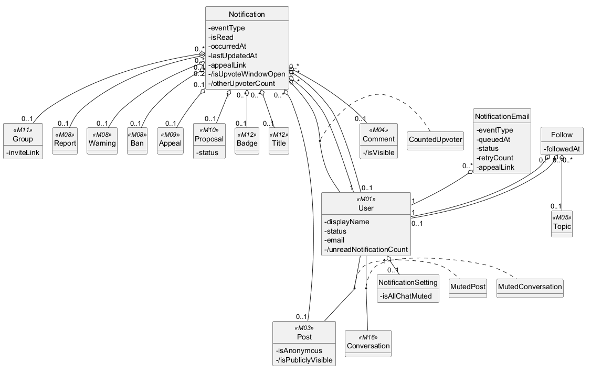

# Phân tích lớp thực thể — M07 Notification

<!-- [Vietnamese Doc] Tài liệu tiếng Việt; tên lớp và thuộc tính viết tiếng Anh (input/CONVENTIONS.md mục 3). -->

| Mã tài liệu | EC-M07 |
|---|---|
| Dự án | iShare |
| Module | M07 — Notification |
| Đầu vào | FR-M07 phiên bản 1.5 |
| Trạng thái | Đã chốt |
| Phiên bản | 1.0 |
| Ngày | 2026-11-19 |
| Tác giả | Phạm Văn Đức |

<!-- Quy ước chung cho mọi bảng dưới đây:
     - Không đổi tên cột, không xóa cột, không đổi số mục: tool đọc bảng theo số mục và tên cột.
     - Ô không có nội dung ghi "—".
     - Mục chưa tới bước làm thì để dòng "(Chưa làm — bước N)".
     - Cột Nguồn ghi mã trong FR: FR-Mxx-nn, FR-Mxx-nn.mm, BR-Mxx-nn, hoặc TN:<thuật ngữ> (mục 2.1 của FR).
     - Mục 4 chỉ chứa ảnh sơ đồ. gen_puml.py ghi mã PlantUML vào tệp riêng diagrams/EC-Mxx.puml, render
       diagrams/EC-Mxx.png và đặt ảnh vào mục 4. Không chép mã PlantUML vào tài liệu, không sửa tay tệp .puml hay ảnh. -->

## 1. Mô tả chức năng

### 1.1 Đoạn mô tả

Hệ thống quản lý thông báo gửi tới người dùng về các sự kiện do các module khác phát sinh, các email trong hàng đợi
email, quan hệ theo dõi giữa người dùng với người dùng và Topic, cùng các cài đặt tắt thông báo cho bài, tắt thông báo
cuộc trò chuyện và tắt thông báo toàn bộ Chat. Các chức năng của module dành cho người dùng đã đăng nhập là User, Mod
và Admin; Guest không nhận thông báo, không theo dõi được và không có cài đặt tắt thông báo.

Hệ thống cho phép người dùng theo dõi người dùng khác và theo dõi Topic do M05 quản lý; người dùng và Topic được theo
dõi gọi chung là đối tượng theo dõi. Mỗi khi người dùng bắt đầu theo dõi một đối tượng theo dõi, hệ thống ghi lại một
quan hệ theo dõi gồm người theo dõi, đối tượng theo dõi và thời điểm bắt đầu theo dõi. Người dùng không theo dõi được
chính mình và không bắt đầu theo dõi được người dùng có trạng thái tài khoản BANNED do M01 quản lý; quan hệ theo dõi
đã có được giữ khi người được theo dõi chuyển sang BANNED hoặc DEACTIVATED. Khi người dùng theo dõi một người dùng
khác lần đầu, hệ thống tạo sự kiện có người theo dõi mới cho người được theo dõi; mỗi cặp người theo dõi và người được
theo dõi chỉ sinh sự kiện này một lần, kể cả khi người theo dõi bỏ theo dõi rồi theo dõi lại. Hệ thống cho phép người
theo dõi bỏ theo dõi một đối tượng theo dõi; khi đó hệ thống xóa quan hệ theo dõi, số người theo dõi của đối tượng
theo dõi giảm theo và không ai nhận thông báo. Hệ thống cung cấp quan hệ theo dõi cùng thời điểm bắt đầu theo dõi cho
M01, M02, M06 và M14.

Khi một module báo một sự kiện thuộc danh sách sự kiện thông báo, hệ thống tạo cho mỗi người nhận một thông báo ở
trạng thái chưa đọc, ghi lại người nhận, sự kiện mà thông báo báo về, người gây sự kiện, nội dung liên quan và thời
điểm xảy ra sự kiện do module phát sinh sự kiện cung cấp. Hệ thống không tạo thông báo khi người gây sự kiện cũng là
người nhận, không tạo thông báo cho người nhận có trạng thái tài khoản DELETED, và với nội dung trong nhóm Private do
M11 quản lý thì chỉ tạo thông báo cho người nhận có quyền xem nội dung đó; người nhận đang BANNED hoặc DEACTIVATED vẫn
nhận thông báo. Khi người nhận đã tắt thông báo cho bài trên một bài viết do M03 quản lý, hệ thống không tạo cho người
nhận thông báo bình luận mới, trả lời, upvote bài viết và upvote bình luận của người nhận trong bài viết đó, nhưng vẫn
tạo thông báo nhắc tên và các thông báo khác về bài viết. Với upvote bài viết và upvote bình luận do M12 báo, hệ thống
gộp upvote riêng cho từng bài viết và từng bình luận do M04 quản lý. Lượt upvote đến khi bài viết hoặc bình luận không
có cửa sổ 5 phút đang mở tạo một thông báo upvote mới hiện tên người upvote và mở cửa sổ 5 phút cho bài viết hoặc bình
luận đó. Mỗi lượt upvote sau trong cửa sổ 5 phút cập nhật chính thông báo upvote đó với người upvote mới nhất và số
người khác nhau còn lại trong cửa sổ 5 phút, chuyển thông báo về chưa đọc và ghi lại lần cập nhật cuối của thông báo.
Mỗi người upvote chỉ được đếm một lần trong một cửa sổ 5 phút, và việc bỏ upvote không làm đổi thông báo upvote đã
tạo. Khi một bài viết lần đầu hiển thị công khai và không được đăng ẩn danh, hệ thống tạo thông báo bài mới cho mỗi
người đang theo dõi tác giả bài viết và xem được bài viết; việc sửa hay khôi phục bài viết và việc Topic có bài viết
mới không sinh thông báo bài mới. Thông báo về một xử lý khiếu nại được, gồm cảnh cáo, ban, bài viết bị Mod hoặc Admin
gỡ và bài viết bị AI từ chối, kèm đường dẫn khiếu nại. Khi Admin gửi đề xuất làm Mod hoặc tài khoản ADMIN gốc gửi đề
xuất làm Admin cho một người dùng, đều do M10 quản lý, hệ thống tạo cho người được đề xuất một thông báo đề xuất có
hai lựa chọn Chấp nhận và Từ chối; mỗi đề xuất mới, kể cả đề xuất lại cùng loại, có thông báo đề xuất riêng. Người
được đề xuất chọn được một lần; hệ thống ghi lại lựa chọn trên thông báo đề xuất và chuyển lựa chọn cho M10 để M10 đặt
vai trò MOD hoặc ADMIN khi người được đề xuất chấp nhận. Thông báo đề xuất không cho chọn nữa khi đề xuất đã quá hạn
mà chưa được trả lời, khi đó thông báo đề xuất hiện là đã hết hạn, hoặc khi có đề xuất mới cùng loại cho cùng người
dùng.

Mỗi thông báo được lưu trước, rồi hệ thống đẩy thông báo tới mọi thiết bị đang mở ứng dụng của người nhận do M01 quản
lý; đẩy không thành công thì hệ thống không thử lại, vì người nhận luôn tải thông báo chưa đọc từ thông báo đã lưu.
Khi một sự kiện thuộc nhóm sự kiện có email xảy ra, hệ thống ghi một email cho người nhận vào hàng đợi email, gửi tới
địa chỉ email của người nhận do M01 quản lý; email về ban kèm đường dẫn tới trang khiếu nại. Hệ thống quét hàng đợi
email định kỳ và gửi các email chưa gửi mà không bắt thao tác gây ra sự kiện phải chờ; email gửi không thành công ở
lại hàng đợi email để gửi lại ở các lần quét kế tiếp cho tới khi hết số lần gửi lại cho phép, sau đó hệ thống dừng gửi
email đó. Cảnh báo trước khi tự xóa của M01 chỉ được gửi qua email, không có thông báo; sự kiện ngoài nhóm sự kiện có
email chỉ có thông báo, không có email.

Hệ thống cho phép người dùng xem thông báo của chính mình, trừ khi tài khoản đang BANNED: chuông thông báo hiện số
thông báo chưa đọc và các thông báo gần nhất xếp theo lần cập nhật cuối, còn trang Thông báo hiện toàn bộ thông báo từ
mới nhất tới cũ nhất. Mỗi thông báo hiện kèm trạng thái đã đọc hoặc chưa đọc, thời điểm của thông báo và tên người gây
sự kiện theo trạng thái tài khoản của người gây sự kiện. Hệ thống giữ mọi thông báo vô thời hạn. Hệ thống cho phép
người nhận đánh dấu một thông báo là đã đọc bằng cách bấm vào thông báo đó, và chuyển người nhận tới nội dung liên
quan nếu nội dung liên quan chưa bị xóa, chưa bị ẩn và người nhận còn quyền xem. Hệ thống cho phép người nhận đánh dấu
tất cả thông báo chưa đọc của mình là đã đọc cùng lúc mà không đổi trạng thái đã đọc của tin nhắn; việc mở chuông
thông báo không đổi trạng thái đã đọc của thông báo.

Tin nhắn mới trong một cuộc trò chuyện do M16 quản lý, là cuộc trò chuyện 1-1 hoặc nhóm chat, không tạo thông báo và
không có email. Hệ thống hiện trên biểu tượng Tin nhắn số cuộc trò chuyện có tin chưa đọc của người dùng, tính theo
mốc đã đọc của M16, chỉ tính tin người dùng thấy được và gồm cả cuộc trò chuyện đã tắt thông báo; biểu tượng Tin nhắn
dẫn tới hộp thư Chat của M16. Với mỗi tin nhắn mới, hệ thống hiện một popup tin nhắn cho thành viên cuộc trò chuyện
đang mở ứng dụng, trừ khi thành viên đang xem đúng cuộc trò chuyện đó, đã tắt thông báo cuộc trò chuyện đó hoặc đang
bật cài đặt tắt thông báo toàn bộ Chat. Hệ thống cho phép người dùng tắt thông báo cho bài trên một bài viết cho riêng
mình và bật lại; hệ thống ghi lại bài viết đã tắt thông báo cho người dùng và bỏ ghi nhận đó khi người dùng bật lại.
Hệ thống cho phép thành viên cuộc trò chuyện tắt thông báo cuộc trò chuyện cho từng cuộc trò chuyện mình là thành viên
và bật lại; hệ thống ghi lại cuộc trò chuyện đã tắt thông báo cho thành viên, bỏ ghi nhận đó khi thành viên bật lại
hoặc khi thành viên rời hay bị xóa khỏi nhóm chat. Hệ thống cho phép người dùng bật và tắt cài đặt tắt thông báo toàn
bộ Chat; khi cài đặt này bật, mọi cuộc trò chuyện của người dùng không hiện popup tin nhắn, và khi cài đặt này tắt,
các cuộc trò chuyện đã tắt thông báo riêng vẫn giữ trạng thái tắt.

<!-- Văn xuôi bình thường, có thể chia vài đoạn. KHÔNG ghi mã câu (S1), (S2)… trong đoạn văn: người đọc không hiểu
     các mã đó. Số câu chỉ nằm ở bảng 1.2. Xem steps/01-describe-functions.md. -->

### 1.2 Truy vết câu

<!-- Mỗi câu của đoạn mô tả một dòng, theo đúng thứ tự. Câu: 1, 2, 3…
     Nội dung câu: chép NGUYÊN VĂN câu đó từ mục 1.1 (tool so khớp từng câu với đoạn văn).
     Nguồn: mã chức năng hoặc yêu cầu của FR mà câu dựa vào. -->

| Câu | Nội dung câu | Nguồn |
|---|---|---|
| 1 | Hệ thống quản lý thông báo gửi tới người dùng về các sự kiện do các module khác phát sinh, các email trong hàng đợi email, quan hệ theo dõi giữa người dùng với người dùng và Topic, cùng các cài đặt tắt thông báo cho bài, tắt thông báo cuộc trò chuyện và tắt thông báo toàn bộ Chat. | FR-M07-01, FR-M07-02, FR-M07-04, FR-M07-08, FR-M07-09 |
| 2 | Các chức năng của module dành cho người dùng đã đăng nhập là User, Mod và Admin; Guest không nhận thông báo, không theo dõi được và không có cài đặt tắt thông báo. | FR-M07-01.03, FR-M07-05.06, FR-M07-06.06, FR-M07-08.05, FR-M07-09.06 |
| 3 | Hệ thống cho phép người dùng theo dõi người dùng khác và theo dõi Topic do M05 quản lý; người dùng và Topic được theo dõi gọi chung là đối tượng theo dõi. | FR-M07-01, FR-M07-01.01 |
| 4 | Mỗi khi người dùng bắt đầu theo dõi một đối tượng theo dõi, hệ thống ghi lại một quan hệ theo dõi gồm người theo dõi, đối tượng theo dõi và thời điểm bắt đầu theo dõi. | FR-M07-01.01 |
| 5 | Người dùng không theo dõi được chính mình và không bắt đầu theo dõi được người dùng có trạng thái tài khoản BANNED do M01 quản lý; quan hệ theo dõi đã có được giữ khi người được theo dõi chuyển sang BANNED hoặc DEACTIVATED. | FR-M07-01.11, FR-M07-01.12, FR-M07-01.13 |
| 6 | Khi người dùng theo dõi một người dùng khác lần đầu, hệ thống tạo sự kiện có người theo dõi mới cho người được theo dõi; mỗi cặp người theo dõi và người được theo dõi chỉ sinh sự kiện này một lần, kể cả khi người theo dõi bỏ theo dõi rồi theo dõi lại. | FR-M07-01.04, FR-M07-01.10 |
| 7 | Hệ thống cho phép người theo dõi bỏ theo dõi một đối tượng theo dõi; khi đó hệ thống xóa quan hệ theo dõi, số người theo dõi của đối tượng theo dõi giảm theo và không ai nhận thông báo. | FR-M07-01.08, FR-M07-01.09 |
| 8 | Hệ thống cung cấp quan hệ theo dõi cùng thời điểm bắt đầu theo dõi cho M01, M02, M06 và M14. | FR-M07-01.01 |
| 9 | Khi một module báo một sự kiện thuộc danh sách sự kiện thông báo, hệ thống tạo cho mỗi người nhận một thông báo ở trạng thái chưa đọc, ghi lại người nhận, sự kiện mà thông báo báo về, người gây sự kiện, nội dung liên quan và thời điểm xảy ra sự kiện do module phát sinh sự kiện cung cấp. | FR-M07-02.01, FR-M07-02.02, FR-M07-05.12 |
| 10 | Hệ thống không tạo thông báo khi người gây sự kiện cũng là người nhận, không tạo thông báo cho người nhận có trạng thái tài khoản DELETED, và với nội dung trong nhóm Private do M11 quản lý thì chỉ tạo thông báo cho người nhận có quyền xem nội dung đó; người nhận đang BANNED hoặc DEACTIVATED vẫn nhận thông báo. | FR-M07-02.11, FR-M07-02.25, FR-M07-02.26, FR-M07-02.27 |
| 11 | Khi người nhận đã tắt thông báo cho bài trên một bài viết do M03 quản lý, hệ thống không tạo cho người nhận thông báo bình luận mới, trả lời, upvote bài viết và upvote bình luận của người nhận trong bài viết đó, nhưng vẫn tạo thông báo nhắc tên và các thông báo khác về bài viết. | FR-M07-02.07, FR-M07-02.08, FR-M07-02.09 |
| 12 | Với upvote bài viết và upvote bình luận do M12 báo, hệ thống gộp upvote riêng cho từng bài viết và từng bình luận do M04 quản lý. | FR-M07-02.18 |
| 13 | Lượt upvote đến khi bài viết hoặc bình luận không có cửa sổ 5 phút đang mở tạo một thông báo upvote mới hiện tên người upvote và mở cửa sổ 5 phút cho bài viết hoặc bình luận đó. | FR-M07-02.03 |
| 14 | Mỗi lượt upvote sau trong cửa sổ 5 phút cập nhật chính thông báo upvote đó với người upvote mới nhất và số người khác nhau còn lại trong cửa sổ 5 phút, chuyển thông báo về chưa đọc và ghi lại lần cập nhật cuối của thông báo. | FR-M07-02.04, FR-M07-05.01 |
| 15 | Mỗi người upvote chỉ được đếm một lần trong một cửa sổ 5 phút, và việc bỏ upvote không làm đổi thông báo upvote đã tạo. | FR-M07-02.19, FR-M07-02.20 |
| 16 | Khi một bài viết lần đầu hiển thị công khai và không được đăng ẩn danh, hệ thống tạo thông báo bài mới cho mỗi người đang theo dõi tác giả bài viết và xem được bài viết; việc sửa hay khôi phục bài viết và việc Topic có bài viết mới không sinh thông báo bài mới. | FR-M07-02.21, FR-M07-02.22, FR-M07-02.23, FR-M07-02.24 |
| 17 | Thông báo về một xử lý khiếu nại được, gồm cảnh cáo, ban, bài viết bị Mod hoặc Admin gỡ và bài viết bị AI từ chối, kèm đường dẫn khiếu nại. | FR-M07-02.13 |
| 18 | Khi Admin gửi đề xuất làm Mod hoặc tài khoản ADMIN gốc gửi đề xuất làm Admin cho một người dùng, đều do M10 quản lý, hệ thống tạo cho người được đề xuất một thông báo đề xuất có hai lựa chọn Chấp nhận và Từ chối; mỗi đề xuất mới, kể cả đề xuất lại cùng loại, có thông báo đề xuất riêng. | FR-M07-02.14, FR-M07-02.30 |
| 19 | Người được đề xuất chọn được một lần; hệ thống ghi lại lựa chọn trên thông báo đề xuất và chuyển lựa chọn cho M10 để M10 đặt vai trò MOD hoặc ADMIN khi người được đề xuất chấp nhận. | FR-M07-02.15, FR-M07-02.16, FR-M07-02.28 |
| 20 | Thông báo đề xuất không cho chọn nữa khi đề xuất đã quá hạn mà chưa được trả lời, khi đó thông báo đề xuất hiện là đã hết hạn, hoặc khi có đề xuất mới cùng loại cho cùng người dùng. | FR-M07-02.31, FR-M07-02.32 |
| 21 | Mỗi thông báo được lưu trước, rồi hệ thống đẩy thông báo tới mọi thiết bị đang mở ứng dụng của người nhận do M01 quản lý; đẩy không thành công thì hệ thống không thử lại, vì người nhận luôn tải thông báo chưa đọc từ thông báo đã lưu. | FR-M07-03.01, FR-M07-03.02, FR-M07-03.03, FR-M07-03.04 |
| 22 | Khi một sự kiện thuộc nhóm sự kiện có email xảy ra, hệ thống ghi một email cho người nhận vào hàng đợi email, gửi tới địa chỉ email của người nhận do M01 quản lý; email về ban kèm đường dẫn tới trang khiếu nại. | FR-M07-04.01, FR-M07-04.08 |
| 23 | Hệ thống quét hàng đợi email định kỳ và gửi các email chưa gửi mà không bắt thao tác gây ra sự kiện phải chờ; email gửi không thành công ở lại hàng đợi email để gửi lại ở các lần quét kế tiếp cho tới khi hết số lần gửi lại cho phép, sau đó hệ thống dừng gửi email đó. | FR-M07-04.02, FR-M07-04.03, FR-M07-04.09, FR-M07-04.10 |
| 24 | Cảnh báo trước khi tự xóa của M01 chỉ được gửi qua email, không có thông báo; sự kiện ngoài nhóm sự kiện có email chỉ có thông báo, không có email. | FR-M07-04.04, FR-M07-04.06 |
| 25 | Hệ thống cho phép người dùng xem thông báo của chính mình, trừ khi tài khoản đang BANNED: chuông thông báo hiện số thông báo chưa đọc và các thông báo gần nhất xếp theo lần cập nhật cuối, còn trang Thông báo hiện toàn bộ thông báo từ mới nhất tới cũ nhất. | FR-M07-05.01, FR-M07-05.02, FR-M07-05.05, FR-M07-05.09, FR-M07-05.10 |
| 26 | Mỗi thông báo hiện kèm trạng thái đã đọc hoặc chưa đọc, thời điểm của thông báo và tên người gây sự kiện theo trạng thái tài khoản của người gây sự kiện. | FR-M07-05.03, FR-M07-05.04, FR-M07-05.12 |
| 27 | Hệ thống giữ mọi thông báo vô thời hạn. | FR-M07-05.07 |
| 28 | Hệ thống cho phép người nhận đánh dấu một thông báo là đã đọc bằng cách bấm vào thông báo đó, và chuyển người nhận tới nội dung liên quan nếu nội dung liên quan chưa bị xóa, chưa bị ẩn và người nhận còn quyền xem. | FR-M07-06.01, FR-M07-06.02, FR-M07-06.04, FR-M07-05.13 |
| 29 | Hệ thống cho phép người nhận đánh dấu tất cả thông báo chưa đọc của mình là đã đọc cùng lúc mà không đổi trạng thái đã đọc của tin nhắn; việc mở chuông thông báo không đổi trạng thái đã đọc của thông báo. | FR-M07-06.03, FR-M07-06.05, FR-M07-05.11 |
| 30 | Tin nhắn mới trong một cuộc trò chuyện do M16 quản lý, là cuộc trò chuyện 1-1 hoặc nhóm chat, không tạo thông báo và không có email. | FR-M07-02.10, BR-M07-02 |
| 31 | Hệ thống hiện trên biểu tượng Tin nhắn số cuộc trò chuyện có tin chưa đọc của người dùng, tính theo mốc đã đọc của M16, chỉ tính tin người dùng thấy được và gồm cả cuộc trò chuyện đã tắt thông báo; biểu tượng Tin nhắn dẫn tới hộp thư Chat của M16. | FR-M07-07.01, FR-M07-07.02, FR-M07-07.03, FR-M07-07.04, FR-M07-09.07 |
| 32 | Với mỗi tin nhắn mới, hệ thống hiện một popup tin nhắn cho thành viên cuộc trò chuyện đang mở ứng dụng, trừ khi thành viên đang xem đúng cuộc trò chuyện đó, đã tắt thông báo cuộc trò chuyện đó hoặc đang bật cài đặt tắt thông báo toàn bộ Chat. | FR-M07-07.05, FR-M07-07.06, FR-M07-07.07 |
| 33 | Hệ thống cho phép người dùng tắt thông báo cho bài trên một bài viết cho riêng mình và bật lại; hệ thống ghi lại bài viết đã tắt thông báo cho người dùng và bỏ ghi nhận đó khi người dùng bật lại. | FR-M07-08.01, FR-M07-08.02, FR-M07-08.03, FR-M07-08.04 |
| 34 | Hệ thống cho phép thành viên cuộc trò chuyện tắt thông báo cuộc trò chuyện cho từng cuộc trò chuyện mình là thành viên và bật lại; hệ thống ghi lại cuộc trò chuyện đã tắt thông báo cho thành viên, bỏ ghi nhận đó khi thành viên bật lại hoặc khi thành viên rời hay bị xóa khỏi nhóm chat. | FR-M07-09.01, FR-M07-09.02, FR-M07-09.05, FR-M07-09.08 |
| 35 | Hệ thống cho phép người dùng bật và tắt cài đặt tắt thông báo toàn bộ Chat; khi cài đặt này bật, mọi cuộc trò chuyện của người dùng không hiện popup tin nhắn, và khi cài đặt này tắt, các cuộc trò chuyện đã tắt thông báo riêng vẫn giữ trạng thái tắt. | FR-M07-09.03, FR-M07-09.04 |

## 2. Danh từ và phân loại

### 2.1 Sổ danh từ

<!-- Phân loại: Lớp | Thuộc tính | Loại bỏ.
     Kết quả: tên lớp; hoặc Lớp.thuộcTính; hoặc "—" khi loại bỏ.
     Xuất hiện ở: "Câu n" (số câu ở bảng 1.2) hoặc "Quét: <mã FR>" (lượt quét bổ sung). -->

| # | Danh từ | Xuất hiện ở | Phân loại | Kết quả | Lý do |
|---|---|---|---|---|---|
| 1 | hệ thống | Câu 1 | Loại bỏ | — | Trừu tượng: chỉ chính phần mềm |
| 2 | thông báo / thông báo đã lưu | Câu 1 | Lớp | Notification | Đối tượng trung tâm của module: được tạo khi có sự kiện (FR-M07-02.01), được sửa khi đánh dấu đã đọc hoặc gộp upvote (FR-M07-06.01, FR-M07-02.04), giữ vô thời hạn (BR-M07-13); mỗi người nhận có thông báo riêng (TN:Thông báo); có trạng thái đã đọc riêng (mục Chuyển trạng thái của FR) |
| 3 | người dùng / người dùng khác / người dùng đã đăng nhập / tài khoản | Câu 1 | Lớp | User | Lớp ngoài (M01): tài khoản; dùng tên User của EC-M01 |
| 4 | sự kiện | Câu 1 | Loại bỏ | — | Hành động không lưu dấu vết: sự kiện do module khác phát sinh rồi báo cho M07 (TN:Sự kiện); M07 không lưu sự kiện, chỉ ghi loại sự kiện vào thông báo và email (dòng 31, 118) |
| 5 | module / module khác / module phát sinh sự kiện | Câu 1 | Loại bỏ | — | Trừu tượng: chỉ một phần của chính hệ thống |
| 6 | email / email thông báo | Câu 1 | Lớp | NotificationEmail | Mỗi email được ghi vào hàng đợi, được gửi ở lần quét sau và được gửi lại khi lỗi (FR-M07-04.01, FR-M07-04.02, FR-M07-04.09); có nhiều email phân biệt được, mỗi email có trạng thái gửi và số lần gửi lại riêng; FR gọi là "Email thông báo (trong hàng đợi)" |
| 7 | hàng đợi email | Câu 1 | Loại bỏ | — | Trừu tượng: tập các email chưa gửi (TN:Hàng đợi email); chỉ có một hàng đợi, không có thông tin riêng; email nào đang chờ thể hiện bằng NotificationEmail.status |
| 8 | quan hệ theo dõi | Câu 1 | Lớp | Follow | Được tạo và xóa riêng (FR-M07-01.01, FR-M07-01.08); có nhiều quan hệ phân biệt được; ghi người theo dõi, đối tượng theo dõi và thời điểm bắt đầu theo dõi (TN:Theo dõi); dùng tên Follow mà EC-M01, EC-M05 đã đặt tạm |
| 9 | Topic | Câu 1 | Lớp | Topic | Lớp ngoài (M05): một loại đối tượng theo dõi; dùng tên Topic của EC-M05 |
| 10 | cài đặt | Câu 1 | Loại bỏ | — | Chung chung: chỉ các cài đặt tắt thông báo, xét ở các dòng ngay sau |
| 11 | tắt thông báo cho bài | Câu 1 | Loại bỏ | — | Chung chung: là quan hệ người dùng – bài viết đã tắt thông báo (TN:Tắt thông báo cho bài); ngoài hai đầu không có thông tin riêng (mục Dữ liệu nghiệp vụ của FR chỉ ghi người dùng, bài viết); ở bước 3 tách quan hệ n-n User – Post thành lớp liên kết MutedPost (mục 3.3) |
| 12 | tắt thông báo cuộc trò chuyện | Câu 1 | Loại bỏ | — | Chung chung: là quan hệ thành viên – cuộc trò chuyện đã tắt thông báo (TN:Tắt thông báo cuộc trò chuyện); ngoài hai đầu không có thông tin riêng; ở bước 3 tách quan hệ n-n User – Conversation thành lớp liên kết MutedConversation (mục 3.3) |
| 13 | tắt thông báo toàn bộ Chat / cài đặt tắt thông báo toàn bộ Chat | Câu 1 | Lớp | NotificationSetting | Cài đặt của một người dùng (TN:Tắt thông báo toàn bộ Chat); mục Dữ liệu nghiệp vụ của FR ghi là thực thể do M07 tạo, sửa (FR-M07-09.03, FR-M07-09.04), có hai trạng thái Đang nhận, Đã tắt (mục Chuyển trạng thái của FR). Tách thành lớp cài đặt riêng do M07 sở hữu, không bổ sung lên lớp User của M01 (trả lời Q-01) |
| 14 | chức năng | Câu 2 | Loại bỏ | — | Trừu tượng |
| 15 | User | Câu 2 | Lớp | User | Vai trò của người dùng có tài khoản; trong M07, User, Mod và Admin có cùng quyền (mục 4.3 của FR) nên M07 không đọc vai trò |
| 16 | Mod | Câu 2 | Lớp | User | Vai trò của người dùng có tài khoản; xem dòng 15 |
| 17 | Admin | Câu 2 | Lớp | User | Vai trò của người dùng có tài khoản; xem dòng 15. Việc Admin gửi đề xuất do M10 kiểm |
| 18 | Guest | Câu 2 | Loại bỏ | — | Không lưu: tác nhân không có dữ liệu |
| 19 | đối tượng theo dõi | Câu 3 | Loại bỏ | — | Chung chung: chỉ người dùng hoặc Topic (TN:Đối tượng theo dõi); việc quan hệ theo dõi trỏ tới người dùng hoặc Topic là quan hệ, xét ở bước 3 |
| 20 | người theo dõi / người đang theo dõi | Câu 4 | Lớp | User | Vai trò của người dùng trong quan hệ theo dõi; quan hệ, xét ở bước 3 |
| 21 | thời điểm bắt đầu theo dõi | Câu 4 | Thuộc tính | Follow.followedAt | Lúc người dùng bắt đầu theo dõi (TN:Thời điểm bắt đầu theo dõi, FR-M07-01.01); M02 dùng để xếp danh sách theo dõi |
| 22 | trạng thái tài khoản | Câu 5 | Thuộc tính | User.status | Thông tin của tài khoản (M01) mà M07 đọc để từ chối theo dõi mới, chọn người nhận, chặn xem chuông và hiện tên người gây sự kiện (FR-M07-01.12, FR-M07-02.27, FR-M07-05.09, FR-M07-05.12) |
| 23 | BANNED | Câu 5 | Loại bỏ | — | Giá trị của User.status |
| 24 | người được theo dõi | Câu 5 | Lớp | User | Vai trò của người dùng trong quan hệ theo dõi; quan hệ, xét ở bước 3 |
| 25 | DEACTIVATED | Câu 5 | Loại bỏ | — | Giá trị của User.status |
| 26 | sự kiện có người theo dõi mới | Câu 6 | Loại bỏ | — | Giá trị của Notification.eventType (BR-M07-01) |
| 27 | cặp người theo dõi và người được theo dõi | Câu 6 | Loại bỏ | — | Không lưu riêng: "cặp đã sinh sự kiện có người theo dõi mới" suy ra được từ Notification có eventType là có người theo dõi mới, người nhận là người được theo dõi và người gây sự kiện là người theo dõi; thông báo không bao giờ bị xóa (BR-M07-13) nên vẫn còn sau khi quan hệ theo dõi bị xóa (FR-M07-01.08, FR-M07-01.10, BR-M07-25) |
| 28 | số người theo dõi | Câu 7 | Loại bỏ | — | Ngoài phạm vi module (M02): số người theo dõi của người dùng là Profile./followerCount của EC-M02, đếm từ Follow; M07 không hiện con số này, FR-M07-01.08 chỉ nêu hệ quả của việc xóa quan hệ theo dõi |
| 29 | danh sách sự kiện thông báo | Câu 9 | Loại bỏ | — | Hằng số của BR-M07-01: tập giá trị của Notification.eventType |
| 30 | người nhận | Câu 9 | Lớp | User | Vai trò theo ngữ cảnh của người dùng (TN:Người nhận); thông báo và email thuộc một người nhận là quan hệ, xét ở bước 3 |
| 31 | sự kiện mà thông báo báo về / loại sự kiện | Câu 9 | Thuộc tính | Notification.eventType | Thông báo báo về đúng một sự kiện thuộc BR-M07-01 (FR-M07-02.01); mục Dữ liệu nghiệp vụ của FR gọi là loại sự kiện |
| 32 | trạng thái chưa đọc / trạng thái đã đọc hoặc chưa đọc / trạng thái đã đọc của thông báo | Câu 9 | Thuộc tính | Notification.isRead | Trạng thái của một thông báo (TN:Đã đọc, chưa đọc; mục Chuyển trạng thái của FR) |
| 33 | người gây sự kiện | Câu 9 | Lớp | User | Vai trò theo ngữ cảnh của người dùng (TN:Người gây sự kiện); thông báo ghi người gây sự kiện là quan hệ, xét ở bước 3; tên hiện theo trạng thái tài khoản lúc xem (FR-M07-05.12) nên không chụp lại tên |
| 34 | nội dung liên quan / nội dung / nội dung liên quan để chuyển tới khi bấm | Câu 9 | Loại bỏ | — | Chung chung: tùy loại sự kiện là bài viết, bình luận, nhóm, báo cáo, cảnh cáo, ban, khiếu nại, đề xuất, badge hoặc danh hiệu (cột Quan hệ ở mục Dữ liệu nghiệp vụ của FR); mỗi đối tượng là một lớp ngoài, việc thông báo trỏ tới chúng là quan hệ, xét ở bước 3 |
| 35 | thời điểm xảy ra sự kiện / thời điểm của thông báo / thời điểm tạo | Câu 9 | Thuộc tính | Notification.occurredAt | Do module phát sinh sự kiện cung cấp (FR-M07-02.02); hiện trên thông báo (FR-M07-05.04, BR-M07-22); mục Dữ liệu nghiệp vụ của FR gọi là thời điểm tạo |
| 36 | DELETED | Câu 10 | Loại bỏ | — | Giá trị của User.status |
| 37 | nhóm | Câu 10 | Lớp | Group | Lớp ngoài (M11): thông báo về sự kiện nhóm (được mời, yêu cầu tham gia, bị kick…) trỏ tới nhóm (BR-M07-01, mục Dữ liệu nghiệp vụ của FR); dùng tên Group mà EC-M03, EC-M06 đã đặt tạm |
| 38 | Private | Câu 10 | Loại bỏ | — | Ngoài phạm vi module (M11): chế độ của nhóm; M07 không đọc chế độ mà hỏi M11 quyền xem nội dung (BR-M07-18) |
| 39 | quyền xem | Câu 10 | Loại bỏ | — | Ngoài phạm vi module (M11, M03): quyền xem nội dung do module sở hữu nhóm và nội dung quyết (BR-M07-18, BR-M07-27); M07 không lưu |
| 40 | bài viết | Câu 11 | Lớp | Post | Lớp ngoài (M03): nội dung liên quan của nhiều loại thông báo và là nơi người dùng tắt thông báo; dùng tên Post của EC-M03 |
| 41 | bình luận mới, trả lời, upvote bài viết, upvote bình luận, nhắc tên (loại thông báo) | Câu 11 | Loại bỏ | — | Giá trị của Notification.eventType (BR-M07-01) |
| 42 | bình luận | Câu 11 | Lớp | Comment | Lớp ngoài (M04): nội dung liên quan của thông báo trả lời, nhắc tên, upvote bình luận, bình luận bị ẩn; upvote được gộp theo từng bình luận (FR-M07-02.18); dùng tên Comment của EC-M04 |
| 43 | thông báo khác về bài viết | Câu 11 | Loại bỏ | — | Chung chung: chỉ các loại thông báo về bài ngoài bình luận mới, trả lời, upvote (FR-M07-02.09); là giá trị của Notification.eventType |
| 44 | upvote / lượt upvote | Câu 12 | Loại bỏ | — | Ngoài phạm vi module (M12): M07 nhận sự kiện upvote, bỏ upvote từ M12 (mục Giao tiếp của FR), không đọc hay ghi Upvote; mỗi lượt chỉ tạo hoặc cập nhật thông báo upvote, người upvote được đếm ghi ở thông báo (dòng 47) |
| 45 | cửa sổ 5 phút / cửa sổ 5 phút đang mở | Câu 13 | Thuộc tính | Notification.isUpvoteWindowOpen | Cửa sổ của một thông báo upvote, bắt đầu ở thời điểm lượt upvote mở thông báo và dài 5 × 60 giây (TN:Cửa sổ 5 phút); điều các quy tắc cần là cửa sổ còn mở hay không (FR-M07-02.03, FR-M07-02.04); độ dài là hằng số của BR-M07-05 |
| 46 | thông báo upvote | Câu 13 | Lớp | Notification | Một loại thông báo (eventType là upvote bài viết hoặc upvote bình luận): cùng người nhận, trạng thái đã đọc và vòng đời với thông báo khác; chỉ có thêm cửa sổ 5 phút và những người upvote đã được đếm |
| 47 | người upvote / những người khác nhau đã upvote | Câu 13 | Lớp | User | Vai trò của người dùng; những người đã được đếm trong cửa sổ là quan hệ thông báo upvote – người dùng (mục Dữ liệu nghiệp vụ của FR), cần để không đếm một người hai lần (FR-M07-02.20); ở bước 3 tách quan hệ n-n Notification – User thành lớp liên kết CountedUpvoter (mục 3.3) |
| 48 | tên người upvote / tên người gây sự kiện | Câu 13 | Thuộc tính | User.displayName | Thông tin của tài khoản (M01) mà M07 đọc lúc hiển thị để hiện tên người gây sự kiện (FR-M07-02.03, FR-M07-05.12) |
| 49 | người upvote mới nhất | Câu 14 | Lớp | User | Vai trò: là người gây sự kiện của thông báo upvote đã gộp ("A" trong TN:Gộp upvote); quan hệ, xét ở bước 3 |
| 50 | số người khác nhau còn lại trong cửa sổ 5 phút | Câu 14 | Thuộc tính | Notification.otherUpvoterCount | "N" trong "A và N người khác đã upvote…" (TN:Gộp upvote); số đếm tính ra từ những người upvote đã được đếm |
| 51 | lần cập nhật cuối / thời điểm cập nhật cuối | Câu 14 | Thuộc tính | Notification.lastUpdatedAt | Chuông xếp thông báo theo lần cập nhật cuối (FR-M07-05.01, BR-M07-12); khác thời điểm xảy ra sự kiện ở thông báo upvote đã gộp |
| 52 | bỏ upvote / việc bỏ upvote | Câu 15 | Loại bỏ | — | Hành động không lưu dấu vết: không làm đổi thông báo upvote (FR-M07-02.19) |
| 53 | hiển thị công khai | Câu 16 | Loại bỏ | — | Ngoài phạm vi module (M03): M03 báo sự kiện bài lần đầu hiển thị công khai (TN:Hiển thị công khai, mục Giao tiếp của FR); M07 không đọc thời điểm này |
| 54 | đăng ẩn danh | Câu 16 | Thuộc tính | Post.isAnonymous | Thông tin của bài viết mà M07 đọc để không tạo thông báo bài mới cho người theo dõi tác giả (FR-M07-02.22) |
| 55 | thông báo bài mới / bài mới | Câu 16 | Loại bỏ | — | Giá trị của Notification.eventType ("người bạn theo dõi có bài mới", BR-M07-01, TN:Bài mới) |
| 56 | tác giả bài viết | Câu 16 | Lớp | User | Vai trò của người dùng; quan hệ bài viết – tác giả do EC-M03 ghi, M07 đọc để tìm người theo dõi tác giả; không ghi quan hệ giữa hai lớp ngoài |
| 57 | việc sửa, khôi phục bài viết | Câu 16 | Loại bỏ | — | Ngoài phạm vi module (M03): không sinh thông báo bài mới (FR-M07-02.23) |
| 58 | xử lý khiếu nại được | Câu 17 | Loại bỏ | — | Chung chung: chỉ các loại sự kiện cảnh cáo, ban, bài bị Mod hoặc Admin gỡ, bài bị AI từ chối (FR-M07-02.13); đó là giá trị của Notification.eventType |
| 59 | cảnh cáo | Câu 17 | Lớp | Warning | Lớp ngoài (M08): thông báo nhận cảnh cáo trỏ tới cảnh cáo (mục Dữ liệu nghiệp vụ của FR); tên tạm, chờ EC-M08 |
| 60 | ban | Câu 17 | Lớp | Ban | Lớp ngoài (M08): thông báo ban, gỡ ban trỏ tới lần ban (mục Dữ liệu nghiệp vụ của FR); dùng tên Ban mà EC-M01 đã đặt tạm, chờ EC-M08 |
| 61 | AI | Câu 17 | Loại bỏ | — | Ngoài phạm vi module (M08, M13): việc AI từ chối bài, ẩn bình luận, ra cảnh cáo do các module đó quyết (mục 5.14 của FR) |
| 62 | đường dẫn khiếu nại | Câu 17 | Thuộc tính | Notification.appealLink | Được đưa vào thông báo về một xử lý khiếu nại được (FR-M07-02.13); M08 cung cấp (mục Giao tiếp của FR) |
| 63 | khiếu nại / kết luận khiếu nại | Câu 17 | Lớp | Appeal | Lớp ngoài (M09): thông báo kết luận khiếu nại trỏ tới khiếu nại (BR-M07-01, mục Dữ liệu nghiệp vụ của FR); tên tạm, chờ EC-M09 |
| 64 | đề xuất làm Mod / đề xuất làm Admin / đề xuất / đề xuất lại | Câu 18 | Lớp | Proposal | Lớp ngoài (M10): FR-M10 định nghĩa thực thể Đề xuất (loại, người được đề xuất, trạng thái), mỗi đề xuất có một thông báo; tên tạm, chờ EC-M10 |
| 65 | tài khoản ADMIN gốc | Câu 18 | Loại bỏ | — | Ngoài phạm vi module (M10): dấu "gốc" của tài khoản do M10 quản lý; M07 không kiểm ai được gửi đề xuất |
| 66 | người được đề xuất | Câu 18 | Lớp | User | Vai trò của người dùng; là người nhận của thông báo đề xuất; quan hệ đề xuất – người được đề xuất do EC-M10 ghi |
| 67 | thông báo đề xuất | Câu 18 | Lớp | Notification | Một loại thông báo (eventType là đề xuất làm Mod hoặc đề xuất làm Admin): cùng thông tin và vòng đời với thông báo khác; chỉ có thêm việc trỏ tới đề xuất, xét ở bước 3 |
| 68 | lựa chọn / lựa chọn đã chọn | Câu 18 | Thuộc tính | Proposal.status | Thông tin của đề xuất (M10): FR-M10 ghi trạng thái đề xuất Chưa trả lời, Đã chấp nhận, Đã từ chối, Hết hiệu lực; M07 chuyển lựa chọn cho M10 (FR-M07-02.15) và đọc để hiện trên thông báo (FR-M07-02.28). Xem Q-02 |
| 69 | Chấp nhận, Từ chối | Câu 18 | Loại bỏ | — | Giá trị của Proposal.status (Đã chấp nhận, Đã từ chối) |
| 70 | vai trò MOD, ADMIN | Câu 19 | Loại bỏ | — | Ngoài phạm vi module (M10): M10 đặt vai trò khi người được đề xuất chấp nhận (FR-M07-02.15) |
| 71 | hạn của đề xuất | Câu 20 | Loại bỏ | — | Ngoài phạm vi module (M10): hạn 7 ngày do M10 tính (BR-M07-20); kết quả M07 đọc qua Proposal.status |
| 72 | đã hết hạn | Câu 20 | Loại bỏ | — | Giá trị của Proposal.status (Hết hiệu lực theo FR-M10) |
| 73 | loại đề xuất | Câu 20 | Loại bỏ | — | Ngoài phạm vi module (M10): loại đề xuất và việc đề xuất mới cùng loại làm đề xuất cũ hết hiệu lực do M10 ghi; M07 đọc kết quả qua Proposal.status |
| 74 | thiết bị đang mở ứng dụng / thiết bị | Câu 21 | Loại bỏ | — | Ngoài phạm vi module (M01): M07 không lưu thiết bị; việc đẩy thông báo theo kiểu cố gắng, không thử lại và không lưu dấu vết (TN:Đẩy thông báo, FR-M07-03.03) |
| 75 | ứng dụng | Câu 21 | Loại bỏ | — | Trừu tượng: chỉ chính phần mềm |
| 76 | thông báo chưa đọc | Câu 21 | Loại bỏ | — | Giá trị của Notification.isRead |
| 77 | nhóm sự kiện có email | Câu 22 | Loại bỏ | — | Hằng số của BR-M07-03: tập giá trị của NotificationEmail.eventType |
| 78 | địa chỉ email | Câu 22 | Thuộc tính | User.email | Thông tin của tài khoản (M01) mà M07 đọc để gửi email (FR-M07-04.01, mục Dữ liệu nghiệp vụ của FR) |
| 79 | email về ban | Câu 22 | Loại bỏ | — | Giá trị của NotificationEmail.eventType |
| 80 | đường dẫn tới trang khiếu nại | Câu 22 | Thuộc tính | NotificationEmail.appealLink | Được đưa vào email về ban (FR-M07-04.08) |
| 81 | trang khiếu nại | Câu 22 | Loại bỏ | — | Ngoài phạm vi module (M09) |
| 82 | lần quét | Câu 23 | Loại bỏ | — | Hành động không lưu dấu vết: quét định kỳ mỗi 1 phút (hằng số của BR-M07-11) không được ghi lại; kết quả của mỗi lần quét nằm ở NotificationEmail.status và NotificationEmail.retryCount |
| 83 | email chưa gửi | Câu 23 | Loại bỏ | — | Giá trị của NotificationEmail.status |
| 84 | thao tác gây ra sự kiện | Câu 23 | Loại bỏ | — | Ngoài phạm vi module: thao tác của module phát sinh sự kiện; M07 chỉ không bắt thao tác đó chờ (FR-M07-04.03) |
| 85 | số lần gửi lại cho phép | Câu 23 | Loại bỏ | — | Hằng số của BR-M07-26 (3 lần); ghi vào ràng buộc của NotificationEmail.retryCount |
| 86 | cảnh báo trước khi tự xóa | Câu 24 | Loại bỏ | — | Giá trị của NotificationEmail.eventType; thời điểm gửi do M01 quyết (BR-M07-04) |
| 87 | chuông thông báo | Câu 25 | Loại bỏ | — | Giao diện (TN:Chuông thông báo) |
| 88 | số thông báo chưa đọc | Câu 25 | Thuộc tính | User.unreadNotificationCount | Số đếm tính ra trên một người dùng, hiện trên chuông (FR-M07-05.10, BR-M07-12); M07 định nghĩa nên M07 bổ sung trên lớp của M01 |
| 89 | thông báo gần nhất | Câu 25 | Loại bỏ | — | Giao diện: các thông báo có lastUpdatedAt mới nhất; số 10 là hằng số của BR-M07-12 |
| 90 | trang Thông báo | Câu 25 | Loại bỏ | — | Giao diện (TN:Trang Thông báo); tải 20 thông báo mỗi lần cuộn là hằng số của BR-M07-12 |
| 91 | tin nhắn / tin nhắn mới | Câu 29 | Loại bỏ | — | Ngoài phạm vi module (M16): tin nhắn không tạo thông báo (FR-M07-02.10); M07 không lưu và không đọc thuộc tính nào của tin nhắn |
| 92 | trạng thái đã đọc của tin nhắn | Câu 29 | Loại bỏ | — | Ngoài phạm vi module (M16): "Đánh dấu tất cả đã đọc" không đổi nó (FR-M07-06.05) |
| 93 | cuộc trò chuyện | Câu 30 | Lớp | Conversation | Lớp ngoài (M16): thành viên tắt thông báo theo từng cuộc trò chuyện (FR-M07-09.01, mục Dữ liệu nghiệp vụ của FR); tên tạm, chờ EC-M16 |
| 94 | cuộc trò chuyện 1-1, nhóm chat | Câu 30 | Loại bỏ | — | Ngoài phạm vi module (M16): loại cuộc trò chuyện do M16 ghi; tắt thông báo áp như nhau cho hai loại |
| 95 | biểu tượng Tin nhắn | Câu 31 | Loại bỏ | — | Giao diện (TN:Biểu tượng Tin nhắn) |
| 96 | số cuộc trò chuyện có tin chưa đọc | Câu 31 | Loại bỏ | — | Ngoài phạm vi module (M16): tính hoàn toàn từ dữ liệu M16 (mốc đã đọc, tin người dùng thấy được, FR-M07-07.02), kể cả cuộc đã tắt thông báo (FR-M07-09.07), nên không dùng dữ liệu nào của M07; M07 chỉ hiện con số |
| 97 | mốc đã đọc | Câu 31 | Loại bỏ | — | Ngoài phạm vi module (M16): mốc đã đọc của thành viên cuộc trò chuyện do M16 ghi |
| 98 | tin chưa đọc / tin người dùng thấy được | Câu 31 | Loại bỏ | — | Ngoài phạm vi module (M16) |
| 99 | hộp thư Chat | Câu 31 | Loại bỏ | — | Ngoài phạm vi module (M16) |
| 100 | popup tin nhắn | Câu 32 | Loại bỏ | — | Giao diện (TN:Popup tin nhắn): hiện ngay khi có tin nhắn, không lưu |
| 101 | thành viên cuộc trò chuyện / thành viên | Câu 32 | Lớp | User | Vai trò theo ngữ cảnh của người dùng (mục 4.2 của FR); tư cách thành viên do M16 ghi; việc thành viên tắt thông báo một cuộc trò chuyện là quan hệ, xét ở bước 3 |
| 102 | cuộc trò chuyện đang xem | Câu 32 | Loại bỏ | — | Ngoài phạm vi module (M16): M16 cho biết cuộc người dùng đang xem (mục Giao tiếp của FR); không lưu |
| 103 | ghi nhận | Câu 33 | Loại bỏ | — | Chung chung: chỉ bản ghi tắt thông báo cho bài hoặc tắt thông báo cuộc trò chuyện (dòng 11, 12) |
| 104 | trạng thái tắt | Câu 35 | Loại bỏ | — | Trừu tượng: Đã tắt của một cuộc trò chuyện là việc có quan hệ tắt thông báo cuộc trò chuyện (dòng 12) |
| 105 | kết quả báo cáo / báo cáo | Quét: BR-M07-01 | Lớp | Report | Lớp ngoài (M08): thông báo kết quả báo cáo trỏ tới báo cáo (mục Dữ liệu nghiệp vụ của FR); tên tạm, chờ EC-M08 |
| 106 | badge / mốc điểm | Quét: BR-M07-01 | Lớp | Badge | Lớp ngoài (M12): thông báo đạt badge trỏ tới badge (mục Dữ liệu nghiệp vụ của FR); "mốc điểm" chính là đạt badge (BR-M07-01); tên tạm, chờ EC-M12 |
| 107 | danh hiệu / danh hiệu Ngôi sao tuần | Quét: BR-M07-01 | Lớp | Title | Lớp ngoài (M12): thông báo đạt danh hiệu "Ngôi sao tuần" trỏ tới danh hiệu (mục Dữ liệu nghiệp vụ của FR); tên tạm, chờ EC-M12 |
| 108 | link mời | Quét: BR-M07-01 | Thuộc tính | Group.inviteLink | Thông tin của nhóm (M11): mỗi nhóm có một link mời chung (FR-M11, thuật ngữ Lời mời, link mời); thông báo "được mời" kèm link này (BR-M07-01) |
| 109 | các sự kiện còn lại của BR-M07-01 (bài được đăng, bị từ chối, bị ẩn, poll kết thúc, bình luận bị ẩn, nhận cảnh cáo, gỡ ban, các sự kiện nhóm, đạt badge, đạt danh hiệu…) | Quét: BR-M07-01 | Loại bỏ | — | Giá trị của Notification.eventType |
| 110 | Owner, Group Mod | Quét: BR-M07-01 | Loại bỏ | — | Ngoài phạm vi module (M11): vai trò trong nhóm; "được bổ nhiệm Group Mod", "trở thành Owner" là giá trị của Notification.eventType |
| 111 | số lần gửi lại | Quét: BR-M07-26 | Thuộc tính | NotificationEmail.retryCount | Cần để dừng gửi sau 3 lần gửi lại (FR-M07-04.09, FR-M07-04.10); mục Dữ liệu nghiệp vụ của FR gọi là số lần đã gửi lại |
| 112 | UTC, giờ Asia/Ho_Chi_Minh | Quét: BR-M07-22 | Loại bỏ | — | Hằng số của BR-M07-22; ghi vào ràng buộc của Notification.occurredAt |
| 113 | Chưa đọc, Đã đọc | Quét: Chuyển trạng thái | Loại bỏ | — | Giá trị của Notification.isRead |
| 114 | Đang nhận, Đã tắt | Quét: Chuyển trạng thái | Loại bỏ | — | Giá trị của NotificationSetting.isAllChatMuted; với tắt thông báo cho bài và tắt thông báo cuộc trò chuyện, Đã tắt là việc có quan hệ tắt thông báo (dòng 11, 12) |
| 115 | bài viết bị xóa, bị ẩn | Quét: FR-M07-05.13 | Thuộc tính | Post.isPubliclyVisible | Thông tin của bài viết (M03) mà M07 đọc khi người nhận bấm thông báo, để biết nội dung liên quan còn xem được không (BR-M07-27) |
| 116 | bình luận bị xóa, bị ẩn | Quét: FR-M07-05.13 | Thuộc tính | Comment.isVisible | Thông tin của bình luận (M04) mà M07 đọc khi người nhận bấm thông báo, để biết nội dung liên quan còn xem được không (BR-M07-27) |
| 117 | việc email đã gửi hay chưa | Quét: FR-M07-04.02 | Thuộc tính | NotificationEmail.status | Lần quét chỉ gửi email chưa gửi (FR-M07-04.02) và dừng gửi email lỗi quá số lần (FR-M07-04.10); mục Dữ liệu nghiệp vụ của FR ghi "đã gửi hay chưa" |
| 118 | loại sự kiện của email | Quét: Dữ liệu nghiệp vụ | Thuộc tính | NotificationEmail.eventType | Email sinh từ một sự kiện thuộc nhóm có email (FR-M07-04.01, BR-M07-03); mục Dữ liệu nghiệp vụ của FR nêu loại sự kiện |
| 119 | thời điểm vào hàng đợi | Quét: Dữ liệu nghiệp vụ | Thuộc tính | NotificationEmail.queuedAt | Mục Dữ liệu nghiệp vụ của FR nêu; ghi khi email vào hàng đợi (FR-M07-04.01) |
| 120 | thời điểm mở cửa sổ 5 phút | Quét: Dữ liệu nghiệp vụ | Loại bỏ | — | Không lưu riêng: là Notification.occurredAt của thông báo upvote, vì lượt upvote mở cửa sổ cũng là lượt tạo thông báo (FR-M07-02.03) và cửa sổ không kéo dài theo lượt sau (BR-M07-05) |
| 121 | trạng thái bật hoặc tắt của cài đặt | Quét: Dữ liệu nghiệp vụ | Thuộc tính | NotificationSetting.isAllChatMuted | Giá trị duy nhất của cài đặt tắt thông báo toàn bộ Chat (mục Dữ liệu nghiệp vụ của FR: "người dùng; bật hoặc tắt"; FR-M07-09.03, FR-M07-09.04) |

### 2.2 Lớp

<!-- Nhóm: Thực thể | Liên kết | Thống kê. Sở hữu: mã module sở hữu lớp (Mxx của tài liệu này, hoặc Myy với lớp ngoài).
     Thuộc tính: tên mọi thuộc tính của lớp ở mục 2.3, ngăn bởi dấu phẩy, thuộc tính dẫn xuất có "/" phía trước;
     để người đọc thấy lớp và thuộc tính trên cùng một dòng. Lớp chưa có thuộc tính ghi "—". -->

| Lớp | Tên tiếng Việt | Nhóm | Sở hữu | Mô tả | Thuộc tính | Nguồn |
|---|---|---|---|---|---|---|
| Notification | Thông báo | Thực thể | M07 | Bản ghi báo cho một người nhận về một sự kiện, hiện ở chuông và trang Thông báo; gồm cả thông báo upvote đã gộp và thông báo đề xuất | eventType, isRead, occurredAt, lastUpdatedAt, appealLink, /isUpvoteWindowOpen, /otherUpvoterCount | FR-M07-02, FR-M07-05, FR-M07-06 |
| Follow | Lượt theo dõi | Thực thể | M07 | Quan hệ theo dõi giữa một người dùng (người theo dõi) và một đối tượng theo dõi là người dùng khác hoặc Topic | followedAt | FR-M07-01 |
| NotificationEmail | Email thông báo | Thực thể | M07 | Một email cho một người nhận về một sự kiện thuộc nhóm có email; nằm trong hàng đợi email tới khi gửi được hoặc bị dừng gửi | eventType, queuedAt, status, retryCount, appealLink | FR-M07-04 |
| NotificationSetting | Cài đặt thông báo | Thực thể | M07 | Cài đặt thông báo của một người dùng; theo FR hiện chỉ có cài đặt tắt thông báo toàn bộ Chat | isAllChatMuted | FR-M07-09.03, FR-M07-09.04 |
| CountedUpvoter | Người upvote đã được đếm | Liên kết | M07 | Một người dùng đã được đếm trong cửa sổ 5 phút của một thông báo upvote; mỗi cặp thông báo – người dùng có nhiều nhất một | — | FR-M07-02.04, FR-M07-02.20 |
| MutedPost | Tắt thông báo cho bài | Liên kết | M07 | Một bài viết mà một người dùng đã tắt thông báo; có khi người dùng bật công tắc, bị bỏ khi người dùng tắt công tắc | — | FR-M07-08.02, FR-M07-08.03 |
| MutedConversation | Tắt thông báo cuộc trò chuyện | Liên kết | M07 | Một cuộc trò chuyện mà một thành viên đã tắt thông báo; có khi thành viên tắt thông báo, bị bỏ khi bật lại hoặc khi rời, bị xóa khỏi nhóm chat | — | FR-M07-09.01, FR-M07-09.02, FR-M07-09.08 |
| User | Người dùng (tài khoản) | Thực thể | M01 | Người nhận, người gây sự kiện, người theo dõi, người được theo dõi, thành viên cuộc trò chuyện; chủ của cài đặt thông báo | displayName, status, email, /unreadNotificationCount | FR-M07-01.01, FR-M07-02.01, FR-M07-04.01, FR-M07-09.03 |
| Topic | Topic | Thực thể | M05 | Một loại đối tượng theo dõi | — | FR-M07-01.01 |
| Post | Bài viết | Thực thể | M03 | Nội dung liên quan của thông báo về bài viết; bài mà người dùng tắt thông báo | isAnonymous, /isPubliclyVisible | FR-M07-02.08, FR-M07-02.21, FR-M07-08.02 |
| Comment | Bình luận | Thực thể | M04 | Nội dung liên quan của thông báo về bình luận; upvote được gộp theo từng bình luận | /isVisible | FR-M07-02.03, FR-M07-02.18 |
| Group | Nhóm | Thực thể | M11 | Nội dung liên quan của thông báo về sự kiện nhóm (tên tạm, chờ EC-M11) | inviteLink | BR-M07-01, FR-M07-02.11 |
| Report | Báo cáo | Thực thể | M08 | Nội dung liên quan của thông báo kết quả báo cáo (tên tạm, chờ EC-M08) | — | BR-M07-01 |
| Warning | Cảnh cáo | Thực thể | M08 | Nội dung liên quan của thông báo nhận cảnh cáo (tên tạm, chờ EC-M08) | — | BR-M07-01, FR-M07-02.13 |
| Ban | Lần ban | Thực thể | M08 | Nội dung liên quan của thông báo ban, gỡ ban (tên tạm như EC-M01, chờ EC-M08) | — | BR-M07-01, FR-M07-02.13 |
| Appeal | Khiếu nại | Thực thể | M09 | Nội dung liên quan của thông báo kết luận khiếu nại (tên tạm, chờ EC-M09) | — | BR-M07-01 |
| Proposal | Đề xuất | Thực thể | M10 | Đề xuất làm Mod hoặc làm Admin mà thông báo đề xuất trỏ tới (tên tạm, chờ EC-M10) | status | FR-M07-02.14, FR-M07-02.15 |
| Badge | Huy hiệu | Thực thể | M12 | Nội dung liên quan của thông báo đạt badge (tên tạm, chờ EC-M12) | — | BR-M07-01 |
| Title | Danh hiệu | Thực thể | M12 | Nội dung liên quan của thông báo đạt danh hiệu "Ngôi sao tuần" (tên tạm, chờ EC-M12) | — | BR-M07-01 |
| Conversation | Cuộc trò chuyện | Thực thể | M16 | Cuộc trò chuyện 1-1 hoặc nhóm chat mà thành viên tắt thông báo (tên tạm, chờ EC-M16) | — | FR-M07-09.01 |

### 2.3 Thuộc tính

<!-- Mỗi lớp có ĐỦ thuộc tính để người đọc hình dung được nó; xếp các dòng theo lớp.
     Tính chất: Lưu | Dẫn xuất. Chưa có id, chưa có kiểu, chưa có khóa ngoại.
     Căn cứ: Nguồn nêu (FR nói tới) | Đề xuất (FR không nói, nhưng chức năng hoặc quy tắc ở cột Nguồn cần nó) |
             Tham chiếu (thuộc tính của lớp ngoài mà module này đọc hoặc ghi; module sở hữu lớp đó định nghĩa).
     Ràng buộc nguồn nêu: độ dài tối đa, duy nhất, bắt buộc/tùy chọn, tập giá trị, mặc định, công thức (với Dẫn xuất)
             — chép từ FR kèm mã. Đề xuất mà FR không nêu ràng buộc thì ghi "—".
     Nguồn: mã FR/BR nêu thuộc tính; với Đề xuất là mã chức năng hoặc quy tắc cần nó.
     Ghi chú: bắt buộc với Đề xuất (vì sao cần) và Tham chiếu (module này dùng nó làm gì). -->

| Lớp | Thuộc tính | Tên tiếng Việt | Tính chất | Căn cứ | Ràng buộc nguồn nêu | Nguồn | Ghi chú |
|---|---|---|---|---|---|---|---|
| Notification | eventType | Loại sự kiện | Lưu | Nguồn nêu | Một trong các sự kiện của BR-M07-01: mật khẩu đã đổi; đã liên kết Google; có người theo dõi mới; người bạn theo dõi có bài mới; bài được đăng; bài bị từ chối; bài bị ẩn; poll kết thúc; upvote bài viết; upvote bình luận; bình luận mới; trả lời; nhắc tên; bình luận của bạn đã bị ẩn; kết quả báo cáo; nhận cảnh cáo; ban; gỡ ban; kết luận khiếu nại về ban, về bài viết, về cảnh cáo; nhóm: được mời, có yêu cầu tham gia mới, yêu cầu được chấp nhận, được bổ nhiệm Group Mod, bị kick, trở thành Owner, bài hoặc bình luận bị gỡ khỏi nhóm; đạt badge; đạt danh hiệu "Ngôi sao tuần"; đề xuất làm Mod; đề xuất làm Admin. Không có tin nhắn (FR-M07-02.10), không có cảnh báo trước khi tự xóa (FR-M07-04.06), không có các trường hợp ở BR-M07-21 | FR-M07-02.01, BR-M07-01 | Quyết định nội dung hiển thị và các quy tắc theo loại: gộp upvote (BR-M07-05), tắt thông báo bài chỉ chặn bình luận mới, trả lời, upvote (BR-M07-07), đề xuất có lựa chọn (BR-M07-20) |
| Notification | isRead | Đã đọc | Lưu | Nguồn nêu | Hai giá trị Chưa đọc, Đã đọc; mới tạo là Chưa đọc (FR-M07-02.01); Chưa đọc → Đã đọc khi người nhận bấm vào hoặc bấm "Đánh dấu tất cả đã đọc" (FR-M07-06.01, FR-M07-06.03, BR-M07-27); Đã đọc → Chưa đọc chỉ khi thông báo upvote được gộp thêm (FR-M07-02.04); mở chuông không đổi (FR-M07-05.11) | FR-M07-02.01, FR-M07-05.03, FR-M07-06.01, FR-M07-06.03 | Người dùng không tự chuyển thông báo về Chưa đọc (mục Chuyển trạng thái của FR) |
| Notification | occurredAt | Thời điểm xảy ra sự kiện | Lưu | Nguồn nêu | Do module phát sinh sự kiện cung cấp (FR-M07-02.02); lưu theo UTC, hiển thị theo giờ Asia/Ho_Chi_Minh (BR-M07-22) | FR-M07-02.02, FR-M07-05.04, BR-M07-22 | Mục Dữ liệu nghiệp vụ của FR gọi là thời điểm tạo. Với thông báo upvote, đây là lượt upvote mở cửa sổ 5 phút; cửa sổ tính từ đây và không kéo dài theo lượt sau (BR-M07-05), nên thuộc tính này không đổi khi gộp |
| Notification | lastUpdatedAt | Lần cập nhật cuối | Lưu | Nguồn nêu | Bằng occurredAt khi tạo; đổi thành thời điểm của lượt upvote gộp thêm (FR-M07-02.04); chuông hiện 10 thông báo mới nhất theo lần cập nhật cuối (BR-M07-12) | FR-M07-05.01, FR-M07-02.04, BR-M07-12 | Đưa thông báo upvote vừa gộp lên đầu chuông (FR-M07-02.04) |
| Notification | appealLink | Đường dẫn khiếu nại | Lưu | Nguồn nêu | Chỉ có khi sự kiện là một xử lý khiếu nại được: cảnh cáo, ban, bài bị Mod hoặc Admin gỡ, bài bị AI từ chối (FR-M07-02.13) | FR-M07-02.13 | M08 cung cấp (mục Giao tiếp của FR, dòng Dùng M08) |
| Notification | isUpvoteWindowOpen | Cửa sổ 5 phút đang mở | Dẫn xuất | Nguồn nêu | Chỉ với thông báo upvote: đúng khi thời điểm hiện tại còn trước occurredAt + 5 × 60 giây; không kéo dài theo lượt upvote sau (TN:Cửa sổ 5 phút, BR-M07-05) | FR-M07-02.03, FR-M07-02.04, BR-M07-05 | Lượt upvote mới gộp vào thông báo upvote có cửa sổ đang mở của cùng bài viết hoặc bình luận; không có thì tạo thông báo mới (FR-M07-02.18) |
| Notification | otherUpvoterCount | Số người upvote khác | Dẫn xuất | Nguồn nêu | Chỉ với thông báo upvote: số người khác nhau đã được đếm trong cửa sổ 5 phút, trừ người upvote mới nhất; mỗi người đếm một lần (FR-M07-02.20); bỏ upvote không làm giảm (FR-M07-02.19) (BR-M07-05) | FR-M07-02.04, BR-M07-05 | "N" trong "A và N người khác đã upvote…"; đếm từ các CountedUpvoter của thông báo (R-M07-03), trừ một cho người upvote mới nhất |
| Follow | followedAt | Thời điểm bắt đầu theo dõi | Lưu | Nguồn nêu | Ghi khi người dùng bắt đầu theo dõi (FR-M07-01.01) | FR-M07-01.01 | M02 xếp danh sách theo dõi theo thời điểm này (mục Giao tiếp của FR, dòng Cung cấp M02) |
| NotificationEmail | eventType | Loại sự kiện | Lưu | Nguồn nêu | Một trong: mật khẩu đã đổi, đã liên kết Google, cảnh báo trước khi tự xóa, ban, gỡ ban, kết luận khiếu nại về ban (BR-M07-03) | FR-M07-04.01, BR-M07-03 | Chọn nội dung email theo loại sự kiện |
| NotificationEmail | queuedAt | Thời điểm vào hàng đợi | Lưu | Nguồn nêu | — | FR-M07-04.01 | Mục Dữ liệu nghiệp vụ của FR nêu; ghi khi email được đưa vào hàng đợi |
| NotificationEmail | status | Trạng thái gửi | Lưu | Nguồn nêu | Chờ gửi khi vào hàng đợi; Đã gửi khi gửi thành công (FR-M07-04.02); Đã dừng khi vẫn lỗi sau 3 lần gửi lại (FR-M07-04.10) | FR-M07-04.02, FR-M07-04.09, FR-M07-04.10 | Lần quét chỉ gửi email đang Chờ gửi; mục Dữ liệu nghiệp vụ của FR ghi "đã gửi hay chưa", giá trị Đã dừng thêm theo FR-M07-04.10 |
| NotificationEmail | retryCount | Số lần đã gửi lại | Lưu | Nguồn nêu | Từ 0 tới 3; tăng 1 mỗi lần gửi lại sau lần gửi lỗi; hết 3 lần mà vẫn lỗi thì dừng gửi (BR-M07-26) | FR-M07-04.09, FR-M07-04.10, BR-M07-26 | — |
| NotificationEmail | appealLink | Đường dẫn tới trang khiếu nại | Lưu | Nguồn nêu | Chỉ có với email về ban (FR-M07-04.08) | FR-M07-04.08 | — |
| NotificationSetting | isAllChatMuted | Tắt thông báo toàn bộ Chat | Lưu | Nguồn nêu | Hai giá trị Đang nhận, Đã tắt (mục Chuyển trạng thái của FR); khi Đã tắt thì tin nhắn của mọi cuộc trò chuyện không hiện popup, không có ngoại lệ; khi về Đang nhận thì mỗi cuộc theo cài đặt riêng (BR-M07-08) | FR-M07-09.03, FR-M07-09.04, BR-M07-08 | Đọc mỗi khi có tin nhắn mới để quyết định có hiện popup tin nhắn không (FR-M07-07.07); không đổi số trên biểu tượng Tin nhắn (FR-M07-09.07) |
| User | displayName | Tên hiển thị | Lưu | Tham chiếu | — | FR-M07-02.03, FR-M07-05.12 | M07 đọc lúc hiển thị để hiện tên người gây sự kiện, kể cả người upvote mới nhất; khi tài khoản DEACTIVATED, DELETED thì hiện chữ thay thế theo BR-M07-24 |
| User | status | Trạng thái tài khoản | Lưu | Tham chiếu | — | FR-M07-01.12, FR-M07-01.13, FR-M07-02.26, FR-M07-02.27, FR-M07-05.09, FR-M07-05.12 | M07 đọc để từ chối bắt đầu theo dõi tài khoản BANNED, không tạo thông báo cho người nhận DELETED, chặn xem chuông khi BANNED và chọn cách hiện tên người gây sự kiện |
| User | email | Địa chỉ email | Lưu | Tham chiếu | — | FR-M07-04.01 | M07 đọc để gửi email trong hàng đợi tới người nhận |
| User | unreadNotificationCount | Số thông báo chưa đọc | Dẫn xuất | Nguồn nêu | Số Notification của người dùng đang Chưa đọc; không tính tin nhắn (FR-M07-05.10, BR-M07-12) | FR-M07-05.10, BR-M07-12 | Hiện trên chuông; M07 định nghĩa, bổ sung trên lớp của M01 (mục 5) |
| Post | isAnonymous | Đăng ẩn danh | Lưu | Tham chiếu | — | FR-M07-02.22 | M07 đọc để không tạo thông báo bài mới cho người theo dõi tác giả khi bài ẩn danh. Thuộc tính do M11 bổ sung trên Post (EC-M03 mục 5), tên tạm, chờ EC-M11 |
| Post | isPubliclyVisible | Hiển thị công khai | Dẫn xuất | Tham chiếu | — | FR-M07-05.13 | M07 đọc khi người nhận bấm thông báo để biết bài còn xem được không (BR-M07-27); cùng tên với EC-M04 |
| Comment | isVisible | Hiển thị bình thường | Dẫn xuất | Tham chiếu | — | FR-M07-05.13 | M07 đọc khi người nhận bấm thông báo để biết bình luận còn xem được không (BR-M07-27) |
| Group | inviteLink | Link mời | Lưu | Tham chiếu | — | BR-M07-01 | M07 đưa link mời chung của nhóm vào thông báo "được mời"; tên tạm, chờ EC-M11 |
| Proposal | status | Trạng thái đề xuất | Lưu | Tham chiếu | — | FR-M07-02.15, FR-M07-02.28, FR-M07-02.31, FR-M07-02.32 | M07 chuyển lựa chọn Chấp nhận, Từ chối cho M10 ghi (FR-M07-02.15); đọc để hiện lựa chọn đã chọn hoặc "Đã hết hạn" và không cho chọn lại. FR-M10 ghi các giá trị Chưa trả lời, Đã chấp nhận, Đã từ chối, Hết hiệu lực. Xem Q-02 |

### 2.4 Đối chiếu với mục Dữ liệu nghiệp vụ của FR

<!-- Mỗi thực thể ở bảng "Dữ liệu nghiệp vụ" của FR một dòng; chép đúng tên ở cột Thực thể của FR.
     Xử lý: Khớp | Đã thêm qua sổ danh từ | Mô hình có thêm: … | Lệch: … (kèm Q-nn). -->

| Thực thể trong FR | Trong mô hình | Xử lý |
|---|---|---|
| Thông báo | Notification | Khớp: loại sự kiện → eventType; trạng thái đã đọc/chưa đọc → isRead; thời điểm tạo → occurredAt (FR-M07-02.02 gọi là thời điểm xảy ra sự kiện); thời điểm cập nhật cuối → lastUpdatedAt; đường dẫn khiếu nại → appealLink. Người nhận, người gây sự kiện và nội dung liên quan (bài viết, bình luận, nhóm, báo cáo, cảnh cáo, ban, khiếu nại, đề xuất, badge, danh hiệu) là quan hệ (R-M07-01, R-M07-02, R-M07-05 đến R-M07-14); những người khác nhau đã upvote là lớp liên kết CountedUpvoter (R-M07-03, R-M07-04). "A và N người khác" → /otherUpvoterCount; thời điểm mở cửa sổ 5 phút không lưu riêng vì chính là occurredAt (sổ danh từ, dòng cuối). Mô hình có thêm: /isUpvoteWindowOpen (TN:Cửa sổ 5 phút, FR-M07-02.03). Lệch, đã xử lý theo Q-02: lựa chọn Chấp nhận/Từ chối và lựa chọn đã chọn được đọc từ Proposal.status (M10), không lưu lại trên thông báo |
| Email thông báo (trong hàng đợi) | NotificationEmail | Khớp: loại sự kiện → eventType; thời điểm vào hàng đợi → queuedAt (đã thêm qua sổ danh từ); đã gửi hay chưa → status, có thêm giá trị Đã dừng theo FR-M07-04.10; số lần đã gửi lại → retryCount. Người nhận là quan hệ với User (R-M07-18), địa chỉ email đọc từ User.email. Mô hình có thêm: appealLink (FR-M07-04.08) |
| Quan hệ theo dõi | Follow | Khớp: thời điểm bắt đầu theo dõi → followedAt; người theo dõi và đối tượng theo dõi (người dùng hoặc Topic) là quan hệ với User, Topic (R-M07-15, R-M07-16, R-M07-17) |
| Tắt thông báo cho bài | MutedPost | Khớp: FR chỉ ghi người dùng và bài viết nên đây là quan hệ n-n User – Post, tách thành lớp liên kết MutedPost không có thuộc tính riêng (mục 3.3; R-M07-20, R-M07-21) |
| Tắt thông báo cuộc trò chuyện | MutedConversation | Khớp: FR chỉ ghi thành viên và cuộc trò chuyện nên đây là quan hệ n-n User – Conversation, tách thành lớp liên kết MutedConversation không có thuộc tính riêng (mục 3.3; R-M07-22, R-M07-23) |
| Tắt thông báo toàn bộ Chat | NotificationSetting | Khớp, đã xử lý theo Q-01: lớp cài đặt riêng do M07 sở hữu; "bật hoặc tắt" → isAllChatMuted; người dùng là quan hệ với User (R-M07-19). Tên lớp là Cài đặt thông báo (NotificationSetting) thay cho tên của FR, theo trả lời Q-01 |

## 3. Quan hệ giữa các lớp

### 3.1 Ma trận cặp lớp

<!-- T = quan hệ trực tiếp; G(X) = chỉ gián tiếp qua lớp X; trống = không liên quan. Chỉ điền nửa trên. -->

Chỉ ghi các hàng của lớp thuộc M07; cặp hai lớp ngoài không xét (CONVENTIONS mục 5). Riêng hai quan hệ User – Post (tắt thông báo cho bài) và User – Conversation (tắt thông báo cuộc trò chuyện) do FR-M07 định nghĩa (mục Dữ liệu nghiệp vụ) nên được xét ở mục 3.2 và tách qua lớp liên kết của M07, như EC-M02 làm với Bookmark. Lớp liên kết sinh ở mục 3.3 không có trong ma trận. Module không có lớp thống kê.

Một ô Notification – User gồm ba quan hệ: người nhận, người gây sự kiện, và những người upvote đã được đếm. Follow – User gồm hai: người theo dõi, người được theo dõi. Follow đã là lớp Thực thể từ bước 2 và trỏ tới người dùng hoặc Topic, nên quan hệ theo dõi không hiện thành n-n giữa hai lớp cố định. Ô G(User) ở Notification – Follow: thông báo bài mới tìm người nhận qua lượt theo dõi lúc tạo (FR-M07-02.21), thông báo không ghi lại lượt theo dõi.

| | Follow | NotificationEmail | NotificationSetting | User | Topic | Post | Comment | Group | Report | Warning | Ban | Appeal | Proposal | Badge | Title | Conversation |
|---|---|---|---|---|---|---|---|---|---|---|---|---|---|---|---|---|
| Notification | G(User) | G(User) | G(User) | T |  | T | T | T | T | T | T | T | T | T | T |  |
| Follow |  | G(User) | G(User) | T | T | G(User) |  |  |  |  |  |  |  |  |  |  |
| NotificationEmail |  |  | G(User) | T |  |  |  |  |  |  |  |  |  |  |  |  |
| NotificationSetting |  |  |  | T |  |  |  |  |  |  |  |  |  |  |  | G(User) |

### 3.2 Quan hệ số lượng

<!-- Mỗi ô T của ma trận một dòng. Dạng đọc theo thứ tự A–B: 1-1 | 1-n | n-1 | n-n.
     Xử lý: Giữ nguyên | Gộp vào <Lớp>: … | Giữ: … | Tách: thêm lớp <X>. -->

| Cặp | Câu A → B | Câu B → A | Dạng | Xử lý |
|---|---|---|---|---|
| User – Notification (người nhận) | Một người dùng có thể nhận nhiều thông báo. | Một thông báo thuộc đúng một người nhận. | 1-n | Giữ nguyên |
| User – Notification (người gây sự kiện) | Một người dùng có thể là người gây sự kiện của nhiều thông báo. | Một thông báo có nhiều nhất một người gây sự kiện (thông báo như poll kết thúc, bài bị AI từ chối không có người gây sự kiện). | 1-n | Giữ nguyên |
| Notification – User (người upvote đã được đếm) | Một thông báo upvote có thể đếm nhiều người upvote khác nhau trong cửa sổ 5 phút. | Một người dùng có thể được đếm trong nhiều thông báo upvote ở các thời điểm khác nhau. | n-n | Tách: thêm lớp CountedUpvoter (FR gọi "những người khác nhau đã upvote") |
| Notification – CountedUpvoter | Một thông báo có nhiều người upvote đã được đếm; thông báo không phải upvote không có. | Một người upvote đã được đếm thuộc đúng một thông báo upvote. | 1-n | Giữ nguyên |
| User – CountedUpvoter | Một người dùng có thể là người upvote đã được đếm của nhiều thông báo. | Một người upvote đã được đếm ứng với đúng một người dùng. | 1-n | Giữ nguyên |
| Post – Notification | Một bài viết có thể được nhiều thông báo trỏ tới (bình luận mới, upvote, bài được đăng, bài mới cho người theo dõi…). | Một thông báo trỏ tới nhiều nhất một bài viết. | 1-n | Giữ nguyên |
| Comment – Notification | Một bình luận có thể được nhiều thông báo trỏ tới (trả lời, upvote bình luận…). | Một thông báo trỏ tới nhiều nhất một bình luận. | 1-n | Giữ nguyên |
| Group – Notification | Một nhóm có thể được nhiều thông báo trỏ tới (mời, yêu cầu tham gia, bị kick…). | Một thông báo trỏ tới nhiều nhất một nhóm. | 1-n | Giữ nguyên |
| Report – Notification | Một báo cáo có thể được nhiều thông báo kết quả trỏ tới (người nhận do M08 báo). | Một thông báo trỏ tới nhiều nhất một báo cáo. | 1-n | Giữ nguyên |
| Warning – Notification | Một cảnh cáo được nhiều nhất một thông báo nhận cảnh cáo trỏ tới. | Một thông báo trỏ tới nhiều nhất một cảnh cáo. | 1-1 | Giữ: khác module sở hữu (M08); hai đầu tùy chọn |
| Ban – Notification | Một lần ban có nhiều nhất hai thông báo trỏ tới: thông báo ban và thông báo gỡ ban. | Một thông báo trỏ tới nhiều nhất một lần ban. | 1-n | Giữ nguyên |
| Appeal – Notification | Một khiếu nại được nhiều nhất một thông báo kết luận khiếu nại trỏ tới. | Một thông báo trỏ tới nhiều nhất một khiếu nại. | 1-1 | Giữ: khác module sở hữu (M09); hai đầu tùy chọn |
| Proposal – Notification | Một đề xuất có đúng một thông báo đề xuất; đề xuất mới cùng loại là một thông báo mới. | Một thông báo trỏ tới nhiều nhất một đề xuất (chỉ thông báo đề xuất làm Mod, làm Admin). | 1-1 | Giữ: khác module sở hữu (M10); đầu đề xuất là tùy chọn (0..1) với các loại thông báo khác |
| Badge – Notification | Một huy hiệu có thể được nhắc trong thông báo đạt huy hiệu của nhiều người dùng. | Một thông báo trỏ tới nhiều nhất một huy hiệu. | 1-n | Giữ nguyên |
| Title – Notification | Một danh hiệu có thể được nhắc trong nhiều thông báo đạt danh hiệu "Ngôi sao tuần" ở các tuần khác nhau. | Một thông báo trỏ tới nhiều nhất một danh hiệu. | 1-n | Giữ nguyên |
| User – Follow (người theo dõi) | Một người dùng có thể có nhiều lượt theo dõi người dùng và Topic. | Một lượt theo dõi do đúng một người dùng tạo. | 1-n | Giữ nguyên |
| User – Follow (người được theo dõi) | Một người dùng có thể được nhiều lượt theo dõi trỏ tới. | Một lượt theo dõi trỏ tới nhiều nhất một người dùng (lượt theo dõi Topic không trỏ tới người dùng nào). | 1-n | Giữ nguyên |
| Topic – Follow | Một Topic có thể có nhiều lượt theo dõi. | Một lượt theo dõi trỏ tới nhiều nhất một Topic (đối tượng theo dõi là người dùng hoặc Topic). | 1-n | Giữ nguyên |
| User – NotificationEmail | Một người dùng có thể có nhiều email thông báo trong hàng đợi. | Một email thông báo thuộc đúng một người nhận. | 1-n | Giữ nguyên |
| User – NotificationSetting | Một người dùng có nhiều nhất một cài đặt thông báo (có từ lần đầu bật tắt toàn bộ Chat). | Một cài đặt thông báo thuộc đúng một người dùng. | 1-1 | Giữ: đầu cài đặt là tùy chọn (0..1); khác module sở hữu; lớp riêng theo Q-01 |
| User – Post (tắt thông báo cho bài) | Một người dùng có thể tắt thông báo cho nhiều bài viết. | Một bài viết có thể bị nhiều người dùng tắt thông báo. | n-n | Tách: thêm lớp MutedPost (FR gọi "Tắt thông báo cho bài"); mỗi cặp người dùng – bài viết có nhiều nhất một |
| User – MutedPost | Một người dùng có thể có nhiều bài đã tắt thông báo. | Một bài đã tắt thông báo thuộc đúng một người dùng. | 1-n | Giữ nguyên |
| Post – MutedPost | Một bài viết có thể có nhiều lượt tắt thông báo của các người dùng khác nhau. | Một bài đã tắt thông báo ứng với đúng một bài viết. | 1-n | Giữ nguyên |
| User – Conversation (tắt thông báo cuộc trò chuyện) | Một thành viên có thể tắt thông báo nhiều cuộc trò chuyện. | Một cuộc trò chuyện có thể bị nhiều thành viên tắt thông báo. | n-n | Tách: thêm lớp MutedConversation (FR gọi "Tắt thông báo cuộc trò chuyện"); mỗi cặp thành viên – cuộc trò chuyện có nhiều nhất một |
| User – MutedConversation | Một người dùng có thể có nhiều cuộc trò chuyện đã tắt thông báo. | Một cuộc trò chuyện đã tắt thông báo thuộc đúng một thành viên. | 1-n | Giữ nguyên |
| Conversation – MutedConversation | Một cuộc trò chuyện có thể có nhiều lượt tắt thông báo của các thành viên. | Một cuộc trò chuyện đã tắt thông báo ứng với đúng một cuộc trò chuyện. | 1-n | Giữ nguyên |

### 3.3 Lớp liên kết

<!-- Mỗi lớp có Nhóm = Liên kết một dòng. "Tách từ quan hệ n-n" viết dạng "LớpA – LớpB".
     "Thuộc tính riêng của liên kết": tên các thuộc tính (đã ghi ở mục 2.3); không có thì ghi rõ vì sao. -->

| Lớp liên kết | Tách từ quan hệ n-n | Thuộc tính riêng của liên kết | Nguồn |
|---|---|---|---|
| CountedUpvoter | Notification – User | Không có: FR chỉ nêu những người khác nhau đã upvote trong cửa sổ, mỗi người đếm một lần (FR-M07-02.20); người upvote mới nhất là người gây sự kiện của thông báo (R-M07-02) nên không cần thời điểm upvote | FR-M07-02.04, FR-M07-02.20, BR-M07-05 |
| MutedPost | User – Post | Không có: FR chỉ nêu người dùng và bài viết; Đã tắt là việc có liên kết, bật lại thông báo thì bỏ liên kết (FR-M07-08.03) | FR-M07-08.02, FR-M07-08.03 |
| MutedConversation | User – Conversation | Không có: FR chỉ nêu thành viên và cuộc trò chuyện; Đã tắt là việc có liên kết, bật lại hoặc rời, bị xóa khỏi nhóm chat thì bỏ liên kết (FR-M07-09.02, FR-M07-09.08) | FR-M07-09.01, FR-M07-09.02, FR-M07-09.08 |

### 3.4 Quan hệ

<!-- Bội số A = số đối tượng A ứng với một đối tượng B (ghi ở đầu A trên sơ đồ). Cú pháp: 1, 0..1, 0..*, 1..*, 1..3.
     Loại: Kế thừa | Hợp thành | Kết tập | Liên kết | Phụ thuộc.
     Bên chính: lớp cha (Kế thừa), lớp toàn thể (Hợp thành, Kết tập), lớp được dùng (Phụ thuộc); "—" với Liên kết.
     Kế thừa và Phụ thuộc ghi "—" ở Bội số A, Bội số B, Dạng. Không được còn dạng n-n. -->

| ID | Lớp A | Bội số A | Lớp B | Bội số B | Dạng | Loại | Bên chính | Căn cứ | Nguồn |
|---|---|---|---|---|---|---|---|---|---|
| R-M07-01 | User | 1 | Notification | 0..* | 1-n | Kết tập | Notification | Thông báo ghi lại người nhận; người dùng tồn tại độc lập, thông báo được giữ vô thời hạn (BR-M07-13) | FR-M07-02.01, BR-M07-13 |
| R-M07-02 | User | 0..1 | Notification | 0..* | 1-n | Kết tập | Notification | Thông báo ghi lại người gây sự kiện; quan hệ được giữ khi tài khoản đó DEACTIVATED, DELETED để hiện chữ thay thế (BR-M07-24) | FR-M07-05.12, BR-M07-24 |
| R-M07-03 | Notification | 1 | CountedUpvoter | 0..* | 1-n | Liên kết | — | Nửa thứ nhất của quan hệ n-n Notification – User (người upvote đã được đếm) đã tách qua lớp liên kết CountedUpvoter | FR-M07-02.04, FR-M07-02.20 |
| R-M07-04 | User | 1 | CountedUpvoter | 0..* | 1-n | Liên kết | — | Nửa thứ hai của quan hệ n-n Notification – User; nối người dùng chứ không nối lượt upvote vì bỏ upvote không đổi thông báo (FR-M07-02.19) | FR-M07-02.19, FR-M07-02.20 |
| R-M07-05 | Post | 0..1 | Notification | 0..* | 1-n | Kết tập | Notification | Thông báo ghi lại bài viết là nội dung liên quan; bài tồn tại độc lập, bị ẩn hay xóa thì thông báo vẫn còn (BR-M07-27) | FR-M07-02.02, BR-M07-27 |
| R-M07-06 | Comment | 0..1 | Notification | 0..* | 1-n | Kết tập | Notification | Thông báo ghi lại bình luận là nội dung liên quan; bình luận tồn tại độc lập (BR-M07-27) | FR-M07-02.02, FR-M07-02.18, BR-M07-27 |
| R-M07-07 | Group | 0..1 | Notification | 0..* | 1-n | Kết tập | Notification | Thông báo ghi lại nhóm của sự kiện nhóm; nhóm tồn tại độc lập | BR-M07-01, FR-M07-02.11 |
| R-M07-08 | Report | 0..1 | Notification | 0..* | 1-n | Kết tập | Notification | Thông báo ghi lại báo cáo của sự kiện kết quả báo cáo; báo cáo do M08 quản lý, tồn tại độc lập | BR-M07-01, FR-M07-02.02 |
| R-M07-09 | Warning | 0..1 | Notification | 0..1 | 1-1 | Kết tập | Notification | Thông báo ghi lại cảnh cáo của sự kiện nhận cảnh cáo; cảnh cáo do M08 quản lý, tồn tại độc lập | BR-M07-01, FR-M07-02.13 |
| R-M07-10 | Ban | 0..1 | Notification | 0..2 | 1-n | Kết tập | Notification | Thông báo ghi lại lần ban của sự kiện ban, gỡ ban; lần ban do M08 quản lý, tồn tại độc lập | BR-M07-01, FR-M07-02.13 |
| R-M07-11 | Appeal | 0..1 | Notification | 0..1 | 1-1 | Kết tập | Notification | Thông báo ghi lại khiếu nại của sự kiện kết luận khiếu nại; khiếu nại do M09 quản lý, tồn tại độc lập | BR-M07-01 |
| R-M07-12 | Proposal | 0..1 | Notification | 1 | 1-1 | Kết tập | Notification | Thông báo đề xuất ghi lại đề xuất mà nó trỏ tới và đọc trạng thái của đề xuất (Q-02); đề xuất do M10 quản lý, tồn tại độc lập | FR-M07-02.14, FR-M07-02.15, FR-M07-02.30, BR-M07-20 |
| R-M07-13 | Badge | 0..1 | Notification | 0..* | 1-n | Kết tập | Notification | Thông báo ghi lại huy hiệu của sự kiện đạt huy hiệu; huy hiệu do M12 quản lý, tồn tại độc lập | BR-M07-01 |
| R-M07-14 | Title | 0..1 | Notification | 0..* | 1-n | Kết tập | Notification | Thông báo ghi lại danh hiệu của sự kiện đạt danh hiệu "Ngôi sao tuần"; danh hiệu do M12 quản lý, tồn tại độc lập | BR-M07-01 |
| R-M07-15 | User | 1 | Follow | 0..* | 1-n | Kết tập | Follow | Lượt theo dõi ghi lại người theo dõi; người dùng tồn tại độc lập. Cùng loại và chiều với R-M01-13 | FR-M07-01.01, FR-M07-01.08 |
| R-M07-16 | User | 0..1 | Follow | 0..* | 1-n | Kết tập | Follow | Lượt theo dõi ghi lại người được theo dõi; bội số phía người dùng là 0..1 vì lượt theo dõi Topic không trỏ tới người dùng; lượt theo dõi được giữ khi tài khoản đó BANNED, DEACTIVATED (FR-M07-01.13). Cùng loại và chiều với R-M01-14 | FR-M07-01.01, FR-M07-01.11, FR-M07-01.13 |
| R-M07-17 | Topic | 0..1 | Follow | 0..* | 1-n | Kết tập | Follow | Lượt theo dõi ghi lại Topic được theo dõi; không hợp thành vì lượt theo dõi chuyển sang Topic đích khi gộp (FR-M05-07.06). Cùng loại và chiều với R-M05-12. Mỗi lượt theo dõi trỏ tới đúng một trong hai: người dùng (R-M07-16) hoặc Topic | FR-M07-01.01, FR-M05-07.06, FR-M05-08.06 |
| R-M07-18 | User | 1 | NotificationEmail | 0..* | 1-n | Kết tập | NotificationEmail | Email thông báo ghi lại người nhận và gửi tới địa chỉ email của người đó; người dùng tồn tại độc lập | FR-M07-04.01 |
| R-M07-19 | User | 1 | NotificationSetting | 0..1 | 1-1 | Kết tập | User | Người dùng có một cài đặt thông báo, như tài khoản có một hồ sơ (R-M01-09); không ghi hợp thành vì FR không nói xóa cài đặt (mục Dữ liệu nghiệp vụ: không có việc xóa) và tài khoản không bị xóa hẳn | FR-M07-09.03, FR-M07-09.04 |
| R-M07-20 | User | 1 | MutedPost | 0..* | 1-n | Liên kết | — | Nửa thứ nhất của quan hệ n-n User – Post (tắt thông báo cho bài) đã tách qua lớp liên kết MutedPost; người tắt thông báo, chỉ áp cho chính người đó (FR-M07-08.04) | FR-M07-08.02, FR-M07-08.04 |
| R-M07-21 | Post | 1 | MutedPost | 0..* | 1-n | Liên kết | — | Nửa thứ hai của quan hệ n-n User – Post; bài viết bị tắt thông báo | FR-M07-08.01, FR-M07-08.02 |
| R-M07-22 | User | 1 | MutedConversation | 0..* | 1-n | Liên kết | — | Nửa thứ nhất của quan hệ n-n User – Conversation (tắt thông báo cuộc trò chuyện) đã tách qua lớp liên kết MutedConversation; chỉ thành viên mới tắt được (FR-M07-09.05) | FR-M07-09.01, FR-M07-09.05 |
| R-M07-23 | Conversation | 1 | MutedConversation | 0..* | 1-n | Liên kết | — | Nửa thứ hai của quan hệ n-n User – Conversation; cuộc trò chuyện bị tắt thông báo. Liên kết bị bỏ khi thành viên rời, bị xóa khỏi nhóm chat (FR-M07-09.08) | FR-M07-09.01, FR-M07-09.08 |

## 4. Sơ đồ lớp phân tích

<!-- BEGIN:DIAGRAM -->

Mã nguồn sơ đồ: [diagrams/EC-M07.puml](diagrams/EC-M07.puml). Ảnh và tệp .puml do `gen_puml.py` sinh từ các bảng của tài liệu này; muốn đổi sơ đồ thì sửa bảng rồi chạy lại tool, không sửa tay.
<!-- END:DIAGRAM -->

## 5. Liên module

<!-- Mỗi lớp có Sở hữu khác module này một dòng. -->

| Lớp | Module sở hữu | Module này dùng thế nào | Thuộc tính module này bổ sung |
|---|---|---|---|
| User | M01 | Người nhận của thông báo và email (R-M07-01, R-M07-18), người gây sự kiện (R-M07-02), người upvote đã được đếm (R-M07-04), người theo dõi và người được theo dõi (R-M07-15, R-M07-16), chủ cài đặt thông báo (R-M07-19), người tắt thông báo bài và cuộc trò chuyện (R-M07-20, R-M07-22); đọc displayName, status, email | /unreadNotificationCount |
| Topic | M05 | Đối tượng theo dõi (R-M07-17); M05 chuyển, bỏ lượt theo dõi khi gộp, xóa Topic | — |
| Post | M03 | Nội dung liên quan của thông báo (R-M07-05); bài bị tắt thông báo (R-M07-21); đọc isAnonymous (do M11 bổ sung) và /isPubliclyVisible | — |
| Comment | M04 | Nội dung liên quan của thông báo (R-M07-06); đọc /isVisible | — |
| Group | M11 | Nội dung liên quan của thông báo sự kiện nhóm (R-M07-07); đọc inviteLink. Tên tạm, chờ EC-M11 | — |
| Report | M08 | Nội dung liên quan của thông báo kết quả báo cáo (R-M07-08). Tên tạm, chờ EC-M08 | — |
| Warning | M08 | Nội dung liên quan của thông báo nhận cảnh cáo (R-M07-09). Tên tạm, chờ EC-M08 | — |
| Ban | M08 | Nội dung liên quan của thông báo ban, gỡ ban (R-M07-10). Tên tạm, chờ EC-M08 | — |
| Appeal | M09 | Nội dung liên quan của thông báo kết luận khiếu nại (R-M07-11). Tên tạm, chờ EC-M09 | — |
| Proposal | M10 | Thông báo đề xuất trỏ tới đề xuất (R-M07-12); chuyển lựa chọn Chấp nhận, Từ chối cho M10 ghi, đọc status để hiện lựa chọn đã chọn hoặc "Đã hết hạn" (Q-02). Tên tạm, chờ EC-M10 | — |
| Badge | M12 | Nội dung liên quan của thông báo đạt huy hiệu (R-M07-13). Tên tạm, chờ EC-M12 | — |
| Title | M12 | Nội dung liên quan của thông báo đạt danh hiệu "Ngôi sao tuần" (R-M07-14). Tên tạm, chờ EC-M12 | — |
| Conversation | M16 | Cuộc trò chuyện bị tắt thông báo (R-M07-23); M16 báo việc thành viên rời, bị xóa khỏi nhóm chat để bỏ MutedConversation. Tên tạm, chờ EC-M16 | — |

## 6. Câu hỏi và điểm chưa chốt

<!-- Loại: Thiếu | Mơ hồ | Mâu thuẫn | Lệch. Ghi vào: mục của tài liệu này đã sửa theo câu trả lời, hoặc "Chờ cập nhật FR-Mxx". -->

| Mã | Loại | Câu hỏi | Trả lời | Ghi vào |
|---|---|---|---|---|
| Q-01 | Lệch | Mục Dữ liệu nghiệp vụ của FR-M07 ghi "Tắt thông báo toàn bộ Chat" (người dùng; bật hoặc tắt) là một thực thể. Mỗi người dùng chỉ có một giá trị bật/tắt và không có thông tin nào khác, nên phép thử cho ra thuộc tính. Đề xuất: thuộc tính User.isAllChatMuted do M07 bổ sung trên lớp của M01 (mục 5), không tạo lớp riêng | Người dùng chọn tách thành lớp cài đặt riêng: NotificationSetting (Cài đặt thông báo) do M07 sở hữu, mỗi người dùng một cài đặt, thuộc tính isAllChatMuted; không bổ sung thuộc tính lên User của M01 | Mục 2.1 (dòng 13, 114, 121), 2.2, 2.3, 2.4 |
| Q-02 | Lệch | Mục Dữ liệu nghiệp vụ của FR-M07 ghi "lựa chọn Chấp nhận/Từ chối và lựa chọn đã chọn" trên Thông báo; FR-M10 ghi trạng thái của Đề xuất (Chưa trả lời, Đã chấp nhận, Đã từ chối, Hết hiệu lực) và "mỗi đề xuất có một thông báo (M07)". Lưu ở cả hai nơi là trùng. Đề xuất: thông báo đề xuất trỏ tới đề xuất (bước 3) và đọc Proposal.status để hiện lựa chọn đã chọn, "Đã hết hạn" và khóa lựa chọn; M07 không lưu lựa chọn trên Notification | Đồng ý theo đề xuất: thông báo đề xuất trỏ tới đề xuất và đọc Proposal.status; không lưu lựa chọn trên Notification | Mục 2.1, 2.3, 2.4 |

## 7. Lịch sử sửa đổi

| Phiên bản | Ngày | Nội dung | Người sửa |
|---|---|---|---|
| 0.1 | 2026-11-18 | Tạo mới | Phạm Văn Đức |
| 1.0 | 2026-11-19 | Chốt: 3 bước; Q-01, Q-02 đã trả lời (tắt thông báo toàn bộ Chat là lớp cài đặt riêng NotificationSetting; thông báo đề xuất đọc trạng thái của đề xuất, không lưu lựa chọn); thêm ba lớp liên kết CountedUpvoter, MutedPost, MutedConversation | Phạm Văn Đức |
