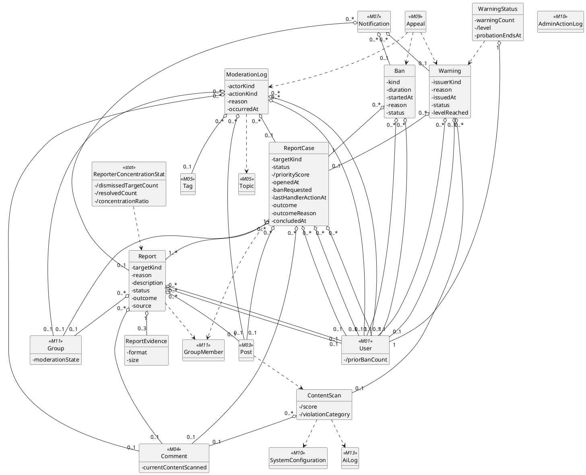

# Phân tích lớp thực thể — M08 Moderation

<!-- [Vietnamese Doc] Tài liệu tiếng Việt; tên lớp và thuộc tính viết tiếng Anh (input/CONVENTIONS.md mục 3). -->

| Mã tài liệu | EC-M08 |
|---|---|
| Dự án | iShare |
| Module | M08 — Moderation |
| Đầu vào | FR-M08 phiên bản 1.7 |
| Trạng thái | Bản nháp |
| Phiên bản | 0.3 |
| Ngày | 2026-11-18 |
| Tác giả | Phạm Văn Đức |

<!-- Quy ước chung cho mọi bảng dưới đây:
     - Không đổi tên cột, không xóa cột, không đổi số mục: tool đọc bảng theo số mục và tên cột.
     - Ô không có nội dung ghi "—".
     - Mục chưa tới bước làm thì để dòng "(Chưa làm — bước N)".
     - Cột Nguồn ghi mã trong FR: FR-M08-nn, FR-M08-nn.mm, BR-M08-nn, hoặc TN:<thuật ngữ> (mục 2.1 của FR).
     - Sơ đồ ở mục 4 do gen_puml.py sinh; không sửa tay. -->

## 1. Mô tả chức năng

### 1.1 Đoạn mô tả

(S1) Hệ thống quản lý báo cáo, vụ báo cáo, kết quả quét nội dung, cảnh cáo, ban và nhật ký kiểm duyệt để xử lý vi phạm trên bài viết, bình luận, tài khoản và nhóm. (S2) Hệ thống cho người dùng đã đăng nhập gửi báo cáo và lưu người báo cáo, loại đối tượng, đối tượng bị báo cáo, lý do, mô tả, ảnh bằng chứng và trạng thái Mở, rồi thêm báo cáo vào vụ đang mở của đối tượng hoặc mở vụ mới. (S3) Hệ thống cho Mod, Admin xem hàng chờ vụ báo cáo, gồm vụ có mục do AI tạo và vụ được đánh dấu yêu cầu ban, sắp theo điểm ưu tiên và thời điểm mở vụ, đồng thời ghi người giữ vụ và nhả vụ khi hết thời gian không thao tác tính từ thao tác cuối của người giữ. (S4) Hệ thống cho Mod, Admin xem báo cáo và bằng chứng trong vụ, nội dung bị báo cáo được giữ lại dù đã xóa hoặc Tự ẩn, lịch sử kết luận của đối tượng, chỉ số tập trung của từng người báo cáo và mức cảnh cáo hiện tại của người bị báo cáo, đồng thời dùng danh tính thật của tác giả bài ẩn danh hoặc đã vô hiệu hóa và xác định Owner là người bị báo cáo khi đối tượng là nhóm. (S5) Hệ thống cho Mod, Admin đang giữ vụ ghi kết luận Có xử lý hoặc Bác bỏ cùng lý do, người kết luận và thời điểm kết luận, đóng các báo cáo của vụ theo kết luận và chuyển kết quả cho M07 thông báo tới người báo cáo và người bị báo cáo theo quyền của từng bên. (S6) Hệ thống cho Mod, Admin đang giữ vụ ẩn bài viết hoặc bình luận vi phạm, cập nhật trạng thái kiểm duyệt của nội dung và cung cấp dữ liệu xử lý cho M03, M04 và M12. (S7) Hệ thống đưa bài viết Bị gắn cờ sau khi quét lại và bình luận bị AI ẩn cần xét vào vụ bằng mục do AI tạo với nhóm vi phạm, rồi cho Mod, Admin xét để giữ hoặc ẩn nội dung và quyết định cảnh cáo tác giả theo kết quả quét. (S8) Khi công tắc AI tổng và công tắc Moderation đều bật, hệ thống dùng số trả lời trong khoảng thời gian trượt của luồng để kích hoạt quét các bình luận chưa được quét với nội dung hiện tại, ghi nhận nội dung đã quét, dùng điểm cao nhất trong các nhóm vi phạm do M13 trả về để giữ nguyên, ẩn hoặc chuyển nội dung sang xét và gửi thông báo khi AI ẩn bình luận. (S9) Hệ thống tạo cảnh cáo do AI ra đối với từng nội dung có kết quả quét đạt ngưỡng tự cảnh cáo và đủ điều kiện, chuyển trường hợp tác giả là Mod sang Admin xét và đánh dấu vụ là yêu cầu ban khi người đang ở mức HEAVY bị xác định vi phạm tiếp. (S10) Hệ thống cho Mod, Admin đang giữ vụ ra cảnh cáo với người ra, lý do và vụ liên quan, cập nhật số lần cảnh cáo, mức cảnh cáo và thời gian thử thách của người bị cảnh cáo, rồi chuyển thông báo cảnh cáo kèm đường dẫn khiếu nại qua M07. (S11) Hệ thống cho Mod, Admin bỏ cảnh cáo do AI ra, giữ bản ghi với dấu đã bỏ, tính lại số lần và mức cảnh cáo theo số lần còn lại và giữ thời điểm kết thúc thử thách hiện tại. (S12) Hệ thống giảm mức cảnh cáo khi hết thời gian thử thách, cập nhật số lần và thời gian thử thách theo mức mới, cung cấp mức cảnh cáo để áp hạn chế và cho người dùng xem mức hiện tại cùng thời điểm kết thúc thử thách của chính mình. (S13) Hệ thống cho Mod, Admin đang giữ vụ tạo ban có thời hạn leo thang theo số lần đã bị ban hoặc ban vĩnh viễn, lưu lý do, người ban, thời điểm bắt đầu và trạng thái ban, chuyển tài khoản sang BANNED, báo M10 khi cần thu hồi vai trò Mod và gửi thông báo cùng email qua M07. (S14) Hệ thống ghi nhận ban tạm thời hết hạn và cho Mod, Admin gỡ ban đang hiệu lực trực tiếp trên tài khoản, chuyển ban đã gỡ sang Đã gỡ, đưa tài khoản về ACTIVE và chuyển sự kiện gỡ ban cho M07. (S15) Hệ thống ghi nhật ký kiểm duyệt với người làm, loại thao tác, đối tượng, lý do và thời điểm cho các thao tác kiểm duyệt thuộc phạm vi ghi nhật ký, gồm thao tác lên Tag và phân loại bài viết từ M05, giữ bản ghi vĩnh viễn và hỗ trợ tra cứu qua username của người làm đã xóa tài khoản. (S16) Hệ thống cho Admin xem và lọc nhật ký kiểm duyệt theo người làm, cho Mod xem các vụ chính mình xử lý và xem chi tiết thao tác của Mod khác khi đang xét khiếu nại liên quan từ M09. (S17) Hệ thống cho Mod, Admin đang giữ vụ báo cáo nhóm chuyển trạng thái kiểm duyệt của nhóm sang Bị ẩn hoặc Bị khóa, cho mở khóa về Bình thường, và cung cấp trạng thái cho M11 áp quyền xem và thao tác trong nhóm.

<!-- Một đoạn văn, mỗi câu đánh số (S1) (S2) … Xem steps/01-describe-functions.md. -->

### 1.2 Truy vết câu

| Câu | Nội dung tóm tắt | Nguồn |
|---|---|---|
| S1 | Phạm vi dữ liệu kiểm duyệt | FR-M08-01, FR-M08-05, FR-M08-08, FR-M08-10, FR-M08-14, FR-M08-16 |
| S2 | Lập báo cáo và nhập vụ | FR-M08-01.01, FR-M08-01.02, FR-M08-01.03, FR-M08-01.04 |
| S3 | Hàng chờ, điểm ưu tiên và quyền giữ vụ | FR-M08-01.05, FR-M08-02, FR-M08-02.02, FR-M08-02.07, FR-M08-02.08, FR-M08-03, FR-M08-03.08 |
| S4 | Chi tiết vụ, lịch sử và số liệu đánh giá | FR-M08-04, FR-M08-04.02, FR-M08-04.03, FR-M08-04.04, FR-M08-04.05, FR-M08-04.06, FR-M08-04.10 |
| S5 | Kết luận vụ và thông báo kết quả | FR-M08-05, FR-M08-05.01, FR-M08-05.02, FR-M08-05.04, FR-M08-05.05, FR-M08-05.06 |
| S6 | Ẩn bài viết hoặc bình luận vi phạm | FR-M08-06, FR-M08-06.01, FR-M08-06.02 |
| S7 | Mục do AI tạo và quyết định xét nội dung | FR-M08-04.09, FR-M08-07, FR-M08-07.05, FR-M08-07.09, FR-M08-08.05 |
| S8 | Kích hoạt quét luồng và xử lý kết quả | FR-M08-08, FR-M08-08.01, FR-M08-08.04, FR-M08-08.05, FR-M08-08.06, FR-M08-08.07, FR-M08-08.08, FR-M08-08.11, FR-M08-08.12 |
| S9 | Cảnh cáo AI, xét Mod và yêu cầu ban | FR-M08-09, FR-M08-09.01, FR-M08-09.08, FR-M08-09.11, FR-M08-09.12, FR-M08-14.11 |
| S10 | Lập cảnh cáo và cập nhật mức cảnh cáo | FR-M08-10, FR-M08-10.01, FR-M08-10.02, FR-M08-10.03 |
| S11 | Bỏ cảnh cáo AI và giữ dấu vết | FR-M08-11, FR-M08-11.03, FR-M08-11.04, FR-M08-11.05 |
| S12 | Giảm mức, áp hạn chế và xem mức cảnh cáo | FR-M08-12, FR-M08-12.02, FR-M08-12.04, FR-M08-12.05, FR-M08-13, FR-M08-13.01 |
| S13 | Tạo ban và cập nhật trạng thái tài khoản | FR-M08-14, FR-M08-14.01, FR-M08-14.02, FR-M08-14.03, FR-M08-14.04, FR-M08-14.05, FR-M08-14.12 |
| S14 | Hết hạn và gỡ ban | FR-M08-14.08, FR-M08-15, FR-M08-15.01, FR-M08-15.02, FR-M08-15.05 |
| S15 | Ghi và giữ nhật ký kiểm duyệt | FR-M08-16, FR-M08-16.01, FR-M08-16.02, FR-M08-16.03, FR-M08-16.04, FR-M08-16.05 |
| S16 | Xem nhật ký theo vai trò và vụ khiếu nại | FR-M08-17, FR-M08-17.01, FR-M08-17.02, FR-M08-17.03, FR-M08-17.06 |
| S17 | Ẩn, khóa và mở khóa nhóm | FR-M08-18, FR-M08-18.01, FR-M08-18.02, FR-M08-18.04, FR-M08-18.05, FR-M08-18.06, FR-M08-18.07 |

## 2. Danh từ và phân loại

### 2.1 Sổ danh từ

| # | Danh từ | Xuất hiện ở | Phân loại | Kết quả | Lý do |
|---|---|---|---|---|---|
| 1 | Kết quả quét nội dung | S1 | Lớp | ContentScan | T8, Kết quả dùng để quyết định xử lý nội dung. Nhật ký quyết định AI thô thuộc M13. FR-M08-08.08, FR-M08-08.11 |
| 2 | Cảnh cáo | S1 | Lớp | Warning | T8, Bản ghi cảnh cáo do AI, Mod hoặc Admin ra. FR-M08-09.01, FR-M08-10.01, FR-M08-11.04 |
| 3 | Ban | S1 | Lớp | Ban | T8, Bản ghi ban tạm thời hoặc vĩnh viễn. FR-M08-14.01, FR-M08-14.02, FR-M08-14.08, FR-M08-15.01 |
| 4 | Dòng nhật ký kiểm duyệt | S1 | Lớp | ModerationLog | T8, Bản ghi thao tác kiểm duyệt được giữ vĩnh viễn. FR-M08-16.01, FR-M08-16.03 |
| 5 | Bài viết | S1 | Lớp | Post | T4, Đối tượng báo cáo, quét và ẩn. FR-M08-01.02, FR-M08-06.01, FR-M08-07.09 |
| 6 | Bình luận | S1 | Lớp | Comment | T4, Đối tượng báo cáo, quét và ẩn. FR-M08-01.02, FR-M08-06.02, FR-M08-08.08 |
| 7 | Nhóm | S1 | Lớp | Group | T4, Đối tượng báo cáo, ẩn hoặc khóa. FR-M08-01.02, FR-M08-18.01, FR-M08-18.04 |
| 8 | Hệ thống | S1 | Loại bỏ | — | Trừu tượng, tác nhân xử lý. |
| 9 | Kiểm duyệt / vi phạm | S1 | Loại bỏ | — | Chung chung, được biểu diễn bằng báo cáo, kết quả quét và bản ghi xử lý cụ thể. |
| 10 | Báo cáo | S2 | Lớp | Report | T8, Mục do người dùng gửi hoặc AI tạo trong vụ báo cáo. FR-M08-01.02, FR-M08-07.09 |
| 11 | Vụ báo cáo | S2 | Lớp | ReportCase | T8, Tập hợp báo cáo về cùng đối tượng với vòng đời giữ và kết luận. FR-M08-01.03, FR-M08-05.01 |
| 12 | Ảnh bằng chứng | S2 | Lớp | ReportEvidence | T8, Từng ảnh bằng chứng gửi cùng báo cáo. FR-M08-01.02, FR-M08-01.10 |
| 13 | Tài khoản | S2 | Lớp | User | T4, Người báo cáo, người bị báo cáo, người giữ vụ hoặc người làm. FR-M08-01.02, FR-M08-03.01, FR-M08-16.01 |
| 14 | Loại đối tượng | S2 | Thuộc tính | Report.targetKind | T9, Bài viết, bình luận, người dùng hoặc nhóm. |
| 15 | Lý do báo cáo | S2 | Thuộc tính | Report.reason | T9, Một lý do theo loại đối tượng. Mục AI dùng nhóm vi phạm phát hiện. |
| 16 | Mô tả báo cáo | S2 | Thuộc tính | Report.description | T9, Bắt buộc khi chọn Khác. |
| 17 | Trạng thái báo cáo | S2 | Thuộc tính | Report.status | T9, Mở khi tạo, Đã xử lý khi kết luận vụ. |
| 18 | Đối tượng bị báo cáo / người bị báo cáo | S2 | Loại bỏ | — | Chung chung, vai trò của Post, Comment, User hoặc Group. Owner của nhóm được xác định qua ngữ cảnh thành viên. |
| 19 | Người giữ vụ / người kết luận / người báo cáo / Mod / Admin / tác giả / Owner | S2 | Loại bỏ | — | Chung chung, vai trò của User trong từng ngữ cảnh, được xét ở bước 3. |
| 20 | Điểm ưu tiên | S3 | Thuộc tính | ReportCase.priorityScore | T7, Mức nặng cao nhất của lý do + 2 × số báo cáo, tính cả mục AI. |
| 21 | Thời điểm mở vụ | S3 | Thuộc tính | ReportCase.openedAt | T9, Mốc dùng xếp vụ mở trước khi bằng điểm. |
| 22 | Dấu yêu cầu ban | S3 | Thuộc tính | ReportCase.banRequested | T9, Đánh dấu khi người đang ở mức HEAVY bị xác định vi phạm tiếp. |
| 23 | Thời điểm thao tác cuối | S3 | Thuộc tính | ReportCase.lastHandlerActionAt | T9, Dùng tính thời hạn 30 phút để nhả vụ. |
| 24 | Hàng chờ vụ báo cáo | S3 | Loại bỏ | — | Chung chung, tập các ReportCase đang Mở được sắp theo ưu tiên. |
| 25 | Thời gian không thao tác | S3 | Loại bỏ | — | Hằng số của BR-M08-09. Mốc cuối được giữ trên ReportCase. |
| 26 | Chỉ số tập trung của người báo cáo theo đối tượng | S4 | Lớp | ReporterConcentrationStat | T7, Nhóm số liệu tính khi xem vụ theo người báo cáo và đối tượng. FR-M08-04.04, BR-M08-19 |
| 27 | Chỉ số tập trung | S4 | Thuộc tính | ReporterConcentrationStat.concentrationRatio | T7, Số báo cáo bị bác bỏ về đối tượng chia tổng số báo cáo đã xử lý trong cửa sổ. Q-01 đã chọn A cho mẫu số 0, chờ cập nhật FR để áp dụng. |
| 28 | Lịch sử báo cáo | S4 | Loại bỏ | — | Chung chung, tập các vụ đã kết luận về cùng đối tượng theo BR-M08-11. |
| 29 | Nội dung bị báo cáo / nội dung đã xóa / nội dung Tự ẩn | S4 | Loại bỏ | — | Ngoài phạm vi module (M03, M04), dữ liệu gốc được đọc trong vụ. |
| 30 | Danh tính thật / bài ẩn danh / tài khoản vô hiệu hóa | S4 | Loại bỏ | — | Ngoài phạm vi module (M01, M11), dữ liệu nguồn để xác định tác giả. |
| 31 | Thông báo | S5 | Lớp | Notification | T4, Kết quả vụ và thông báo cảnh cáo, ban hoặc gỡ ban. FR-M08-05.04, FR-M08-09.05, FR-M08-14.04, FR-M08-15.02 |
| 32 | Kết luận của báo cáo | S5 | Thuộc tính | Report.outcome | T9, Có xử lý hoặc Bác bỏ theo kết luận vụ. |
| 33 | Kết luận vụ | S5 | Thuộc tính | ReportCase.outcome | T9, Có xử lý hoặc Bác bỏ khi đóng vụ. |
| 34 | Lý do kết luận | S5 | Thuộc tính | ReportCase.outcomeReason | T9, Bắt buộc khi kết luận. Có thể khác lý do báo cáo. |
| 35 | Thời điểm kết luận | S5 | Thuộc tính | ReportCase.concludedAt | T9, Mốc kết luận được lưu và dùng xét cửa sổ thống kê báo cáo. |
| 36 | Có xử lý / Bác bỏ | S5 | Loại bỏ | — | Giá trị của kết luận vụ hoặc báo cáo. |
| 37 | Quyền xem / quyền giữ vụ / quyền xử lý | S5 | Loại bỏ | — | Trừu tượng, ràng buộc quyền áp lên vụ và đối tượng đã có. |
| 38 | Ẩn bài viết hoặc bình luận | S6 | Loại bỏ | — | Hành động không lưu dấu vết riêng ngoài trạng thái nội dung và dòng ModerationLog. |
| 39 | Trạng thái kiểm duyệt bài viết / trạng thái kiểm duyệt bình luận | S6 | Loại bỏ | — | Ngoài phạm vi khai báo trùng thuộc tính, Post.moderationState và Comment.moderationState đã có trong EC-M03 và EC-M04. M08 cập nhật theo FR-M08-06.01/06.02. |
| 40 | Nguồn mục báo cáo | S7 | Thuộc tính | Report.source | T9, Phân biệt báo cáo người dùng và mục Hệ thống (AI). |
| 41 | Điểm quét | S7 | Thuộc tính | ContentScan.score | T7, Giá trị cao nhất trong bốn điểm nhóm do M13 trả về. |
| 42 | Nhóm vi phạm của kết quả quét | S7 | Thuộc tính | ContentScan.violationCategory | T7, Nhóm ứng với điểm quét cao nhất, dùng làm lý do mục AI. |
| 43 | Bị gắn cờ / Bị ẩn / Bị khóa / Bình thường | S7 | Loại bỏ | — | Giá trị trạng thái kiểm duyệt của đối tượng tương ứng. |
| 44 | Mục do AI tạo / mục Hệ thống AI | S7 | Loại bỏ | — | Chung chung, một Report có nguồn AI theo BR-M08-49. |
| 45 | AI / Hệ thống (AI) | S7 | Loại bỏ | — | Không lưu dưới dạng tài khoản, vai trò nguồn được biểu diễn trên Report, Warning và ModerationLog. |
| 46 | Cấu hình hệ thống | S8 | Lớp | SystemConfiguration | T4, Công tắc AI tổng và Moderation. FR-M08-08.10, FR-M08-09.07 |
| 47 | Dấu đã quét nội dung hiện tại | S8 | Thuộc tính | Comment.currentContentScanned | T9, Ghi khi quét xong. Sau sửa chỉ quét lại ở lần kích hoạt luồng kế tiếp. M08 bổ sung trên Comment. |
| 48 | Luồng bình luận / trả lời | S8 | Loại bỏ | — | Ngoài phạm vi module (M04), tập Comment và vai trò bình luận trong luồng dùng để kích hoạt quét. |
| 49 | Số trả lời trong khoảng thời gian trượt | S8 | Loại bỏ | — | Chung chung, số đếm từ thời điểm đăng trả lời để áp điều kiện kích hoạt quét, theo FR-M08-08.01. |
| 50 | Khoảng thời gian trượt / ngưỡng tốc độ | S8 | Loại bỏ | — | Hằng số nghiệp vụ của BR-M08-20, ngưỡng cụ thể hoãn theo FR nếu chưa chốt. |
| 51 | Công tắc AI tổng / công tắc Moderation | S8 | Loại bỏ | — | Ngoài phạm vi module (M10), cấu hình của SystemConfiguration. |
| 52 | Loại người ra cảnh cáo | S9 | Thuộc tính | Warning.issuerKind | T9, AI hoặc người có vai trò Mod hoặc Admin. Tài khoản người ra được xét ở bước 3. |
| 53 | Ngưỡng tự cảnh cáo / điểm từng nhóm vi phạm | S9 | Loại bỏ | — | Hằng số và đầu vào nguồn theo BR-M08-23/51, điểm từng nhóm do M13 cung cấp. |
| 54 | Khiếu nại | S10 | Lớp | Appeal | T4, Ngữ cảnh đối chiếu thao tác và lật quyết định kiểm duyệt. FR-M08-05.11, FR-M08-14.12, FR-M08-17.03 |
| 55 | Lý do cảnh cáo | S10 | Thuộc tính | Warning.reason | T9, Ghi lý do cảnh cáo theo nguồn xử lý. |
| 56 | Số lần cảnh cáo | S10 | Thuộc tính | WarningStatus.warningCount | T9, Cập nhật khi ra, bỏ hoặc lật cảnh cáo và đặt lại theo bậc khi hết thử thách. |
| 57 | Mức cảnh cáo | S10 | Thuộc tính | WarningStatus.level | T7, Xác định theo số lần hiện hành, gồm Sạch, LIGHT, MEDIUM, HEAVY. Hết thử thách giảm bậc và đặt lại số lần. |
| 58 | Đường dẫn khiếu nại / email | S10 | Loại bỏ | — | Ngoài phạm vi module (M07, M09), kênh và đường dẫn dùng để chuyển kết quả xử lý. |
| 59 | Trạng thái cảnh cáo | S11 | Thuộc tính | Warning.status | T9, Đang tính, Đã bỏ hoặc Bị lật. Giữ bản ghi. |
| 60 | Thời điểm kết thúc thử thách | S11 | Thuộc tính | WarningStatus.probationEndsAt | T9, Tính từ lúc ra cảnh cáo hoặc giảm mức theo BR-M08-29. Giữ mốc hiện tại khi bỏ hoặc lật cảnh cáo. |
| 61 | Dấu đã bỏ / Bị lật / Đang tính | S11 | Loại bỏ | — | Giá trị của Warning.status. |
| 62 | Trạng thái cảnh cáo của người dùng | S12 | Lớp | WarningStatus | T8, Số lần, mức và thời điểm hết thử thách hiện hành của tài khoản. FR-M08-09.04, FR-M08-11.03, FR-M08-12.04, FR-M08-13.01 |
| 63 | Sạch / LIGHT / MEDIUM / HEAVY | S12 | Loại bỏ | — | Giá trị của WarningStatus.level theo BR-M08-28. |
| 64 | Hạn chế theo mức cảnh cáo | S12 | Loại bỏ | — | Trừu tượng, quy tắc áp theo mức hiện hành tại các module sử dụng. |
| 65 | Loại ban | S13 | Thuộc tính | Ban.kind | T9, Tạm thời hoặc vĩnh viễn. |
| 66 | Thời hạn ban | S13 | Thuộc tính | Ban.duration | T9, Ban tạm thời theo thời hạn leo thang 30 hoặc 90 ngày. Ban vĩnh viễn không có thời hạn kết thúc. |
| 67 | Thời điểm bắt đầu ban | S13 | Thuộc tính | Ban.startedAt | T9, Ghi khi tạo ban. |
| 68 | Lý do ban | S13 | Thuộc tính | Ban.reason | T9, Dữ liệu ban và thông báo cho tài khoản bị ban. |
| 69 | Trạng thái ban | S13 | Thuộc tính | Ban.status | T9, Đang hiệu lực, Hết hạn, Đã gỡ hoặc Bị lật. |
| 70 | Số lần đã bị ban | S13 | Thuộc tính | User.priorBanCount | T7, Đếm ban từng có hiệu lực, gồm ban gỡ sớm và ban vĩnh viễn, loại ban bị lật do khiếu nại. M08 bổ sung trên User. |
| 71 | BANNED / ACTIVE / vai trò Mod bị thu hồi | S13 | Loại bỏ | — | Ngoài phạm vi module (M01, M10), trạng thái và vai trò tài khoản sau ban hoặc gỡ ban. |
| 72 | Ban tạm thời / ban vĩnh viễn / Đã gỡ / Hết hạn | S13 | Loại bỏ | — | Giá trị của Ban.kind và Ban.status. |
| 73 | Gỡ ban | S14 | Loại bỏ | — | Hành động không lưu dấu vết riêng ngoài trạng thái Ban và ModerationLog. |
| 74 | Tag | S15 | Lớp | Tag | T4, Đối tượng thao tác ghi nhật ký. FR-M08-16.02 |
| 75 | Topic | S15 | Lớp | Topic | T4, Phân loại bài được đổi trong thao tác ghi nhật ký. FR-M08-16.02 |
| 76 | Loại người làm | S15 | Thuộc tính | ModerationLog.actorKind | T9, Mod, Admin hoặc AI tại thời điểm thao tác. Tài khoản người làm được xét ở bước 3. |
| 77 | Loại thao tác | S15 | Thuộc tính | ModerationLog.actionKind | T9, Các thao tác thuộc BR-M08-39. |
| 78 | Lý do thao tác | S15 | Thuộc tính | ModerationLog.reason | T9, Ghi theo thao tác kiểm duyệt. |
| 79 | Thời điểm thao tác | S15 | Thuộc tính | ModerationLog.occurredAt | T9, Ghi khi thao tác phát sinh. Dòng nhật ký giữ vĩnh viễn. |
| 80 | Username của người làm | S15 | Loại bỏ | — | Ngoài phạm vi module (M01), User.username dùng tra cứu theo FR-M08-16.04. |
| 81 | Bộ lọc theo người làm | S16 | Loại bỏ | — | Giao diện, tiêu chí đọc ModerationLog theo người làm. |
| 82 | Trạng thái kiểm duyệt nhóm | S17 | Thuộc tính | Group.moderationState | T9, Bình thường, Bị khóa hoặc Bị ẩn. M08 bổ sung trên Group cho M11 áp quyền xem và thao tác. |
| 83 | Ẩn nhóm / khóa nhóm / mở khóa nhóm | S17 | Loại bỏ | — | Hành động không lưu dấu vết riêng ngoài trạng thái Group và ModerationLog. |
| 84 | Thành viên nhóm | Quét: FR-M08-01.11 | Lớp | GroupMember | T4, Tư cách thành viên và ngữ cảnh Owner khi xử lý báo cáo. FR-M08-01.11, FR-M08-04.10 |
| 85 | Nhật ký thao tác Admin | Quét: BR-M08-39 | Lớp | AdminActionLog | T4, Thao tác Admin còn được ghi tại M10. BR-M08-39 |
| 86 | Nhật ký AI | Quét: FR-M08-08.09 | Lớp | AiLog | T4, Nhật ký quyết định AI và kết quả thô theo mục 5.22. FR-M08-08.09, FR-M08-08.11 |
| 87 | Loại đối tượng của vụ | Quét: Dữ liệu nghiệp vụ | Thuộc tính | ReportCase.targetKind | T9, Cùng loại đối tượng của các báo cáo trong vụ. |
| 88 | Trạng thái vụ | Quét: Dữ liệu nghiệp vụ | Thuộc tính | ReportCase.status | T9, Mở hoặc Đã xử lý. |
| 89 | Định dạng ảnh | Quét: FR-M08-01.10 | Thuộc tính | ReportEvidence.format | T9, JPEG, PNG hoặc WebP. Tối đa 3 ảnh một báo cáo. |
| 90 | Kích thước ảnh | Quét: FR-M08-01.10 | Thuộc tính | ReportEvidence.size | T9, Tối đa 5 MB mỗi ảnh. |
| 91 | Thời điểm cảnh cáo | Quét: Dữ liệu nghiệp vụ | Thuộc tính | Warning.issuedAt | T9, Mốc ra cảnh cáo, căn cứ tính thời gian thử thách. |
| 92 | Mức đạt sau lần cảnh cáo | Quét: FR-M08-09.04, FR-M08-10.02 | Thuộc tính | Warning.levelReached | T9, Mức ngay sau khi ra cảnh cáo, dữ liệu cung cấp M15 tại mục 5.22. |
| 93 | Số báo cáo bị bác bỏ về đối tượng | Quét: BR-M08-19 | Thuộc tính | ReporterConcentrationStat.dismissedTargetCount | T7, Đếm báo cáo của người báo cáo về đúng đối tượng, đã xử lý trong cửa sổ 90 × 24 giờ. |
| 94 | Tổng số báo cáo đã xử lý | Quét: BR-M08-19 | Thuộc tính | ReporterConcentrationStat.resolvedCount | T7, Đếm mọi báo cáo đã xử lý của người báo cáo trong cùng cửa sổ. Mốc đúng 90 × 24 giờ trước lúc xem nằm ngoài cửa sổ. |
| 95 | Các giới hạn ảnh bằng chứng | Quét: BR-M08-03 | Loại bỏ | — | Hằng số của BR-M08-03, ghi tại ràng buộc ReportEvidence. |
| 96 | Cửa sổ 90 × 24 giờ | Quét: BR-M08-19 | Loại bỏ | — | Hằng số của phép tính chỉ số tập trung. |
| 97 | Số báo cáo trong vụ / mức nặng cao nhất | Quét: BR-M08-06 | Loại bỏ | — | Chung chung, thành phần phép tính ReportCase.priorityScore. |
| 98 | Thời lượng thử thách theo mức | Quét: BR-M08-29 | Loại bỏ | — | Hằng số của BR-M08-29, dùng tính mốc kết thúc thử thách. |

Có 98 dòng, gồm 21 dòng thành lớp, 42 dòng thành thuộc tính và 35 dòng bị loại. Lượt quét bổ sung 15 dòng.

### 2.2 Lớp

| Lớp | Tên tiếng Việt | Nhóm | Sở hữu | Mô tả | Nguồn |
|---|---|---|---|---|---|
| Report | Báo cáo | Thực thể | M08 | Mục do người dùng gửi hoặc AI tạo trong vụ báo cáo. | FR-M08-01.02, FR-M08-07.09 |
| ReportCase | Vụ báo cáo | Thực thể | M08 | Tập hợp báo cáo về cùng đối tượng với vòng đời giữ và kết luận. | FR-M08-01.03, FR-M08-05.01 |
| ReportEvidence | Ảnh bằng chứng | Thực thể | M08 | Từng ảnh bằng chứng gửi cùng báo cáo. | FR-M08-01.02, FR-M08-01.10 |
| ContentScan | Kết quả quét nội dung | Thực thể | M08 | Kết quả dùng để quyết định xử lý nội dung. Nhật ký quyết định AI thô thuộc M13. | FR-M08-08.08, FR-M08-08.11 |
| Warning | Cảnh cáo | Thực thể | M08 | Bản ghi cảnh cáo do AI, Mod hoặc Admin ra. | FR-M08-09.01, FR-M08-10.01, FR-M08-11.04 |
| WarningStatus | Trạng thái cảnh cáo của người dùng | Thực thể | M08 | Số lần, mức và thời điểm hết thử thách hiện hành của tài khoản. | FR-M08-09.04, FR-M08-11.03, FR-M08-12.04, FR-M08-13.01 |
| Ban | Ban | Thực thể | M08 | Bản ghi ban tạm thời hoặc vĩnh viễn. | FR-M08-14.01, FR-M08-14.02, FR-M08-14.08, FR-M08-15.01 |
| ModerationLog | Dòng nhật ký kiểm duyệt | Thực thể | M08 | Bản ghi thao tác kiểm duyệt được giữ vĩnh viễn. | FR-M08-16.01, FR-M08-16.03 |
| ReporterConcentrationStat | Chỉ số tập trung của người báo cáo theo đối tượng | Thống kê | M08 | Nhóm số liệu tính khi xem vụ theo người báo cáo và đối tượng. | FR-M08-04.04, BR-M08-19 |
| User | Tài khoản | Thực thể | M01 | Người báo cáo, người bị báo cáo, người giữ vụ hoặc người làm. | FR-M08-01.02, FR-M08-03.01, FR-M08-16.01 |
| Post | Bài viết | Thực thể | M03 | Đối tượng báo cáo, quét và ẩn. | FR-M08-01.02, FR-M08-06.01, FR-M08-07.09 |
| Comment | Bình luận | Thực thể | M04 | Đối tượng báo cáo, quét và ẩn. | FR-M08-01.02, FR-M08-06.02, FR-M08-08.08 |
| Group | Nhóm | Thực thể | M11 | Đối tượng báo cáo, ẩn hoặc khóa. | FR-M08-01.02, FR-M08-18.01, FR-M08-18.04 |
| GroupMember | Thành viên nhóm | Thực thể | M11 | Tư cách thành viên và ngữ cảnh Owner khi xử lý báo cáo. | FR-M08-01.11, FR-M08-04.10 |
| Tag | Tag | Thực thể | M05 | Đối tượng thao tác ghi nhật ký. | FR-M08-16.02 |
| Topic | Topic | Thực thể | M05 | Phân loại bài được đổi trong thao tác ghi nhật ký. | FR-M08-16.02 |
| Appeal | Khiếu nại | Thực thể | M09 | Ngữ cảnh đối chiếu thao tác và lật quyết định kiểm duyệt. | FR-M08-05.11, FR-M08-14.12, FR-M08-17.03 |
| Notification | Thông báo | Thực thể | M07 | Kết quả vụ và thông báo cảnh cáo, ban hoặc gỡ ban. | FR-M08-05.04, FR-M08-09.05, FR-M08-14.04, FR-M08-15.02 |
| SystemConfiguration | Cấu hình hệ thống | Thực thể | M10 | Công tắc AI tổng và Moderation. | FR-M08-08.10, FR-M08-09.07 |
| AdminActionLog | Nhật ký thao tác Admin | Thực thể | M10 | Thao tác Admin còn được ghi tại M10. | BR-M08-39 |
| AiLog | Nhật ký AI | Thực thể | M13 | Nhật ký quyết định AI và kết quả thô theo mục 5.22. | FR-M08-08.09, FR-M08-08.11 |

M08 sở hữu 9 lớp, gồm 8 thực thể và một lớp thống kê. Tên Report, ContentScan, Warning, Ban và ModerationLog dùng lại từ các EC đã tham chiếu. Các lớp ngoài thuộc M09, M10, M11 và M13 chờ đối chiếu với EC của module sở hữu.

### 2.3 Thuộc tính

| Lớp | Thuộc tính | Tên tiếng Việt | Tính chất | Ràng buộc nguồn nêu | Nguồn |
|---|---|---|---|---|---|
| Report | targetKind | Loại đối tượng | Lưu | Bài viết, bình luận, người dùng hoặc nhóm. | FR-M08-01.02 |
| Report | reason | Lý do báo cáo | Lưu | Một lý do theo loại đối tượng. Mục AI dùng nhóm vi phạm phát hiện. | FR-M08-01.19, FR-M08-04.09, BR-M08-02, BR-M08-49 |
| Report | description | Mô tả báo cáo | Lưu | Bắt buộc khi chọn Khác. | FR-M08-01.02, FR-M08-01.08 |
| Report | status | Trạng thái báo cáo | Lưu | Mở khi tạo, Đã xử lý khi kết luận vụ. | FR-M08-01.02, FR-M08-05.02 |
| Report | outcome | Kết luận của báo cáo | Lưu | Có xử lý hoặc Bác bỏ theo kết luận vụ. | FR-M08-05.01, FR-M08-05.02 |
| Report | source | Nguồn mục báo cáo | Lưu | Phân biệt báo cáo người dùng và mục Hệ thống (AI). | FR-M08-01.02, FR-M08-04.09, FR-M08-07.09 |
| ReportCase | targetKind | Loại đối tượng của vụ | Lưu | Cùng loại đối tượng của các báo cáo trong vụ. | FR-M08-01.03, FR-M08-01.04 |
| ReportCase | status | Trạng thái vụ | Lưu | Mở hoặc Đã xử lý. | FR-M08-02.01, FR-M08-05.01 |
| ReportCase | priorityScore | Điểm ưu tiên | Dẫn xuất | Mức nặng cao nhất của lý do + 2 × số báo cáo, tính cả mục AI. | FR-M08-01.05, BR-M08-06 |
| ReportCase | openedAt | Thời điểm mở vụ | Lưu | Mốc dùng xếp vụ mở trước khi bằng điểm. | FR-M08-01.04, FR-M08-02.07 |
| ReportCase | banRequested | Dấu yêu cầu ban | Lưu | Đánh dấu khi người đang ở mức HEAVY bị xác định vi phạm tiếp. | FR-M08-02.08, FR-M08-14.11 |
| ReportCase | lastHandlerActionAt | Thời điểm thao tác cuối | Lưu | Dùng tính thời hạn 30 phút để nhả vụ. | FR-M08-03.04, FR-M08-03.08 |
| ReportCase | outcome | Kết luận vụ | Lưu | Có xử lý hoặc Bác bỏ khi đóng vụ. | FR-M08-05.01 |
| ReportCase | outcomeReason | Lý do kết luận | Lưu | Bắt buộc khi kết luận. Có thể khác lý do báo cáo. | FR-M08-05.01, FR-M08-05.03, FR-M08-05.09 |
| ReportCase | concludedAt | Thời điểm kết luận | Lưu | Mốc kết luận được lưu và dùng xét cửa sổ thống kê báo cáo. | FR-M08-05.01, BR-M08-19 |
| ReportEvidence | format | Định dạng ảnh | Lưu | JPEG, PNG hoặc WebP. Tối đa 3 ảnh một báo cáo. | FR-M08-01.09, FR-M08-01.10, BR-M08-03 |
| ReportEvidence | size | Kích thước ảnh | Lưu | Tối đa 5 MB mỗi ảnh. | FR-M08-01.10, BR-M08-03 |
| ContentScan | score | Điểm quét | Dẫn xuất | Giá trị cao nhất trong bốn điểm nhóm do M13 trả về. | FR-M08-08.11, BR-M08-51 |
| ContentScan | violationCategory | Nhóm vi phạm của kết quả quét | Dẫn xuất | Nhóm ứng với điểm quét cao nhất, dùng làm lý do mục AI. | FR-M08-04.09, BR-M08-49, BR-M08-51 |
| Warning | issuerKind | Loại người ra cảnh cáo | Lưu | AI hoặc người có vai trò Mod hoặc Admin. Tài khoản người ra được xét ở bước 3. | FR-M08-09.01, FR-M08-10.01 |
| Warning | reason | Lý do cảnh cáo | Lưu | Ghi lý do cảnh cáo theo nguồn xử lý. | FR-M08-10.01 |
| Warning | issuedAt | Thời điểm cảnh cáo | Lưu | Mốc ra cảnh cáo, căn cứ tính thời gian thử thách. | FR-M08-09.04, BR-M08-29 |
| Warning | status | Trạng thái cảnh cáo | Lưu | Đang tính, Đã bỏ hoặc Bị lật. Giữ bản ghi. | FR-M08-11.04, BR-M08-54 |
| Warning | levelReached | Mức đạt sau lần cảnh cáo | Lưu | Mức ngay sau khi ra cảnh cáo, dữ liệu cung cấp M15 tại mục 5.22. | FR-M08-09.04, FR-M08-10.02 |
| WarningStatus | warningCount | Số lần cảnh cáo | Lưu | Cập nhật khi ra, bỏ hoặc lật cảnh cáo và đặt lại theo bậc khi hết thử thách. | FR-M08-09.04, FR-M08-11.03, FR-M08-12.04, BR-M08-54 |
| WarningStatus | level | Mức cảnh cáo | Dẫn xuất | Xác định theo số lần hiện hành, gồm Sạch, LIGHT, MEDIUM, HEAVY. Hết thử thách giảm bậc và đặt lại số lần. | FR-M08-09.04, FR-M08-12.01, FR-M08-12.04, BR-M08-28 |
| WarningStatus | probationEndsAt | Thời điểm kết thúc thử thách | Lưu | Tính từ lúc ra cảnh cáo hoặc giảm mức theo BR-M08-29. Giữ mốc hiện tại khi bỏ hoặc lật cảnh cáo. | FR-M08-11.05, FR-M08-12.03, FR-M08-12.05, BR-M08-29, BR-M08-54 |
| Ban | kind | Loại ban | Lưu | Tạm thời hoặc vĩnh viễn. | FR-M08-14.01, FR-M08-14.02, BR-M08-34 |
| Ban | duration | Thời hạn ban | Lưu | Ban tạm thời theo thời hạn leo thang 30 hoặc 90 ngày. Ban vĩnh viễn không có thời hạn kết thúc. | FR-M08-14.01, FR-M08-14.02, BR-M08-34 |
| Ban | startedAt | Thời điểm bắt đầu ban | Lưu | Ghi khi tạo ban. | FR-M08-14.01 |
| Ban | reason | Lý do ban | Lưu | Dữ liệu ban và thông báo cho tài khoản bị ban. | FR-M08-14.01, FR-M08-14.04 |
| Ban | status | Trạng thái ban | Lưu | Đang hiệu lực, Hết hạn, Đã gỡ hoặc Bị lật. | FR-M08-14.01, FR-M08-14.08, FR-M08-15.01, BR-M08-34 |
| ModerationLog | actorKind | Loại người làm | Lưu | Mod, Admin hoặc AI tại thời điểm thao tác. Tài khoản người làm được xét ở bước 3. | FR-M08-16.01, BR-M08-39 |
| ModerationLog | actionKind | Loại thao tác | Lưu | Các thao tác thuộc BR-M08-39. | FR-M08-16.01, FR-M08-16.02, FR-M08-16.05, BR-M08-39 |
| ModerationLog | reason | Lý do thao tác | Lưu | Ghi theo thao tác kiểm duyệt. | FR-M08-16.01, BR-M08-39 |
| ModerationLog | occurredAt | Thời điểm thao tác | Lưu | Ghi khi thao tác phát sinh. Dòng nhật ký giữ vĩnh viễn. | FR-M08-16.01, FR-M08-16.03 |
| ReporterConcentrationStat | dismissedTargetCount | Số báo cáo bị bác bỏ về đối tượng | Dẫn xuất | Đếm báo cáo của người báo cáo về đúng đối tượng, đã xử lý trong cửa sổ 90 × 24 giờ. | FR-M08-04.04, BR-M08-19 |
| ReporterConcentrationStat | resolvedCount | Tổng số báo cáo đã xử lý | Dẫn xuất | Đếm mọi báo cáo đã xử lý của người báo cáo trong cùng cửa sổ. Mốc đúng 90 × 24 giờ trước lúc xem nằm ngoài cửa sổ. | FR-M08-04.04, BR-M08-19 |
| ReporterConcentrationStat | concentrationRatio | Chỉ số tập trung | Dẫn xuất | Số báo cáo bị bác bỏ về đối tượng chia tổng số báo cáo đã xử lý trong cửa sổ. Q-01 đã chọn A cho mẫu số 0, chờ cập nhật FR để áp dụng. | FR-M08-04.04, BR-M08-19 |
| Comment | currentContentScanned | Dấu đã quét nội dung hiện tại | Lưu | Ghi khi quét xong. Sau sửa chỉ quét lại ở lần kích hoạt luồng kế tiếp. M08 bổ sung trên Comment. | FR-M08-08.01, FR-M08-08.03, FR-M08-08.08, BR-M08-21 |
| Group | moderationState | Trạng thái kiểm duyệt nhóm | Lưu | Bình thường, Bị khóa hoặc Bị ẩn. M08 bổ sung trên Group cho M11 áp quyền xem và thao tác. | FR-M08-18.01, FR-M08-18.04, FR-M08-18.07 |
| User | priorBanCount | Số lần đã bị ban | Dẫn xuất | Đếm ban từng có hiệu lực, gồm ban gỡ sớm và ban vĩnh viễn, loại ban bị lật do khiếu nại. M08 bổ sung trên User. | FR-M08-14.12, BR-M08-34 |

M08 ghi ba mục bổ sung trên lớp ngoài là Comment.currentContentScanned, Group.moderationState và User.priorBanCount. Trạng thái kiểm duyệt Post và Comment đã được khai báo tại EC-M03 và EC-M04. Người ra, người nhận xử lý, người giữ và đối tượng được báo cáo là các vai trò tham chiếu để xét ở bước 3.

### 2.4 Đối chiếu với mục Dữ liệu nghiệp vụ của FR

| Thực thể trong FR | Trong mô hình | Xử lý |
|---|---|---|
| Báo cáo | Report, ReportEvidence | Khớp dữ liệu báo cáo. Từng ảnh được xét riêng do mỗi ảnh có kích thước và định dạng theo BR-M08-03. Mục do AI tạo được biểu diễn bằng nguồn của Report. |
| Vụ báo cáo | ReportCase | Khớp dữ liệu vụ và điểm ưu tiên dẫn xuất. Người giữ, người kết luận và danh sách báo cáo được xét như đối tượng ở bước 3. |
| Cảnh cáo | Warning | Khớp dữ liệu cảnh cáo. Bổ sung mức đạt sau khi ra cảnh cáo theo giao tiếp M15 tại mục 5.22. |
| Trạng thái cảnh cáo của người dùng | WarningStatus | Khớp số lần và mốc thử thách. Mức hiện hành dẫn xuất từ số lần theo BR-M08-28 và quy tắc cập nhật FR-M08-12.04. |
| Ban | Ban | Khớp loại, thời hạn, trạng thái và dữ liệu bắt đầu ban. Số lần từng bị ban được tính trên tài khoản theo BR-M08-34. |
| Dòng nhật ký kiểm duyệt | ModerationLog | Khớp dữ liệu dòng nhật ký và yêu cầu giữ vĩnh viễn. Tài khoản và đối tượng thao tác được xét ở bước 3. |
| Dữ liệu quét và trạng thái nhóm ở mục 5.20 | ContentScan, Comment.currentContentScanned, Group.moderationState | ContentScan biểu diễn điểm quét và nhóm vi phạm được rút ra theo BR-M08-51, kết quả thô thuộc nhật ký AI M13. Dấu quét và trạng thái nhóm được khai báo bổ sung trên lớp ngoài. |
| Dữ liệu tính theo BR-M08-19 | ReporterConcentrationStat | Mô hình có thêm nhóm số liệu dẫn xuất theo người báo cáo và đối tượng của vụ đang xem. Nhánh mẫu số 0 đã chọn A tại Q-01 và chờ cập nhật FR. |

## 3. Quan hệ giữa các lớp

### 3.1 Ma trận cặp lớp

| Lớp | 01 | 02 | 03 | 04 | 05 | 06 | 07 | 08 | 09 | 10 | 11 | 12 | 13 | 14 | 15 | 16 | 17 | 18 | 19 | 20 |
| --- | --- | --- | --- | --- | --- | --- | --- | --- | --- | --- | --- | --- | --- | --- | --- | --- | --- | --- | --- | --- |
| 01 Report |  | T | T |  |  |  |  |  | T | T | T | T | T |  |  |  | T |  |  |  |
| 02 ReportCase |  |  |  |  | T |  | T | T | T | T | T | T | T |  |  |  |  |  |  |  |
| 03 ReportEvidence |  |  |  |  |  |  |  |  |  |  |  |  |  |  |  |  |  |  |  |  |
| 04 ContentScan |  |  |  |  | T |  |  |  |  | T | T |  |  |  |  |  |  | T |  | T |
| 05 Warning |  |  |  |  |  | T |  |  | T |  |  |  |  |  |  | T | T |  |  |  |
| 06 WarningStatus |  |  |  |  |  |  |  |  | T |  |  |  |  |  |  |  |  |  |  |  |
| 07 Ban |  |  |  |  |  |  |  |  | T |  |  |  |  |  |  | T | T |  |  |  |
| 08 ModerationLog |  |  |  |  |  |  |  |  | T | T | T | T |  | T | T | T |  |  |  |  |
| 09 User |  |  |  |  |  |  |  |  |  |  |  |  |  |  |  |  |  |  |  |  |
| 10 Post |  |  |  |  |  |  |  |  |  |  |  |  |  |  |  |  |  |  |  |  |
| 11 Comment |  |  |  |  |  |  |  |  |  |  |  |  |  |  |  |  |  |  |  |  |
| 12 Group |  |  |  |  |  |  |  |  |  |  |  |  |  |  |  |  |  |  |  |  |
| 13 GroupMember |  |  |  |  |  |  |  |  |  |  |  |  |  |  |  |  |  |  |  |  |
| 14 Tag |  |  |  |  |  |  |  |  |  |  |  |  |  |  |  |  |  |  |  |  |
| 15 Topic |  |  |  |  |  |  |  |  |  |  |  |  |  |  |  |  |  |  |  |  |
| 16 Appeal |  |  |  |  |  |  |  |  |  |  |  |  |  |  |  |  |  |  |  |  |
| 17 Notification |  |  |  |  |  |  |  |  |  |  |  |  |  |  |  |  |  |  |  |  |
| 18 SystemConfiguration |  |  |  |  |  |  |  |  |  |  |  |  |  |  |  |  |  |  |  |  |
| 19 AdminActionLog |  |  |  |  |  |  |  |  |  |  |  |  |  |  |  |  |  |  |  |  |
| 20 AiLog |  |  |  |  |  |  |  |  |  |  |  |  |  |  |  |  |  |  |  |  |

T biểu thị cặp trực tiếp. Một ô T có thể tương ứng nhiều dòng khi hai lớp có nhiều vai trò. ReporterConcentrationStat được xét riêng trong quan hệ Phụ thuộc ở mục 3.4 theo quy tắc lớp thống kê. Các cặp hai lớp ngoài thuộc phạm vi module sở hữu.

### 3.2 Quan hệ số lượng

| Cặp | Câu A → B | Câu B → A | Dạng | Xử lý |
| --- | --- | --- | --- | --- |
| ReportCase – Report (R-M08-01) | Một ReportCase ứng với 1..* Report trong vai trò của R-M08-01. | Một Report ứng với 1 ReportCase trong cùng vai trò. | 1-n | Giữ nguyên |
| Report – ReportEvidence (R-M08-02) | Một Report ứng với 0..3 ReportEvidence trong vai trò của R-M08-02. | Một ReportEvidence ứng với 1 Report trong cùng vai trò. | 1-n | Giữ nguyên |
| User – Report (R-M08-03) | Một User ứng với 0..* Report trong vai trò của R-M08-03. | Một Report ứng với 0..1 User trong cùng vai trò. | 1-n | Giữ nguyên |
| Post – Report (R-M08-04) | Một Post ứng với 0..* Report trong vai trò của R-M08-04. | Một Report ứng với 0..1 Post trong cùng vai trò. | 1-n | Giữ nguyên |
| Post – ReportCase (R-M08-05) | Một Post ứng với 0..* ReportCase trong vai trò của R-M08-05. | Một ReportCase ứng với 0..1 Post trong cùng vai trò. | 1-n | Giữ nguyên |
| Comment – Report (R-M08-06) | Một Comment ứng với 0..* Report trong vai trò của R-M08-06. | Một Report ứng với 0..1 Comment trong cùng vai trò. | 1-n | Giữ nguyên |
| Comment – ReportCase (R-M08-07) | Một Comment ứng với 0..* ReportCase trong vai trò của R-M08-07. | Một ReportCase ứng với 0..1 Comment trong cùng vai trò. | 1-n | Giữ nguyên |
| User – Report (R-M08-08) | Một User ứng với 0..* Report trong vai trò của R-M08-08. | Một Report ứng với 0..1 User trong cùng vai trò. | 1-n | Giữ nguyên |
| User – ReportCase (R-M08-09) | Một User ứng với 0..* ReportCase trong vai trò của R-M08-09. | Một ReportCase ứng với 0..1 User trong cùng vai trò. | 1-n | Giữ nguyên |
| Group – Report (R-M08-10) | Một Group ứng với 0..* Report trong vai trò của R-M08-10. | Một Report ứng với 0..1 Group trong cùng vai trò. | 1-n | Giữ nguyên |
| Group – ReportCase (R-M08-11) | Một Group ứng với 0..* ReportCase trong vai trò của R-M08-11. | Một ReportCase ứng với 0..1 Group trong cùng vai trò. | 1-n | Giữ nguyên |
| User – ReportCase (R-M08-12) | Một User ứng với 0..* ReportCase trong vai trò của R-M08-12. | Một ReportCase ứng với 0..1 User trong cùng vai trò. | 1-n | Giữ nguyên |
| User – ReportCase (R-M08-13) | Một User ứng với 0..* ReportCase trong vai trò của R-M08-13. | Một ReportCase ứng với 0..1 User trong cùng vai trò. | 1-n | Giữ nguyên |
| User – WarningStatus (R-M08-14) | Một User ứng với 1 WarningStatus trong vai trò của R-M08-14. | Một WarningStatus ứng với 1 User trong cùng vai trò. | 1-1 | Giữ: hai lớp có dữ liệu, phạm vi sử dụng hoặc module sở hữu riêng. |
| User – Warning (R-M08-15) | Một User ứng với 0..* Warning trong vai trò của R-M08-15. | Một Warning ứng với 1 User trong cùng vai trò. | 1-n | Giữ nguyên |
| User – Warning (R-M08-16) | Một User ứng với 0..* Warning trong vai trò của R-M08-16. | Một Warning ứng với 0..1 User trong cùng vai trò. | 1-n | Giữ nguyên |
| ReportCase – Warning (R-M08-17) | Một ReportCase ứng với 0..* Warning trong vai trò của R-M08-17. | Một Warning ứng với 0..1 ReportCase trong cùng vai trò. | 1-n | Giữ nguyên |
| ContentScan – Warning (R-M08-18) | Một ContentScan ứng với 0..1 Warning trong vai trò của R-M08-18. | Một Warning ứng với 0..1 ContentScan trong cùng vai trò. | 1-1 | Giữ: hai lớp có dữ liệu, phạm vi sử dụng hoặc module sở hữu riêng. |
| User – Ban (R-M08-19) | Một User ứng với 0..* Ban trong vai trò của R-M08-19. | Một Ban ứng với 1 User trong cùng vai trò. | 1-n | Giữ nguyên |
| User – Ban (R-M08-20) | Một User ứng với 0..* Ban trong vai trò của R-M08-20. | Một Ban ứng với 1 User trong cùng vai trò. | 1-n | Giữ nguyên |
| ReportCase – Ban (R-M08-21) | Một ReportCase ứng với 0..* Ban trong vai trò của R-M08-21. | Một Ban ứng với 1 ReportCase trong cùng vai trò. | 1-n | Giữ nguyên |
| Comment – ContentScan (R-M08-22) | Một Comment ứng với 0..* ContentScan trong vai trò của R-M08-22. | Một ContentScan ứng với 0..1 Comment trong cùng vai trò. | 1-n | Giữ nguyên |
| User – ModerationLog (R-M08-23) | Một User ứng với 0..* ModerationLog trong vai trò của R-M08-23. | Một ModerationLog ứng với 0..1 User trong cùng vai trò. | 1-n | Giữ nguyên |
| Post – ModerationLog (R-M08-24) | Một Post ứng với 0..* ModerationLog trong vai trò của R-M08-24. | Một ModerationLog ứng với 0..1 Post trong cùng vai trò. | 1-n | Giữ nguyên |
| Comment – ModerationLog (R-M08-25) | Một Comment ứng với 0..* ModerationLog trong vai trò của R-M08-25. | Một ModerationLog ứng với 0..1 Comment trong cùng vai trò. | 1-n | Giữ nguyên |
| User – ModerationLog (R-M08-26) | Một User ứng với 0..* ModerationLog trong vai trò của R-M08-26. | Một ModerationLog ứng với 0..1 User trong cùng vai trò. | 1-n | Giữ nguyên |
| Group – ModerationLog (R-M08-27) | Một Group ứng với 0..* ModerationLog trong vai trò của R-M08-27. | Một ModerationLog ứng với 0..1 Group trong cùng vai trò. | 1-n | Giữ nguyên |
| Tag – ModerationLog (R-M08-28) | Một Tag ứng với 0..* ModerationLog trong vai trò của R-M08-28. | Một ModerationLog ứng với 0..1 Tag trong cùng vai trò. | 1-n | Giữ nguyên |
| ReportCase – ModerationLog (R-M08-29) | Một ReportCase ứng với 0..* ModerationLog trong vai trò của R-M08-29. | Một ModerationLog ứng với 0..1 ReportCase trong cùng vai trò. | 1-n | Giữ nguyên |
| Report – Notification (R-M08-30) | Một Report ứng với 0..* Notification trong vai trò của R-M08-30. | Một Notification ứng với 0..1 Report trong cùng vai trò. | 1-n | Giữ nguyên |
| Warning – Notification (R-M08-31) | Một Warning ứng với 0..* Notification trong vai trò của R-M08-31. | Một Notification ứng với 0..1 Warning trong cùng vai trò. | 1-n | Giữ nguyên |
| Ban – Notification (R-M08-32) | Một Ban ứng với 0..* Notification trong vai trò của R-M08-32. | Một Notification ứng với 0..1 Ban trong cùng vai trò. | 1-n | Giữ nguyên |

| ID quan hệ Phụ thuộc | Câu đọc |
| --- | --- |
| R-M08-33 | Bài viết dùng điểm quét và nhóm vi phạm để quyết định trạng thái, khớp R-M03-21. |
| R-M08-34 | Kết quả nghiệp vụ dùng dữ liệu điểm từ kết quả thô và nhật ký AI do M13 quản lý. |
| R-M08-35 | Quét luồng cần công tắc AI tổng và Moderation. |
| R-M08-36 | Tiếp nhận báo cáo dùng tư cách thành viên và quyền xem nội dung nhóm Private. |
| R-M08-37 | Vụ báo cáo nhóm xác định Owner là người bị báo cáo. |
| R-M08-38 | Chỉ số dùng lịch sử báo cáo đã xử lý, kết luận và thời điểm kết luận của vụ để tính theo người báo cáo và đối tượng. |
| R-M08-39 | Việc ra, bỏ hoặc lật cảnh cáo làm thay số lần và mức cảnh cáo hiện hành. |
| R-M08-40 | Nhật ký thay phân loại bài dùng thông tin Topic từ thao tác M05. Đối tượng của thao tác là bài. |
| R-M08-41 | Xét khiếu nại cần xem chi tiết thao tác liên quan của Mod khác. |
| R-M08-42 | Kết quả khiếu nại thành công được dùng để lật cảnh cáo và tính lại mức hiện hành. |
| R-M08-43 | Khiếu nại ban dùng bản ghi ban, kết quả lật ban loại bản ghi khỏi số lần từng bị ban. |

- Report và ReportCase có đúng một đối tượng trong bốn loại Post, Comment, User, Group. Loại và đối tượng của Report trùng với vụ chứa báo cáo. Một đối tượng có tối đa một vụ Mở tại một thời điểm theo BR-M08-05.
- Tài khoản người báo cáo, người giữ vụ, người kết luận, người ra cảnh cáo, người bị cảnh cáo, người ra ban, người bị ban và người làm nhật ký là các vai trò riêng. AI là nguồn của bản ghi, các đầu tài khoản của người làm có thể vắng theo loại nguồn.
- Ban có tối đa một bản ghi Đang hiệu lực mỗi tài khoản theo FR-M08-14.13. Bội số 0..* bao quát lịch sử.
- WarningStatus có một trạng thái nghiệp vụ hiện hành mỗi tài khoản, gồm mức Sạch. Quan hệ ContentScan–Warning được xét trên kết quả của từng nội dung, một lượt quét luồng có thể cho nhiều kết quả theo FR-M08-09.12.
- ReportEvidence được giữ cùng dữ liệu báo cáo. FR xác định giới hạn 0..3 ảnh và giữ báo cáo, nên quan hệ được ghi Kết tập theo căn cứ vòng đời hiện có.
- ReporterConcentrationStat tính theo người báo cáo, đối tượng của vụ đang xem và thời điểm xem qua lịch sử Report. Quy tắc hiển thị khi chưa có báo cáo đã xử lý chờ cập nhật FR theo Q-01 chọn A.

### 3.3 Lớp liên kết

Bước 3 giữ 21 lớp. Các cặp đã định lượng có dạng 1-1 hoặc 1-n. Nhóm số liệu chỉ số tập trung được tính khi xem, thể hiện bằng một Phụ thuộc vào Report.

### 3.4 Quan hệ

| ID | Lớp A | Bội số A | Lớp B | Bội số B | Dạng | Loại | Bên chính | Căn cứ | Nguồn |
| --- | --- | --- | --- | --- | --- | --- | --- | --- | --- |
| R-M08-01 | ReportCase | 1 | Report | 1..* | 1-n | Kết tập | ReportCase | Vụ gồm các báo cáo cùng đối tượng và giữ lại để xem lịch sử. | FR-M08-01.03, FR-M08-01.04, FR-M08-05.02 |
| R-M08-02 | Report | 1 | ReportEvidence | 0..3 | 1-n | Kết tập | Report | Báo cáo chứa từng ảnh bằng chứng. FR quy định giữ báo cáo sau khi gửi. | FR-M08-01.02, FR-M08-01.18, BR-M08-03 |
| R-M08-03 | User | 0..1 | Report | 0..* | 1-n | Kết tập | Report | Báo cáo ghi tài khoản người báo cáo khi nguồn là người dùng. Mục do AI tạo dùng nguồn AI. | FR-M08-01.02, FR-M08-04.09, BR-M08-49 |
| R-M08-04 | Post | 0..1 | Report | 0..* | 1-n | Kết tập | Report | Báo cáo ghi một đối tượng thuộc loại Post khi targetKind tương ứng. | FR-M08-01.01, FR-M08-01.02 |
| R-M08-05 | Post | 0..1 | ReportCase | 0..* | 1-n | Kết tập | ReportCase | Vụ ghi đối tượng loại Post. Các vụ cùng đối tượng tạo lịch sử. | FR-M08-01.03, FR-M08-01.04, FR-M08-04.03 |
| R-M08-06 | Comment | 0..1 | Report | 0..* | 1-n | Kết tập | Report | Báo cáo ghi một đối tượng thuộc loại Comment khi targetKind tương ứng. | FR-M08-01.01, FR-M08-01.02 |
| R-M08-07 | Comment | 0..1 | ReportCase | 0..* | 1-n | Kết tập | ReportCase | Vụ ghi đối tượng loại Comment. Các vụ cùng đối tượng tạo lịch sử. | FR-M08-01.03, FR-M08-01.04, FR-M08-04.03 |
| R-M08-08 | User | 0..1 | Report | 0..* | 1-n | Kết tập | Report | Báo cáo ghi một đối tượng thuộc loại User khi targetKind tương ứng. | FR-M08-01.01, FR-M08-01.02 |
| R-M08-09 | User | 0..1 | ReportCase | 0..* | 1-n | Kết tập | ReportCase | Vụ ghi đối tượng loại User. Các vụ cùng đối tượng tạo lịch sử. | FR-M08-01.03, FR-M08-01.04, FR-M08-04.03 |
| R-M08-10 | Group | 0..1 | Report | 0..* | 1-n | Kết tập | Report | Báo cáo ghi một đối tượng thuộc loại Group khi targetKind tương ứng. | FR-M08-01.01, FR-M08-01.02 |
| R-M08-11 | Group | 0..1 | ReportCase | 0..* | 1-n | Kết tập | ReportCase | Vụ ghi đối tượng loại Group. Các vụ cùng đối tượng tạo lịch sử. | FR-M08-01.03, FR-M08-01.04, FR-M08-04.03 |
| R-M08-12 | User | 0..1 | ReportCase | 0..* | 1-n | Kết tập | ReportCase | Vụ ghi người đang giữ. Đầu này vắng trước khi nhận hoặc sau khi tự nhả. | FR-M08-03.01, FR-M08-03.04, FR-M08-03.08 |
| R-M08-13 | User | 0..1 | ReportCase | 0..* | 1-n | Kết tập | ReportCase | Vụ ghi người kết luận sau khi xử lý. | FR-M08-05.01 |
| R-M08-14 | User | 1 | WarningStatus | 1 | 1-1 | Kết tập | WarningStatus | Mỗi tài khoản có đúng một trạng thái cảnh cáo hiện hành theo mục 5.20, có thể ở mức Sạch. | FR-M08-09.04, FR-M08-10.02, FR-M08-13.01, BR-M08-28 |
| R-M08-15 | User | 1 | Warning | 0..* | 1-n | Kết tập | Warning | Cảnh cáo ghi người bị cảnh cáo. | FR-M08-09.01, FR-M08-10.01, BR-M08-54 |
| R-M08-16 | User | 0..1 | Warning | 0..* | 1-n | Kết tập | Warning | Cảnh cáo ghi người ra Mod hoặc Admin. Thiếu tài khoản người ra khi nguồn là AI. | FR-M08-09.01, FR-M08-10.01 |
| R-M08-17 | ReportCase | 0..1 | Warning | 0..* | 1-n | Kết tập | Warning | Cảnh cáo thủ công ghi vụ. Cảnh cáo AI có thể phát sinh từ lần quét. | FR-M08-09.01, FR-M08-10.01 |
| R-M08-18 | ContentScan | 0..1 | Warning | 0..1 | 1-1 | Kết tập | Warning | Điểm của từng nội dung đã quét có thể sinh một cảnh cáo AI. Cảnh cáo thủ công đi theo vụ. Giữ riêng kết quả quét làm căn cứ của cảnh cáo. | FR-M08-09.01, FR-M08-09.02, FR-M08-09.08, FR-M08-09.11, FR-M08-09.12 |
| R-M08-19 | User | 1 | Ban | 0..* | 1-n | Kết tập | Ban | Bản ghi ban ghi người bị ban. Tài khoản có nhiều ban trong lịch sử và tối đa một ban đang hiệu lực. | FR-M08-14.01, FR-M08-14.12, FR-M08-14.13 |
| R-M08-20 | User | 1 | Ban | 0..* | 1-n | Kết tập | Ban | Bản ghi ban ghi Mod hoặc Admin ra ban. | FR-M08-14.01, FR-M08-14.07 |
| R-M08-21 | ReportCase | 1 | Ban | 0..* | 1-n | Kết tập | Ban | Ban được tạo trong vụ người ra ban đang giữ. Gỡ ban có thể thực hiện trực tiếp trên tài khoản. | FR-M08-14.01, FR-M08-14.02, FR-M08-14.14, FR-M08-15.05 |
| R-M08-22 | Comment | 0..1 | ContentScan | 0..* | 1-n | Kết tập | ContentScan | Kết quả quét bình luận gắn nội dung đã quét. Bình luận sửa có thể được quét lại khi luồng kích hoạt lần sau. Kết quả quét bài dùng ngữ cảnh riêng. | FR-M08-08.01, FR-M08-08.03, FR-M08-08.08, FR-M08-08.11 |
| R-M08-23 | User | 0..1 | ModerationLog | 0..* | 1-n | Kết tập | ModerationLog | Nhật ký ghi Mod hoặc Admin thực hiện. Thao tác AI dùng loại người làm AI. | FR-M08-16.01, FR-M08-16.04, BR-M08-39 |
| R-M08-24 | Post | 0..1 | ModerationLog | 0..* | 1-n | Kết tập | ModerationLog | Dòng nhật ký ghi Post khi là đối tượng thao tác tương ứng theo FR mục 5.20. | BR-M08-39, FR-M08-16.01, FR-M08-16.02 |
| R-M08-25 | Comment | 0..1 | ModerationLog | 0..* | 1-n | Kết tập | ModerationLog | Dòng nhật ký ghi Comment khi là đối tượng thao tác tương ứng theo FR mục 5.20. | BR-M08-39, FR-M08-16.01, FR-M08-06.02 |
| R-M08-26 | User | 0..1 | ModerationLog | 0..* | 1-n | Kết tập | ModerationLog | Dòng nhật ký ghi User khi là đối tượng thao tác tương ứng theo FR mục 5.20. | BR-M08-39, FR-M08-16.01, FR-M08-16.05 |
| R-M08-27 | Group | 0..1 | ModerationLog | 0..* | 1-n | Kết tập | ModerationLog | Dòng nhật ký ghi Group khi là đối tượng thao tác tương ứng theo FR mục 5.20. | BR-M08-39, FR-M08-16.05, FR-M08-18.01 |
| R-M08-28 | Tag | 0..1 | ModerationLog | 0..* | 1-n | Kết tập | ModerationLog | Dòng nhật ký ghi Tag khi là đối tượng thao tác tương ứng theo FR mục 5.20. | BR-M08-39, FR-M08-16.02 |
| R-M08-29 | ReportCase | 0..1 | ModerationLog | 0..* | 1-n | Kết tập | ModerationLog | Dòng nhật ký ghi ReportCase khi là đối tượng thao tác tương ứng theo FR mục 5.20. | BR-M08-39, FR-M08-05.01, FR-M08-16.01 |
| R-M08-30 | Report | 0..1 | Notification | 0..* | 1-n | Kết tập | Notification | Thông báo ghi đối tượng xử lý theo sự kiện M08 cung cấp, phù hợp cách biểu diễn tại EC-M07. | FR-M08-05.02, FR-M08-05.04 |
| R-M08-31 | Warning | 0..1 | Notification | 0..* | 1-n | Kết tập | Notification | Thông báo ghi đối tượng xử lý theo sự kiện M08 cung cấp, phù hợp cách biểu diễn tại EC-M07. | FR-M08-09.05, FR-M08-10.03 |
| R-M08-32 | Ban | 0..1 | Notification | 0..* | 1-n | Kết tập | Notification | Thông báo ghi đối tượng xử lý theo sự kiện M08 cung cấp, phù hợp cách biểu diễn tại EC-M07. | FR-M08-14.04, FR-M08-15.02 |
| R-M08-33 | Post | — | ContentScan | — | — | Phụ thuộc | ContentScan | Bài viết dùng điểm quét và nhóm vi phạm để quyết định trạng thái, khớp R-M03-21. | FR-M08-07.09, FR-M08-09.01, FR-M08-08.11 |
| R-M08-34 | ContentScan | — | AiLog | — | — | Phụ thuộc | AiLog | Kết quả nghiệp vụ dùng dữ liệu điểm từ kết quả thô và nhật ký AI do M13 quản lý. | FR-M08-08.09, FR-M08-08.11 |
| R-M08-35 | ContentScan | — | SystemConfiguration | — | — | Phụ thuộc | SystemConfiguration | Quét luồng cần công tắc AI tổng và Moderation. | FR-M08-08.01, FR-M08-08.10 |
| R-M08-36 | Report | — | GroupMember | — | — | Phụ thuộc | GroupMember | Tiếp nhận báo cáo dùng tư cách thành viên và quyền xem nội dung nhóm Private. | FR-M08-01.11, FR-M08-01.12 |
| R-M08-37 | ReportCase | — | GroupMember | — | — | Phụ thuộc | GroupMember | Vụ báo cáo nhóm xác định Owner là người bị báo cáo. | FR-M08-04.10 |
| R-M08-38 | ReporterConcentrationStat | — | Report | — | — | Phụ thuộc | Report | Chỉ số dùng lịch sử báo cáo đã xử lý, kết luận và thời điểm kết luận của vụ để tính theo người báo cáo và đối tượng. | FR-M08-04.04, FR-M08-05.01, BR-M08-19 |
| R-M08-39 | WarningStatus | — | Warning | — | — | Phụ thuộc | Warning | Việc ra, bỏ hoặc lật cảnh cáo làm thay số lần và mức cảnh cáo hiện hành. | FR-M08-09.04, FR-M08-11.03, BR-M08-54 |
| R-M08-40 | ModerationLog | — | Topic | — | — | Phụ thuộc | Topic | Nhật ký thay phân loại bài dùng thông tin Topic từ thao tác M05. Đối tượng của thao tác là bài. | FR-M08-16.02, BR-M08-39 |
| R-M08-41 | Appeal | — | ModerationLog | — | — | Phụ thuộc | ModerationLog | Xét khiếu nại cần xem chi tiết thao tác liên quan của Mod khác. | FR-M08-17.03 |
| R-M08-42 | Appeal | — | Warning | — | — | Phụ thuộc | Warning | Kết quả khiếu nại thành công được dùng để lật cảnh cáo và tính lại mức hiện hành. | FR-M08-11.03, BR-M08-54 |
| R-M08-43 | Appeal | — | Ban | — | — | Phụ thuộc | Ban | Khiếu nại ban dùng bản ghi ban, kết quả lật ban loại bản ghi khỏi số lần từng bị ban. | FR-M08-05.11, FR-M08-14.12 |

Các chiều Kết tập dựa trên bên chứa hoặc ghi lại đối tượng. ReportCase chứa Report, Report chứa ReportEvidence. Các dòng còn lại lấy bản ghi nghiệp vụ ghi đối tượng làm bên chính. Các bội số và loại của quan hệ Report–Post, Report–Comment, Ban–User ở vai trò người bị ban, ModerationLog–User ở hai vai trò, ModerationLog–Tag và các tham chiếu Notification tới Report, Warning, Ban khớp các EC đã có. Post phụ thuộc ContentScan như R-M03-21.

## 4. Sơ đồ lớp phân tích

<!-- BEGIN:PUML -->

<!-- END:PUML -->

Đọc sơ đồ cùng bảng 3.4 để phân biệt vai trò của User trên các đường nối và điều kiện chọn đúng một loại đối tượng báo cáo. QU-10 và QU-11 đang dùng theo mặc định của skill.

## 5. Liên module

| Lớp | Module sở hữu | Module này dùng thế nào | Thuộc tính module này bổ sung |
| --- | --- | --- | --- |
| User | M01 | Người báo cáo, người bị báo cáo, người giữ vụ hoặc người làm. | priorBanCount |
| Post | M03 | Đối tượng báo cáo, quét và ẩn. | — |
| Comment | M04 | Đối tượng báo cáo, quét và ẩn. | currentContentScanned |
| Group | M11 | Đối tượng báo cáo, ẩn hoặc khóa. | moderationState |
| GroupMember | M11 | Tư cách thành viên và ngữ cảnh Owner khi xử lý báo cáo. | — |
| Tag | M05 | Đối tượng thao tác ghi nhật ký. | — |
| Topic | M05 | Phân loại bài được đổi trong thao tác ghi nhật ký. | — |
| Appeal | M09 | Ngữ cảnh đối chiếu thao tác và lật quyết định kiểm duyệt. | — |
| Notification | M07 | Kết quả vụ và thông báo cảnh cáo, ban hoặc gỡ ban. | — |
| SystemConfiguration | M10 | Công tắc AI tổng và Moderation. | — |
| AdminActionLog | M10 | Thao tác Admin còn được ghi tại M10. | — |
| AiLog | M13 | Nhật ký quyết định AI và kết quả thô theo mục 5.22. | — |

M08 gửi sự kiện kết quả báo cáo, cảnh cáo, ban và gỡ ban cho M07. M10 ghi nhật ký thao tác Admin theo cùng sự kiện kiểm duyệt khi áp dụng. M15 nhận dữ liệu kết luận, số liệu cảnh cáo và lịch sử ban theo mục 5.22. Các tên lớp ngoài ở M09, M10, M11 và M13 chờ xác nhận trong EC tương ứng.

## 6. Câu hỏi và điểm chưa chốt

| Mã | Loại | Câu hỏi | Trả lời | Ghi vào |
|---|---|---|---|---|
| Q-01 | Thiếu | FR-M08-04.04 và BR-M08-19 yêu cầu hiện chỉ số tập trung. Khi người báo cáo chưa có báo cáo nào đã xử lý trong cửa sổ 90 × 24 giờ, mẫu số bằng 0. A, hiển thị Chưa đủ dữ liệu. B, hiển thị 0. Đề xuất A để phân biệt với chỉ số 0 có dữ liệu. | Người dùng chọn A — hiển thị “Chưa đủ dữ liệu” khi mẫu số bằng 0. | Chờ duyệt dự thảo register FR-M08-v1.8-register-draft.md, cập nhật và chốt FR trước khi đồng bộ ReporterConcentrationStat.concentrationRatio. |

## 7. Lịch sử sửa đổi

| Phiên bản | Ngày | Nội dung | Người sửa |
|---|---|---|---|
| 0.1 | 2026-11-18 | Soạn 17 câu mô tả và truy vết 18 chức năng từ FR-M08 v1.7, chờ duyệt bước 1 | Codex |
| 0.2 | 2026-11-18 | Người dùng duyệt bước 1. Lập sổ danh từ, bảng lớp và thuộc tính, đối chiếu FR và trình Q-01 ở bước 2 | Codex |
| 0.3 | 2026-11-18 | Người dùng duyệt bước 2 và chọn Q-01 A. Bổ sung ma trận, 43 quan hệ, sơ đồ và liên module. Soạn dự thảo cập nhật FR cho Q-01 | Codex |
