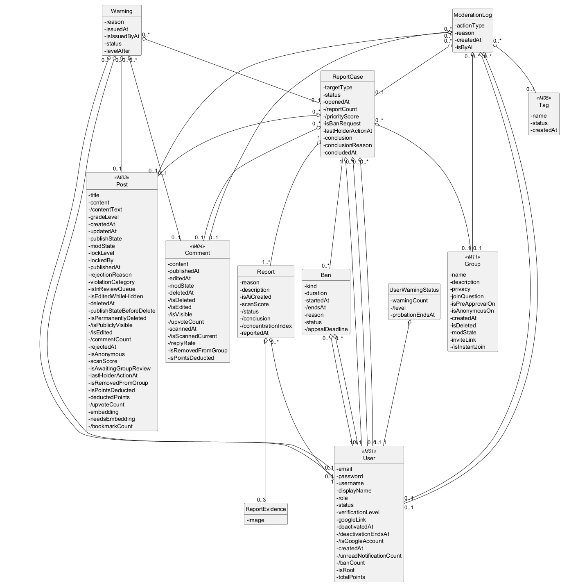

# Phân tích lớp thực thể — M08 Moderation

<!-- [Vietnamese Doc] Tài liệu tiếng Việt; tên lớp và thuộc tính viết tiếng Anh (input/CONVENTIONS.md mục 3). -->

| Mã tài liệu | EC-M08 |
|---|---|
| Dự án | iShare |
| Module | M08 — Moderation |
| Đầu vào | FR-M08 phiên bản 1.7 |
| Trạng thái | Đã chốt |
| Phiên bản | 1.1 |
| Ngày | 2026-11-20 |
| Tác giả | Phạm Văn Đức |

<!-- Quy ước chung cho mọi bảng dưới đây:
     - Không đổi tên cột, không xóa cột, không đổi số mục: tool đọc bảng theo số mục và tên cột.
     - Ô không có nội dung ghi "—".
     - Mục chưa tới bước làm thì để dòng "(Chưa làm — bước N)".
     - Cột Nguồn ghi mã trong FR: FR-Mxx-nn, FR-Mxx-nn.mm, BR-Mxx-nn, hoặc TN:<thuật ngữ> (mục 2.1 của FR).
     - Mục 4 chỉ chứa ảnh sơ đồ. gen_puml.py ghi mã PlantUML vào tệp riêng diagrams/EC-Mxx.puml, render
       diagrams/EC-Mxx.png và đặt ảnh vào mục 4. Không chép mã PlantUML vào tài liệu, không sửa tay tệp .puml hay ảnh. -->

## 1. Mô tả chức năng

### 1.1 Đoạn mô tả

Hệ thống quản lý việc kiểm duyệt trên iShare: báo cáo của người dùng về bài viết, bình luận, người dùng và nhóm vi
phạm, vụ báo cáo và hàng chờ báo cáo, cảnh cáo, ban, nhật ký kiểm duyệt, cùng trạng thái kiểm duyệt của bài viết,
trạng thái kiểm duyệt của bình luận và trạng thái kiểm duyệt của nhóm.

Hệ thống cho phép người dùng đã đăng nhập báo cáo một bài viết, bình luận, người dùng hoặc nhóm của người khác. Mỗi
khi một báo cáo được gửi, hệ thống ghi lại người báo cáo, loại đối tượng bị báo cáo, đối tượng bị báo cáo, một lý do
báo cáo chọn từ danh sách lý do báo cáo riêng của loại đối tượng bị báo cáo, mô tả, bằng chứng và trạng thái của báo
cáo. Hệ thống gom các báo cáo đang mở về cùng một đối tượng bị báo cáo thành một vụ báo cáo, mở vụ báo cáo mới và đưa
vào hàng chờ báo cáo khi đối tượng bị báo cáo chưa có vụ báo cáo đang mở, và mỗi khi thêm báo cáo vào vụ báo cáo thì
tính lại điểm ưu tiên của vụ báo cáo theo mức nặng của lý do báo cáo và số báo cáo trong vụ báo cáo.

Hệ thống cho phép Mod và Admin xem hàng chờ báo cáo gồm các vụ báo cáo đang mở, kể cả vụ báo cáo do AI tạo, xếp theo
điểm ưu tiên rồi theo thời điểm mở vụ báo cáo, trong đó vụ báo cáo đang có người giữ vụ và vụ báo cáo là yêu cầu ban
được đánh dấu. Hệ thống cho phép Mod và Admin nhận xử lý một vụ báo cáo đang mở chưa có người giữ vụ, ghi lại Mod hoặc
Admin đó là người giữ vụ cùng thời điểm thao tác cuối của người giữ vụ trên vụ báo cáo, và tự nhả vụ báo cáo khi người
giữ vụ không còn thao tác. Hệ thống cho phép Mod và Admin xem chi tiết một vụ báo cáo: từng báo cáo trong vụ báo cáo
với người báo cáo, lý do báo cáo, mô tả và bằng chứng; đối tượng bị báo cáo, kể cả bài viết hoặc bình luận đã bị tác
giả xóa, đã xóa hẳn hoặc đang Tự ẩn; và người bị báo cáo, là tác giả của bài viết hoặc bình luận, chính người dùng bị
báo cáo hoặc Owner của nhóm, kèm danh tính thật của tác giả bài viết ẩn danh và mức cảnh cáo hiện tại của người bị báo
cáo. Trong chi tiết vụ báo cáo, hệ thống hiển thị thêm lịch sử báo cáo của đối tượng, gồm các vụ báo cáo đã kết luận
trước đó về cùng đối tượng bị báo cáo và kết luận của từng vụ báo cáo, và chỉ số tập trung của từng người báo cáo,
tính từ các báo cáo đã xử lý của người báo cáo đó. Hệ thống cho phép người giữ vụ kết luận vụ báo cáo là Có xử lý hoặc
Bác bỏ kèm lý do kết luận; mỗi khi một vụ báo cáo được kết luận, hệ thống ghi lại kết luận, lý do kết luận, người kết
luận và thời điểm kết luận, rồi chuyển vụ báo cáo và mọi báo cáo đang mở trong vụ báo cáo sang Đã xử lý với kết luận
của vụ báo cáo. Khi một vụ báo cáo được kết luận, hệ thống gửi qua M07 cho mọi người báo cáo là người dùng một kết quả
chung, và khi vụ báo cáo được kết luận Có xử lý thì gửi cho người bị báo cáo lý do kết luận, mức xử lý và, với cảnh
cáo, ban hoặc bài viết bị ẩn, đường dẫn khiếu nại của M09.

Trong vụ báo cáo đang giữ, hệ thống cho phép người giữ vụ ẩn bài viết hoặc bình luận vi phạm bằng cách chuyển trạng
thái kiểm duyệt của bài viết hoặc trạng thái kiểm duyệt của bình luận sang Bị ẩn. Hệ thống đưa nội dung bị gắn cờ, gồm
bài viết chuyển sang Bị gắn cờ sau khi M03 quét lại và bình luận bị AI ẩn cần Mod xét, vào hàng chờ báo cáo dưới dạng
một mục do AI tạo có người báo cáo là "Hệ thống (AI)" và lý do báo cáo là nhóm vi phạm AI phát hiện, thêm vào vụ báo
cáo đang mở của bài viết hoặc bình luận đó hoặc vào một vụ báo cáo mới. Hệ thống cho phép Mod và Admin xét nội dung bị
gắn cờ: chuyển bài viết đang Bị gắn cờ về Bình thường hoặc sang Bị ẩn, chuyển bình luận bị AI ẩn về Bình thường hoặc
giữ bình luận đó ở Bị ẩn, và quyết có cảnh cáo tác giả hay không.

Khi công tắc AI tổng và công tắc Moderation do M10 quản lý đều bật và tốc độ trả lời của một luồng bình luận đạt
ngưỡng tốc độ, hệ thống quét AI các bình luận của luồng bình luận chưa được quét với nội dung hiện tại để nhận điểm
quét của từng bình luận, rồi ghi nhận bình luận đã được quét với nội dung hiện tại. Theo điểm quét, hệ thống chuyển
bình luận sang Bị ẩn mà không đưa vào hàng chờ báo cáo, chuyển bình luận sang Bị ẩn và đưa vào hàng chờ báo cáo, hoặc
giữ nguyên trạng thái kiểm duyệt của bình luận; mỗi khi AI ẩn một bình luận, hệ thống báo cho tác giả qua M07; khi
quét một bình luận thất bại, hệ thống giữ nguyên bình luận và ghi lỗi cho Admin. Khi kết quả quét AI một bài viết do
M03 gửi hoặc một bình luận có điểm quét cao, hệ thống tự ra cho tác giả một cảnh cáo cho mỗi bài viết hoặc bình luận
với người ra cảnh cáo là AI; với tác giả có vai trò Mod, hệ thống không tự cảnh cáo mà thêm một mục do AI tạo vào vụ
báo cáo của bài viết hoặc bình luận để Admin quyết, và AI không bao giờ tạo ban.

Hệ thống cho phép người giữ vụ cảnh cáo người vi phạm, kể cả người báo cáo bị đánh giá là báo cáo ác ý; mỗi cảnh cáo
do Mod hoặc Admin ra ghi lại người bị cảnh cáo, người ra cảnh cáo, lý do và vụ báo cáo liên quan. Mỗi khi một cảnh cáo
được ra, hệ thống cập nhật số lần cảnh cáo, mức cảnh cáo và thời gian thử thách của người bị cảnh cáo, áp hạn chế của
mức cảnh cáo mới và gửi thông báo cảnh cáo kèm đường dẫn khiếu nại qua M07. Khi người dùng đang ở mức cảnh cáo HEAVY
lại bị xác định vi phạm, hệ thống không ra cảnh cáo mới mà đánh dấu vụ báo cáo của bài viết hoặc bình luận vi phạm là
yêu cầu ban, và mở vụ báo cáo nếu bài viết hoặc bình luận đó chưa có vụ báo cáo đang mở. Hệ thống cho phép Mod và
Admin bỏ một cảnh cáo do AI ra; cảnh cáo bị bỏ vẫn được giữ và đánh dấu đã bỏ, số lần cảnh cáo của người bị cảnh cáo
giảm và mức cảnh cáo được tính lại. Khi thời gian thử thách của mức cảnh cáo hiện tại kết thúc, hệ thống tự giảm mức
cảnh cáo của người dùng một bậc, đặt lại số lần cảnh cáo theo mức mới và bắt đầu thời gian thử thách của mức mới. Hệ
thống cho phép người dùng xem mức cảnh cáo hiện tại và thời điểm kết thúc thời gian thử thách của chính mình, và giữ
mức cảnh cáo riêng tư với người dùng khác ngoài Mod và Admin.

Hệ thống cho phép người giữ vụ ban người vi phạm bằng một ban tạm thời có thời hạn tính theo số lần đã bị ban hoặc
bằng một ban vĩnh viễn; mỗi ban ghi lại người bị ban, người ban, lý do, thời điểm bắt đầu, thời hạn và trạng thái của
ban. Mỗi khi một ban được tạo, hệ thống chuyển trạng thái tài khoản của người bị ban sang BANNED do M01 quản lý, thu
hồi vai trò Mod nếu người bị ban có vai trò Mod và gửi thông báo ban kèm lý do và đường dẫn khiếu nại qua M07; khi ban
tạm thời hết thời hạn, hệ thống chuyển ban sang Hết hạn. Hệ thống cho phép Mod và Admin gỡ một ban đang hiệu lực mà
không cần vụ báo cáo, chuyển ban sang Đã gỡ, đưa trạng thái tài khoản của người bị ban về ACTIVE và gửi thông báo gỡ
ban qua M07.

Trong vụ báo cáo về một nhóm do M11 quản lý, hệ thống cho phép người giữ vụ ẩn nhóm hoặc khóa nhóm bằng cách chuyển
trạng thái kiểm duyệt của nhóm sang Bị ẩn hoặc Bị khóa, và cho phép Mod và Admin mở khóa nhóm đang Bị khóa về Bình
thường mà không cần vụ báo cáo.

Mỗi khi Mod, Admin hoặc AI thực hiện một thao tác kiểm duyệt, kể cả việc vô hiệu hóa, kích hoạt lại Tag và đổi Topic,
Tag trên bài viết của người khác do M05 gửi, hệ thống ghi một dòng nhật ký kiểm duyệt gồm người làm, loại thao tác,
đối tượng của thao tác, lý do và thời điểm, và giữ dòng nhật ký kiểm duyệt vĩnh viễn, không cho sửa. Khi người làm đã
xóa tài khoản do M01 quản lý, hệ thống vẫn giữ dòng nhật ký kiểm duyệt, hiển thị người làm là "[Người dùng đã xóa]" và
cho tra cứu dòng nhật ký kiểm duyệt qua username của người làm. Hệ thống cho phép Admin xem toàn bộ nhật ký kiểm duyệt
và lọc theo người làm, cho phép Mod xem các vụ báo cáo chính Mod đó đã xử lý, và chỉ cho Mod xem thao tác kiểm duyệt
của Mod khác khi đang xét một khiếu nại về thao tác kiểm duyệt đó do M09 quản lý.

Hệ thống cung cấp mức cảnh cáo cho M03, M04, M06 và M12 để chặn tạo bài viết, chặn tạo bình luận, giảm hạng tìm kiếm
và loại khỏi bảng xếp hạng, cung cấp trạng thái kiểm duyệt của nhóm cho M11, và cung cấp báo cáo, kết luận vụ báo cáo,
cảnh cáo kèm mức cảnh cáo đạt sau mỗi cảnh cáo, ban và gỡ ban cho thống kê kiểm duyệt của M15.

<!-- Văn xuôi bình thường, có thể chia vài đoạn. KHÔNG ghi mã câu (S1), (S2)… trong đoạn văn: người đọc không hiểu
     các mã đó. Số câu chỉ nằm ở bảng 1.2. Xem steps/01-describe-functions.md. -->

### 1.2 Truy vết câu

<!-- Mỗi câu của đoạn mô tả một dòng, theo đúng thứ tự. Câu: 1, 2, 3…
     Nội dung câu: chép NGUYÊN VĂN câu đó từ mục 1.1 (tool so khớp từng câu với đoạn văn).
     Nguồn: mã chức năng hoặc yêu cầu của FR mà câu dựa vào. -->

| Câu | Nội dung câu | Nguồn |
|---|---|---|
| 1 | Hệ thống quản lý việc kiểm duyệt trên iShare: báo cáo của người dùng về bài viết, bình luận, người dùng và nhóm vi phạm, vụ báo cáo và hàng chờ báo cáo, cảnh cáo, ban, nhật ký kiểm duyệt, cùng trạng thái kiểm duyệt của bài viết, trạng thái kiểm duyệt của bình luận và trạng thái kiểm duyệt của nhóm. | FR-M08-01, FR-M08-02, FR-M08-06, FR-M08-10, FR-M08-14, FR-M08-16, FR-M08-18 |
| 2 | Hệ thống cho phép người dùng đã đăng nhập báo cáo một bài viết, bình luận, người dùng hoặc nhóm của người khác. | FR-M08-01, FR-M08-01.01, FR-M08-01.15 |
| 3 | Mỗi khi một báo cáo được gửi, hệ thống ghi lại người báo cáo, loại đối tượng bị báo cáo, đối tượng bị báo cáo, một lý do báo cáo chọn từ danh sách lý do báo cáo riêng của loại đối tượng bị báo cáo, mô tả, bằng chứng và trạng thái của báo cáo. | FR-M08-01.01, FR-M08-01.02, FR-M08-01.19 |
| 4 | Hệ thống gom các báo cáo đang mở về cùng một đối tượng bị báo cáo thành một vụ báo cáo, mở vụ báo cáo mới và đưa vào hàng chờ báo cáo khi đối tượng bị báo cáo chưa có vụ báo cáo đang mở, và mỗi khi thêm báo cáo vào vụ báo cáo thì tính lại điểm ưu tiên của vụ báo cáo theo mức nặng của lý do báo cáo và số báo cáo trong vụ báo cáo. | FR-M08-01.03, FR-M08-01.04, FR-M08-01.05 |
| 5 | Hệ thống cho phép Mod và Admin xem hàng chờ báo cáo gồm các vụ báo cáo đang mở, kể cả vụ báo cáo do AI tạo, xếp theo điểm ưu tiên rồi theo thời điểm mở vụ báo cáo, trong đó vụ báo cáo đang có người giữ vụ và vụ báo cáo là yêu cầu ban được đánh dấu. | FR-M08-02, FR-M08-02.01, FR-M08-02.02, FR-M08-02.07, FR-M08-02.08 |
| 6 | Hệ thống cho phép Mod và Admin nhận xử lý một vụ báo cáo đang mở chưa có người giữ vụ, ghi lại Mod hoặc Admin đó là người giữ vụ cùng thời điểm thao tác cuối của người giữ vụ trên vụ báo cáo, và tự nhả vụ báo cáo khi người giữ vụ không còn thao tác. | FR-M08-03, FR-M08-03.01, FR-M08-03.04, FR-M08-03.08 |
| 7 | Hệ thống cho phép Mod và Admin xem chi tiết một vụ báo cáo: từng báo cáo trong vụ báo cáo với người báo cáo, lý do báo cáo, mô tả và bằng chứng; đối tượng bị báo cáo, kể cả bài viết hoặc bình luận đã bị tác giả xóa, đã xóa hẳn hoặc đang Tự ẩn; và người bị báo cáo, là tác giả của bài viết hoặc bình luận, chính người dùng bị báo cáo hoặc Owner của nhóm, kèm danh tính thật của tác giả bài viết ẩn danh và mức cảnh cáo hiện tại của người bị báo cáo. | FR-M08-04, FR-M08-04.01, FR-M08-04.02, FR-M08-04.05, FR-M08-04.06, FR-M08-04.10 |
| 8 | Trong chi tiết vụ báo cáo, hệ thống hiển thị thêm lịch sử báo cáo của đối tượng, gồm các vụ báo cáo đã kết luận trước đó về cùng đối tượng bị báo cáo và kết luận của từng vụ báo cáo, và chỉ số tập trung của từng người báo cáo, tính từ các báo cáo đã xử lý của người báo cáo đó. | FR-M08-04.03, FR-M08-04.04 |
| 9 | Hệ thống cho phép người giữ vụ kết luận vụ báo cáo là Có xử lý hoặc Bác bỏ kèm lý do kết luận; mỗi khi một vụ báo cáo được kết luận, hệ thống ghi lại kết luận, lý do kết luận, người kết luận và thời điểm kết luận, rồi chuyển vụ báo cáo và mọi báo cáo đang mở trong vụ báo cáo sang Đã xử lý với kết luận của vụ báo cáo. | FR-M08-05, FR-M08-05.01, FR-M08-05.02 |
| 10 | Khi một vụ báo cáo được kết luận, hệ thống gửi qua M07 cho mọi người báo cáo là người dùng một kết quả chung, và khi vụ báo cáo được kết luận Có xử lý thì gửi cho người bị báo cáo lý do kết luận, mức xử lý và, với cảnh cáo, ban hoặc bài viết bị ẩn, đường dẫn khiếu nại của M09. | FR-M08-05.04, FR-M08-05.05, FR-M08-05.11, FR-M08-18.11 |
| 11 | Trong vụ báo cáo đang giữ, hệ thống cho phép người giữ vụ ẩn bài viết hoặc bình luận vi phạm bằng cách chuyển trạng thái kiểm duyệt của bài viết hoặc trạng thái kiểm duyệt của bình luận sang Bị ẩn. | FR-M08-06, FR-M08-06.01, FR-M08-06.02, FR-M08-06.06 |
| 12 | Hệ thống đưa nội dung bị gắn cờ, gồm bài viết chuyển sang Bị gắn cờ sau khi M03 quét lại và bình luận bị AI ẩn cần Mod xét, vào hàng chờ báo cáo dưới dạng một mục do AI tạo có người báo cáo là "Hệ thống (AI)" và lý do báo cáo là nhóm vi phạm AI phát hiện, thêm vào vụ báo cáo đang mở của bài viết hoặc bình luận đó hoặc vào một vụ báo cáo mới. | FR-M08-07.09, FR-M08-08.05, FR-M08-04.09 |
| 13 | Hệ thống cho phép Mod và Admin xét nội dung bị gắn cờ: chuyển bài viết đang Bị gắn cờ về Bình thường hoặc sang Bị ẩn, chuyển bình luận bị AI ẩn về Bình thường hoặc giữ bình luận đó ở Bị ẩn, và quyết có cảnh cáo tác giả hay không. | FR-M08-07, FR-M08-07.01, FR-M08-07.02, FR-M08-07.03, FR-M08-07.04, FR-M08-07.05 |
| 14 | Khi công tắc AI tổng và công tắc Moderation do M10 quản lý đều bật và tốc độ trả lời của một luồng bình luận đạt ngưỡng tốc độ, hệ thống quét AI các bình luận của luồng bình luận chưa được quét với nội dung hiện tại để nhận điểm quét của từng bình luận, rồi ghi nhận bình luận đã được quét với nội dung hiện tại. | FR-M08-08, FR-M08-08.01, FR-M08-08.08, FR-M08-08.10, FR-M08-08.11 |
| 15 | Theo điểm quét, hệ thống chuyển bình luận sang Bị ẩn mà không đưa vào hàng chờ báo cáo, chuyển bình luận sang Bị ẩn và đưa vào hàng chờ báo cáo, hoặc giữ nguyên trạng thái kiểm duyệt của bình luận; mỗi khi AI ẩn một bình luận, hệ thống báo cho tác giả qua M07; khi quét một bình luận thất bại, hệ thống giữ nguyên bình luận và ghi lỗi cho Admin. | FR-M08-08.04, FR-M08-08.05, FR-M08-08.06, FR-M08-08.07, FR-M08-08.09 |
| 16 | Khi kết quả quét AI một bài viết do M03 gửi hoặc một bình luận có điểm quét cao, hệ thống tự ra cho tác giả một cảnh cáo cho mỗi bài viết hoặc bình luận với người ra cảnh cáo là AI; với tác giả có vai trò Mod, hệ thống không tự cảnh cáo mà thêm một mục do AI tạo vào vụ báo cáo của bài viết hoặc bình luận để Admin quyết, và AI không bao giờ tạo ban. | FR-M08-09, FR-M08-09.01, FR-M08-09.06, FR-M08-09.08, FR-M08-09.12, FR-M08-14.06 |
| 17 | Hệ thống cho phép người giữ vụ cảnh cáo người vi phạm, kể cả người báo cáo bị đánh giá là báo cáo ác ý; mỗi cảnh cáo do Mod hoặc Admin ra ghi lại người bị cảnh cáo, người ra cảnh cáo, lý do và vụ báo cáo liên quan. | FR-M08-10, FR-M08-10.01, FR-M08-10.04 |
| 18 | Mỗi khi một cảnh cáo được ra, hệ thống cập nhật số lần cảnh cáo, mức cảnh cáo và thời gian thử thách của người bị cảnh cáo, áp hạn chế của mức cảnh cáo mới và gửi thông báo cảnh cáo kèm đường dẫn khiếu nại qua M07. | FR-M08-09.04, FR-M08-09.05, FR-M08-10.02, FR-M08-10.03, FR-M08-12.02 |
| 19 | Khi người dùng đang ở mức cảnh cáo HEAVY lại bị xác định vi phạm, hệ thống không ra cảnh cáo mới mà đánh dấu vụ báo cáo của bài viết hoặc bình luận vi phạm là yêu cầu ban, và mở vụ báo cáo nếu bài viết hoặc bình luận đó chưa có vụ báo cáo đang mở. | FR-M08-14.11, FR-M08-09.11, FR-M08-10.10 |
| 20 | Hệ thống cho phép Mod và Admin bỏ một cảnh cáo do AI ra; cảnh cáo bị bỏ vẫn được giữ và đánh dấu đã bỏ, số lần cảnh cáo của người bị cảnh cáo giảm và mức cảnh cáo được tính lại. | FR-M08-11, FR-M08-11.01, FR-M08-11.03, FR-M08-11.04, FR-M08-11.05 |
| 21 | Khi thời gian thử thách của mức cảnh cáo hiện tại kết thúc, hệ thống tự giảm mức cảnh cáo của người dùng một bậc, đặt lại số lần cảnh cáo theo mức mới và bắt đầu thời gian thử thách của mức mới. | FR-M08-12, FR-M08-12.01, FR-M08-12.04, FR-M08-12.05 |
| 22 | Hệ thống cho phép người dùng xem mức cảnh cáo hiện tại và thời điểm kết thúc thời gian thử thách của chính mình, và giữ mức cảnh cáo riêng tư với người dùng khác ngoài Mod và Admin. | FR-M08-13, FR-M08-13.01, FR-M08-13.02 |
| 23 | Hệ thống cho phép người giữ vụ ban người vi phạm bằng một ban tạm thời có thời hạn tính theo số lần đã bị ban hoặc bằng một ban vĩnh viễn; mỗi ban ghi lại người bị ban, người ban, lý do, thời điểm bắt đầu, thời hạn và trạng thái của ban. | FR-M08-14, FR-M08-14.01, FR-M08-14.02, FR-M08-14.12 |
| 24 | Mỗi khi một ban được tạo, hệ thống chuyển trạng thái tài khoản của người bị ban sang BANNED do M01 quản lý, thu hồi vai trò Mod nếu người bị ban có vai trò Mod và gửi thông báo ban kèm lý do và đường dẫn khiếu nại qua M07; khi ban tạm thời hết thời hạn, hệ thống chuyển ban sang Hết hạn. | FR-M08-14.03, FR-M08-14.04, FR-M08-14.05, FR-M08-14.08 |
| 25 | Hệ thống cho phép Mod và Admin gỡ một ban đang hiệu lực mà không cần vụ báo cáo, chuyển ban sang Đã gỡ, đưa trạng thái tài khoản của người bị ban về ACTIVE và gửi thông báo gỡ ban qua M07. | FR-M08-15, FR-M08-15.01, FR-M08-15.02, FR-M08-15.05 |
| 26 | Trong vụ báo cáo về một nhóm do M11 quản lý, hệ thống cho phép người giữ vụ ẩn nhóm hoặc khóa nhóm bằng cách chuyển trạng thái kiểm duyệt của nhóm sang Bị ẩn hoặc Bị khóa, và cho phép Mod và Admin mở khóa nhóm đang Bị khóa về Bình thường mà không cần vụ báo cáo. | FR-M08-18, FR-M08-18.01, FR-M08-18.04, FR-M08-18.07 |
| 27 | Mỗi khi Mod, Admin hoặc AI thực hiện một thao tác kiểm duyệt, kể cả việc vô hiệu hóa, kích hoạt lại Tag và đổi Topic, Tag trên bài viết của người khác do M05 gửi, hệ thống ghi một dòng nhật ký kiểm duyệt gồm người làm, loại thao tác, đối tượng của thao tác, lý do và thời điểm, và giữ dòng nhật ký kiểm duyệt vĩnh viễn, không cho sửa. | FR-M08-16, FR-M08-16.01, FR-M08-16.02, FR-M08-16.03, FR-M08-16.05, FR-M08-16.06 |
| 28 | Khi người làm đã xóa tài khoản do M01 quản lý, hệ thống vẫn giữ dòng nhật ký kiểm duyệt, hiển thị người làm là "[Người dùng đã xóa]" và cho tra cứu dòng nhật ký kiểm duyệt qua username của người làm. | FR-M08-16.04 |
| 29 | Hệ thống cho phép Admin xem toàn bộ nhật ký kiểm duyệt và lọc theo người làm, cho phép Mod xem các vụ báo cáo chính Mod đó đã xử lý, và chỉ cho Mod xem thao tác kiểm duyệt của Mod khác khi đang xét một khiếu nại về thao tác kiểm duyệt đó do M09 quản lý. | FR-M08-17, FR-M08-17.01, FR-M08-17.02, FR-M08-17.03, FR-M08-17.04, FR-M08-17.06 |
| 30 | Hệ thống cung cấp mức cảnh cáo cho M03, M04, M06 và M12 để chặn tạo bài viết, chặn tạo bình luận, giảm hạng tìm kiếm và loại khỏi bảng xếp hạng, cung cấp trạng thái kiểm duyệt của nhóm cho M11, và cung cấp báo cáo, kết luận vụ báo cáo, cảnh cáo kèm mức cảnh cáo đạt sau mỗi cảnh cáo, ban và gỡ ban cho thống kê kiểm duyệt của M15. | FR-M08-12.02, FR-M08-09.04, FR-M08-10.02, FR-M08-18.02, FR-M08-18.05, FR-M08-05.01, FR-M08-14.01, FR-M08-15.01 |

## 2. Danh từ và phân loại

### 2.1 Sổ danh từ

<!-- Phân loại: Lớp | Thuộc tính | Loại bỏ.
     Kết quả: tên lớp; hoặc Lớp.thuộcTính; hoặc "—" khi loại bỏ.
     Xuất hiện ở: "Câu n" (số câu ở bảng 1.2) hoặc "Quét: <mã FR>" (lượt quét bổ sung). -->

| # | Danh từ | Xuất hiện ở | Phân loại | Kết quả | Lý do |
|---|---|---|---|---|---|
| 1 | hệ thống | Câu 1 | Loại bỏ | — | Trừu tượng: chỉ chính phần mềm |
| 2 | việc kiểm duyệt | Câu 1 | Loại bỏ | — | Trừu tượng: tên lĩnh vực của module |
| 3 | iShare | Câu 1 | Loại bỏ | — | Trừu tượng: tên sản phẩm |
| 4 | báo cáo | Câu 1 | Lớp | Report | Hệ thống lưu từng báo cáo với người báo cáo, lý do, mô tả, bằng chứng (FR-M08-01.02); dùng tên Report mà EC-M07 đã đặt tạm |
| 5 | người dùng / tài khoản | Câu 1 | Lớp | User | Lớp ngoài (M01): người báo cáo, người bị báo cáo và các vai trò khác đều là tài khoản; "người dùng" và "tài khoản" chỉ cùng một đối tượng; dùng tên User của EC-M01 |
| 6 | bài viết | Câu 1 | Lớp | Post | Lớp ngoài (M03): đối tượng bị báo cáo, bị ẩn, bị gắn cờ |
| 7 | bình luận | Câu 1 | Lớp | Comment | Lớp ngoài (M04): đối tượng bị báo cáo, bị AI quét, bị ẩn |
| 8 | nhóm | Câu 1 | Lớp | Group | Lớp ngoài (M11): đối tượng bị báo cáo, bị ẩn hoặc khóa; tên tạm theo glossary, chờ EC-M11 |
| 9 | vụ báo cáo | Câu 1 | Lớp | ReportCase | Có danh tính, trạng thái và vòng đời riêng (mở, được giữ, kết luận), giữ lại làm lịch sử (TN:Vụ báo cáo, BR-M08-05) |
| 10 | hàng chờ báo cáo | Câu 1 | Loại bỏ | — | Không lưu riêng: là các vụ báo cáo đang Mở xếp theo ReportCase.priorityScore rồi ReportCase.openedAt (BR-M08-07) |
| 11 | cảnh cáo | Câu 1 | Lớp | Warning | Mỗi lần cảnh cáo được lưu với người ra, lý do, thời điểm, trạng thái; bản ghi giữ khi bị bỏ (FR-M08-11.04); dùng tên Warning mà EC-M07 đã đặt tạm |
| 12 | ban | Câu 1 | Lớp | Ban | Mỗi lần ban được lưu với loại, thời hạn, lý do, trạng thái (FR-M08-14.01); dùng tên Ban mà EC-M01, EC-M07 đã đặt tạm |
| 13 | nhật ký kiểm duyệt / dòng nhật ký kiểm duyệt | Câu 1 | Lớp | ModerationLog | Nhật ký là tập các dòng; mỗi dòng ghi một thao tác và được giữ vĩnh viễn (FR-M08-16.01, FR-M08-16.03); dùng tên ModerationLog mà EC-M05 đã đặt tạm |
| 14 | trạng thái kiểm duyệt của bài viết | Câu 1 | Thuộc tính | Post.modState | Thông tin của bài viết (M03) mà M08 đọc và ghi; tên modState của EC-M03 |
| 15 | trạng thái kiểm duyệt của bình luận | Câu 1 | Thuộc tính | Comment.modState | Thông tin của bình luận (M04) mà M08 ghi; tên modState của EC-M04 |
| 16 | trạng thái kiểm duyệt của nhóm | Câu 1 | Thuộc tính | Group.modState | M08 định nghĩa trên lớp ngoài Group (mục Chuyển trạng thái và ma trận CRUD của FR); M11 áp lên cách nhóm hiển thị |
| 17 | người dùng đã đăng nhập | Câu 2 | Lớp | User | Vai trò User, có tài khoản (mục 4.2 của FR) |
| 18 | người khác / người dùng khác | Câu 2 | Loại bỏ | — | Chung chung: người dùng không phải người đang thao tác |
| 19 | người báo cáo | Câu 3 | Lớp | User | Vai trò theo ngữ cảnh của tài khoản gửi báo cáo (TN:Người báo cáo); mục do AI tạo không có người báo cáo là tài khoản (dòng 68); quan hệ xét ở bước 3 |
| 20 | loại đối tượng bị báo cáo | Câu 3 | Thuộc tính | ReportCase.targetType | Một trong bốn giá trị cố định; mọi báo cáo trong một vụ có cùng đối tượng (TN:Vụ báo cáo) nên ghi ở vụ |
| 21 | đối tượng bị báo cáo | Câu 3 | Loại bỏ | — | Chung chung: là một bài viết, bình luận, người dùng hoặc nhóm (dòng 5–8); quan hệ với vụ báo cáo xét ở bước 3 |
| 22 | lý do báo cáo | Câu 3 | Thuộc tính | Report.reason | Một giá trị chọn từ danh sách cố định của loại đối tượng (BR-M08-02) |
| 23 | danh sách lý do báo cáo | Câu 3 | Loại bỏ | — | Hằng số của BR-M08-02: danh sách cố định theo loại đối tượng, không ai thêm, sửa được; ghi ở ràng buộc của Report.reason |
| 24 | mô tả | Câu 3 | Thuộc tính | Report.description | Một giá trị mô tả báo cáo (BR-M08-04) |
| 25 | bằng chứng | Câu 3 | Lớp | ReportEvidence | Một báo cáo có tới 3 ảnh, mỗi ảnh có ràng buộc riêng (BR-M08-03); thuộc tính nhiều giá trị nên tách lớp |
| 26 | trạng thái của báo cáo | Câu 3 | Thuộc tính | Report.status | Có bảng chuyển trạng thái riêng (mục Chuyển trạng thái: Báo cáo); luôn bằng trạng thái của vụ chứa báo cáo nên ghi là dẫn xuất |
| 27 | điểm ưu tiên | Câu 4 | Thuộc tính | ReportCase.priorityScore | Số liệu tính từ các báo cáo của vụ (BR-M08-06) |
| 28 | mức nặng của lý do | Câu 4 | Loại bỏ | — | Hằng số của BR-M08-06: 10, 5, 2 theo lý do; ghi ở ràng buộc của Report.reason |
| 29 | số báo cáo trong vụ báo cáo | Câu 4 | Thuộc tính | ReportCase.reportCount | Số đếm gắn với một vụ (BR-M08-06) |
| 30 | Mở / đang mở | Câu 4 | Loại bỏ | — | Giá trị của ReportCase.status và Report.status |
| 31 | Mod | Câu 5 | Lớp | User | Vai trò có tài khoản; phân biệt bằng User.role |
| 32 | Admin | Câu 5 | Lớp | User | Vai trò có tài khoản; phân biệt bằng User.role |
| 33 | AI | Câu 5 | Loại bỏ | — | Không lưu: tác nhân không có tài khoản; việc do AI làm được đánh dấu bằng Report.isAiCreated, Warning.isIssuedByAi, ModerationLog.isByAi |
| 34 | thời điểm mở vụ báo cáo | Câu 5 | Thuộc tính | ReportCase.openedAt | Dùng xếp hai vụ bằng điểm ưu tiên (BR-M08-07) |
| 35 | người giữ vụ | Câu 5 | Lớp | User | Vai trò theo ngữ cảnh của Mod, Admin đang giữ vụ (TN:Nhận xử lý); quan hệ xét ở bước 3 |
| 36 | yêu cầu ban | Câu 5 | Thuộc tính | ReportCase.isBanRequest | Một đánh dấu trên vụ (TN:Yêu cầu ban) |
| 37 | thời điểm thao tác cuối của người giữ vụ | Câu 6 | Thuộc tính | ReportCase.lastHolderActionAt | Mốc tính 30 phút tự nhả vụ (FR-M08-03.08) |
| 38 | chi tiết vụ báo cáo | Câu 7 | Loại bỏ | — | Giao diện: màn hình xem một vụ |
| 39 | tác giả | Câu 7 | Lớp | User | Vai trò theo ngữ cảnh của tài khoản viết bài viết, bình luận; quan hệ tác giả thuộc M03, M04 |
| 40 | đã bị tác giả xóa | Câu 7 | Loại bỏ | — | Ngoài phạm vi module (M03, M04): trạng thái xóa của bài viết, bình luận; M08 vẫn hiển thị đối tượng trong vụ (BR-M08-15) |
| 41 | đã xóa hẳn | Câu 7 | Loại bỏ | — | Ngoài phạm vi module (M03): trạng thái của bài viết |
| 42 | Tự ẩn | Câu 7 | Loại bỏ | — | Ngoài phạm vi module (M03): một giá trị trạng thái đăng của bài viết |
| 43 | người bị báo cáo | Câu 7 | Lớp | User | Vai trò theo ngữ cảnh (TN:Người bị báo cáo), suy ra từ đối tượng của vụ: tác giả, chính người dùng hoặc Owner của nhóm |
| 44 | Owner của nhóm | Câu 7 | Lớp | User | Vai trò trong nhóm (M11); quan hệ Owner – nhóm là của M11 |
| 45 | danh tính thật của tác giả bài viết ẩn danh | Câu 7 | Loại bỏ | — | Ngoài phạm vi module (M03, M11): là tác giả của bài viết (quan hệ của M03); M08 chỉ hiển thị cho Mod, Admin |
| 46 | bài viết ẩn danh | Câu 7 | Loại bỏ | — | Ngoài phạm vi module (M11): đăng ẩn danh trong nhóm |
| 47 | mức cảnh cáo | Câu 7 | Thuộc tính | UserWarningStatus.level | Một giá trị tính từ số lần cảnh cáo (BR-M08-28) |
| 48 | lịch sử báo cáo của đối tượng | Câu 8 | Loại bỏ | — | Không lưu riêng: là các vụ báo cáo Đã xử lý về cùng đối tượng (TN:Lịch sử báo cáo của đối tượng) |
| 49 | kết luận | Câu 8 | Thuộc tính | ReportCase.conclusion | Một trong hai giá trị (TN:Kết luận vụ) |
| 50 | chỉ số tập trung | Câu 8 | Thuộc tính | Report.concentrationIndex | Số liệu tính cho người báo cáo của một báo cáo và đối tượng của vụ (BR-M08-19) |
| 51 | Có xử lý | Câu 9 | Loại bỏ | — | Giá trị của ReportCase.conclusion |
| 52 | Bác bỏ | Câu 9 | Loại bỏ | — | Giá trị của ReportCase.conclusion |
| 53 | lý do kết luận | Câu 9 | Thuộc tính | ReportCase.conclusionReason | FR-M08-05.01 yêu cầu lưu |
| 54 | người kết luận | Câu 9 | Lớp | User | Vai trò theo ngữ cảnh của Mod, Admin kết luận vụ; quan hệ xét ở bước 3 |
| 55 | thời điểm kết luận | Câu 9 | Thuộc tính | ReportCase.concludedAt | FR-M08-05.01 yêu cầu lưu |
| 56 | Đã xử lý | Câu 9 | Loại bỏ | — | Giá trị của ReportCase.status và Report.status |
| 57 | M01, M03, M04, M05, M06, M07, M09, M10, M11, M12, M15 (tên module) | Câu 10 | Loại bỏ | — | Trừu tượng: tên các phần của hệ thống |
| 58 | kết quả chung | Câu 10 | Loại bỏ | — | Ngoài phạm vi module (M07): nội dung thông báo, câu chữ chốt khi thiết kế (BR-M08-12) |
| 59 | mức xử lý | Câu 10 | Loại bỏ | — | Chung chung: tóm tắt các xử lý đã làm trong vụ (cảnh cáo, ban, ẩn), lấy từ Warning, Ban và trạng thái kiểm duyệt |
| 60 | bài viết bị ẩn | Câu 10 | Loại bỏ | — | Chung chung: bài viết có Post.modState là Bị ẩn |
| 61 | đường dẫn khiếu nại | Câu 10 | Loại bỏ | — | Ngoài phạm vi module (M07): Notification.appealLink của EC-M07 |
| 62 | khiếu nại | Câu 10 | Loại bỏ | — | Ngoài phạm vi module (M09): khiếu nại, việc lật cảnh cáo, ban và việc Mod xem thao tác của Mod khác khi xét khiếu nại do M09 ghi |
| 63 | Bị ẩn | Câu 11 | Loại bỏ | — | Giá trị của Post.modState, Comment.modState, Group.modState |
| 64 | nội dung bị gắn cờ | Câu 12 | Loại bỏ | — | Chung chung: bài viết có Post.modState là Bị gắn cờ, hoặc bình luận bị AI ẩn đang chờ trong một vụ (TN:Nội dung bị gắn cờ) |
| 65 | Bị gắn cờ | Câu 12 | Loại bỏ | — | Giá trị của Post.modState |
| 66 | việc quét lại | Câu 12 | Loại bỏ | — | Ngoài phạm vi module (M03): quét lại bài viết sau khi sửa |
| 67 | bình luận bị AI ẩn | Câu 12 | Loại bỏ | — | Chung chung: bình luận có Comment.modState là Bị ẩn sau khi quét |
| 68 | mục do AI tạo | Câu 12 | Thuộc tính | Report.isAiCreated | Một báo cáo có người báo cáo là "Hệ thống (AI)", tính như một báo cáo (TN:Mục do AI tạo) |
| 69 | "Hệ thống (AI)" | Câu 12 | Loại bỏ | — | Giao diện: cách hiển thị người báo cáo khi Report.isAiCreated đúng (FR-M08-04.09) |
| 70 | nhóm vi phạm AI phát hiện | Câu 12 | Loại bỏ | — | Giá trị của Report.reason (BR-M08-25, BR-M08-51) |
| 71 | Bình thường | Câu 13 | Loại bỏ | — | Giá trị của Post.modState, Comment.modState, Group.modState |
| 72 | công tắc AI tổng | Câu 14 | Loại bỏ | — | Ngoài phạm vi module (M10) |
| 73 | công tắc Moderation | Câu 14 | Loại bỏ | — | Ngoài phạm vi module (M10) |
| 74 | tốc độ trả lời | Câu 14 | Thuộc tính | Comment.replyRate | Số đếm gắn với bình luận gốc của một luồng (TN:Tốc độ trả lời) |
| 75 | luồng bình luận | Câu 14 | Loại bỏ | — | Ngoài phạm vi module (M04): là bình luận gốc cùng các trả lời, đã có quan hệ trong EC-M04 (R-M04-03) |
| 76 | ngưỡng tốc độ | Câu 14 | Loại bỏ | — | Hằng số của BR-M08-20 (giá trị tạm, TBD-M08-04); ghi ở ràng buộc của Comment.replyRate |
| 77 | lần quét AI / kết quả quét AI | Câu 14 | Loại bỏ | — | Hành động không lưu dấu vết: FR-M08 chỉ yêu cầu ghi nhận bình luận đã được quét (FR-M08-08.08); kết quả quét thô thuộc nhật ký quyết định AI của M13 (chú thích ở mục Dữ liệu nghiệp vụ của FR) |
| 78 | nội dung hiện tại | Câu 14 | Thuộc tính | Comment.content | Thông tin của bình luận (M04) mà M08 gửi đi quét |
| 79 | điểm quét | Câu 14 | Thuộc tính | Report.scanScore | Chỉ lưu ở mục do AI tạo, để Mod, Admin xét đúng nhánh (xem mục 2.3) |
| 80 | bình luận đã được quét với nội dung hiện tại | Câu 14 | Thuộc tính | Comment.isScannedCurrent | M08 định nghĩa trên lớp ngoài Comment (chú thích ở mục Dữ liệu nghiệp vụ của FR) |
| 81 | lỗi | Câu 15 | Loại bỏ | — | Ngoài phạm vi module (M13): lỗi gọi AI ghi cho Admin thuộc tầng gọi AI (mục Giao tiếp, dòng Dùng M13); FR-M08 không nêu dữ liệu nào của lỗi |
| 82 | người ra cảnh cáo | Câu 16 | Lớp | User | Vai trò theo ngữ cảnh của Mod, Admin ra cảnh cáo; cảnh cáo do AI ra không có người ra là tài khoản (Warning.isIssuedByAi) |
| 83 | vai trò Mod | Câu 16 | Thuộc tính | User.role | Thông tin của tài khoản (M01) mà M08 đọc; ban một Mod thì vai trò bị thu hồi qua M10 |
| 84 | người vi phạm | Câu 17 | Lớp | User | Vai trò theo ngữ cảnh của tài khoản bị xác định vi phạm |
| 85 | báo cáo ác ý | Câu 17 | Loại bỏ | — | Chung chung: đánh giá của Mod, Admin, không lưu; dẫn tới một cảnh cáo thông thường (BR-M08-18) |
| 86 | người bị cảnh cáo | Câu 17 | Lớp | User | Vai trò theo ngữ cảnh; quan hệ xét ở bước 3 |
| 87 | lý do (cảnh cáo) | Câu 17 | Thuộc tính | Warning.reason | FR-M08-10.01 yêu cầu lưu |
| 88 | số lần cảnh cáo | Câu 18 | Thuộc tính | UserWarningStatus.warningCount | Mô tả trạng thái cảnh cáo của một người dùng (TN:Số lần cảnh cáo) |
| 89 | thời gian thử thách | Câu 18 | Loại bỏ | — | Hằng số của BR-M08-29: độ dài 7, 10, 15 ngày theo mức; điểm kết thúc lưu ở UserWarningStatus.probationEndsAt |
| 90 | hạn chế (của mức cảnh cáo) | Câu 18 | Loại bỏ | — | Ngoài phạm vi module (M03, M04, M06, M12): các module đó áp hạn chế theo mức cảnh cáo (BR-M08-31) |
| 91 | thông báo cảnh cáo | Câu 18 | Loại bỏ | — | Ngoài phạm vi module (M07): quan hệ thông báo – cảnh cáo đã ghi ở EC-M07 (R-M07-09) |
| 92 | HEAVY | Câu 19 | Loại bỏ | — | Giá trị của UserWarningStatus.level |
| 93 | cảnh cáo do AI ra | Câu 20 | Thuộc tính | Warning.isIssuedByAi | Phân biệt cảnh cáo bỏ được (FR-M08-11.01) |
| 94 | đã bỏ | Câu 20 | Loại bỏ | — | Giá trị của Warning.status |
| 95 | thời điểm kết thúc thời gian thử thách | Câu 22 | Thuộc tính | UserWarningStatus.probationEndsAt | FR-M08-13.01 hiển thị cho chính người dùng |
| 96 | ban tạm thời | Câu 23 | Thuộc tính | Ban.kind | "Tạm thời" và "vĩnh viễn" là hai giá trị của loại ban (mục Dữ liệu nghiệp vụ của FR) |
| 97 | thời hạn | Câu 23 | Thuộc tính | Ban.duration | FR-M08-14.01 yêu cầu lưu |
| 98 | số lần đã bị ban | Câu 23 | Thuộc tính | User.banCount | Số đếm gắn với một tài khoản (TN:Số lần đã bị ban); M08 định nghĩa trên lớp ngoài User |
| 99 | ban vĩnh viễn | Câu 23 | Loại bỏ | — | Giá trị của Ban.kind |
| 100 | người bị ban | Câu 23 | Lớp | User | Vai trò theo ngữ cảnh; quan hệ xét ở bước 3 |
| 101 | người ban | Câu 23 | Lớp | User | Vai trò theo ngữ cảnh của Mod, Admin; quan hệ xét ở bước 3 |
| 102 | lý do (ban) | Câu 23 | Thuộc tính | Ban.reason | FR-M08-14.01 yêu cầu lưu |
| 103 | thời điểm bắt đầu | Câu 23 | Thuộc tính | Ban.startedAt | FR-M08-14.01 yêu cầu lưu |
| 104 | trạng thái của ban | Câu 23 | Thuộc tính | Ban.status | Có bảng chuyển trạng thái riêng (mục Chuyển trạng thái: Ban) |
| 105 | trạng thái tài khoản | Câu 24 | Thuộc tính | User.status | Thông tin của tài khoản (M01) mà ban, gỡ ban làm đổi |
| 106 | BANNED | Câu 24 | Loại bỏ | — | Giá trị của User.status |
| 107 | thông báo ban | Câu 24 | Loại bỏ | — | Ngoài phạm vi module (M07): quan hệ thông báo – ban đã ghi ở EC-M07 (R-M07-10) |
| 108 | Hết hạn | Câu 24 | Loại bỏ | — | Giá trị của Ban.status |
| 109 | đang hiệu lực | Câu 25 | Loại bỏ | — | Giá trị của Ban.status |
| 110 | Đã gỡ | Câu 25 | Loại bỏ | — | Giá trị của Ban.status |
| 111 | ACTIVE | Câu 25 | Loại bỏ | — | Giá trị của User.status |
| 112 | thông báo gỡ ban | Câu 25 | Loại bỏ | — | Ngoài phạm vi module (M07): quan hệ thông báo – ban đã ghi ở EC-M07 (R-M07-10) |
| 113 | Bị khóa | Câu 26 | Loại bỏ | — | Giá trị của Group.modState |
| 114 | ẩn nhóm, khóa nhóm, mở khóa nhóm | Câu 26 | Loại bỏ | — | Hành động không lưu dấu vết riêng: chỉ đổi Group.modState; dấu vết là một dòng ModerationLog (FR-M08-16.05) |
| 115 | thao tác kiểm duyệt | Câu 27 | Lớp | ModerationLog | FR yêu cầu lưu dấu vết từng thao tác: mỗi thao tác kiểm duyệt là một dòng nhật ký (FR-M08-16.01) |
| 116 | việc vô hiệu hóa, kích hoạt lại Tag | Câu 27 | Loại bỏ | — | Ngoài phạm vi module (M05): thao tác của M05; dấu vết là một dòng ModerationLog |
| 117 | Tag | Câu 27 | Lớp | Tag | Lớp ngoài (M05): đối tượng của dòng nhật ký khi Mod, Admin vô hiệu hóa, kích hoạt lại Tag (mục Dữ liệu nghiệp vụ của FR) |
| 118 | Topic | Câu 27 | Loại bỏ | — | Ngoài phạm vi module (M05): việc đổi Topic, Tag trên bài người khác ghi nhật ký với đối tượng là bài viết |
| 119 | người làm | Câu 27 | Lớp | User | Vai trò theo ngữ cảnh của Mod, Admin; người làm là AI ghi bằng ModerationLog.isByAi |
| 120 | loại thao tác | Câu 27 | Thuộc tính | ModerationLog.actionType | FR-M08-16.01 yêu cầu lưu; tên actionType như EC-M05 đã tham chiếu |
| 121 | đối tượng của thao tác | Câu 27 | Loại bỏ | — | Chung chung: bài viết, bình luận, người dùng, nhóm, Tag hoặc vụ báo cáo (mục Dữ liệu nghiệp vụ của FR); quan hệ xét ở bước 3 |
| 122 | lý do (dòng nhật ký) | Câu 27 | Thuộc tính | ModerationLog.reason | FR-M08-16.01 yêu cầu lưu |
| 123 | thời điểm (dòng nhật ký) | Câu 27 | Thuộc tính | ModerationLog.createdAt | FR-M08-16.01 yêu cầu lưu; tên createdAt như EC-M05 đã tham chiếu |
| 124 | "[Người dùng đã xóa]" | Câu 28 | Loại bỏ | — | Giao diện: cách hiển thị người làm đã xóa tài khoản |
| 125 | username | Câu 28 | Thuộc tính | User.username | Thông tin của tài khoản (M01) dùng để tra nhật ký (BR-M08-40) |
| 126 | hạng tìm kiếm | Câu 30 | Loại bỏ | — | Ngoài phạm vi module (M06) |
| 127 | bảng xếp hạng | Câu 30 | Loại bỏ | — | Ngoài phạm vi module (M12) |
| 128 | mức cảnh cáo đạt sau mỗi cảnh cáo | Câu 30 | Thuộc tính | Warning.levelAfter | Giá trị chụp lúc cảnh cáo; M15 dùng (mục Giao tiếp, dòng Cung cấp M15) |
| 129 | gỡ ban | Câu 30 | Loại bỏ | — | Hành động không lưu dấu vết riêng: chỉ đổi Ban.status sang Đã gỡ; người gỡ và thời điểm nằm ở dòng ModerationLog (FR-M08-16.05) |
| 130 | thống kê kiểm duyệt | Câu 30 | Loại bỏ | — | Ngoài phạm vi module (M15) |
| 131 | trạng thái cảnh cáo của người dùng | Quét: FR-M08-13 | Lớp | UserWarningStatus | Mỗi người dùng có một bộ số lần cảnh cáo, mức cảnh cáo, thời điểm kết thúc thử thách với bảng chuyển trạng thái riêng (mục Chuyển trạng thái: Mức cảnh cáo của người dùng); M08 tạo và sửa (ma trận CRUD) |
| 132 | trạng thái của vụ báo cáo | Quét: FR-M08-05.01 | Thuộc tính | ReportCase.status | Có bảng chuyển trạng thái riêng (mục Chuyển trạng thái: Vụ báo cáo) |
| 133 | kết luận của báo cáo | Quét: FR-M08-05.02 | Thuộc tính | Report.conclusion | Mọi báo cáo nhận kết luận của vụ (BR-M08-10), nên ghi là dẫn xuất |
| 134 | ảnh | Quét: TN:Bằng chứng | Thuộc tính | ReportEvidence.image | Bằng chứng là ảnh (BR-M08-03) |
| 135 | thời điểm cảnh cáo | Quét: BR-M08-29 | Thuộc tính | Warning.issuedAt | Mốc tính thời gian thử thách (BR-M08-29) |
| 136 | trạng thái của cảnh cáo | Quét: BR-M08-54 | Thuộc tính | Warning.status | Đang tính, Đã bỏ, Bị lật (BR-M08-54, mục Dữ liệu nghiệp vụ của FR) |
| 137 | Đang tính | Quét: Dữ liệu nghiệp vụ | Loại bỏ | — | Giá trị của Warning.status |
| 138 | bị lật | Quét: BR-M08-54 | Loại bỏ | — | Giá trị của Warning.status và Ban.status (do M09 đặt) |
| 139 | người làm là AI | Quét: BR-M08-39 | Thuộc tính | ModerationLog.isByAi | Người làm có thể là AI, không có tài khoản (BR-M08-39) |
| 140 | Sạch, LIGHT, MEDIUM | Quét: TN:Mức cảnh cáo | Loại bỏ | — | Giá trị của UserWarningStatus.level |
| 141 | lần sửa nội dung gần nhất | Quét: TN:Đã quét với nội dung hiện tại | Thuộc tính | Comment.editedAt | Thông tin của bình luận (M04) dùng để xét bình luận đã được quét với nội dung hiện tại |
| 142 | thời điểm đăng của trả lời | Quét: BR-M08-20 | Thuộc tính | Comment.publishedAt | Thông tin của bình luận (M04) dùng để đếm trả lời trong khoảng thời gian trượt |
| 143 | khoảng thời gian trượt | Quét: BR-M08-20 | Loại bỏ | — | Hằng số của BR-M08-20 (giá trị tạm 5 phút, TBD-M08-04) |
| 144 | nhận xử lý, tự nhả vụ | Quét: TN:Nhận xử lý | Loại bỏ | — | Hành động không lưu dấu vết: chỉ đổi người giữ vụ; không ghi nhật ký (FR-M08-16.07) |
| 145 | hằng số chính sách | Quét: TN:Hằng số chính sách | Loại bỏ | — | Hằng số của BR-M08-42: không cấu hình qua giao diện |
| 146 | giờ Việt Nam | Quét: TN:Giờ Việt Nam | Loại bỏ | — | Hằng số của BR-M08-43: múi giờ tính và hiển thị thời gian |

### 2.2 Lớp

<!-- Nhóm: Thực thể | Liên kết | Thống kê. Sở hữu: mã module sở hữu lớp (Mxx của tài liệu này, hoặc Myy với lớp ngoài).
     Thuộc tính: tên mọi thuộc tính của lớp ở mục 2.3, ngăn bởi dấu phẩy, thuộc tính dẫn xuất có "/" phía trước;
     để người đọc thấy lớp và thuộc tính trên cùng một dòng. Lớp chưa có thuộc tính ghi "—". -->

| Lớp | Tên tiếng Việt | Nhóm | Sở hữu | Mô tả | Thuộc tính | Nguồn |
|---|---|---|---|---|---|---|
| Report | Báo cáo | Thực thể | M08 | Một lần người dùng đã đăng nhập tố cáo một đối tượng vi phạm, hoặc một mục do AI tạo; luôn thuộc một vụ báo cáo | reason, description, isAiCreated, scanScore, /status, /conclusion, /concentrationIndex, reportedAt | FR-M08-01.02, FR-M08-07.09, FR-M08-08.05 |
| ReportEvidence | Bằng chứng báo cáo | Thực thể | M08 | Một ảnh người báo cáo đính kèm báo cáo | image | FR-M08-01.02, BR-M08-03 |
| ReportCase | Vụ báo cáo | Thực thể | M08 | Tập các báo cáo đang mở về cùng một đối tượng; đơn vị Mod, Admin nhận xử lý và kết luận; vụ đã kết luận giữ làm lịch sử báo cáo của đối tượng | targetType, status, openedAt, /reportCount, /priorityScore, isBanRequest, lastHolderActionAt, conclusion, conclusionReason, concludedAt | FR-M08-01.04, FR-M08-02.01, FR-M08-03.01, FR-M08-05.01 |
| Warning | Cảnh cáo | Thực thể | M08 | Một lần người dùng bị ghi nhận vi phạm, do AI hoặc Mod, Admin ra | reason, issuedAt, isIssuedByAi, status, levelAfter | FR-M08-09.01, FR-M08-10.01 |
| UserWarningStatus | Trạng thái cảnh cáo của người dùng | Thực thể | M08 | Số lần cảnh cáo, mức cảnh cáo và thời điểm kết thúc thời gian thử thách hiện tại của một người dùng | warningCount, /level, probationEndsAt | FR-M08-09.04, FR-M08-12.01, FR-M08-13.01 |
| Ban | Lần ban | Thực thể | M08 | Một lần Mod hoặc Admin khóa tài khoản, tạm thời hoặc vĩnh viễn | kind, duration, startedAt, /endsAt, reason, status, /appealDeadline | FR-M08-14.01, FR-M08-14.02, FR-M08-15.01 |
| ModerationLog | Dòng nhật ký kiểm duyệt | Thực thể | M08 | Một thao tác kiểm duyệt của Mod, Admin hoặc AI, giữ vĩnh viễn | actionType, reason, createdAt, isByAi | FR-M08-16.01, FR-M08-16.02, FR-M08-16.05 |
| User | Người dùng (tài khoản) | Thực thể | M01 | Người báo cáo, người bị báo cáo, người giữ vụ, người kết luận, người ra và người bị cảnh cáo, người ban và người bị ban, người làm trong nhật ký | email, password, username, displayName, role, status, verificationLevel, googleLink, deactivatedAt, /deactivationEndsAt, /isGoogleAccount, createdAt, /unreadNotificationCount, /banCount, isRoot, totalPoints | FR-M08-01.02, FR-M08-03.01, FR-M08-10.01, FR-M08-14.01, FR-M08-16.01 |
| Post | Bài viết | Thực thể | M03 | Đối tượng bị báo cáo; bị Mod, Admin ẩn; bị gắn cờ sau khi quét lại | title, content, /contentText, gradeLevel, createdAt, updatedAt, publishState, modState, lockLevel, lockedBy, publishedAt, rejectionReason, violationCategory, isInReviewQueue, isEditedWhileHidden, deletedAt, publishStateBeforeDelete, isPermanentlyDeleted, /isPubliclyVisible, /isEdited, /commentCount, rejectedAt, isAnonymous, scanScore, isAwaitingGroupReview, lastHolderActionAt, isRemovedFromGroup, isPointsDeducted, deductedPoints, /upvoteCount, embedding, needsEmbedding, /bookmarkCount | FR-M08-01.01, FR-M08-06.01, FR-M08-07.09 |
| Comment | Bình luận | Thực thể | M04 | Đối tượng bị báo cáo; được AI quét theo luồng; bị AI hoặc Mod, Admin ẩn | content, publishedAt, editedAt, modState, deletedAt, /isDeleted, /isEdited, /isVisible, /upvoteCount, scannedAt, /isScannedCurrent, /replyRate, isRemovedFromGroup, isPointsDeducted | FR-M08-01.01, FR-M08-06.02, FR-M08-08.01 |
| Group | Nhóm | Thực thể | M11 | Đối tượng bị báo cáo; bị Mod, Admin ẩn hoặc khóa | name, description, privacy, joinQuestion, isPreApprovalOn, isAnonymousOn, createdAt, isDeleted, modState, inviteLink, /isInstantJoin | FR-M08-01.01, FR-M08-18.01, FR-M08-18.04 |
| Tag | Tag | Thực thể | M05 | Đối tượng của dòng nhật ký khi Mod, Admin vô hiệu hóa, kích hoạt lại Tag | name, status, createdAt | FR-M08-16.02 |

### 2.3 Thuộc tính

<!-- Mỗi lớp có ĐỦ thuộc tính để người đọc hình dung được nó; xếp các dòng theo lớp.
     Tính chất: Lưu | Dẫn xuất. Chưa có id, chưa có kiểu, chưa có khóa ngoại.
     Căn cứ: Nguồn nêu (FR nói tới) | Đề xuất (FR không nói, nhưng chức năng hoặc quy tắc ở cột Nguồn cần nó) |
             Tham chiếu (thuộc tính của lớp ngoài; module sở hữu lớp đó định nghĩa. Sau lượt gộp hệ thống,
             lớp ngoài ghi đủ thuộc tính như EC-SYS, MD-05).
     Ràng buộc nguồn nêu: độ dài tối đa, duy nhất, bắt buộc/tùy chọn, tập giá trị, mặc định, công thức (với Dẫn xuất)
             — chép từ FR kèm mã. Đề xuất mà FR không nêu ràng buộc thì ghi "—".
     Nguồn: mã FR/BR nêu thuộc tính; với Đề xuất là mã chức năng hoặc quy tắc cần nó.
     Ghi chú: bắt buộc với Đề xuất (vì sao cần) và Tham chiếu (module này dùng nó làm gì). -->

| Lớp | Thuộc tính | Tên tiếng Việt | Tính chất | Căn cứ | Ràng buộc nguồn nêu | Nguồn | Ghi chú |
|---|---|---|---|---|---|---|---|
| Report | reason | Lý do báo cáo | Lưu | Nguồn nêu | Bắt buộc, đúng một lý do (FR-M08-01.07, FR-M08-01.19); chọn từ danh sách riêng của loại đối tượng: bài viết 8, bình luận 7, người dùng 2, nhóm 4 lý do (BR-M08-02); mức nặng 10, 5, 2 theo lý do (BR-M08-06); với mục do AI tạo là nhóm vi phạm có điểm cao nhất trong bốn nhóm AI phát hiện (BR-M08-25, BR-M08-51); không sửa được sau khi gửi (FR-M08-01.18) | FR-M08-01.02, BR-M08-02 | — |
| Report | description | Mô tả | Lưu | Nguồn nêu | Tùy chọn; bắt buộc khi lý do là "Khác" (BR-M08-04); không sửa được sau khi gửi (FR-M08-01.18) | FR-M08-01.02, BR-M08-04 | — |
| Report | isAiCreated | Mục do AI tạo | Lưu | Nguồn nêu | Đúng khi người báo cáo là "Hệ thống (AI)" (TN:Mục do AI tạo); tạo khi bình luận bị AI ẩn với điểm 0,5 đến dưới 0,9, bài Bị gắn cờ sau khi quét lại, nội dung của Mod có điểm từ 0,9, hoặc yêu cầu ban (BR-M08-49); không gửi kết quả chung cho mục này (BR-M08-12) | FR-M08-04.09, BR-M08-49 | Khi đúng thì báo cáo không có người báo cáo là tài khoản (bước 3) |
| Report | scanScore | Điểm quét | Lưu | Đề xuất | 0 đến 1, là điểm cao nhất trong bốn nhóm vi phạm (BR-M08-51); chỉ có ở mục do AI tạo | FR-M08-07.03, FR-M08-07.05, FR-M08-09.08 | FR-M08-07.03 và FR-M08-07.05 chỉ cho Mod, Admin đưa bình luận bị AI ẩn về Bình thường và quyết có cảnh cáo hay không khi điểm quét từ 0,5 đến dưới 0,9; mục do AI tạo cho nội dung của Mod có điểm từ 0,9 (FR-M08-09.08) cũng nằm trong vụ nhưng bình luận đó không được đưa về Bình thường. Cần lưu điểm quét ở mục do AI tạo để biết vụ thuộc nhánh nào khi xét. Kết quả quét thô vẫn thuộc M13 |
| Report | status | Trạng thái | Dẫn xuất | Nguồn nêu | Mở, Đã xử lý (mục Chuyển trạng thái: Báo cáo); bằng ReportCase.status của vụ chứa báo cáo, vì báo cáo chỉ được thêm vào vụ đang Mở và mọi báo cáo Mở chuyển Đã xử lý cùng lúc vụ được kết luận (BR-M08-05, BR-M08-10) | FR-M08-01.02, FR-M08-05.02 | FR ghi là thuộc tính của Báo cáo; mô hình ghi dẫn xuất vì luôn bằng trạng thái của vụ |
| Report | conclusion | Kết luận | Dẫn xuất | Nguồn nêu | Có xử lý, Bác bỏ; chỉ có khi Đã xử lý; bằng ReportCase.conclusion của vụ chứa báo cáo (BR-M08-10) | FR-M08-05.02, BR-M08-10 | Chỉ số tập trung đếm báo cáo bị Bác bỏ (BR-M08-19); M15 đếm báo cáo theo kết luận (mục Giao tiếp) |
| Report | concentrationIndex | Chỉ số tập trung | Dẫn xuất | Nguồn nêu | Số báo cáo của người báo cáo nhắm vào đối tượng của vụ đang xem và bị Bác bỏ ÷ tổng số báo cáo của người báo cáo đã được xử lý; chỉ tính báo cáo có vụ kết luận trong 90 × 24 giờ gần nhất (BR-M08-19); tính lúc xem, chỉ để tham khảo, không tự phạt (BR-M08-18) | FR-M08-04.04, BR-M08-19 | Mỗi người báo cáo có đúng một báo cáo trong một vụ đang Mở (BR-M08-47), nên chỉ số gắn với báo cáo của người đó trong vụ đang xem |
| Report | reportedAt | Thời điểm báo cáo | Lưu | Đề xuất | — | BR-M15-18, FR-M15-03.01, FR-M15-03.20 | Bổ sung từ EC-M15 (MD-05). BR-M15-18 và FR-M15-03.20 đếm báo cáo được tạo trong khoảng đã chọn, nên mỗi báo cáo cần thời điểm tạo; EC-M08 chưa có thuộc tính này trên Report (chỉ có ReportCase.openedAt cho vụ). M15 bổ sung trên lớp ngoài Report (mục 5) |
| ReportEvidence | image | Ảnh | Lưu | Nguồn nêu | Mỗi báo cáo tối đa 3 ảnh; mỗi ảnh tối đa 5MB, định dạng JPEG, PNG hoặc WebP (BR-M08-03); bằng chứng là tùy chọn (TN:Báo cáo) | FR-M08-01.02, FR-M08-01.09, FR-M08-01.10, BR-M08-03 | — |
| ReportCase | targetType | Loại đối tượng | Lưu | Nguồn nêu | Bài viết, bình luận, người dùng, nhóm (TN:Đối tượng bị báo cáo); quyết định danh sách lý do báo cáo dùng được (BR-M08-02) | FR-M08-01.02, FR-M08-01.04 | Mọi báo cáo trong vụ có cùng đối tượng (TN:Vụ báo cáo) nên loại đối tượng ghi một lần ở vụ; FR ghi ở cả Báo cáo và Vụ báo cáo |
| ReportCase | status | Trạng thái | Lưu | Nguồn nêu | Mở, Đã xử lý; vụ mới ở Mở; Đã xử lý là trạng thái cuối, vụ không mở lại (BR-M08-05); mỗi đối tượng có nhiều nhất một vụ Mở (BR-M08-05) | FR-M08-01.04, FR-M08-05.01 | — |
| ReportCase | openedAt | Thời điểm mở | Lưu | Nguồn nêu | Hai vụ bằng điểm ưu tiên thì vụ mở trước đứng trước (BR-M08-07) | FR-M08-02.07, BR-M08-07 | — |
| ReportCase | reportCount | Số báo cáo trong vụ | Dẫn xuất | Nguồn nêu | Đếm các báo cáo của vụ, mục do AI tạo tính là một báo cáo (BR-M08-06, BR-M08-49) | BR-M08-06 | — |
| ReportCase | priorityScore | Điểm ưu tiên | Dẫn xuất | Nguồn nêu | Mức nặng cao nhất trong các lý do của các báo cáo trong vụ + reportCount × 2; mức nặng 10, 5, 2 theo lý do (BR-M08-06); tính lại khi thêm báo cáo (FR-M08-01.05); hàng chờ xếp giảm dần (BR-M08-07) | FR-M08-01.05, BR-M08-06 | — |
| ReportCase | isBanRequest | Yêu cầu ban | Lưu | Nguồn nêu | Đánh dấu khi người đang ở mức HEAVY lại bị xác định vi phạm (BR-M08-36); hiện trong hàng chờ (FR-M08-02.08) | FR-M08-14.11, FR-M08-02.08 | — |
| ReportCase | lastHolderActionAt | Thời điểm thao tác cuối của người giữ | Lưu | Nguồn nêu | Thao tác gồm mở xem vụ, ẩn nội dung, cảnh cáo, ban, kết luận; 30 phút không thao tác thì tự nhả (BR-M08-09) | FR-M08-03.04, FR-M08-03.08 | — |
| ReportCase | conclusion | Kết luận | Lưu | Nguồn nêu | Có xử lý, Bác bỏ; chỉ người đang giữ vụ kết luận được (BR-M08-08); không kết luận lại (FR-M08-05.08) | FR-M08-05.01 | — |
| ReportCase | conclusionReason | Lý do kết luận | Lưu | Nguồn nêu | Bắt buộc khi kết luận (FR-M08-05.09); do Mod, Admin tự xác định, không cần trùng lý do báo cáo (FR-M08-05.03); người bị báo cáo nhận khi vụ Có xử lý (BR-M08-13) | FR-M08-05.01, FR-M08-05.09 | — |
| ReportCase | concludedAt | Thời điểm kết luận | Lưu | Nguồn nêu | Dùng để chỉ tính báo cáo được xử lý trong 90 × 24 giờ gần nhất (BR-M08-19) | FR-M08-05.01 | — |
| Warning | reason | Lý do | Lưu | Nguồn nêu | Bắt buộc với cảnh cáo do Mod, Admin ra (FR-M08-10.01); với cảnh cáo do AI ra là nhóm vi phạm có điểm cao nhất mà AI phát hiện, như lý do của mục do AI tạo (BR-M08-51; Q-01) | FR-M08-10.01 | — |
| Warning | issuedAt | Thời điểm cảnh cáo | Lưu | Nguồn nêu | Thời gian thử thách tính đủ N × 24 giờ kể từ lúc cảnh cáo (BR-M08-29, FR-M08-12.03) | BR-M08-29, FR-M08-12.03 | — |
| Warning | isIssuedByAi | Do AI ra | Lưu | Nguồn nêu | Đúng khi người ra là AI (FR-M08-09.01); chỉ cảnh cáo do AI ra mới bỏ được (FR-M08-11.01) | FR-M08-09.01, FR-M08-11.01 | Khi đúng thì cảnh cáo không có người ra là tài khoản (bước 3) |
| Warning | status | Trạng thái | Lưu | Nguồn nêu | Đang tính, Đã bỏ, Bị lật; cảnh cáo mới là Đang tính; bị bỏ hoặc bị lật thì bản ghi giữ, chỉ đổi trạng thái (BR-M08-54); Bị lật do M09 đặt | FR-M08-11.04, BR-M08-54 | — |
| Warning | levelAfter | Mức đạt sau cảnh cáo | Lưu | Nguồn nêu | LIGHT, MEDIUM, HEAVY: mức của người bị cảnh cáo ngay sau cảnh cáo này (BR-M08-28) | FR-M08-09.04, FR-M08-10.02 | Mục Giao tiếp, dòng Cung cấp M15: thống kê đếm cảnh cáo theo mức đạt sau cảnh cáo; phải lưu vì mức của người dùng đổi về sau |
| UserWarningStatus | warningCount | Số lần cảnh cáo | Lưu | Nguồn nêu | 0 đến 6 (TN:Mức cảnh cáo); tăng 1 mỗi cảnh cáo (FR-M08-09.04, FR-M08-10.02); giảm 1 khi cảnh cáo bị bỏ hoặc bị lật (BR-M08-54); hết thời gian thử thách thì thành 4, 2 hoặc 0 (BR-M08-30); tài khoản mới là 0 | FR-M08-09.04, FR-M08-11.03, FR-M08-12.04 | Không tính lại được từ các cảnh cáo, vì giảm mức đặt lại số lần |
| UserWarningStatus | level | Mức cảnh cáo | Dẫn xuất | Nguồn nêu | Sạch (0), LIGHT (1–2), MEDIUM (3–4), HEAVY (5–6) theo warningCount (BR-M08-28); riêng tư: chỉ chính người đó và Mod, Admin thấy (BR-M08-32) | FR-M08-13.01, BR-M08-28 | M03, M04, M06, M12 đọc để áp hạn chế (BR-M08-31, ma trận CRUD) |
| UserWarningStatus | probationEndsAt | Thời điểm kết thúc thời gian thử thách | Lưu | Nguồn nêu | Lúc cảnh cáo hoặc lúc giảm mức + 7, 10, 15 × 24 giờ theo mức LIGHT, MEDIUM, HEAVY (BR-M08-29, BR-M08-30); không đổi khi cảnh cáo bị bỏ (FR-M08-11.05); không có khi Sạch | FR-M08-13.01, FR-M08-12.03 | — |
| Ban | kind | Loại ban | Lưu | Nguồn nêu | Tạm thời, Vĩnh viễn; thao tác "Ban" lần thứ 3 trở đi ra vĩnh viễn (BR-M08-34); thao tác "Ban vĩnh viễn" bỏ qua cách tính leo thang (BR-M08-35) | FR-M08-14.01, FR-M08-14.02 | M15 đếm ban theo tạm thời, vĩnh viễn (mục Giao tiếp, dòng Cung cấp M15) |
| Ban | duration | Thời hạn | Lưu | Nguồn nêu | 30 ngày khi chưa từng bị ban, 90 ngày khi đã bị ban 1 lần (BR-M08-34); N ngày là đủ N × 24 giờ (BR-M08-43); không có với ban vĩnh viễn | FR-M08-14.01, BR-M08-34 | — |
| Ban | startedAt | Thời điểm bắt đầu | Lưu | Nguồn nêu | — | FR-M08-14.01 | — |
| Ban | endsAt | Thời điểm hết hạn | Dẫn xuất | Đề xuất | startedAt + duration (BR-M08-43); không có với ban vĩnh viễn | FR-M08-14.08, BR-M08-37 | FR-M08-14.08, BR-M08-37: ban tạm thời hết hạn thì chuyển Hết hạn và tài khoản về ACTIVE ngay lúc hết hạn, nên cần thời điểm hết hạn; EC-M01 đã tham chiếu Ban.endsAt |
| Ban | reason | Lý do | Lưu | Nguồn nêu | — | FR-M08-14.01 | M01 đọc để hiển thị trên màn hình tài khoản bị khóa (mục Giao tiếp, dòng Cung cấp M01); gửi kèm thông báo ban (FR-M08-14.04) |
| Ban | status | Trạng thái | Lưu | Nguồn nêu | Đang hiệu lực, Hết hạn, Đã gỡ, Bị lật; ban mới là Đang hiệu lực; Hết hạn, Đã gỡ, Bị lật là trạng thái cuối; mỗi tài khoản có nhiều nhất một ban Đang hiệu lực (BR-M08-52); Bị lật do M09 đặt | FR-M08-14.01, FR-M08-14.08, FR-M08-15.01 | — |
| Ban | appealDeadline | Hết thời hạn khiếu nại | Dẫn xuất | Nguồn nêu | Ban tạm thời: startedAt + duration; ban vĩnh viễn: startedAt + 90 × 24 giờ; theo giờ Việt Nam (BR-M09-04); quá hạn với ban vĩnh viễn thì mất quyền khiếu nại (BR-M09-05) | BR-M09-04, FR-M09-01.13, FR-M01-05.08, FR-M01-05.09 | Thêm theo MD-04: M01 hiện thời gian khiếu nại còn lại và nút khiếu nại; M09 xét hạn khiếu nại; M16 xét Admin nhóm chat không thể khôi phục |
| ModerationLog | actionType | Loại thao tác | Lưu | Nguồn nêu | Cảnh cáo, bỏ cảnh cáo do AI ra, ban, gỡ ban, ẩn nội dung, ẩn nhóm, khóa nhóm, mở khóa nhóm, kết luận vụ, vô hiệu hóa Tag, kích hoạt lại Tag, đổi Topic hoặc Tag trên bài người khác (BR-M08-39); không ghi việc nhận, nhả vụ (FR-M08-16.07) | FR-M08-16.01, FR-M08-16.02, FR-M08-16.05, BR-M08-39 | Tên actionType như EC-M05 đã tham chiếu |
| ModerationLog | reason | Lý do | Lưu | Nguồn nêu | — | FR-M08-16.01 | — |
| ModerationLog | createdAt | Thời điểm | Lưu | Nguồn nêu | Dòng nhật ký giữ vĩnh viễn, không sửa, không xóa (BR-M08-40) | FR-M08-16.01, FR-M08-16.03, FR-M08-16.06 | Tên createdAt như EC-M05 đã tham chiếu |
| ModerationLog | isByAi | Người làm là AI | Lưu | Nguồn nêu | Người làm là Mod, Admin hoặc AI (BR-M08-39) | FR-M08-16.01, BR-M08-39 | Khi đúng thì dòng nhật ký không có người làm là tài khoản (bước 3) |
| User | email | Email | Lưu | Tham chiếu | — | FR-M01-01.01, FR-M01-01.06, FR-M01-12.06 | Ghi đủ lớp sau gộp (MD-05); EC-M01 định nghĩa |
| User | password | Mật khẩu | Lưu | Tham chiếu | — | FR-M01-01.10, FR-M01-08.01, FR-M01-09.02 | Ghi đủ lớp sau gộp (MD-05); EC-M01 định nghĩa |
| User | username | Tên định danh | Lưu | Tham chiếu | — | FR-M08-16.04 | Tra cứu dòng nhật ký của người làm đã xóa tài khoản (BR-M08-40) |
| User | displayName | Tên hiển thị | Lưu | Tham chiếu | — | FR-M01-03.01, FR-M01-03.12, FR-M01-03.13, FR-M01-03.14, FR-M01-04.02 | Ghi đủ lớp sau gộp (MD-05); EC-M01 định nghĩa |
| User | role | Vai trò | Lưu | Tham chiếu | — | FR-M08-10.08, FR-M08-14.05 | M08 đọc để kiểm quyền Mod, Admin và các quy tắc chỉ Admin xử lý Mod, không ai báo cáo được Admin (BR-M08-46, BR-M08-55); ban một Mod thì vai trò Mod bị thu hồi qua M10 (FR-M08-14.05) |
| User | status | Trạng thái tài khoản | Lưu | Tham chiếu | — | FR-M08-14.03, FR-M08-15.01 | Ban chuyển tài khoản sang BANNED, gỡ ban đưa về ACTIVE; M01 thực hiện việc chuyển |
| User | verificationLevel | Mức xác minh | Lưu | Tham chiếu | — | FR-M01-01.01, FR-M01-02.01, FR-M01-03.01, FR-M01-04.01 | Ghi đủ lớp sau gộp (MD-05); EC-M01 định nghĩa |
| User | googleLink | Liên kết Google | Lưu | Tham chiếu | — | FR-M01-04.04, FR-M01-12.08 | Ghi đủ lớp sau gộp (MD-05); EC-M01 định nghĩa |
| User | deactivatedAt | Thời điểm vô hiệu hóa | Lưu | Tham chiếu | — | FR-M01-10.07 | Ghi đủ lớp sau gộp (MD-05); EC-M01 định nghĩa |
| User | deactivationEndsAt | Thời điểm hết thời hạn vô hiệu hóa | Dẫn xuất | Tham chiếu | — | FR-M01-10.07, FR-M01-11.05, FR-M01-12.01, FR-M01-12.05 | Ghi đủ lớp sau gộp (MD-05); EC-M01 định nghĩa |
| User | isGoogleAccount | Là tài khoản Google | Dẫn xuất | Tham chiếu | — | FR-M01-05.13, FR-M01-08.06, FR-M01-09.07 | Ghi đủ lớp sau gộp (MD-05); EC-M01 định nghĩa |
| User | createdAt | Thời điểm tạo tài khoản | Lưu | Tham chiếu | — | FR-M01-01.01, FR-M01-04.01 | Ghi đủ lớp sau gộp (MD-05); EC-M01 định nghĩa |
| User | unreadNotificationCount | Số thông báo chưa đọc | Dẫn xuất | Tham chiếu | — | FR-M07-05.10, BR-M07-12 | Ghi đủ lớp sau gộp (MD-05); EC-M01 định nghĩa |
| User | banCount | Số lần đã bị ban | Dẫn xuất | Tham chiếu | Số ban của tài khoản từng có hiệu lực, kể cả ban được gỡ sớm và ban vĩnh viễn, trừ ban Bị lật (BR-M08-34) | FR-M08-14.12, BR-M08-34 | M08 định nghĩa; đã đưa vào lớp User của EC-M01 (MD-05). Dùng tính thời hạn của thao tác "Ban" |
| User | isRoot | Là tài khoản ADMIN gốc | Lưu | Tham chiếu | — | FR-M10-07.04, FR-M10-01.05, BR-M10-10, BR-M10-11 | Ghi đủ lớp sau gộp (MD-05); EC-M01 định nghĩa |
| User | totalPoints | Tổng điểm | Lưu | Tham chiếu | — | FR-M12-02.01, FR-M12-02.02, FR-M12-02.03, FR-M12-02.12 | Ghi đủ lớp sau gộp (MD-05); EC-M01 định nghĩa |
| Post | title | Tiêu đề | Lưu | Tham chiếu | — | FR-M08-04.02 | Mod, Admin xem bài viết bị báo cáo trong vụ, kể cả bài đã xóa, đã xóa hẳn, Tự ẩn (BR-M08-15) |
| Post | content | Nội dung | Lưu | Tham chiếu | — | FR-M08-04.02 | Mod, Admin xem bài viết bị báo cáo trong vụ, kể cả bài đã xóa, đã xóa hẳn, Tự ẩn (BR-M08-15) |
| Post | contentText | Nội dung chữ | Dẫn xuất | Tham chiếu | — | FR-M03-07.01 | Ghi đủ lớp sau gộp (MD-05); EC-M03 định nghĩa |
| Post | gradeLevel | Lớp/Khối | Lưu | Tham chiếu | — | FR-M03-01.05, FR-M03-01.06, FR-M03-01.07 | Ghi đủ lớp sau gộp (MD-05); EC-M03 định nghĩa |
| Post | createdAt | Thời điểm tạo | Lưu | Tham chiếu | — | FR-M03-01.08 | Ghi đủ lớp sau gộp (MD-05); EC-M03 định nghĩa |
| Post | updatedAt | Thời điểm cập nhật | Lưu | Tham chiếu | — | FR-M03-01.08 | Ghi đủ lớp sau gộp (MD-05); EC-M03 định nghĩa |
| Post | publishState | Trạng thái đăng | Lưu | Tham chiếu | — | FR-M03-01.01, FR-M03-04.01, FR-M03-13.01, FR-M03-15.01 | Ghi đủ lớp sau gộp (MD-05); EC-M03 định nghĩa |
| Post | modState | Trạng thái kiểm duyệt | Lưu | Tham chiếu | — | FR-M08-06.01, FR-M08-07.01, FR-M08-07.02 | M08 đổi sang Bị Mod ẩn khi Mod, Admin ẩn bài; xét bài Bị gắn cờ thì đổi về Bình thường hoặc sang Bị Mod ẩn; M03 đặt Bị gắn cờ khi quét lại (FR-M08-07.09) |
| Post | lockLevel | Mức khóa | Lưu | Tham chiếu | — | FR-M03-01.09, FR-M03-14.01, FR-M03-14.03 | Ghi đủ lớp sau gộp (MD-05); EC-M03 định nghĩa |
| Post | lockedBy | Người khóa | Lưu | Tham chiếu | — | FR-M03-14.01, FR-M03-14.02, FR-M03-14.09 | Ghi đủ lớp sau gộp (MD-05); EC-M03 định nghĩa |
| Post | publishedAt | Thời điểm đăng | Lưu | Tham chiếu | — | FR-M03-04.03, FR-M03-05.01, FR-M03-06.02 | Ghi đủ lớp sau gộp (MD-05); EC-M03 định nghĩa |
| Post | rejectionReason | Lý do từ chối | Lưu | Tham chiếu | — | FR-M03-06.03, FR-M03-06.05 | Ghi đủ lớp sau gộp (MD-05); EC-M03 định nghĩa |
| Post | violationCategory | Nhóm vi phạm | Lưu | Tham chiếu | — | FR-M03-05.12 | Ghi đủ lớp sau gộp (MD-05); EC-M03 định nghĩa |
| Post | isInReviewQueue | Đang trong hàng chờ duyệt | Lưu | Tham chiếu | — | FR-M03-06.01, FR-M03-05.02, FR-M03-05.04, FR-M03-15.06 | Ghi đủ lớp sau gộp (MD-05); EC-M03 định nghĩa |
| Post | isEditedWhileHidden | Có bản sửa lưu trong lúc Tự ẩn chưa quét | Lưu | Tham chiếu | — | FR-M03-13.06, FR-M03-05.14 | Ghi đủ lớp sau gộp (MD-05); EC-M03 định nghĩa |
| Post | deletedAt | Thời điểm xóa | Lưu | Tham chiếu | — | FR-M03-15.01, FR-M03-16.02 | Ghi đủ lớp sau gộp (MD-05); EC-M03 định nghĩa |
| Post | publishStateBeforeDelete | Trạng thái trước khi xóa | Lưu | Tham chiếu | — | FR-M03-15.01, FR-M03-16.01, FR-M03-16.06 | Ghi đủ lớp sau gộp (MD-05); EC-M03 định nghĩa |
| Post | isPermanentlyDeleted | Đã xóa hẳn | Lưu | Tham chiếu | — | FR-M03-17.01, FR-M03-17.02 | Ghi đủ lớp sau gộp (MD-05); EC-M03 định nghĩa |
| Post | isPubliclyVisible | Hiển thị công khai | Dẫn xuất | Tham chiếu | — | FR-M03-07.01, BR-M03-18 | Ghi đủ lớp sau gộp (MD-05); EC-M03 định nghĩa |
| Post | isEdited | Đã chỉnh sửa | Dẫn xuất | Tham chiếu | — | FR-M03-12.01 | Ghi đủ lớp sau gộp (MD-05); EC-M03 định nghĩa |
| Post | commentCount | Số bình luận của bài | Dẫn xuất | Tham chiếu | — | FR-M04-01.10, BR-M04-18 | Ghi đủ lớp sau gộp (MD-05); EC-M03 định nghĩa |
| Post | rejectedAt | Thời điểm bị từ chối | Lưu | Tham chiếu | — | BR-M09-04, FR-M09-01.14, FR-M09-06.02, FR-M09-08.14 | Ghi đủ lớp sau gộp (MD-05); EC-M03 định nghĩa |
| Post | isAnonymous | Đăng ẩn danh | Lưu | Tham chiếu | — | FR-M11-12.07, FR-M11-12.08, FR-M11-12.09, FR-M11-12.10 | Ghi đủ lớp sau gộp (MD-05); EC-M03 định nghĩa |
| Post | scanScore | Điểm quét | Lưu | Tham chiếu | — | FR-M11-12.02, FR-M11-12.03, FR-M11-12.04, FR-M11-12.05 | Ghi đủ lớp sau gộp (MD-05); EC-M03 định nghĩa |
| Post | isAwaitingGroupReview | Đang chờ nhóm duyệt | Lưu | Tham chiếu | — | FR-M11-12.03, FR-M11-12.04, FR-M11-13.01, FR-M11-02.15 | Ghi đủ lớp sau gộp (MD-05); EC-M03 định nghĩa |
| Post | lastHolderActionAt | Thời điểm thao tác cuối | Lưu | Tham chiếu | — | FR-M11-13.02, FR-M11-13.04, BR-M11-20 | Ghi đủ lớp sau gộp (MD-05); EC-M03 định nghĩa |
| Post | isRemovedFromGroup | Bị gỡ khỏi nhóm | Lưu | Tham chiếu | — | FR-M11-14.01, FR-M11-14.05 | Ghi đủ lớp sau gộp (MD-05); EC-M03 định nghĩa |
| Post | isPointsDeducted | Đã trừ điểm | Lưu | Tham chiếu | — | FR-M12-02.08, FR-M12-02.10, FR-M12-02.12, FR-M12-02.18 | Ghi đủ lớp sau gộp (MD-05); EC-M03 định nghĩa |
| Post | deductedPoints | Số điểm đã trừ | Lưu | Tham chiếu | — | FR-M12-02.08, FR-M12-02.10, FR-M12-02.12 | Ghi đủ lớp sau gộp (MD-05); EC-M03 định nghĩa |
| Post | upvoteCount | Số upvote | Dẫn xuất | Tham chiếu | — | FR-M12-01.01, FR-M12-01.02 | Ghi đủ lớp sau gộp (MD-05); EC-M03 định nghĩa |
| Post | embedding | Embedding | Lưu | Tham chiếu | — | FR-M13-03.01, FR-M13-03.02, FR-M13-03.03, FR-M13-03.07 | Ghi đủ lớp sau gộp (MD-05); EC-M03 định nghĩa |
| Post | needsEmbedding | Đang chờ tạo bù embedding | Lưu | Tham chiếu | — | FR-M13-03.08, FR-M13-03.09, FR-M13-03.10, BR-M13-26 | Ghi đủ lớp sau gộp (MD-05); EC-M03 định nghĩa |
| Post | bookmarkCount | Số bookmark | Dẫn xuất | Tham chiếu | — | FR-M14-03.02, FR-M14-03.10 | Ghi đủ lớp sau gộp (MD-05); EC-M03 định nghĩa |
| Comment | content | Nội dung bình luận | Lưu | Tham chiếu | — | FR-M08-08.01, FR-M08-04.02 | Gửi đi quét AI; Mod, Admin xem bình luận trong vụ, kể cả bình luận đã xóa |
| Comment | publishedAt | Thời điểm đăng | Lưu | Tham chiếu | — | FR-M08-08.01, BR-M08-20 | Đếm trả lời của luồng trong khoảng thời gian trượt để tính tốc độ trả lời |
| Comment | editedAt | Thời điểm sửa | Lưu | Tham chiếu | — | FR-M08-08.03 | So với scannedAt để biết bình luận đã được quét với nội dung hiện tại |
| Comment | modState | Trạng thái kiểm duyệt | Lưu | Tham chiếu | — | FR-M08-06.02, FR-M08-07.03, FR-M08-08.04, FR-M08-08.05 | M08 đổi sang Bị ẩn khi AI hoặc Mod, Admin ẩn bình luận; về Bình thường khi Mod, Admin xét không vi phạm |
| Comment | deletedAt | Thời điểm xóa | Lưu | Tham chiếu | — | FR-M04-05.01, FR-M04-05.02, FR-M04-05.03 | Ghi đủ lớp sau gộp (MD-05); EC-M04 định nghĩa |
| Comment | isDeleted | Đã xóa | Dẫn xuất | Tham chiếu | — | FR-M04-05.01, FR-M04-05.07 | Ghi đủ lớp sau gộp (MD-05); EC-M04 định nghĩa |
| Comment | isEdited | Đã chỉnh sửa | Dẫn xuất | Tham chiếu | — | FR-M04-01.06 | Ghi đủ lớp sau gộp (MD-05); EC-M04 định nghĩa |
| Comment | isVisible | Hiển thị bình thường | Dẫn xuất | Tham chiếu | — | FR-M04-01.07, FR-M04-03.01, BR-M04-18 | Ghi đủ lớp sau gộp (MD-05); EC-M04 định nghĩa |
| Comment | upvoteCount | Số upvote | Dẫn xuất | Tham chiếu | — | FR-M04-01.03, FR-M04-01.14, BR-M04-05 | Ghi đủ lớp sau gộp (MD-05); EC-M04 định nghĩa |
| Comment | scannedAt | Thời điểm quét gần nhất | Lưu | Tham chiếu | — | FR-M08-08.01, FR-M08-08.08 | M08 định nghĩa; đã đưa vào lớp Comment của EC-M04 (MD-05). TN:Đã quét với nội dung hiện tại là đã quét sau lần sửa nội dung gần nhất (hoặc sau khi đăng); cần thời điểm quét để so với Comment.editedAt mà M04 không phải xóa dấu khi sửa |
| Comment | isScannedCurrent | Đã quét với nội dung hiện tại | Dẫn xuất | Tham chiếu | Đúng khi có scannedAt và scannedAt không sớm hơn Comment.editedAt (TN:Đã quét với nội dung hiện tại); mỗi lần kích hoạt chỉ quét bình luận chưa đúng (BR-M08-21) | FR-M08-08.01, FR-M08-08.08 | M08 định nghĩa; đã đưa vào lớp Comment của EC-M04 (MD-05) |
| Comment | replyRate | Tốc độ trả lời | Dẫn xuất | Tham chiếu | Chỉ có ở bình luận gốc: số trả lời của luồng có thời điểm đăng trong khoảng thời gian trượt, chỉ đếm trả lời (BR-M08-20); đạt ngưỡng tốc độ thì kích hoạt quét (giá trị tạm 10 trả lời trong 5 phút, TBD-M08-04) | FR-M08-08.01, BR-M08-20 | M08 định nghĩa; đã đưa vào lớp Comment của EC-M04 (MD-05) |
| Comment | isRemovedFromGroup | Bị gỡ khỏi nhóm | Lưu | Tham chiếu | — | FR-M11-14.01, FR-M11-14.05 | Ghi đủ lớp sau gộp (MD-05); EC-M04 định nghĩa |
| Comment | isPointsDeducted | Đã trừ điểm | Lưu | Tham chiếu | — | FR-M12-02.11, FR-M12-02.19, FR-M12-02.20, FR-M12-02.18 | Ghi đủ lớp sau gộp (MD-05); EC-M04 định nghĩa |
| Group | name | Tên nhóm | Lưu | Tham chiếu | — | FR-M11-01.01, FR-M11-01.08, FR-M11-02.01, BR-M11-31 | Ghi đủ lớp sau gộp (MD-05); EC-M11 định nghĩa |
| Group | description | Mô tả nhóm | Lưu | Tham chiếu | — | FR-M11-01.01, FR-M11-01.09, FR-M11-02.01 | Ghi đủ lớp sau gộp (MD-05); EC-M11 định nghĩa |
| Group | privacy | Chế độ | Lưu | Tham chiếu | — | FR-M11-01.01, FR-M11-02.02, BR-M11-15 | Ghi đủ lớp sau gộp (MD-05); EC-M11 định nghĩa |
| Group | joinQuestion | Câu hỏi tham gia | Lưu | Tham chiếu | — | FR-M11-01.11, FR-M11-02.07, FR-M11-02.08, BR-M11-08 | Ghi đủ lớp sau gộp (MD-05); EC-M11 định nghĩa |
| Group | isPreApprovalOn | Công tắc duyệt trước | Lưu | Tham chiếu | — | FR-M11-01.12, FR-M11-02.05, FR-M11-02.15, BR-M11-18 | Ghi đủ lớp sau gộp (MD-05); EC-M11 định nghĩa |
| Group | isAnonymousOn | Công tắc ẩn danh | Lưu | Tham chiếu | — | FR-M11-01.12, FR-M11-02.06, BR-M11-16 | Ghi đủ lớp sau gộp (MD-05); EC-M11 định nghĩa |
| Group | createdAt | Thời điểm tạo | Lưu | Tham chiếu | — | FR-M11-01.03, FR-M11-03.17, BR-M11-03, BR-M11-35 | Ghi đủ lớp sau gộp (MD-05); EC-M11 định nghĩa |
| Group | isDeleted | Đã xóa | Lưu | Tham chiếu | — | FR-M11-01.01, FR-M11-15.01, FR-M11-10.06, FR-M11-11.03 | Ghi đủ lớp sau gộp (MD-05); EC-M11 định nghĩa |
| Group | modState | Trạng thái kiểm duyệt của nhóm | Lưu | Tham chiếu | Bình thường, Bị khóa, Bị ẩn; nhóm mới ở Bình thường (M11); Bị ẩn là trạng thái cuối, không bỏ ẩn (FR-M08-18.03, BR-M08-50); nhóm Bị khóa có thể bị ẩn ở vụ sau (FR-M08-18.08) | FR-M08-18.01, FR-M08-18.04, FR-M08-18.07 | M08 định nghĩa và ghi; đã gộp vào dòng Group.modState của EC-M11 (MD-06). M11 áp lên cách nhóm hiển thị và chặn thao tác |
| Group | inviteLink | Link mời | Lưu | Tham chiếu | — | FR-M11-05.01, FR-M11-05.06, FR-M11-05.07 | Ghi đủ lớp sau gộp (MD-05); EC-M11 định nghĩa |
| Group | isInstantJoin | Nhóm vào ngay | Dẫn xuất | Tham chiếu | — | FR-M11-04.01, FR-M11-02.14, BR-M11-32 | Ghi đủ lớp sau gộp (MD-05); EC-M11 định nghĩa |
| Tag | name | Tên Tag chuẩn hóa | Lưu | Tham chiếu | — | FR-M08-16.02, FR-M08-17.01 | Hiển thị đối tượng của dòng nhật ký khi thao tác là vô hiệu hóa, kích hoạt lại Tag |
| Tag | status | Trạng thái | Lưu | Tham chiếu | — | FR-M05-03.02, FR-M05-09.01, FR-M05-10.01 | Ghi đủ lớp sau gộp (MD-05); EC-M05 định nghĩa |
| Tag | createdAt | Thời điểm tạo | Lưu | Tham chiếu | — | FR-M05-03.02 | Ghi đủ lớp sau gộp (MD-05); EC-M05 định nghĩa |

### 2.4 Đối chiếu với mục Dữ liệu nghiệp vụ của FR

<!-- Mỗi thực thể ở bảng "Dữ liệu nghiệp vụ" của FR một dòng; chép đúng tên ở cột Thực thể của FR.
     Xử lý: Khớp | Đã thêm qua sổ danh từ | Mô hình có thêm: … | Lệch: … (kèm Q-nn). -->

| Thực thể trong FR | Trong mô hình | Xử lý |
|---|---|---|
| Báo cáo | Report, ReportEvidence | Mô hình có thêm: scanScore (đề xuất, FR-M08-07.03, FR-M08-07.05), /concentrationIndex (BR-M08-19). Bằng chứng tách thành lớp ReportEvidence vì có tới 3 ảnh (BR-M08-03). Loại đối tượng ghi ở ReportCase.targetType vì mọi báo cáo trong vụ cùng đối tượng; trạng thái và kết luận ghi dẫn xuất từ vụ (BR-M08-10). Người báo cáo, đối tượng là quan hệ (bước 3); người báo cáo "Hệ thống (AI)" thành Report.isAiCreated |
| Vụ báo cáo | ReportCase | Mô hình có thêm: /reportCount (BR-M08-06). Còn lại khớp; các báo cáo, đối tượng, người đang giữ, người kết luận là quan hệ (bước 3) |
| Cảnh cáo | Warning | Mô hình có thêm: levelAfter (mục Giao tiếp, dòng Cung cấp M15). Người ra là AI thành Warning.isIssuedByAi; người bị cảnh cáo, người ra là Mod, Admin, vụ hoặc nội dung liên quan là quan hệ (bước 3) |
| Trạng thái cảnh cáo của người dùng | UserWarningStatus | Khớp; mức cảnh cáo ghi dẫn xuất từ số lần cảnh cáo (BR-M08-28) |
| Ban | Ban | Mô hình có thêm: /endsAt (đề xuất, FR-M08-14.08; EC-M01 đã tham chiếu). Loại thành kind, thời hạn thành duration; người bị ban, người ban là quan hệ (bước 3) |
| Dòng nhật ký kiểm duyệt | ModerationLog | Khớp; người làm là AI thành ModerationLog.isByAi; người làm là Mod, Admin và đối tượng của thao tác là quan hệ (bước 3) |
| Trạng thái kiểm duyệt của nhóm (thuộc tính của Nhóm, M11) | Group.modState | Khớp (dòng ma trận CRUD) |
| Dấu "đã quét với nội dung hiện tại" của Bình luận (chú thích) | Comment.scannedAt, Comment./isScannedCurrent | Mô hình có thêm: scannedAt (đề xuất), để dấu tính được từ thời điểm quét và Comment.editedAt |

## 3. Quan hệ giữa các lớp

### 3.1 Ma trận cặp lớp

<!-- T = quan hệ trực tiếp; G(X) = chỉ gián tiếp qua lớp X; trống = không liên quan. Chỉ điền nửa trên. -->

Chỉ ghi các hàng của lớp thuộc M08; cặp hai lớp ngoài không xét (CONVENTIONS mục 5). Ô T giữa User và một lớp của M08 có thể ứng với nhiều quan hệ theo vai trò (người báo cáo, người giữ vụ…), mỗi vai trò một dòng ở mục 3.2. Report không có quan hệ trực tiếp với đối tượng bị báo cáo: đối tượng ghi ở vụ báo cáo chứa nó.

| | ReportEvidence | ReportCase | Warning | UserWarningStatus | Ban | ModerationLog | User | Post | Comment | Group | Tag |
|---|---|---|---|---|---|---|---|---|---|---|---|
| Report | T | T | G(User) |   |   |   | T | G(ReportCase) | G(ReportCase) | G(ReportCase) |   |
| ReportEvidence |   |   |   |   |   |   |   |   |   |   |   |
| ReportCase |   |   | T | G(User) | T | T | T | T | T | T |   |
| Warning |   |   |   | G(User) |   | G(User) | T | T | T |   |   |
| UserWarningStatus |   |   |   |   | G(User) |   | T |   |   |   |   |
| Ban |   |   |   |   |   | G(User) | T |   |   |   |   |
| ModerationLog |   |   |   |   |   |   | T | T | T | T | T |

### 3.2 Quan hệ số lượng

<!-- Mỗi ô T của ma trận một dòng. Dạng đọc theo thứ tự A–B: 1-1 | 1-n | n-1 | n-n.
     Xử lý: Giữ nguyên | Gộp vào <Lớp>: … | Giữ: … | Tách: thêm lớp <X>. -->

| Cặp | Câu A → B | Câu B → A | Dạng | Xử lý |
|---|---|---|---|---|
| ReportCase – Report | Một vụ báo cáo phải có ít nhất một báo cáo; mục do AI tạo cũng là một báo cáo. | Một báo cáo thuộc đúng một vụ báo cáo và không chuyển sang vụ khác. | 1-n | Giữ nguyên |
| Report – ReportEvidence | Một báo cáo có thể có từ 0 đến 3 bằng chứng. | Một bằng chứng thuộc đúng một báo cáo. | 1-n | Giữ nguyên |
| User – Report | Một người dùng có thể gửi nhiều báo cáo ở các thời điểm khác nhau, nhưng chỉ một báo cáo trong một vụ đang Mở. | Một báo cáo do nhiều nhất một người dùng gửi; mục do AI tạo không có người báo cáo là người dùng. | 1-n | Giữ nguyên |
| Post – ReportCase | Một bài viết có thể có nhiều vụ báo cáo ở các thời điểm khác nhau, nhiều nhất một vụ đang Mở. | Một vụ báo cáo nhắm vào nhiều nhất một bài viết (đối tượng của vụ là đúng một bài viết, bình luận, người dùng hoặc nhóm). | 1-n | Giữ nguyên |
| Comment – ReportCase | Một bình luận có thể có nhiều vụ báo cáo ở các thời điểm khác nhau, nhiều nhất một vụ đang Mở. | Một vụ báo cáo nhắm vào nhiều nhất một bình luận. | 1-n | Giữ nguyên |
| User – ReportCase (đối tượng) | Một người dùng có thể là đối tượng của nhiều vụ báo cáo ở các thời điểm khác nhau, nhiều nhất một vụ đang Mở. | Một vụ báo cáo nhắm vào nhiều nhất một người dùng. | 1-n | Giữ nguyên |
| Group – ReportCase | Một nhóm có thể có nhiều vụ báo cáo ở các thời điểm khác nhau, nhiều nhất một vụ đang Mở. | Một vụ báo cáo nhắm vào nhiều nhất một nhóm. | 1-n | Giữ nguyên |
| User – ReportCase (người giữ vụ) | Một người dùng (Mod, Admin) có thể giữ nhiều vụ báo cáo ở các thời điểm khác nhau. | Một vụ báo cáo tại một thời điểm có nhiều nhất một người giữ vụ. | 1-n | Giữ nguyên |
| User – ReportCase (người kết luận) | Một người dùng (Mod, Admin) có thể kết luận nhiều vụ báo cáo. | Một vụ báo cáo do nhiều nhất một người kết luận; chỉ có khi vụ Đã xử lý. | 1-n | Giữ nguyên |
| ReportCase – Warning | Một vụ báo cáo có thể dẫn tới nhiều cảnh cáo (người vi phạm, người báo cáo ác ý). | Một cảnh cáo gắn với nhiều nhất một vụ báo cáo; cảnh cáo do AI ra có thể không có vụ. | 1-n | Giữ nguyên |
| ReportCase – Ban | Một vụ báo cáo có thể dẫn tới không, một hoặc nhiều ban. | Một ban được tạo trong đúng một vụ báo cáo mà người ban đang giữ. | 1-n | Giữ nguyên |
| User – Warning (người bị cảnh cáo) | Một người dùng có thể bị cảnh cáo nhiều lần ở các thời điểm khác nhau. | Một cảnh cáo thuộc đúng một người dùng. | 1-n | Giữ nguyên |
| User – Warning (người ra) | Một người dùng (Mod, Admin) có thể ra nhiều cảnh cáo. | Một cảnh cáo do nhiều nhất một người dùng ra; cảnh cáo do AI ra không có người ra là người dùng. | 1-n | Giữ nguyên |
| Post – Warning | Một bài viết có thể dẫn tới nhiều cảnh cáo do AI ra qua các lần quét khác nhau (khi gửi, khi quét lại sau khi sửa). | Một cảnh cáo gắn với nhiều nhất một bài viết. | 1-n | Giữ nguyên |
| Comment – Warning | Một bình luận có thể dẫn tới nhiều cảnh cáo do AI ra qua các lần quét khác nhau (bình luận được quét lại sau khi sửa). | Một cảnh cáo gắn với nhiều nhất một bình luận. | 1-n | Giữ nguyên |
| User – UserWarningStatus | Một người dùng có đúng một trạng thái cảnh cáo. | Một trạng thái cảnh cáo thuộc đúng một người dùng. | 1-1 | Giữ: khác module sở hữu (User của M01, UserWarningStatus của M08); FR gọi trạng thái cảnh cáo là một thực thể riêng có bảng chuyển trạng thái riêng |
| User – Ban (người bị ban) | Một người dùng có thể bị ban nhiều lần ở các thời điểm khác nhau, nhiều nhất một ban Đang hiệu lực. | Một ban thuộc đúng một người dùng. | 1-n | Giữ nguyên |
| User – Ban (người ban) | Một người dùng (Mod, Admin) có thể tạo nhiều ban. | Một ban do đúng một người dùng tạo; AI không tạo ban. | 1-n | Giữ nguyên |
| User – ModerationLog (người làm) | Một người dùng (Mod, Admin) có thể làm nhiều thao tác kiểm duyệt. | Một dòng nhật ký có nhiều nhất một người làm là người dùng; người làm là AI thì không có. | 1-n | Giữ nguyên |
| User – ModerationLog (đối tượng) | Một người dùng có thể là đối tượng của nhiều dòng nhật ký (cảnh cáo, ban, gỡ ban, bỏ cảnh cáo). | Một dòng nhật ký có nhiều nhất một đối tượng là người dùng. | 1-n | Giữ nguyên |
| Post – ModerationLog | Một bài viết có thể là đối tượng của nhiều dòng nhật ký (ẩn bài, đổi Topic, Tag trên bài). | Một dòng nhật ký có nhiều nhất một đối tượng là bài viết. | 1-n | Giữ nguyên |
| Comment – ModerationLog | Một bình luận có thể là đối tượng của nhiều dòng nhật ký (ẩn bình luận). | Một dòng nhật ký có nhiều nhất một đối tượng là bình luận. | 1-n | Giữ nguyên |
| Group – ModerationLog | Một nhóm có thể là đối tượng của nhiều dòng nhật ký (ẩn, khóa, mở khóa nhóm). | Một dòng nhật ký có nhiều nhất một đối tượng là nhóm. | 1-n | Giữ nguyên |
| Tag – ModerationLog | Một Tag có thể là đối tượng của nhiều dòng nhật ký (vô hiệu hóa, kích hoạt lại). | Một dòng nhật ký có nhiều nhất một đối tượng là Tag. | 1-n | Giữ nguyên |
| ReportCase – ModerationLog | Một vụ báo cáo có thể là đối tượng của nhiều dòng nhật ký (kết luận vụ). | Một dòng nhật ký có nhiều nhất một đối tượng là vụ báo cáo. | 1-n | Giữ nguyên |

Không có cặp n-n. Cặp 1-1 duy nhất (User – UserWarningStatus) được giữ vì hai lớp thuộc hai module khác nhau. M08 không có lớp thống kê.

### 3.3 Lớp liên kết

<!-- Mỗi lớp có Nhóm = Liên kết một dòng. "Tách từ quan hệ n-n" viết dạng "LớpA – LớpB".
     "Thuộc tính riêng của liên kết": tên các thuộc tính (đã ghi ở mục 2.3); không có thì ghi rõ vì sao. -->

Không có lớp liên kết: không cặp nào ở mục 3.2 có dạng n-n.

| Lớp liên kết | Tách từ quan hệ n-n | Thuộc tính riêng của liên kết | Nguồn |
|---|---|---|---|
| — | — | — | — |

### 3.4 Quan hệ

<!-- Bội số A = số đối tượng A ứng với một đối tượng B (ghi ở đầu A trên sơ đồ). Cú pháp: 1, 0..1, 0..*, 1..*, 1..3.
     Loại: Kế thừa | Hợp thành | Kết tập | Liên kết | Phụ thuộc.
     Bên chính: lớp cha (Kế thừa), lớp toàn thể (Hợp thành, Kết tập), lớp được dùng (Phụ thuộc); "—" với Liên kết.
     Kế thừa và Phụ thuộc ghi "—" ở Bội số A, Bội số B, Dạng. Không được còn dạng n-n. -->

| ID | Lớp A | Bội số A | Lớp B | Bội số B | Dạng | Loại | Bên chính | Căn cứ | Nguồn |
|---|---|---|---|---|---|---|---|---|---|
| R-M08-01 | ReportCase | 1 | Report | 1..* | 1-n | Kết tập | ReportCase | Vụ báo cáo gồm các báo cáo (mục Dữ liệu nghiệp vụ của FR). Đủ điều (i), (ii) nhưng không có căn cứ cho điều (iii): vụ không bao giờ bị xóa, giữ làm lịch sử (BR-M08-05, ma trận CRUD), nên không ghi hợp thành | FR-M08-01.03, FR-M08-01.04, BR-M08-05 |
| R-M08-02 | Report | 1 | ReportEvidence | 0..3 | 1-n | Kết tập | Report | Báo cáo gồm các ảnh bằng chứng. Không có căn cứ cho điều (iii): báo cáo không bị xóa, không sửa được (FR-M08-01.18, ma trận CRUD), nên không ghi hợp thành | FR-M08-01.02, BR-M08-03 |
| R-M08-03 | User | 0..1 | Report | 0..* | 1-n | Kết tập | Report | Báo cáo ghi lại người báo cáo; tài khoản tồn tại độc lập. Đầu User là 0..1 vì mục do AI tạo không có người báo cáo là tài khoản (Report.isAiCreated) | FR-M08-01.02, FR-M08-04.09, BR-M08-47 |
| R-M08-04 | Post | 0..1 | ReportCase | 0..* | 1-n | Kết tập | ReportCase | Vụ ghi lại đối tượng bị báo cáo là bài viết; bài viết tồn tại độc lập. Mỗi vụ có đúng một đối tượng trong bốn quan hệ R-M08-04 đến R-M08-07, khớp ReportCase.targetType; một đối tượng có nhiều nhất một vụ Mở (BR-M08-05) | FR-M08-01.04, BR-M08-05 |
| R-M08-05 | Comment | 0..1 | ReportCase | 0..* | 1-n | Kết tập | ReportCase | Vụ ghi lại đối tượng bị báo cáo là bình luận; bình luận tồn tại độc lập. Mỗi vụ có đúng một đối tượng trong bốn quan hệ R-M08-04 đến R-M08-07, khớp ReportCase.targetType | FR-M08-01.04, BR-M08-05 |
| R-M08-06 | User | 0..1 | ReportCase | 0..* | 1-n | Kết tập | ReportCase | Vụ ghi lại đối tượng bị báo cáo là người dùng; tài khoản tồn tại độc lập. Mỗi vụ có đúng một đối tượng trong bốn quan hệ R-M08-04 đến R-M08-07, khớp ReportCase.targetType | FR-M08-01.04, BR-M08-05 |
| R-M08-07 | Group | 0..1 | ReportCase | 0..* | 1-n | Kết tập | ReportCase | Vụ ghi lại đối tượng bị báo cáo là nhóm; nhóm tồn tại độc lập; người bị báo cáo là Owner của nhóm (BR-M08-50). Mỗi vụ có đúng một đối tượng trong bốn quan hệ R-M08-04 đến R-M08-07, khớp ReportCase.targetType | FR-M08-01.04, FR-M08-04.10, BR-M08-50 |
| R-M08-08 | User | 0..1 | ReportCase | 0..* | 1-n | Kết tập | ReportCase | Người giữ vụ: vụ ghi lại Mod, Admin đang giữ (FR-M08-03.01); không có khi chưa ai giữ hoặc đã tự nhả (FR-M08-03.04); một vụ có nhiều nhất một người giữ (BR-M08-08) | FR-M08-03.01, FR-M08-03.04, BR-M08-08 |
| R-M08-09 | User | 0..1 | ReportCase | 0..* | 1-n | Kết tập | ReportCase | Người kết luận: vụ ghi lại Mod, Admin kết luận vụ (FR-M08-05.01); chỉ có khi vụ Đã xử lý. Mod xem danh sách vụ mình đã xử lý qua quan hệ này (FR-M08-17.02) | FR-M08-05.01, FR-M08-17.02 |
| R-M08-10 | ReportCase | 0..1 | Warning | 0..* | 1-n | Kết tập | Warning | Cảnh cáo do Mod, Admin ra ghi lại vụ liên quan (FR-M08-10.01); vụ tồn tại độc lập. Đầu vụ là 0..1 vì cảnh cáo do AI ra có thể không có vụ (bình luận từ 0,9 bị ẩn mà không vào hàng chờ, FR-M08-08.04) | FR-M08-10.01, FR-M08-10.04, FR-M08-09.01 |
| R-M08-11 | ReportCase | 1 | Ban | 0..* | 1-n | Liên kết | — | Vụ báo cáo có thể dẫn tới ban (mục Dữ liệu nghiệp vụ của FR); mọi ban được tạo trong một vụ người ban đang giữ (BR-M08-48), nên đầu vụ là 1. FR không nói ban chứa hay ghi lại vụ (FR-M08-14.01 không liệt kê vụ), nên ghi liên kết, không ghi kết tập | FR-M08-14.01, FR-M08-14.14, BR-M08-48 |
| R-M08-12 | User | 1 | Warning | 0..* | 1-n | Kết tập | Warning | Người bị cảnh cáo: cảnh cáo ghi lại tài khoản bị cảnh cáo, "thuộc một Tài khoản" (mục Dữ liệu nghiệp vụ của FR). Không có căn cứ cho điều (iii): FR không nói xóa tài khoản thì xóa cảnh cáo | FR-M08-09.01, FR-M08-10.01 |
| R-M08-13 | User | 0..1 | Warning | 0..* | 1-n | Kết tập | Warning | Người ra cảnh cáo: cảnh cáo ghi lại Mod, Admin ra nó (FR-M08-10.01); đầu User là 0..1 vì cảnh cáo do AI ra không có người ra là tài khoản (Warning.isIssuedByAi) | FR-M08-10.01, FR-M08-09.01 |
| R-M08-14 | Post | 0..1 | Warning | 0..* | 1-n | Kết tập | Warning | Cảnh cáo do AI ra ghi lại nội dung liên quan (mục Dữ liệu nghiệp vụ: "vụ hoặc nội dung liên quan"); mỗi bài viết có điểm từ 0,9 cho một cảnh cáo (FR-M08-09.12); bài viết tồn tại độc lập | FR-M08-09.01, FR-M08-09.12 |
| R-M08-15 | Comment | 0..1 | Warning | 0..* | 1-n | Kết tập | Warning | Cảnh cáo do AI ra ghi lại nội dung liên quan; mỗi bình luận có điểm từ 0,9 cho một cảnh cáo (FR-M08-09.12); bình luận tồn tại độc lập | FR-M08-09.01, FR-M08-09.12 |
| R-M08-16 | User | 1 | UserWarningStatus | 1 | 1-1 | Kết tập | UserWarningStatus | Trạng thái cảnh cáo ghi lại tài khoản mà nó thuộc về, "một cho mỗi Tài khoản" (mục Dữ liệu nghiệp vụ của FR); bắt đầu ở Sạch khi tài khoản được tạo (mục Chuyển trạng thái). Không có căn cứ cho điều (iii) nên không ghi hợp thành; khác module sở hữu nên không gộp | FR-M08-09.04, FR-M08-12.01, FR-M08-13.01 |
| R-M08-17 | User | 1 | Ban | 0..* | 1-n | Kết tập | Ban | Người bị ban: lần ban ghi lại tài khoản bị ban; tài khoản tồn tại độc lập. Cùng loại và chiều với R-M01-15; mỗi tài khoản có nhiều nhất một ban Đang hiệu lực (BR-M08-52) | FR-M08-14.01, BR-M08-52 |
| R-M08-18 | User | 1 | Ban | 0..* | 1-n | Kết tập | Ban | Người ban: lần ban ghi lại Mod, Admin tạo nó (FR-M08-14.01); đầu User là 1 vì AI không tạo ban (BR-M08-33) | FR-M08-14.01, BR-M08-33 |
| R-M08-19 | User | 0..1 | ModerationLog | 0..* | 1-n | Kết tập | ModerationLog | Người làm: dòng nhật ký ghi lại Mod, Admin làm thao tác; đầu User là 0..1 vì người làm có thể là AI (ModerationLog.isByAi); người làm đã xóa tài khoản vẫn tra được (BR-M08-40) | FR-M08-16.01, FR-M08-16.04, BR-M08-39 |
| R-M08-20 | User | 0..1 | ModerationLog | 0..* | 1-n | Kết tập | ModerationLog | Đối tượng là tài khoản: dòng nhật ký ghi lại tài khoản bị cảnh cáo, ban, gỡ ban. Mỗi dòng nhật ký có đúng một đối tượng trong sáu quan hệ R-M08-20 đến R-M08-25 (mục Dữ liệu nghiệp vụ của FR) | FR-M08-16.01, FR-M08-16.05 |
| R-M08-21 | Post | 0..1 | ModerationLog | 0..* | 1-n | Kết tập | ModerationLog | Đối tượng là bài viết: dòng nhật ký ghi lại bài bị ẩn hoặc bị đổi Topic, Tag; bài viết tồn tại độc lập. Mỗi dòng nhật ký có đúng một đối tượng trong sáu quan hệ R-M08-20 đến R-M08-25 (mục Dữ liệu nghiệp vụ của FR) | FR-M08-16.01, FR-M08-16.02 |
| R-M08-22 | Comment | 0..1 | ModerationLog | 0..* | 1-n | Kết tập | ModerationLog | Đối tượng là bình luận: dòng nhật ký ghi lại bình luận bị ẩn; bình luận tồn tại độc lập. Mỗi dòng nhật ký có đúng một đối tượng trong sáu quan hệ R-M08-20 đến R-M08-25 (mục Dữ liệu nghiệp vụ của FR) | FR-M08-16.01 |
| R-M08-23 | Group | 0..1 | ModerationLog | 0..* | 1-n | Kết tập | ModerationLog | Đối tượng là nhóm: dòng nhật ký ghi lại nhóm bị ẩn, khóa, mở khóa; nhóm tồn tại độc lập. Mỗi dòng nhật ký có đúng một đối tượng trong sáu quan hệ R-M08-20 đến R-M08-25 (mục Dữ liệu nghiệp vụ của FR) | FR-M08-16.05 |
| R-M08-24 | Tag | 0..1 | ModerationLog | 0..* | 1-n | Kết tập | ModerationLog | Đối tượng là Tag: dòng nhật ký ghi lại Tag bị vô hiệu hóa, kích hoạt lại; Tag không bị xóa. Cùng loại, chiều và bội số với R-M05-14. Mỗi dòng nhật ký có đúng một đối tượng trong sáu quan hệ R-M08-20 đến R-M08-25 (mục Dữ liệu nghiệp vụ của FR) | FR-M08-16.02 |
| R-M08-25 | ReportCase | 0..1 | ModerationLog | 0..* | 1-n | Kết tập | ModerationLog | Đối tượng là vụ báo cáo: dòng nhật ký ghi lại vụ được kết luận; vụ tồn tại độc lập. Mỗi dòng nhật ký có đúng một đối tượng trong sáu quan hệ R-M08-20 đến R-M08-25 (mục Dữ liệu nghiệp vụ của FR) | FR-M08-16.01 |

## 4. Sơ đồ lớp phân tích

<!-- BEGIN:DIAGRAM -->

Mã nguồn sơ đồ: [diagrams/EC-M08.puml](diagrams/EC-M08.puml). Ảnh và tệp .puml do `gen_puml.py` sinh từ các bảng của tài liệu này; muốn đổi sơ đồ thì sửa bảng rồi chạy lại tool, không sửa tay.
<!-- END:DIAGRAM -->

## 5. Liên module

<!-- Mỗi lớp có Sở hữu khác module này một dòng. -->

| Lớp | Module sở hữu | Module này dùng thế nào | Thuộc tính module này bổ sung |
|---|---|---|---|
| User | M01 | Ghi người báo cáo (R-M08-03); đối tượng, người giữ vụ, người kết luận của vụ (R-M08-06, R-M08-08, R-M08-09); người bị cảnh cáo, người ra cảnh cáo (R-M08-12, R-M08-13); trạng thái cảnh cáo (R-M08-16); người bị ban, người ban (R-M08-17, R-M08-18); người làm và đối tượng của dòng nhật ký (R-M08-19, R-M08-20). Đọc role, username; ban, gỡ ban làm M01 đổi status | /banCount — đã đưa vào lớp của EC-M01 (MD-05) |
| Post | M03 | Đối tượng của vụ (R-M08-04); nội dung liên quan của cảnh cáo do AI ra (R-M08-14); đối tượng của dòng nhật ký (R-M08-21). Đọc title, content; ghi modState (Bị ẩn, Bình thường) | — |
| Comment | M04 | Đối tượng của vụ (R-M08-05); nội dung liên quan của cảnh cáo do AI ra (R-M08-15); đối tượng của dòng nhật ký (R-M08-22). Đọc content, publishedAt, editedAt để quét luồng; ghi modState (Bị ẩn, Bình thường) | scannedAt, /isScannedCurrent, /replyRate — đã đưa vào lớp của EC-M04 (MD-05) |
| Group | M11 | Đối tượng của vụ (R-M08-07); đối tượng của dòng nhật ký (R-M08-23) | modState — đã gộp vào dòng của EC-M11 (MD-06) |
| Tag | M05 | Đối tượng của dòng nhật ký (R-M08-24, trùng R-M05-14 của EC-M05; lượt gộp khử trùng). Đọc name | — |

## 6. Câu hỏi và điểm chưa chốt

<!-- Loại: Thiếu | Mơ hồ | Mâu thuẫn | Lệch. Ghi vào: mục của tài liệu này đã sửa theo câu trả lời, hoặc "Chờ cập nhật FR-Mxx". -->

| Mã | Loại | Câu hỏi | Trả lời | Ghi vào |
|---|---|---|---|---|
| Q-01 | Thiếu | FR-M08-10.01 nói cảnh cáo do Mod, Admin ra có lý do; FR-M08-09.01 không nói cảnh cáo do AI ra lấy lý do gì. Warning.reason của cảnh cáo do AI ra là gì? Đề xuất: nhóm vi phạm có điểm cao nhất mà AI phát hiện, giống lý do của mục do AI tạo (BR-M08-51) | Đồng ý đề xuất (trả lời "ok" ở cổng bước 2): lý do của cảnh cáo do AI ra là nhóm vi phạm có điểm cao nhất mà AI phát hiện. FR-M08 không cần sửa: mục Dữ liệu nghiệp vụ đã có "lý do" cho mọi cảnh cáo, đây chỉ là giá trị của thuộc tính đó | EC-M08 mục 2.3 (Warning.reason) |

## 7. Lịch sử sửa đổi

| Phiên bản | Ngày | Nội dung | Người sửa |
|---|---|---|---|
| 0.1 | 2026-11-19 | Tạo mới | Phạm Văn Đức |
| 1.0 | 2026-11-19 | Chốt sau 3 bước: 7 lớp của M08, 5 lớp ngoài, 25 quan hệ (R-M08-01 đến R-M08-25); Q-01 đã trả lời | Phạm Văn Đức |
| 1.1 | 2026-11-20 | Áp dụng quyết định gộp hệ thống (EC-SYS): MD-04: thêm Ban.appealDeadline; MD-05: thêm Report.reportedAt, dòng module này bổ sung trên lớp ngoài đổi thành Tham chiếu: User.banCount, Comment.scannedAt, Comment.isScannedCurrent, Comment.replyRate, Group.modState, ghi đủ thuộc tính của lớp ngoài theo EC-SYS: thêm 61 dòng Tham chiếu, tên tiếng Việt của thuộc tính lớp ngoài theo module sở hữu: User.username: Tên đăng nhập → Tên định danh; Comment.content: Nội dung → Nội dung bình luận; Tag.name: Tên Tag → Tên Tag chuẩn hóa; MD-09: tên tiếng Việt của ReportEvidence: Bằng chứng → Bằng chứng báo cáo; MD-10: giá trị Bị ẩn thành Bị Mod ẩn ở ghi chú Post.modState; bỏ các ghi chú "tên tạm, chờ EC-…" đã hết hiệu lực ở mô tả lớp và mục Liên module | Phạm Văn Đức |
